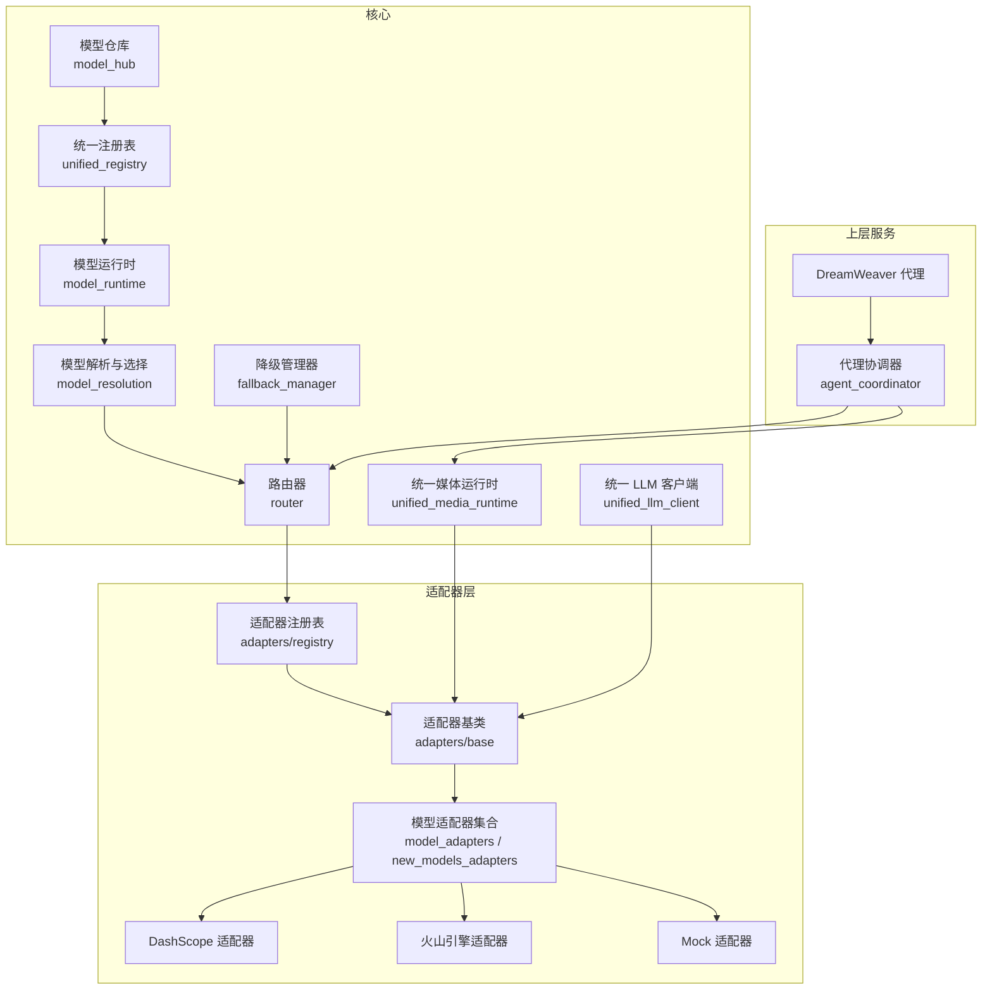
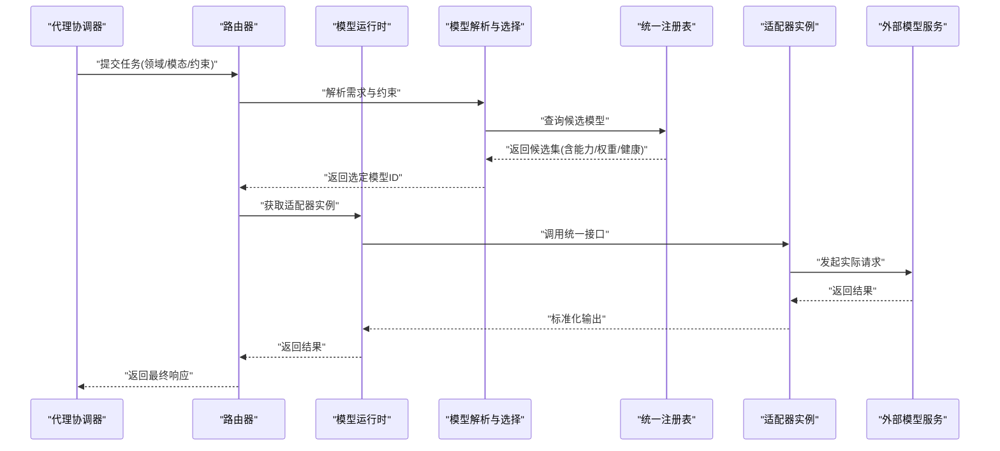
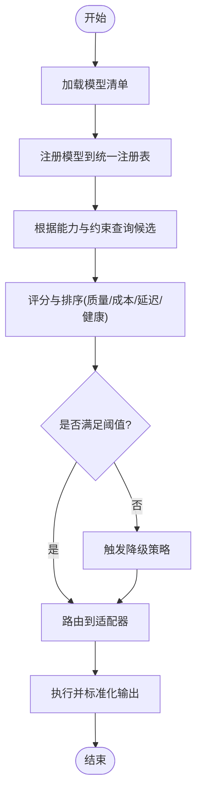
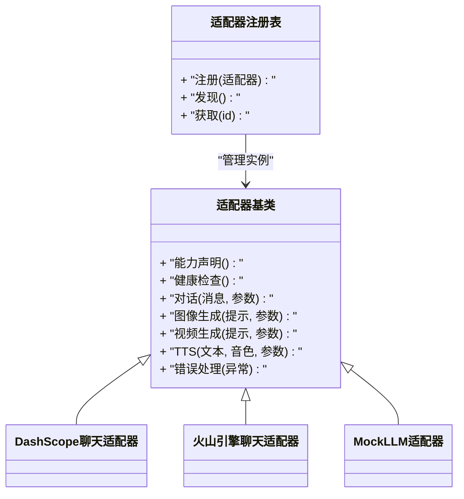
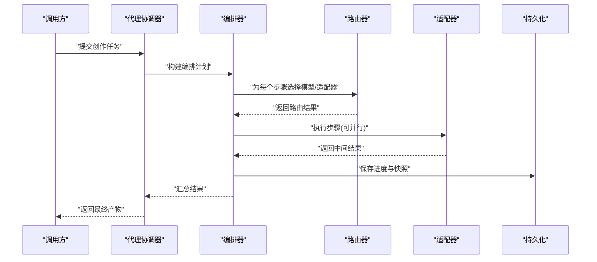
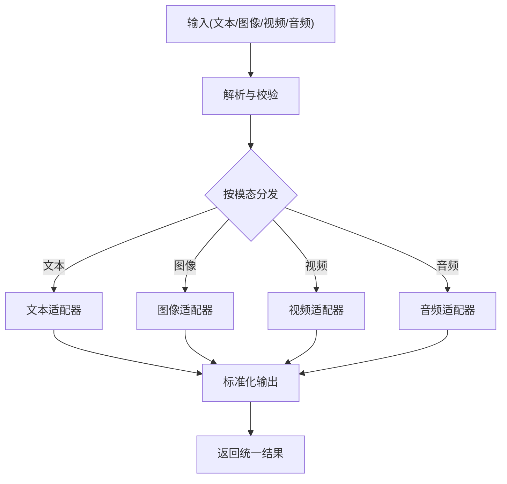
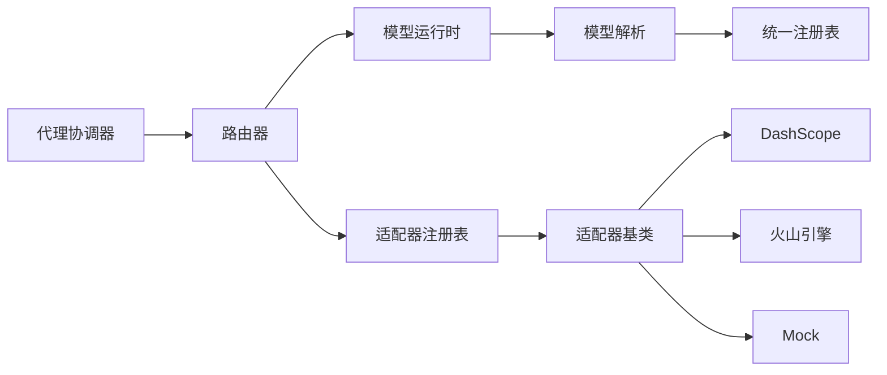

# 核心系统

<cite>
**本文引用的文件**   
- [core/unified_registry.py](file://core/unified_registry.py)
- [core/model_runtime.py](file://core/model_runtime.py)
- [core/model_resolution.py](file://core/model_resolution.py)
- [core/router.py](file://core/router.py)
- [adapters/base.py](file://adapters/base.py)
- [adapters/registry.py](file://adapters/registry.py)
- [adapters/_shared.py](file://adapters/_shared.py)
- [adapters/model_adapters.py](file://adapters/model_adapters.py)
- [adapters/new_models_adapters.py](file://adapters/new_models_adapters.py)
- [adapters/dashscope/chat.py](file://adapters/dashscope/chat.py)
- [adapters/volcengine/chat.py](file://adapters/volcengine/chat.py)
- [adapters/mock/llm.py](file://adapters/mock/llm.py)
- [core/unified_media_runtime.py](file://core/unified_media_runtime.py)
- [core/unified_llm_client.py](file://core/unified_llm_client.py)
- [core/model_hub.py](file://core/model_hub.py)
- [core/fallback_manager.py](file://core/fallback_manager.py)
- [backend/app/services/agent_coordinator.py](file://backend/app/services/agent_coordinator.py)
- [agents/dreamweaver.py](file://agents/dreamweaver.py)
- [config/models.yaml](file://config/models.yaml)
- [schemas/unified_model_spec.py](file://schemas/unified_model_spec.py)
</cite>

## 目录
1. [简介](#简介)
2. [项目结构](#项目结构)
3. [核心组件](#核心组件)
4. [架构总览](#架构总览)
5. [详细组件分析](#详细组件分析)
6. [依赖关系分析](#依赖关系分析)
7. [性能考量](#性能考量)
8. [故障排查指南](#故障排查指南)
9. [结论](#结论)
10. [附录](#附录)

## 简介
本技术文档面向小说创作代理系统的“核心系统”，聚焦统一模型系统、适配器模式与代理协调器三大关键部分，并补充媒体运行时对文本、图像、视频、音频的统一抽象。文档旨在帮助开发者理解模型的注册、发现、选择与路由机制；掌握适配器的接口规范、动态加载与错误处理；以及协调器的生命周期管理、任务分发、负载均衡与故障恢复策略。同时提供配置选项、使用模式、集成方式与扩展点说明，并给出性能优化建议与常见问题解决方案。

## 项目结构
核心系统由以下模块组成：
- 统一模型注册与解析：负责模型元数据、能力声明、版本与优先级管理，并提供按能力与约束的模型选择。
- 适配器层：以统一接口封装不同厂商/平台的 LLM、TTS、图像、视频等能力，支持动态加载与降级。
- 路由与调度：根据请求上下文（领域、质量、成本、延迟）将任务路由到合适的适配器实例。
- 媒体运行时：对文本、图像、视频、音频进行统一抽象，屏蔽底层差异。
- 代理协调器：编排多 Agent 协作，管理生命周期、任务分发、负载均衡与失败恢复。

图表来源
- [core/unified_registry.py](file://core/unified_registry.py)
- [core/model_runtime.py](file://core/model_runtime.py)
- [core/model_resolution.py](file://core/model_resolution.py)
- [core/router.py](file://core/router.py)
- [core/unified_media_runtime.py](file://core/unified_media_runtime.py)
- [core/unified_llm_client.py](file://core/unified_llm_client.py)
- [core/model_hub.py](file://core/model_hub.py)
- [core/fallback_manager.py](file://core/fallback_manager.py)
- [adapters/base.py](file://adapters/base.py)
- [adapters/registry.py](file://adapters/registry.py)
- [adapters/model_adapters.py](file://adapters/model_adapters.py)
- [adapters/new_models_adapters.py](file://adapters/new_models_adapters.py)
- [adapters/dashscope/chat.py](file://adapters/dashscope/chat.py)
- [adapters/volcengine/chat.py](file://adapters/volcengine/chat.py)
- [adapters/mock/llm.py](file://adapters/mock/llm.py)
- [backend/app/services/agent_coordinator.py](file://backend/app/services/agent_coordinator.py)
- [agents/dreamweaver.py](file://agents/dreamweaver.py)

章节来源
- [core/unified_registry.py](file://core/unified_registry.py)
- [core/model_runtime.py](file://core/model_runtime.py)
- [core/model_resolution.py](file://core/model_resolution.py)
- [core/router.py](file://core/router.py)
- [adapters/base.py](file://adapters/base.py)
- [adapters/registry.py](file://adapters/registry.py)
- [adapters/model_adapters.py](file://adapters/model_adapters.py)
- [adapters/new_models_adapters.py](file://adapters/new_models_adapters.py)
- [adapters/dashscope/chat.py](file://adapters/dashscope/chat.py)
- [adapters/volcengine/chat.py](file://adapters/volcengine/chat.py)
- [adapters/mock/llm.py](file://adapters/mock/llm.py)
- [core/unified_media_runtime.py](file://core/unified_media_runtime.py)
- [core/unified_llm_client.py](file://core/unified_llm_client.py)
- [core/model_hub.py](file://core/model_hub.py)
- [core/fallback_manager.py](file://core/fallback_manager.py)
- [backend/app/services/agent_coordinator.py](file://backend/app/services/agent_coordinator.py)
- [agents/dreamweaver.py](file://agents/dreamweaver.py)

## 核心组件
- 统一注册表：集中维护模型能力、版本、权重、健康状态与配额信息，提供按能力与约束的查询与过滤。
- 模型运行时：封装模型实例的生命周期、连接池、重试与超时控制，对外暴露统一的调用入口。
- 模型解析与选择：基于输入特征（领域、模态、质量、预算、延迟目标）计算候选集并排序选择最优模型。
- 路由器：将高层任务（如对话、绘图、视频生成、TTS）映射到具体适配器实现，支持多路径与回退。
- 适配器基类与注册表：定义统一接口（输入/输出契约、能力声明），支持插件式动态加载与热插拔。
- 统一媒体运行时：为文本、图像、视频、音频提供一致的 API，内部委托给对应适配器。
- 统一 LLM 客户端：屏蔽不同 LLM 提供商的差异，提供流式与非流式调用、参数归一化与结果标准化。
- 模型仓库：从配置或远端目录加载模型清单，驱动注册表的初始化与更新。
- 降级管理器：在模型不可用或质量不达标时，自动切换到备选模型或降级策略。

章节来源
- [core/unified_registry.py](file://core/unified_registry.py)
- [core/model_runtime.py](file://core/model_runtime.py)
- [core/model_resolution.py](file://core/model_resolution.py)
- [core/router.py](file://core/router.py)
- [adapters/base.py](file://adapters/base.py)
- [adapters/registry.py](file://adapters/registry.py)
- [core/unified_media_runtime.py](file://core/unified_media_runtime.py)
- [core/unified_llm_client.py](file://core/unified_llm_client.py)
- [core/model_hub.py](file://core/model_hub.py)
- [core/fallback_manager.py](file://core/fallback_manager.py)

## 架构总览
下图展示了从上层代理协调器到适配器层的整体调用链路与数据流向。

图表来源
- [backend/app/services/agent_coordinator.py](file://backend/app/services/agent_coordinator.py)
- [core/router.py](file://core/router.py)
- [core/model_runtime.py](file://core/model_runtime.py)
- [core/model_resolution.py](file://core/model_resolution.py)
- [core/unified_registry.py](file://core/unified_registry.py)
- [adapters/base.py](file://adapters/base.py)

## 详细组件分析

### 统一模型系统与注册/发现/选择/路由
- 注册与发现
  - 通过模型仓库加载配置清单，统一注册表维护模型 ID、能力标签、版本、权重、健康状态与配额。
  - 支持按能力（如 chat/image/video/tts）与约束（延迟、成本、地域）快速筛选。
- 选择与路由
  - 模型解析器根据输入特征与业务策略（质量优先、成本优先、延迟优先）计算评分，选出最优模型。
  - 路由器将任务类型映射到适配器命名空间，结合运行时的健康检查与负载状态完成最终路由。
- 运行时
  - 模型运行时负责实例缓存、连接复用、超时与重试、熔断与限流。

图表来源
- [core/model_hub.py](file://core/model_hub.py)
- [core/unified_registry.py](file://core/unified_registry.py)
- [core/model_resolution.py](file://core/model_resolution.py)
- [core/router.py](file://core/router.py)
- [core/fallback_manager.py](file://core/fallback_manager.py)

章节来源
- [core/unified_registry.py](file://core/unified_registry.py)
- [core/model_resolution.py](file://core/model_resolution.py)
- [core/router.py](file://core/router.py)
- [core/model_hub.py](file://core/model_hub.py)
- [core/fallback_manager.py](file://core/fallback_manager.py)

### 适配器模式：接口规范、动态加载与错误处理
- 接口规范
  - 所有适配器继承统一基类，实现标准方法族（如对话、图像生成、视频生成、TTS），保证输入输出契约一致。
  - 能力声明用于注册表匹配与路由决策。
- 动态加载
  - 适配器注册表扫描可用适配器包，按需导入并注册，支持热插拔与灰度发布。
- 错误处理
  - 统一异常分类（网络、鉴权、限流、内容安全、格式错误），适配器层进行本地重试与降级，必要时上报监控。

图表来源
- [adapters/base.py](file://adapters/base.py)
- [adapters/registry.py](file://adapters/registry.py)
- [adapters/dashscope/chat.py](file://adapters/dashscope/chat.py)
- [adapters/volcengine/chat.py](file://adapters/volcengine/chat.py)
- [adapters/mock/llm.py](file://adapters/mock/llm.py)

章节来源
- [adapters/base.py](file://adapters/base.py)
- [adapters/registry.py](file://adapters/registry.py)
- [adapters/model_adapters.py](file://adapters/model_adapters.py)
- [adapters/new_models_adapters.py](file://adapters/new_models_adapters.py)
- [adapters/dashscope/chat.py](file://adapters/dashscope/chat.py)
- [adapters/volcengine/chat.py](file://adapters/volcengine/chat.py)
- [adapters/mock/llm.py](file://adapters/mock/llm.py)

### 代理协调器：生命周期、任务分发、负载均衡与故障恢复
- 生命周期管理
  - 启动时初始化各子代理与资源（模型运行时、媒体运行时、队列、缓存）。
  - 优雅关闭时释放连接、持久化状态、清理临时工件。
- 任务分发
  - 接收上层请求，解析意图与约束，拆分为子任务并分发给相应代理或适配器。
  - 支持并行与串行编排，确保依赖顺序与一致性。
- 负载均衡
  - 基于健康检查、延迟统计、成功率与配额限制，动态调整路由权重。
- 故障恢复
  - 自动重试、指数退避、熔断与降级；跨节点迁移与断点续跑。

图表来源
- [backend/app/services/agent_coordinator.py](file://backend/app/services/agent_coordinator.py)
- [core/router.py](file://core/router.py)
- [adapters/base.py](file://adapters/base.py)

章节来源
- [backend/app/services/agent_coordinator.py](file://backend/app/services/agent_coordinator.py)
- [agents/dreamweaver.py](file://agents/dreamweaver.py)

### 媒体运行时：文本、图像、视频、音频的统一抽象
- 统一抽象
  - 文本：标准化提示词、上下文窗口、语言与风格参数。
  - 图像：分辨率、风格、构图、种子、后处理参数统一。
  - 视频：时长、帧率、转场、镜头运动、音画同步参数统一。
  - 音频：采样率、比特率、音色、情感、语速、停顿标记统一。
- 内部委托
  - 媒体运行时根据模态与能力标签，将请求委派给对应适配器，并对结果进行校验与转换。
- 错误与降级
  - 针对网络抖动、格式不兼容、内容安全拦截等进行本地修复或降级（如降低分辨率、切换 TTS 音色）。

图表来源
- [core/unified_media_runtime.py](file://core/unified_media_runtime.py)
- [adapters/base.py](file://adapters/base.py)

章节来源
- [core/unified_media_runtime.py](file://core/unified_media_runtime.py)

### 统一 LLM 客户端
- 功能要点
  - 参数归一化：将上层参数转换为各提供商所需格式。
  - 流式与非流式：支持增量输出与完整输出两种模式。
  - 结果标准化：统一消息结构、工具调用、引用与元数据。
- 集成点
  - 被路由器与媒体运行时调用，作为 LLM 能力的统一入口。

章节来源
- [core/unified_llm_client.py](file://core/unified_llm_client.py)

## 依赖关系分析
- 耦合与内聚
  - 统一注册表与模型解析高内聚于模型能力与约束；路由器与运行时解耦适配器实现，提升可扩展性。
- 直接依赖
  - 协调器依赖路由器与媒体运行时；媒体运行时依赖适配器基类与注册表。
- 外部依赖
  - 各适配器对接外部模型服务（DashScope、火山引擎等），需处理鉴权、限流与协议差异。
- 循环依赖
  - 通过接口与注册表避免循环依赖，保持清晰的分层。

图表来源
- [backend/app/services/agent_coordinator.py](file://backend/app/services/agent_coordinator.py)
- [core/router.py](file://core/router.py)
- [core/model_runtime.py](file://core/model_runtime.py)
- [core/model_resolution.py](file://core/model_resolution.py)
- [core/unified_registry.py](file://core/unified_registry.py)
- [adapters/registry.py](file://adapters/registry.py)
- [adapters/base.py](file://adapters/base.py)
- [adapters/dashscope/chat.py](file://adapters/dashscope/chat.py)
- [adapters/volcengine/chat.py](file://adapters/volcengine/chat.py)
- [adapters/mock/llm.py](file://adapters/mock/llm.py)

章节来源
- [core/router.py](file://core/router.py)
- [core/model_runtime.py](file://core/model_runtime.py)
- [core/model_resolution.py](file://core/model_resolution.py)
- [core/unified_registry.py](file://core/unified_registry.py)
- [adapters/registry.py](file://adapters/registry.py)
- [adapters/base.py](file://adapters/base.py)

## 性能考量
- 连接与实例复用
  - 模型运行时维护连接池与适配器实例缓存，减少握手与初始化开销。
- 并发与批处理
  - 媒体运行时与协调器支持批量请求与并行执行，注意背压与内存上限。
- 缓存与预热
  - 热点模型与音色预加载，减少冷启动延迟。
- 限流与熔断
  - 在适配器层与路由器层实施速率限制与熔断，保护上游服务。
- 指标与追踪
  - 记录延迟、吞吐、错误率与降级次数，辅助容量规划与调优。

[本节为通用指导，无需特定文件来源]

## 故障排查指南
- 常见错误分类
  - 网络与鉴权：超时、证书、Token 过期、IP 白名单。
  - 限流与配额：429、余额不足、并发上限。
  - 内容与合规：敏感词拦截、版权限制。
  - 格式与兼容性：输入尺寸、采样率、编码格式不匹配。
- 定位与修复
  - 查看适配器日志与健康检查状态，确认模型可用性。
  - 检查统一注册表中的权重与配额设置，验证路由策略。
  - 启用降级策略与回退模型，观察恢复情况。
  - 对媒体输入进行预处理校验，确保符合目标适配器要求。
- 监控与告警
  - 关注错误率突增、延迟升高、降级频繁等指标，及时扩容或切换供应商。

章节来源
- [core/fallback_manager.py](file://core/fallback_manager.py)
- [adapters/base.py](file://adapters/base.py)
- [adapters/registry.py](file://adapters/registry.py)

## 结论
统一模型系统通过注册表、解析与路由实现了灵活、可扩展的模型选择与调度；适配器模式以统一接口屏蔽了多厂商差异，支持动态加载与稳健的错误处理；代理协调器则提供了端到端的编排能力，保障复杂创作流程的稳定与高效。配合媒体运行时的统一抽象，系统能够在文本、图像、视频、音频等多模态场景下保持一致的开发体验与运行表现。建议在生产环境中持续完善监控、限流与降级策略，并结合业务指标进行容量与路由策略的动态调优。

[本节为总结，无需特定文件来源]

## 附录

### 配置与使用模式
- 模型清单配置
  - 使用 models.yaml 定义模型 ID、能力、权重、健康检查与配额，供模型仓库加载并注入注册表。
- 使用模式
  - 通过统一 LLM 客户端与媒体运行时发起请求，无需关心底层适配器细节。
  - 在协调器中编排多步任务，利用路由器的智能选择与降级策略提高鲁棒性。

章节来源
- [config/models.yaml](file://config/models.yaml)
- [core/model_hub.py](file://core/model_hub.py)
- [core/unified_llm_client.py](file://core/unified_llm_client.py)
- [core/unified_media_runtime.py](file://core/unified_media_runtime.py)

### 扩展点与集成方式
- 新增适配器
  - 继承适配器基类，实现标准方法族并在注册表中注册；遵循输入输出契约与能力声明。
- 自定义路由策略
  - 扩展模型解析器，增加新的评分维度（如用户偏好、历史成功率、地域就近）。
- 与后端服务集成
  - 通过 HTTP/WebSocket 暴露统一接口，协调器作为编排中心接入业务 API。

章节来源
- [adapters/base.py](file://adapters/base.py)
- [adapters/registry.py](file://adapters/registry.py)
- [core/model_resolution.py](file://core/model_resolution.py)
- [backend/app/services/agent_coordinator.py](file://backend/app/services/agent_coordinator.py)

### 数据模型与规范
- 统一模型规格
  - unified_model_spec.py 定义了模型能力、参数与输出的统一结构，便于跨层传递与校验。

章节来源
- [schemas/unified_model_spec.py](file://schemas/unified_model_spec.py)