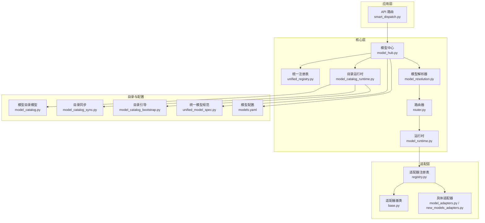
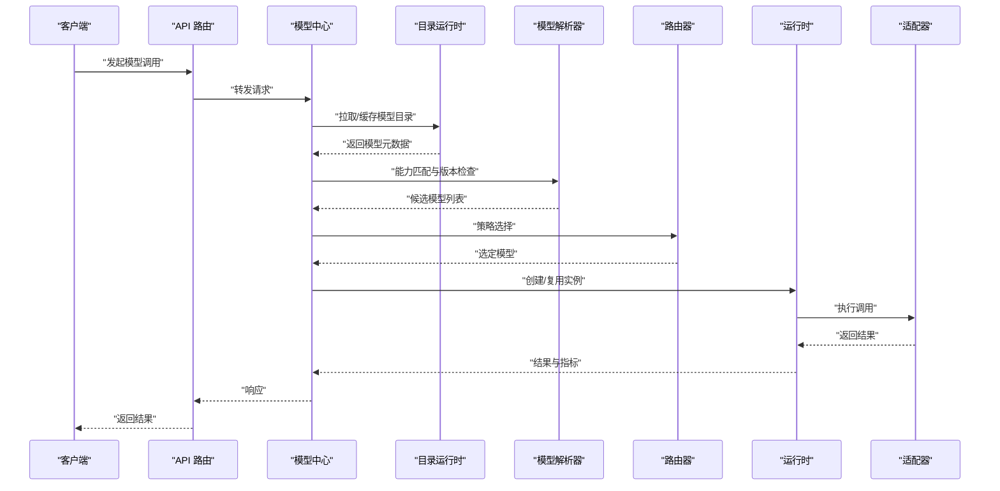
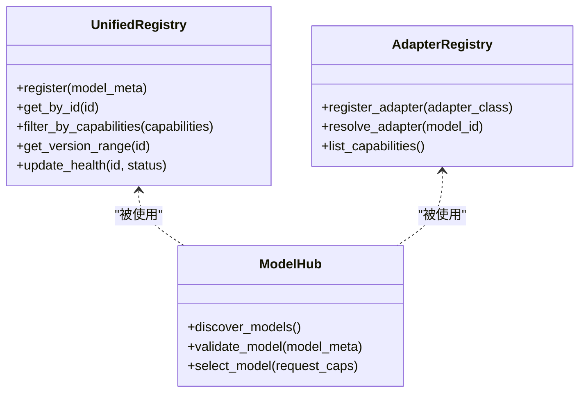
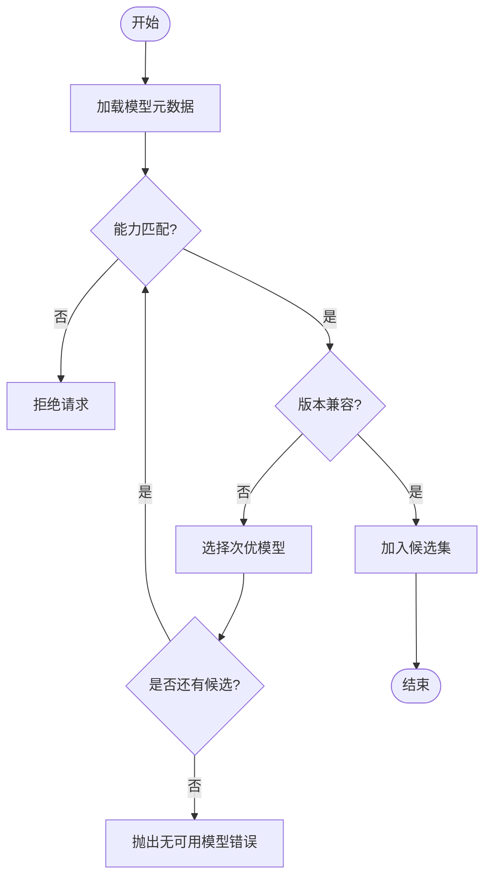
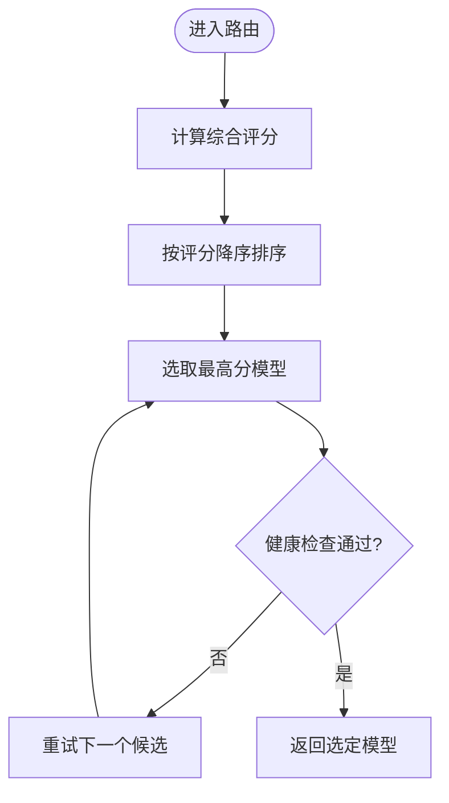
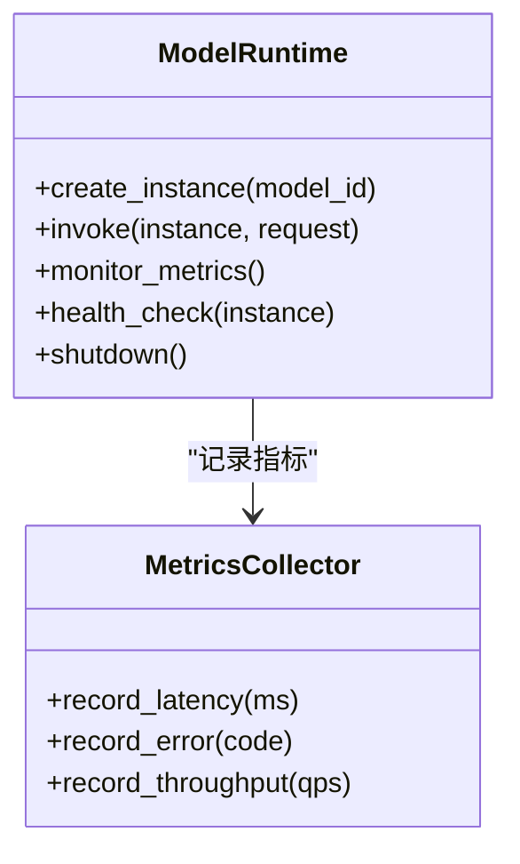
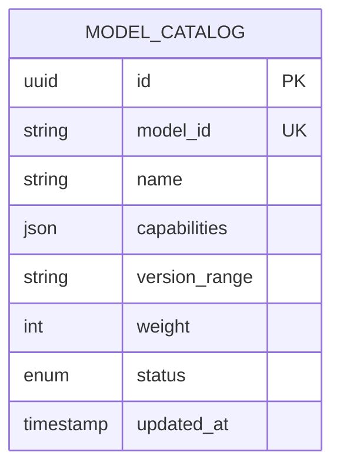
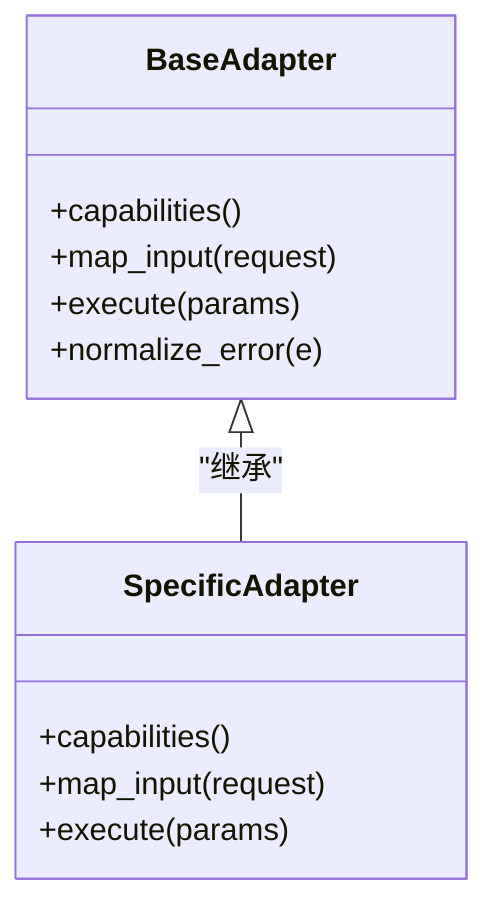
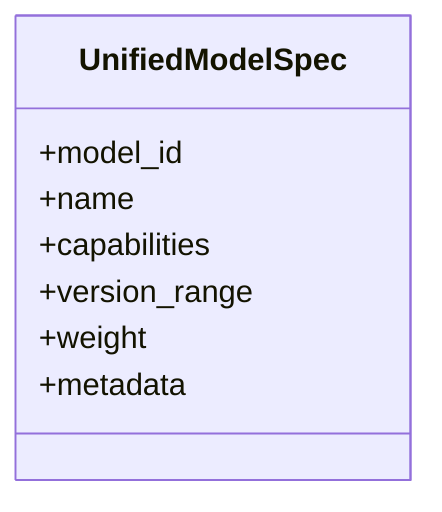
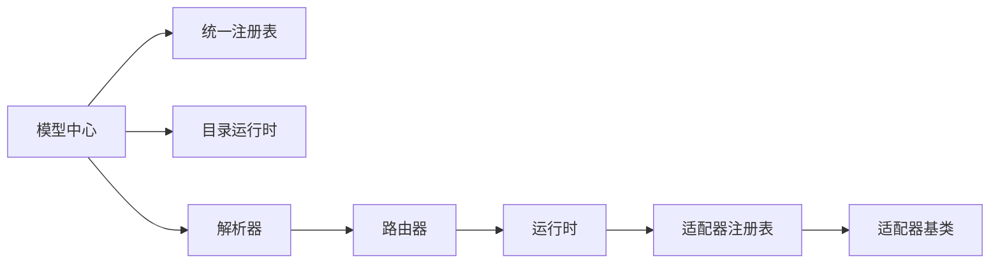

# 统一模型系统

<cite>
**本文引用的文件**   
- [core/unified_registry.py](file://core/unified_registry.py)
- [core/model_hub.py](file://core/model_hub.py)
- [core/model_resolution.py](file://core/model_resolution.py)
- [core/router.py](file://core/router.py)
- [core/model_runtime.py](file://core/model_runtime.py)
- [adapters/registry.py](file://adapters/registry.py)
- [adapters/base.py](file://adapters/base.py)
- [adapters/model_adapters.py](file://adapters/model_adapters.py)
- [adapters/new_models_adapters.py](file://adapters/new_models_adapters.py)
- [backend/app/api/v1/smart_dispatch.py](file://backend/app/api/v1/smart_dispatch.py)
- [backend/app/services/model_catalog_sync.py](file://backend/app/services/model_catalog_sync.py)
- [backend/app/services/model_catalog_bootstrap.py](file://backend/app/services/model_catalog_bootstrap.py)
- [backend/app/models/model_catalog.py](file://backend/app/models/model_catalog.py)
- [schemas/unified_model_spec.py](file://schemas/unified_model_spec.py)
- [config/models.yaml](file://config/models.yaml)
- [core/model_catalog_runtime.py](file://core/model_catalog_runtime.py)
</cite>

## 目录
1. [简介](#简介)
2. [项目结构](#项目结构)
3. [核心组件](#核心组件)
4. [架构总览](#架构总览)
5. [详细组件分析](#详细组件分析)
6. [依赖关系分析](#依赖关系分析)
7. [性能考虑](#性能考虑)
8. [故障排查指南](#故障排查指南)
9. [结论](#结论)
10. [附录](#附录)

## 简介
本技术文档围绕“统一模型系统”展开，聚焦于模型注册、发现与选择机制的实现原理，涵盖模型元数据管理、能力检测与版本兼容性检查；深入解析模型路由算法（基于能力的智能选择、负载均衡与故障转移）；说明运行时环境管理（资源分配、性能监控与生命周期控制）；并提供注册新模型、配置优先级与处理调用异常的具体示例路径。同时阐述与适配器层的集成方式与扩展点，给出性能优化建议与调试技巧。

## 项目结构
统一模型系统由以下关键层次组成：
- 适配层：封装各厂商/模型的实现细节，提供统一接口
- 注册与发现：集中管理模型元数据、能力标签与版本信息
- 路由与选择：根据请求能力、权重与运行状态进行智能选择
- 运行时：负责实例化、资源管理与生命周期控制
- 目录服务：持久化模型目录、同步与引导初始化
- 规范与配置：统一的模型规格定义与外部配置

图表来源
- [backend/app/api/v1/smart_dispatch.py](file://backend/app/api/v1/smart_dispatch.py)
- [core/unified_registry.py](file://core/unified_registry.py)
- [core/model_hub.py](file://core/model_hub.py)
- [core/model_resolution.py](file://core/model_resolution.py)
- [core/router.py](file://core/router.py)
- [core/model_runtime.py](file://core/model_runtime.py)
- [adapters/registry.py](file://adapters/registry.py)
- [adapters/base.py](file://adapters/base.py)
- [adapters/model_adapters.py](file://adapters/model_adapters.py)
- [adapters/new_models_adapters.py](file://adapters/new_models_adapters.py)
- [backend/app/models/model_catalog.py](file://backend/app/models/model_catalog.py)
- [backend/app/services/model_catalog_sync.py](file://backend/app/services/model_catalog_sync.py)
- [backend/app/services/model_catalog_bootstrap.py](file://backend/app/services/model_catalog_bootstrap.py)
- [schemas/unified_model_spec.py](file://schemas/unified_model_spec.py)
- [config/models.yaml](file://config/models.yaml)

章节来源
- [core/unified_registry.py](file://core/unified_registry.py)
- [core/model_hub.py](file://core/model_hub.py)
- [core/model_resolution.py](file://core/model_resolution.py)
- [core/router.py](file://core/router.py)
- [core/model_runtime.py](file://core/model_runtime.py)
- [adapters/registry.py](file://adapters/registry.py)
- [adapters/base.py](file://adapters/base.py)
- [adapters/model_adapters.py](file://adapters/model_adapters.py)
- [adapters/new_models_adapters.py](file://adapters/new_models_adapters.py)
- [backend/app/api/v1/smart_dispatch.py](file://backend/app/api/v1/smart_dispatch.py)
- [backend/app/services/model_catalog_sync.py](file://backend/app/services/model_catalog_sync.py)
- [backend/app/services/model_catalog_bootstrap.py](file://backend/app/services/model_catalog_bootstrap.py)
- [backend/app/models/model_catalog.py](file://backend/app/models/model_catalog.py)
- [schemas/unified_model_spec.py](file://schemas/unified_model_spec.py)
- [config/models.yaml](file://config/models.yaml)

## 核心组件
- 统一注册表：维护模型标识、能力标签、版本、权重与可用性状态，提供按能力筛选与排序的查询接口
- 模型中心：聚合注册表、目录运行时与配置，对外暴露模型发现、校验与选择入口
- 模型解析器：将用户请求的能力需求映射为候选模型集合，并执行能力匹配与版本兼容检查
- 路由器：在候选集中依据策略（权重、负载、健康度）选择最终模型实例
- 运行时：负责模型实例的生命周期管理、资源分配、并发控制与监控埋点
- 适配器注册表与基类：定义统一适配器契约，提供能力声明、参数映射与错误归一化
- 目录服务：从数据库或配置文件加载模型目录，支持增量同步与启动引导

章节来源
- [core/unified_registry.py](file://core/unified_registry.py)
- [core/model_hub.py](file://core/model_hub.py)
- [core/model_resolution.py](file://core/model_resolution.py)
- [core/router.py](file://core/router.py)
- [core/model_runtime.py](file://core/model_runtime.py)
- [adapters/registry.py](file://adapters/registry.py)
- [adapters/base.py](file://adapters/base.py)

## 架构总览
统一模型系统的调用流程如下：
- 上层业务通过 API 发起模型调用
- 模型中心接收请求，结合目录运行时获取最新模型元数据
- 解析器根据能力需求过滤候选集，并进行版本兼容性检查
- 路由器基于权重、健康度与负载策略选择最优模型
- 运行时创建或复用实例，执行调用并返回结果
- 适配器层屏蔽底层差异，向上提供统一接口

图表来源
- [backend/app/api/v1/smart_dispatch.py](file://backend/app/api/v1/smart_dispatch.py)
- [core/model_hub.py](file://core/model_hub.py)
- [core/model_catalog_runtime.py](file://core/model_catalog_runtime.py)
- [core/model_resolution.py](file://core/model_resolution.py)
- [core/router.py](file://core/router.py)
- [core/model_runtime.py](file://core/model_runtime.py)
- [adapters/base.py](file://adapters/base.py)

## 详细组件分析

### 模型注册与发现
- 注册表职责：维护模型 ID、名称、能力标签、版本范围、权重、健康状态与扩展属性
- 发现机制：支持从配置与目录服务动态加载，合并去重，提供按能力与版本的筛选接口
- 扩展点：新增模型时仅需在适配器注册表中声明能力与版本，并在配置中补充元数据

图表来源
- [core/unified_registry.py](file://core/unified_registry.py)
- [adapters/registry.py](file://adapters/registry.py)
- [core/model_hub.py](file://core/model_hub.py)

章节来源
- [core/unified_registry.py](file://core/unified_registry.py)
- [adapters/registry.py](file://adapters/registry.py)
- [core/model_hub.py](file://core/model_hub.py)

### 能力检测与版本兼容性
- 能力检测：适配器声明支持的输入输出类型、任务域与约束条件
- 版本兼容：解析器比较请求版本与模型版本范围，拒绝不兼容组合
- 降级策略：当首选模型不可用时，自动回退到次优候选

图表来源
- [core/model_resolution.py](file://core/model_resolution.py)
- [adapters/base.py](file://adapters/base.py)

章节来源
- [core/model_resolution.py](file://core/model_resolution.py)
- [adapters/base.py](file://adapters/base.py)

### 模型路由算法
- 智能选择：基于能力匹配度、权重与健康度评分排序
- 负载均衡：按实例活跃连接数或延迟分片选择
- 故障转移：健康检查失败时自动切换至备用实例

图表来源
- [core/router.py](file://core/router.py)

章节来源
- [core/router.py](file://core/router.py)

### 运行时环境管理
- 资源分配：线程池/进程池、GPU/CPU 资源隔离、内存上限限制
- 性能监控：QPS、延迟、错误率、吞吐等指标采集与上报
- 生命周期控制：预热、优雅关闭、实例回收与重启策略

图表来源
- [core/model_runtime.py](file://core/model_runtime.py)

章节来源
- [core/model_runtime.py](file://core/model_runtime.py)

### 目录服务与配置
- 目录模型：持久化模型 ID、名称、能力、版本、权重与状态
- 同步服务：定时或事件驱动更新目录，保证一致性
- 引导脚本：启动时加载默认目录，确保系统可用

图表来源
- [backend/app/models/model_catalog.py](file://backend/app/models/model_catalog.py)

章节来源
- [backend/app/services/model_catalog_sync.py](file://backend/app/services/model_catalog_sync.py)
- [backend/app/services/model_catalog_bootstrap.py](file://backend/app/services/model_catalog_bootstrap.py)
- [backend/app/models/model_catalog.py](file://backend/app/models/model_catalog.py)

### 适配器层集成与扩展点
- 基类契约：定义能力声明、参数映射、错误归一化与结果标准化
- 注册机制：适配器类注册到统一注册表，供路由与运行时查找
- 扩展点：新增适配器只需实现基类方法并声明能力标签

图表来源
- [adapters/base.py](file://adapters/base.py)
- [adapters/model_adapters.py](file://adapters/model_adapters.py)
- [adapters/new_models_adapters.py](file://adapters/new_models_adapters.py)

章节来源
- [adapters/base.py](file://adapters/base.py)
- [adapters/model_adapters.py](file://adapters/model_adapters.py)
- [adapters/new_models_adapters.py](file://adapters/new_models_adapters.py)

### 统一模型规范与配置
- 统一规范：定义模型 ID、名称、能力、版本范围、权重与扩展字段
- 配置加载：从 YAML 或数据库加载，合并覆盖，提供运行时快照

图表来源
- [schemas/unified_model_spec.py](file://schemas/unified_model_spec.py)
- [config/models.yaml](file://config/models.yaml)

章节来源
- [schemas/unified_model_spec.py](file://schemas/unified_model_spec.py)
- [config/models.yaml](file://config/models.yaml)

## 依赖关系分析
- 耦合关系：模型中心强依赖注册表与目录运行时；解析器依赖适配器能力声明；路由器依赖运行时健康状态
- 外部依赖：数据库（模型目录）、配置系统（YAML）、监控系统（指标上报）
- 循环依赖：通过分层与接口解耦避免循环引用

图表来源
- [core/model_hub.py](file://core/model_hub.py)
- [core/unified_registry.py](file://core/unified_registry.py)
- [core/model_catalog_runtime.py](file://core/model_catalog_runtime.py)
- [core/model_resolution.py](file://core/model_resolution.py)
- [core/router.py](file://core/router.py)
- [core/model_runtime.py](file://core/model_runtime.py)
- [adapters/registry.py](file://adapters/registry.py)
- [adapters/base.py](file://adapters/base.py)

章节来源
- [core/model_hub.py](file://core/model_hub.py)
- [core/unified_registry.py](file://core/unified_registry.py)
- [core/model_catalog_runtime.py](file://core/model_catalog_runtime.py)
- [core/model_resolution.py](file://core/model_resolution.py)
- [core/router.py](file://core/router.py)
- [core/model_runtime.py](file://core/model_runtime.py)
- [adapters/registry.py](file://adapters/registry.py)
- [adapters/base.py](file://adapters/base.py)

## 性能考虑
- 缓存目录：对模型目录与能力索引进行内存缓存，减少 IO 与网络开销
- 预构建实例：热点模型预热，降低冷启动延迟
- 批量调用：合并小请求，提升吞吐
- 异步执行：非阻塞 I/O 与流式处理，提高并发能力
- 指标采样：按需采样与聚合，降低监控开销
- 资源隔离：按模型或租户隔离 CPU/GPU/内存，避免相互干扰

## 故障排查指南
- 常见问题定位
  - 模型不可用：检查健康状态与最近错误日志
  - 能力不匹配：核对能力标签与请求参数
  - 版本冲突：确认版本范围与请求版本
  - 路由异常：查看评分与负载指标
- 诊断步骤
  - 启用详细日志与追踪 ID
  - 导出模型目录快照与运行时指标
  - 回放请求与适配器输入输出
- 恢复策略
  - 临时下线故障模型
  - 调整权重与优先级
  - 回滚版本或配置

章节来源
- [core/model_runtime.py](file://core/model_runtime.py)
- [core/router.py](file://core/router.py)
- [core/model_resolution.py](file://core/model_resolution.py)

## 结论
统一模型系统通过清晰的层次划分与严格的契约设计，实现了模型注册、发现、选择与运行的全链路管理。借助能力检测、版本兼容与智能路由，系统在多模型环境下具备高可用与可扩展性。配合完善的目录服务与运行时监控，能够满足复杂业务场景下的稳定与高效需求。

## 附录
- 注册新模型示例路径
  - 适配器实现与能力声明：[adapters/model_adapters.py](file://adapters/model_adapters.py)、[adapters/new_models_adapters.py](file://adapters/new_models_adapters.py)
  - 适配器注册：[adapters/registry.py](file://adapters/registry.py)
  - 模型元数据配置：[config/models.yaml](file://config/models.yaml)
- 配置模型优先级示例路径
  - 权重与优先级设置：[config/models.yaml](file://config/models.yaml)
  - 路由策略与评分：[core/router.py](file://core/router.py)
- 处理模型调用异常示例路径
  - 错误归一化与重试：[adapters/base.py](file://adapters/base.py)
  - 运行时监控与告警：[core/model_runtime.py](file://core/model_runtime.py)
- 与适配器层集成与扩展点
  - 基类契约与扩展点：[adapters/base.py](file://adapters/base.py)
  - 适配器注册与发现：[adapters/registry.py](file://adapters/registry.py)
- 性能优化建议
  - 目录缓存与实例预热：[core/model_catalog_runtime.py](file://core/model_catalog_runtime.py)、[core/model_runtime.py](file://core/model_runtime.py)
  - 指标采集与采样：[core/model_runtime.py](file://core/model_runtime.py)
- 调试技巧
  - 启用追踪与日志：[core/model_runtime.py](file://core/model_runtime.py)
  - 导出目录快照与指标：[backend/app/services/model_catalog_sync.py](file://backend/app/services/model_catalog_sync.py)