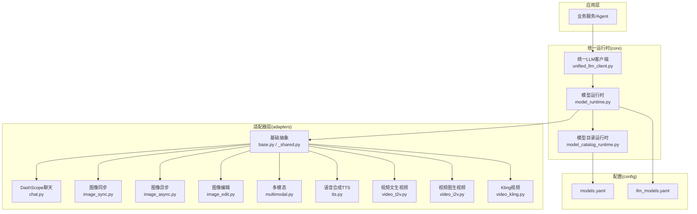
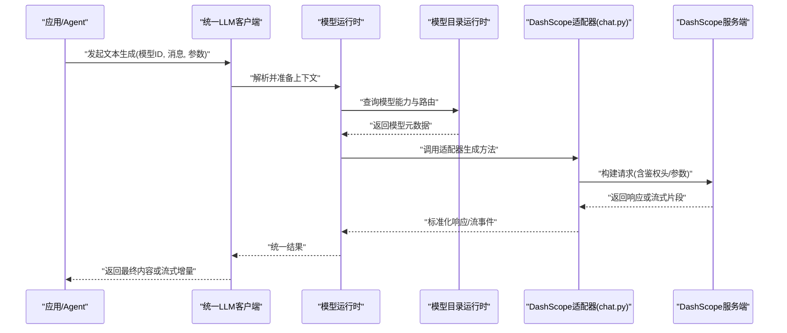
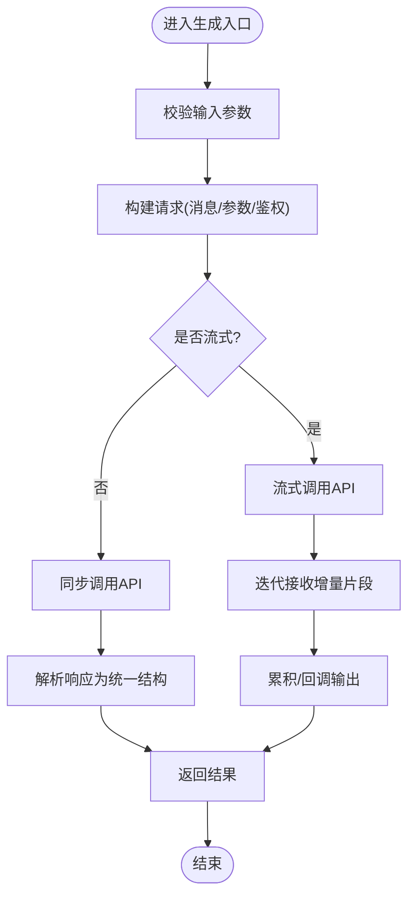
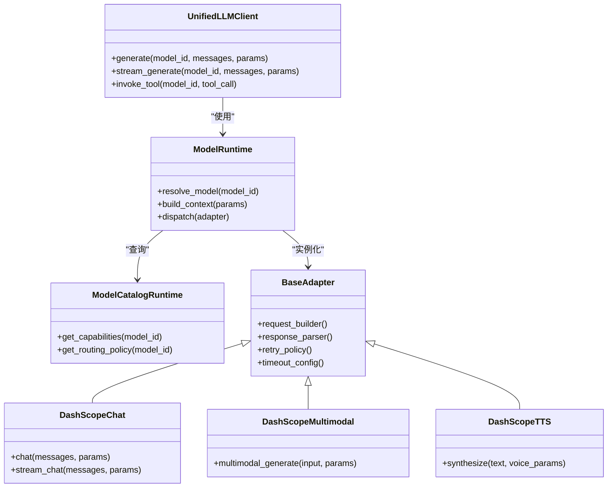

# DashScope适配器

<cite>
**本文引用的文件**   
- [adapters/dashscope/__init__.py](file://adapters/dashscope/__init__.py)
- [adapters/dashscope/chat.py](file://adapters/dashscope/chat.py)
- [adapters/dashscope/image_async.py](file://adapters/dashscope/image_async.py)
- [adapters/dashscope/image_edit.py](file://adapters/dashscope/image_edit.py)
- [adapters/dashscope/image_sync.py](file://adapters/dashscope/image_sync.py)
- [adapters/dashscope/multimodal.py](file://adapters/dashscope/multimodal.py)
- [adapters/dashscope/tts.py](file://adapters/dashscope/tts.py)
- [adapters/dashscope/video_i2v.py](file://adapters/dashscope/video_i2v.py)
- [adapters/dashscope/video_kling.py](file://adapters/dashscope/video_kling.py)
- [adapters/dashscope/video_t2v.py](file://adapters/dashscope/video_t2v.py)
- [adapters/base.py](file://adapters/base.py)
- [adapters/_shared.py](file://adapters/_shared.py)
- [adapters/adapter_helpers.py](file://adapters/adapter_helpers.py)
- [core/unified_llm_client.py](file://core/unified_llm_client.py)
- [core/model_runtime.py](file://core/model_runtime.py)
- [core/model_catalog_runtime.py](file://core/model_catalog_runtime.py)
- [config/models.yaml](file://config/models.yaml)
- [config/llm_models.yaml](file://config/llm_models.yaml)
</cite>

## 目录
1. [简介](#简介)
2. [项目结构](#项目结构)
3. [核心组件](#核心组件)
4. [架构总览](#架构总览)
5. [详细组件分析](#详细组件分析)
6. [依赖关系分析](#依赖关系分析)
7. [性能考量](#性能考量)
8. [故障排查指南](#故障排查指南)
9. [结论](#结论)
10. [附录](#附录)

## 简介
本技术文档聚焦于DashScope LLM适配器的集成实现，围绕API密钥配置、请求构建与响应解析、文本生成接口（模型选择、参数配置、流式输出）、错误处理与重试策略、超时管理等方面展开。同时提供完整的调用示例与最佳实践，帮助开发者快速、稳定地使用DashScope进行文本生成与多模态能力调用。

## 项目结构
本项目采用“适配器层 + 统一运行时”的分层设计：
- 适配器层：按能力域划分（如dashscope、volcengine、mock等），每个适配器封装具体厂商的SDK或HTTP调用细节。
- 统一运行时：在core层提供统一的LLM客户端、模型目录与运行时抽象，屏蔽底层差异。
- 配置层：集中管理模型清单与路由策略。

图表来源
- [core/unified_llm_client.py](file://core/unified_llm_client.py)
- [core/model_runtime.py](file://core/model_runtime.py)
- [core/model_catalog_runtime.py](file://core/model_catalog_runtime.py)
- [adapters/base.py](file://adapters/base.py)
- [adapters/_shared.py](file://adapters/_shared.py)
- [adapters/dashscope/chat.py](file://adapters/dashscope/chat.py)
- [adapters/dashscope/image_sync.py](file://adapters/dashscope/image_sync.py)
- [adapters/dashscope/image_async.py](file://adapters/dashscope/image_async.py)
- [adapters/dashscope/image_edit.py](file://adapters/dashscope/image_edit.py)
- [adapters/dashscope/multimodal.py](file://adapters/dashscope/multimodal.py)
- [adapters/dashscope/tts.py](file://adapters/dashscope/tts.py)
- [adapters/dashscope/video_t2v.py](file://adapters/dashscope/video_t2v.py)
- [adapters/dashscope/video_i2v.py](file://adapters/dashscope/video_i2v.py)
- [adapters/dashscope/video_kling.py](file://adapters/dashscope/video_kling.py)
- [config/models.yaml](file://config/models.yaml)
- [config/llm_models.yaml](file://config/llm_models.yaml)

章节来源
- [adapters/dashscope/__init__.py](file://adapters/dashscope/__init__.py)
- [adapters/base.py](file://adapters/base.py)
- [adapters/_shared.py](file://adapters/_shared.py)
- [core/unified_llm_client.py](file://core/unified_llm_client.py)
- [core/model_runtime.py](file://core/model_runtime.py)
- [core/model_catalog_runtime.py](file://core/model_catalog_runtime.py)
- [config/models.yaml](file://config/models.yaml)
- [config/llm_models.yaml](file://config/llm_models.yaml)

## 核心组件
- 统一LLM客户端：对外暴露一致的文本生成、流式生成、工具调用等接口，内部根据模型标识选择对应适配器。
- 模型运行时：负责加载配置、解析模型能力、构造请求上下文、分发到具体适配器。
- 模型目录运行时：维护模型元数据、版本、能力标签与路由策略。
- DashScope适配器族：基于统一抽象，分别实现聊天、图像、多模态、TTS、视频等能力。

章节来源
- [core/unified_llm_client.py](file://core/unified_llm_client.py)
- [core/model_runtime.py](file://core/model_runtime.py)
- [core/model_catalog_runtime.py](file://core/model_catalog_runtime.py)
- [adapters/dashscope/chat.py](file://adapters/dashscope/chat.py)
- [adapters/dashscope/multimodal.py](file://adapters/dashscope/multimodal.py)
- [adapters/dashscope/tts.py](file://adapters/dashscope/tts.py)

## 架构总览
下图展示了从上层调用到DashScope适配器的完整流程，包括模型解析、请求构建、网络调用、响应解析与流式输出处理。

图表来源
- [core/unified_llm_client.py](file://core/unified_llm_client.py)
- [core/model_runtime.py](file://core/model_runtime.py)
- [core/model_catalog_runtime.py](file://core/model_catalog_runtime.py)
- [adapters/dashscope/chat.py](file://adapters/dashscope/chat.py)

## 详细组件分析

### DashScope聊天适配器(chat.py)
- 职责：封装DashScope的对话/文本生成接口，支持非流式与流式两种模式；负责消息格式转换、参数映射、鉴权头注入、响应结构化与错误码归一化。
- 关键流程：
  - 输入校验与参数规范化（模型名、系统提示、用户消息、温度、TopP、最大长度等）。
  - 构建请求体与头部（包含API Key、模型标识、流式标志等）。
  - 发送请求并处理响应：
    - 非流式：直接解析完整响应为统一结构。
    - 流式：逐块解析增量内容，触发回调或迭代器供上层消费。
  - 错误处理：区分网络异常、鉴权失败、限流、业务错误码，并进行可配置的重试与退避。
  - 超时控制：设置连接与读取超时，避免阻塞。

图表来源
- [adapters/dashscope/chat.py](file://adapters/dashscope/chat.py)

章节来源
- [adapters/dashscope/chat.py](file://adapters/dashscope/chat.py)

### 多模态适配器(multimodal.py)
- 职责：统一处理图文混合输入，将多模态消息转换为DashScope所需格式，支持图片URL/Base64、文本、系统提示等。
- 关键点：
  - 媒体预处理：尺寸裁剪、编码格式转换、大小限制。
  - 参数映射：temperature、top_p、max_tokens、seed等。
  - 响应解析：结构化提取文本与可选的结构化字段。

章节来源
- [adapters/dashscope/multimodal.py](file://adapters/dashscope/multimodal.py)

### TTS适配器(tts.py)
- 职责：将文本转为语音，支持不同音色与语速参数，提供同步与异步两种调用方式。
- 关键点：
  - 音频格式与采样率配置。
  - 流式音频分片处理（可选）。
  - 错误码与重试策略（如网络抖动、限流）。

章节来源
- [adapters/dashscope/tts.py](file://adapters/dashscope/tts.py)

### 图像适配器(image_sync.py, image_async.py, image_edit.py)
- 同步/异步图像生成：支持文生图、批量任务提交与状态轮询。
- 图像编辑：基于参考图与指令进行编辑，返回结果链接或二进制数据。
- 关键点：
  - 任务ID与状态机管理。
  - 下载与缓存策略。
  - 错误分类与重试。

章节来源
- [adapters/dashscope/image_sync.py](file://adapters/dashscope/image_sync.py)
- [adapters/dashscope/image_async.py](file://adapters/dashscope/image_async.py)
- [adapters/dashscope/image_edit.py](file://adapters/dashscope/image_edit.py)

### 视频适配器(video_t2v.py, video_i2v.py, video_kling.py)
- 文生视频/图生视频：支持长视频分段生成、进度查询、结果下载。
- Kling视频：特定能力的封装与参数映射。
- 关键点：
  - 任务生命周期管理（创建、轮询、完成）。
  - 大文件传输优化（断点续传、分片下载）。
  - 资源配额与并发控制。

章节来源
- [adapters/dashscope/video_t2v.py](file://adapters/dashscope/video_t2v.py)
- [adapters/dashscope/video_i2v.py](file://adapters/dashscope/video_i2v.py)
- [adapters/dashscope/video_kling.py](file://adapters/dashscope/video_kling.py)

### 基础抽象与共享(_shared.py, base.py)
- 基础抽象：定义适配器通用接口（请求构建、响应解析、重试、超时、日志、指标上报）。
- 共享工具：鉴权头生成、签名计算、参数校验、错误码映射、速率限制。

章节来源
- [adapters/base.py](file://adapters/base.py)
- [adapters/_shared.py](file://adapters/_shared.py)

## 依赖关系分析
- 统一LLM客户端依赖模型运行时与模型目录运行时，以动态选择适配器。
- 模型运行时依赖配置（models.yaml、llm_models.yaml）与运行时环境（环境变量、密钥）。
- DashScope各适配器依赖基础抽象与共享工具，确保一致的错误处理、重试与超时策略。

图表来源
- [core/unified_llm_client.py](file://core/unified_llm_client.py)
- [core/model_runtime.py](file://core/model_runtime.py)
- [core/model_catalog_runtime.py](file://core/model_catalog_runtime.py)
- [adapters/base.py](file://adapters/base.py)
- [adapters/dashscope/chat.py](file://adapters/dashscope/chat.py)
- [adapters/dashscope/multimodal.py](file://adapters/dashscope/multimodal.py)
- [adapters/dashscope/tts.py](file://adapters/dashscope/tts.py)

章节来源
- [core/unified_llm_client.py](file://core/unified_llm_client.py)
- [core/model_runtime.py](file://core/model_runtime.py)
- [core/model_catalog_runtime.py](file://core/model_catalog_runtime.py)
- [adapters/base.py](file://adapters/base.py)
- [adapters/_shared.py](file://adapters/_shared.py)

## 性能考量
- 流式输出：优先使用流式接口降低首字延迟，适合长文本生成与实时交互场景。
- 连接池与复用：合理配置HTTP连接池，减少握手开销。
- 批处理与缓存：对重复请求或相似输入进行缓存，降低调用成本。
- 并发控制：通过速率限制与队列控制并发度，避免触发限流。
- 超时与重试：短超时+指数退避重试，平衡稳定性与用户体验。

[本节为通用指导，不直接分析具体文件]

## 故障排查指南
- 鉴权失败：检查API密钥是否正确配置、是否过期、权限是否足够。
- 限流错误：观察返回码，适当降低并发或增加重试间隔。
- 超时问题：调整连接与读取超时，检查网络状况与服务端负载。
- 参数错误：核对模型支持的参数范围与必填项。
- 流式中断：捕获流式异常，记录断点位置，支持断点续传或重新拉取。

章节来源
- [adapters/_shared.py](file://adapters/_shared.py)
- [adapters/base.py](file://adapters/base.py)

## 结论
DashScope适配器通过统一抽象与分层架构，实现了与DashScope服务的稳定集成。开发者只需关注业务逻辑，即可便捷地调用文本生成、多模态、TTS与视频能力。合理的错误处理、重试策略与超时管理保障了系统的健壮性，流式输出提升了交互体验。建议在生产环境中结合监控与日志，持续优化性能与可靠性。

[本节为总结性内容，不直接分析具体文件]

## 附录

### API密钥配置与环境变量
- 常见环境变量：
  - DASHSCOPE_API_KEY：DashScope API密钥
  - DASHSCOPE_BASE_URL：自定义基地址（可选）
  - DASHSCOPE_TIMEOUT：默认超时秒数（可选）
- 配置优先级：环境变量 > 配置文件 > 默认值

章节来源
- [adapters/_shared.py](file://adapters/_shared.py)
- [config/models.yaml](file://config/models.yaml)
- [config/llm_models.yaml](file://config/llm_models.yaml)

### 文本生成接口调用模式
- 非流式调用：适用于一次性生成完整回复的场景。
- 流式调用：适用于实时对话、长文本逐步输出。
- 参数配置：temperature、top_p、max_tokens、stop、presence_penalty、frequency_penalty等。
- 模型选择：通过模型ID或别名解析到具体模型能力。

章节来源
- [core/unified_llm_client.py](file://core/unified_llm_client.py)
- [adapters/dashscope/chat.py](file://adapters/dashscope/chat.py)

### 错误处理与重试策略
- 错误分类：网络错误、鉴权错误、限流错误、业务错误。
- 重试策略：指数退避、最大重试次数、幂等性保证。
- 超时管理：连接超时、读取超时、整体超时。

章节来源
- [adapters/base.py](file://adapters/base.py)
- [adapters/_shared.py](file://adapters/_shared.py)

### 完整调用示例（路径指引）
- 文本生成（非流式）：参见 chat.py 中的同步生成方法。
- 文本生成（流式）：参见 chat.py 中的流式生成方法。
- 多模态生成：参见 multimodal.py 中的多模态方法。
- TTS合成：参见 tts.py 中的合成方法。
- 图像生成：参见 image_sync.py 与 image_async.py。
- 视频生成：参见 video_t2v.py 与 video_i2v.py。

章节来源
- [adapters/dashscope/chat.py](file://adapters/dashscope/chat.py)
- [adapters/dashscope/multimodal.py](file://adapters/dashscope/multimodal.py)
- [adapters/dashscope/tts.py](file://adapters/dashscope/tts.py)
- [adapters/dashscope/image_sync.py](file://adapters/dashscope/image_sync.py)
- [adapters/dashscope/image_async.py](file://adapters/dashscope/image_async.py)
- [adapters/dashscope/video_t2v.py](file://adapters/dashscope/video_t2v.py)
- [adapters/dashscope/video_i2v.py](file://adapters/dashscope/video_i2v.py)

### 最佳实践
- 使用流式接口提升用户体验。
- 合理设置超时与重试，避免长时间阻塞。
- 对敏感参数进行加密存储与访问控制。
- 启用日志与指标上报，便于问题定位与性能优化。
- 定期更新模型配置，确保路由策略与能力标签准确。

[本节为通用指导，不直接分析具体文件]