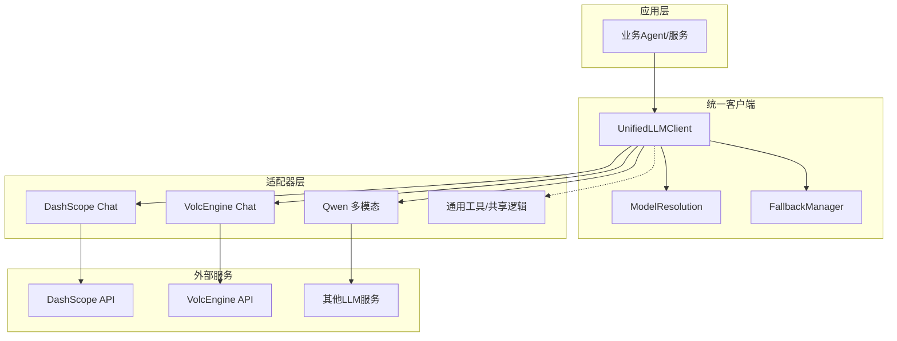
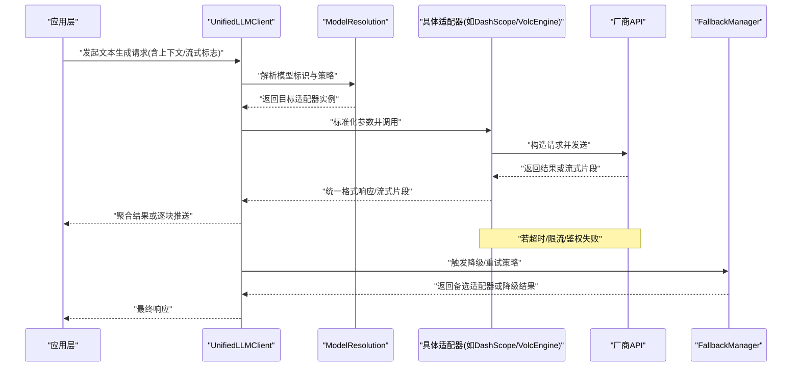
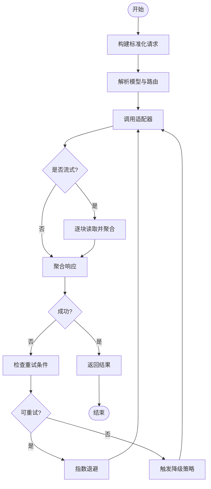
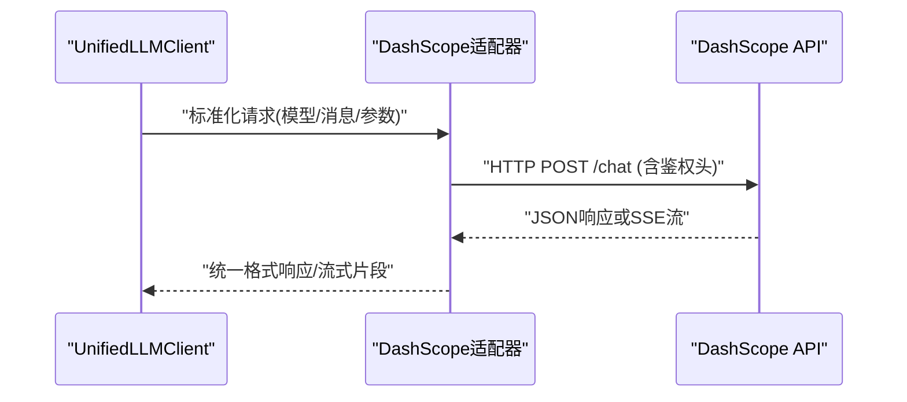
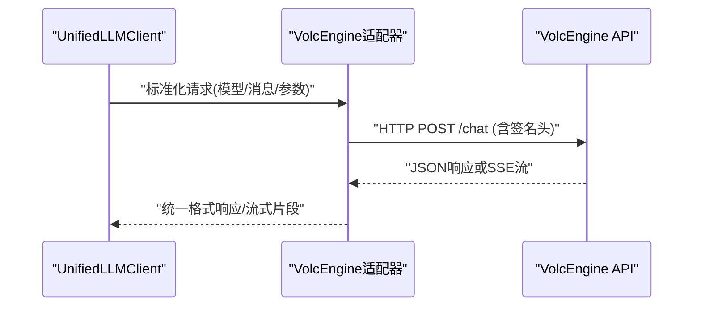
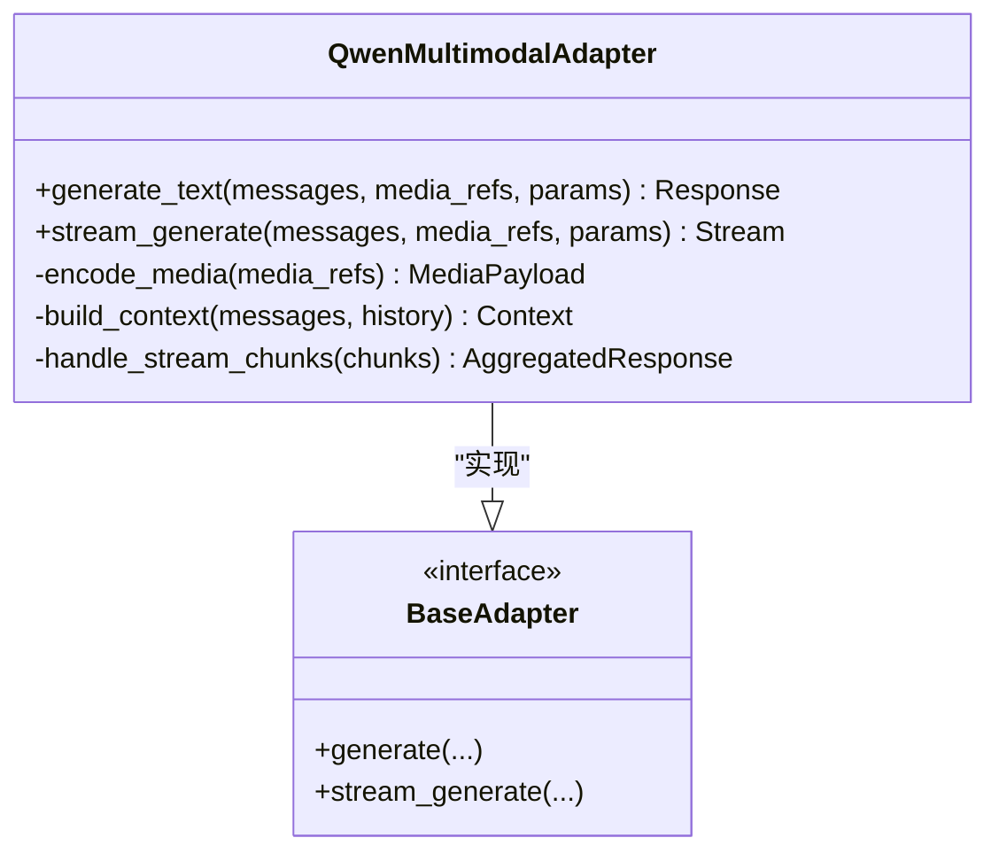
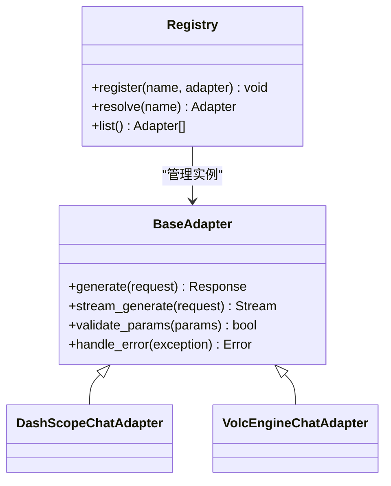
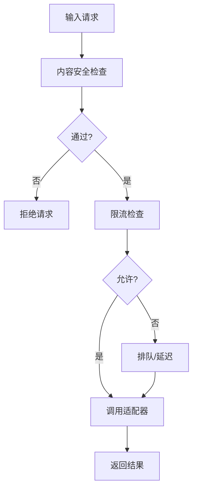
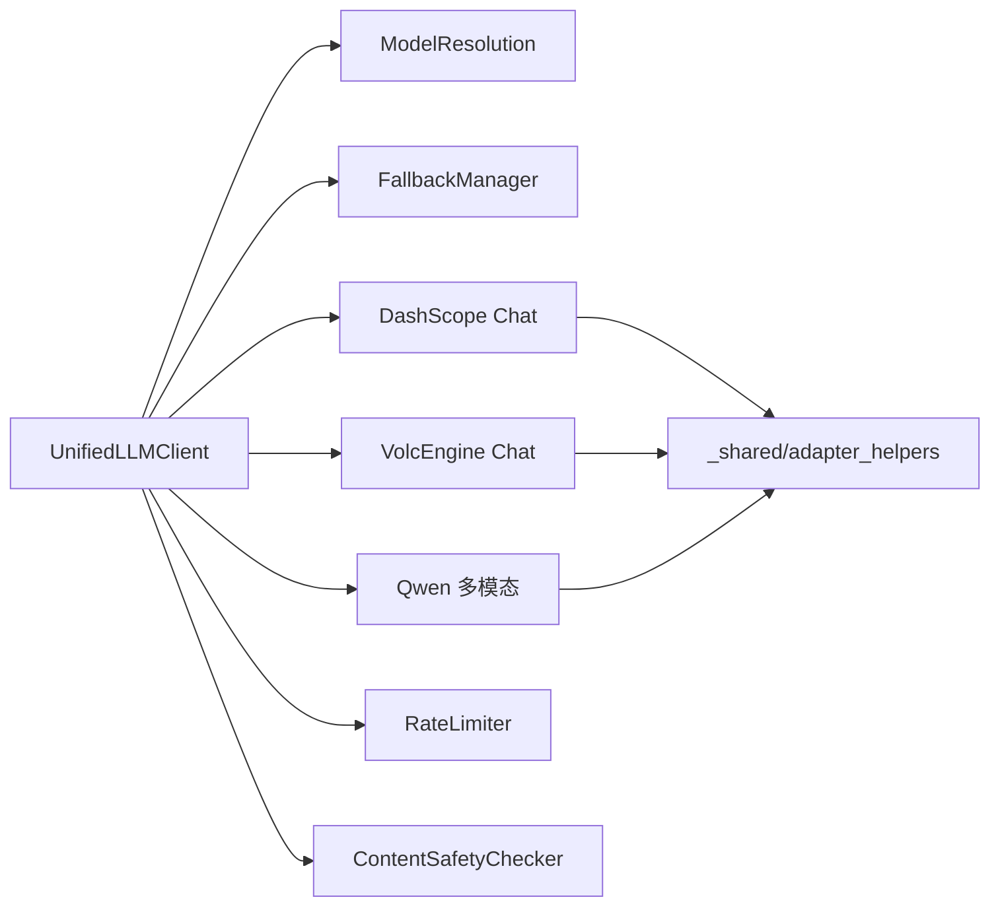

# LLM文本生成适配器

<cite>
**本文引用的文件**   
- [adapters/base.py](file://adapters/base.py)
- [adapters/dashscope/chat.py](file://adapters/dashscope/chat.py)
- [adapters/volcengine/chat.py](file://adapters/volcengine/chat.py)
- [adapters/_shared.py](file://adapters/_shared.py)
- [adapters/adapter_helpers.py](file://adapters/adapter_helpers.py)
- [core/unified_llm_client.py](file://core/unified_llm_client.py)
- [core/model_runtime.py](file://core/model_runtime.py)
- [core/model_resolution.py](file://core/model_resolution.py)
- [core/fallback_manager.py](file://core/fallback_manager.py)
- [adapters/rate_limiter.py](file://adapters/rate_limiter.py)
- [adapters/content_safety_checker.py](file://adapters/content_safety_checker.py)
- [adapters/qwen_multimodal_adapter.py](file://adapters/qwen_multimodal_adapter.py)
- [adapters/new_models_adapters.py](file://adapters/new_models_adapters.py)
- [adapters/model_adapters.py](file://adapters/model_adapters.py)
- [adapters/registry.py](file://adapters/registry.py)
- [agents/llm_client.py](file://agents/llm_client.py)
- [backend/app/services/streaming_service.py](file://backend/app/services/streaming_service.py)
- [scripts/test_all_models.py](file://scripts/test_all_models.py)
</cite>

## 目录
1. [简介](#简介)
2. [项目结构](#项目结构)
3. [核心组件](#核心组件)
4. [架构总览](#架构总览)
5. [详细组件分析](#详细组件分析)
6. [依赖关系分析](#依赖关系分析)
7. [性能考量](#性能考量)
8. [故障排查指南](#故障排查指南)
9. [结论](#结论)
10. [附录](#附录)

## 简介
本技术文档聚焦于大语言模型（LLM）文本生成适配器的设计与实现，覆盖主流AI服务（如DashScope、VolcEngine等）的集成方式、统一的文本生成接口规范、流式输出处理、多模态适配与上下文管理、错误处理与重试降级策略，以及API调用示例、性能优化技巧与自定义适配器开发模板。文档面向开发者与运维人员，力求在保持技术深度的同时，提供易于理解的结构化说明与可视化图示。

## 项目结构
本项目采用“适配器层 + 统一客户端 + 运行时调度”的分层架构：
- 适配器层：针对不同厂商（DashScope、VolcEngine等）的具体实现，屏蔽差异，暴露统一接口。
- 统一客户端：对外提供一致的调用入口，负责参数标准化、协议转换、流式处理、鉴权与限流。
- 运行时调度：负责模型解析、路由选择、失败回退与降级、指标采集与追踪。

图表来源
- [core/unified_llm_client.py](file://core/unified_llm_client.py)
- [core/model_resolution.py](file://core/model_resolution.py)
- [core/fallback_manager.py](file://core/fallback_manager.py)
- [adapters/dashscope/chat.py](file://adapters/dashscope/chat.py)
- [adapters/volcengine/chat.py](file://adapters/volcengine/chat.py)
- [adapters/qwen_multimodal_adapter.py](file://adapters/qwen_multimodal_adapter.py)
- [adapters/_shared.py](file://adapters/_shared.py)

章节来源
- [adapters/base.py](file://adapters/base.py)
- [adapters/registry.py](file://adapters/registry.py)
- [core/unified_llm_client.py](file://core/unified_llm_client.py)
- [core/model_runtime.py](file://core/model_runtime.py)

## 核心组件
- 统一LLM客户端（UnifiedLLMClient）
  - 职责：统一请求构建、参数校验、协议适配、流式响应聚合、错误归一化、埋点与追踪。
  - 关键能力：支持同步/异步调用、流式增量返回、上下文会话管理、重试与降级编排。
- 模型解析与路由（ModelResolution）
  - 职责：根据模型标识、配置与策略选择具体适配器实例；支持按区域、版本、配额与可用性动态路由。
- 回退管理器（FallbackManager）
  - 职责：当主路径失败时自动切换至备选模型或降级策略，保障服务可用性。
- 适配器基类与注册表（BaseAdapter & Registry）
  - 职责：定义标准接口（文本生成、流式生成、多模态输入），集中注册各厂商适配器，便于扩展与维护。
- 共享工具与限流器（_shared, adapter_helpers, rate_limiter）
  - 职责：通用工具函数、请求/响应转换、速率限制、缓存与幂等键生成。

章节来源
- [core/unified_llm_client.py](file://core/unified_llm_client.py)
- [core/model_resolution.py](file://core/model_resolution.py)
- [core/fallback_manager.py](file://core/fallback_manager.py)
- [adapters/base.py](file://adapters/base.py)
- [adapters/registry.py](file://adapters/registry.py)
- [adapters/_shared.py](file://adapters/_shared.py)
- [adapters/adapter_helpers.py](file://adapters/adapter_helpers.py)
- [adapters/rate_limiter.py](file://adapters/rate_limiter.py)

## 架构总览
下图展示从业务调用到具体厂商API的完整链路，包括流式输出与错误回退路径。

图表来源
- [core/unified_llm_client.py](file://core/unified_llm_client.py)
- [core/model_resolution.py](file://core/model_resolution.py)
- [core/fallback_manager.py](file://core/fallback_manager.py)
- [adapters/dashscope/chat.py](file://adapters/dashscope/chat.py)
- [adapters/volcengine/chat.py](file://adapters/volcengine/chat.py)

## 详细组件分析

### 统一LLM客户端（UnifiedLLMClient）
- 设计要点
  - 统一接口：封装文本生成、流式生成、多模态输入的统一方法签名。
  - 参数标准化：将不同厂商的参数映射为内部标准结构，确保一致性。
  - 流式处理：对SSE/流式响应进行增量读取与拼接，支持断点续传与进度回调。
  - 错误归一化：将不同厂商的错误码转换为统一异常类型，便于上层处理。
  - 可观测性：记录请求ID、耗时、Token用量、错误分类等指标。
- 关键流程
  - 请求构建 -> 模型解析 -> 适配器选择 -> 调用 -> 流式聚合 -> 响应返回
  - 失败路径 -> 重试/降级 -> 备选适配器 -> 再次调用 -> 返回

图表来源
- [core/unified_llm_client.py](file://core/unified_llm_client.py)
- [adapters/rate_limiter.py](file://adapters/rate_limiter.py)
- [core/fallback_manager.py](file://core/fallback_manager.py)

章节来源
- [core/unified_llm_client.py](file://core/unified_llm_client.py)
- [adapters/adapter_helpers.py](file://adapters/adapter_helpers.py)

### DashScope 文本生成适配器
- 职责与特性
  - 对接DashScope聊天接口，支持文本生成与流式输出。
  - 处理鉴权、消息格式、系统提示词、温度/TopP等采样参数。
  - 错误码映射与重试策略（网络抖动、限流）。
- 典型调用序列

图表来源
- [adapters/dashscope/chat.py](file://adapters/dashscope/chat.py)

章节来源
- [adapters/dashscope/chat.py](file://adapters/dashscope/chat.py)

### VolcEngine 文本生成适配器
- 职责与特性
  - 对接VolcEngine聊天接口，支持文本生成与流式输出。
  - 处理请求签名、消息体组装、参数映射与响应解析。
  - 针对限流与鉴权失败的差异化处理。
- 典型调用序列

图表来源
- [adapters/volcengine/chat.py](file://adapters/volcengine/chat.py)

章节来源
- [adapters/volcengine/chat.py](file://adapters/volcengine/chat.py)

### Qwen 多模态适配器
- 特殊处理
  - 支持图像/视频等多模态输入，需对媒体数据进行编码与上传。
  - 上下文管理：维护对话历史、图像引用、时间戳与元数据。
  - 流式输出：对文本增量与媒体状态进行分离处理。
- 上下文管理要点
  - 会话窗口控制：按Token预算裁剪历史消息。
  - 媒体引用：使用URL或临时存储路径，避免重复上传。
  - 状态同步：确保文本与媒体状态一致，防止错位。

图表来源
- [adapters/qwen_multimodal_adapter.py](file://adapters/qwen_multimodal_adapter.py)
- [adapters/base.py](file://adapters/base.py)

章节来源
- [adapters/qwen_multimodal_adapter.py](file://adapters/qwen_multimodal_adapter.py)

### 适配器基类与注册表
- 基类（BaseAdapter）
  - 定义统一接口：文本生成、流式生成、参数校验、错误处理。
  - 提供默认实现：日志、度量、基础重试。
- 注册表（Registry）
  - 集中管理适配器实例，支持按模型名/命名空间查找。
  - 支持热插拔与新适配器注册。

图表来源
- [adapters/base.py](file://adapters/base.py)
- [adapters/registry.py](file://adapters/registry.py)

章节来源
- [adapters/base.py](file://adapters/base.py)
- [adapters/registry.py](file://adapters/registry.py)

### 内容安全与限流
- 内容安全检测（ContentSafetyChecker）
  - 在请求前对输入进行敏感词/违规内容检测，拦截高风险请求。
  - 支持策略配置与白名单机制。
- 限流器（RateLimiter）
  - 基于令牌桶/滑动窗口实现，保护下游服务不被突发流量打垮。
  - 支持按租户/模型维度限流。

图表来源
- [adapters/content_safety_checker.py](file://adapters/content_safety_checker.py)
- [adapters/rate_limiter.py](file://adapters/rate_limiter.py)

章节来源
- [adapters/content_safety_checker.py](file://adapters/content_safety_checker.py)
- [adapters/rate_limiter.py](file://adapters/rate_limiter.py)

### 新模型与旧模型适配桥接
- 新模型适配（new_models_adapters）
  - 面向最新API规范的适配器集合，强调流式与结构化输出。
- 旧模型适配（model_adapters）
  - 兼容历史接口，提供迁移桥接与参数映射。
- 运行时（model_runtime）
  - 统一生命周期管理、资源清理与监控。

章节来源
- [adapters/new_models_adapters.py](file://adapters/new_models_adapters.py)
- [adapters/model_adapters.py](file://adapters/model_adapters.py)
- [core/model_runtime.py](file://core/model_runtime.py)

### Agent侧LLM客户端
- 职责
  - 为Agent提供简洁的LLM调用封装，隐藏底层复杂性。
  - 支持批量调用、并发控制与结果合并。
- 典型用法
  - 初始化客户端 -> 设置模型与参数 -> 调用生成 -> 处理结果

章节来源
- [agents/llm_client.py](file://agents/llm_client.py)

## 依赖关系分析
- 组件耦合
  - UnifiedLLMClient依赖ModelResolution与FallbackManager进行路由与回退。
  - 各适配器依赖共享工具（_shared、adapter_helpers）进行参数/响应转换。
  - 限流与安全检测作为横切关注点，贯穿调用链。
- 外部依赖
  - DashScope、VolcEngine等第三方API，需处理鉴权、签名、限流与错误码。

图表来源
- [core/unified_llm_client.py](file://core/unified_llm_client.py)
- [core/model_resolution.py](file://core/model_resolution.py)
- [core/fallback_manager.py](file://core/fallback_manager.py)
- [adapters/_shared.py](file://adapters/_shared.py)
- [adapters/adapter_helpers.py](file://adapters/adapter_helpers.py)
- [adapters/rate_limiter.py](file://adapters/rate_limiter.py)
- [adapters/content_safety_checker.py](file://adapters/content_safety_checker.py)

章节来源
- [core/unified_llm_client.py](file://core/unified_llm_client.py)
- [adapters/_shared.py](file://adapters/_shared.py)
- [adapters/adapter_helpers.py](file://adapters/adapter_helpers.py)

## 性能考量
- 连接池与复用
  - 复用HTTP连接，减少握手开销；合理设置超时与最大连接数。
- 流式输出
  - 优先使用流式接口，降低首字节延迟与内存占用。
- 缓存与去重
  - 对相同请求进行缓存（如短文本摘要、固定提示词），避免重复调用。
- 并发与批处理
  - 合理并发度，避免下游限流；批量请求合并以减少往返次数。
- 监控与调优
  - 采集延迟分位、错误率、Token用量，定位瓶颈并优化。

[本节为通用指导，不直接分析具体文件]

## 故障排查指南
- 常见问题
  - 鉴权失败：检查密钥、签名算法与有效期。
  - 限流报错：调整限流阈值、增加重试退避或切换备用模型。
  - 流式中断：检查网络稳定性、服务端超时设置与客户端缓冲。
  - 多模态错位：核对媒体引用与上下文顺序，确保时间戳一致。
- 诊断步骤
  - 启用详细日志与追踪ID，定位请求链路。
  - 使用测试脚本验证单模型连通性与基本功能。
  - 逐步缩小范围，隔离问题模块（客户端/适配器/外部服务）。

章节来源
- [scripts/test_all_models.py](file://scripts/test_all_models.py)
- [adapters/rate_limiter.py](file://adapters/rate_limiter.py)
- [adapters/content_safety_checker.py](file://adapters/content_safety_checker.py)

## 结论
本适配器体系通过统一客户端与分层设计，有效屏蔽了多厂商API的差异，提供了稳定、可扩展的LLM文本生成能力。结合流式输出、限流与安全检测、重试与降级策略，能够在复杂生产环境中保持高可用与高性能。建议持续完善监控与测试体系，按需扩展新模型适配器，并遵循统一的接口规范与最佳实践。

[本节为总结性内容，不直接分析具体文件]

## 附录
- API调用示例（概念性）
  - 同步文本生成：传入模型标识、消息列表与采样参数，获取完整响应。
  - 流式文本生成：开启流式标志，逐块接收增量文本并实时渲染。
  - 多模态生成：附加图像/视频引用与上下文，生成包含文本与媒体状态的响应。
- 自定义适配器开发模板
  - 继承BaseAdapter，实现generate与stream_generate方法。
  - 在Registry中注册新适配器，提供模型名与实例映射。
  - 编写单元测试与集成测试，覆盖正常路径、错误路径与流式场景。
- 测试方法
  - 使用test_all_models脚本进行冒烟测试。
  - 模拟下游限流与超时，验证重试与降级逻辑。
  - 对多模态输入进行端到端验证，确保上下文与媒体引用正确。

[本节为补充信息，不直接分析具体文件]