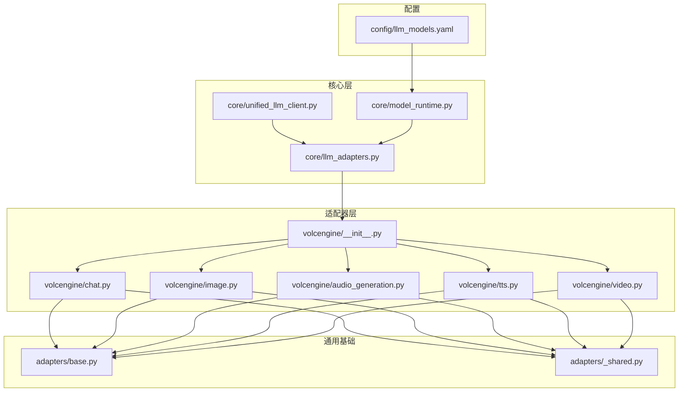
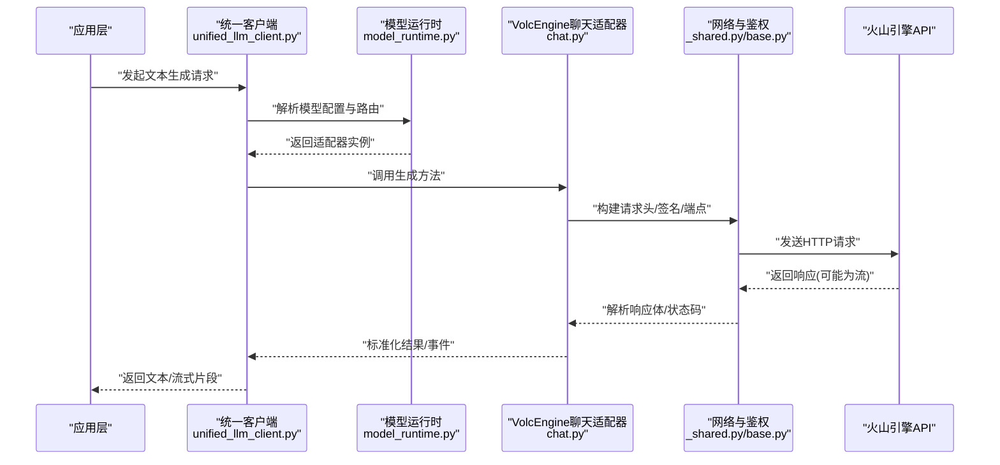
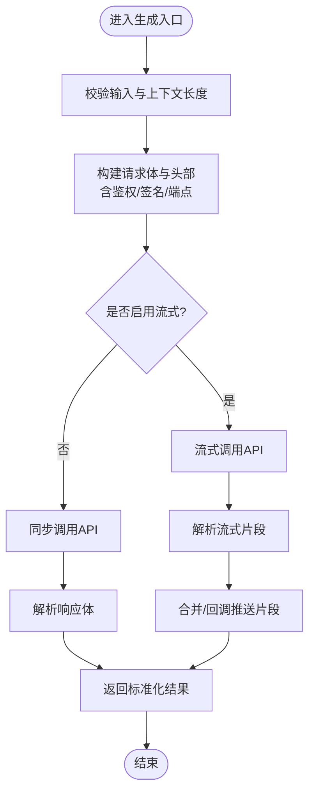
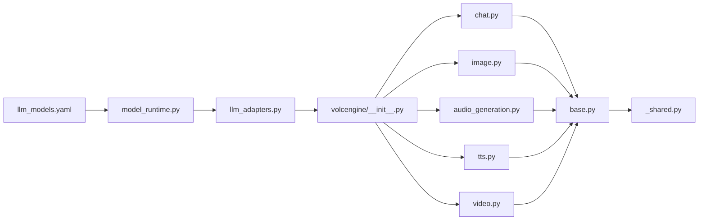

# VolcEngine适配器

<cite>
**本文引用的文件**   
- [adapters/volcengine/__init__.py](file://adapters/volcengine/__init__.py)
- [adapters/volcengine/chat.py](file://adapters/volcengine/chat.py)
- [adapters/volcengine/image.py](file://adapters/volcengine/image.py)
- [adapters/volcengine/audio_generation.py](file://adapters/volcengine/audio_generation.py)
- [adapters/volcengine/tts.py](file://adapters/volcengine/tts.py)
- [adapters/volcengine/video.py](file://adapters/volcengine/video.py)
- [adapters/base.py](file://adapters/base.py)
- [adapters/_shared.py](file://adapters/_shared.py)
- [core/unified_llm_client.py](file://core/unified_llm_client.py)
- [core/model_runtime.py](file://core/model_runtime.py)
- [core/llm_adapters.py](file://core/llm_adapters.py)
- [config/llm_models.yaml](file://config/llm_models.yaml)
</cite>

## 目录
1. [简介](#简介)
2. [项目结构](#项目结构)
3. [核心组件](#核心组件)
4. [架构总览](#架构总览)
5. [详细组件分析](#详细组件分析)
6. [依赖关系分析](#依赖关系分析)
7. [性能与连接池](#性能与连接池)
8. [故障排查指南](#故障排查指南)
9. [结论](#结论)
10. [附录：使用示例与最佳实践](#附录使用示例与最佳实践)

## 简介
本技术文档聚焦于VolcEngine（火山引擎）LLM适配器的集成实现，覆盖服务认证、API端点配置、请求签名、文本生成接口规范（模型参数、上下文管理、响应格式）、异步调用支持、连接池管理与性能优化策略。文档同时提供完整的使用示例与调试技巧，帮助开发者快速接入并稳定运行基于火山引擎的文本生成任务。

## 项目结构
VolcEngine适配器位于 adapters/volcengine 目录下，按能力划分多个模块：聊天（chat）、图像（image）、音频生成（audio_generation）、TTS（tts）、视频（video）。这些模块统一继承自适配器基类，并通过核心层的统一客户端与运行时进行调度。

图表来源
- [adapters/volcengine/__init__.py](file://adapters/volcengine/__init__.py)
- [adapters/volcengine/chat.py](file://adapters/volcengine/chat.py)
- [adapters/volcengine/image.py](file://adapters/volcengine/image.py)
- [adapters/volcengine/audio_generation.py](file://adapters/volcengine/audio_generation.py)
- [adapters/volcengine/tts.py](file://adapters/volcengine/tts.py)
- [adapters/volcengine/video.py](file://adapters/volcengine/video.py)
- [adapters/base.py](file://adapters/base.py)
- [adapters/_shared.py](file://adapters/_shared.py)
- [core/unified_llm_client.py](file://core/unified_llm_client.py)
- [core/model_runtime.py](file://core/model_runtime.py)
- [core/llm_adapters.py](file://core/llm_adapters.py)
- [config/llm_models.yaml](file://config/llm_models.yaml)

章节来源
- [adapters/volcengine/__init__.py](file://adapters/volcengine/__init__.py)
- [adapters/base.py](file://adapters/base.py)
- [adapters/_shared.py](file://adapters/_shared.py)
- [core/unified_llm_client.py](file://core/unified_llm_client.py)
- [core/model_runtime.py](file://core/model_runtime.py)
- [core/llm_adapters.py](file://core/llm_adapters.py)
- [config/llm_models.yaml](file://config/llm_models.yaml)

## 核心组件
- VolcEngine聊天适配器：封装对话式文本生成，处理消息上下文、流式与非流式响应、重试与错误映射。
- VolcEngine图像/音频/TTS/视频适配器：分别负责对应模态的生成或合成，遵循统一的适配器契约。
- 适配器基类与共享工具：定义抽象接口、公共网络请求、鉴权与签名、超时与重试等横切逻辑。
- 核心统一客户端与运行时：根据模型配置选择具体适配器，统一编排调用、并发控制与结果归一化。

章节来源
- [adapters/volcengine/chat.py](file://adapters/volcengine/chat.py)
- [adapters/base.py](file://adapters/base.py)
- [adapters/_shared.py](file://adapters/_shared.py)
- [core/unified_llm_client.py](file://core/unified_llm_client.py)
- [core/model_runtime.py](file://core/model_runtime.py)
- [core/llm_adapters.py](file://core/llm_adapters.py)

## 架构总览
整体采用“适配器模式 + 统一客户端”的分层架构。上层通过统一客户端发起请求，核心运行时根据模型标识解析配置并路由到具体VolcEngine适配器；适配器内部完成鉴权、签名、HTTP调用与响应解析，最终返回标准化结果。

图表来源
- [core/unified_llm_client.py](file://core/unified_llm_client.py)
- [core/model_runtime.py](file://core/model_runtime.py)
- [adapters/volcengine/chat.py](file://adapters/volcengine/chat.py)
- [adapters/_shared.py](file://adapters/_shared.py)
- [adapters/base.py](file://adapters/base.py)

## 详细组件分析

### VolcEngine聊天适配器（chat.py）
- 职责：实现对话式文本生成，包括系统/用户/助手消息组装、上下文长度管理、温度/TopP/最大生成长度等参数映射、流式增量输出与错误映射。
- 关键流程：
  - 输入校验与上下文裁剪：确保不超过模型上下文窗口。
  - 请求构建：设置端点、鉴权头、签名、请求体字段。
  - 响应处理：非流式直接返回文本；流式逐块拼接或回调推送。
  - 错误处理：将上游错误码映射为统一异常，便于上层重试或降级。

图表来源
- [adapters/volcengine/chat.py](file://adapters/volcengine/chat.py)

章节来源
- [adapters/volcengine/chat.py](file://adapters/volcengine/chat.py)

### VolcEngine图像/音频/TTS/视频适配器
- 图像适配器：负责文生图/图编辑等能力，处理图片URL/二进制、分辨率、风格参数等。
- 音频生成适配器：用于生成语音片段或音效，处理采样率、时长、音色等参数。
- TTS适配器：文本转语音，支持多音色、语速、停顿控制，以及流式音频分片。
- 视频适配器：文本/图像到视频生成，处理帧率、时长、分辨率、运动强度等。

上述适配器均遵循统一契约：输入规范化、参数映射、网络调用、响应解析与错误映射。

章节来源
- [adapters/volcengine/image.py](file://adapters/volcengine/image.py)
- [adapters/volcengine/audio_generation.py](file://adapters/volcengine/audio_generation.py)
- [adapters/volcengine/tts.py](file://adapters/volcengine/tts.py)
- [adapters/volcengine/video.py](file://adapters/volcengine/video.py)

### 适配器基类与共享工具（base.py, _shared.py）
- 基类：定义抽象接口（如generate、stream_generate、health_check），统一生命周期与日志埋点。
- 共享工具：封装HTTP客户端、重试策略、超时、鉴权与签名、限流、指标上报等横切能力。

章节来源
- [adapters/base.py](file://adapters/base.py)
- [adapters/_shared.py](file://adapters/_shared.py)

### 核心统一客户端与运行时（unified_llm_client.py, model_runtime.py, llm_adapters.py）
- 统一客户端：对外暴露一致的调用接口，屏蔽底层适配器差异。
- 模型运行时：加载配置、解析模型标识、选择适配器实例、管理并发与资源。
- 适配器注册表：维护各厂商适配器与模型ID的映射关系。

章节来源
- [core/unified_llm_client.py](file://core/unified_llm_client.py)
- [core/model_runtime.py](file://core/model_runtime.py)
- [core/llm_adapters.py](file://core/llm_adapters.py)

## 依赖关系分析
VolcEngine适配器依赖以下层次：
- 配置层：llm_models.yaml定义模型ID、端点、鉴权方式与默认参数。
- 运行时层：model_runtime.py读取配置并创建适配器实例。
- 适配器层：chat/image/audio/tts/video各自实现具体能力。
- 基础设施层：base.py与_shared.py提供网络、鉴权、重试、限流等通用能力。

图表来源
- [config/llm_models.yaml](file://config/llm_models.yaml)
- [core/model_runtime.py](file://core/model_runtime.py)
- [core/llm_adapters.py](file://core/llm_adapters.py)
- [adapters/volcengine/__init__.py](file://adapters/volcengine/__init__.py)
- [adapters/volcengine/chat.py](file://adapters/volcengine/chat.py)
- [adapters/volcengine/image.py](file://adapters/volcengine/image.py)
- [adapters/volcengine/audio_generation.py](file://adapters/volcengine/audio_generation.py)
- [adapters/volcengine/tts.py](file://adapters/volcengine/tts.py)
- [adapters/volcengine/video.py](file://adapters/volcengine/video.py)
- [adapters/base.py](file://adapters/base.py)
- [adapters/_shared.py](file://adapters/_shared.py)

章节来源
- [config/llm_models.yaml](file://config/llm_models.yaml)
- [core/model_runtime.py](file://core/model_runtime.py)
- [core/llm_adapters.py](file://core/llm_adapters.py)
- [adapters/volcengine/__init__.py](file://adapters/volcengine/__init__.py)

## 性能与连接池
- 连接复用：通过共享HTTP客户端维持长连接，减少握手开销。
- 并发控制：限制并发请求数，避免触发上游限流；对高吞吐场景建议队列化与背压。
- 流式处理：优先使用流式接口降低首字节延迟与内存占用。
- 重试与退避：对可重试错误实施指数退避，避免雪崩。
- 缓存与预取：对热点提示词或静态配置进行缓存，缩短冷启动时间。
- 资源隔离：不同租户/项目使用独立连接池与超时配置，防止相互影响。

[本节为通用指导，不直接分析具体文件]

## 故障排查指南
- 鉴权失败：检查AK/SK、签名算法、时间戳与请求头顺序；确认端点域名与协议正确。
- 超时与中断：调整超时阈值，开启重试；检查网络质量与上游限流策略。
- 上下文溢出：裁剪历史消息或启用上下文压缩；确认模型最大上下文长度。
- 流式异常：捕获部分读取异常，记录断点位置，支持断点续传或重放。
- 错误码映射：查看适配器错误映射表，定位上游错误类型与恢复策略。
- 日志与追踪：开启请求级TraceID，记录入参出参与耗时分布，便于定位瓶颈。

章节来源
- [adapters/_shared.py](file://adapters/_shared.py)
- [adapters/base.py](file://adapters/base.py)
- [adapters/volcengine/chat.py](file://adapters/volcengine/chat.py)

## 结论
VolcEngine适配器通过清晰的层次结构与统一的契约设计，实现了与火山引擎AI服务的稳定集成。借助共享的网络与鉴权能力、灵活的运行时路由与配置驱动，开发者可以高效地扩展新的模型与能力。结合流式处理、连接池与重试机制，可在保证可用性的同时获得良好的性能表现。

[本节为总结性内容，不直接分析具体文件]

## 附录：使用示例与最佳实践
- 环境准备
  - 在配置文件中添加VolcEngine模型条目，包含模型ID、端点、鉴权方式与默认参数。
  - 设置环境变量或配置文件中的AK/SK，确保签名所需信息齐全。
- 初始化与选择
  - 通过统一客户端加载运行时，指定模型ID以选择VolcEngine聊天适配器。
- 文本生成
  - 构造消息列表（系统/用户/助手），设置温度、TopP、最大生成长度等参数。
  - 如需流式输出，启用流式模式并按片段处理。
- 错误处理
  - 捕获鉴权、超时、限流等异常，实施重试或降级策略。
  - 记录TraceID与关键入参，便于问题回溯。
- 性能优化
  - 合理设置并发与超时，启用连接复用与流式传输。
  - 对高频提示词进行缓存，减少重复计算。
- 调试技巧
  - 开启详细日志，打印请求头与响应摘要（脱敏）。
  - 使用最小可复现用例验证端点连通性与签名正确性。

章节来源
- [config/llm_models.yaml](file://config/llm_models.yaml)
- [core/unified_llm_client.py](file://core/unified_llm_client.py)
- [core/model_runtime.py](file://core/model_runtime.py)
- [adapters/volcengine/chat.py](file://adapters/volcengine/chat.py)
- [adapters/_shared.py](file://adapters/_shared.py)