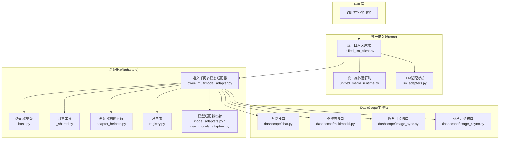
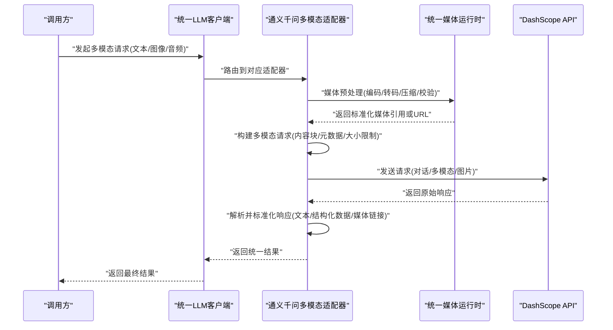
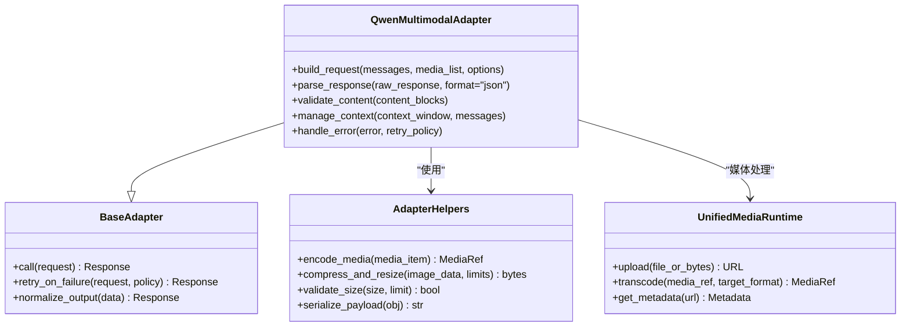
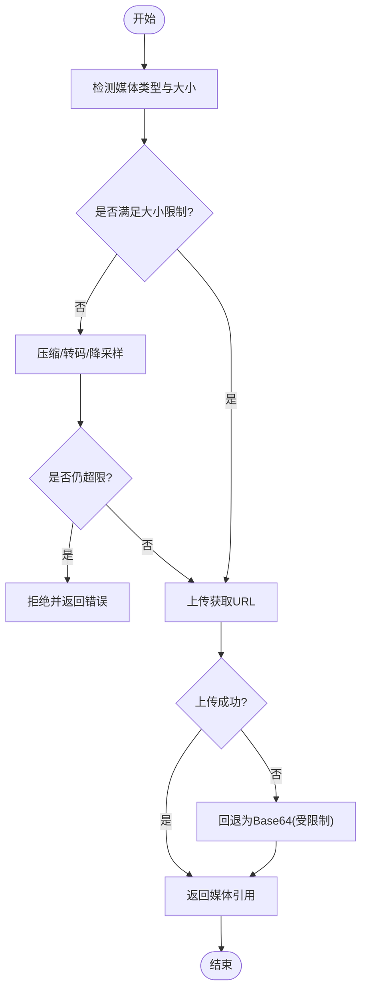
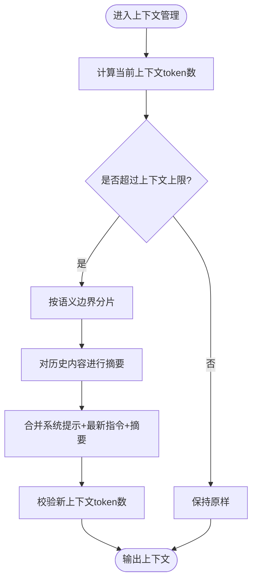
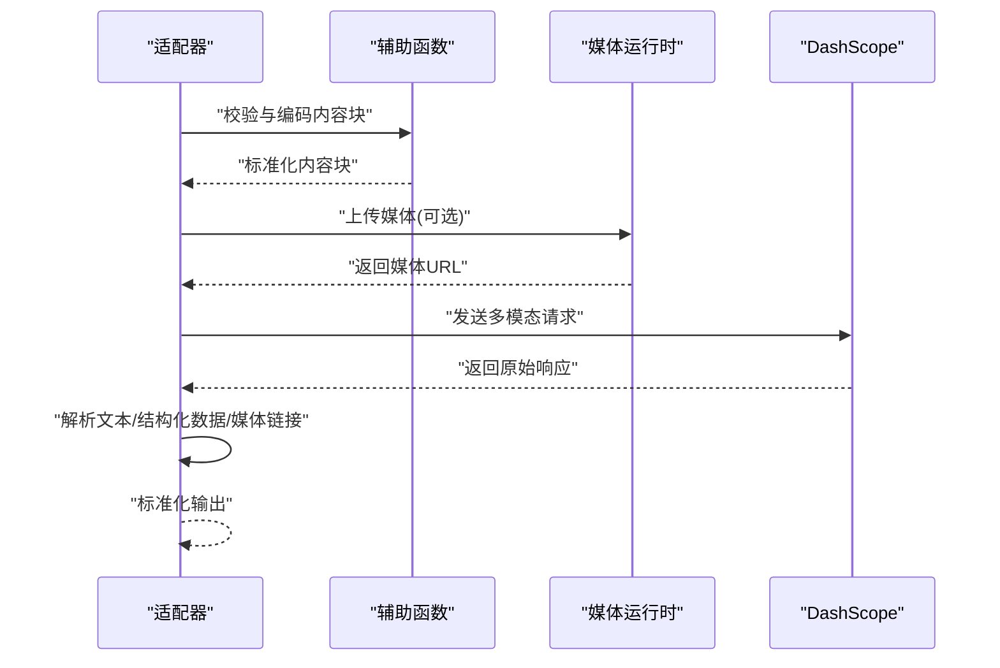
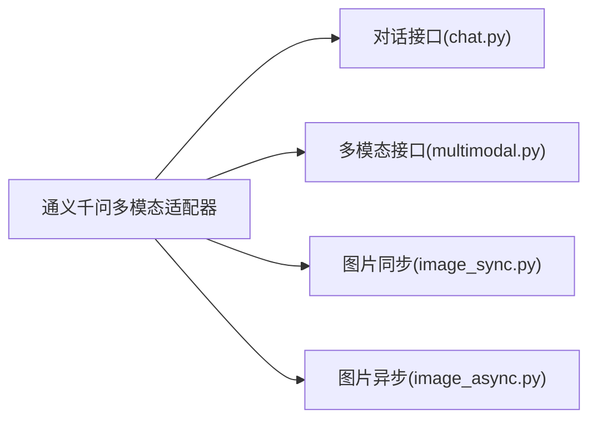
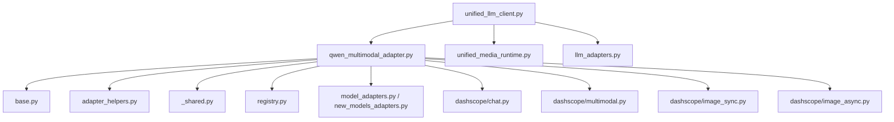

# 通义千问多模态适配器

<cite>
**本文引用的文件**   
- [qwen_multimodal_adapter.py](file://adapters/qwen_multimodal_adapter.py)
- [base.py](file://adapters/base.py)
- [_shared.py](file://adapters/_shared.py)
- [adapter_helpers.py](file://adapters/adapter_helpers.py)
- [model_adapters.py](file://adapters/model_adapters.py)
- [new_models_adapters.py](file://adapters/new_models_adapters.py)
- [registry.py](file://adapters/registry.py)
- [unified_llm_client.py](file://core/unified_llm_client.py)
- [unified_media_runtime.py](file://core/unified_media_runtime.py)
- [llm_adapters.py](file://core/llm_adapters.py)
- [dash_chat.py](file://adapters/dashscope/chat.py)
- [dash_multimodal.py](file://adapters/dashscope/multimodal.py)
- [dash_image_sync.py](file://adapters/dashscope/image_sync.py)
- [dash_image_async.py](file://adapters/dashscope/image_async.py)
</cite>

## 目录
1. [简介](#简介)
2. [项目结构](#项目结构)
3. [核心组件](#核心组件)
4. [架构总览](#架构总览)
5. [详细组件分析](#详细组件分析)
6. [依赖关系分析](#依赖关系分析)
7. [性能考量](#性能考量)
8. [故障排查指南](#故障排查指南)
9. [结论](#结论)
10. [附录：使用示例与最佳实践](#附录使用示例与最佳实践)

## 简介
本技术文档面向“通义千问多模态适配器”，系统性阐述其在统一接入层中对文本、图像、音频等多模态输入的处理方式，涵盖请求构建（编码、格式转换、大小限制）、上下文窗口管理与长文本策略、响应解析（结构化数据提取与标准化），以及端到端的使用示例。读者无需深入源码即可理解整体设计，同时提供代码级溯源以便进一步定制或排障。

## 项目结构
围绕多模态适配的关键目录与文件如下：
- adapters：各模型/厂商适配器实现，包含通义千问多模态适配器与 DashScope 子模块
- core：统一客户端、媒体运行时、LLM 适配桥接等通用能力
- schemas：统一模型规格与任务规范
- scripts：验证与测试脚本，便于集成回归

图表来源 
- [qwen_multimodal_adapter.py](file://adapters/qwen_multimodal_adapter.py)
- [base.py](file://adapters/base.py)
- [_shared.py](file://adapters/_shared.py)
- [adapter_helpers.py](file://adapters/adapter_helpers.py)
- [model_adapters.py](file://adapters/model_adapters.py)
- [new_models_adapters.py](file://adapters/new_models_adapters.py)
- [registry.py](file://adapters/registry.py)
- [unified_llm_client.py](file://core/unified_llm_client.py)
- [unified_media_runtime.py](file://core/unified_media_runtime.py)
- [llm_adapters.py](file://core/llm_adapters.py)
- [dash_chat.py](file://adapters/dashscope/chat.py)
- [dash_multimodal.py](file://adapters/dashscope/multimodal.py)
- [dash_image_sync.py](file://adapters/dashscope/image_sync.py)
- [dash_image_async.py](file://adapters/dashscope/image_async.py)

章节来源
- [qwen_multimodal_adapter.py](file://adapters/qwen_multimodal_adapter.py)
- [base.py](file://adapters/base.py)
- [_shared.py](file://adapters/_shared.py)
- [adapter_helpers.py](file://adapters/adapter_helpers.py)
- [model_adapters.py](file://adapters/model_adapters.py)
- [new_models_adapters.py](file://adapters/new_models_adapters.py)
- [registry.py](file://adapters/registry.py)
- [unified_llm_client.py](file://core/unified_llm_client.py)
- [unified_media_runtime.py](file://core/unified_media_runtime.py)
- [llm_adapters.py](file://core/llm_adapters.py)
- [dash_chat.py](file://adapters/dashscope/chat.py)
- [dash_multimodal.py](file://adapters/dashscope/multimodal.py)
- [dash_image_sync.py](file://adapters/dashscope/image_sync.py)
- [dash_image_async.py](file://adapters/dashscope/image_async.py)

## 核心组件
- 通义千问多模态适配器：封装对 DashScope 的多模态能力（文本、图像、音频）的统一调用、参数映射、错误处理与结果标准化。
- 适配器基类与共享工具：定义统一的抽象接口、公共校验、重试、限流、日志与序列化逻辑。
- 统一LLM客户端与媒体运行时：对外暴露一致的调用入口，屏蔽底层差异；媒体运行时负责上传、转码、压缩与缓存。
- 注册表与模型映射：集中管理模型ID到适配器的绑定，支持动态发现与切换。
- DashScope子模块：分别承载对话、多模态、图片同步/异步等具体API封装。

章节来源
- [qwen_multimodal_adapter.py](file://adapters/qwen_multimodal_adapter.py)
- [base.py](file://adapters/base.py)
- [_shared.py](file://adapters/_shared.py)
- [adapter_helpers.py](file://adapters/adapter_helpers.py)
- [unified_llm_client.py](file://core/unified_llm_client.py)
- [unified_media_runtime.py](file://core/unified_media_runtime.py)
- [registry.py](file://adapters/registry.py)
- [model_adapters.py](file://adapters/model_adapters.py)
- [new_models_adapters.py](file://adapters/new_models_adapters.py)
- [dash_chat.py](file://adapters/dashscope/chat.py)
- [dash_multimodal.py](file://adapters/dashscope/multimodal.py)
- [dash_image_sync.py](file://adapters/dashscope/image_sync.py)
- [dash_image_async.py](file://adapters/dashscope/image_async.py)

## 架构总览
下图展示从调用方到DashScope的完整链路，包括媒体预处理、请求构建、响应解析与标准化。

图表来源 
- [unified_llm_client.py](file://core/unified_llm_client.py)
- [qwen_multimodal_adapter.py](file://adapters/qwen_multimodal_adapter.py)
- [unified_media_runtime.py](file://core/unified_media_runtime.py)
- [dash_chat.py](file://adapters/dashscope/chat.py)
- [dash_multimodal.py](file://adapters/dashscope/multimodal.py)
- [dash_image_sync.py](file://adapters/dashscope/image_sync.py)
- [dash_image_async.py](file://adapters/dashscope/image_async.py)

## 详细组件分析

### 通义千问多模态适配器
职责与流程：
- 输入统一：将文本、图像、音频等输入转换为内部统一的内容块表示。
- 请求构建：根据目标模型能力选择对话或多模态接口，组装消息体、系统提示、参数与媒体引用。
- 媒体处理：通过统一媒体运行时进行编码、转码、压缩、尺寸与大小限制校验。
- 上下文管理：按模型上下文窗口上限进行分片、摘要或裁剪，保证不超限且语义连贯。
- 响应解析：提取文本、结构化字段（如JSON片段）、媒体链接，并进行格式标准化。
- 错误处理：捕获网络、鉴权、配额、格式错误，进行重试或降级。

图表来源 
- [qwen_multimodal_adapter.py](file://adapters/qwen_multimodal_adapter.py)
- [base.py](file://adapters/base.py)
- [adapter_helpers.py](file://adapters/adapter_helpers.py)
- [unified_media_runtime.py](file://core/unified_media_runtime.py)

章节来源
- [qwen_multimodal_adapter.py](file://adapters/qwen_multimodal_adapter.py)
- [base.py](file://adapters/base.py)
- [adapter_helpers.py](file://adapters/adapter_helpers.py)
- [unified_media_runtime.py](file://core/unified_media_runtime.py)

### 媒体数据处理与大小限制
- 编码与转码：统一媒体运行时负责将不同格式的媒体（如PNG/JPEG/WAV/MP3）转换为模型支持的格式与采样率。
- 压缩与尺寸限制：对图像进行分辨率与文件大小双重限制，避免超出模型上下文或API限制。
- 上传与引用：优先上传至云端获取稳定URL，减少请求体体积，提高稳定性。
- 校验与回退：当上传失败时回退为内联Base64（受大小限制约束）。

图表来源 
- [unified_media_runtime.py](file://core/unified_media_runtime.py)
- [adapter_helpers.py](file://adapters/adapter_helpers.py)

章节来源
- [unified_media_runtime.py](file://core/unified_media_runtime.py)
- [adapter_helpers.py](file://adapters/adapter_helpers.py)

### 上下文窗口管理与长文本处理
- 窗口计算：统计token数（含文本与媒体元数据），确保不超过模型上下文上限。
- 分片策略：超长文本按段落/语义边界切分，必要时保留关键上下文。
- 摘要策略：对历史对话进行摘要压缩，保留关键信息，降低后续请求负载。
- 优先级策略：系统提示、用户最新指令优先保留，历史内容可摘要或裁剪。

图表来源 
- [qwen_multimodal_adapter.py](file://adapters/qwen_multimodal_adapter.py)

章节来源
- [qwen_multimodal_adapter.py](file://adapters/qwen_multimodal_adapter.py)

### 多模态请求构建与响应解析
- 请求构建：将文本、图像、音频统一为内容块数组，附加元数据（如格式、时长、分辨率），并按模型要求组织消息体。
- 响应解析：从原始响应中提取文本、结构化数据（如JSON片段）、媒体链接，并进行格式标准化，便于上层消费。
- 安全与合规：对敏感信息进行过滤，确保输出符合内容安全策略。

图表来源 
- [qwen_multimodal_adapter.py](file://adapters/qwen_multimodal_adapter.py)
- [adapter_helpers.py](file://adapters/adapter_helpers.py)
- [unified_media_runtime.py](file://core/unified_media_runtime.py)
- [dash_multimodal.py](file://adapters/dashscope/multimodal.py)

章节来源
- [qwen_multimodal_adapter.py](file://adapters/qwen_multimodal_adapter.py)
- [adapter_helpers.py](file://adapters/adapter_helpers.py)
- [unified_media_runtime.py](file://core/unified_media_runtime.py)
- [dash_multimodal.py](file://adapters/dashscope/multimodal.py)

### DashScope子模块对接
- 对话接口：封装文本对话与基础参数。
- 多模态接口：支持图文混入、音频输入等。
- 图片接口：同步/异步生成与编辑。

图表来源 
- [dash_chat.py](file://adapters/dashscope/chat.py)
- [dash_multimodal.py](file://adapters/dashscope/multimodal.py)
- [dash_image_sync.py](file://adapters/dashscope/image_sync.py)
- [dash_image_async.py](file://adapters/dashscope/image_async.py)

章节来源
- [dash_chat.py](file://adapters/dashscope/chat.py)
- [dash_multimodal.py](file://adapters/dashscope/multimodal.py)
- [dash_image_sync.py](file://adapters/dashscope/image_sync.py)
- [dash_image_async.py](file://adapters/dashscope/image_async.py)

## 依赖关系分析
- 耦合度：适配器依赖基类与辅助函数，低耦合高内聚；媒体运行时独立于适配器，便于替换与扩展。
- 外部依赖：DashScope API、统一媒体运行时、注册表与模型映射。
- 循环依赖：无直接循环依赖，通过统一客户端与注册表解耦。

图表来源 
- [qwen_multimodal_adapter.py](file://adapters/qwen_multimodal_adapter.py)
- [base.py](file://adapters/base.py)
- [adapter_helpers.py](file://adapters/adapter_helpers.py)
- [_shared.py](file://adapters/_shared.py)
- [registry.py](file://adapters/registry.py)
- [model_adapters.py](file://adapters/model_adapters.py)
- [new_models_adapters.py](file://adapters/new_models_adapters.py)
- [unified_llm_client.py](file://core/unified_llm_client.py)
- [unified_media_runtime.py](file://core/unified_media_runtime.py)
- [llm_adapters.py](file://core/llm_adapters.py)
- [dash_chat.py](file://adapters/dashscope/chat.py)
- [dash_multimodal.py](file://adapters/dashscope/multimodal.py)
- [dash_image_sync.py](file://adapters/dashscope/image_sync.py)
- [dash_image_async.py](file://adapters/dashscope/image_async.py)

章节来源
- [qwen_multimodal_adapter.py](file://adapters/qwen_multimodal_adapter.py)
- [base.py](file://adapters/base.py)
- [adapter_helpers.py](file://adapters/adapter_helpers.py)
- [_shared.py](file://adapters/_shared.py)
- [registry.py](file://adapters/registry.py)
- [model_adapters.py](file://adapters/model_adapters.py)
- [new_models_adapters.py](file://adapters/new_models_adapters.py)
- [unified_llm_client.py](file://core/unified_llm_client.py)
- [unified_media_runtime.py](file://core/unified_media_runtime.py)
- [llm_adapters.py](file://core/llm_adapters.py)
- [dash_chat.py](file://adapters/dashscope/chat.py)
- [dash_multimodal.py](file://adapters/dashscope/multimodal.py)
- [dash_image_sync.py](file://adapters/dashscope/image_sync.py)
- [dash_image_async.py](file://adapters/dashscope/image_async.py)

## 性能考量
- 媒体上传与缓存：优先使用URL引用，结合缓存减少重复上传。
- 压缩与转码：按需调整分辨率与采样率，平衡质量与延迟。
- 上下文管理：摘要与分片降低token消耗，提升吞吐。
- 重试与限流：合理设置重试次数与退避策略，避免雪崩。
- 并发控制：批量请求时采用队列与并发上限，防止过载。

[本节为通用指导，不直接分析具体文件]

## 故障排查指南
常见问题与定位要点：
- 媒体过大或格式不支持：检查媒体运行时转码与大小限制配置，确认上传成功。
- 上下文超限：查看上下文管理策略，启用摘要或分片。
- 鉴权或配额错误：核对API密钥与配额，必要时切换模型或降级策略。
- 响应解析失败：检查返回结构与解析逻辑，增加容错与默认值。
- 网络超时：调整超时与重试策略，监控网络质量。

章节来源
- [qwen_multimodal_adapter.py](file://adapters/qwen_multimodal_adapter.py)
- [adapter_helpers.py](file://adapters/adapter_helpers.py)
- [unified_media_runtime.py](file://core/unified_media_runtime.py)

## 结论
通义千问多模态适配器通过统一接入层与媒体运行时，实现了文本、图像、音频等多模态内容的标准化处理与高效调用。其清晰的职责划分、完善的上下文管理与健壮的错误处理机制，使其在复杂业务场景中具备高可用性与可扩展性。建议在生产环境中结合缓存、限流与监控，进一步提升稳定性与性能。

[本节为总结，不直接分析具体文件]

## 附录：使用示例与最佳实践
- 多模态输入构建：将文本、图像、音频统一为内容块，附加必要元数据（格式、时长、分辨率）。
- 媒体预处理：优先上传获取URL，必要时进行压缩与转码，确保满足大小与格式限制。
- 上下文管理：对长文本进行分片与摘要，保留关键信息，避免超限。
- 请求构建：根据模型能力选择对话或多模态接口，组装消息体与参数。
- 响应解析：提取文本、结构化数据与媒体链接，进行标准化后返回。
- 错误处理：捕获并分类错误，执行重试或降级策略，记录诊断信息。

章节来源
- [qwen_multimodal_adapter.py](file://adapters/qwen_multimodal_adapter.py)
- [adapter_helpers.py](file://adapters/adapter_helpers.py)
- [unified_media_runtime.py](file://core/unified_media_runtime.py)
- [dash_multimodal.py](file://adapters/dashscope/multimodal.py)