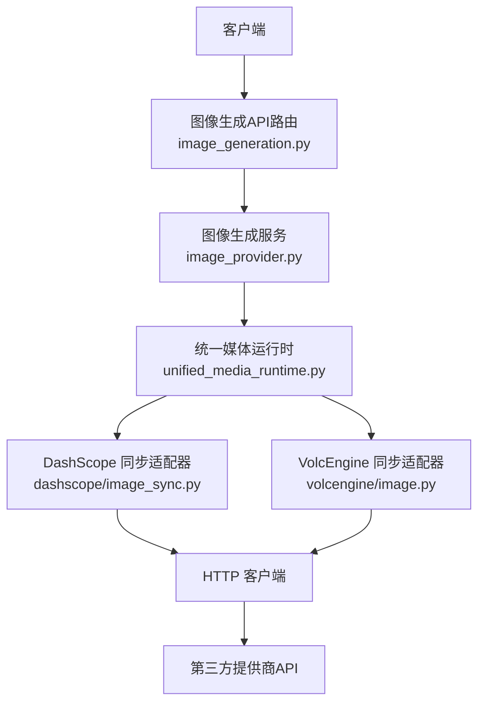
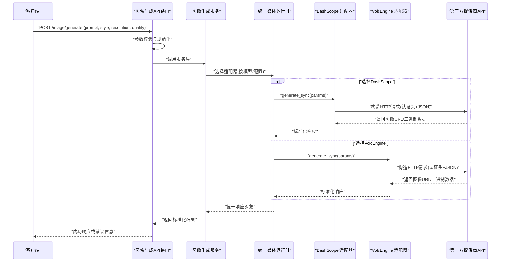
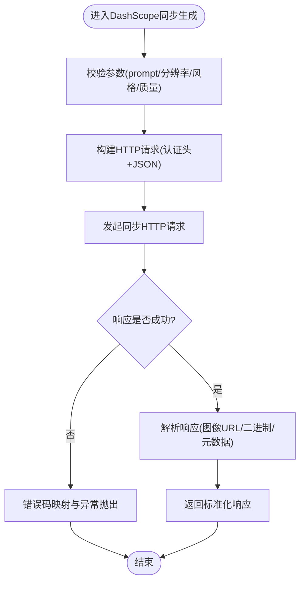
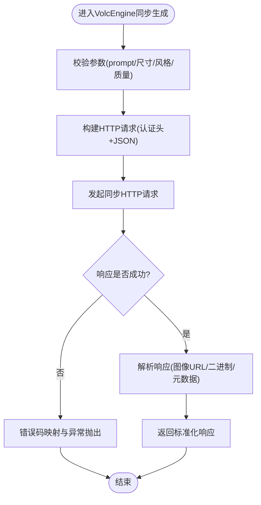
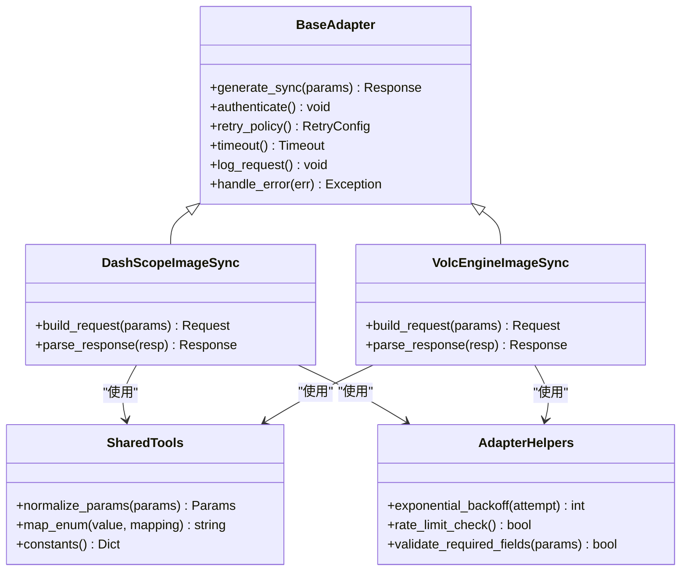
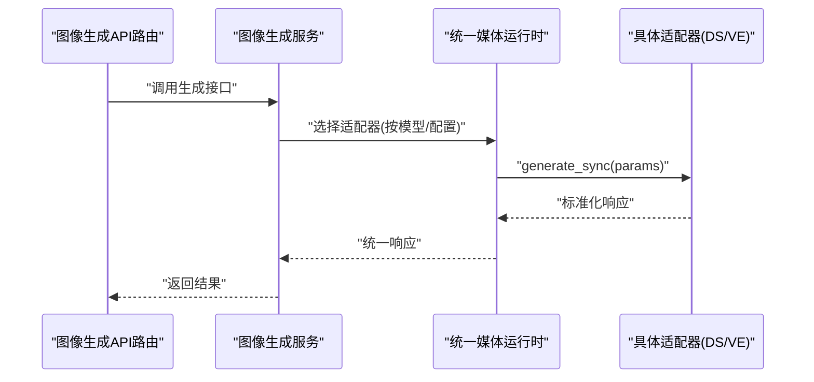
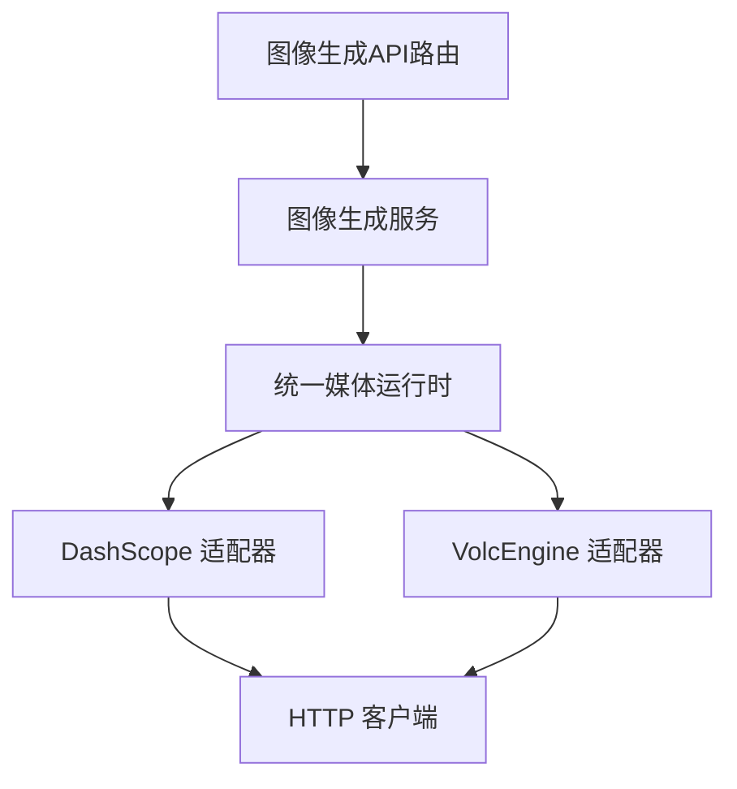

# 同步图像生成适配器

<cite>
**本文引用的文件**   
- [adapters/dashscope/image_sync.py](file://adapters/dashscope/image_sync.py)
- [adapters/volcengine/image.py](file://adapters/volcengine/image.py)
- [adapters/base.py](file://adapters/base.py)
- [adapters/_shared.py](file://adapters/_shared.py)
- [adapters/adapter_helpers.py](file://adapters/adapter_helpers.py)
- [core/unified_media_runtime.py](file://core/unified_media_runtime.py)
- [backend/app/api/v1/dreamweaver_api/image_generation.py](file://backend/app/api/v1/dreamweaver_api/image_generation.py)
- [backend/app/services/providers/image_provider.py](file://backend/app/services/providers/image_provider.py)
</cite>

## 目录
1. [简介](#简介)
2. [项目结构](#项目结构)
3. [核心组件](#核心组件)
4. [架构总览](#架构总览)
5. [详细组件分析](#详细组件分析)
6. [依赖关系分析](#依赖关系分析)
7. [性能考量](#性能考量)
8. [故障排查指南](#故障排查指南)
9. [结论](#结论)
10. [附录](#附录)

## 简介
本技术文档聚焦“同步图像生成适配器”，围绕以下目标展开：
- 解释同步请求处理机制：HTTP 请求构建、参数校验与响应解析。
- 详述 DashScope 与 VolcEngine 提供商的 API 集成实现：认证方式、请求格式转换、错误码映射。
- 描述图像生成参数的完整映射关系（分辨率、风格、质量等）。
- 提供调用同步接口的示例流程，以及成功响应与异常处理的实践建议。
- 给出性能优化建议与最佳实践。

## 项目结构
与同步图像生成相关的代码主要分布在 adapters 层与后端服务层：
- adapters/dashscope/image_sync.py：DashScope 同步图像生成适配器的实现。
- adapters/volcengine/image.py：VolcEngine 同步图像生成适配器的实现。
- adapters/base.py：适配器基类与通用能力定义。
- adapters/_shared.py：跨适配器的共享工具与常量。
- adapters/adapter_helpers.py：适配器辅助函数（如参数归一化、重试策略等）。
- core/unified_media_runtime.py：统一媒体运行时，负责调度不同提供商的媒体能力。
- backend/app/api/v1/dreamweaver_api/image_generation.py：对外暴露的图像生成 API 路由。
- backend/app/services/providers/image_provider.py：图像生成服务编排与提供商选择。

图表来源
- [backend/app/api/v1/dreamweaver_api/image_generation.py](file://backend/app/api/v1/dreamweaver_api/image_generation.py)
- [backend/app/services/providers/image_provider.py](file://backend/app/services/providers/image_provider.py)
- [core/unified_media_runtime.py](file://core/unified_media_runtime.py)
- [adapters/dashscope/image_sync.py](file://adapters/dashscope/image_sync.py)
- [adapters/volcengine/image.py](file://adapters/volcengine/image.py)

章节来源
- [adapters/dashscope/image_sync.py](file://adapters/dashscope/image_sync.py)
- [adapters/volcengine/image.py](file://adapters/volcengine/image.py)
- [adapters/base.py](file://adapters/base.py)
- [adapters/_shared.py](file://adapters/_shared.py)
- [adapters/adapter_helpers.py](file://adapters/adapter_helpers.py)
- [core/unified_media_runtime.py](file://core/unified_media_runtime.py)
- [backend/app/api/v1/dreamweaver_api/image_generation.py](file://backend/app/api/v1/dreamweaver_api/image_generation.py)
- [backend/app/services/providers/image_provider.py](file://backend/app/services/providers/image_provider.py)

## 核心组件
- 适配器基类（Base）：定义统一的接口契约（如 generate_sync），封装通用的认证、重试、超时、日志与错误处理逻辑。
- DashScope 同步适配器：将内部参数转换为 DashScope 的请求格式，发起同步请求并解析返回结果。
- VolcEngine 同步适配器：将内部参数转换为 VolcEngine 的请求格式，发起同步请求并解析返回结果。
- 适配器辅助函数：提供参数归一化、枚举映射、重试退避、限流等通用能力。
- 统一媒体运行时：根据模型或配置选择具体适配器，屏蔽底层差异，向上提供一致的调用体验。
- 图像生成服务与API路由：接收用户请求，进行输入校验，调用服务层，最终返回标准化响应。

章节来源
- [adapters/base.py](file://adapters/base.py)
- [adapters/dashscope/image_sync.py](file://adapters/dashscope/image_sync.py)
- [adapters/volcengine/image.py](file://adapters/volcengine/image.py)
- [adapters/adapter_helpers.py](file://adapters/adapter_helpers.py)
- [core/unified_media_runtime.py](file://core/unified_media_runtime.py)
- [backend/app/api/v1/dreamweaver_api/image_generation.py](file://backend/app/api/v1/dreamweaver_api/image_generation.py)
- [backend/app/services/providers/image_provider.py](file://backend/app/services/providers/image_provider.py)

## 架构总览
下图展示了从客户端到第三方提供商的端到端调用链路，包括请求构建、参数校验、提供商选择、同步请求与响应解析。

图表来源
- [backend/app/api/v1/dreamweaver_api/image_generation.py](file://backend/app/api/v1/dreamweaver_api/image_generation.py)
- [backend/app/services/providers/image_provider.py](file://backend/app/services/providers/image_provider.py)
- [core/unified_media_runtime.py](file://core/unified_media_runtime.py)
- [adapters/dashscope/image_sync.py](file://adapters/dashscope/image_sync.py)
- [adapters/volcengine/image.py](file://adapters/volcengine/image.py)

## 详细组件分析

### DashScope 同步图像生成适配器
- 职责
  - 将内部参数映射为 DashScope 的请求体字段（如 prompt、style、resolution、quality、seed 等）。
  - 设置认证头（通常为 API Key），处理超时与重试。
  - 解析响应：提取图像 URL、二进制数据或错误信息，并转换为统一响应结构。
- 关键流程
  - 参数校验：检查必填字段与取值范围（分辨率、风格枚举、质量等级）。
  - 请求构建：组装 JSON 负载与头部（鉴权、内容类型等）。
  - 同步调用：发起 HTTP 请求并等待结果。
  - 响应解析：识别成功状态码与业务字段，失败时抛出结构化异常。
- 错误码映射
  - 将提供商错误码映射为系统级错误类型（如参数错误、配额不足、服务不可用），便于上层统一处理。

图表来源
- [adapters/dashscope/image_sync.py](file://adapters/dashscope/image_sync.py)

章节来源
- [adapters/dashscope/image_sync.py](file://adapters/dashscope/image_sync.py)

### VolcEngine 同步图像生成适配器
- 职责
  - 将内部参数映射为 VolcEngine 的请求体字段（如 prompt、size/style、quality、seed 等）。
  - 设置认证头（通常为 API Key/签名），处理超时与重试。
  - 解析响应：提取图像 URL、二进制数据或错误信息，并转换为统一响应结构。
- 关键流程
  - 参数校验：检查必填字段与取值范围。
  - 请求构建：组装 JSON 负载与头部（鉴权、内容类型等）。
  - 同步调用：发起 HTTP 请求并等待结果。
  - 响应解析：识别成功状态码与业务字段，失败时抛出结构化异常。
- 错误码映射
  - 将提供商错误码映射为系统级错误类型，确保上层一致的错误处理路径。

图表来源
- [adapters/volcengine/image.py](file://adapters/volcengine/image.py)

章节来源
- [adapters/volcengine/image.py](file://adapters/volcengine/image.py)

### 适配器基类与共享工具
- 基类（Base）
  - 定义统一接口：generate_sync、认证方法、重试策略、超时控制、日志记录。
  - 提供通用错误处理与响应包装，减少重复代码。
- 共享工具（_shared）
  - 提供参数归一化、枚举映射、常用常量（如默认分辨率、风格列表、质量等级）。
- 适配器辅助（adapter_helpers）
  - 提供重试退避、限流、缓存键生成、参数校验工具等。

图表来源
- [adapters/base.py](file://adapters/base.py)
- [adapters/_shared.py](file://adapters/_shared.py)
- [adapters/adapter_helpers.py](file://adapters/adapter_helpers.py)
- [adapters/dashscope/image_sync.py](file://adapters/dashscope/image_sync.py)
- [adapters/volcengine/image.py](file://adapters/volcengine/image.py)

章节来源
- [adapters/base.py](file://adapters/base.py)
- [adapters/_shared.py](file://adapters/_shared.py)
- [adapters/adapter_helpers.py](file://adapters/adapter_helpers.py)

### 统一媒体运行时与服务编排
- 统一媒体运行时（unified_media_runtime）
  - 根据模型 ID 或配置选择具体适配器（DashScope/VolcEngine）。
  - 屏蔽底层差异，向上提供一致的调用接口。
- 图像生成服务（image_provider）
  - 编排调用流程：参数校验、提供商选择、调用适配器、结果标准化。
- API 路由（image_generation）
  - 接收外部请求，进行输入校验，调用服务层，返回标准化响应。

图表来源
- [core/unified_media_runtime.py](file://core/unified_media_runtime.py)
- [backend/app/services/providers/image_provider.py](file://backend/app/services/providers/image_provider.py)
- [backend/app/api/v1/dreamweaver_api/image_generation.py](file://backend/app/api/v1/dreamweaver_api/image_generation.py)

章节来源
- [core/unified_media_runtime.py](file://core/unified_media_runtime.py)
- [backend/app/services/providers/image_provider.py](file://backend/app/services/providers/image_provider.py)
- [backend/app/api/v1/dreamweaver_api/image_generation.py](file://backend/app/api/v1/dreamweaver_api/image_generation.py)

## 依赖关系分析
- 组件耦合与内聚
  - 适配器基类与具体适配器之间通过继承解耦，提高内聚性。
  - 统一媒体运行时与适配器之间通过接口契约解耦，降低耦合度。
- 直接依赖
  - 适配器依赖 HTTP 客户端与提供商 SDK（如有）。
  - 服务层依赖统一媒体运行时与适配器。
  - API 路由依赖服务层。
- 潜在循环依赖
  - 通过分层设计避免循环依赖（API -> Service -> Runtime -> Adapter）。
- 外部依赖
  - DashScope 与 VolcEngine 的 HTTP API。
  - 可能的缓存、限流、重试中间件。

图表来源
- [backend/app/api/v1/dreamweaver_api/image_generation.py](file://backend/app/api/v1/dreamweaver_api/image_generation.py)
- [backend/app/services/providers/image_provider.py](file://backend/app/services/providers/image_provider.py)
- [core/unified_media_runtime.py](file://core/unified_media_runtime.py)
- [adapters/dashscope/image_sync.py](file://adapters/dashscope/image_sync.py)
- [adapters/volcengine/image.py](file://adapters/volcengine/image.py)

章节来源
- [backend/app/api/v1/dreamweaver_api/image_generation.py](file://backend/app/api/v1/dreamweaver_api/image_generation.py)
- [backend/app/services/providers/image_provider.py](file://backend/app/services/providers/image_provider.py)
- [core/unified_media_runtime.py](file://core/unified_media_runtime.py)
- [adapters/dashscope/image_sync.py](file://adapters/dashscope/image_sync.py)
- [adapters/volcengine/image.py](file://adapters/volcengine/image.py)

## 性能考量
- 连接池与复用
  - 使用 HTTP 连接池，减少握手开销。
- 超时与重试
  - 合理设置超时时间，配合指数退避重试，提升稳定性。
- 并发与限流
  - 对高并发场景启用队列与限流，避免触发提供商限制。
- 缓存
  - 对相同参数组合的结果进行缓存，减少重复调用。
- 参数优化
  - 选择合适的分辨率与质量，平衡速度与效果。
- 监控与追踪
  - 记录关键指标（延迟、成功率、错误码分布），便于定位瓶颈。

[本节为通用指导，不直接分析具体文件]

## 故障排查指南
- 常见问题
  - 认证失败：检查 API Key 是否正确、权限是否足够。
  - 参数错误：核对必填字段与取值范围（分辨率、风格、质量）。
  - 网络超时：调整超时时间或重试策略。
  - 配额不足：检查账户余额或配额限制。
- 错误码映射
  - 将提供商错误码映射为系统级错误类型，便于统一处理与提示。
- 日志与追踪
  - 记录请求与响应的关键信息（脱敏后），便于问题定位。
- 回退策略
  - 在某个提供商不可用时，自动切换到其他提供商或降级模式。

章节来源
- [adapters/dashscope/image_sync.py](file://adapters/dashscope/image_sync.py)
- [adapters/volcengine/image.py](file://adapters/volcengine/image.py)
- [adapters/base.py](file://adapters/base.py)
- [adapters/adapter_helpers.py](file://adapters/adapter_helpers.py)

## 结论
同步图像生成适配器通过统一的基类与运行时抽象，屏蔽了 DashScope 与 VolcEngine 的差异，提供了稳定、可扩展的图像生成能力。通过合理的参数映射、错误码映射与性能优化策略，能够在保证质量的同时提升系统稳定性与效率。

[本节为总结，不直接分析具体文件]

## 附录
- 调用示例（概念性流程）
  - 准备参数：prompt、resolution、style、quality、seed。
  - 调用 API：POST /image/generate。
  - 处理响应：获取图像 URL 或二进制数据，保存或展示。
  - 异常处理：捕获并提示错误信息，必要时重试或切换提供商。
- 参数映射参考
  - 分辨率：映射为 width/height 或 size 字段。
  - 风格：映射为 style 或 model 字段。
  - 质量：映射为 quality 或 mode 字段。
  - 种子：映射为 seed 字段。

[本节为概念性内容，不直接分析具体文件]