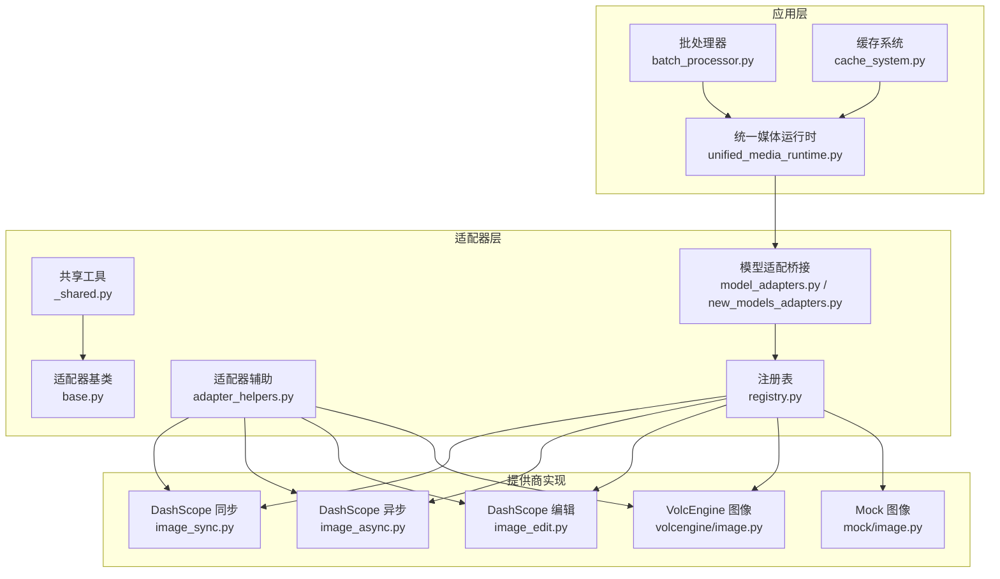
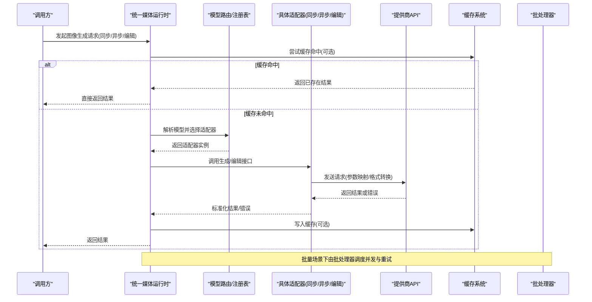
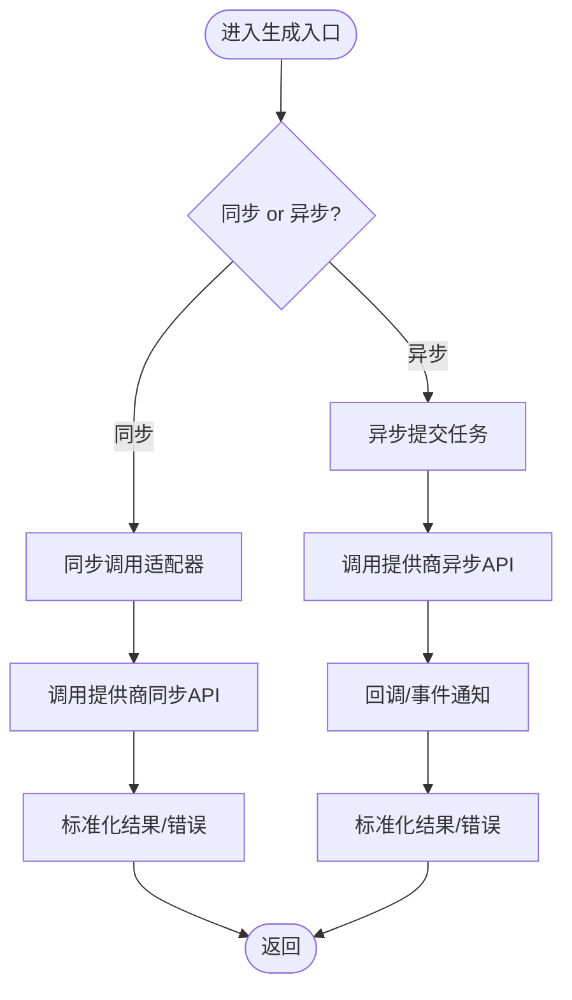
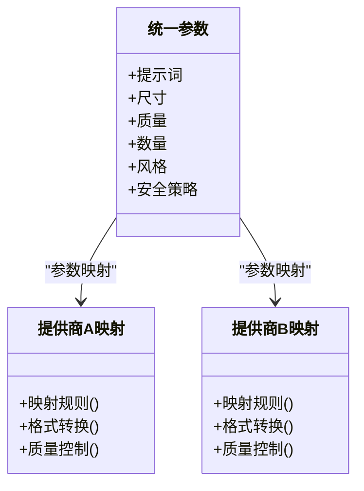
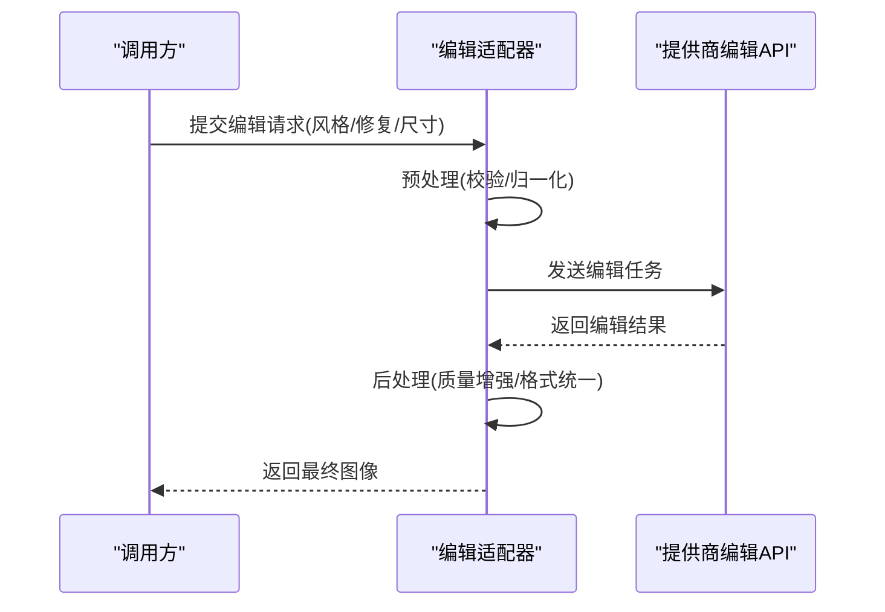
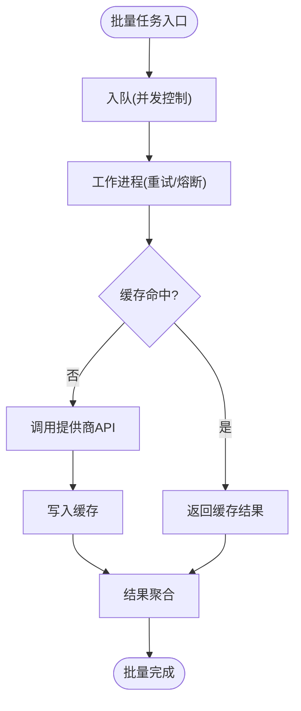
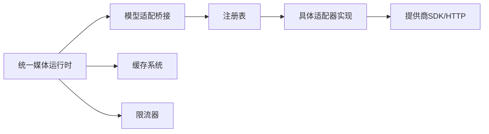

# 图像生成适配器

<cite>
**本文档引用的文件**   
- [adapters/base.py](file://adapters/base.py)
- [adapters/_shared.py](file://adapters/_shared.py)
- [adapters/adapter_helpers.py](file://adapters/adapter_helpers.py)
- [adapters/dashscope/image_sync.py](file://adapters/dashscope/image_sync.py)
- [adapters/dashscope/image_async.py](file://adapters/dashscope/image_async.py)
- [adapters/dashscope/image_edit.py](file://adapters/dashscope/image_edit.py)
- [adapters/volcengine/image.py](file://adapters/volcengine/image.py)
- [adapters/mock/image.py](file://adapters/mock/image.py)
- [adapters/model_adapters.py](file://adapters/model_adapters.py)
- [adapters/new_models_adapters.py](file://adapters/new_models_adapters.py)
- [adapters/registry.py](file://adapters/registry.py)
- [core/unified_media_runtime.py](file://core/unified_media_runtime.py)
- [backend/app/services/batch_processor.py](file://backend/app/services/batch_processor.py)
- [backend/app/services/cache_system.py](file://backend/app/services/cache_system.py)
- [adapters/rate_limiter.py](file://adapters/rate_limiter.py)
</cite>

## 目录
1. [简介](#简介)
2. [项目结构](#项目结构)
3. [核心组件](#核心组件)
4. [架构总览](#架构总览)
5. [详细组件分析](#详细组件分析)
6. [依赖关系分析](#依赖关系分析)
7. [性能考量](#性能考量)
8. [故障排除指南](#故障排除指南)
9. [结论](#结论)
10. [附录](#附录)

## 简介
本技术文档面向“图像生成适配器”子系统，覆盖同步与异步图像生成接口、多提供商集成（参数映射、格式转换、质量控制）、图像编辑（风格迁移、修复、尺寸调整）、批量处理、缓存策略与性能优化。读者无需深入源码即可理解整体设计、调用流程与排错方法；同时为二次开发与扩展提供清晰的参考路径。

## 项目结构
图像生成相关代码主要分布在以下模块：
- 适配器基类与通用工具：定义统一抽象、共享逻辑与辅助函数
- 具体提供商实现：如 DashScope、VolcEngine、Mock 等
- 模型路由与注册：负责按模型名或能力选择具体适配器
- 统一媒体运行时：对外暴露统一的同步/异步 API 与错误语义
- 批处理与缓存服务：支撑高吞吐与低延迟的批量任务与结果复用
- 限流器：保护下游 API 不被超限

图表来源
- [core/unified_media_runtime.py](file://core/unified_media_runtime.py)
- [adapters/model_adapters.py](file://adapters/model_adapters.py)
- [adapters/new_models_adapters.py](file://adapters/new_models_adapters.py)
- [adapters/registry.py](file://adapters/registry.py)
- [adapters/dashscope/image_sync.py](file://adapters/dashscope/image_sync.py)
- [adapters/dashscope/image_async.py](file://adapters/dashscope/image_async.py)
- [adapters/dashscope/image_edit.py](file://adapters/dashscope/image_edit.py)
- [adapters/volcengine/image.py](file://adapters/volcengine/image.py)
- [adapters/mock/image.py](file://adapters/mock/image.py)
- [backend/app/services/batch_processor.py](file://backend/app/services/batch_processor.py)
- [backend/app/services/cache_system.py](file://backend/app/services/cache_system.py)

章节来源
- [adapters/base.py](file://adapters/base.py)
- [adapters/_shared.py](file://adapters/_shared.py)
- [adapters/adapter_helpers.py](file://adapters/adapter_helpers.py)
- [adapters/model_adapters.py](file://adapters/model_adapters.py)
- [adapters/new_models_adapters.py](file://adapters/new_models_adapters.py)
- [adapters/registry.py](file://adapters/registry.py)
- [core/unified_media_runtime.py](file://core/unified_media_runtime.py)
- [backend/app/services/batch_processor.py](file://backend/app/services/batch_processor.py)
- [backend/app/services/cache_system.py](file://backend/app/services/cache_system.py)

## 核心组件
- 适配器基类与抽象
  - 定义统一的图像生成接口（同步/异步）、编辑接口、参数校验与错误映射
  - 提供重试、超时、日志与指标埋点钩子
- 提供商实现
  - DashScope：同步、异步与编辑三类实现，分别对应不同 API 形态
  - VolcEngine：图像生成与编辑的统一封装
  - Mock：用于本地调试与回归测试
- 模型路由与注册
  - 通过注册表将“模型标识 -> 适配器实例”进行绑定，支持按能力维度路由
- 统一媒体运行时
  - 对外暴露一致的同步/异步 API，屏蔽底层差异，集中处理错误与回调
- 批处理与缓存
  - 批处理器支持并发控制、失败重试与结果聚合
  - 缓存系统基于请求指纹命中，减少重复计算与网络开销
- 限流器
  - 对下游提供商 API 进行令牌桶/漏桶限流，避免触发配额限制

章节来源
- [adapters/base.py](file://adapters/base.py)
- [adapters/dashscope/image_sync.py](file://adapters/dashscope/image_sync.py)
- [adapters/dashscope/image_async.py](file://adapters/dashscope/image_async.py)
- [adapters/dashscope/image_edit.py](file://adapters/dashscope/image_edit.py)
- [adapters/volcengine/image.py](file://adapters/volcengine/image.py)
- [adapters/mock/image.py](file://adapters/mock/image.py)
- [adapters/model_adapters.py](file://adapters/model_adapters.py)
- [adapters/new_models_adapters.py](file://adapters/new_models_adapters.py)
- [adapters/registry.py](file://adapters/registry.py)
- [core/unified_media_runtime.py](file://core/unified_media_runtime.py)
- [backend/app/services/batch_processor.py](file://backend/app/services/batch_processor.py)
- [backend/app/services/cache_system.py](file://backend/app/services/cache_system.py)
- [adapters/rate_limiter.py](file://adapters/rate_limiter.py)

## 架构总览
下图展示了从上层调用到具体提供商的完整链路，包括同步/异步分支、编辑分支、批处理与缓存的介入点。

图表来源
- [core/unified_media_runtime.py](file://core/unified_media_runtime.py)
- [adapters/registry.py](file://adapters/registry.py)
- [adapters/dashscope/image_sync.py](file://adapters/dashscope/image_sync.py)
- [adapters/dashscope/image_async.py](file://adapters/dashscope/image_async.py)
- [adapters/dashscope/image_edit.py](file://adapters/dashscope/image_edit.py)
- [adapters/volcengine/image.py](file://adapters/volcengine/image.py)
- [backend/app/services/cache_system.py](file://backend/app/services/cache_system.py)
- [backend/app/services/batch_processor.py](file://backend/app/services/batch_processor.py)

## 详细组件分析

### 同步与异步图像生成接口差异
- 请求处理方式
  - 同步：阻塞等待提供商响应，适合简单调用链与短耗时任务
  - 异步：非阻塞提交任务，使用回调或事件通知完成，适合高并发与长耗时任务
- 回调机制
  - 异步接口通常采用回调函数或事件总线，在任务完成后回传结果或错误
  - 统一媒体运行时对回调进行标准化封装，保证错误语义一致
- 错误处理
  - 网络异常、鉴权失败、参数校验错误、业务错误（如内容安全拦截）均被捕获并转换为统一错误类型
  - 重试策略可配置（指数退避、最大重试次数），并在失败时记录诊断信息

图表来源
- [adapters/dashscope/image_sync.py](file://adapters/dashscope/image_sync.py)
- [adapters/dashscope/image_async.py](file://adapters/dashscope/image_async.py)
- [core/unified_media_runtime.py](file://core/unified_media_runtime.py)

章节来源
- [adapters/dashscope/image_sync.py](file://adapters/dashscope/image_sync.py)
- [adapters/dashscope/image_async.py](file://adapters/dashscope/image_async.py)
- [core/unified_media_runtime.py](file://core/unified_media_runtime.py)

### 多提供商集成：参数映射、格式转换与质量控制
- 参数映射
  - 将上层统一参数（提示词、尺寸、质量、数量、风格等）映射为各提供商特定字段
  - 缺失字段提供默认值，非法字段进行裁剪或拒绝
- 格式转换
  - 输入图像编码（Base64/URL/本地路径）统一转换为提供商要求的格式
  - 输出图像统一为标准格式（如 PNG/JPEG）与元数据（宽高、色彩空间）
- 质量控制
  - 分辨率阈值、宽高比校验、内容安全检测、质量评分（可选）
  - 失败降级：当某提供商不可用时自动切换至备选模型或回退策略

图表来源
- [adapters/dashscope/image_sync.py](file://adapters/dashscope/image_sync.py)
- [adapters/dashscope/image_async.py](file://adapters/dashscope/image_async.py)
- [adapters/volcengine/image.py](file://adapters/volcengine/image.py)
- [adapters/mock/image.py](file://adapters/mock/image.py)

章节来源
- [adapters/dashscope/image_sync.py](file://adapters/dashscope/image_sync.py)
- [adapters/dashscope/image_async.py](file://adapters/dashscope/image_async.py)
- [adapters/volcengine/image.py](file://adapters/volcengine/image.py)
- [adapters/mock/image.py](file://adapters/mock/image.py)

### 图像编辑功能：风格迁移、修复与尺寸调整
- 风格迁移
  - 输入参考图与目标图，通过风格权重与提示词控制迁移强度
  - 适配器内部进行图像预处理（归一化、对齐）与后处理（锐化、降噪）
- 图像修复
  - 掩码区域识别与填充，结合上下文语义进行内容补全
  - 支持局部重绘与全局一致性检查
- 尺寸调整
  - 保持宽高比的智能缩放、裁切与填充
  - 多分辨率输出与质量档位选择

图表来源
- [adapters/dashscope/image_edit.py](file://adapters/dashscope/image_edit.py)
- [adapters/volcengine/image.py](file://adapters/volcengine/image.py)

章节来源
- [adapters/dashscope/image_edit.py](file://adapters/dashscope/image_edit.py)
- [adapters/volcengine/image.py](file://adapters/volcengine/image.py)

### 批处理、缓存策略与性能优化
- 批处理
  - 并发度可控的任务队列，支持失败重试与部分成功聚合
  - 任务分片与负载均衡，避免单点过载
- 缓存策略
  - 基于请求指纹（提示词+参数哈希）命中缓存，减少重复调用
  - 缓存失效策略（TTL、版本控制、人工刷新）
- 性能优化
  - 连接池与HTTP复用、零拷贝传输、压缩传输
  - 预热与懒加载，降低冷启动延迟

图表来源
- [backend/app/services/batch_processor.py](file://backend/app/services/batch_processor.py)
- [backend/app/services/cache_system.py](file://backend/app/services/cache_system.py)

章节来源
- [backend/app/services/batch_processor.py](file://backend/app/services/batch_processor.py)
- [backend/app/services/cache_system.py](file://backend/app/services/cache_system.py)

## 依赖关系分析
- 耦合与内聚
  - 适配器基类提供高内聚的通用能力，具体实现仅关注提供商差异
  - 注册表解耦模型选择与实现，便于扩展新提供商
- 外部依赖
  - 提供商 SDK/HTTP 客户端、缓存存储（内存/Redis）、消息队列（可选）
- 循环依赖
  - 通过分层与接口隔离避免循环引用

图表来源
- [core/unified_media_runtime.py](file://core/unified_media_runtime.py)
- [adapters/model_adapters.py](file://adapters/model_adapters.py)
- [adapters/new_models_adapters.py](file://adapters/new_models_adapters.py)
- [adapters/registry.py](file://adapters/registry.py)
- [adapters/rate_limiter.py](file://adapters/rate_limiter.py)
- [backend/app/services/cache_system.py](file://backend/app/services/cache_system.py)

章节来源
- [adapters/model_adapters.py](file://adapters/model_adapters.py)
- [adapters/new_models_adapters.py](file://adapters/new_models_adapters.py)
- [adapters/registry.py](file://adapters/registry.py)
- [core/unified_media_runtime.py](file://core/unified_media_runtime.py)
- [adapters/rate_limiter.py](file://adapters/rate_limiter.py)
- [backend/app/services/cache_system.py](file://backend/app/services/cache_system.py)

## 性能考量
- 并发与吞吐
  - 合理设置并发度与队列长度，避免下游限流与资源耗尽
  - 使用连接池与 HTTP/2 提升网络效率
- 缓存命中率
  - 优化指纹键设计，提高相同语义请求的命中率
  - 定期清理过期缓存，释放内存
- 错误恢复
  - 指数退避重试、熔断与快速失败，缩短故障影响面
- 监控与观测
  - 关键指标：QPS、延迟分布、错误率、缓存命中率、重试率
  - 日志与追踪：请求ID贯穿全流程，便于定位问题

[本节为通用指导，不直接分析具体文件]

## 故障排除指南
- 常见问题
  - 鉴权失败：检查密钥与权限范围，确认提供商账户状态
  - 参数错误：核对必填字段与取值范围，启用严格校验模式
  - 内容安全拦截：调整提示词或关闭敏感过滤（需合规审批）
  - 超时与重试：增加超时阈值与重试次数，观察是否稳定
  - 缓存污染：清除相关缓存键，验证结果是否正确
- 诊断步骤
  - 查看请求日志与错误码，定位失败阶段（参数校验/网络/提供商/后处理）
  - 使用 Mock 适配器复现问题，隔离第三方因素
  - 逐步缩小范围（单条请求 vs 批量、同步 vs 异步）

章节来源
- [adapters/mock/image.py](file://adapters/mock/image.py)
- [core/unified_media_runtime.py](file://core/unified_media_runtime.py)

## 结论
图像生成适配器通过统一的抽象与注册机制，屏蔽了多提供商差异，提供了稳定的同步/异步接口与编辑能力。配合批处理、缓存与限流策略，可在高并发场景下保持稳定与高效。建议在生产环境完善监控与告警，持续优化参数映射与质量控制策略，确保质量与成本平衡。

[本节为总结性内容，不直接分析具体文件]

## 附录
- 调用示例（路径参考）
  - 同步生成：参见 [adapters/dashscope/image_sync.py](file://adapters/dashscope/image_sync.py)
  - 异步生成：参见 [adapters/dashscope/image_async.py](file://adapters/dashscope/image_async.py)
  - 图像编辑：参见 [adapters/dashscope/image_edit.py](file://adapters/dashscope/image_edit.py)
  - 多提供商接入：参见 [adapters/volcengine/image.py](file://adapters/volcengine/image.py)、[adapters/mock/image.py](file://adapters/mock/image.py)
  - 模型路由与注册：参见 [adapters/model_adapters.py](file://adapters/model_adapters.py)、[adapters/new_models_adapters.py](file://adapters/new_models_adapters.py)、[adapters/registry.py](file://adapters/registry.py)
  - 统一媒体运行时：参见 [core/unified_media_runtime.py](file://core/unified_media_runtime.py)
  - 批处理与缓存：参见 [backend/app/services/batch_processor.py](file://backend/app/services/batch_processor.py)、[backend/app/services/cache_system.py](file://backend/app/services/cache_system.py)
  - 限流器：参见 [adapters/rate_limiter.py](file://adapters/rate_limiter.py)

[本节为索引性内容，不直接分析具体文件]