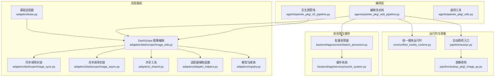
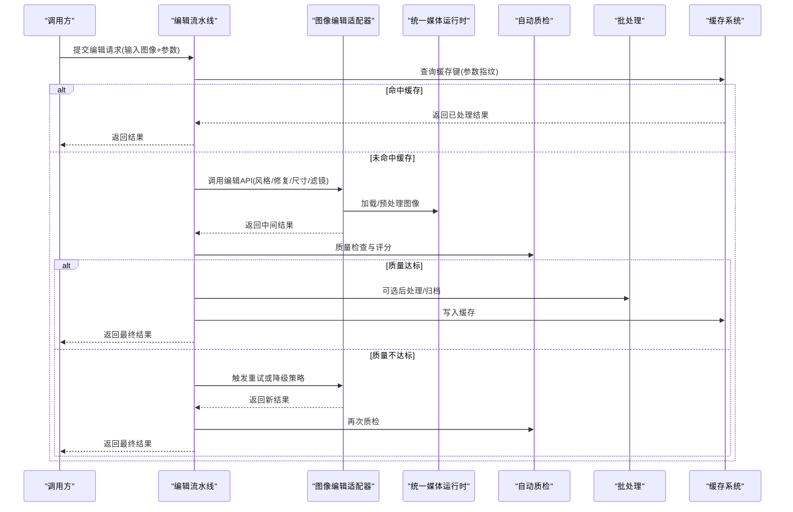
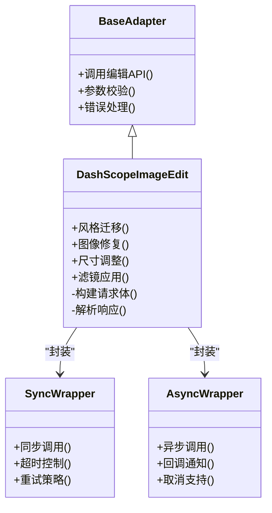
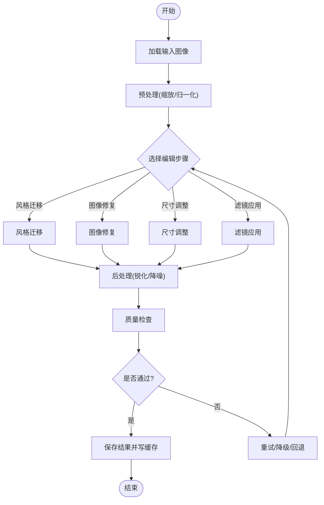
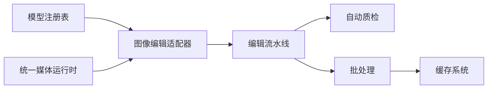
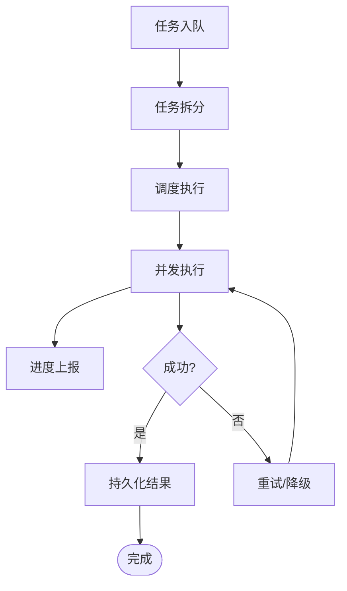

# 图像编辑适配器

<cite>
**本文引用的文件**   
- [adapters/dashscope/image_edit.py](file://adapters/dashscope/image_edit.py)
- [adapters/dashscope/image_async.py](file://adapters/dashscope/image_async.py)
- [adapters/dashscope/image_sync.py](file://adapters/dashscope/image_sync.py)
- [adapters/base.py](file://adapters/base.py)
- [adapters/registry.py](file://adapters/registry.py)
- [adapters/_shared.py](file://adapters/_shared.py)
- [adapters/adapter_helpers.py](file://adapters/adapter_helpers.py)
- [agents/painter_pkg/_edit_pipeline.py](file://agents/painter_pkg/_edit_pipeline.py)
- [agents/painter_pkg/_t2i_pipeline.py](file://agents/painter_pkg/_t2i_pipeline.py)
- [agents/painter_pkg/_utils.py](file://agents/painter_pkg/_utils.py)
- [core/unified_media_runtime.py](file://core/unified_media_runtime.py)
- [pipeline/autoqc.py](file://pipeline/autoqc.py)
- [pipeline/_image_qc.py](file://pipeline/autoqc_pkg/_image_qc.py)
- [backend/app/services/batch_processor.py](file://backend/app/services/batch_processor.py)
- [backend/app/services/cache_system.py](file://backend/app/services/cache_system.py)
- [schemas/common.py](file://schemas/common.py)
</cite>

## 目录
1. [简介](#简介)
2. [项目结构](#项目结构)
3. [核心组件](#核心组件)
4. [架构总览](#架构总览)
5. [详细组件分析](#详细组件分析)
6. [依赖关系分析](#依赖关系分析)
7. [性能考量](#性能考量)
8. [故障排查指南](#故障排查指南)
9. [结论](#结论)
10. [附录](#附录)

## 简介
本技术文档面向“图像编辑适配器”，系统性阐述风格迁移、图像修复、尺寸调整与滤镜应用的实现原理与调用方式。文档覆盖：
- 输入图像格式要求、编辑参数配置与输出结果处理
- 批量编辑的任务调度、进度跟踪与错误恢复
- 图像处理算法选择与优化策略（GPU加速、内存管理、缓存机制）
- 完整编辑操作示例，展示复杂编辑流水线
- 编辑质量评估与结果验证方法

## 项目结构
图像编辑相关代码主要分布在以下模块：
- 适配器层：统一抽象与多后端接入（如 DashScope），提供同步/异步接口
- 编排层：编辑流水线与任务编排（Painter 包）
- 运行时：媒体统一运行时，负责编解码、转码与资源管理
- 质量保障：自动质检与评分
- 批处理与缓存：后台服务中的批量处理器与缓存系统

**图表来源** 
- [adapters/base.py](file://adapters/base.py)
- [adapters/dashscope/image_edit.py](file://adapters/dashscope/image_edit.py)
- [adapters/dashscope/image_sync.py](file://adapters/dashscope/image_sync.py)
- [adapters/dashscope/image_async.py](file://adapters/dashscope/image_async.py)
- [adapters/_shared.py](file://adapters/_shared.py)
- [adapters/adapter_helpers.py](file://adapters/adapter_helpers.py)
- [adapters/registry.py](file://adapters/registry.py)
- [agents/painter_pkg/_edit_pipeline.py](file://agents/painter_pkg/_edit_pipeline.py)
- [agents/painter_pkg/_t2i_pipeline.py](file://agents/painter_pkg/_t2i_pipeline.py)
- [core/unified_media_runtime.py](file://core/unified_media_runtime.py)
- [pipeline/autoqc.py](file://pipeline/autoqc.py)
- [pipeline/autoqc_pkg/_image_qc.py](file://pipeline/autoqc_pkg/_image_qc.py)
- [backend/app/services/batch_processor.py](file://backend/app/services/batch_processor.py)
- [backend/app/services/cache_system.py](file://backend/app/services/cache_system.py)

**章节来源**
- [adapters/base.py](file://adapters/base.py)
- [adapters/dashscope/image_edit.py](file://adapters/dashscope/image_edit.py)
- [adapters/dashscope/image_sync.py](file://adapters/dashscope/image_sync.py)
- [adapters/dashscope/image_async.py](file://adapters/dashscope/image_async.py)
- [adapters/_shared.py](file://adapters/_shared.py)
- [adapters/adapter_helpers.py](file://adapters/adapter_helpers.py)
- [adapters/registry.py](file://adapters/registry.py)
- [agents/painter_pkg/_edit_pipeline.py](file://agents/painter_pkg/_edit_pipeline.py)
- [agents/painter_pkg/_t2i_pipeline.py](file://agents/painter_pkg/_t2i_pipeline.py)
- [core/unified_media_runtime.py](file://core/unified_media_runtime.py)
- [pipeline/autoqc.py](file://pipeline/autoqc.py)
- [pipeline/autoqc_pkg/_image_qc.py](file://pipeline/autoqc_pkg/_image_qc.py)
- [backend/app/services/batch_processor.py](file://backend/app/services/batch_processor.py)
- [backend/app/services/cache_system.py](file://backend/app/services/cache_system.py)

## 核心组件
- 基础适配器与注册表：定义统一的图像编辑能力抽象与模型注册机制，确保多后端可插拔接入
- DashScope 图像编辑适配器：封装具体厂商的图像编辑 API（风格迁移、修复、尺寸调整、滤镜等）
- 同步/异步调用封装：分别面向阻塞式与非阻塞式调用场景，统一错误与重试策略
- 编辑流水线：将多个编辑步骤组合为可复用的工作流，支持参数化与条件分支
- 统一媒体运行时：负责图像加载、编码、缩放、色彩空间转换与内存复用
- 自动质检：对生成结果进行质量检查与评分，支撑结果筛选与回退
- 批处理与缓存：任务拆分、并发控制、进度上报、失败重试与结果缓存

**章节来源**
- [adapters/base.py](file://adapters/base.py)
- [adapters/dashscope/image_edit.py](file://adapters/dashscope/image_edit.py)
- [adapters/dashscope/image_sync.py](file://adapters/dashscope/image_sync.py)
- [adapters/dashscope/image_async.py](file://adapters/dashscope/image_async.py)
- [agents/painter_pkg/_edit_pipeline.py](file://agents/painter_pkg/_edit_pipeline.py)
- [core/unified_media_runtime.py](file://core/unified_media_runtime.py)
- [pipeline/autoqc.py](file://pipeline/autoqc.py)
- [backend/app/services/batch_processor.py](file://backend/app/services/batch_processor.py)
- [backend/app/services/cache_system.py](file://backend/app/services/cache_system.py)

## 架构总览
图像编辑适配器采用分层解耦设计：上层编排器通过统一接口调用适配器；适配器根据模型注册表选择具体后端；底层媒体运行时负责数据面处理；质量与批处理贯穿全流程。

**图表来源** 
- [agents/painter_pkg/_edit_pipeline.py](file://agents/painter_pkg/_edit_pipeline.py)
- [adapters/dashscope/image_edit.py](file://adapters/dashscope/image_edit.py)
- [core/unified_media_runtime.py](file://core/unified_media_runtime.py)
- [pipeline/autoqc.py](file://pipeline/autoqc.py)
- [backend/app/services/batch_processor.py](file://backend/app/services/batch_processor.py)
- [backend/app/services/cache_system.py](file://backend/app/services/cache_system.py)

## 详细组件分析

### 图像编辑适配器（DashScope）
- 功能范围：风格迁移、图像修复、尺寸调整、滤镜应用
- 输入要求：支持常见图像格式（JPEG/PNG/WEBP），分辨率与通道数由运行时校验与转换
- 参数配置：强度、权重、目标尺寸、区域掩膜、采样步数、随机种子等
- 输出处理：统一编码为指定格式，附带元数据（尺寸、哈希、质量分）

**图表来源** 
- [adapters/base.py](file://adapters/base.py)
- [adapters/dashscope/image_edit.py](file://adapters/dashscope/image_edit.py)
- [adapters/dashscope/image_sync.py](file://adapters/dashscope/image_sync.py)
- [adapters/dashscope/image_async.py](file://adapters/dashscope/image_async.py)

**章节来源**
- [adapters/dashscope/image_edit.py](file://adapters/dashscope/image_edit.py)
- [adapters/dashscope/image_sync.py](file://adapters/dashscope/image_sync.py)
- [adapters/dashscope/image_async.py](file://adapters/dashscope/image_async.py)
- [adapters/base.py](file://adapters/base.py)

### 编辑流水线（Painter）
- 流程编排：串联多个编辑步骤（预处理→编辑→后处理→质检）
- 参数传递：步骤间以结构化对象传递，支持默认值与覆盖
- 条件分支：基于质量分数或业务规则决定下一步动作
- 错误恢复：单步失败时触发重试、降级或跳过策略

**图表来源** 
- [agents/painter_pkg/_edit_pipeline.py](file://agents/painter_pkg/_edit_pipeline.py)
- [agents/painter_pkg/_utils.py](file://agents/painter_pkg/_utils.py)
- [core/unified_media_runtime.py](file://core/unified_media_runtime.py)
- [pipeline/autoqc.py](file://pipeline/autoqc.py)

**章节来源**
- [agents/painter_pkg/_edit_pipeline.py](file://agents/painter_pkg/_edit_pipeline.py)
- [agents/painter_pkg/_utils.py](file://agents/painter_pkg/_utils.py)
- [core/unified_media_runtime.py](file://core/unified_media_runtime.py)
- [pipeline/autoqc.py](file://pipeline/autoqc.py)

### 统一媒体运行时
- 编解码：支持多种图像格式与色彩空间，统一内部表示
- 内存管理：池化与复用，避免频繁分配释放
- GPU 加速：在可用条件下启用硬件加速路径
- 缓存：按内容哈希缓存中间结果，减少重复计算

**章节来源**
- [core/unified_media_runtime.py](file://core/unified_media_runtime.py)

### 自动质检（AutoQC）
- 指标：清晰度、噪声、过曝/欠曝、色偏、语义一致性
- 阈值策略：动态阈值与模型自适应
- 回退：低分结果触发重算或降级模型

**章节来源**
- [pipeline/autoqc.py](file://pipeline/autoqc.py)
- [pipeline/autoqc_pkg/_image_qc.py](file://pipeline/autoqc_pkg/_image_qc.py)

### 批处理与缓存
- 任务调度：队列化、优先级、并发限制
- 进度跟踪：事件驱动上报，支持断点续传
- 错误恢复：指数退避重试、死信队列、人工介入
- 缓存策略：LRU/TTL、按参数指纹去重

**章节来源**
- [backend/app/services/batch_processor.py](file://backend/app/services/batch_processor.py)
- [backend/app/services/cache_system.py](file://backend/app/services/cache_system.py)

## 依赖关系分析
- 适配器依赖运行时进行数据面处理，依赖注册表选择具体后端
- 流水线依赖适配器与质检，间接依赖批处理与缓存
- 批处理与缓存为横切关注点，贯穿编辑全流程

**图表来源** 
- [adapters/registry.py](file://adapters/registry.py)
- [adapters/dashscope/image_edit.py](file://adapters/dashscope/image_edit.py)
- [core/unified_media_runtime.py](file://core/unified_media_runtime.py)
- [agents/painter_pkg/_edit_pipeline.py](file://agents/painter_pkg/_edit_pipeline.py)
- [pipeline/autoqc.py](file://pipeline/autoqc.py)
- [backend/app/services/batch_processor.py](file://backend/app/services/batch_processor.py)
- [backend/app/services/cache_system.py](file://backend/app/services/cache_system.py)

**章节来源**
- [adapters/registry.py](file://adapters/registry.py)
- [adapters/dashscope/image_edit.py](file://adapters/dashscope/image_edit.py)
- [core/unified_media_runtime.py](file://core/unified_media_runtime.py)
- [agents/painter_pkg/_edit_pipeline.py](file://agents/painter_pkg/_edit_pipeline.py)
- [pipeline/autoqc.py](file://pipeline/autoqc.py)
- [backend/app/services/batch_processor.py](file://backend/app/services/batch_processor.py)
- [backend/app/services/cache_system.py](file://backend/app/services/cache_system.py)

## 性能考量
- GPU 加速：在媒体运行时中优先使用 GPU 路径，降低 CPU 负载
- 内存复用：图像块级处理与缓冲区池，减少峰值内存
- 并行度：批处理并发与流水线并行，结合限流避免过载
- 缓存命中率：参数指纹规范化与短 TTL 热点缓存
- 传输优化：按需压缩与流式传输，减少网络开销

[本节为通用指导，不直接分析具体文件]

## 故障排查指南
- 常见问题
  - 输入格式不支持：检查运行时支持的格式与通道数
  - 参数越界：校验强度、尺寸、步数等边界
  - 超时与重试：查看批处理的重试策略与退避间隔
  - 质量不达标：定位质检指标与阈值，调整模型或参数
- 诊断手段
  - 启用详细日志与追踪 ID
  - 导出中间结果与质量分数
  - 回放失败任务并对比成功样本

**章节来源**
- [adapters/_shared.py](file://adapters/_shared.py)
- [adapters/adapter_helpers.py](file://adapters/adapter_helpers.py)
- [pipeline/autoqc.py](file://pipeline/autoqc.py)
- [backend/app/services/batch_processor.py](file://backend/app/services/batch_processor.py)

## 结论
图像编辑适配器通过清晰的层次划分与模块化设计，实现了风格迁移、图像修复、尺寸调整与滤镜应用的统一接入与编排。借助统一媒体运行时、自动质检与批处理缓存，系统在性能、稳定性与可维护性方面具备良好表现。建议在生产环境中结合监控与审计，持续优化参数与策略。

[本节为总结，不直接分析具体文件]

## 附录

### API 调用方式与参数说明
- 输入图像格式：JPEG/PNG/WEBP，RGB/RGBA，分辨率建议符合模型要求
- 编辑参数：强度、权重、目标尺寸、掩膜、采样步数、随机种子等
- 输出结果：图像二进制或 URL，附带元数据（尺寸、哈希、质量分）

**章节来源**
- [adapters/dashscope/image_edit.py](file://adapters/dashscope/image_edit.py)
- [adapters/dashscope/image_sync.py](file://adapters/dashscope/image_sync.py)
- [adapters/dashscope/image_async.py](file://adapters/dashscope/image_async.py)
- [schemas/common.py](file://schemas/common.py)

### 批量编辑示例（概念流程）
- 任务拆分：按批次大小与优先级入队
- 并发执行：限制并发度，避免资源争用
- 进度上报：实时推送完成比例与状态
- 错误恢复：失败任务进入重试队列，超限转入死信

[本图为概念流程，不映射具体源码]

### 编辑质量评估与结果验证
- 指标体系：清晰度、噪声、曝光、色偏、语义一致性
- 阈值策略：静态阈值与动态自适应
- 验证方法：抽样人工复核、A/B 测试、回归基线对比

**章节来源**
- [pipeline/autoqc.py](file://pipeline/autoqc.py)
- [pipeline/autoqc_pkg/_image_qc.py](file://pipeline/autoqc_pkg/_image_qc.py)