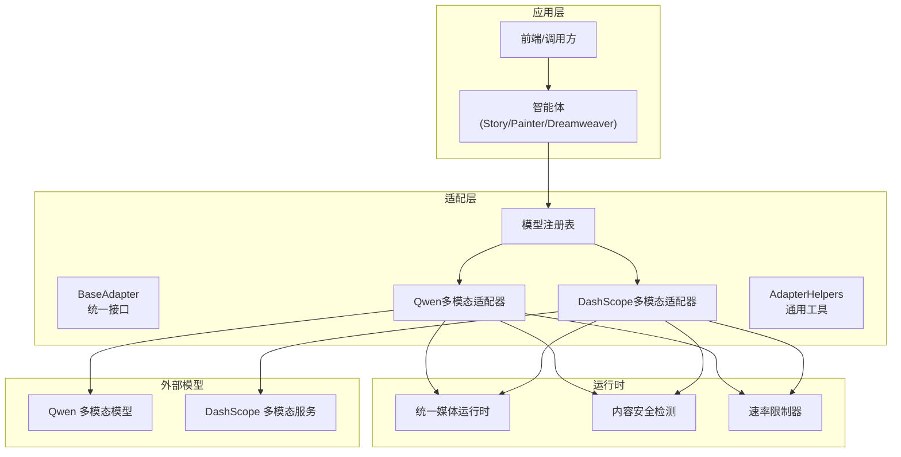
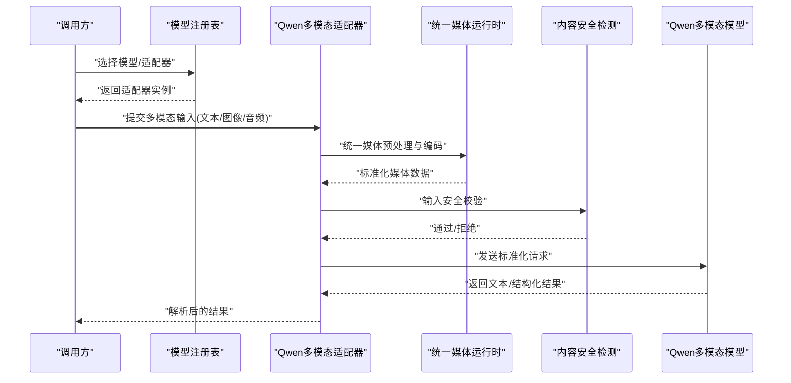
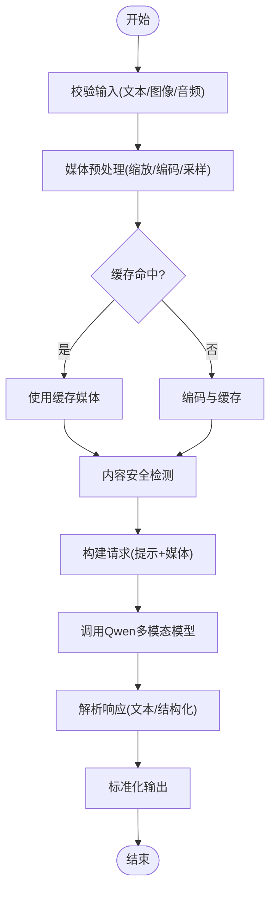
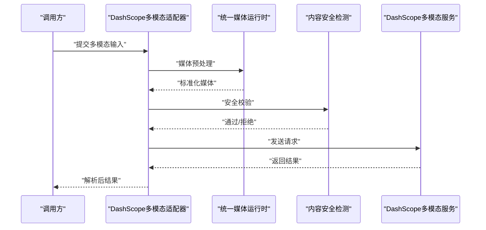
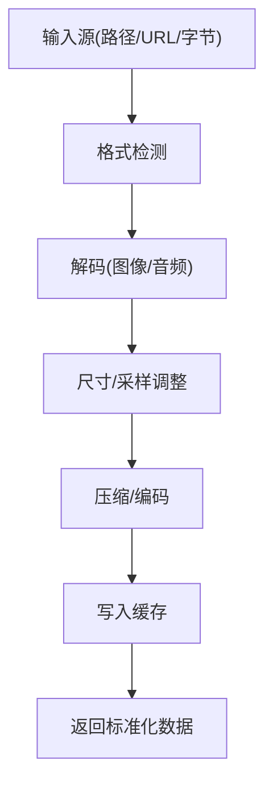
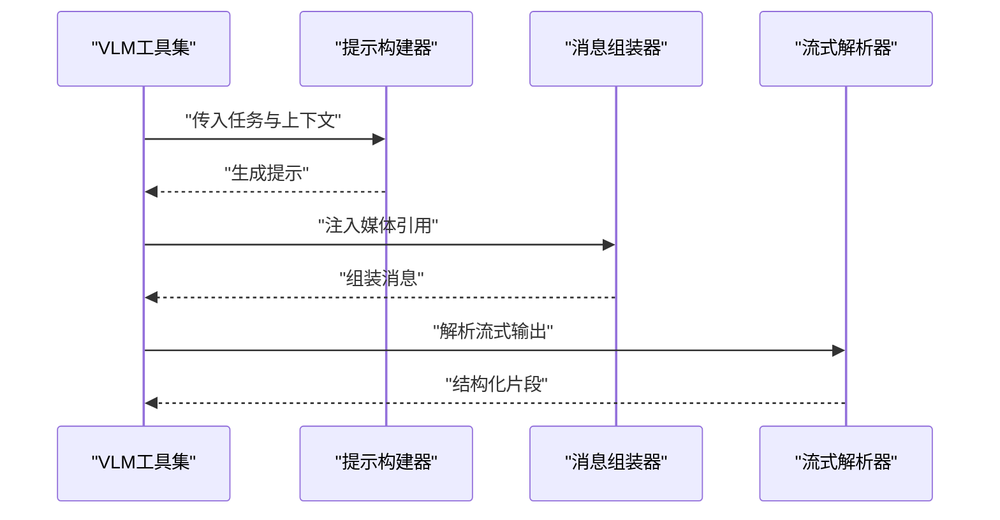
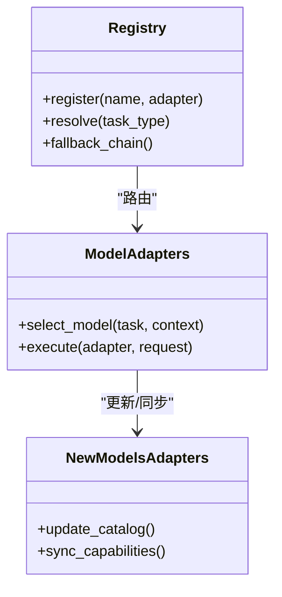
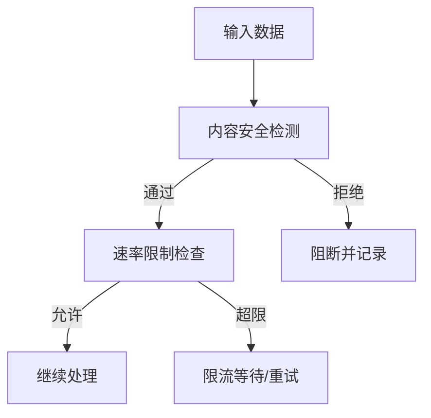
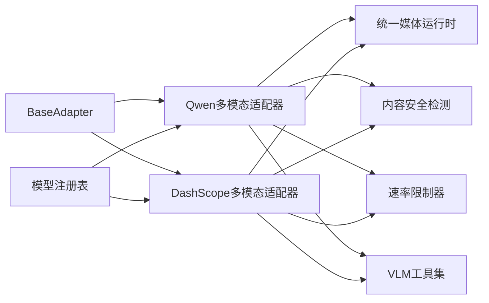

# 多模态图像适配器

<cite>
**本文引用的文件**   
- [adapters/qwen_multimodal_adapter.py](file://adapters/qwen_multimodal_adapter.py)
- [adapters/dashscope/multimodal.py](file://adapters/dashscope/multimodal.py)
- [adapters/base.py](file://adapters/base.py)
- [adapters/adapter_helpers.py](file://adapters/adapter_helpers.py)
- [core/unified_media_runtime.py](file://core/unified_media_runtime.py)
- [agents/vlm_utils.py](file://agents/vlm_utils.py)
- [adapters/_shared.py](file://adapters/_shared.py)
- [adapters/model_adapters.py](file://adapters/model_adapters.py)
- [adapters/new_models_adapters.py](file://adapters/new_models_adapters.py)
- [adapters/registry.py](file://adapters/registry.py)
- [adapters/content_safety_checker.py](file://adapters/content_safety_checker.py)
- [adapters/rate_limiter.py](file://adapters/rate_limiter.py)
</cite>

## 目录
1. [简介](#简介)
2. [项目结构](#项目结构)
3. [核心组件](#核心组件)
4. [架构总览](#架构总览)
5. [详细组件分析](#详细组件分析)
6. [依赖关系分析](#依赖关系分析)
7. [性能考量](#性能考量)
8. [故障排查指南](#故障排查指南)
9. [结论](#结论)
10. [附录](#附录)

## 简介
本技术文档面向“多模态图像适配器”，聚焦于文本、图像、音频等多类型输入的统一封装与处理，跨模态理解与分析的实现原理（特征提取、语义对齐、融合策略），以及与Qwen等多模态模型的集成方式（模型选择、参数配置、结果解析）。同时覆盖复杂场景下的推理流程（上下文管理、注意力机制、输出生成）、完整的多模态交互示例，以及数据处理最佳实践与性能优化技巧。

## 项目结构
本项目在多模态方向采用“适配器层 + 统一媒体运行时 + VLM工具集”的分层设计：
- 适配器层：按提供商或能力域划分，如 dashscope、volcengine、mimo、vidu_platform 等；通用基类与辅助函数位于 adapters 根目录。
- 统一媒体运行时：提供统一的媒体加载、编码、缓存与并发控制，屏蔽底层差异。
- VLM工具集：为视觉语言模型（VLM）提供通用的提示构建、消息组装、流式输出解析等能力。
- 模型注册与调度：通过 registry 与 model_adapters/new_models_adapters 实现模型发现、路由与降级。

**图示来源** 
- [adapters/base.py](file://adapters/base.py)
- [adapters/qwen_multimodal_adapter.py](file://adapters/qwen_multimodal_adapter.py)
- [adapters/dashscope/multimodal.py](file://adapters/dashscope/multimodal.py)
- [adapters/adapter_helpers.py](file://adapters/adapter_helpers.py)
- [core/unified_media_runtime.py](file://core/unified_media_runtime.py)
- [adapters/content_safety_checker.py](file://adapters/content_safety_checker.py)
- [adapters/rate_limiter.py](file://adapters/rate_limiter.py)
- [adapters/registry.py](file://adapters/registry.py)

**章节来源**
- [adapters/base.py](file://adapters/base.py)
- [adapters/qwen_multimodal_adapter.py](file://adapters/qwen_multimodal_adapter.py)
- [adapters/dashscope/multimodal.py](file://adapters/dashscope/multimodal.py)
- [core/unified_media_runtime.py](file://core/unified_media_runtime.py)
- [adapters/registry.py](file://adapters/registry.py)

## 核心组件
- BaseAdapter：定义多模态适配器的统一接口，包括输入规范化、请求构造、响应解析、错误处理与重试策略。
- Qwen多模态适配器：封装与Qwen多模态模型的交互，支持文本+图像（可扩展音频）的联合输入，负责消息格式转换、流式与非流式输出解析。
- DashScope多模态适配器：封装与DashScope多模态服务的交互，提供类似的统一接口以兼容不同提供商。
- AdapterHelpers：提供通用的媒体预处理、提示模板、消息拼装、结果解码等工具。
- UnifiedMediaRuntime：统一媒体运行时，负责图片/音频的读取、缩放、编码、缓存、并发下载与内存管理。
- ContentSafetyChecker：内容安全检测，对输入/输出进行敏感信息过滤与合规检查。
- RateLimiter：速率限制器，保障下游API的稳定性与配额保护。
- Registry与ModelAdapters：模型注册、选择与路由，支持动态切换与降级。

**章节来源**
- [adapters/base.py](file://adapters/base.py)
- [adapters/qwen_multimodal_adapter.py](file://adapters/qwen_multimodal_adapter.py)
- [adapters/dashscope/multimodal.py](file://adapters/dashscope/multimodal.py)
- [adapters/adapter_helpers.py](file://adapters/adapter_helpers.py)
- [core/unified_media_runtime.py](file://core/unified_media_runtime.py)
- [adapters/content_safety_checker.py](file://adapters/content_safety_checker.py)
- [adapters/rate_limiter.py](file://adapters/rate_limiter.py)
- [adapters/registry.py](file://adapters/registry.py)
- [adapters/model_adapters.py](file://adapters/model_adapters.py)
- [adapters/new_models_adapters.py](file://adapters/new_models_adapters.py)

## 架构总览
多模态图像适配器采用“统一接口 + 多提供商实现 + 共享运行时”的架构模式。上层通过Registry选择具体适配器，适配器内部使用UnifiedMediaRuntime进行媒体处理，并通过ContentSafetyChecker和RateLimiter保障安全与稳定。最终将标准化请求发送至Qwen或DashScope等多模态模型，并解析返回的结构化结果。

**图示来源** 
- [adapters/registry.py](file://adapters/registry.py)
- [adapters/qwen_multimodal_adapter.py](file://adapters/qwen_multimodal_adapter.py)
- [core/unified_media_runtime.py](file://core/unified_media_runtime.py)
- [adapters/content_safety_checker.py](file://adapters/content_safety_checker.py)

## 详细组件分析

### Qwen多模态适配器
- 功能要点
  - 统一输入封装：将文本、图像、音频转换为模型可识别的消息结构。
  - 特征提取与对齐：在适配器层完成必要的图像尺寸归一化、音频采样率转换，确保与模型期望一致。
  - 语义融合策略：根据任务类型（描述、问答、生成）组合提示词与媒体元数据，形成融合上下文。
  - 结果解析：支持文本、JSON、结构化字段等多种返回格式的解析与校验。
- 关键流程
  - 输入校验与预处理 → 媒体编码与缓存 → 安全检测 → 请求构造 → 调用模型 → 结果解析 → 输出标准化。

**图示来源** 
- [adapters/qwen_multimodal_adapter.py](file://adapters/qwen_multimodal_adapter.py)
- [core/unified_media_runtime.py](file://core/unified_media_runtime.py)
- [adapters/content_safety_checker.py](file://adapters/content_safety_checker.py)

**章节来源**
- [adapters/qwen_multimodal_adapter.py](file://adapters/qwen_multimodal_adapter.py)
- [core/unified_media_runtime.py](file://core/unified_media_runtime.py)
- [adapters/content_safety_checker.py](file://adapters/content_safety_checker.py)

### DashScope多模态适配器
- 功能要点
  - 与DashScope多模态服务对接，复用统一媒体运行时与安全检测。
  - 支持不同的消息格式与返回结构，提供适配层转换。
- 关键流程
  - 输入标准化 → 媒体预处理 → 安全检测 → 请求构造 → 调用DashScope → 结果解析 → 输出标准化。

**图示来源** 
- [adapters/dashscope/multimodal.py](file://adapters/dashscope/multimodal.py)
- [core/unified_media_runtime.py](file://core/unified_media_runtime.py)
- [adapters/content_safety_checker.py](file://adapters/content_safety_checker.py)

**章节来源**
- [adapters/dashscope/multimodal.py](file://adapters/dashscope/multimodal.py)
- [core/unified_media_runtime.py](file://core/unified_media_runtime.py)
- [adapters/content_safety_checker.py](file://adapters/content_safety_checker.py)

### 统一媒体运行时
- 功能要点
  - 统一加载与编码：支持多种图像与音频格式，自动选择最优编码器。
  - 缓存与并发：基于URL/指纹进行缓存，支持并发下载与内存池管理。
  - 质量与尺寸控制：提供分辨率、压缩比、采样率等参数化配置。
- 关键流程
  - 输入源识别 → 解码/转码 → 尺寸/采样调整 → 缓存写入 → 返回标准化数据。

**图示来源** 
- [core/unified_media_runtime.py](file://core/unified_media_runtime.py)

**章节来源**
- [core/unified_media_runtime.py](file://core/unified_media_runtime.py)

### VLM工具集
- 功能要点
  - 提示构建：根据任务类型生成结构化提示，包含图像描述、上下文、约束条件。
  - 消息组装：将文本与媒体引用组装为模型可接受的消息列表。
  - 流式解析：支持增量输出解析与中断恢复。
- 关键流程
  - 任务分类 → 提示模板选择 → 媒体引用注入 → 消息拼装 → 流式解析。

**图示来源** 
- [agents/vlm_utils.py](file://agents/vlm_utils.py)

**章节来源**
- [agents/vlm_utils.py](file://agents/vlm_utils.py)

### 模型注册与调度
- 功能要点
  - 动态注册：支持运行时注册新适配器与模型。
  - 路由策略：基于模型能力、负载、成本进行智能选择。
  - 降级与回退：当主模型不可用时自动切换到备用模型。
- 关键流程
  - 模型发现 → 能力匹配 → 负载均衡 → 调用执行 → 结果回传。

**图示来源** 
- [adapters/registry.py](file://adapters/registry.py)
- [adapters/model_adapters.py](file://adapters/model_adapters.py)
- [adapters/new_models_adapters.py](file://adapters/new_models_adapters.py)

**章节来源**
- [adapters/registry.py](file://adapters/registry.py)
- [adapters/model_adapters.py](file://adapters/model_adapters.py)
- [adapters/new_models_adapters.py](file://adapters/new_models_adapters.py)

### 内容安全与速率限制
- 内容安全检测：对输入文本与媒体进行敏感信息扫描，输出进行合规过滤。
- 速率限制：基于令牌桶或滑动窗口算法，防止API过载与配额耗尽。

**图示来源** 
- [adapters/content_safety_checker.py](file://adapters/content_safety_checker.py)
- [adapters/rate_limiter.py](file://adapters/rate_limiter.py)

**章节来源**
- [adapters/content_safety_checker.py](file://adapters/content_safety_checker.py)
- [adapters/rate_limiter.py](file://adapters/rate_limiter.py)

## 依赖关系分析
- 适配器层依赖统一媒体运行时进行媒体处理，依赖内容安全检测与速率限制器保障稳定性。
- VLM工具集被各适配器复用，提供一致的提示与消息处理能力。
- 模型注册表统一管理适配器生命周期与路由逻辑。

**图示来源** 
- [adapters/base.py](file://adapters/base.py)
- [adapters/qwen_multimodal_adapter.py](file://adapters/qwen_multimodal_adapter.py)
- [adapters/dashscope/multimodal.py](file://adapters/dashscope/multimodal.py)
- [core/unified_media_runtime.py](file://core/unified_media_runtime.py)
- [adapters/content_safety_checker.py](file://adapters/content_safety_checker.py)
- [adapters/rate_limiter.py](file://adapters/rate_limiter.py)
- [agents/vlm_utils.py](file://agents/vlm_utils.py)
- [adapters/registry.py](file://adapters/registry.py)

**章节来源**
- [adapters/base.py](file://adapters/base.py)
- [adapters/qwen_multimodal_adapter.py](file://adapters/qwen_multimodal_adapter.py)
- [adapters/dashscope/multimodal.py](file://adapters/dashscope/multimodal.py)
- [core/unified_media_runtime.py](file://core/unified_media_runtime.py)
- [adapters/content_safety_checker.py](file://adapters/content_safety_checker.py)
- [adapters/rate_limiter.py](file://adapters/rate_limiter.py)
- [agents/vlm_utils.py](file://agents/vlm_utils.py)
- [adapters/registry.py](file://adapters/registry.py)

## 性能考量
- 媒体缓存：基于URL/指纹的缓存策略减少重复编码与下载开销。
- 并发控制：合理设置并发度，避免I/O阻塞与内存峰值。
- 流式处理：对于长文本输出，采用流式解析降低首字延迟。
- 资源回收：及时释放媒体对象与网络连接，防止内存泄漏。
- 自适应质量：根据网络与设备状态动态调整图像分辨率与音频采样率。

[本节为通用指导，不直接分析具体文件]

## 故障排查指南
- 常见问题
  - 媒体解码失败：检查格式支持与编码参数。
  - 安全检测拦截：审查输入内容是否触发敏感规则。
  - 速率限制触发：调整并发或等待重试。
  - 模型不可用：检查注册表与健康状态，启用降级策略。
- 调试建议
  - 启用详细日志，记录请求/响应与中间状态。
  - 使用模拟适配器验证流程正确性。
  - 分阶段测试：媒体处理 → 安全检测 → 模型调用 → 结果解析。

**章节来源**
- [adapters/content_safety_checker.py](file://adapters/content_safety_checker.py)
- [adapters/rate_limiter.py](file://adapters/rate_limiter.py)
- [adapters/registry.py](file://adapters/registry.py)

## 结论
多模态图像适配器通过统一接口、共享运行时与智能调度，实现了文本、图像、音频的高效处理与跨模态理解。与Qwen等多模态模型的集成提供了灵活的模型选择与参数配置能力。在实际应用中，应注重媒体缓存、并发控制与流式处理，以提升性能与稳定性。

[本节为总结性内容，不直接分析具体文件]

## 附录
- 最佳实践
  - 输入标准化：确保媒体格式与尺寸符合模型要求。
  - 提示工程：结合任务目标设计结构化提示，提升生成质量。
  - 错误恢复：实现重试与降级机制，增强鲁棒性。
  - 监控与观测：记录关键指标，便于问题定位与优化。

[本节为补充说明，不直接分析具体文件]