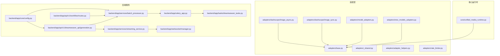
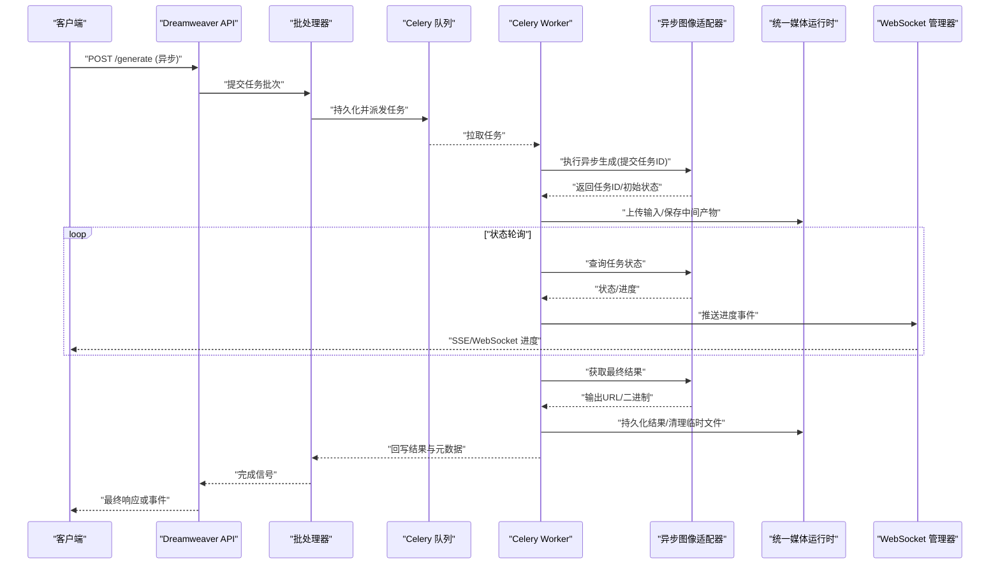
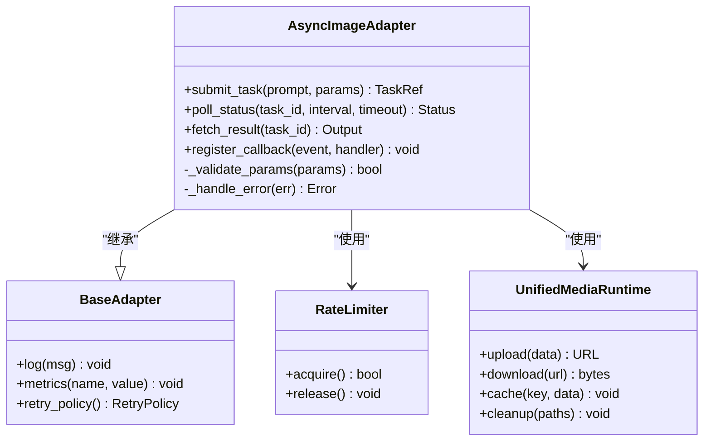
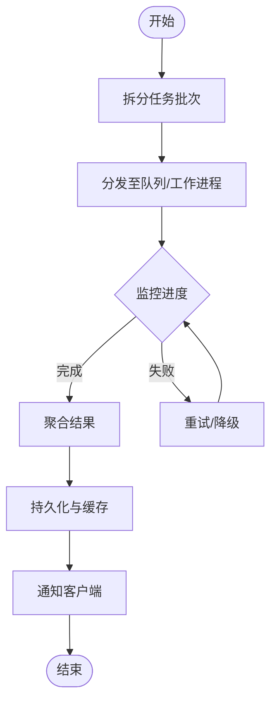
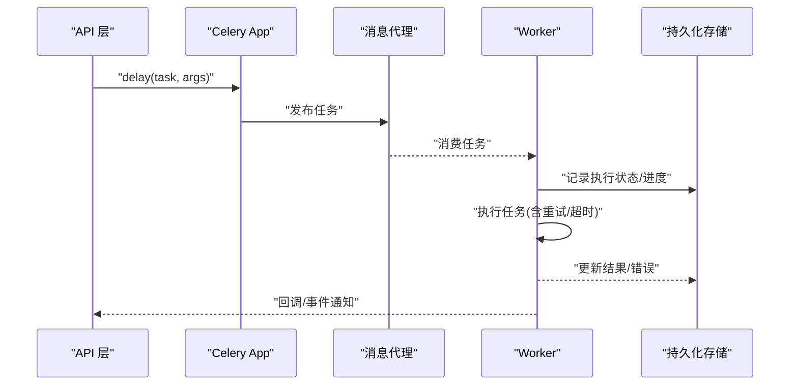
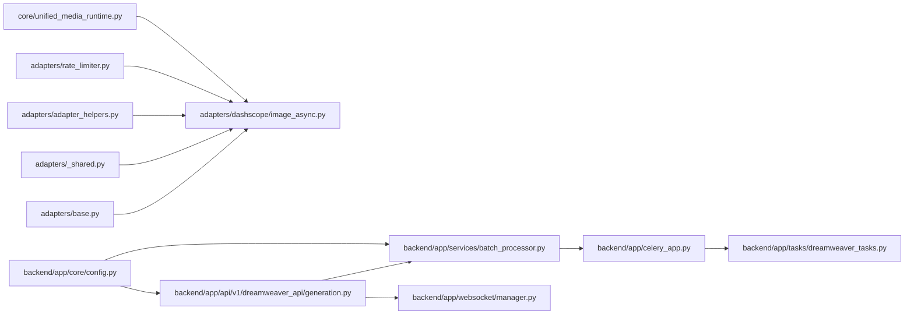
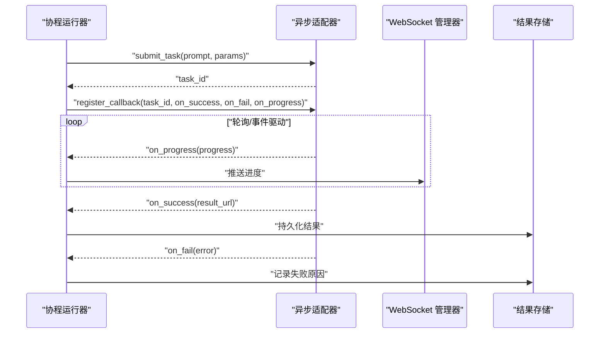

# 异步图像生成适配器

<cite>
**本文引用的文件**   
- [adapters/dashscope/image_async.py](file://adapters/dashscope/image_async.py)
- [adapters/dashscope/image_sync.py](file://adapters/dashscope/image_sync.py)
- [adapters/base.py](file://adapters/base.py)
- [adapters/_shared.py](file://adapters/_shared.py)
- [adapters/adapter_helpers.py](file://adapters/adapter_helpers.py)
- [adapters/rate_limiter.py](file://adapters/rate_limiter.py)
- [adapters/model_adapters.py](file://adapters/model_adapters.py)
- [adapters/new_models_adapters.py](file://adapters/new_models_adapters.py)
- [core/unified_media_runtime.py](file://core/unified_media_runtime.py)
- [backend/app/services/batch_processor.py](file://backend/app/services/batch_processor.py)
- [backend/app/celery_app.py](file://backend/app/celery_app.py)
- [backend/app/tasks/dreamweaver_tasks.py](file://backend/app/tasks/dreamweaver_tasks.py)
- [backend/app/api/v1/dreamweaver_api/generation.py](file://backend/app/api/v1/dreamweaver_api/generation.py)
- [backend/app/api/v1/workflow/routes.py](file://backend/app/api/v1/workflow/routes.py)
- [backend/app/services/streaming_service.py](file://backend/app/services/streaming_service.py)
- [backend/app/websocket/manager.py](file://backend/app/websocket/manager.py)
- [backend/app/core/config.py](file://backend/app/core/config.py)
</cite>

## 目录
1. [简介](#简介)
2. [项目结构](#项目结构)
3. [核心组件](#核心组件)
4. [架构总览](#架构总览)
5. [详细组件分析](#详细组件分析)
6. [依赖关系分析](#依赖关系分析)
7. [性能考量](#性能考量)
8. [故障排查指南](#故障排查指南)
9. [结论](#结论)
10. [附录：异步调用示例与最佳实践](#附录异步调用示例与最佳实践)

## 简介
本技术文档围绕“异步图像生成适配器”展开，聚焦于异步请求处理架构、任务提交与状态轮询、结果获取机制、回调注册与执行流程（成功、失败、进度更新），以及与同步接口的差异（并发、资源管理、内存优化）。同时解释任务队列的实现原理（持久化、重试、超时），并提供基于协程和事件循环的高效批量处理示例与最佳实践。

## 项目结构
本项目采用分层与按功能域组织相结合的结构：
- adapters：各模型厂商的适配层，包含同步与异步实现、通用工具、限流等
- core：统一媒体运行时、模型解析、路由等核心能力
- backend/app：Web API、服务层、Celery 任务、WebSocket 管理器、配置等
- 其他：脚本、测试、前端、配置等

图表来源
- [adapters/base.py](file://adapters/base.py)
- [adapters/_shared.py](file://adapters/_shared.py)
- [adapters/adapter_helpers.py](file://adapters/adapter_helpers.py)
- [adapters/rate_limiter.py](file://adapters/rate_limiter.py)
- [adapters/dashscope/image_async.py](file://adapters/dashscope/image_async.py)
- [adapters/dashscope/image_sync.py](file://adapters/dashscope/image_sync.py)
- [adapters/model_adapters.py](file://adapters/model_adapters.py)
- [adapters/new_models_adapters.py](file://adapters/new_models_adapters.py)
- [core/unified_media_runtime.py](file://core/unified_media_runtime.py)
- [backend/app/api/v1/dreamweaver_api/generation.py](file://backend/app/api/v1/dreamweaver_api/generation.py)
- [backend/app/api/v1/workflow/routes.py](file://backend/app/api/v1/workflow/routes.py)
- [backend/app/services/batch_processor.py](file://backend/app/services/batch_processor.py)
- [backend/app/services/streaming_service.py](file://backend/app/services/streaming_service.py)
- [backend/app/websocket/manager.py](file://backend/app/websocket/manager.py)
- [backend/app/celery_app.py](file://backend/app/celery_app.py)
- [backend/app/tasks/dreamweaver_tasks.py](file://backend/app/tasks/dreamweaver_tasks.py)
- [backend/app/core/config.py](file://backend/app/core/config.py)

章节来源
- [adapters/base.py](file://adapters/base.py)
- [adapters/dashscope/image_async.py](file://adapters/dashscope/image_async.py)
- [adapters/dashscope/image_sync.py](file://adapters/dashscope/image_sync.py)
- [adapters/model_adapters.py](file://adapters/model_adapters.py)
- [adapters/new_models_adapters.py](file://adapters/new_models_adapters.py)
- [core/unified_media_runtime.py](file://core/unified_media_runtime.py)
- [backend/app/api/v1/dreamweaver_api/generation.py](file://backend/app/api/v1/dreamweaver_api/generation.py)
- [backend/app/api/v1/workflow/routes.py](file://backend/app/api/v1/workflow/routes.py)
- [backend/app/services/batch_processor.py](file://backend/app/services/batch_processor.py)
- [backend/app/services/streaming_service.py](file://backend/app/services/streaming_service.py)
- [backend/app/websocket/manager.py](file://backend/app/websocket/manager.py)
- [backend/app/celery_app.py](file://backend/app/celery_app.py)
- [backend/app/tasks/dreamweaver_tasks.py](file://backend/app/tasks/dreamweaver_tasks.py)
- [backend/app/core/config.py](file://backend/app/core/config.py)

## 核心组件
- 异步图像生成适配器（DashScope）：提供非阻塞的任务提交、状态轮询与结果拉取，支持回调通知与进度上报
- 同步图像生成适配器：面向简单场景的阻塞式调用，便于对比与兼容
- 适配器基类与共享工具：抽象公共逻辑、错误处理、参数校验、日志与指标埋点
- 速率限制器：保护下游接口，避免触发限流或熔断
- 统一媒体运行时：对图片/视频等多模态资源的统一生命周期管理（上传、下载、缓存、清理）
- 批处理器与服务编排：将大量异步任务进行分片、调度、聚合与结果回写
- Celery 任务系统：持久化任务队列、重试、超时、幂等与分布式执行
- WebSocket 管理器：实时推送进度与结果到客户端
- 配置中心：集中管理超时、并发、重试策略、队列参数等

章节来源
- [adapters/dashscope/image_async.py](file://adapters/dashscope/image_async.py)
- [adapters/dashscope/image_sync.py](file://adapters/dashscope/image_sync.py)
- [adapters/base.py](file://adapters/base.py)
- [adapters/_shared.py](file://adapters/_shared.py)
- [adapters/adapter_helpers.py](file://adapters/adapter_helpers.py)
- [adapters/rate_limiter.py](file://adapters/rate_limiter.py)
- [core/unified_media_runtime.py](file://core/unified_media_runtime.py)
- [backend/app/services/batch_processor.py](file://backend/app/services/batch_processor.py)
- [backend/app/celery_app.py](file://backend/app/celery_app.py)
- [backend/app/tasks/dreamweaver_tasks.py](file://backend/app/tasks/dreamweaver_tasks.py)
- [backend/app/websocket/manager.py](file://backend/app/websocket/manager.py)
- [backend/app/core/config.py](file://backend/app/core/config.py)

## 架构总览
下图展示了从 HTTP 请求进入，到异步任务提交、队列持久化、Worker 执行、结果回传与客户端回调的全链路。

图表来源
- [backend/app/api/v1/dreamweaver_api/generation.py](file://backend/app/api/v1/dreamweaver_api/generation.py)
- [backend/app/services/batch_processor.py](file://backend/app/services/batch_processor.py)
- [backend/app/celery_app.py](file://backend/app/celery_app.py)
- [backend/app/tasks/dreamweaver_tasks.py](file://backend/app/tasks/dreamweaver_tasks.py)
- [adapters/dashscope/image_async.py](file://adapters/dashscope/image_async.py)
- [core/unified_media_runtime.py](file://core/unified_media_runtime.py)
- [backend/app/websocket/manager.py](file://backend/app/websocket/manager.py)

## 详细组件分析

### 异步图像生成适配器（DashScope）
- 任务提交：非阻塞地创建远程任务，返回唯一任务ID与初始状态
- 状态轮询：周期性查询任务状态，直至完成/失败/超时
- 结果获取：成功后拉取输出（URL或二进制），并进行格式校验与缓存
- 回调机制：注册成功、失败、进度回调；在事件驱动中安全触发
- 错误处理：网络异常、鉴权失败、配额不足、超时等分类处理与重试策略

图表来源
- [adapters/dashscope/image_async.py](file://adapters/dashscope/image_async.py)
- [adapters/base.py](file://adapters/base.py)
- [adapters/rate_limiter.py](file://adapters/rate_limiter.py)
- [core/unified_media_runtime.py](file://core/unified_media_runtime.py)

章节来源
- [adapters/dashscope/image_async.py](file://adapters/dashscope/image_async.py)
- [adapters/base.py](file://adapters/base.py)
- [adapters/rate_limiter.py](file://adapters/rate_limiter.py)
- [core/unified_media_runtime.py](file://core/unified_media_runtime.py)

### 同步图像生成适配器（对比）
- 阻塞式调用：直接等待结果返回，适合小规模或调试场景
- 资源占用：长时间持有连接与内存，不适合高并发
- 错误处理：同步异常直接上抛，重试需上层实现
- 适用性：低延迟、单请求、快速验证

章节来源
- [adapters/dashscope/image_sync.py](file://adapters/dashscope/image_sync.py)

### 批处理器与服务编排
- 任务分片：将大批量请求切分为可并行处理的子批次
- 调度策略：基于优先级、资源可用性、速率限制进行调度
- 结果聚合：合并多个子批次结果，保证顺序与一致性
- 监控与追踪：记录每个阶段的耗时、成功率、失败原因

图表来源
- [backend/app/services/batch_processor.py](file://backend/app/services/batch_processor.py)
- [backend/app/api/v1/dreamweaver_api/generation.py](file://backend/app/api/v1/dreamweaver_api/generation.py)

章节来源
- [backend/app/services/batch_processor.py](file://backend/app/services/batch_processor.py)
- [backend/app/api/v1/dreamweaver_api/generation.py](file://backend/app/api/v1/dreamweaver_api/generation.py)

### Celery 任务系统与队列
- 持久化：任务入队即落盘，崩溃恢复后自动重放
- 重试机制：指数退避、最大重试次数、死信队列
- 超时处理：任务级与步骤级超时控制，防止长尾
- 幂等性：通过任务ID去重，避免重复执行

图表来源
- [backend/app/celery_app.py](file://backend/app/celery_app.py)
- [backend/app/tasks/dreamweaver_tasks.py](file://backend/app/tasks/dreamweaver_tasks.py)

章节来源
- [backend/app/celery_app.py](file://backend/app/celery_app.py)
- [backend/app/tasks/dreamweaver_tasks.py](file://backend/app/tasks/dreamweaver_tasks.py)

### WebSocket 实时推送
- 事件类型：任务创建、进度更新、完成、失败
- 连接管理：心跳、断线重连、会话隔离
- 广播与定向：按用户/任务维度推送

章节来源
- [backend/app/websocket/manager.py](file://backend/app/websocket/manager.py)
- [backend/app/services/streaming_service.py](file://backend/app/services/streaming_service.py)

### 配置与策略
- 超时：全局与任务级超时，区分网络IO与计算阶段
- 并发：线程/进程池大小、令牌桶限速
- 重试：退避策略、最大重试次数、条件重试
- 队列：持久化开关、分区策略、消费者数量

章节来源
- [backend/app/core/config.py](file://backend/app/core/config.py)

## 依赖关系分析
- 适配器层依赖基类与工具模块，解耦具体厂商实现
- 批处理器依赖 Celery 与统一媒体运行时，负责编排与资源管理
- API 层通过批处理器与 WebSocket 管理器暴露异步能力
- 配置模块贯穿各层，确保行为一致

图表来源
- [adapters/base.py](file://adapters/base.py)
- [adapters/_shared.py](file://adapters/_shared.py)
- [adapters/adapter_helpers.py](file://adapters/adapter_helpers.py)
- [adapters/rate_limiter.py](file://adapters/rate_limiter.py)
- [adapters/dashscope/image_async.py](file://adapters/dashscope/image_async.py)
- [core/unified_media_runtime.py](file://core/unified_media_runtime.py)
- [backend/app/api/v1/dreamweaver_api/generation.py](file://backend/app/api/v1/dreamweaver_api/generation.py)
- [backend/app/services/batch_processor.py](file://backend/app/services/batch_processor.py)
- [backend/app/celery_app.py](file://backend/app/celery_app.py)
- [backend/app/tasks/dreamweaver_tasks.py](file://backend/app/tasks/dreamweaver_tasks.py)
- [backend/app/websocket/manager.py](file://backend/app/websocket/manager.py)
- [backend/app/core/config.py](file://backend/app/core/config.py)

章节来源
- [adapters/model_adapters.py](file://adapters/model_adapters.py)
- [adapters/new_models_adapters.py](file://adapters/new_models_adapters.py)
- [core/unified_media_runtime.py](file://core/unified_media_runtime.py)
- [backend/app/services/batch_processor.py](file://backend/app/services/batch_processor.py)
- [backend/app/celery_app.py](file://backend/app/celery_app.py)
- [backend/app/tasks/dreamweaver_tasks.py](file://backend/app/tasks/dreamweaver_tasks.py)
- [backend/app/api/v1/dreamweaver_api/generation.py](file://backend/app/api/v1/dreamweaver_api/generation.py)
- [backend/app/websocket/manager.py](file://backend/app/websocket/manager.py)
- [backend/app/core/config.py](file://backend/app/core/config.py)

## 性能考量
- 并发控制：通过速率限制器与线程/进程池上限，避免下游限流与资源耗尽
- 内存优化：流式上传/下载、及时释放临时文件、对象池复用
- 缓存策略：热点结果与中间产物缓存，减少重复计算
- 批处理优化：合理批次大小、背压与削峰填谷
- 监控与告警：关键指标（QPS、P95/P99、错误率、队列长度）采集与阈值告警

[本节为通用指导，不直接分析具体文件]

## 故障排查指南
- 常见问题
  - 任务卡住：检查超时设置、队列堆积、Worker 健康状态
  - 频繁失败：查看错误码与日志，确认鉴权、配额、网络连通性
  - 进度不更新：确认事件通道（WebSocket/SSE）是否可达，心跳是否正常
  - 内存泄漏：定位大对象未释放、临时文件未清理
- 诊断手段
  - 启用详细日志与追踪ID，关联上下游调用链
  - 使用指标面板观察队列长度、消费者数、任务耗时分布
  - 模拟故障注入（网络抖动、下游限流）验证重试与降级

章节来源
- [backend/app/services/streaming_service.py](file://backend/app/services/streaming_service.py)
- [backend/app/websocket/manager.py](file://backend/app/websocket/manager.py)
- [backend/app/core/config.py](file://backend/app/core/config.py)

## 结论
异步图像生成适配器通过非阻塞任务提交、状态轮询与回调机制，结合 Celery 队列与 WebSocket 实时推送，实现了高吞吐、可扩展且可观测的图像生成流水线。与同步接口相比，其在并发处理、资源管理与内存优化方面具备显著优势。合理的批处理、重试与超时策略是保障稳定性的关键。

[本节为总结，不直接分析具体文件]

## 附录：异步调用示例与最佳实践

### 异步调用示例（概念性说明）
- 使用协程与事件循环并发提交大量图像生成任务
- 为每个任务注册成功、失败与进度回调
- 通过 WebSocket 接收进度与结果，前端实时更新
- 使用批处理器对任务进行分片与聚合，提升整体吞吐

图表来源
- [adapters/dashscope/image_async.py](file://adapters/dashscope/image_async.py)
- [backend/app/websocket/manager.py](file://backend/app/websocket/manager.py)

### 最佳实践
- 任务设计
  - 明确任务边界与幂等键，避免重复执行
  - 合理设置超时与重试次数，区分可重试与不可重试错误
- 并发与资源
  - 控制并发度，避免打满 CPU/内存/网络
  - 使用连接池与对象池，减少分配开销
- 错误与降级
  - 捕获并分类异常，提供降级路径（如切换模型/降低分辨率）
  - 死信队列与人工介入机制
- 监控与可观测性
  - 全链路追踪、指标采集、结构化日志
  - 关键路径的告警规则与自愈策略

[本节为通用指导，不直接分析具体文件]