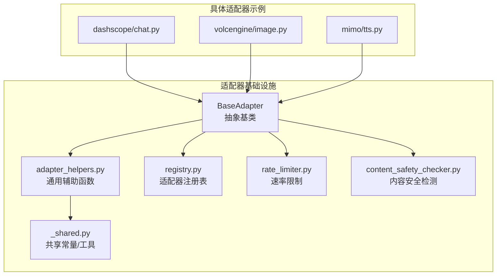
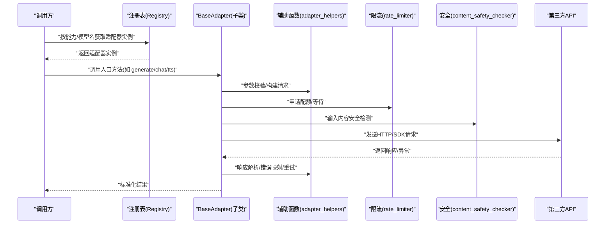
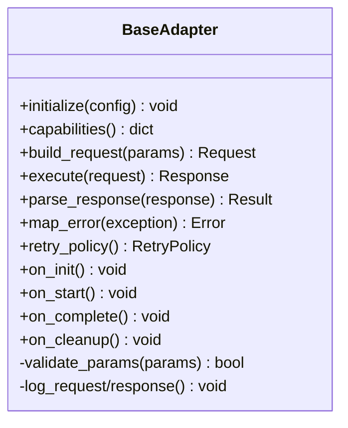
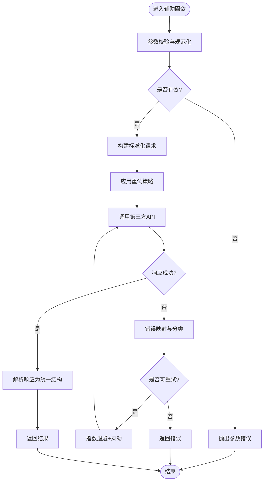
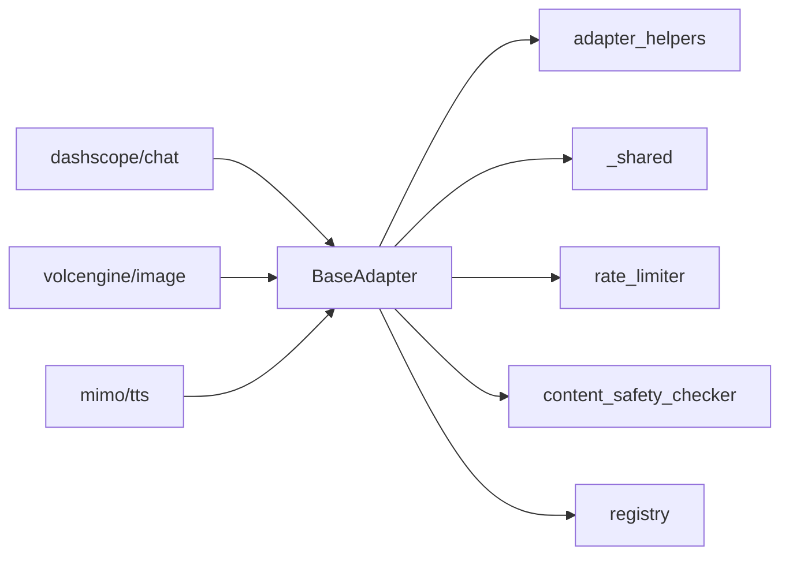

# 基础接口与抽象类

<cite>
**本文引用的文件**   
- [adapters/base.py](file://adapters/base.py)
- [adapters/_shared.py](file://adapters/_shared.py)
- [adapters/adapter_helpers.py](file://adapters/adapter_helpers.py)
- [adapters/rate_limiter.py](file://adapters/rate_limiter.py)
- [adapters/content_safety_checker.py](file://adapters/content_safety_checker.py)
- [adapters/registry.py](file://adapters/registry.py)
- [core/logging_config.py](file://core/logging_config.py)
- [core/config.py](file://core/config.py)
- [adapters/dashscope/chat.py](file://adapters/dashscope/chat.py)
- [adapters/volcengine/image.py](file://adapters/volcengine/image.py)
- [adapters/mimo/tts.py](file://adapters/mimo/tts.py)
</cite>

## 目录
1. [简介](#简介)
2. [项目结构](#项目结构)
3. [核心组件](#核心组件)
4. [架构总览](#架构总览)
5. [详细组件分析](#详细组件分析)
6. [依赖关系分析](#依赖关系分析)
7. [性能考量](#性能考量)
8. [故障排查指南](#故障排查指南)
9. [结论](#结论)
10. [附录](#附录)

## 简介
本技术文档聚焦于适配器基础接口与抽象类，系统阐述适配器模式在本项目中的设计理念、抽象接口定义与实现规范。重点覆盖：
- BaseAdapter 基类的结构与职责边界
- 通用方法与抽象方法契约
- 共享组件与辅助函数（错误处理、日志记录、配置管理）
- 适配器生命周期管理、状态维护与资源清理机制
- 继承基础类实现自定义适配器的最佳实践与常见陷阱

通过分层说明与可视化图示，帮助读者快速理解并安全扩展新的适配器实现。

## 项目结构
适配器子系统位于 adapters 目录，围绕 base.py 的抽象基类构建统一的适配器契约；_shared.py 与 adapter_helpers.py 提供跨适配器的通用能力；rate_limiter.py 与 content_safety_checker.py 分别承担限流与安全校验；registry.py 负责适配器注册与发现。具体实现分布在各厂商或功能子包中（如 dashscope、volcengine、mimo 等）。

图表来源
- [adapters/base.py](file://adapters/base.py)
- [adapters/_shared.py](file://adapters/_shared.py)
- [adapters/adapter_helpers.py](file://adapters/adapter_helpers.py)
- [adapters/rate_limiter.py](file://adapters/rate_limiter.py)
- [adapters/content_safety_checker.py](file://adapters/content_safety_checker.py)
- [adapters/registry.py](file://adapters/registry.py)
- [adapters/dashscope/chat.py](file://adapters/dashscope/chat.py)
- [adapters/volcengine/image.py](file://adapters/volcengine/image.py)
- [adapters/mimo/tts.py](file://adapters/mimo/tts.py)

章节来源
- [adapters/base.py](file://adapters/base.py)
- [adapters/_shared.py](file://adapters/_shared.py)
- [adapters/adapter_helpers.py](file://adapters/adapter_helpers.py)
- [adapters/rate_limiter.py](file://adapters/rate_limiter.py)
- [adapters/content_safety_checker.py](file://adapters/content_safety_checker.py)
- [adapters/registry.py](file://adapters/registry.py)

## 核心组件
- BaseAdapter（抽象基类）
  - 定义统一适配器契约：初始化、能力探测、请求构建、调用执行、结果解析、错误映射、重试策略、限流、安全校验、日志与追踪、资源释放等。
  - 提供可复用的通用流程编排与默认行为，子类仅需实现关键差异点。
- 共享组件与辅助函数
  - _shared.py：集中存放跨适配器使用的常量、枚举、数据结构与轻量工具。
  - adapter_helpers.py：封装通用的参数校验、请求/响应转换、重试与退避、超时控制、缓存键生成、上下文透传等。
- 横切关注点
  - rate_limiter.py：令牌桶/漏桶等限流策略，保护下游服务。
  - content_safety_checker.py：输入输出内容安全检测，拦截敏感信息。
  - registry.py：适配器元数据登记、按能力路由与版本兼容。
- 日志与配置
  - core/logging_config.py：统一日志级别、格式化与采样策略。
  - core/config.py：集中式配置加载、环境变量注入与默认值回退。

章节来源
- [adapters/base.py](file://adapters/base.py)
- [adapters/_shared.py](file://adapters/_shared.py)
- [adapters/adapter_helpers.py](file://adapters/adapter_helpers.py)
- [adapters/rate_limiter.py](file://adapters/rate_limiter.py)
- [adapters/content_safety_checker.py](file://adapters/content_safety_checker.py)
- [adapters/registry.py](file://adapters/registry.py)
- [core/logging_config.py](file://core/logging_config.py)
- [core/config.py](file://core/config.py)

## 架构总览
下图展示适配器在系统中的位置与交互关系：上层业务通过注册表选择具体适配器，BaseAdapter 编排通用流程，辅助函数完成参数与结果转换，限流与安全模块作为横切能力介入，最终调用第三方 API。

图表来源
- [adapters/registry.py](file://adapters/registry.py)
- [adapters/base.py](file://adapters/base.py)
- [adapters/adapter_helpers.py](file://adapters/adapter_helpers.py)
- [adapters/rate_limiter.py](file://adapters/rate_limiter.py)
- [adapters/content_safety_checker.py](file://adapters/content_safety_checker.py)

## 详细组件分析

### BaseAdapter 抽象基类
- 设计目标
  - 统一适配器契约，屏蔽不同厂商的差异。
  - 将“准备-调用-解析-容错”的流程固化为模板方法，减少重复代码。
- 关键职责
  - 初始化与配置注入（从 core/config.py 读取环境/配置文件）。
  - 能力探测（capabilities/features），用于动态路由。
  - 请求构建与响应解析（由子类实现差异化逻辑）。
  - 错误映射与重试（统一异常类型、指数退避、幂等键）。
  - 限流接入（rate_limiter）、安全检测（content_safety_checker）。
  - 生命周期钩子（on_init/on_start/on_complete/on_cleanup）与资源释放。
- 抽象方法规范
  - 必须实现：请求构建、调用执行、响应解析、错误映射。
  - 可选实现：能力探测、重试策略、异步支持、流式处理。
- 状态与资源
  - 内部状态应最小化且线程安全；连接池/客户端对象应在 on_cleanup 中释放。
  - 避免在长生命周期对象中持有大对象引用，防止内存泄漏。

图表来源
- [adapters/base.py](file://adapters/base.py)

章节来源
- [adapters/base.py](file://adapters/base.py)

### 共享组件与辅助函数
- _shared.py
  - 集中定义跨适配器使用的枚举、常量、数据结构（如任务类型、媒体格式、错误码映射等）。
  - 提供轻量工具函数（序列化/反序列化、ID生成、时间戳处理）。
- adapter_helpers.py
  - 参数校验与规范化（必填字段检查、类型转换、默认值填充）。
  - 请求/响应转换（统一 HTTP/SDK 请求体与响应体结构）。
  - 重试与退避（指数退避、抖动、最大重试次数、条件重试）。
  - 超时控制与取消（基于事件循环或线程的超时包装）。
  - 缓存键生成与上下文透传（trace_id、用户ID、租户ID等）。

图表来源
- [adapters/adapter_helpers.py](file://adapters/adapter_helpers.py)

章节来源
- [adapters/_shared.py](file://adapters/_shared.py)
- [adapters/adapter_helpers.py](file://adapters/adapter_helpers.py)

### 限流器（rate_limiter.py）
- 作用
  - 保护下游服务不被突发流量打爆，保障稳定性与公平性。
- 策略
  - 令牌桶/漏桶算法，支持全局与按租户/用户维度隔离。
  - 可配置 QPS、突发容量、冷却时间。
- 集成
  - BaseAdapter 在执行前申请配额，失败时触发降级或排队。

章节来源
- [adapters/rate_limiter.py](file://adapters/rate_limiter.py)

### 内容安全检测（content_safety_checker.py）
- 作用
  - 对输入/输出进行敏感词、违规内容检测，阻断风险请求。
- 策略
  - 白名单/黑名单、正则与语义规则组合，支持热更新。
- 集成
  - BaseAdapter 在请求构建后、发送前执行检测，必要时替换或拒绝。

章节来源
- [adapters/content_safety_checker.py](file://adapters/content_safety_checker.py)

### 注册表（registry.py）
- 作用
  - 统一管理适配器元数据（名称、能力、版本、兼容性矩阵）。
  - 提供按能力/模型名的查找与实例化，支持多版本并存与灰度。
- 特性
  - 延迟实例化、按需加载、健康检查与熔断开关。

章节来源
- [adapters/registry.py](file://adapters/registry.py)

### 日志与配置
- 日志（core/logging_config.py）
  - 统一日志格式、分级、采样与输出目标（控制台/文件/远端）。
  - 建议为每个适配器实例绑定独立 logger，便于追踪。
- 配置（core/config.py）
  - 集中加载环境变量、配置文件与默认值，支持运行时重载。
  - 敏感信息加密存储与访问审计。

章节来源
- [core/logging_config.py](file://core/logging_config.py)
- [core/config.py](file://core/config.py)

### 具体适配器示例
- dashscope/chat.py
  - 继承 BaseAdapter，实现对话模型的请求构建、流式响应解析与错误映射。
- volcengine/image.py
  - 实现图像生成/编辑的同步调用、参数映射与结果下载。
- mimo/tts.py
  - 实现语音合成，包含音频流式处理与音质参数映射。

章节来源
- [adapters/dashscope/chat.py](file://adapters/dashscope/chat.py)
- [adapters/volcengine/image.py](file://adapters/volcengine/image.py)
- [adapters/mimo/tts.py](file://adapters/mimo/tts.py)

## 依赖关系分析
- 内聚与耦合
  - BaseAdapter 高内聚地封装了通用流程，低耦合地依赖辅助函数与横切模块。
  - 具体适配器仅关注领域差异，降低重复与出错概率。
- 外部依赖
  - 第三方 SDK/HTTP 客户端、限流库、安全检测引擎。
- 潜在循环依赖
  - 确保 registry 不反向依赖具体适配器实现，仅依赖元数据。

图表来源
- [adapters/base.py](file://adapters/base.py)
- [adapters/adapter_helpers.py](file://adapters/adapter_helpers.py)
- [adapters/_shared.py](file://adapters/_shared.py)
- [adapters/rate_limiter.py](file://adapters/rate_limiter.py)
- [adapters/content_safety_checker.py](file://adapters/content_safety_checker.py)
- [adapters/registry.py](file://adapters/registry.py)
- [adapters/dashscope/chat.py](file://adapters/dashscope/chat.py)
- [adapters/volcengine/image.py](file://adapters/volcengine/image.py)
- [adapters/mimo/tts.py](file://adapters/mimo/tts.py)

章节来源
- [adapters/base.py](file://adapters/base.py)
- [adapters/registry.py](file://adapters/registry.py)

## 性能考量
- 连接复用与池化
  - HTTP/SDK 客户端应复用连接，避免频繁握手。
- 异步与并发
  - 优先使用异步 I/O，合理设置并发上限与队列长度。
- 重试与退避
  - 指数退避+抖动，避免雪崩；区分可重试与不可重试错误。
- 缓存与去重
  - 对幂等请求使用缓存键，减少重复计算与网络开销。
- 日志采样
  - 高频路径启用采样，避免 I/O 阻塞主流程。
- 内存管理
  - 及时释放大对象与临时文件，避免内存泄漏。

[本节为通用指导，无需特定文件来源]

## 故障排查指南
- 常见问题定位
  - 参数错误：检查 adapter_helpers 的参数校验与默认值填充。
  - 网络超时/连接失败：确认限流策略、重试次数与超时配置。
  - 内容安全拦截：查看 content_safety_checker 的规则与阈值。
  - 错误映射缺失：补充 map_error 分支，确保上游能识别错误类型。
- 调试建议
  - 开启详细日志（DEBUG），记录请求/响应摘要与 trace_id。
  - 使用 registry 的健康检查接口验证适配器可用性。
  - 针对幂等请求增加去重键，观察重复调用情况。
- 恢复策略
  - 自动重试与降级到备用模型/提供商。
  - 熔断与隔离，避免级联故障。

章节来源
- [adapters/adapter_helpers.py](file://adapters/adapter_helpers.py)
- [adapters/rate_limiter.py](file://adapters/rate_limiter.py)
- [adapters/content_safety_checker.py](file://adapters/content_safety_checker.py)
- [adapters/registry.py](file://adapters/registry.py)

## 结论
通过 BaseAdapter 抽象基类与完善的共享组件、辅助函数与横切模块，本项目实现了高内聚、低耦合的适配器体系。开发者只需聚焦领域差异，即可快速实现稳定、可观测、可伸缩的第三方能力接入。遵循本文的最佳实践与注意事项，可有效降低缺陷率与维护成本。

[本节为总结性内容，无需特定文件来源]

## 附录
- 实现自定义适配器的步骤
  - 继承 BaseAdapter，实现必要抽象方法。
  - 在 adapter_helpers 中复用参数校验、重试、超时等通用逻辑。
  - 通过 registry 注册新适配器，声明能力与版本信息。
  - 编写单元测试覆盖正常路径、错误路径与边界条件。
- 最佳实践清单
  - 明确错误分类与重试策略，避免盲目重试。
  - 使用统一日志格式与 trace_id，便于链路追踪。
  - 合理设置限流与超时，保护上下游。
  - 保持状态最小化，避免长生命周期对象持有大对象。
- 常见陷阱
  - 忽略幂等性导致重复计费或副作用。
  - 未释放资源造成连接泄漏或内存增长。
  - 过度依赖全局状态导致并发问题。
  - 未处理非预期响应结构引发解析崩溃。

[本节为通用指导，无需特定文件来源]