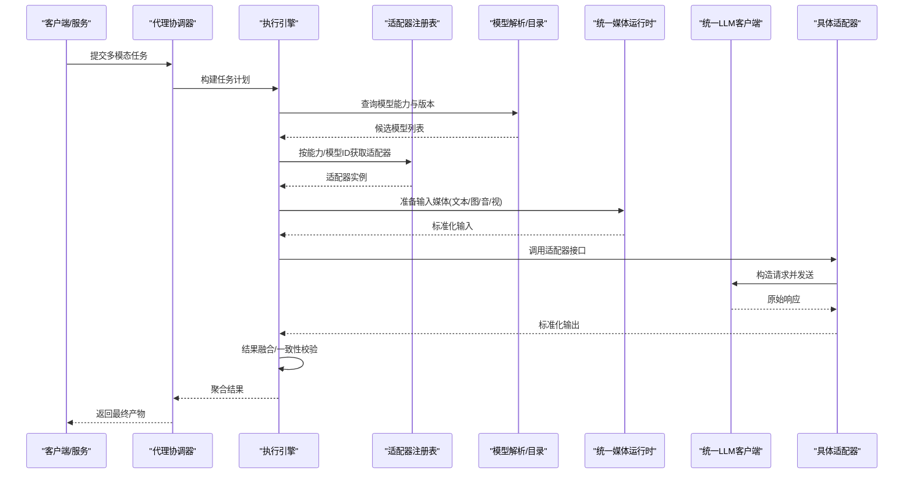
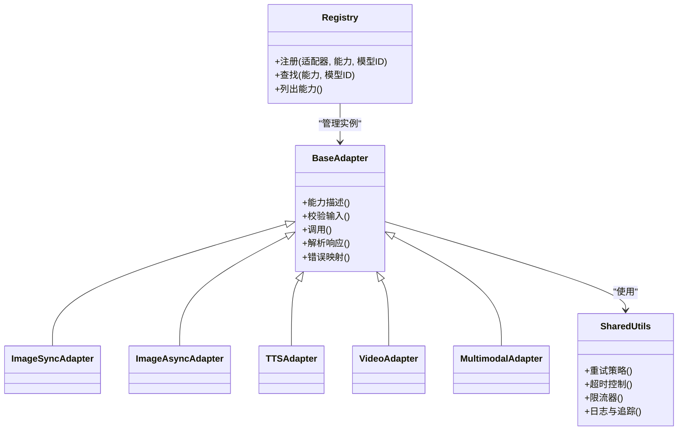
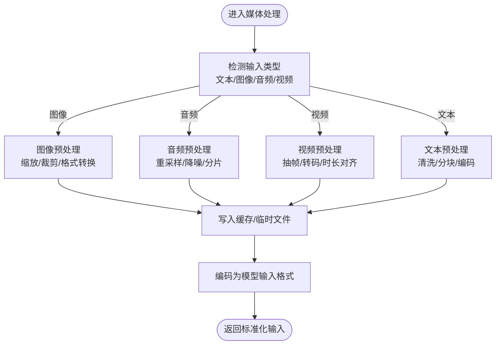
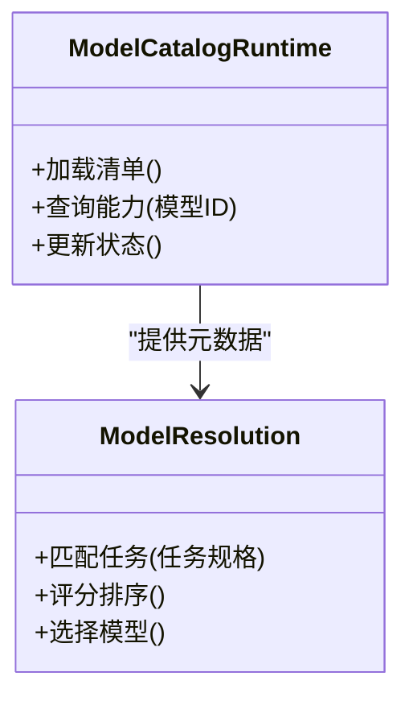
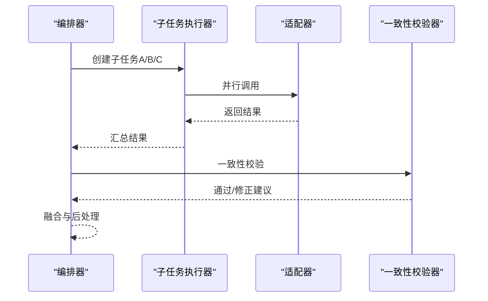
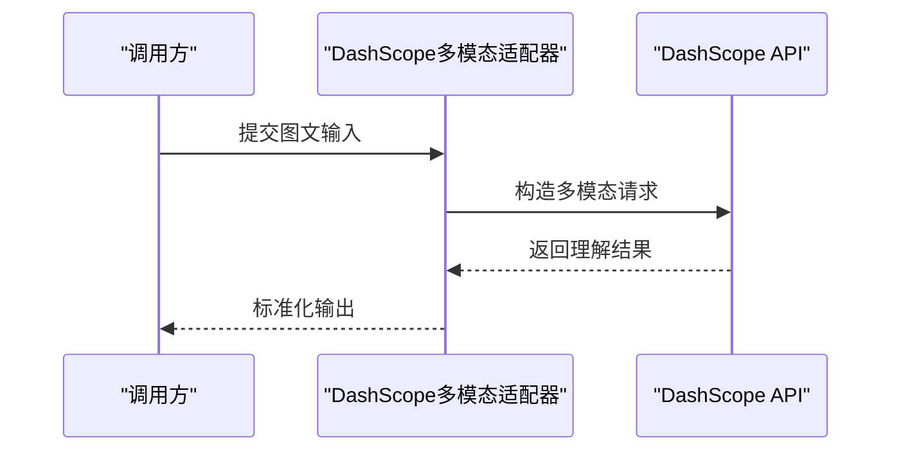
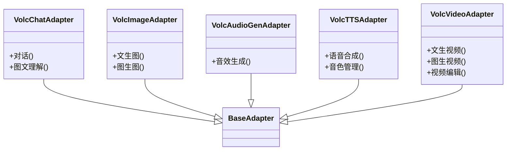
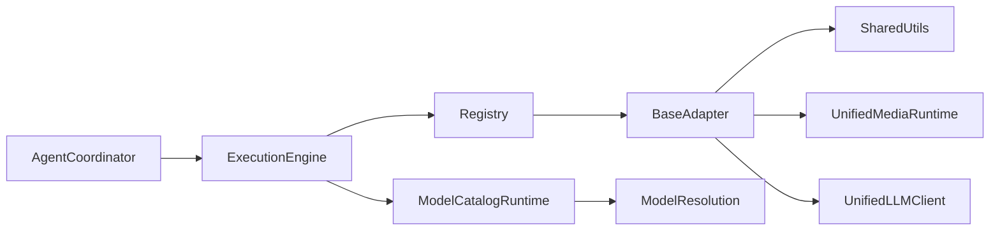

# 多模态适配器

<cite>
**本文引用的文件**   
- [adapters/base.py](file://adapters/base.py)
- [adapters/registry.py](file://adapters/registry.py)
- [adapters/_shared.py](file://adapters/_shared.py)
- [adapters/adapter_helpers.py](file://adapters/adapter_helpers.py)
- [adapters/model_adapters.py](file://adapters/model_adapters.py)
- [adapters/new_models_adapters.py](file://adapters/new_models_adapters.py)
- [adapters/qwen_multimodal_adapter.py](file://adapters/qwen_multimodal_adapter.py)
- [adapters/wanx_adapter.py](file://adapters/wanx_adapter.py)
- [adapters/wan26_video_adapter.py](file://adapters/wan26_video_adapter.py)
- [adapters/dashscope/multimodal.py](file://adapters/dashscope/multimodal.py)
- [adapters/dashscope/image_sync.py](file://adapters/dashscope/image_sync.py)
- [adapters/dashscope/image_async.py](file://adapters/dashscope/image_async.py)
- [adapters/dashscope/tts.py](file://adapters/dashscope/tts.py)
- [adapters/volcengine/chat.py](file://adapters/volcengine/chat.py)
- [adapters/volcengine/image.py](file://adapters/volcengine/image.py)
- [adapters/volcengine/audio_generation.py](file://adapters/volcengine/audio_generation.py)
- [adapters/volcengine/tts.py](file://adapters/volcengine/tts.py)
- [adapters/volcengine/video.py](file://adapters/volcengine/video.py)
- [adapters/mock/image.py](file://adapters/mock/image.py)
- [adapters/mock/llm.py](file://adapters/mock/llm.py)
- [core/unified_media_runtime.py](file://core/unified_media_runtime.py)
- [core/unified_llm_client.py](file://core/unified_llm_client.py)
- [core/model_runtime.py](file://core/model_runtime.py)
- [core/model_catalog_runtime.py](file://core/model_catalog_runtime.py)
- [core/model_resolution.py](file://core/model_resolution.py)
- [core/fallback_manager.py](file://core/fallback_manager.py)
- [core/router.py](file://core/router.py)
- [core/execution_engine.py](file://core/execution_engine.py)
- [schemas/common.py](file://schemas/common.py)
- [schemas/task_spec.py](file://schemas/task_spec.py)
- [backend/app/services/agents/agent_coordinator.py](file://backend/app/services/agents/agent_coordinator.py)
</cite>

## 目录
1. [简介](#简介)
2. [项目结构](#项目结构)
3. [核心组件](#核心组件)
4. [架构总览](#架构总览)
5. [详细组件分析](#详细组件分析)
6. [依赖关系分析](#依赖关系分析)
7. [性能考量](#性能考量)
8. [故障排查指南](#故障排查指南)
9. [结论](#结论)
10. [附录](#附录)

## 简介
本技术文档面向“多模态适配器”子系统，系统性阐述文本、图像、音频、视频等多类型输入输出的适配实现方式。重点覆盖：
- 跨模态数据处理与格式转换
- 内容理解与统一抽象
- 多模态任务编排策略、结果融合与一致性保证
- 复杂业务场景下的适配器组合模式与错误处理
- 完整工作流示例与性能优化技巧
- 自定义多模态适配器的开发指南与测试方法

## 项目结构
多模态适配器位于 adapters 目录，按提供商（如 dashscope、volcengine）与能力（image、tts、video、multimodal）组织；核心运行时与调度在 core 目录；统一规范与契约在 schemas 目录；上层编排由后端服务与代理协调器驱动。

```mermaid
graph TB
subgraph "适配器层"
A_base["adapters/base.py"]
A_reg["adapters/registry.py"]
A_shared["adapters/_shared.py"]
A_helpers["adapters/adapter_helpers.py"]
A_model_adapt["adapters/model_adapters.py"]
A_new_models["adapters/new_models_adapters.py"]
A_qwen["adapters/qwen_multimodal_adapter.py"]
A_wanx["adapters/wanx_adapter.py"]
A_wan26["adapters/wan26_video_adapter.py"]
subgraph "DashScope"
D_mm["dashscope/multimodal.py"]
D_img_s["dashscope/image_sync.py"]
D_img_a["dashscope/image_async.py"]
D_tts["dashscope/tts.py"]
end
subgraph "VolcEngine"
V_chat["volcengine/chat.py"]
V_img["volcengine/image.py"]
V_audio["volcengine/audio_generation.py"]
V_tts["volcengine/tts.py"]
V_vid["volcengine/video.py"]
end
A_mock_img["mock/image.py"]
A_mock_llm["mock/llm.py"]
end
subgraph "核心运行时"
C_umr["core/unified_media_runtime.py"]
C_ullm["core/unified_llm_client.py"]
C_mr["core/model_runtime.py"]
C_mcr["core/model_catalog_runtime.py"]
C_mrslv["core/model_resolution.py"]
C_fb["core/fallback_manager.py"]
C_router["core/router.py"]
C_exec["core/execution_engine.py"]
end
subgraph "契约与规范"
S_common["schemas/common.py"]
S_task["schemas/task_spec.py"]
end
subgraph "编排与服务"
B_agent["backend/app/services/agents/agent_coordinator.py"]
end
A_base --> A_reg
A_model_adapt --> A_base
A_new_models --> A_base
A_qwen --> A_base
A_wanx --> A_base
A_wan26 --> A_base
D_mm --> A_base
D_img_s --> A_base
D_img_a --> A_base
D_tts --> A_base
V_chat --> A_base
V_img --> A_base
V_audio --> A_base
V_tts --> A_base
V_vid --> A_base
A_mock_img --> A_base
A_mock_llm --> A_base
A_reg --> C_umr
A_reg --> C_ullm
A_reg --> C_mr
A_reg --> C_mcr
A_reg --> C_mrslv
A_reg --> C_fb
A_reg --> C_router
A_reg --> C_exec
C_umr --> S_common
C_ullm --> S_common
C_mr --> S_common
C_mcr --> S_common
C_mrslv --> S_common
C_fb --> S_common
C_router --> S_common
C_exec --> S_common
B_agent --> A_reg
B_agent --> C_exec
```

图表来源
- [adapters/base.py](file://adapters/base.py)
- [adapters/registry.py](file://adapters/registry.py)
- [adapters/_shared.py](file://adapters/_shared.py)
- [adapters/adapter_helpers.py](file://adapters/adapter_helpers.py)
- [adapters/model_adapters.py](file://adapters/model_adapters.py)
- [adapters/new_models_adapters.py](file://adapters/new_models_adapters.py)
- [adapters/qwen_multimodal_adapter.py](file://adapters/qwen_multimodal_adapter.py)
- [adapters/wanx_adapter.py](file://adapters/wanx_adapter.py)
- [adapters/wan26_video_adapter.py](file://adapters/wan26_video_adapter.py)
- [adapters/dashscope/multimodal.py](file://adapters/dashscope/multimodal.py)
- [adapters/dashscope/image_sync.py](file://adapters/dashscope/image_sync.py)
- [adapters/dashscope/image_async.py](file://adapters/dashscope/image_async.py)
- [adapters/dashscope/tts.py](file://adapters/dashscope/tts.py)
- [adapters/volcengine/chat.py](file://adapters/volcengine/chat.py)
- [adapters/volcengine/image.py](file://adapters/volcengine/image.py)
- [adapters/volcengine/audio_generation.py](file://adapters/volcengine/audio_generation.py)
- [adapters/volcengine/tts.py](file://adapters/volcengine/tts.py)
- [adapters/volcengine/video.py](file://adapters/volcengine/video.py)
- [adapters/mock/image.py](file://adapters/mock/image.py)
- [adapters/mock/llm.py](file://adapters/mock/llm.py)
- [core/unified_media_runtime.py](file://core/unified_media_runtime.py)
- [core/unified_llm_client.py](file://core/unified_llm_client.py)
- [core/model_runtime.py](file://core/model_runtime.py)
- [core/model_catalog_runtime.py](file://core/model_catalog_runtime.py)
- [core/model_resolution.py](file://core/model_resolution.py)
- [core/fallback_manager.py](file://core/fallback_manager.py)
- [core/router.py](file://core/router.py)
- [core/execution_engine.py](file://core/execution_engine.py)
- [schemas/common.py](file://schemas/common.py)
- [schemas/task_spec.py](file://schemas/task_spec.py)
- [backend/app/services/agents/agent_coordinator.py](file://backend/app/services/agents/agent_coordinator.py)

章节来源
- [adapters/base.py](file://adapters/base.py)
- [adapters/registry.py](file://adapters/registry.py)
- [core/unified_media_runtime.py](file://core/unified_media_runtime.py)
- [core/unified_llm_client.py](file://core/unified_llm_client.py)
- [core/model_runtime.py](file://core/model_runtime.py)
- [core/model_catalog_runtime.py](file://core/model_catalog_runtime.py)
- [core/model_resolution.py](file://core/model_resolution.py)
- [core/fallback_manager.py](file://core/fallback_manager.py)
- [core/router.py](file://core/router.py)
- [core/execution_engine.py](file://core/execution_engine.py)
- [schemas/common.py](file://schemas/common.py)
- [schemas/task_spec.py](file://schemas/task_spec.py)
- [backend/app/services/agents/agent_coordinator.py](file://backend/app/services/agents/agent_coordinator.py)

## 核心组件
- 适配器基类与注册表
  - 提供统一的接口抽象、能力声明、参数校验与结果规范化
  - 集中注册各厂商/能力的适配器，支持按模型ID或能力路由
- 媒体与LLM统一运行时
  - 统一封装图像、音频、视频、文本等媒体的加载、编码、解码与传输
  - 统一LLM调用入口，屏蔽不同模型的请求差异
- 模型目录与解析
  - 维护模型元数据、能力矩阵与版本信息
  - 根据任务规格选择合适模型与适配器
- 编排与执行引擎
  - 将多模态任务分解为步骤，管理并发、重试、回退与结果融合
- Mock适配器
  - 用于开发与测试阶段的快速验证与回归

章节来源
- [adapters/base.py](file://adapters/base.py)
- [adapters/registry.py](file://adapters/registry.py)
- [adapters/_shared.py](file://adapters/_shared.py)
- [adapters/adapter_helpers.py](file://adapters/adapter_helpers.py)
- [core/unified_media_runtime.py](file://core/unified_media_runtime.py)
- [core/unified_llm_client.py](file://core/unified_llm_client.py)
- [core/model_runtime.py](file://core/model_runtime.py)
- [core/model_catalog_runtime.py](file://core/model_catalog_runtime.py)
- [core/model_resolution.py](file://core/model_resolution.py)
- [core/execution_engine.py](file://core/execution_engine.py)
- [adapters/mock/image.py](file://adapters/mock/image.py)
- [adapters/mock/llm.py](file://adapters/mock/llm.py)

## 架构总览
多模态适配器采用“统一接口 + 注册路由 + 运行时封装 + 编排引擎”的分层架构。上层通过统一运行时发起任务，运行时依据模型目录与解析策略选择具体适配器，适配器负责与外部模型交互并返回标准化结果。

图表来源
- [backend/app/services/agents/agent_coordinator.py](file://backend/app/services/agents/agent_coordinator.py)
- [core/execution_engine.py](file://core/execution_engine.py)
- [adapters/registry.py](file://adapters/registry.py)
- [core/model_catalog_runtime.py](file://core/model_catalog_runtime.py)
- [core/model_resolution.py](file://core/model_resolution.py)
- [core/unified_media_runtime.py](file://core/unified_media_runtime.py)
- [core/unified_llm_client.py](file://core/unified_llm_client.py)

## 详细组件分析

### 适配器基类与注册表
- 基类职责
  - 定义统一的能力描述、输入输出规范、参数校验与错误映射
  - 提供通用工具：重试、超时、限流、日志与追踪
- 注册表职责
  - 维护能力到适配器的映射，支持按模型ID、能力标签、版本进行查找
  - 提供热插拔与动态发现机制

图表来源
- [adapters/base.py](file://adapters/base.py)
- [adapters/registry.py](file://adapters/registry.py)
- [adapters/_shared.py](file://adapters/_shared.py)

章节来源
- [adapters/base.py](file://adapters/base.py)
- [adapters/registry.py](file://adapters/registry.py)
- [adapters/_shared.py](file://adapters/_shared.py)

### 统一媒体运行时与LLM客户端
- 统一媒体运行时
  - 负责图像、音频、视频的编解码、尺寸/采样率调整、缓存与IO优化
  - 提供内存与磁盘的混合存储策略，减少大对象拷贝
- 统一LLM客户端
  - 封装HTTP/WebSocket/流式接口，统一鉴权、重试、超时与错误码映射
  - 支持文本、图像、音频、视频的多模态请求构造

图表来源
- [core/unified_media_runtime.py](file://core/unified_media_runtime.py)
- [core/unified_llm_client.py](file://core/unified_llm_client.py)

章节来源
- [core/unified_media_runtime.py](file://core/unified_media_runtime.py)
- [core/unified_llm_client.py](file://core/unified_llm_client.py)

### 模型目录与解析
- 模型目录运行时
  - 维护模型清单、能力矩阵、版本与可用性状态
  - 提供查询接口供解析器与注册表使用
- 模型解析
  - 根据任务规格与上下文选择最优模型与适配器
  - 支持优先级、成本、延迟与质量指标的综合评估

图表来源
- [core/model_catalog_runtime.py](file://core/model_catalog_runtime.py)
- [core/model_resolution.py](file://core/model_resolution.py)

章节来源
- [core/model_catalog_runtime.py](file://core/model_catalog_runtime.py)
- [core/model_resolution.py](file://core/model_resolution.py)

### 编排与执行引擎
- 任务分解
  - 将多模态任务拆分为子任务（如先文本生成提示词，再图像生成，最后视频合成）
- 并发与重试
  - 支持并行执行独立子任务，失败自动重试与降级
- 结果融合与一致性
  - 合并多个子任务的输出，进行语义一致性与时序对齐检查

图表来源
- [core/execution_engine.py](file://core/execution_engine.py)
- [core/fallback_manager.py](file://core/fallback_manager.py)

章节来源
- [core/execution_engine.py](file://core/execution_engine.py)
- [core/fallback_manager.py](file://core/fallback_manager.py)

### DashScope 多模态适配器
- 多模态对话与图文理解
  - 支持文本+图像的联合输入，返回结构化或多模态输出
- 图像同步/异步生成
  - 同步接口适合短任务，异步接口适合长耗时任务（队列回调）
- TTS语音合成
  - 支持多种音色与语速配置，返回音频文件或流

图表来源
- [adapters/dashscope/multimodal.py](file://adapters/dashscope/multimodal.py)
- [adapters/dashscope/image_sync.py](file://adapters/dashscope/image_sync.py)
- [adapters/dashscope/image_async.py](file://adapters/dashscope/image_async.py)
- [adapters/dashscope/tts.py](file://adapters/dashscope/tts.py)

章节来源
- [adapters/dashscope/multimodal.py](file://adapters/dashscope/multimodal.py)
- [adapters/dashscope/image_sync.py](file://adapters/dashscope/image_sync.py)
- [adapters/dashscope/image_async.py](file://adapters/dashscope/image_async.py)
- [adapters/dashscope/tts.py](file://adapters/dashscope/tts.py)

### VolcEngine 适配器族
- 聊天与多模态
  - 文本对话与图文理解
- 图像生成
  - 文生图、图生图、风格迁移
- 音频生成与TTS
  - 音效生成、语音合成、音色克隆
- 视频生成
  - 文生视频、图生视频、视频编辑

图表来源
- [adapters/volcengine/chat.py](file://adapters/volcengine/chat.py)
- [adapters/volcengine/image.py](file://adapters/volcengine/image.py)
- [adapters/volcengine/audio_generation.py](file://adapters/volcengine/audio_generation.py)
- [adapters/volcengine/tts.py](file://adapters/volcengine/tts.py)
- [adapters/volcengine/video.py](file://adapters/volcengine/video.py)

章节来源
- [adapters/volcengine/chat.py](file://adapters/volcengine/chat.py)
- [adapters/volcengine/image.py](file://adapters/volcengine/image.py)
- [adapters/volcengine/audio_generation.py](file://adapters/volcengine/audio_generation.py)
- [adapters/volcengine/tts.py](file://adapters/volcengine/tts.py)
- [adapters/volcengine/video.py](file://adapters/volcengine/video.py)

### 其他适配器与桥接
- Qwen 多模态适配器
  - 针对Qwen系列模型的统一封装，支持文本、图像、音频联合输入
- WanX/Wan26 视频适配器
  - 面向视频生成的专用适配器，包含抽帧、时长对齐、转码等流程
- 模型适配器桥接
  - 兼容旧版模型接口，提供迁移路径与降级策略

章节来源
- [adapters/qwen_multimodal_adapter.py](file://adapters/qwen_multimodal_adapter.py)
- [adapters/wanx_adapter.py](file://adapters/wanx_adapter.py)
- [adapters/wan26_video_adapter.py](file://adapters/wan26_video_adapter.py)
- [adapters/model_adapters.py](file://adapters/model_adapters.py)
- [adapters/new_models_adapters.py](file://adapters/new_models_adapters.py)

### 辅助工具与Mock
- 适配器辅助工具
  - 提供通用的参数校验、格式转换、缓存与日志工具
- Mock适配器
  - 模拟真实API行为，便于单元测试与集成测试

章节来源
- [adapters/adapter_helpers.py](file://adapters/adapter_helpers.py)
- [adapters/mock/image.py](file://adapters/mock/image.py)
- [adapters/mock/llm.py](file://adapters/mock/llm.py)

## 依赖关系分析
- 低耦合高内聚
  - 适配器仅依赖基类与共享工具，不直接耦合运行时细节
- 明确的外部依赖
  - 媒体运行时与LLM客户端作为基础设施，被所有适配器复用
- 可能的循环依赖规避
  - 通过注册表与工厂模式解耦，避免适配器间直接引用

图表来源
- [adapters/base.py](file://adapters/base.py)
- [adapters/_shared.py](file://adapters/_shared.py)
- [adapters/registry.py](file://adapters/registry.py)
- [core/unified_media_runtime.py](file://core/unified_media_runtime.py)
- [core/unified_llm_client.py](file://core/unified_llm_client.py)
- [core/model_catalog_runtime.py](file://core/model_catalog_runtime.py)
- [core/model_resolution.py](file://core/model_resolution.py)
- [core/execution_engine.py](file://core/execution_engine.py)
- [backend/app/services/agents/agent_coordinator.py](file://backend/app/services/agents/agent_coordinator.py)

章节来源
- [adapters/base.py](file://adapters/base.py)
- [adapters/_shared.py](file://adapters/_shared.py)
- [adapters/registry.py](file://adapters/registry.py)
- [core/unified_media_runtime.py](file://core/unified_media_runtime.py)
- [core/unified_llm_client.py](file://core/unified_llm_client.py)
- [core/model_catalog_runtime.py](file://core/model_catalog_runtime.py)
- [core/model_resolution.py](file://core/model_resolution.py)
- [core/execution_engine.py](file://core/execution_engine.py)
- [backend/app/services/agents/agent_coordinator.py](file://backend/app/services/agents/agent_coordinator.py)

## 性能考量
- 媒体处理优化
  - 使用内存映射与零拷贝策略，减少大文件I/O开销
  - 对图像/音频/视频进行按需转码与分辨率/采样率自适应
- 并发与批处理
  - 对独立子任务并行执行，合理设置线程池与队列大小
  - 批量请求合并以降低网络往返次数
- 缓存与预热
  - 对常用模型与模板进行本地缓存，启动时预热关键资源
- 错误恢复
  - 指数退避重试、熔断与降级策略，保障系统稳定性

[本节为通用指导，不直接分析具体文件]

## 故障排查指南
- 常见问题定位
  - 模型不可用或能力不匹配：检查模型目录与能力矩阵
  - 媒体格式不支持：确认统一媒体运行时的预处理链
  - 超时与限流：查看重试策略与限流器配置
  - 结果不一致：检查一致性校验规则与融合逻辑
- 调试建议
  - 启用详细日志与追踪，记录请求/响应摘要
  - 使用Mock适配器隔离外部依赖，逐步定位问题

章节来源
- [core/fallback_manager.py](file://core/fallback_manager.py)
- [adapters/_shared.py](file://adapters/_shared.py)
- [adapters/adapter_helpers.py](file://adapters/adapter_helpers.py)

## 结论
多模态适配器通过统一接口、注册路由、运行时封装与编排引擎，实现了文本、图像、音频、视频等多类型输入输出的灵活组合与高效处理。借助模型目录与解析策略，系统能够动态选择最优模型与适配器，并通过结果融合与一致性校验保障输出质量。配合完善的错误处理与性能优化策略，可在复杂业务场景下稳定运行。

[本节为总结性内容，不直接分析具体文件]

## 附录

### 自定义多模态适配器开发指南
- 步骤概览
  - 继承适配器基类，实现能力描述、输入校验、调用与响应解析
  - 在注册表中登记新适配器，绑定能力与模型ID
  - 编写单元测试与集成测试，覆盖正常与异常路径
- 最佳实践
  - 严格遵循统一媒体运行时与LLM客户端的输入输出规范
  - 实现合理的重试、超时与错误映射
  - 提供清晰的日志与追踪信息，便于问题定位

章节来源
- [adapters/base.py](file://adapters/base.py)
- [adapters/registry.py](file://adapters/registry.py)
- [core/unified_media_runtime.py](file://core/unified_media_runtime.py)
- [core/unified_llm_client.py](file://core/unified_llm_client.py)

### 多模态工作流完整示例
- 典型流程
  - 文本生成提示词 → 图像生成 → 视频合成 → 音频配音 → 字幕对齐
- 关键点
  - 子任务并行与串行依赖管理
  - 中间结果的缓存与版本化
  - 一致性校验与人工审核节点

章节来源
- [core/execution_engine.py](file://core/execution_engine.py)
- [backend/app/services/agents/agent_coordinator.py](file://backend/app/services/agents/agent_coordinator.py)

### 测试方法与用例设计
- 单元测试
  - 使用Mock适配器模拟外部API，验证参数校验与错误映射
- 集成测试
  - 端到端验证媒体处理链路与适配器调用
- 性能测试
  - 压测并发与吞吐，评估缓存与批处理效果

章节来源
- [adapters/mock/image.py](file://adapters/mock/image.py)
- [adapters/mock/llm.py](file://adapters/mock/llm.py)