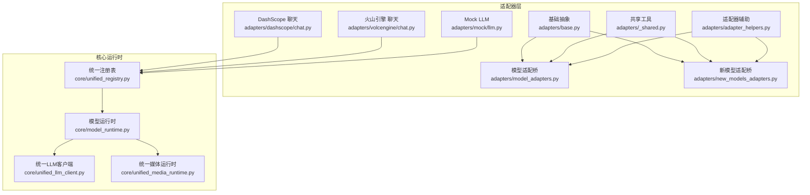
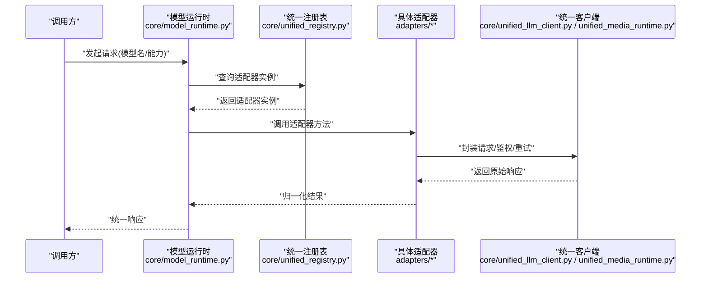
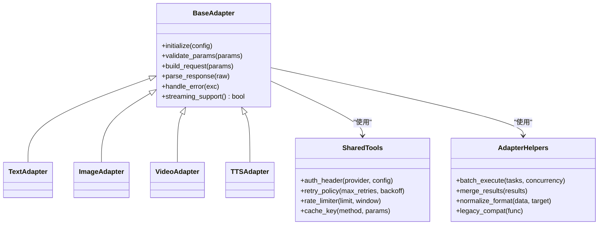
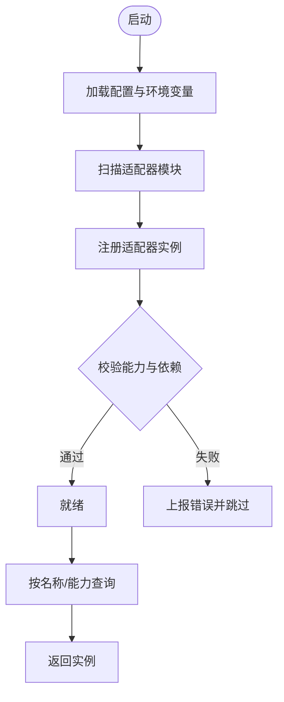
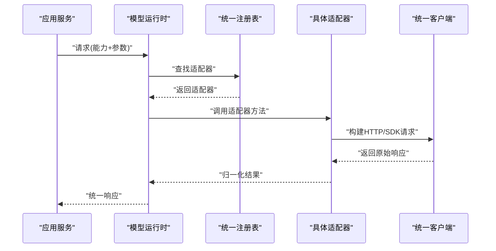
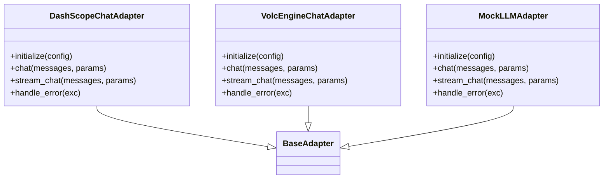
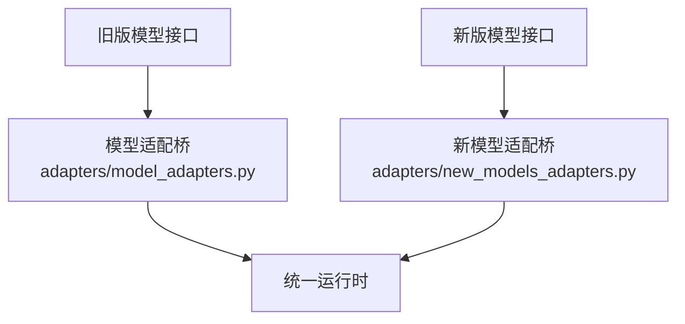
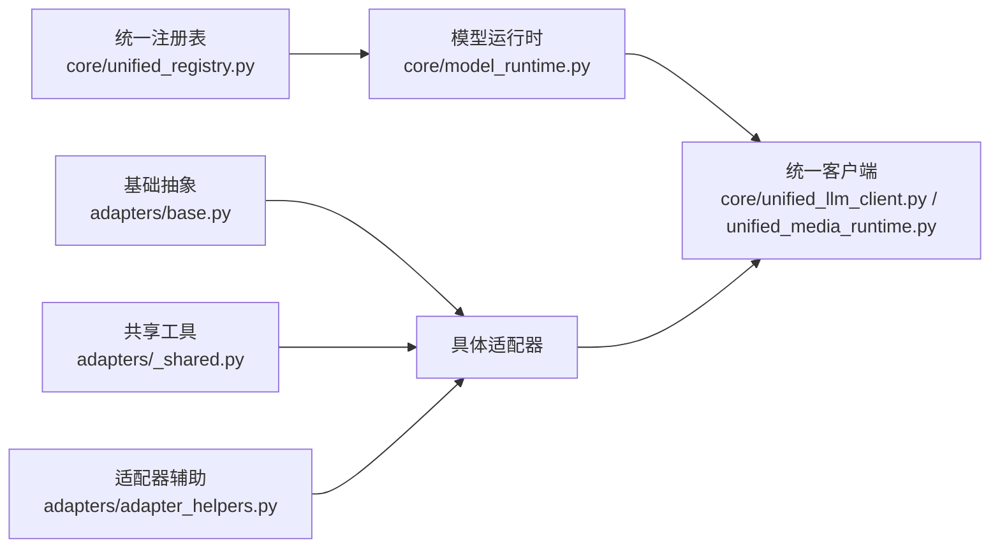

# 自定义适配器开发

<cite>
**本文档引用的文件**   
- [adapters/base.py](file://adapters/base.py)
- [adapters/registry.py](file://adapters/registry.py)
- [adapters/_shared.py](file://adapters/_shared.py)
- [adapters/adapter_helpers.py](file://adapters/adapter_helpers.py)
- [adapters/model_adapters.py](file://adapters/model_adapters.py)
- [adapters/new_models_adapters.py](file://adapters/new_models_adapters.py)
- [core/unified_registry.py](file://core/unified_registry.py)
- [core/model_runtime.py](file://core/model_runtime.py)
- [core/unified_llm_client.py](file://core/unified_llm_client.py)
- [core/unified_media_runtime.py](file://core/unified_media_runtime.py)
- [adapters/dashscope/chat.py](file://adapters/dashscope/chat.py)
- [adapters/volcengine/chat.py](file://adapters/volcengine/chat.py)
- [adapters/mock/llm.py](file://adapters/mock/llm.py)
- [scripts/test_all_models.py](file://scripts/test_all_models.py)
- [scripts/verify_all_adapters.py](file://scripts/verify_all_adapters.py)
</cite>

## 目录
1. [简介](#简介)
2. [项目结构](#项目结构)
3. [核心组件](#核心组件)
4. [架构总览](#架构总览)
5. [详细组件分析](#详细组件分析)
6. [依赖关系分析](#依赖关系分析)
7. [性能考虑](#性能考虑)
8. [故障排除指南](#故障排除指南)
9. [结论](#结论)
10. [附录](#附录)

## 简介
本指南面向希望为系统扩展新的“自定义适配器”的开发者。内容涵盖：
- 基于基础接口实现新适配器类型（LLM、图像、视频、TTS等）
- 错误处理与日志记录规范
- 适配器注册流程与配置管理方法
- 完整的开发模板与代码示例路径
- 测试策略、调试技巧与性能分析方法
- 发布、版本管理与兼容性维护最佳实践
- 常见问题与排障清单

## 项目结构
适配器体系位于 adapters 目录，按提供商或能力域划分模块；统一注册与运行时在 core 目录提供。关键组织方式：
- 基础抽象与共享工具：base、_shared、adapter_helpers
- 各提供商实现：如 dashscope、volcengine、mock 等
- 模型适配桥接：model_adapters、new_models_adapters
- 统一注册与运行时：core/unified_registry.py、core/model_runtime.py、core/unified_llm_client.py、core/unified_media_runtime.py

图表来源
- [adapters/base.py](file://adapters/base.py)
- [adapters/_shared.py](file://adapters/_shared.py)
- [adapters/adapter_helpers.py](file://adapters/adapter_helpers.py)
- [adapters/model_adapters.py](file://adapters/model_adapters.py)
- [adapters/new_models_adapters.py](file://adapters/new_models_adapters.py)
- [core/unified_registry.py](file://core/unified_registry.py)
- [core/model_runtime.py](file://core/model_runtime.py)
- [core/unified_llm_client.py](file://core/unified_llm_client.py)
- [core/unified_media_runtime.py](file://core/unified_media_runtime.py)

章节来源
- [adapters/base.py](file://adapters/base.py)
- [adapters/registry.py](file://adapters/registry.py)
- [core/unified_registry.py](file://core/unified_registry.py)
- [core/model_runtime.py](file://core/model_runtime.py)

## 核心组件
- 基础抽象与协议
  - 定义统一的适配器基类与能力契约（文本生成、图像生成、视频生成、TTS 等），确保不同提供商实现一致的行为与返回结构。
  - 关键职责：参数标准化、结果归一化、流式与非流式统一、错误映射、重试与超时控制。
- 注册表与发现
  - 集中管理适配器实例与元数据，支持按名称或能力维度查找、路由与降级。
  - 提供动态加载与热插拔能力，便于扩展新适配器而无需改动上层调用方。
- 运行时与客户端
  - 统一模型运行时负责选择具体适配器、编排请求、聚合响应、监控与追踪。
  - 统一 LLM/媒体客户端屏蔽底层差异，向上暴露一致的 API。

章节来源
- [adapters/base.py](file://adapters/base.py)
- [adapters/registry.py](file://adapters/registry.py)
- [core/unified_registry.py](file://core/unified_registry.py)
- [core/model_runtime.py](file://core/model_runtime.py)
- [core/unified_llm_client.py](file://core/unified_llm_client.py)
- [core/unified_media_runtime.py](file://core/unified_media_runtime.py)

## 架构总览
适配器通过统一注册表注入运行时，运行时根据配置与能力选择具体实现，并对外暴露一致的调用接口。

图表来源
- [core/model_runtime.py](file://core/model_runtime.py)
- [core/unified_registry.py](file://core/unified_registry.py)
- [core/unified_llm_client.py](file://core/unified_llm_client.py)
- [core/unified_media_runtime.py](file://core/unified_media_runtime.py)
- [adapters/base.py](file://adapters/base.py)

## 详细组件分析

### 基础抽象与共享工具
- 基础抽象
  - 定义统一的适配器基类与能力接口，包括文本、图像、视频、TTS 等能力的标准方法与返回结构。
  - 要求子类实现：参数校验、请求构建、响应解析、错误映射、流式输出支持。
- 共享工具
  - 提供通用工具函数：鉴权头构造、签名、重试策略、限流、缓存键生成、日志上下文注入等。
- 适配器辅助
  - 提供便捷方法：批量请求、并发控制、结果合并、格式转换、兼容旧版接口等。

图表来源
- [adapters/base.py](file://adapters/base.py)
- [adapters/_shared.py](file://adapters/_shared.py)
- [adapters/adapter_helpers.py](file://adapters/adapter_helpers.py)

章节来源
- [adapters/base.py](file://adapters/base.py)
- [adapters/_shared.py](file://adapters/_shared.py)
- [adapters/adapter_helpers.py](file://adapters/adapter_helpers.py)

### 适配器注册与发现
- 注册表职责
  - 维护适配器名称到实例的映射，支持按能力维度检索。
  - 提供生命周期管理：初始化、预热、销毁。
- 动态加载
  - 支持从配置文件或环境变量自动发现并加载适配器。
  - 提供插件式扩展点，避免硬编码依赖。

图表来源
- [adapters/registry.py](file://adapters/registry.py)
- [core/unified_registry.py](file://core/unified_registry.py)

章节来源
- [adapters/registry.py](file://adapters/registry.py)
- [core/unified_registry.py](file://core/unified_registry.py)

### 运行时与客户端
- 模型运行时
  - 根据请求上下文选择具体适配器，处理重试、降级、超时与熔断。
  - 统一监控指标采集与链路追踪。
- 统一客户端
  - 对 LLM 与媒体能力分别提供统一入口，屏蔽底层差异。
  - 提供流式与非流式两种模式，保证一致性体验。

图表来源
- [core/model_runtime.py](file://core/model_runtime.py)
- [core/unified_registry.py](file://core/unified_registry.py)
- [core/unified_llm_client.py](file://core/unified_llm_client.py)
- [core/unified_media_runtime.py](file://core/unified_media_runtime.py)

章节来源
- [core/model_runtime.py](file://core/model_runtime.py)
- [core/unified_llm_client.py](file://core/unified_llm_client.py)
- [core/unified_media_runtime.py](file://core/unified_media_runtime.py)

### 具体适配器实现示例
- DashScope 聊天适配器
  - 实现文本对话能力，包含消息格式化、流式输出、错误映射与重试。
- 火山引擎聊天适配器
  - 实现文本对话能力，包含鉴权、参数映射、响应解析与异常处理。
- Mock LLM 适配器
  - 用于开发与测试，模拟上游行为，便于断言与回归。

图表来源
- [adapters/dashscope/chat.py](file://adapters/dashscope/chat.py)
- [adapters/volcengine/chat.py](file://adapters/volcengine/chat.py)
- [adapters/mock/llm.py](file://adapters/mock/llm.py)
- [adapters/base.py](file://adapters/base.py)

章节来源
- [adapters/dashscope/chat.py](file://adapters/dashscope/chat.py)
- [adapters/volcengine/chat.py](file://adapters/volcengine/chat.py)
- [adapters/mock/llm.py](file://adapters/mock/llm.py)

### 模型适配桥与新模型适配桥
- 模型适配桥
  - 将旧版模型接口与新版适配器进行桥接，保证向后兼容。
- 新模型适配桥
  - 为新模型能力提供快速接入通道，减少重复实现。

图表来源
- [adapters/model_adapters.py](file://adapters/model_adapters.py)
- [adapters/new_models_adapters.py](file://adapters/new_models_adapters.py)
- [core/model_runtime.py](file://core/model_runtime.py)

章节来源
- [adapters/model_adapters.py](file://adapters/model_adapters.py)
- [adapters/new_models_adapters.py](file://adapters/new_models_adapters.py)

## 依赖关系分析
- 组件耦合
  - 适配器依赖基础抽象与共享工具，运行时依赖注册表与客户端。
  - 适配器之间无直接耦合，通过运行时与注册表解耦。
- 外部依赖
  - HTTP/SDK 调用第三方服务，需处理鉴权、限流、重试与超时。
- 循环依赖
  - 通过分层与接口隔离避免循环依赖。

图表来源
- [adapters/base.py](file://adapters/base.py)
- [adapters/_shared.py](file://adapters/_shared.py)
- [adapters/adapter_helpers.py](file://adapters/adapter_helpers.py)
- [core/unified_registry.py](file://core/unified_registry.py)
- [core/model_runtime.py](file://core/model_runtime.py)
- [core/unified_llm_client.py](file://core/unified_llm_client.py)
- [core/unified_media_runtime.py](file://core/unified_media_runtime.py)

章节来源
- [adapters/base.py](file://adapters/base.py)
- [adapters/_shared.py](file://adapters/_shared.py)
- [adapters/adapter_helpers.py](file://adapters/adapter_helpers.py)
- [core/unified_registry.py](file://core/unified_registry.py)
- [core/model_runtime.py](file://core/model_runtime.py)
- [core/unified_llm_client.py](file://core/unified_llm_client.py)
- [core/unified_media_runtime.py](file://core/unified_media_runtime.py)

## 性能考虑
- 连接池与复用
  - 复用 HTTP/SDK 连接，减少握手开销。
- 并发与限流
  - 合理设置并发度与令牌桶限流，避免上游过载。
- 缓存与去重
  - 对幂等请求启用缓存，降低重复调用。
- 流式处理
  - 优先使用流式输出，降低内存占用与首字节延迟。
- 监控与追踪
  - 采集耗时、错误率、QPS 等指标，定位瓶颈。

[本节为通用指导，不直接分析具体文件]

## 故障排除指南
- 常见错误
  - 鉴权失败：检查密钥、签名、时间戳与权限范围。
  - 参数不匹配：核对字段命名、类型与取值范围。
  - 超时与限流：调整重试策略与退避算法，关注上游配额。
  - 流式中断：检查网络稳定性与缓冲区大小。
- 调试技巧
  - 启用详细日志与请求/响应体打印（脱敏）。
  - 使用 Mock 适配器验证逻辑分支。
  - 使用脚本进行端到端验证与回归。
- 排查步骤
  - 确认注册表是否成功加载适配器。
  - 检查运行时是否正确选择目标适配器。
  - 查看客户端请求是否被正确构建与发送。
  - 分析错误码与异常堆栈，定位问题层级。

章节来源
- [scripts/test_all_models.py](file://scripts/test_all_models.py)
- [scripts/verify_all_adapters.py](file://scripts/verify_all_adapters.py)

## 结论
通过统一的基础抽象、注册表与运行时，系统实现了高内聚、低耦合的适配器体系。开发者只需遵循接口契约与规范，即可快速扩展新的适配器类型，并在生产环境中获得一致的可靠性与可观测性。建议严格遵循错误处理、日志记录与测试策略，确保稳定交付与持续演进。

[本节为总结性内容，不直接分析具体文件]

## 附录

### 开发模板与示例路径
- 文本对话适配器模板
  - 参考：[adapters/dashscope/chat.py](file://adapters/dashscope/chat.py)、[adapters/volcengine/chat.py](file://adapters/volcengine/chat.py)
- 图像/视频/TTS 适配器模板
  - 参考：[adapters/model_adapters.py](file://adapters/model_adapters.py)、[adapters/new_models_adapters.py](file://adapters/new_models_adapters.py)
- Mock 适配器用于测试
  - 参考：[adapters/mock/llm.py](file://adapters/mock/llm.py)

章节来源
- [adapters/dashscope/chat.py](file://adapters/dashscope/chat.py)
- [adapters/volcengine/chat.py](file://adapters/volcengine/chat.py)
- [adapters/model_adapters.py](file://adapters/model_adapters.py)
- [adapters/new_models_adapters.py](file://adapters/new_models_adapters.py)
- [adapters/mock/llm.py](file://adapters/mock/llm.py)

### 测试策略
- 单元测试
  - 针对参数校验、请求构建、响应解析与错误映射编写用例。
- 集成测试
  - 使用真实或 Mock 上游进行端到端验证。
- 回归与冒烟
  - 使用脚本批量验证所有适配器可用性与基本功能。

章节来源
- [scripts/test_all_models.py](file://scripts/test_all_models.py)
- [scripts/verify_all_adapters.py](file://scripts/verify_all_adapters.py)

### 发布与版本管理
- 版本策略
  - 采用语义化版本，明确主/次/补丁变更影响范围。
- 兼容性维护
  - 保持接口向后兼容，废弃字段需标记弃用并提供迁移指引。
- 发布流程
  - 代码审查、自动化测试、灰度发布与回滚预案。

[本节为通用指导，不直接分析具体文件]

### 常见问题与解决方案
- 适配器未生效
  - 检查注册表加载顺序与配置项是否正确。
- 性能退化
  - 检查并发、限流与缓存命中率，优化请求结构与重试策略。
- 日志缺失
  - 确认日志级别与上下文注入是否启用。

[本节为通用指导，不直接分析具体文件]