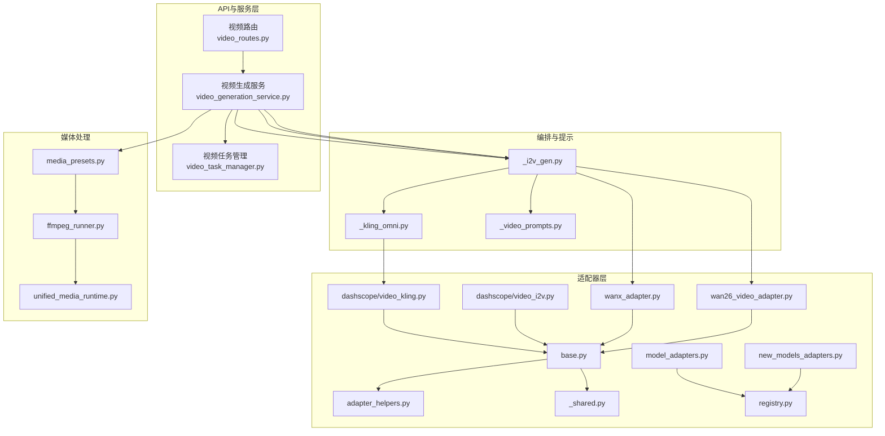
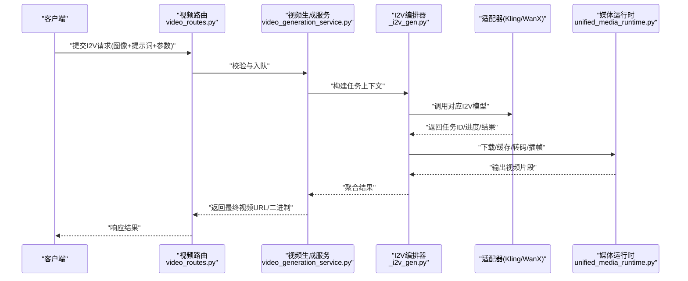
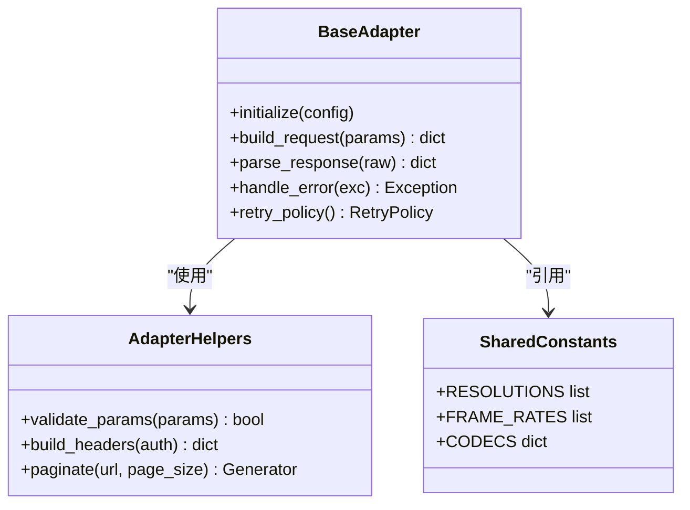
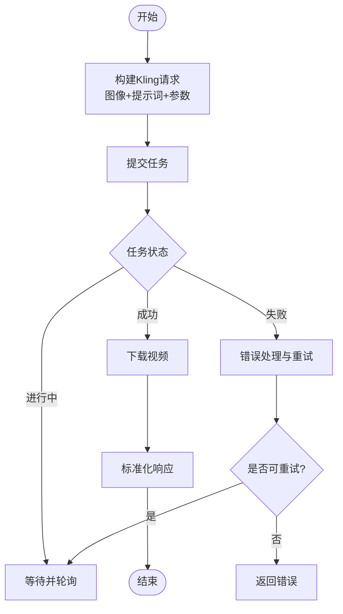
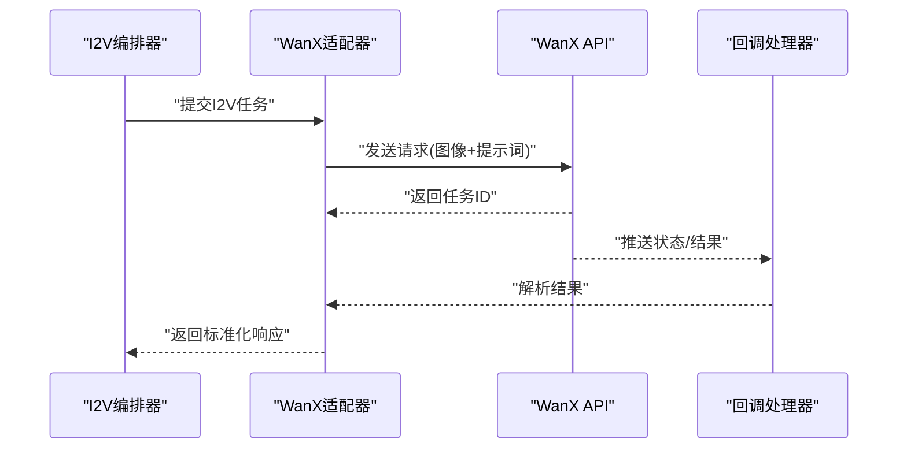
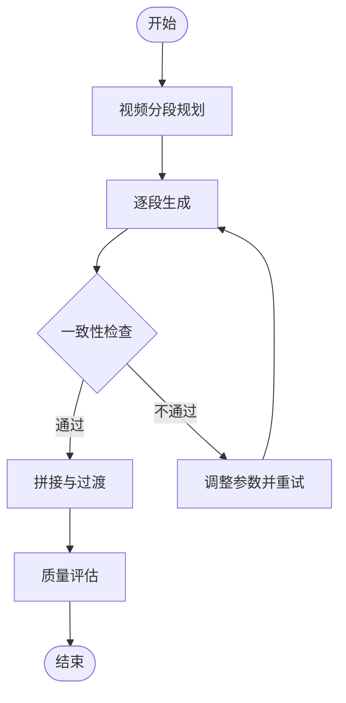
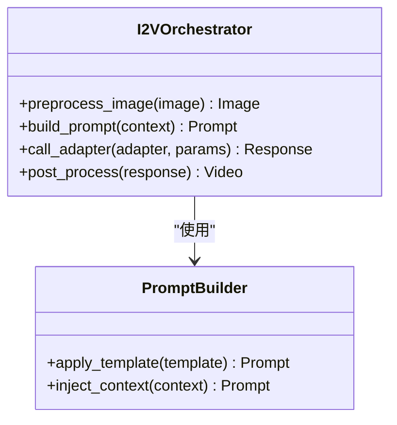
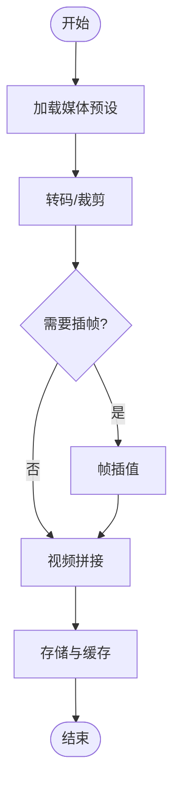
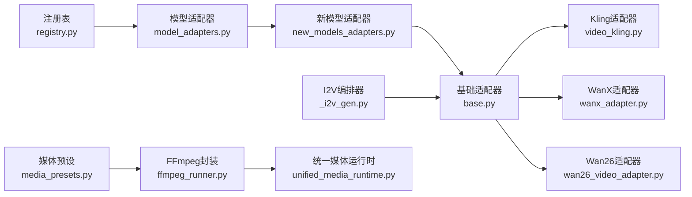

# 图像到视频适配器

<cite>
**本文引用的文件**   
- [adapters/dashscope/video_kling.py](file://adapters/dashscope/video_kling.py)
- [adapters/dashscope/video_i2v.py](file://adapters/dashscope/video_i2v.py)
- [adapters/wanx_adapter.py](file://adapters/wanx_adapter.py)
- [adapters/wan26_video_adapter.py](file://adapters/wan26_video_adapter.py)
- [adapters/base.py](file://adapters/base.py)
- [adapters/adapter_helpers.py](file://adapters/adapter_helpers.py)
- [adapters/_shared.py](file://adapters/_shared.py)
- [adapters/model_adapters.py](file://adapters/model_adapters.py)
- [adapters/new_models_adapters.py](file://adapters/new_models_adapters.py)
- [adapters/registry.py](file://adapters/registry.py)
- [agents/dreamweaver_pkg/_i2v_gen.py](file://agents/dreamweaver_pkg/_i2v_gen.py)
- [agents/dreamweaver_pkg/_kling_omni.py](file://agents/dreamweaver_pkg/_kling_omni.py)
- [agents/dreamweaver_pkg/_video_prompts.py](file://agents/dreamweaver_pkg/_video_prompts.py)
- [pipeline/media_presets.py](file://pipeline/media_presets.py)
- [pipeline/ffmpeg_runner.py](file://pipeline/ffmpeg_runner.py)
- [core/unified_media_runtime.py](file://core/unified_media_runtime.py)
- [backend/app/services/dreamweaver/video_generation_service.py](file://backend/app/services/dreamweaver/video_generation_service.py)
- [backend/app/services/dreamweaver/video_task_manager.py](file://backend/app/services/dreamweaver/video_task_manager.py)
- [backend/app/api/v1/dreamweaver_api/video_routes.py](file://backend/app/api/v1/dreamweaver_api/video_routes.py)
</cite>

## 目录
1. [简介](#简介)
2. [项目结构](#项目结构)
3. [核心组件](#核心组件)
4. [架构总览](#架构总览)
5. [详细组件分析](#详细组件分析)
6. [依赖关系分析](#依赖关系分析)
7. [性能考量](#性能考量)
8. [故障排查指南](#故障排查指南)
9. [结论](#结论)
10. [附录](#附录)

## 简介
本技术文档面向“图像到视频”（Image-to-Video, I2V）适配器的设计与实现，覆盖以下关键主题：
- 基于静态图像生成动态视频的AI模型集成与调用流程
- 图像预处理、关键帧提取与视频插值技术
- Kling、WanX等提供商的I2V API接入、参数配置与结果处理
- 视频动画效果控制、运动轨迹规划与时间线管理
- 视频质量评估、帧率优化与压缩策略
- 图像处理流水线、批量处理与错误恢复机制

该文档既适合工程师快速定位实现细节，也适合非技术读者理解整体工作流。

## 项目结构
围绕I2V能力，代码主要分布在以下模块：
- adapters：各视频/图像模型的适配器封装（Kling、WanX、DashScope等）
- agents/dreamweaver_pkg：视频生成编排、提示词构建、任务调度
- pipeline：媒体处理（FFmpeg、预设、转码）
- core：统一媒体运行时、模型路由与注册
- backend/app：API路由、服务层、任务管理器

图表来源
- [backend/app/api/v1/dreamweaver_api/video_routes.py](file://backend/app/api/v1/dreamweaver_api/video_routes.py)
- [backend/app/services/dreamweaver/video_generation_service.py](file://backend/app/services/dreamweaver/video_generation_service.py)
- [backend/app/services/dreamweaver/video_task_manager.py](file://backend/app/services/dreamweaver/video_task_manager.py)
- [agents/dreamweaver_pkg/_i2v_gen.py](file://agents/dreamweaver_pkg/_i2v_gen.py)
- [agents/dreamweaver_pkg/_kling_omni.py](file://agents/dreamweaver_pkg/_kling_omni.py)
- [agents/dreamweaver_pkg/_video_prompts.py](file://agents/dreamweaver_pkg/_video_prompts.py)
- [adapters/dashscope/video_kling.py](file://adapters/dashscope/video_kling.py)
- [adapters/dashscope/video_i2v.py](file://adapters/dashscope/video_i2v.py)
- [adapters/wanx_adapter.py](file://adapters/wanx_adapter.py)
- [adapters/wan26_video_adapter.py](file://adapters/wan26_video_adapter.py)
- [adapters/base.py](file://adapters/base.py)
- [adapters/adapter_helpers.py](file://adapters/adapter_helpers.py)
- [adapters/_shared.py](file://adapters/_shared.py)
- [adapters/model_adapters.py](file://adapters/model_adapters.py)
- [adapters/new_models_adapters.py](file://adapters/new_models_adapters.py)
- [adapters/registry.py](file://adapters/registry.py)
- [pipeline/media_presets.py](file://pipeline/media_presets.py)
- [pipeline/ffmpeg_runner.py](file://pipeline/ffmpeg_runner.py)
- [core/unified_media_runtime.py](file://core/unified_media_runtime.py)

章节来源
- [adapters/base.py](file://adapters/base.py)
- [adapters/adapter_helpers.py](file://adapters/adapter_helpers.py)
- [adapters/_shared.py](file://adapters/_shared.py)
- [adapters/model_adapters.py](file://adapters/model_adapters.py)
- [adapters/new_models_adapters.py](file://adapters/new_models_adapters.py)
- [adapters/registry.py](file://adapters/registry.py)
- [adapters/dashscope/video_kling.py](file://adapters/dashscope/video_kling.py)
- [adapters/dashscope/video_i2v.py](file://adapters/dashscope/video_i2v.py)
- [adapters/wanx_adapter.py](file://adapters/wanx_adapter.py)
- [adapters/wan26_video_adapter.py](file://adapters/wan26_video_adapter.py)
- [agents/dreamweaver_pkg/_i2v_gen.py](file://agents/dreamweaver_pkg/_i2v_gen.py)
- [agents/dreamweaver_pkg/_kling_omni.py](file://agents/dreamweaver_pkg/_kling_omni.py)
- [agents/dreamweaver_pkg/_video_prompts.py](file://agents/dreamweaver_pkg/_video_prompts.py)
- [pipeline/media_presets.py](file://pipeline/media_presets.py)
- [pipeline/ffmpeg_runner.py](file://pipeline/ffmpeg_runner.py)
- [core/unified_media_runtime.py](file://core/unified_media_runtime.py)
- [backend/app/api/v1/dreamweaver_api/video_routes.py](file://backend/app/api/v1/dreamweaver_api/video_routes.py)
- [backend/app/services/dreamweaver/video_generation_service.py](file://backend/app/services/dreamweaver/video_generation_service.py)
- [backend/app/services/dreamweaver/video_task_manager.py](file://backend/app/services/dreamweaver/video_task_manager.py)

## 核心组件
- 适配器基类与工具
  - base.py：定义统一的视频/图像适配器接口与通用生命周期（初始化、请求构造、响应解析、重试与错误映射）。
  - adapter_helpers.py：提供通用的参数校验、URL拼接、鉴权头组装、分页/轮询辅助。
  - _shared.py：跨适配器的共享数据结构与常量（如分辨率、帧率、时长、编码参数）。
- 具体适配器
  - dashscope/video_kling.py：Kling I2V 适配器，负责将图像与提示词转换为Kling API请求，并处理异步任务状态轮询与结果下载。
  - dashscope/video_i2v.py：通用I2V封装，用于不同厂商的统一调用入口。
  - wanx_adapter.py：WanX I2V 适配器，包含参数映射、并发限制、结果回调处理。
  - wan26_video_adapter.py：Wan26 视频适配器，侧重长视频分段生成与拼接。
- 模型路由与注册
  - model_adapters.py / new_models_adapters.py：按模型ID或能力选择具体适配器实例。
  - registry.py：适配器注册表，支持动态发现与热更新。
- 编排与提示工程
  - _i2v_gen.py：I2V生成编排器，协调图像预处理、提示词构建、适配器调用、后处理。
  - _kling_omni.py：Kling多模态增强，融合图像特征与文本描述提升一致性。
  - _video_prompts.py：视频提示词模板与策略（镜头语言、运动强度、风格化）。
- 媒体处理与运行时
  - media_presets.py：视频输出预设（分辨率、码率、帧率、编码格式）。
  - ffmpeg_runner.py：FFmpeg封装，执行转码、裁剪、插帧、合成。
  - unified_media_runtime.py：统一媒体运行时，抽象本地/云端存储、缓存、IO路径。

章节来源
- [adapters/base.py](file://adapters/base.py)
- [adapters/adapter_helpers.py](file://adapters/adapter_helpers.py)
- [adapters/_shared.py](file://adapters/_shared.py)
- [adapters/dashscope/video_kling.py](file://adapters/dashscope/video_kling.py)
- [adapters/dashscope/video_i2v.py](file://adapters/dashscope/video_i2v.py)
- [adapters/wanx_adapter.py](file://adapters/wanx_adapter.py)
- [adapters/wan26_video_adapter.py](file://adapters/wan26_video_adapter.py)
- [adapters/model_adapters.py](file://adapters/model_adapters.py)
- [adapters/new_models_adapters.py](file://adapters/new_models_adapters.py)
- [adapters/registry.py](file://adapters/registry.py)
- [agents/dreamweaver_pkg/_i2v_gen.py](file://agents/dreamweaver_pkg/_i2v_gen.py)
- [agents/dreamweaver_pkg/_kling_omni.py](file://agents/dreamweaver_pkg/_kling_omni.py)
- [agents/dreamweaver_pkg/_video_prompts.py](file://agents/dreamweaver_pkg/_video_prompts.py)
- [pipeline/media_presets.py](file://pipeline/media_presets.py)
- [pipeline/ffmpeg_runner.py](file://pipeline/ffmpeg_runner.py)
- [core/unified_media_runtime.py](file://core/unified_media_runtime.py)

## 架构总览
I2V的整体调用链从API路由进入，经服务层编排，选择具体适配器调用外部模型，再通过后处理与媒体运行时产出最终视频。

图表来源
- [backend/app/api/v1/dreamweaver_api/video_routes.py](file://backend/app/api/v1/dreamweaver_api/video_routes.py)
- [backend/app/services/dreamweaver/video_generation_service.py](file://backend/app/services/dreamweaver/video_generation_service.py)
- [agents/dreamweaver_pkg/_i2v_gen.py](file://agents/dreamweaver_pkg/_i2v_gen.py)
- [adapters/dashscope/video_kling.py](file://adapters/dashscope/video_kling.py)
- [adapters/wanx_adapter.py](file://adapters/wanx_adapter.py)
- [core/unified_media_runtime.py](file://core/unified_media_runtime.py)

## 详细组件分析

### 适配器基类与工具
- 职责
  - 统一请求构造、鉴权、重试、超时、错误映射
  - 提供通用参数校验与日志追踪
- 关键点
  - 抽象方法：build_request、parse_response、handle_error
  - 可插拔的后处理器：对响应进行标准化（URL、状态码、元数据）
  - 与注册表协作，支持按模型ID动态加载

图表来源
- [adapters/base.py](file://adapters/base.py)
- [adapters/adapter_helpers.py](file://adapters/adapter_helpers.py)
- [adapters/_shared.py](file://adapters/_shared.py)

章节来源
- [adapters/base.py](file://adapters/base.py)
- [adapters/adapter_helpers.py](file://adapters/adapter_helpers.py)
- [adapters/_shared.py](file://adapters/_shared.py)

### Kling I2V适配器（DashScope）
- 职责
  - 将图像与提示词转换为Kling I2V API请求
  - 处理异步任务状态轮询（创建→运行→完成/失败）
  - 下载结果并进行标准化
- 关键点
  - 参数映射：分辨率、时长、帧率、运动强度、种子
  - 重试策略：指数退避、最大尝试次数
  - 错误分类：网络错误、配额不足、内容审核失败

图表来源
- [adapters/dashscope/video_kling.py](file://adapters/dashscope/video_kling.py)
- [adapters/dashscope/video_i2v.py](file://adapters/dashscope/video_i2v.py)

章节来源
- [adapters/dashscope/video_kling.py](file://adapters/dashscope/video_kling.py)
- [adapters/dashscope/video_i2v.py](file://adapters/dashscope/video_i2v.py)

### WanX I2V适配器
- 职责
  - 封装WanX I2V调用，支持参数映射与结果回调
  - 处理并发限制与速率控制
- 关键点
  - 参数校验：图像尺寸、宽高比、时长上限
  - 回调处理：事件驱动的结果通知
  - 降级策略：当主模型不可用时切换备用模型

图表来源
- [adapters/wanx_adapter.py](file://adapters/wanx_adapter.py)

章节来源
- [adapters/wanx_adapter.py](file://adapters/wanx_adapter.py)

### Wan26视频适配器
- 职责
  - 长视频分段生成与拼接
  - 分段一致性控制（角色、场景、风格）
- 关键点
  - 分段策略：按时间切分、关键帧对齐
  - 拼接算法：过渡效果、音画同步
  - 质量检查：分段间跳变检测

图表来源
- [adapters/wan26_video_adapter.py](file://adapters/wan26_video_adapter.py)

章节来源
- [adapters/wan26_video_adapter.py](file://adapters/wan26_video_adapter.py)

### I2V编排器与提示工程
- 职责
  - 协调图像预处理、提示词构建、适配器调用、后处理
  - 管理任务上下文（图像、提示词、参数、状态）
- 关键点
  - 图像预处理：缩放、裁剪、格式转换、色彩空间校正
  - 提示词模板：镜头语言、运动强度、风格化、时间线
  - 结果聚合：多段视频合并、音频同步

图表来源
- [agents/dreamweaver_pkg/_i2v_gen.py](file://agents/dreamweaver_pkg/_i2v_gen.py)
- [agents/dreamweaver_pkg/_video_prompts.py](file://agents/dreamweaver_pkg/_video_prompts.py)

章节来源
- [agents/dreamweaver_pkg/_i2v_gen.py](file://agents/dreamweaver_pkg/_i2v_gen.py)
- [agents/dreamweaver_pkg/_video_prompts.py](file://agents/dreamweaver_pkg/_video_prompts.py)

### 媒体处理与运行时
- 职责
  - 视频转码、裁剪、插帧、合成
  - 统一存储与缓存管理
- 关键点
  - 预设管理：分辨率、码率、帧率、编码格式
  - FFmpeg封装：命令构建、进程管理、错误捕获
  - 运行时抽象：本地/云端路径、临时文件清理

图表来源
- [pipeline/media_presets.py](file://pipeline/media_presets.py)
- [pipeline/ffmpeg_runner.py](file://pipeline/ffmpeg_runner.py)
- [core/unified_media_runtime.py](file://core/unified_media_runtime.py)

章节来源
- [pipeline/media_presets.py](file://pipeline/media_presets.py)
- [pipeline/ffmpeg_runner.py](file://pipeline/ffmpeg_runner.py)
- [core/unified_media_runtime.py](file://core/unified_media_runtime.py)

## 依赖关系分析
- 适配器与注册表
  - 适配器通过注册表动态加载，支持热更新与多模型并行
- 编排器与适配器
  - 编排器根据模型能力选择适配器，传递标准化参数
- 媒体处理与运行时
  - 媒体处理依赖运行时进行IO操作，确保跨平台兼容

图表来源
- [adapters/registry.py](file://adapters/registry.py)
- [adapters/model_adapters.py](file://adapters/model_adapters.py)
- [adapters/new_models_adapters.py](file://adapters/new_models_adapters.py)
- [adapters/base.py](file://adapters/base.py)
- [adapters/dashscope/video_kling.py](file://adapters/dashscope/video_kling.py)
- [adapters/wanx_adapter.py](file://adapters/wanx_adapter.py)
- [adapters/wan26_video_adapter.py](file://adapters/wan26_video_adapter.py)
- [agents/dreamweaver_pkg/_i2v_gen.py](file://agents/dreamweaver_pkg/_i2v_gen.py)
- [pipeline/media_presets.py](file://pipeline/media_presets.py)
- [pipeline/ffmpeg_runner.py](file://pipeline/ffmpeg_runner.py)
- [core/unified_media_runtime.py](file://core/unified_media_runtime.py)

章节来源
- [adapters/registry.py](file://adapters/registry.py)
- [adapters/model_adapters.py](file://adapters/model_adapters.py)
- [adapters/new_models_adapters.py](file://adapters/new_models_adapters.py)
- [adapters/base.py](file://adapters/base.py)
- [adapters/dashscope/video_kling.py](file://adapters/dashscope/video_kling.py)
- [adapters/wanx_adapter.py](file://adapters/wanx_adapter.py)
- [adapters/wan26_video_adapter.py](file://adapters/wan26_video_adapter.py)
- [agents/dreamweaver_pkg/_i2v_gen.py](file://agents/dreamweaver_pkg/_i2v_gen.py)
- [pipeline/media_presets.py](file://pipeline/media_presets.py)
- [pipeline/ffmpeg_runner.py](file://pipeline/ffmpeg_runner.py)
- [core/unified_media_runtime.py](file://core/unified_media_runtime.py)

## 性能考量
- 并发与限流
  - 适配器层实现指数退避与最大重试次数
  - 服务层通过任务队列控制并发度
- 缓存策略
  - 中间结果缓存（预处理图像、提示词哈希）
  - 视频片段缓存（避免重复生成）
- 资源优化
  - 按需加载适配器，减少内存占用
  - 流式处理大文件，避免全量加载
- 监控与追踪
  - 关键指标：成功率、延迟、吞吐量
  - 错误分类与告警

[本节为通用指导，无需特定文件来源]

## 故障排查指南
- 常见问题
  - 网络错误：检查代理、超时设置、重试策略
  - 配额不足：监控用量，设置阈值告警
  - 内容审核失败：调整提示词，增加安全过滤
- 调试技巧
  - 启用详细日志，记录请求/响应
  - 使用模拟适配器验证流程
  - 逐步隔离问题（网络、参数、模型）
- 恢复策略
  - 自动重试与降级
  - 断点续传与任务恢复
  - 人工介入与反馈循环

章节来源
- [adapters/base.py](file://adapters/base.py)
- [adapters/adapter_helpers.py](file://adapters/adapter_helpers.py)
- [adapters/dashscope/video_kling.py](file://adapters/dashscope/video_kling.py)
- [adapters/wanx_adapter.py](file://adapters/wanx_adapter.py)

## 结论
本适配器体系通过统一的接口抽象、灵活的编排机制与健壮的媒体处理能力，实现了高效的图像到视频生成流水线。未来可进一步扩展更多模型支持、优化插帧算法、增强质量评估与自动化调优能力。

[本节为总结性内容，无需特定文件来源]

## 附录
- 术语表
  - I2V：图像到视频（Image-to-Video）
  - 关键帧：视频中的关键画面，用于插值与拼接
  - 插帧：在相邻帧之间生成中间帧，提升流畅度
- 参考链接
  - FFmpeg官方文档
  - Kling API文档
  - WanX API文档

[本节为补充信息，无需特定文件来源]