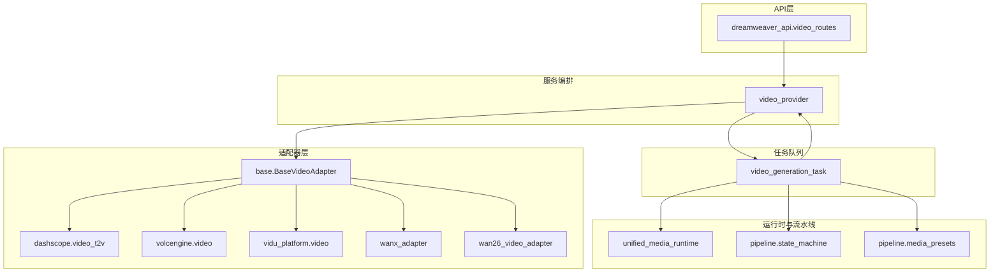
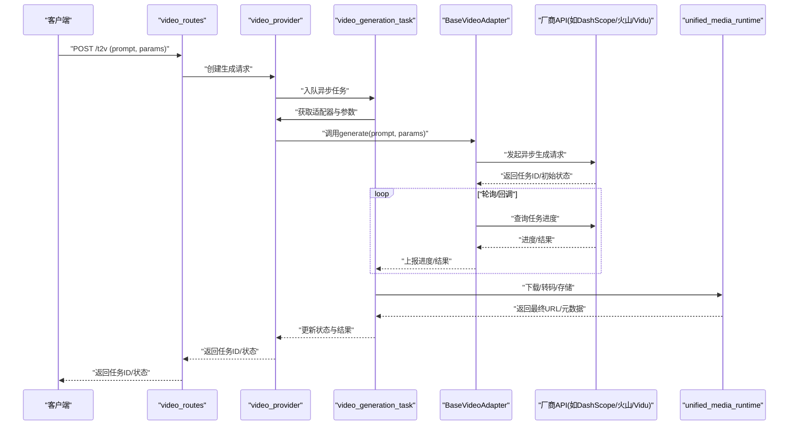
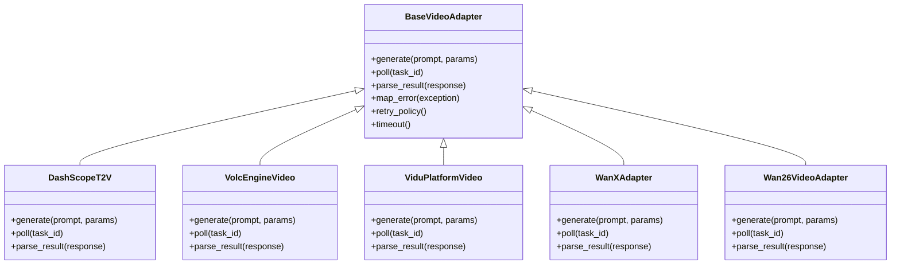
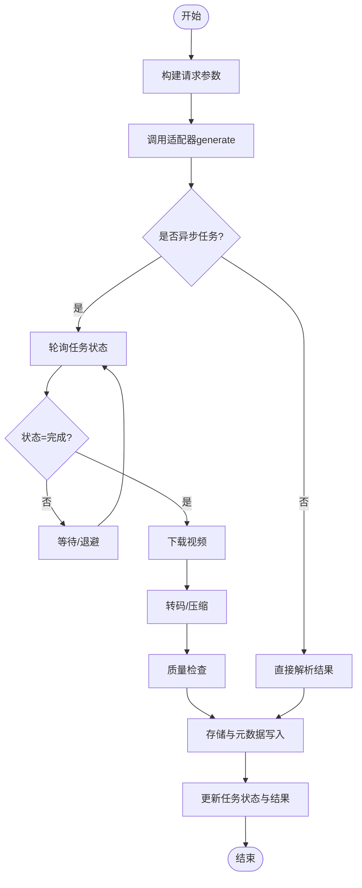
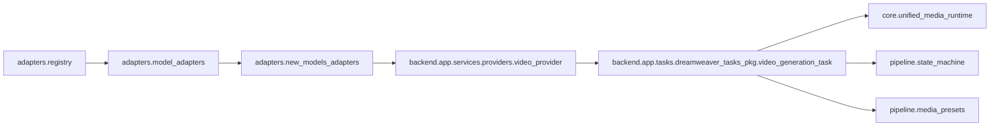

# 文本到视频适配器

<cite>
**本文引用的文件**   
- [adapters/dashscope/video_t2v.py](file://adapters/dashscope/video_t2v.py)
- [adapters/volcengine/video.py](file://adapters/volcengine/video.py)
- [adapters/vidu_platform/video.py](file://adapters/vidu_platform/video.py)
- [adapters/wanx_adapter.py](file://adapters/wanx_adapter.py)
- [adapters/wan26_video_adapter.py](file://adapters/wan26_video_adapter.py)
- [adapters/base.py](file://adapters/base.py)
- [adapters/_shared.py](file://adapters/_shared.py)
- [adapters/model_adapters.py](file://adapters/model_adapters.py)
- [adapters/new_models_adapters.py](file://adapters/new_models_adapters.py)
- [adapters/registry.py](file://adapters/registry.py)
- [adapters/prompt_optimizer.py](file://adapters/prompt_optimizer.py)
- [adapters/rate_limiter.py](file://adapters/rate_limiter.py)
- [backend/app/services/providers/__init__.py](file://backend/app/services/providers/__init__.py)
- [backend/app/services/providers/video_provider.py](file://backend/app/services/providers/video_provider.py)
- [backend/app/tasks/dreamweaver_tasks_pkg/video_generation_task.py](file://backend/app/tasks/dreamweaver_tasks_pkg/video_generation_task.py)
- [backend/app/api/v1/dreamweaver_api/video_routes.py](file://backend/app/api/v1/dreamweaver_api/video_routes.py)
- [core/unified_media_runtime.py](file://core/unified_media_runtime.py)
- [pipeline/state_machine.py](file://pipeline/state_machine.py)
- [pipeline/media_presets.py](file://pipeline/media_presets.py)
</cite>

## 目录
1. [简介](#简介)
2. [项目结构](#项目结构)
3. [核心组件](#核心组件)
4. [架构总览](#架构总览)
5. [详细组件分析](#详细组件分析)
6. [依赖关系分析](#依赖关系分析)
7. [性能考量](#性能考量)
8. [故障排查指南](#故障排查指南)
9. [结论](#结论)
10. [附录](#附录)

## 简介
本技术文档面向“文本到视频”（T2V）适配器的实现与集成，覆盖以下关键主题：
- 基于文本描述生成视频的AI模型集成：提示词处理、参数配置、结果解析
- 多提供商API调用方式与认证机制：DashScope、火山引擎、Vidu平台等
- 异步任务管理、进度跟踪与状态同步
- 视频质量评估、格式优化与存储策略
- 性能调优、并发控制与资源管理的最佳实践

本仓库采用“适配器模式 + 统一运行时 + 服务编排 + 任务队列”的分层架构，将不同厂商的视频生成能力抽象为统一接口，并通过后端API与Celery任务进行异步编排。

## 项目结构
围绕T2V的核心代码主要分布在以下模块：
- adapters：各厂商适配器实现与通用基类、注册表、限流器、提示词优化等
- backend/app/services/providers：视频生成服务编排与提供商选择
- backend/app/tasks/dreamweaver_tasks_pkg：异步任务定义与执行
- backend/app/api/v1/dreamweaver_api：HTTP API路由
- core/unified_media_runtime：统一媒体运行时（上传/下载/转码/存储）
- pipeline：状态机与媒体预设（分辨率、编码、时长等）

图表来源
- [backend/app/api/v1/dreamweaver_api/video_routes.py](file://backend/app/api/v1/dreamweaver_api/video_routes.py)
- [backend/app/services/providers/video_provider.py](file://backend/app/services/providers/video_provider.py)
- [backend/app/tasks/dreamweaver_tasks_pkg/video_generation_task.py](file://backend/app/tasks/dreamweaver_tasks_pkg/video_generation_task.py)
- [adapters/base.py](file://adapters/base.py)
- [adapters/dashscope/video_t2v.py](file://adapters/dashscope/video_t2v.py)
- [adapters/volcengine/video.py](file://adapters/volcengine/video.py)
- [adapters/vidu_platform/video.py](file://adapters/vidu_platform/video.py)
- [adapters/wanx_adapter.py](file://adapters/wanx_adapter.py)
- [adapters/wan26_video_adapter.py](file://adapters/wan26_video_adapter.py)
- [core/unified_media_runtime.py](file://core/unified_media_runtime.py)
- [pipeline/state_machine.py](file://pipeline/state_machine.py)
- [pipeline/media_presets.py](file://pipeline/media_presets.py)

章节来源
- [adapters/base.py](file://adapters/base.py)
- [adapters/model_adapters.py](file://adapters/model_adapters.py)
- [adapters/new_models_adapters.py](file://adapters/new_models_adapters.py)
- [adapters/registry.py](file://adapters/registry.py)
- [adapters/prompt_optimizer.py](file://adapters/prompt_optimizer.py)
- [adapters/rate_limiter.py](file://adapters/rate_limiter.py)
- [backend/app/services/providers/video_provider.py](file://backend/app/services/providers/video_provider.py)
- [backend/app/tasks/dreamweaver_tasks_pkg/video_generation_task.py](file://backend/app/tasks/dreamweaver_tasks_pkg/video_generation_task.py)
- [backend/app/api/v1/dreamweaver_api/video_routes.py](file://backend/app/api/v1/dreamweaver_api/video_routes.py)
- [core/unified_media_runtime.py](file://core/unified_media_runtime.py)
- [pipeline/state_machine.py](file://pipeline/state_machine.py)
- [pipeline/media_presets.py](file://pipeline/media_presets.py)

## 核心组件
- 适配器基类与契约
  - 定义统一的视频生成接口（输入文本、参数、回调/轮询、结果解析），屏蔽厂商差异
  - 提供错误映射、重试策略、超时控制、速率限制钩子
- 提供商适配器
  - DashScope T2V：按官方API规范构造请求、鉴权、轮询任务状态、解析输出URL
  - 火山引擎视频：按SDK或REST封装调用、签名认证、异步任务查询
  - Vidu平台：平台特定参数映射、鉴权头、结果回调或轮询
  - 其他（WanX/Wan26）：兼容历史或新模型的适配封装
- 服务编排与任务
  - video_provider：根据模型ID/策略选择具体适配器，组装请求并调度任务
  - video_generation_task：Celery任务，负责调用适配器、进度上报、失败重试、结果落盘
- 统一媒体运行时
  - 负责上传/下载、转码、压缩、校验、元数据写入与存储策略（本地/对象存储）
- 状态机与媒体预设
  - 定义生成流程状态（排队、提交、进行中、完成、失败）、状态转换与持久化
  - 预设分辨率、帧率、编码、比特率、时长等，确保输出一致性

章节来源
- [adapters/base.py](file://adapters/base.py)
- [adapters/dashscope/video_t2v.py](file://adapters/dashscope/video_t2v.py)
- [adapters/volcengine/video.py](file://adapters/volcengine/video.py)
- [adapters/vidu_platform/video.py](file://adapters/vidu_platform/video.py)
- [adapters/wanx_adapter.py](file://adapters/wanx_adapter.py)
- [adapters/wan26_video_adapter.py](file://adapters/wan26_video_adapter.py)
- [backend/app/services/providers/video_provider.py](file://backend/app/services/providers/video_provider.py)
- [backend/app/tasks/dreamweaver_tasks_pkg/video_generation_task.py](file://backend/app/tasks/dreamweaver_tasks_pkg/video_generation_task.py)
- [core/unified_media_runtime.py](file://core/unified_media_runtime.py)
- [pipeline/state_machine.py](file://pipeline/state_machine.py)
- [pipeline/media_presets.py](file://pipeline/media_presets.py)

## 架构总览
下图展示了从HTTP请求到适配器调用、任务执行、结果回传的完整链路。

图表来源
- [backend/app/api/v1/dreamweaver_api/video_routes.py](file://backend/app/api/v1/dreamweaver_api/video_routes.py)
- [backend/app/services/providers/video_provider.py](file://backend/app/services/providers/video_provider.py)
- [backend/app/tasks/dreamweaver_tasks_pkg/video_generation_task.py](file://backend/app/tasks/dreamweaver_tasks_pkg/video_generation_task.py)
- [adapters/base.py](file://adapters/base.py)
- [adapters/dashscope/video_t2v.py](file://adapters/dashscope/video_t2v.py)
- [adapters/volcengine/video.py](file://adapters/volcengine/video.py)
- [adapters/vidu_platform/video.py](file://adapters/vidu_platform/video.py)
- [core/unified_media_runtime.py](file://core/unified_media_runtime.py)

## 详细组件分析

### 适配器基类与统一契约
- 职责
  - 定义统一的generate方法签名、参数校验、错误映射、重试与超时
  - 提供进度上报接口与结果标准化（URL、时长、分辨率、哈希等）
- 设计要点
  - 通过注册表动态加载具体适配器实现
  - 支持可选的提示词优化器注入
  - 与限流器集成，避免触发厂商配额限制

图表来源
- [adapters/base.py](file://adapters/base.py)
- [adapters/dashscope/video_t2v.py](file://adapters/dashscope/video_t2v.py)
- [adapters/volcengine/video.py](file://adapters/volcengine/video.py)
- [adapters/vidu_platform/video.py](file://adapters/vidu_platform/video.py)
- [adapters/wanx_adapter.py](file://adapters/wanx_adapter.py)
- [adapters/wan26_video_adapter.py](file://adapters/wan26_video_adapter.py)

章节来源
- [adapters/base.py](file://adapters/base.py)
- [adapters/registry.py](file://adapters/registry.py)
- [adapters/prompt_optimizer.py](file://adapters/prompt_optimizer.py)
- [adapters/rate_limiter.py](file://adapters/rate_limiter.py)

### 提供商适配器实现要点
- DashScope T2V
  - 认证：使用API Key或Token，按官方规范设置请求头
  - 参数：文本提示、分辨率、时长、帧率、采样策略、种子等
  - 异步：提交任务后轮询任务状态，直至完成或失败
  - 结果：解析视频URL、时长、分辨率、哈希、封面图等元数据
- 火山引擎视频
  - 认证：AK/SK签名或OAuth，按SDK/REST要求构造请求
  - 参数：与DashScope类似，但字段名与取值范围可能不同，需做映射
  - 异步：任务ID查询或回调通知
  - 结果：标准化为统一结构
- Vidu平台
  - 认证：平台特定的鉴权头或Token
  - 参数：平台特有参数（如风格、镜头语言）映射到内部参数
  - 异步：轮询或回调
  - 结果：统一解析

章节来源
- [adapters/dashscope/video_t2v.py](file://adapters/dashscope/video_t2v.py)
- [adapters/volcengine/video.py](file://adapters/volcengine/video.py)
- [adapters/vidu_platform/video.py](file://adapters/vidu_platform/video.py)

### 服务编排与任务管理
- video_provider
  - 根据模型ID/策略选择适配器实例
  - 组装请求参数，调用适配器generate
  - 维护任务上下文（用户ID、项目ID、追踪ID）
- video_generation_task
  - Celery任务：接收provider返回的任务ID，进入轮询循环
  - 进度上报：定期更新数据库/缓存中的任务状态与进度
  - 失败重试：指数退避+最大重试次数
  - 结果处理：下载视频、转码、质量检查、存储、写元数据

图表来源
- [backend/app/services/providers/video_provider.py](file://backend/app/services/providers/video_provider.py)
- [backend/app/tasks/dreamweaver_tasks_pkg/video_generation_task.py](file://backend/app/tasks/dreamweaver_tasks_pkg/video_generation_task.py)
- [core/unified_media_runtime.py](file://core/unified_media_runtime.py)
- [pipeline/state_machine.py](file://pipeline/state_machine.py)

章节来源
- [backend/app/services/providers/video_provider.py](file://backend/app/services/providers/video_provider.py)
- [backend/app/tasks/dreamweaver_tasks_pkg/video_generation_task.py](file://backend/app/tasks/dreamweaver_tasks_pkg/video_generation_task.py)

### 提示词处理与参数配置
- 提示词优化
  - 通过prompt_optimizer对原始文本进行结构化、去噪、风格增强、长度裁剪
  - 支持多语言与领域词典（影视分镜、镜头术语）
- 参数配置
  - 分辨率、帧率、时长、编码、比特率、种子、采样步数等
  - 不同提供商的参数映射表与默认值
- 结果解析
  - 统一数据结构：视频URL、时长、分辨率、帧率、哈希、封面图、元数据
  - 异常映射：网络错误、鉴权失败、内容安全拦截、配额超限

章节来源
- [adapters/prompt_optimizer.py](file://adapters/prompt_optimizer.py)
- [adapters/base.py](file://adapters/base.py)

### 认证机制与错误处理
- 认证
  - DashScope：API Key/Token，请求头注入
  - 火山引擎：AK/SK签名或OAuth Token
  - Vidu：平台Token或Header
- 错误处理
  - 网络异常：重试与熔断
  - 鉴权失败：快速失败并提示重新配置
  - 内容安全：拦截并记录审计日志
  - 配额限制：降级或切换备用提供商

章节来源
- [adapters/dashscope/video_t2v.py](file://adapters/dashscope/video_t2v.py)
- [adapters/volcengine/video.py](file://adapters/volcengine/video.py)
- [adapters/vidu_platform/video.py](file://adapters/vidu_platform/video.py)
- [adapters/rate_limiter.py](file://adapters/rate_limiter.py)

### 异步任务管理、进度跟踪与状态同步
- 任务生命周期
  - 排队 → 提交 → 进行中 → 完成/失败
- 进度上报
  - 定时更新数据库/缓存，前端可通过SSE或WebSocket拉取
- 状态同步
  - 状态机驱动，保证幂等与可恢复
  - 失败自动重试，成功持久化结果

章节来源
- [backend/app/tasks/dreamweaver_tasks_pkg/video_generation_task.py](file://backend/app/tasks/dreamweaver_tasks_pkg/video_generation_task.py)
- [pipeline/state_machine.py](file://pipeline/state_machine.py)

### 视频质量评估、格式优化与存储策略
- 质量评估
  - 基础指标：分辨率、帧率、时长、码率、文件大小
  - 可选AI质检：清晰度、噪声、抖动检测
- 格式优化
  - 统一转码为H.264/H.265 MP4，按需生成缩略图
  - 自适应码率与分段（可选）
- 存储策略
  - 本地磁盘或对象存储（阿里云OSS、腾讯云COS等）
  - 元数据与索引（哈希、指纹、标签）

章节来源
- [core/unified_media_runtime.py](file://core/unified_media_runtime.py)
- [pipeline/media_presets.py](file://pipeline/media_presets.py)

## 依赖关系分析
- 适配器注册与选择
  - registry维护适配器名称到实现的映射
  - model_adapters/new_models_adapters提供模型到适配器的路由
- 服务与任务解耦
  - provider仅负责组装与调度，task负责执行与结果处理
- 运行时与流水线
  - unified_media_runtime提供统一的媒体I/O能力
  - state_machine与media_presets保障一致性与可观测性

图表来源
- [adapters/registry.py](file://adapters/registry.py)
- [adapters/model_adapters.py](file://adapters/model_adapters.py)
- [adapters/new_models_adapters.py](file://adapters/new_models_adapters.py)
- [backend/app/services/providers/video_provider.py](file://backend/app/services/providers/video_provider.py)
- [backend/app/tasks/dreamweaver_tasks_pkg/video_generation_task.py](file://backend/app/tasks/dreamweaver_tasks_pkg/video_generation_task.py)
- [core/unified_media_runtime.py](file://core/unified_media_runtime.py)
- [pipeline/state_machine.py](file://pipeline/state_machine.py)
- [pipeline/media_presets.py](file://pipeline/media_presets.py)

章节来源
- [adapters/registry.py](file://adapters/registry.py)
- [adapters/model_adapters.py](file://adapters/model_adapters.py)
- [adapters/new_models_adapters.py](file://adapters/new_models_adapters.py)
- [backend/app/services/providers/video_provider.py](file://backend/app/services/providers/video_provider.py)
- [backend/app/tasks/dreamweaver_tasks_pkg/video_generation_task.py](file://backend/app/tasks/dreamweaver_tasks_pkg/video_generation_task.py)
- [core/unified_media_runtime.py](file://core/unified_media_runtime.py)
- [pipeline/state_machine.py](file://pipeline/state_machine.py)
- [pipeline/media_presets.py](file://pipeline/media_presets.py)

## 性能考量
- 并发控制
  - 使用Celery worker池大小与队列隔离，避免单任务阻塞
  - 适配器层限流（rate_limiter）防止触发厂商配额
- 资源管理
  - 连接池复用HTTP客户端，减少握手开销
  - 大文件下载分块与断点续传（必要时）
- 缓存与预热
  - 热门模型/参数的响应缓存（短TTL）
  - 启动时预加载适配器与凭证
- 转码优化
  - 使用硬件加速（GPU/NPU）或高效编码器预设
  - 按需生成缩略图与低清预览

[本节为通用指导，不直接分析具体文件]

## 故障排查指南
- 常见问题
  - 鉴权失败：检查密钥/签名配置与有效期
  - 配额超限：降低并发或切换备用提供商
  - 内容安全拦截：调整提示词或关闭严格模式（谨慎）
  - 任务卡住：检查状态机与重试策略，清理僵尸任务
- 诊断手段
  - 查看任务日志与状态流转
  - 抓取适配器请求/响应报文（脱敏）
  - 监控指标：成功率、延迟、错误码分布

章节来源
- [adapters/rate_limiter.py](file://adapters/rate_limiter.py)
- [backend/app/tasks/dreamweaver_tasks_pkg/video_generation_task.py](file://backend/app/tasks/dreamweaver_tasks_pkg/video_generation_task.py)
- [pipeline/state_machine.py](file://pipeline/state_machine.py)

## 结论
本适配器体系通过统一契约与分层架构，将多厂商视频生成能力整合为稳定、可扩展的服务。结合异步任务、状态机与媒体运行时，实现了端到端的文本到视频生成流水线。建议在生产环境中强化限流、监控与容错，持续优化提示词与参数策略，以获得更高质量与更高吞吐的视频生成体验。

[本节为总结性内容，不直接分析具体文件]

## 附录
- API入口参考
  - dreamweaver_api.video_routes：T2V相关HTTP接口
- 提供商初始化
  - providers.__init__：提供商注册与配置加载
- 媒体预设
  - media_presets：分辨率、编码、时长等默认配置

章节来源
- [backend/app/api/v1/dreamweaver_api/video_routes.py](file://backend/app/api/v1/dreamweaver_api/video_routes.py)
- [backend/app/services/providers/__init__.py](file://backend/app/services/providers/__init__.py)
- [pipeline/media_presets.py](file://pipeline/media_presets.py)