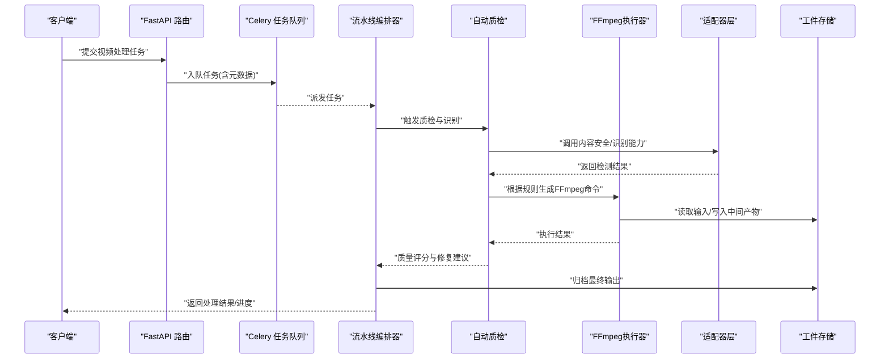
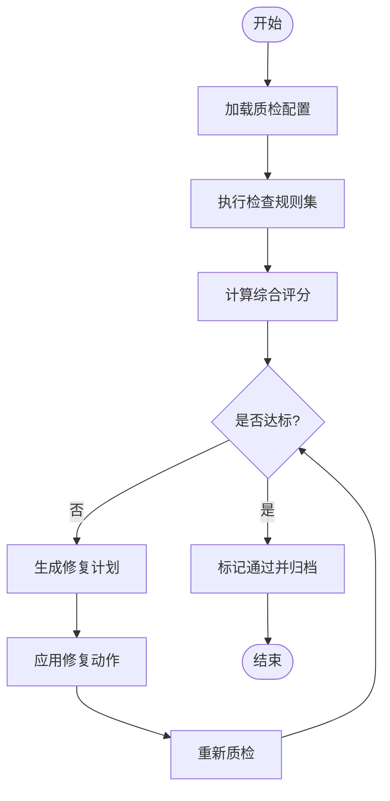
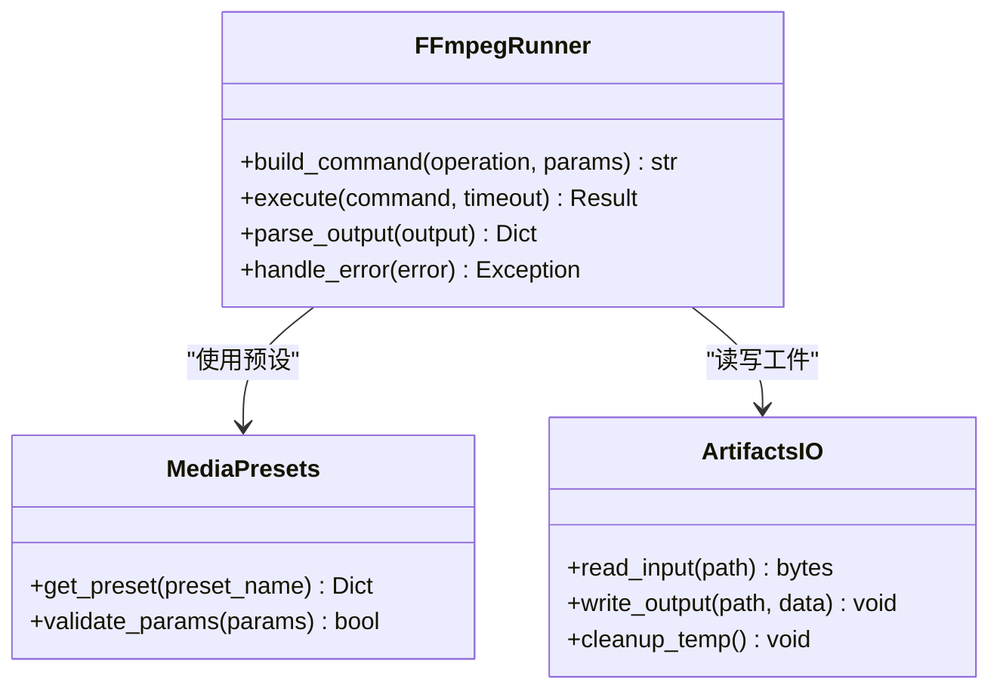
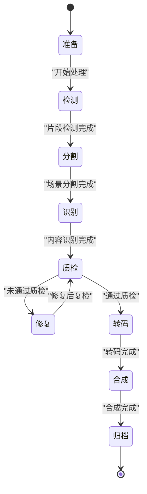
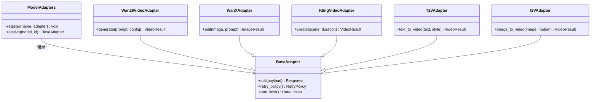
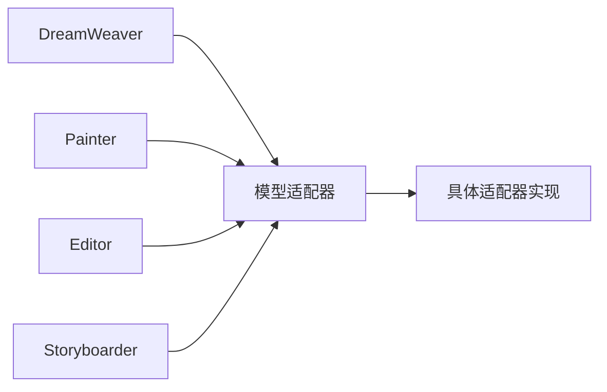
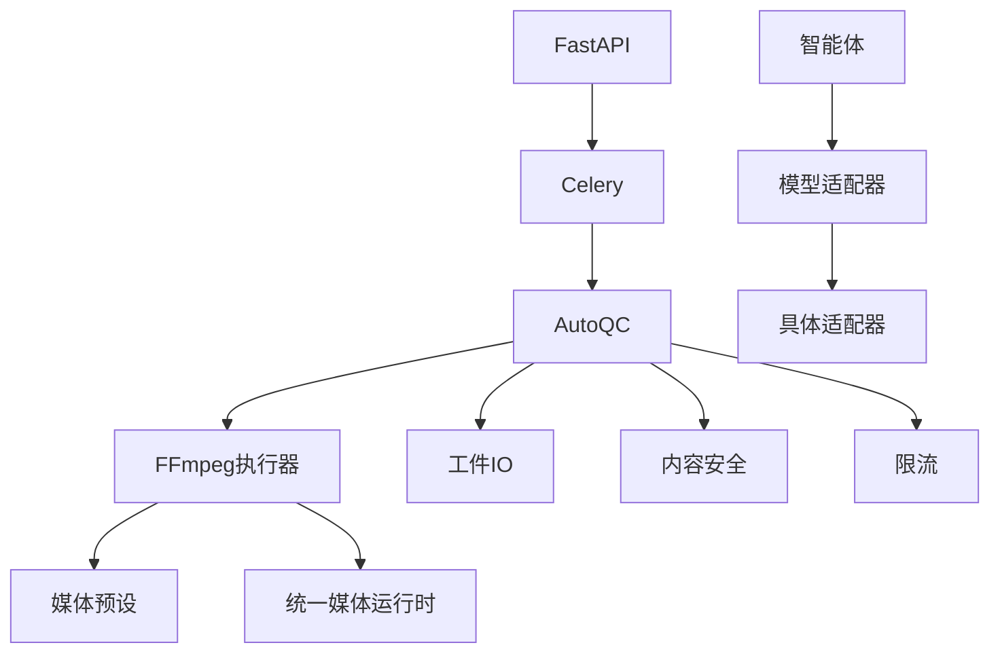

# 视频处理流水线

<cite>
**本文引用的文件**   
- [pipeline/autoqc.py](file://pipeline/autoqc.py)
- [pipeline/ffmpeg_runner.py](file://pipeline/ffmpeg_runner.py)
- [pipeline/media_presets.py](file://pipeline/media_presets.py)
- [pipeline/state_machine.py](file://pipeline/state_machine.py)
- [pipeline/artifacts_io.py](file://pipeline/artifacts_io.py)
- [backend/app/celery_app.py](file://backend/app/celery_app.py)
- [backend/app/main.py](file://backend/app/main.py)
- [adapters/base.py](file://adapters/base.py)
- [adapters/model_adapters.py](file://adapters/model_adapters.py)
- [adapters/wan26_video_adapter.py](file://adapters/wan26_video_adapter.py)
- [adapters/wanx_adapter.py](file://adapters/wanx_adapter.py)
- [adapters/video_kling.py](file://adapters/video_kling.py)
- [adapters/video_t2v.py](file://adapters/video_t2v.py)
- [adapters/video_i2v.py](file://adapters/video_i2v.py)
- [adapters/content_safety_checker.py](file://adapters/content_safety_checker.py)
- [adapters/rate_limiter.py](file://adapters/rate_limiter.py)
- [agents/dreamweaver.py](file://agents/dreamweaver.py)
- [agents/painter.py](file://agents/painter.py)
- [agents/editor.py](file://agents/editor.py)
- [agents/storyboarder.py](file://agents/storyboarder.py)
- [core/unified_media_runtime.py](file://core/unified_media_runtime.py)
- [core/config.py](file://core/config.py)
- [core/logging_config.py](file://core/logging_config.py)
- [scripts/ffmpeg/fast_transit.sh](file://scripts/ffmpeg/fast_transit.sh)
- [scripts/ffmpeg/slow_transit.sh](file://scripts/ffmpeg/slow_transit.sh)
- [FFMPEG_VIDEO_EDIT_GUIDE.md](file://FFMPEG_VIDEO_EDIT_GUIDE.md)
</cite>

## 目录
1. [简介](#简介)
2. [项目结构](#项目结构)
3. [核心组件](#核心组件)
4. [架构总览](#架构总览)
5. [详细组件分析](#详细组件分析)
6. [依赖关系分析](#依赖关系分析)
7. [性能考量](#性能考量)
8. [故障排查指南](#故障排查指南)
9. [结论](#结论)
10. [附录](#附录)

## 简介
本技术文档围绕“视频处理流水线”展开，聚焦于视频内容分析、自动质量控制与编辑操作的端到端流程。文档涵盖：
- 视频片段检测、场景分割与内容识别算法
- 自动质量检查规则、评分标准与问题修复机制
- FFmpeg集成、转码、格式转换与特效处理流程
- 流水线编排、任务调度、错误重试与监控告警实现方案

该流水线以模块化设计为核心，通过适配器层对接多种视频生成与处理能力，借助Celery进行异步任务编排，结合状态机驱动阶段流转，并通过统一媒体运行时与配置中心完成资源管理与可观测性。

## 项目结构
仓库采用多模块分层组织：
- pipeline：视频处理流水线核心（自动质检、FFmpeg执行器、媒体预设、状态机、工件IO）
- adapters：模型与第三方能力适配层（视频生成、安全审核、限流等）
- agents：业务智能体（DreamWeaver、Painter、Editor、Storyboarder等）
- backend：后端服务（FastAPI路由、Celery应用、数据库模型、任务队列）
- core：通用基础设施（统一媒体运行时、配置、日志）
- scripts：脚本工具（FFmpeg快速/慢速过渡脚本）

```mermaid
graph TB
subgraph "前端/调用方"
UI["用户界面/外部系统"]
end
subgraph "后端服务"
API["FastAPI 路由<br/>backend/app/main.py"]
Celery["Celery 应用<br/>backend/app/celery_app.py"]
end
subgraph "流水线核心"
AutoQC["自动质检<br/>pipeline/autoqc.py"]
FFRunner["FFmpeg执行器<br/>pipeline/ffmpeg_runner.py"]
Presets["媒体预设<br/>pipeline/media_presets.py"]
SM["状态机<br/>pipeline/state_machine.py"]
Artifacts["工件IO<br/>pipeline/artifacts_io.py"]
end
subgraph "适配器层"
Base["基础适配器<br/>adapters/base.py"]
ModelAdapters["模型适配器注册<br/>adapters/model_adapters.py"]
Wan26["Wan26 视频适配器<br/>adapters/wan26_video_adapter.py"]
WanX["WanX 适配器<br/>adapters/wanx_adapter.py]
Kling["Kling 视频适配器<br/>adapters/video_kling.py"]
T2V["文本到视频<br/>adapters/video_t2v.py"]
I2V["图像到视频<br/>adapters/video_i2v.py"]
Safety["内容安全审核<br/>adapters/content_safety_checker.py"]
RateLimit["限流器<br/>adapters/rate_limiter.py"]
end
subgraph "智能体"
DW["DreamWeaver<br/>agents/dreamweaver.py"]
Painter["Painter<br/>agents/painter.py"]
Editor["Editor<br/>agents/editor.py"]
Storyboarder["Storyboarder<br/>agents/storyboarder.py"]
end
subgraph "基础设施"
UMedia["统一媒体运行时<br/>core/unified_media_runtime.py"]
Config["配置中心<br/>core/config.py"]
Log["日志配置<br/>core/logging_config.py"]
end
UI --> API
API --> Celery
Celery --> AutoQC
AutoQC --> FFRunner
AutoQC --> Artifacts
AutoQC --> SM
AutoQC --> Safety
AutoQC --> RateLimit
FFRunner --> UMedia
DW --> ModelAdapters
Painter --> ModelAdapters
Editor --> ModelAdapters
Storyboarder --> ModelAdapters
ModelAdapters --> Wan26
ModelAdapters --> WanX
ModelAdapters --> Kling
ModelAdapters --> T2V
ModelAdapters --> I2V
Config --> API
Log --> API
```

**图表来源** 
- [backend/app/main.py](file://backend/app/main.py)
- [backend/app/celery_app.py](file://backend/app/celery_app.py)
- [pipeline/autoqc.py](file://pipeline/autoqc.py)
- [pipeline/ffmpeg_runner.py](file://pipeline/ffmpeg_runner.py)
- [pipeline/media_presets.py](file://pipeline/media_presets.py)
- [pipeline/state_machine.py](file://pipeline/state_machine.py)
- [pipeline/artifacts_io.py](file://pipeline/artifacts_io.py)
- [adapters/base.py](file://adapters/base.py)
- [adapters/model_adapters.py](file://adapters/model_adapters.py)
- [adapters/wan26_video_adapter.py](file://adapters/wan26_video_adapter.py)
- [adapters/wanx_adapter.py](file://adapters/wanx_adapter.py)
- [adapters/video_kling.py](file://adapters/video_kling.py)
- [adapters/video_t2v.py](file://adapters/video_t2v.py)
- [adapters/video_i2v.py](file://adapters/video_i2v.py)
- [adapters/content_safety_checker.py](file://adapters/content_safety_checker.py)
- [adapters/rate_limiter.py](file://adapters/rate_limiter.py)
- [core/unified_media_runtime.py](file://core/unified_media_runtime.py)
- [core/config.py](file://core/config.py)
- [core/logging_config.py](file://core/logging_config.py)

**章节来源**
- [backend/app/main.py](file://backend/app/main.py)
- [backend/app/celery_app.py](file://backend/app/celery_app.py)
- [pipeline/autoqc.py](file://pipeline/autoqc.py)
- [pipeline/ffmpeg_runner.py](file://pipeline/ffmpeg_runner.py)
- [pipeline/media_presets.py](file://pipeline/media_presets.py)
- [pipeline/state_machine.py](file://pipeline/state_machine.py)
- [pipeline/artifacts_io.py](file://pipeline/artifacts_io.py)
- [adapters/base.py](file://adapters/base.py)
- [adapters/model_adapters.py](file://adapters/model_adapters.py)
- [adapters/wan26_video_adapter.py](file://adapters/wan26_video_adapter.py)
- [adapters/wanx_adapter.py](file://adapters/wanx_adapter.py)
- [adapters/video_kling.py](file://adapters/video_kling.py)
- [adapters/video_t2v.py](file://adapters/video_t2v.py)
- [adapters/video_i2v.py](file://adapters/video_i2v.py)
- [adapters/content_safety_checker.py](file://adapters/content_safety_checker.py)
- [adapters/rate_limiter.py](file://adapters/rate_limiter.py)
- [core/unified_media_runtime.py](file://core/unified_media_runtime.py)
- [core/config.py](file://core/config.py)
- [core/logging_config.py](file://core/logging_config.py)

## 核心组件
- 自动质检（AutoQC）：定义质量检查规则、评分策略与问题修复路径，串联内容安全、语义一致性、状态连续性、视频片段检查等子模块。
- FFmpeg执行器：封装FFmpeg命令构建与执行，支持转码、裁剪、拼接、滤镜、字幕合成等。
- 媒体预设：集中管理分辨率、码率、帧率、编码参数等标准化配置。
- 状态机：驱动流水线阶段流转，维护任务上下文与结果持久化。
- 工件IO：管理中间产物与最终输出的读写、缓存与生命周期。
- 适配器层：统一抽象不同视频生成/处理能力，提供模型选择、限流与安全审核。
- 智能体：编排具体业务逻辑（如分镜、绘画、编辑、DreamWeaver）。
- 基础设施：统一媒体运行时、配置与日志。

**章节来源**
- [pipeline/autoqc.py](file://pipeline/autoqc.py)
- [pipeline/ffmpeg_runner.py](file://pipeline/ffmpeg_runner.py)
- [pipeline/media_presets.py](file://pipeline/media_presets.py)
- [pipeline/state_machine.py](file://pipeline/state_machine.py)
- [pipeline/artifacts_io.py](file://pipeline/artifacts_io.py)
- [adapters/base.py](file://adapters/base.py)
- [adapters/model_adapters.py](file://adapters/model_adapters.py)
- [adapters/wan26_video_adapter.py](file://adapters/wan26_video_adapter.py)
- [adapters/wanx_adapter.py](file://adapters/wanx_adapter.py)
- [adapters/video_kling.py](file://adapters/video_kling.py)
- [adapters/video_t2v.py](file://adapters/video_t2v.py)
- [adapters/video_i2v.py](file://adapters/video_i2v.py)
- [adapters/content_safety_checker.py](file://adapters/content_safety_checker.py)
- [adapters/rate_limiter.py](file://adapters/rate_limiter.py)
- [core/unified_media_runtime.py](file://core/unified_media_runtime.py)
- [core/config.py](file://core/config.py)
- [core/logging_config.py](file://core/logging_config.py)

## 架构总览
整体架构遵循“请求入口 → 任务编排 → 流水线执行 → 适配器调用 → 输出归档”的链路：
- FastAPI暴露接口接收任务
- Celery负责异步任务分发与重试
- 状态机驱动各阶段执行（检测、分割、识别、质检、修复、转码、合成）
- 适配器层屏蔽第三方差异，统一调用
- 工件IO与媒体预设保障一致性与可复用性
- 日志与监控贯穿全链路



**图表来源** 
- [backend/app/main.py](file://backend/app/main.py)
- [backend/app/celery_app.py](file://backend/app/celery_app.py)
- [pipeline/autoqc.py](file://pipeline/autoqc.py)
- [pipeline/ffmpeg_runner.py](file://pipeline/ffmpeg_runner.py)
- [adapters/base.py](file://adapters/base.py)
- [adapters/model_adapters.py](file://adapters/model_adapters.py)
- [adapters/content_safety_checker.py](file://adapters/content_safety_checker.py)
- [pipeline/artifacts_io.py](file://pipeline/artifacts_io.py)

## 详细组件分析

### 自动质检（AutoQC）
- 功能要点
  - 规则引擎：定义质量检查项（画面稳定性、音频电平、黑场/白场、音画同步、字幕对齐等）
  - 评分体系：多维度加权评分，阈值判定是否通过或进入修复流程
  - 修复策略：基于规则自动生成修复动作（重采样、降噪、裁剪、拼接、字幕修正）
  - 内容安全：敏感内容检测与拦截
  - 语义一致性：跨镜头角色/场景一致性校验
  - 状态连续性：时间轴连贯性检查（跳帧、时长异常）
  - 视频片段检查：片段长度、分辨率、码率合规性



**图表来源** 
- [pipeline/autoqc.py](file://pipeline/autoqc.py)
- [adapters/content_safety_checker.py](file://adapters/content_safety_checker.py)
- [pipeline/media_presets.py](file://pipeline/media_presets.py)

**章节来源**
- [pipeline/autoqc.py](file://pipeline/autoqc.py)
- [adapters/content_safety_checker.py](file://adapters/content_safety_checker.py)
- [pipeline/media_presets.py](file://pipeline/media_presets.py)

### FFmpeg执行器
- 功能要点
  - 命令构建：根据媒体预设与操作类型生成FFmpeg参数
  - 执行与监控：进程启动、超时控制、错误捕获、日志记录
  - 转码与格式转换：容器、编码、分辨率、帧率、码率、声道配置
  - 特效处理：滤镜链、叠加、水印、字幕、音频混音
  - 分段与拼接：按场景切分、顺序合并、无缝衔接



**图表来源** 
- [pipeline/ffmpeg_runner.py](file://pipeline/ffmpeg_runner.py)
- [pipeline/media_presets.py](file://pipeline/media_presets.py)
- [pipeline/artifacts_io.py](file://pipeline/artifacts_io.py)

**章节来源**
- [pipeline/ffmpeg_runner.py](file://pipeline/ffmpeg_runner.py)
- [pipeline/media_presets.py](file://pipeline/media_presets.py)
- [pipeline/artifacts_io.py](file://pipeline/artifacts_io.py)
- [scripts/ffmpeg/fast_transit.sh](file://scripts/ffmpeg/fast_transit.sh)
- [scripts/ffmpeg/slow_transit.sh](file://scripts/ffmpeg/slow_transit.sh)
- [FFMPEG_VIDEO_EDIT_GUIDE.md](file://FFMPEG_VIDEO_EDIT_GUIDE.md)

### 状态机（State Machine）
- 功能要点
  - 阶段定义：准备、检测、分割、识别、质检、修复、转码、合成、归档
  - 事件驱动：基于事件推进状态，支持回滚与重试
  - 上下文管理：保存每阶段输入输出、耗时、错误信息
  - 持久化：状态与结果落库，便于追踪与恢复



**图表来源** 
- [pipeline/state_machine.py](file://pipeline/state_machine.py)

**章节来源**
- [pipeline/state_machine.py](file://pipeline/state_machine.py)

### 适配器层（Adapters）
- 功能要点
  - 统一接口：抽象视频生成/编辑能力，屏蔽提供商差异
  - 模型选择：根据配置与负载动态选择最佳模型
  - 限流与重试：保护下游服务，避免过载
  - 安全审核：内容合规性检查



**图表来源** 
- [adapters/base.py](file://adapters/base.py)
- [adapters/model_adapters.py](file://adapters/model_adapters.py)
- [adapters/wan26_video_adapter.py](file://adapters/wan26_video_adapter.py)
- [adapters/wanx_adapter.py](file://adapters/wanx_adapter.py)
- [adapters/video_kling.py](file://adapters/video_kling.py)
- [adapters/video_t2v.py](file://adapters/video_t2v.py)
- [adapters/video_i2v.py](file://adapters/video_i2v.py)

**章节来源**
- [adapters/base.py](file://adapters/base.py)
- [adapters/model_adapters.py](file://adapters/model_adapters.py)
- [adapters/wan26_video_adapter.py](file://adapters/wan26_video_adapter.py)
- [adapters/wanx_adapter.py](file://adapters/wanx_adapter.py)
- [adapters/video_kling.py](file://adapters/video_kling.py)
- [adapters/video_t2v.py](file://adapters/video_t2v.py)
- [adapters/video_i2v.py](file://adapters/video_i2v.py)
- [adapters/content_safety_checker.py](file://adapters/content_safety_checker.py)
- [adapters/rate_limiter.py](file://adapters/rate_limiter.py)

### 智能体（Agents）
- DreamWeaver：复杂视频生成编排，协调多模型与多步骤
- Painter：图像/关键帧生成与编辑
- Editor：剪辑、拼接、转场、字幕、音效
- Storyboarder：分镜规划、时长估算、提示词生成



**图表来源** 
- [agents/dreamweaver.py](file://agents/dreamweaver.py)
- [agents/painter.py](file://agents/painter.py)
- [agents/editor.py](file://agents/editor.py)
- [agents/storyboarder.py](file://agents/storyboarder.py)
- [adapters/model_adapters.py](file://adapters/model_adapters.py)

**章节来源**
- [agents/dreamweaver.py](file://agents/dreamweaver.py)
- [agents/painter.py](file://agents/painter.py)
- [agents/editor.py](file://agents/editor.py)
- [agents/storyboarder.py](file://agents/storyboarder.py)
- [adapters/model_adapters.py](file://adapters/model_adapters.py)

### 基础设施（Core）
- 统一媒体运行时：封装FFmpeg、图像处理、音频处理等底层能力
- 配置中心：集中管理环境变量、模型参数、预设配置
- 日志配置：结构化日志、追踪ID、性能指标采集

**章节来源**
- [core/unified_media_runtime.py](file://core/unified_media_runtime.py)
- [core/config.py](file://core/config.py)
- [core/logging_config.py](file://core/logging_config.py)

## 依赖关系分析
- 内聚性
  - AutoQC高内聚地封装质检逻辑，依赖FFRunner、ArtifactsIO、Safety、RateLimit
  - FFRunner专注FFmpeg命令构建与执行，依赖MediaPresets与ArtifactsIO
  - StateMachine独立管理状态流转，低耦合其他组件
- 耦合度
  - 适配器层通过BaseAdapter抽象降低与上层逻辑的耦合
  - 智能体通过ModelAdapters间接依赖具体适配器，避免硬编码
- 外部依赖
  - Celery用于任务队列与重试
  - FFmpeg作为外部二进制工具
  - 第三方视频生成API通过适配器调用



**图表来源** 
- [pipeline/autoqc.py](file://pipeline/autoqc.py)
- [pipeline/ffmpeg_runner.py](file://pipeline/ffmpeg_runner.py)
- [pipeline/artifacts_io.py](file://pipeline/artifacts_io.py)
- [adapters/content_safety_checker.py](file://adapters/content_safety_checker.py)
- [adapters/rate_limiter.py](file://adapters/rate_limiter.py)
- [pipeline/media_presets.py](file://pipeline/media_presets.py)
- [core/unified_media_runtime.py](file://core/unified_media_runtime.py)
- [adapters/model_adapters.py](file://adapters/model_adapters.py)
- [backend/app/main.py](file://backend/app/main.py)
- [backend/app/celery_app.py](file://backend/app/celery_app.py)

**章节来源**
- [pipeline/autoqc.py](file://pipeline/autoqc.py)
- [pipeline/ffmpeg_runner.py](file://pipeline/ffmpeg_runner.py)
- [pipeline/artifacts_io.py](file://pipeline/artifacts_io.py)
- [adapters/content_safety_checker.py](file://adapters/content_safety_checker.py)
- [adapters/rate_limiter.py](file://adapters/rate_limiter.py)
- [pipeline/media_presets.py](file://pipeline/media_presets.py)
- [core/unified_media_runtime.py](file://core/unified_media_runtime.py)
- [adapters/model_adapters.py](file://adapters/model_adapters.py)
- [backend/app/main.py](file://backend/app/main.py)
- [backend/app/celery_app.py](file://backend/app/celery_app.py)

## 性能考量
- FFmpeg优化
  - 使用硬件加速（NVENC/QSV）提升转码速度
  - 合理设置码率与分辨率，避免过度压缩
  - 并行处理多个片段，减少I/O等待
- 任务调度
  - Celery worker数量与CPU核数匹配
  - 任务优先级与队列隔离，避免阻塞
- 缓存与复用
  - 中间产物缓存，避免重复计算
  - 媒体预设复用，减少参数解析开销
- 监控与告警
  - 关键指标采集（耗时、错误率、队列长度）
  - 异常自动告警与降级策略

[本节为通用指导，不直接分析具体文件]

## 故障排查指南
- 常见问题
  - FFmpeg命令失败：检查参数合法性、权限、路径
  - 适配器调用超时：检查网络、限流、重试策略
  - 质检失败：查看评分明细与修复建议
  - 任务堆积：检查Celery worker状态与队列深度
- 调试手段
  - 启用详细日志，追踪请求ID
  - 导出中间工件进行分析
  - 单元测试覆盖关键路径

**章节来源**
- [pipeline/ffmpeg_runner.py](file://pipeline/ffmpeg_runner.py)
- [adapters/rate_limiter.py](file://adapters/rate_limiter.py)
- [pipeline/autoqc.py](file://pipeline/autoqc.py)
- [backend/app/celery_app.py](file://backend/app/celery_app.py)

## 结论
本视频处理流水线通过模块化设计与适配器抽象，实现了可扩展、可维护的视频内容分析与质量控制能力。结合Celery任务调度、状态机驱动与FFmpeg强大处理能力，能够高效完成从检测到修复、转码到合成的全流程。未来可进一步引入AI驱动的自适应优化与实时反馈机制，提升自动化水平与用户体验。

[本节为总结性内容，不直接分析具体文件]

## 附录
- FFmpeg使用指南：参考脚本与文档了解常用命令与最佳实践
- 媒体预设规范：统一编码参数与输出格式
- 适配器扩展指南：新增第三方能力的步骤与注意事项

**章节来源**
- [scripts/ffmpeg/fast_transit.sh](file://scripts/ffmpeg/fast_transit.sh)
- [scripts/ffmpeg/slow_transit.sh](file://scripts/ffmpeg/slow_transit.sh)
- [FFMPEG_VIDEO_EDIT_GUIDE.md](file://FFMPEG_VIDEO_EDIT_GUIDE.md)
- [pipeline/media_presets.py](file://pipeline/media_presets.py)
- [adapters/base.py](file://adapters/base.py)