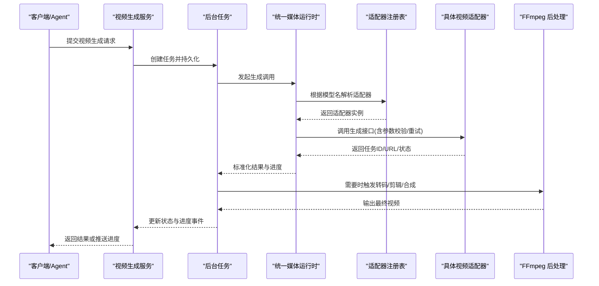
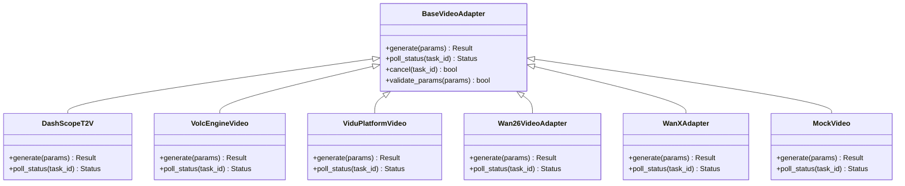
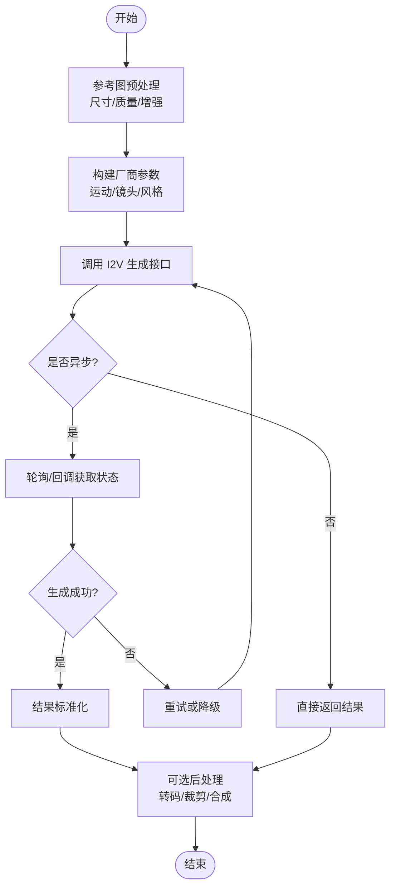
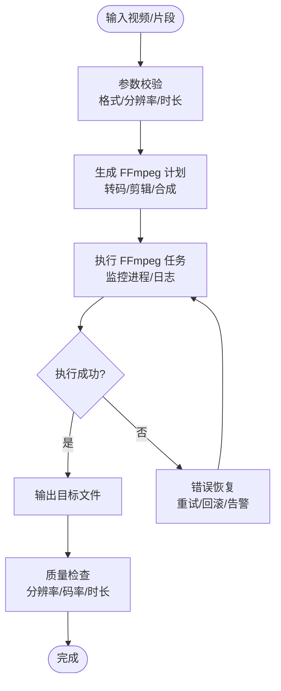
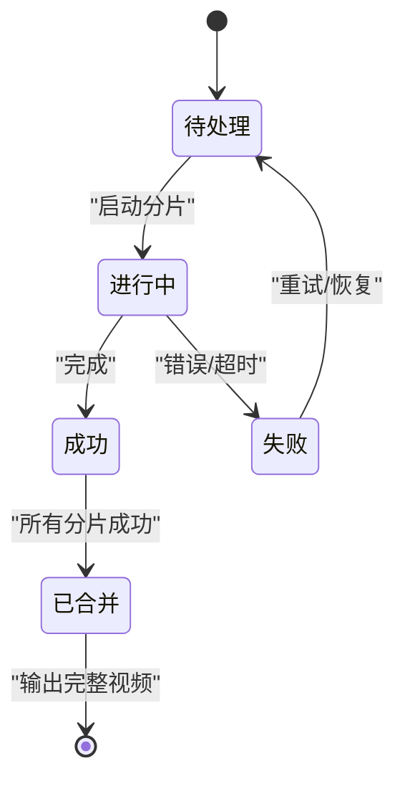
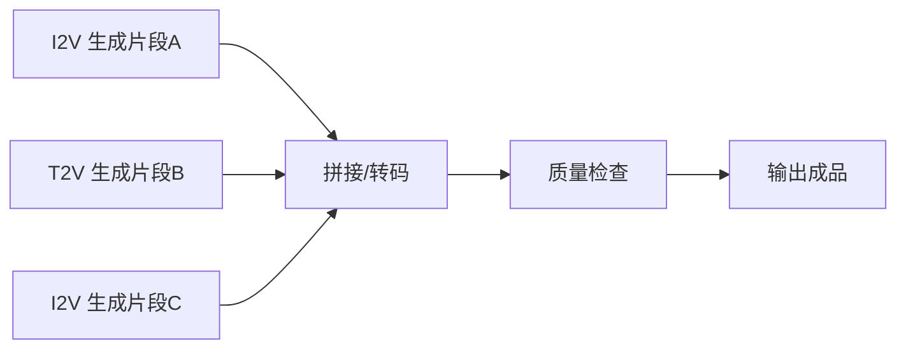
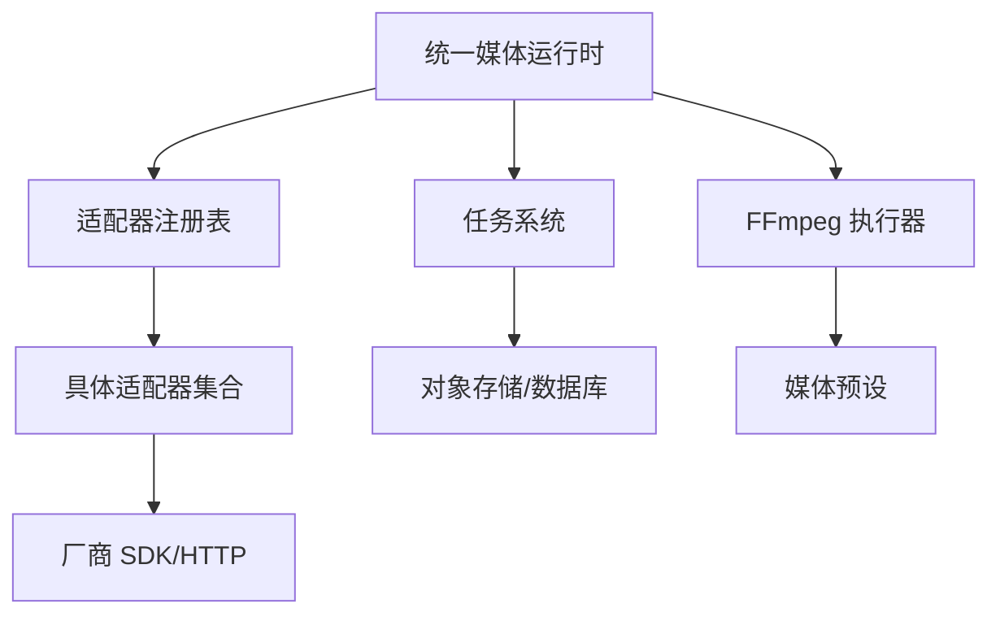

# 视频处理适配器

<cite>
**本文引用的文件**   
- [adapters/base.py](file://adapters/base.py)
- [adapters/registry.py](file://adapters/registry.py)
- [adapters/_shared.py](file://adapters/_shared.py)
- [adapters/adapter_helpers.py](file://adapters/adapter_helpers.py)
- [adapters/dashscope/video_t2v.py](file://adapters/dashscope/video_t2v.py)
- [adapters/dashscope/video_i2v.py](file://adapters/dashscope/video_i2v.py)
- [adapters/dashscope/video_kling.py](file://adapters/dashscope/video_kling.py)
- [adapters/volcengine/video.py](file://adapters/volcengine/video.py)
- [adapters/vidu_platform/video.py](file://adapters/vidu_platform/video.py)
- [adapters/wan26_video_adapter.py](file://adapters/wan26_video_adapter.py)
- [adapters/wanx_adapter.py](file://adapters/wanx_adapter.py)
- [adapters/mock/video.py](file://adapters/mock/video.py)
- [core/unified_media_runtime.py](file://core/unified_media_runtime.py)
- [pipeline/ffmpeg_runner.py](file://pipeline/ffmpeg_runner.py)
- [pipeline/media_presets.py](file://pipeline/media_presets.py)
- [agents/dreamweaver_pkg/_t2v_gen.py](file://agents/dreamweaver_pkg/_t2v_gen.py)
- [agents/dreamweaver_pkg/_i2v_gen.py](file://agents/dreamweaver_pkg/_i2v_gen.py)
- [backend/app/services/dreamweaver/video_generation_service.py](file://backend/app/services/dreamweaver/video_generation_service.py)
- [backend/app/tasks/dreamweaver_tasks.py](file://backend/app/tasks/dreamweaver_tasks.py)
</cite>

## 目录
1. [简介](#简介)
2. [项目结构](#项目结构)
3. [核心组件](#核心组件)
4. [架构总览](#架构总览)
5. [详细组件分析](#详细组件分析)
6. [依赖关系分析](#依赖关系分析)
7. [性能考虑](#性能考虑)
8. [故障排查指南](#故障排查指南)
9. [结论](#结论)
10. [附录](#附录)

## 简介
本技术文档围绕“视频处理适配器”展开，系统性梳理文本到视频（T2V）、图像到视频（I2V）等生成类适配器的实现与组合方式，并覆盖视频编辑、转码、合成等后处理流程。重点说明长视频处理的分片策略、进度跟踪与断点续传机制，以及质量评估、格式转换与压缩优化技术。同时给出复杂工作流的适配器组合模式与错误恢复策略，并提供性能调优与资源管理最佳实践，帮助读者快速理解与高效使用视频处理能力。

## 项目结构
视频相关能力主要分布在以下模块：
- 适配器层：统一抽象与多厂商实现（DashScope、VolcEngine、Vidu、WanX/Wan26、Mock 等）
- 媒体运行时：统一调用入口、参数归一化、结果标准化
- 任务编排：后台任务调度、状态持久化、进度上报
- 后处理管线：FFmpeg 转码、剪辑、合成、质量检查
- 上层 Agent：Dreamweaver 工作流编排 T2V/I2V 生成与拼接

```mermaid
graph TB
subgraph "适配器层"
A_base["基础抽象<br/>adapters/base.py"]
A_reg["注册表<br/>adapters/registry.py"]
A_ds_t2v["DashScope T2V<br/>adapters/dashscope/video_t2v.py"]
A_ds_i2v["DashScope I2V<br/>adapters/dashscope/video_i2v.py"]
A_ds_kl["DashScope Kling<br/>adapters/dashscope/video_kling.py"]
A_ve["VolcEngine 视频<br/>adapters/volcengine/video.py"]
A_vidu["Vidu 平台<br/>adapters/vidu_platform/video.py"]
A_wan26["Wan26 视频<br/>adapters/wan26_video_adapter.py"]
A_wanx["WanX 视频<br/>adapters/wanx_adapter.py"]
A_mock["Mock 视频<br/>adapters/mock/video.py"]
end
subgraph "运行时与工具"
UMR["统一媒体运行时<br/>core/unified_media_runtime.py"]
SHARED["_shared 共享逻辑<br/>adapters/_shared.py"]
HELPERS["适配器辅助函数<br/>adapters/adapter_helpers.py"]
end
subgraph "任务与编排"
DREAM_T2V["T2V 生成编排<br/>agents/dreamweaver_pkg/_t2v_gen.py"]
DREAM_I2V["I2V 生成编排<br/>agents/dreamweaver_pkg/_i2v_gen.py"]
TASKS["后台任务调度<br/>backend/app/tasks/dreamweaver_tasks.py"]
SVC["视频生成服务<br/>backend/app/services/dreamweaver/video_generation_service.py"]
end
subgraph "后处理管线"
FF["FFmpeg 执行器<br/>pipeline/ffmpeg_runner.py"]
PRESETS["媒体预设<br/>pipeline/media_presets.py"]
end
A_base --> A_reg
A_ds_t2v --> A_base
A_ds_i2v --> A_base
A_ds_kl --> A_base
A_ve --> A_base
A_vidu --> A_base
A_wan26 --> A_base
A_wanx --> A_base
A_mock --> A_base
UMR --> A_reg
UMR --> HELPERS
UMR --> SHARED
DREAM_T2V --> UMR
DREAM_I2V --> UMR
SVC --> TASKS
SVC --> UMR
FF --> PRESETS
```

图表来源
- [adapters/base.py](file://adapters/base.py)
- [adapters/registry.py](file://adapters/registry.py)
- [adapters/dashscope/video_t2v.py](file://adapters/dashscope/video_t2v.py)
- [adapters/dashscope/video_i2v.py](file://adapters/dashscope/video_i2v.py)
- [adapters/dashscope/video_kling.py](file://adapters/dashscope/video_kling.py)
- [adapters/volcengine/video.py](file://adapters/volcengine/video.py)
- [adapters/vidu_platform/video.py](file://adapters/vidu_platform/video.py)
- [adapters/wan26_video_adapter.py](file://adapters/wan26_video_adapter.py)
- [adapters/wanx_adapter.py](file://adapters/wanx_adapter.py)
- [adapters/mock/video.py](file://adapters/mock/video.py)
- [core/unified_media_runtime.py](file://core/unified_media_runtime.py)
- [adapters/_shared.py](file://adapters/_shared.py)
- [adapters/adapter_helpers.py](file://adapters/adapter_helpers.py)
- [agents/dreamweaver_pkg/_t2v_gen.py](file://agents/dreamweaver_pkg/_t2v_gen.py)
- [agents/dreamweaver_pkg/_i2v_gen.py](file://agents/dreamweaver_pkg/_i2v_gen.py)
- [backend/app/tasks/dreamweaver_tasks.py](file://backend/app/tasks/dreamweaver_tasks.py)
- [backend/app/services/dreamweaver/video_generation_service.py](file://backend/app/services/dreamweaver/video_generation_service.py)
- [pipeline/ffmpeg_runner.py](file://pipeline/ffmpeg_runner.py)
- [pipeline/media_presets.py](file://pipeline/media_presets.py)

章节来源
- [adapters/base.py](file://adapters/base.py)
- [adapters/registry.py](file://adapters/registry.py)
- [core/unified_media_runtime.py](file://core/unified_media_runtime.py)
- [pipeline/ffmpeg_runner.py](file://pipeline/ffmpeg_runner.py)
- [pipeline/media_presets.py](file://pipeline/media_presets.py)

## 核心组件
- 基础抽象与注册表
  - 定义统一的视频生成/编辑/转码接口与生命周期钩子，提供参数校验、重试、超时、限流等通用能力。
  - 通过注册表按模型名或厂商名动态选择具体实现，支持热插拔与灰度切换。
- 统一媒体运行时
  - 对上游请求进行参数归一化、鉴权、计费上下文注入、并发控制与结果标准化。
  - 聚合各厂商适配器，屏蔽差异，向上暴露一致 API。
- 任务编排与服务层
  - Dreamweaver 的 T2V/I2V 编排将提示词、参考图、时长、分辨率等参数组装为统一任务。
  - 服务层负责任务入队、状态机推进、进度事件推送、失败重试与补偿。
- 后处理管线
  - FFmpeg 执行器封装转码、裁剪、拼接、字幕叠加、水印、码率控制等操作。
  - 媒体预设集中管理输出格式、编码参数与质量档位。

章节来源
- [adapters/base.py](file://adapters/base.py)
- [adapters/registry.py](file://adapters/registry.py)
- [core/unified_media_runtime.py](file://core/unified_media_runtime.py)
- [agents/dreamweaver_pkg/_t2v_gen.py](file://agents/dreamweaver_pkg/_t2v_gen.py)
- [agents/dreamweaver_pkg/_i2v_gen.py](file://agents/dreamweaver_pkg/_i2v_gen.py)
- [backend/app/services/dreamweaver/video_generation_service.py](file://backend/app/services/dreamweaver/video_generation_service.py)
- [pipeline/ffmpeg_runner.py](file://pipeline/ffmpeg_runner.py)
- [pipeline/media_presets.py](file://pipeline/media_presets.py)

## 架构总览
下图展示从上层工作流到具体适配器与后处理的整体调用链。

图表来源
- [backend/app/services/dreamweaver/video_generation_service.py](file://backend/app/services/dreamweaver/video_generation_service.py)
- [backend/app/tasks/dreamweaver_tasks.py](file://backend/app/tasks/dreamweaver_tasks.py)
- [core/unified_media_runtime.py](file://core/unified_media_runtime.py)
- [adapters/registry.py](file://adapters/registry.py)
- [adapters/base.py](file://adapters/base.py)
- [pipeline/ffmpeg_runner.py](file://pipeline/ffmpeg_runner.py)

## 详细组件分析

### 文本到视频（T2V）适配器
- 典型实现
  - DashScope T2V：接收文本提示、风格、时长、分辨率等参数，异步轮询或回调获取结果。
  - VolcEngine/Vidu/WanX/Wan26：各自封装 SDK/API，统一转换为标准输入输出。
- 关键设计
  - 参数映射：将上层参数映射为厂商特定字段，缺失字段采用默认值或回退策略。
  - 异步任务：多数厂商为异步任务，需维护任务 ID、查询状态、处理回调。
  - 结果标准化：统一为视频 URL、帧率、分辨率、时长、元数据等结构。
- 错误处理
  - 网络异常、配额不足、内容审核不通过等错误分类与重试策略。
  - 降级到 Mock 或备选模型，保障可用性。

图表来源
- [adapters/base.py](file://adapters/base.py)
- [adapters/dashscope/video_t2v.py](file://adapters/dashscope/video_t2v.py)
- [adapters/volcengine/video.py](file://adapters/volcengine/video.py)
- [adapters/vidu_platform/video.py](file://adapters/vidu_platform/video.py)
- [adapters/wan26_video_adapter.py](file://adapters/wan26_video_adapter.py)
- [adapters/wanx_adapter.py](file://adapters/wanx_adapter.py)
- [adapters/mock/video.py](file://adapters/mock/video.py)

章节来源
- [adapters/dashscope/video_t2v.py](file://adapters/dashscope/video_t2v.py)
- [adapters/volcengine/video.py](file://adapters/volcengine/video.py)
- [adapters/vidu_platform/video.py](file://adapters/vidu_platform/video.py)
- [adapters/wan26_video_adapter.py](file://adapters/wan26_video_adapter.py)
- [adapters/wanx_adapter.py](file://adapters/wanx_adapter.py)
- [adapters/mock/video.py](file://adapters/mock/video.py)

### 图像到视频（I2V）适配器
- 典型实现
  - DashScope I2V：以首帧或参考图驱动视频生成，支持运动强度、镜头控制等参数。
  - Kling（DashScope）：面向高质量 I2V/T2V 的统一接口，支持更丰富的镜头与风格控制。
- 关键设计
  - 参考图预处理：尺寸归一化、去噪、增强，确保输入质量稳定。
  - 运动控制：速度、方向、景别等参数映射到厂商语义。
  - 一致性约束：角色/场景一致性通过参考图与提示词联合约束。

图表来源
- [adapters/dashscope/video_i2v.py](file://adapters/dashscope/video_i2v.py)
- [adapters/dashscope/video_kling.py](file://adapters/dashscope/video_kling.py)
- [adapters/_shared.py](file://adapters/_shared.py)
- [adapters/adapter_helpers.py](file://adapters/adapter_helpers.py)

章节来源
- [adapters/dashscope/video_i2v.py](file://adapters/dashscope/video_i2v.py)
- [adapters/dashscope/video_kling.py](file://adapters/dashscope/video_kling.py)
- [adapters/_shared.py](file://adapters/_shared.py)
- [adapters/adapter_helpers.py](file://adapters/adapter_helpers.py)

### 视频编辑、转码与合成功能
- 编辑能力
  - 裁剪、缩放、旋转、翻转、滤镜、字幕叠加、水印、封面生成。
- 转码与压缩
  - H.264/H.265、AAC/Opus、码率自适应、关键帧间隔、色彩空间转换。
- 合成与拼接
  - 多片段拼接、音画同步、淡入淡出、过渡效果、时间轴对齐。
- 实现要点
  - FFmpeg 命令模板化与参数校验，避免非法参数导致崩溃。
  - 分块处理大文件，内存占用可控；失败自动重试与断点续传。

图表来源
- [pipeline/ffmpeg_runner.py](file://pipeline/ffmpeg_runner.py)
- [pipeline/media_presets.py](file://pipeline/media_presets.py)

章节来源
- [pipeline/ffmpeg_runner.py](file://pipeline/ffmpeg_runner.py)
- [pipeline/media_presets.py](file://pipeline/media_presets.py)

### 长视频处理：分片、进度与断点续传
- 分片策略
  - 按时间或关键帧切分，保证每段可独立生成/转码；合并阶段保持时间轴对齐。
  - 动态分片：根据模型最大时长限制与资源水位调整分片大小。
- 进度跟踪
  - 每个分片维护进度状态（待处理/进行中/成功/失败），汇总整体进度。
  - 通过事件总线或 SSE 推送实时进度给前端。
- 断点续传
  - 持久化分片状态与中间产物，失败后可从最近成功分片继续。
  - 幂等写入与校验和，防止重复或损坏。

图表来源
- [backend/app/tasks/dreamweaver_tasks.py](file://backend/app/tasks/dreamweaver_tasks.py)
- [backend/app/services/dreamweaver/video_generation_service.py](file://backend/app/services/dreamweaver/video_generation_service.py)

章节来源
- [backend/app/tasks/dreamweaver_tasks.py](file://backend/app/tasks/dreamweaver_tasks.py)
- [backend/app/services/dreamweaver/video_generation_service.py](file://backend/app/services/dreamweaver/video_generation_service.py)

### 质量评估、格式转换与压缩优化
- 质量评估
  - 客观指标：分辨率、码率、帧率、时长、黑边检测、音频响度。
  - 主观指标：AI 评分、一致性检查、画面抖动检测。
- 格式转换
  - 统一输出 MP4/MKV，音频 AAC/Opus，字幕 SRT/VTT。
- 压缩优化
  - CRF/CQP 调参、两遍编码、关键帧策略、B 帧比例、色度采样。
  - 针对移动端/网页端的不同码率档位与自适应码率。

章节来源
- [pipeline/media_presets.py](file://pipeline/media_presets.py)
- [pipeline/ffmpeg_runner.py](file://pipeline/ffmpeg_runner.py)

### 复杂工作流的适配器组合模式
- 组合模式
  - 先 I2V 生成关键片段，再 T2V 补间或扩展，最后 FFmpeg 拼接与调色。
  - 多模型并行生成，择优选取或融合。
- 编排与容错
  - 任务图（DAG）编排，节点级重试与熔断。
  - 失败分支自动降级到备选模型或回退策略。

图表来源
- [agents/dreamweaver_pkg/_i2v_gen.py](file://agents/dreamweaver_pkg/_i2v_gen.py)
- [agents/dreamweaver_pkg/_t2v_gen.py](file://agents/dreamweaver_pkg/_t2v_gen.py)
- [pipeline/ffmpeg_runner.py](file://pipeline/ffmpeg_runner.py)

章节来源
- [agents/dreamweaver_pkg/_i2v_gen.py](file://agents/dreamweaver_pkg/_i2v_gen.py)
- [agents/dreamweaver_pkg/_t2v_gen.py](file://agents/dreamweaver_pkg/_t2v_gen.py)
- [pipeline/ffmpeg_runner.py](file://pipeline/ffmpeg_runner.py)

## 依赖关系分析
- 耦合与内聚
  - 适配器层高内聚：每个厂商实现仅关注自身 API 细节。
  - 运行时低耦合：通过注册表与统一接口解耦上游调用与下游实现。
- 外部依赖
  - 厂商 SDK/HTTP 客户端、FFmpeg 二进制、消息队列/任务队列、对象存储。
- 潜在循环依赖
  - 避免运行时反向依赖适配器；通过接口与注册表单向依赖。

图表来源
- [core/unified_media_runtime.py](file://core/unified_media_runtime.py)
- [adapters/registry.py](file://adapters/registry.py)
- [adapters/base.py](file://adapters/base.py)
- [pipeline/ffmpeg_runner.py](file://pipeline/ffmpeg_runner.py)
- [pipeline/media_presets.py](file://pipeline/media_presets.py)

章节来源
- [core/unified_media_runtime.py](file://core/unified_media_runtime.py)
- [adapters/registry.py](file://adapters/registry.py)
- [adapters/base.py](file://adapters/base.py)
- [pipeline/ffmpeg_runner.py](file://pipeline/ffmpeg_runner.py)
- [pipeline/media_presets.py](file://pipeline/media_presets.py)

## 性能考虑
- 并发与限流
  - 适配器层实现令牌桶/漏桶限流，避免触发厂商速率限制。
  - 任务队列削峰填谷，合理设置 worker 数量与队列深度。
- 缓存与复用
  - 提示词哈希缓存、参考图指纹缓存、中间产物缓存。
  - 预取热门模型与预热连接，降低冷启动延迟。
- 资源管理
  - FFmpeg 进程池与超时回收，避免僵尸进程。
  - 大文件分块读写，控制内存峰值；临时文件及时清理。
- 传输优化
  - 断点续传下载、CDN 加速、分片上传。
  - 音视频流式处理，减少磁盘 IO。

[本节为通用指导，不直接分析具体文件]

## 故障排查指南
- 常见问题定位
  - 参数校验失败：检查必填字段、类型与取值范围。
  - 网络超时/限流：查看重试次数、退避策略与配额使用情况。
  - 内容审核不通过：调整提示词或参考图，启用白名单或人工复核。
  - FFmpeg 失败：核对命令模板、输入文件完整性与权限。
- 调试建议
  - 开启详细日志与追踪 ID，关联任务与分片状态。
  - 使用 Mock 适配器隔离问题，逐步回归真实环境。
  - 导出中间产物与错误堆栈，复现与修复。

章节来源
- [adapters/_shared.py](file://adapters/_shared.py)
- [adapters/adapter_helpers.py](file://adapters/adapter_helpers.py)
- [pipeline/ffmpeg_runner.py](file://pipeline/ffmpeg_runner.py)

## 结论
视频处理适配器体系通过统一抽象与注册表机制，有效屏蔽多厂商差异，支撑 T2V/I2V 生成、编辑、转码与合成的全链路能力。结合任务编排、进度跟踪与断点续传，能够稳定处理长视频与复杂工作流。配合质量评估与压缩优化，可在不同终端与带宽条件下提供一致的观看体验。遵循本文的性能与资源管理建议，可进一步提升吞吐与稳定性。

## 附录
- 术语
  - T2V：文本到视频
  - I2V：图像到视频
  - FFmpeg：多媒体框架
  - CRF：恒定质量因子
- 参考路径
  - 适配器实现：adapters/*
  - 运行时与工具：core/*, adapters/_shared.py, adapters/adapter_helpers.py
  - 任务与服务：backend/app/services/dreamweaver/*, backend/app/tasks/dreamweaver_tasks.py
  - 后处理：pipeline/ffmpeg_runner.py, pipeline/media_presets.py

[本节为补充信息，不直接分析具体文件]