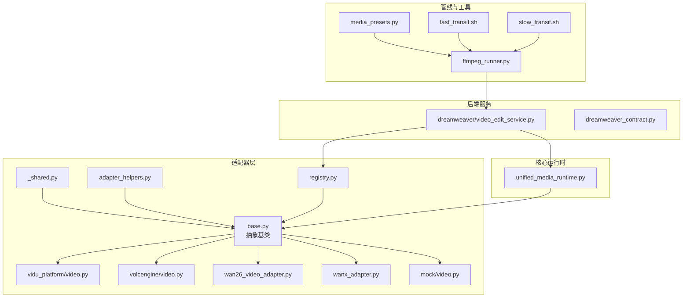
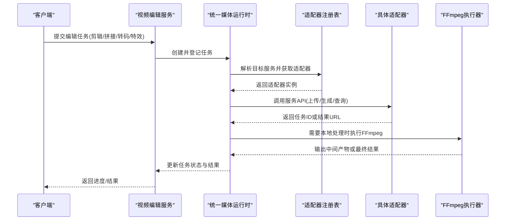
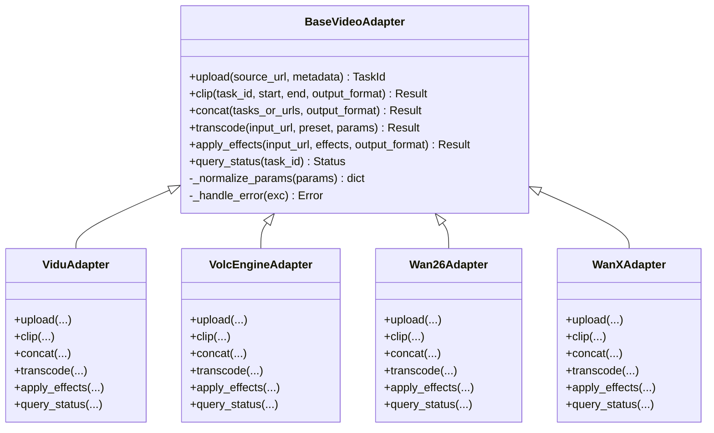
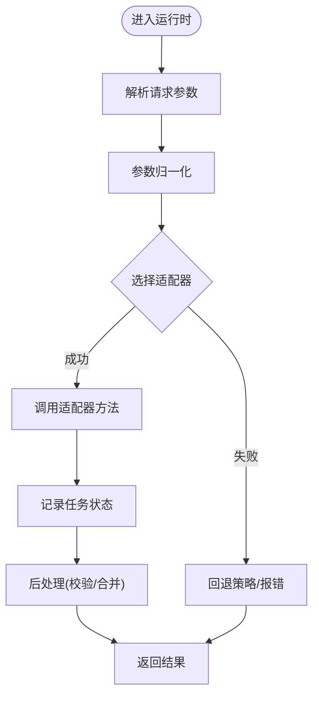
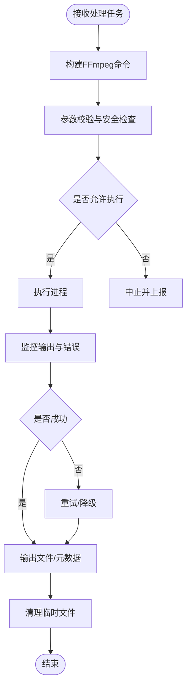
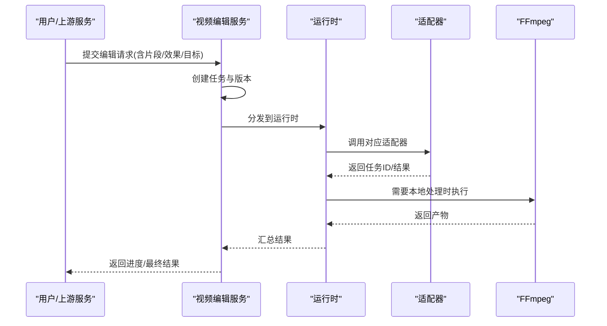
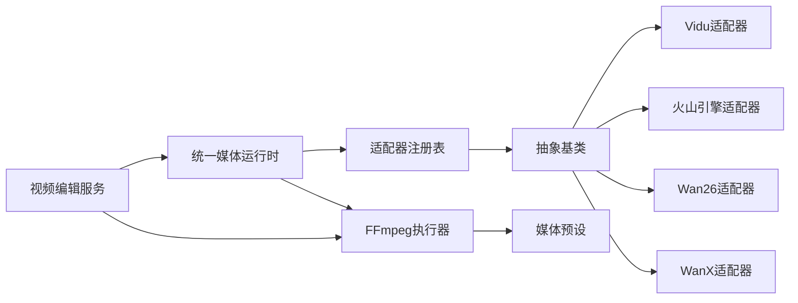

# 视频编辑适配器

<cite>
**本文引用的文件**   
- [adapters/base.py](file://adapters/base.py)
- [adapters/vidu_platform/video.py](file://adapters/vidu_platform/video.py)
- [adapters/volcengine/video.py](file://adapters/volcengine/video.py)
- [adapters/wan26_video_adapter.py](file://adapters/wan26_video_adapter.py)
- [adapters/wanx_adapter.py](file://adapters/wanx_adapter.py)
- [adapters/mock/video.py](file://adapters/mock/video.py)
- [adapters/_shared.py](file://adapters/_shared.py)
- [adapters/adapter_helpers.py](file://adapters/adapter_helpers.py)
- [adapters/registry.py](file://adapters/registry.py)
- [core/unified_media_runtime.py](file://core/unified_media_runtime.py)
- [pipeline/ffmpeg_runner.py](file://pipeline/ffmpeg_runner.py)
- [pipeline/media_presets.py](file://pipeline/media_presets.py)
- [backend/app/services/dreamweaver/video_edit_service.py](file://backend/app/services/dreamweaver/video_edit_service.py)
- [backend/app/schemas/dreamweaver_contract.py](file://backend/app/schemas/dreamweaver_contract.py)
- [scripts/ffmpeg/fast_transit.sh](file://scripts/ffmpeg/fast_transit.sh)
- [scripts/ffmpeg/slow_transit.sh](file://scripts/ffmpeg/slow_transit.sh)
</cite>

## 目录
1. [简介](#简介)
2. [项目结构](#项目结构)
3. [核心组件](#核心组件)
4. [架构总览](#架构总览)
5. [详细组件分析](#详细组件分析)
6. [依赖关系分析](#依赖关系分析)
7. [性能考量](#性能考量)
8. [故障排查指南](#故障排查指南)
9. [结论](#结论)
10. [附录](#附录)

## 简介
本技术文档面向“视频编辑适配器”子系统，系统性阐述视频剪辑、拼接、转码与特效处理的适配器实现。内容覆盖：
- 多视频编辑服务（如 Vidu、火山引擎、Wan26/WanX）的API接口抽象与适配
- 文件上传下载、任务管理与状态跟踪
- 视频分片处理、增量编辑与版本控制机制
- 格式转换、编码参数优化与质量保持策略
- 大规模批处理、并发编辑与存储优化方案

该文档既适合开发者快速定位实现细节，也便于非技术读者理解整体流程与最佳实践。

## 项目结构
围绕视频编辑的核心代码主要分布在以下目录：
- adapters：各视频服务适配器与通用辅助模块
- core：统一媒体运行时与模型路由
- pipeline：FFmpeg 执行器与媒体预设
- backend/app/services/dreamweaver：视频编辑服务编排与业务逻辑
- scripts/ffmpeg：FFmpeg 脚本工具

图表来源
- [adapters/base.py](file://adapters/base.py)
- [adapters/vidu_platform/video.py](file://adapters/vidu_platform/video.py)
- [adapters/volcengine/video.py](file://adapters/volcengine/video.py)
- [adapters/wan26_video_adapter.py](file://adapters/wan26_video_adapter.py)
- [adapters/wanx_adapter.py](file://adapters/wanx_adapter.py)
- [adapters/mock/video.py](file://adapters/mock/video.py)
- [adapters/_shared.py](file://adapters/_shared.py)
- [adapters/adapter_helpers.py](file://adapters/adapter_helpers.py)
- [adapters/registry.py](file://adapters/registry.py)
- [core/unified_media_runtime.py](file://core/unified_media_runtime.py)
- [pipeline/ffmpeg_runner.py](file://pipeline/ffmpeg_runner.py)
- [pipeline/media_presets.py](file://pipeline/media_presets.py)
- [scripts/ffmpeg/fast_transit.sh](file://scripts/ffmpeg/fast_transit.sh)
- [scripts/ffmpeg/slow_transit.sh](file://scripts/ffmpeg/slow_transit.sh)
- [backend/app/services/dreamweaver/video_edit_service.py](file://backend/app/services/dreamweaver/video_edit_service.py)
- [backend/app/schemas/dreamweaver_contract.py](file://backend/app/schemas/dreamweaver_contract.py)

章节来源
- [adapters/base.py](file://adapters/base.py)
- [core/unified_media_runtime.py](file://core/unified_media_runtime.py)
- [pipeline/ffmpeg_runner.py](file://pipeline/ffmpeg_runner.py)
- [pipeline/media_presets.py](file://pipeline/media_presets.py)
- [backend/app/services/dreamweaver/video_edit_service.py](file://backend/app/services/dreamweaver/video_edit_service.py)
- [backend/app/schemas/dreamweaver_contract.py](file://backend/app/schemas/dreamweaver_contract.py)

## 核心组件
- 抽象基类与注册表
  - 定义统一的视频编辑能力接口（剪辑、拼接、转码、特效），并通过注册表集中管理不同服务的实现。
  - 提供通用的错误处理、重试、限流与日志记录能力。
- 统一媒体运行时
  - 屏蔽底层服务差异，对外暴露一致的调用方式；负责参数归一化、结果标准化与任务生命周期管理。
- FFmpeg 执行器与媒体预设
  - 封装 FFmpeg 命令构建与执行，支持批量与并发；媒体预设提供常用编码参数模板。
- 视频编辑服务（Dreamweaver）
  - 编排剪辑、拼接、转码、特效等步骤，协调适配器与FFmpeg，管理任务状态与版本。

章节来源
- [adapters/base.py](file://adapters/base.py)
- [adapters/registry.py](file://adapters/registry.py)
- [core/unified_media_runtime.py](file://core/unified_media_runtime.py)
- [pipeline/ffmpeg_runner.py](file://pipeline/ffmpeg_runner.py)
- [pipeline/media_presets.py](file://pipeline/media_presets.py)
- [backend/app/services/dreamweaver/video_edit_service.py](file://backend/app/services/dreamweaver/video_edit_service.py)

## 架构总览
系统采用“适配器 + 运行时 + 管线”的分层架构：
- 适配器层：对接不同视频编辑服务，统一输入输出契约
- 运行时层：统一调度、参数映射、任务追踪与错误恢复
- 管线层：基于 FFmpeg 的本地处理能力，支撑分片、拼接、转码与特效

图表来源
- [core/unified_media_runtime.py](file://core/unified_media_runtime.py)
- [adapters/registry.py](file://adapters/registry.py)
- [adapters/base.py](file://adapters/base.py)
- [pipeline/ffmpeg_runner.py](file://pipeline/ffmpeg_runner.py)
- [backend/app/services/dreamweaver/video_edit_service.py](file://backend/app/services/dreamweaver/video_edit_service.py)

## 详细组件分析

### 抽象基类与适配器接口
- 职责
  - 定义统一的视频编辑方法签名（如剪辑、拼接、转码、特效）
  - 规范输入输出数据结构（源视频、时间范围、目标格式、编码参数、回调等）
  - 提供通用能力：重试、超时、限流、错误分类与日志
- 关键设计
  - 通过注册表动态加载具体适配器实现
  - 对第三方API进行参数归一化与结果标准化
  - 支持异步与同步两种调用模式

图表来源
- [adapters/base.py](file://adapters/base.py)
- [adapters/vidu_platform/video.py](file://adapters/vidu_platform/video.py)
- [adapters/volcengine/video.py](file://adapters/volcengine/video.py)
- [adapters/wan26_video_adapter.py](file://adapters/wan26_video_adapter.py)
- [adapters/wanx_adapter.py](file://adapters/wanx_adapter.py)

章节来源
- [adapters/base.py](file://adapters/base.py)
- [adapters/vidu_platform/video.py](file://adapters/vidu_platform/video.py)
- [adapters/volcengine/video.py](file://adapters/volcengine/video.py)
- [adapters/wan26_video_adapter.py](file://adapters/wan26_video_adapter.py)
- [adapters/wanx_adapter.py](file://adapters/wanx_adapter.py)

### 统一媒体运行时与注册表
- 统一媒体运行时
  - 负责将上层请求转换为适配器可理解的参数
  - 维护任务上下文（任务ID、阶段、重试次数、错误信息）
  - 聚合多个步骤的结果，保证幂等与一致性
- 注册表
  - 按服务名或能力标签查找适配器
  - 支持热插拔与多版本共存

图表来源
- [core/unified_media_runtime.py](file://core/unified_media_runtime.py)
- [adapters/registry.py](file://adapters/registry.py)

章节来源
- [core/unified_media_runtime.py](file://core/unified_media_runtime.py)
- [adapters/registry.py](file://adapters/registry.py)

### FFmpeg 执行器与媒体预设
- FFmpeg 执行器
  - 封装命令构建、进程管理、资源清理与错误捕获
  - 支持分片并行、断点续传与结果校验
- 媒体预设
  - 提供常用编码参数模板（分辨率、码率、帧率、音频采样率等）
  - 支持按场景切换（直播、点播、移动端、高质量归档）

图表来源
- [pipeline/ffmpeg_runner.py](file://pipeline/ffmpeg_runner.py)
- [pipeline/media_presets.py](file://pipeline/media_presets.py)
- [scripts/ffmpeg/fast_transit.sh](file://scripts/ffmpeg/fast_transit.sh)
- [scripts/ffmpeg/slow_transit.sh](file://scripts/ffmpeg/slow_transit.sh)

章节来源
- [pipeline/ffmpeg_runner.py](file://pipeline/ffmpeg_runner.py)
- [pipeline/media_presets.py](file://pipeline/media_presets.py)
- [scripts/ffmpeg/fast_transit.sh](file://scripts/ffmpeg/fast_transit.sh)
- [scripts/ffmpeg/slow_transit.sh](file://scripts/ffmpeg/slow_transit.sh)

### 视频编辑服务（Dreamweaver）
- 职责
  - 编排剪辑、拼接、转码、特效等多步骤工作流
  - 管理任务生命周期、版本快照与增量更新
  - 协调适配器与FFmpeg，确保端到端一致性
- 关键流程
  - 接收编辑请求，生成任务与版本
  - 根据策略选择适配器与处理路径
  - 逐步推进任务状态，持久化中间产物
  - 完成时输出最终结果与审计信息

图表来源
- [backend/app/services/dreamweaver/video_edit_service.py](file://backend/app/services/dreamweaver/video_edit_service.py)
- [core/unified_media_runtime.py](file://core/unified_media_runtime.py)
- [adapters/base.py](file://adapters/base.py)
- [pipeline/ffmpeg_runner.py](file://pipeline/ffmpeg_runner.py)

章节来源
- [backend/app/services/dreamweaver/video_edit_service.py](file://backend/app/services/dreamweaver/video_edit_service.py)
- [backend/app/schemas/dreamweaver_contract.py](file://backend/app/schemas/dreamweaver_contract.py)

### Mock 适配器与调试
- Mock 适配器用于离线开发与测试，模拟第三方服务行为
- 支持回放固定响应、注入异常与延迟，便于验证流程健壮性

章节来源
- [adapters/mock/video.py](file://adapters/mock/video.py)

## 依赖关系分析
- 低耦合高内聚
  - 适配器之间通过统一基类解耦，运行时负责调度与参数映射
  - FFmpeg 作为独立管线模块，避免与网络服务强耦合
- 外部依赖
  - 第三方视频服务API（Vidu、火山引擎、Wan26/WanX）
  - FFmpeg 二进制与脚本工具
- 潜在风险
  - 第三方API变更导致适配层不稳定
  - FFmpeg 命令参数不兼容引发处理失败

图表来源
- [core/unified_media_runtime.py](file://core/unified_media_runtime.py)
- [adapters/registry.py](file://adapters/registry.py)
- [adapters/base.py](file://adapters/base.py)
- [adapters/vidu_platform/video.py](file://adapters/vidu_platform/video.py)
- [adapters/volcengine/video.py](file://adapters/volcengine/video.py)
- [adapters/wan26_video_adapter.py](file://adapters/wan26_video_adapter.py)
- [adapters/wanx_adapter.py](file://adapters/wanx_adapter.py)
- [pipeline/ffmpeg_runner.py](file://pipeline/ffmpeg_runner.py)
- [pipeline/media_presets.py](file://pipeline/media_presets.py)
- [backend/app/services/dreamweaver/video_edit_service.py](file://backend/app/services/dreamweaver/video_edit_service.py)

章节来源
- [adapters/base.py](file://adapters/base.py)
- [adapters/registry.py](file://adapters/registry.py)
- [core/unified_media_runtime.py](file://core/unified_media_runtime.py)
- [pipeline/ffmpeg_runner.py](file://pipeline/ffmpeg_runner.py)
- [pipeline/media_presets.py](file://pipeline/media_presets.py)
- [backend/app/services/dreamweaver/video_edit_service.py](file://backend/app/services/dreamweaver/video_edit_service.py)

## 性能考量
- 并发与批处理
  - 使用线程池/协程池并发调用适配器与FFmpeg，合理设置并发度以避免资源争用
  - 对大文件采用分片处理与流水线并行，减少内存峰值
- 编码参数优化
  - 依据目标平台选择合适预设（移动端优先码率与分辨率，归档优先无损或高保真）
  - 启用硬件加速（如GPU编码）以降低CPU占用
- 存储优化
  - 中间产物按需保留，及时清理临时文件
  - 使用对象存储的分片上传与断点续传，提升稳定性
- 缓存与去重
  - 对相同输入与参数的处理结果进行缓存，避免重复计算
  - 增量编辑仅处理变更片段，降低总体耗时

[本节为通用指导，无需引用具体文件]

## 故障排查指南
- 常见问题
  - 第三方API限流或超时：检查重试策略与退避算法，必要时降级到备用服务
  - FFmpeg 执行失败：核对命令参数与输入文件完整性，查看错误日志
  - 任务状态不一致：检查运行时状态机与持久化逻辑，确保幂等更新
- 诊断建议
  - 开启详细日志与追踪ID，定位问题链路
  - 使用Mock适配器复现问题，隔离外部依赖影响
  - 对关键路径添加健康检查与告警

章节来源
- [adapters/base.py](file://adapters/base.py)
- [pipeline/ffmpeg_runner.py](file://pipeline/ffmpeg_runner.py)
- [core/unified_media_runtime.py](file://core/unified_media_runtime.py)

## 结论
视频编辑适配器通过清晰的层次划分与统一的接口抽象，有效整合了多源视频服务与本地处理能力。借助运行时与管线模块，系统在可扩展性、稳定性与性能方面具备良好基础。建议在后续迭代中持续完善错误恢复、监控观测与资源治理，以支撑更大规模的视频编辑场景。

[本节为总结性内容，无需引用具体文件]

## 附录
- 术语说明
  - 分片处理：将大视频切分为多个片段并行处理，再合并结果
  - 增量编辑：仅对变更部分进行处理，减少重复计算
  - 版本控制：为每次编辑生成唯一版本，支持回溯与对比
- 参考实现路径
  - 适配器基类与实现：见适配器相关文件
  - 运行时与注册表：见核心运行时与注册表文件
  - FFmpeg 管线：见执行器与预设文件
  - 服务编排：见视频编辑服务与契约文件

[本节为补充信息，无需引用具体文件]