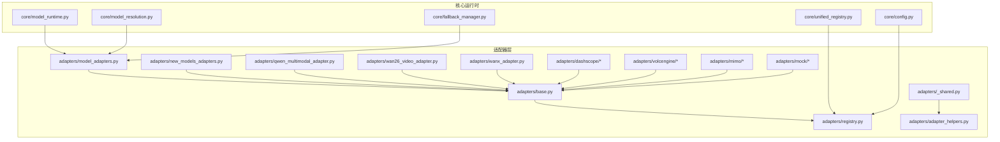
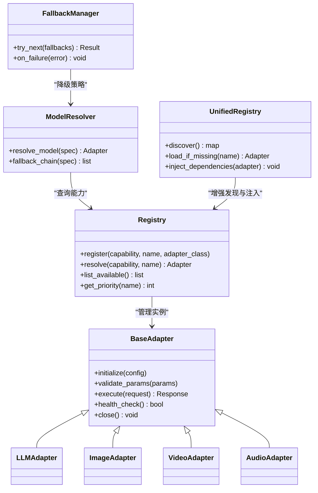
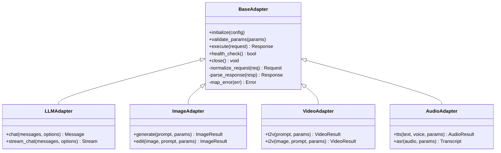
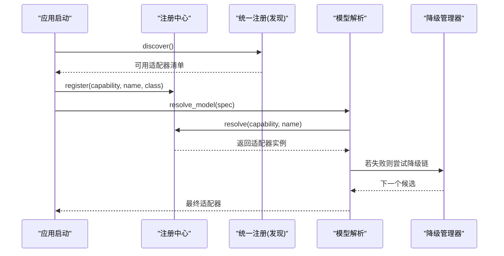
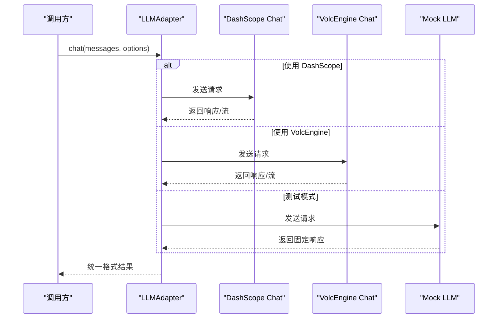
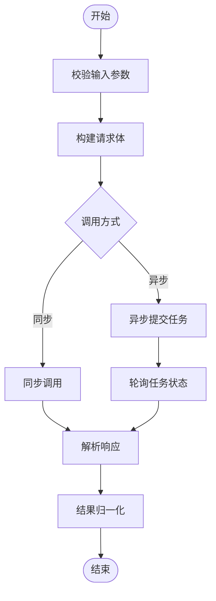
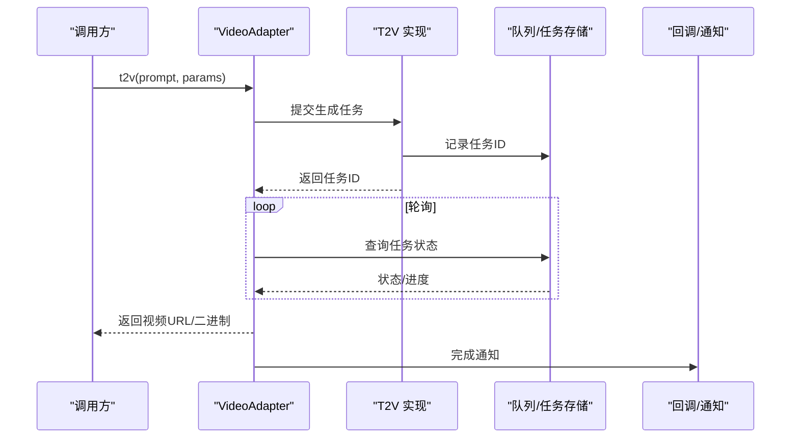
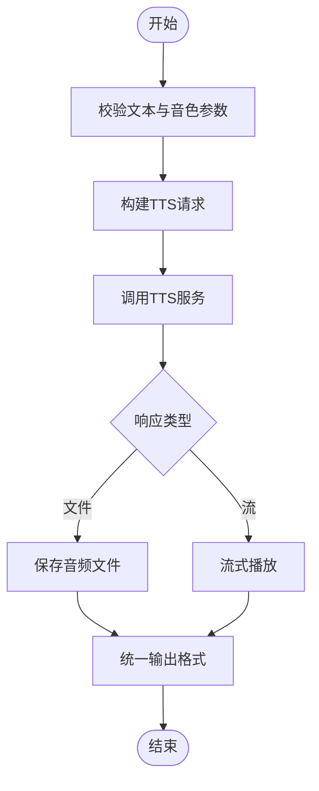
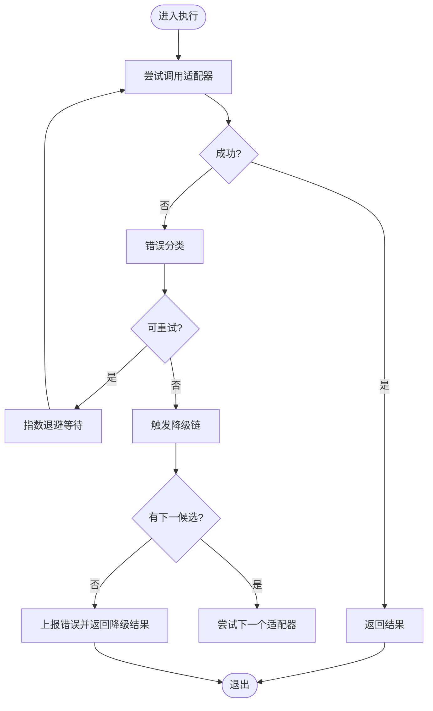

# 适配器层

<cite>
**本文引用的文件**   
- [adapters/base.py](file://adapters/base.py)
- [adapters/registry.py](file://adapters/registry.py)
- [adapters/_shared.py](file://adapters/_shared.py)
- [adapters/adapter_helpers.py](file://adapters/adapter_helpers.py)
- [adapters/model_adapters.py](file://adapters/model_adapters.py)
- [adapters/new_models_adapters.py](file://adapters/new_models_adapters.py)
- [adapters/qwen_multimodal_adapter.py](file://adapters/qwen_multimodal_adapter.py)
- [adapters/wan26_video_adapter.py](file://adapters/wan26_video_adapter.py)
- [adapters/wanx_adapter.py](file://adapters/wanx_adapter.py)
- [adapters/dashscope/chat.py](file://adapters/dashscope/chat.py)
- [adapters/dashscope/image_sync.py](file://adapters/dashscope/image_sync.py)
- [adapters/dashscope/image_async.py](file://adapters/dashscope/image_async.py)
- [adapters/dashscope/video_t2v.py](file://adapters/dashscope/video_t2v.py)
- [adapters/dashscope/video_kling.py](file://adapters/dashscope/video_kling.py)
- [adapters/dashscope/tts.py](file://adapters/dashscope/tts.py)
- [adapters/volcengine/chat.py](file://adapters/volcengine/chat.py)
- [adapters/volcengine/image.py](file://adapters/volcengine/image.py)
- [adapters/volcengine/video.py](file://adapters/volcengine/video.py)
- [adapters/volcengine/tts.py](file://adapters/volcengine/tts.py)
- [adapters/mimo/tts.py](file://adapters/mimo/tts.py)
- [adapters/mock/llm.py](file://adapters/mock/llm.py)
- [adapters/mock/image.py](file://adapters/mock/image.py)
- [adapters/mock/video.py](file://adapters/mock/video.py)
- [core/unified_registry.py](file://core/unified_registry.py)
- [core/model_runtime.py](file://core/model_runtime.py)
- [core/model_resolution.py](file://core/model_resolution.py)
- [core/fallback_manager.py](file://core/fallback_manager.py)
- [core/config.py](file://core/config.py)
- [scripts/verify_all_adapters.py](file://scripts/verify_all_adapters.py)
</cite>

## 目录
1. [简介](#简介)
2. [项目结构](#项目结构)
3. [核心组件](#核心组件)
4. [架构总览](#架构总览)
5. [详细组件分析](#详细组件分析)
6. [依赖关系分析](#依赖关系分析)
7. [性能考量](#性能考量)
8. [故障排查指南](#故障排查指南)
9. [结论](#结论)
10. [附录](#附录)

## 简介
本技术文档围绕“适配器层”展开，系统性阐述适配器模式在本项目中的设计理念与实现方式。内容涵盖：
- 基础接口定义、抽象类设计与具体适配器实现
- 适配器注册机制（动态加载、依赖注入、服务发现）
- 多类型适配器实现（LLM、图像生成、视频处理、音频处理）
- 错误处理、重试机制与降级策略
- 自定义适配器开发指南（模板与测试方法）
- 配置管理与环境变量处理

目标是帮助开发者快速理解并扩展适配器体系，确保系统对多厂商、多模态能力的统一接入与稳定运行。

## 项目结构
适配器层位于 adapters 目录，采用“按能力域+按厂商”的二维组织方式：
- 公共基类与工具：base.py、_shared.py、adapter_helpers.py、registry.py
- 模型适配桥接：model_adapters.py、new_models_adapters.py
- 多模态与专用适配器：qwen_multimodal_adapter.py、wan26_video_adapter.py、wanx_adapter.py
- 厂商实现：dashscope、volcengine、mimo、mock 等子包
- 脚本与验证：scripts/verify_all_adapters.py

图表来源
- [adapters/base.py](file://adapters/base.py)
- [adapters/registry.py](file://adapters/registry.py)
- [adapters/_shared.py](file://adapters/_shared.py)
- [adapters/adapter_helpers.py](file://adapters/adapter_helpers.py)
- [adapters/model_adapters.py](file://adapters/model_adapters.py)
- [adapters/new_models_adapters.py](file://adapters/new_models_adapters.py)
- [adapters/qwen_multimodal_adapter.py](file://adapters/qwen_multimodal_adapter.py)
- [adapters/wan26_video_adapter.py](file://adapters/wan26_video_adapter.py)
- [adapters/wanx_adapter.py](file://adapters/wanx_adapter.py)
- [adapters/dashscope/chat.py](file://adapters/dashscope/chat.py)
- [adapters/dashscope/image_sync.py](file://adapters/dashscope/image_sync.py)
- [adapters/dashscope/image_async.py](file://adapters/dashscope/image_async.py)
- [adapters/dashscope/video_t2v.py](file://adapters/dashscope/video_t2v.py)
- [adapters/dashscope/video_kling.py](file://adapters/dashscope/video_kling.py)
- [adapters/dashscope/tts.py](file://adapters/dashscope/tts.py)
- [adapters/volcengine/chat.py](file://adapters/volcengine/chat.py)
- [adapters/volcengine/image.py](file://adapters/volcengine/image.py)
- [adapters/volcengine/video.py](file://adapters/volcengine/video.py)
- [adapters/volcengine/tts.py](file://adapters/volcengine/tts.py)
- [adapters/mimo/tts.py](file://adapters/mimo/tts.py)
- [adapters/mock/llm.py](file://adapters/mock/llm.py)
- [adapters/mock/image.py](file://adapters/mock/image.py)
- [adapters/mock/video.py](file://adapters/mock/video.py)
- [core/unified_registry.py](file://core/unified_registry.py)
- [core/model_runtime.py](file://core/model_runtime.py)
- [core/model_resolution.py](file://core/model_resolution.py)
- [core/fallback_manager.py](file://core/fallback_manager.py)
- [core/config.py](file://core/config.py)

章节来源
- [adapters/base.py](file://adapters/base.py)
- [adapters/registry.py](file://adapters/registry.py)
- [adapters/_shared.py](file://adapters/_shared.py)
- [adapters/adapter_helpers.py](file://adapters/adapter_helpers.py)
- [adapters/model_adapters.py](file://adapters/model_adapters.py)
- [adapters/new_models_adapters.py](file://adapters/new_models_adapters.py)
- [adapters/qwen_multimodal_adapter.py](file://adapters/qwen_multimodal_adapter.py)
- [adapters/wan26_video_adapter.py](file://adapters/wan26_video_adapter.py)
- [adapters/wanx_adapter.py](file://adapters/wanx_adapter.py)
- [adapters/dashscope/chat.py](file://adapters/dashscope/chat.py)
- [adapters/dashscope/image_sync.py](file://adapters/dashscope/image_sync.py)
- [adapters/dashscope/image_async.py](file://adapters/dashscope/image_async.py)
- [adapters/dashscope/video_t2v.py](file://adapters/dashscope/video_t2v.py)
- [adapters/dashscope/video_kling.py](file://adapters/dashscope/video_kling.py)
- [adapters/dashscope/tts.py](file://adapters/dashscope/tts.py)
- [adapters/volcengine/chat.py](file://adapters/volcengine/chat.py)
- [adapters/volcengine/image.py](file://adapters/volcengine/image.py)
- [adapters/volcengine/video.py](file://adapters/volcengine/video.py)
- [adapters/volcengine/tts.py](file://adapters/volcengine/tts.py)
- [adapters/mimo/tts.py](file://adapters/mimo/tts.py)
- [adapters/mock/llm.py](file://adapters/mock/llm.py)
- [adapters/mock/image.py](file://adapters/mock/image.py)
- [adapters/mock/video.py](file://adapters/mock/video.py)
- [core/unified_registry.py](file://core/unified_registry.py)
- [core/model_runtime.py](file://core/model_runtime.py)
- [core/model_resolution.py](file://core/model_resolution.py)
- [core/fallback_manager.py](file://core/fallback_manager.py)
- [core/config.py](file://core/config.py)

## 核心组件
- 基础接口与抽象类
  - 定义统一的输入输出契约、能力标签、参数校验与结果归一化
  - 提供通用生命周期钩子（初始化、预热、关闭）、上下文传递与日志埋点
- 注册中心
  - 支持按能力维度（文本、图像、视频、音频）与厂商维度的命名空间注册
  - 提供动态发现、按需加载、版本选择与优先级排序
- 共享工具与辅助函数
  - 参数标准化、幂等键生成、速率限制、缓存键构造、错误码映射
- 模型适配桥接
  - 将上层模型解析与路由逻辑与具体厂商实现解耦
  - 兼容新旧两套模型描述规范，提供自动转换与回退路径

章节来源
- [adapters/base.py](file://adapters/base.py)
- [adapters/registry.py](file://adapters/registry.py)
- [adapters/_shared.py](file://adapters/_shared.py)
- [adapters/adapter_helpers.py](file://adapters/adapter_helpers.py)
- [adapters/model_adapters.py](file://adapters/model_adapters.py)
- [adapters/new_models_adapters.py](file://adapters/new_models_adapters.py)

## 架构总览
适配器层通过“统一接口 + 注册中心 + 运行时调度”的架构，屏蔽底层差异，向上提供一致的能力访问方式。

图表来源
- [adapters/base.py](file://adapters/base.py)
- [adapters/registry.py](file://adapters/registry.py)
- [core/unified_registry.py](file://core/unified_registry.py)
- [core/model_resolution.py](file://core/model_resolution.py)
- [core/fallback_manager.py](file://core/fallback_manager.py)

## 详细组件分析

### 基础接口与抽象类设计
- 目标：为所有适配器提供一致的契约，包括参数校验、执行入口、健康检查与资源释放
- 关键职责：
  - 参数规范化与校验（必填字段、类型约束、范围限制）
  - 执行流程封装（请求构建、调用、响应解析、错误映射）
  - 可观测性（指标上报、链路追踪、结构化日志）
  - 生命周期管理（初始化、预热、关闭）

图表来源
- [adapters/base.py](file://adapters/base.py)

章节来源
- [adapters/base.py](file://adapters/base.py)

### 适配器注册机制（动态加载、依赖注入、服务发现）
- 注册中心职责：
  - 维护能力到实现的映射表，支持按名称与优先级检索
  - 提供插件式动态加载，避免启动时全量导入
  - 支持依赖注入（如 HTTP 客户端、密钥管理器、限流器）
- 服务发现：
  - 基于配置文件或环境变量扫描可用适配器
  - 结合模型目录与能力标签进行匹配
- 统一注册增强：
  - 在 core/unified_registry.py 中集成发现、懒加载与依赖注入

图表来源
- [adapters/registry.py](file://adapters/registry.py)
- [core/unified_registry.py](file://core/unified_registry.py)
- [core/model_resolution.py](file://core/model_resolution.py)
- [core/fallback_manager.py](file://core/fallback_manager.py)

章节来源
- [adapters/registry.py](file://adapters/registry.py)
- [core/unified_registry.py](file://core/unified_registry.py)
- [core/model_resolution.py](file://core/model_resolution.py)
- [core/fallback_manager.py](file://core/fallback_manager.py)

### LLM 适配器
- 典型实现：
  - dashscope/chat.py：对接大模型对话接口，支持同步/异步、流式输出
  - volcengine/chat.py：另一厂商的对话实现
  - mock/llm.py：用于开发与测试的模拟实现
- 关键特性：
  - 消息格式统一（角色、内容、工具调用）
  - 流式与非流式双通道
  - 错误码映射与重试策略（网络抖动、限流）

图表来源
- [adapters/dashscope/chat.py](file://adapters/dashscope/chat.py)
- [adapters/volcengine/chat.py](file://adapters/volcengine/chat.py)
- [adapters/mock/llm.py](file://adapters/mock/llm.py)

章节来源
- [adapters/dashscope/chat.py](file://adapters/dashscope/chat.py)
- [adapters/volcengine/chat.py](file://adapters/volcengine/chat.py)
- [adapters/mock/llm.py](file://adapters/mock/llm.py)

### 图像生成适配器
- 典型实现：
  - dashscope/image_sync.py：同步图像生成
  - dashscope/image_async.py：异步图像生成
  - volcengine/image.py：图像生成与编辑
  - mock/image.py：模拟图像生成
- 关键特性：
  - 提示词标准化、风格参数映射
  - 图片尺寸、质量、安全过滤
  - 异步任务状态轮询与回调

图表来源
- [adapters/dashscope/image_sync.py](file://adapters/dashscope/image_sync.py)
- [adapters/dashscope/image_async.py](file://adapters/dashscope/image_async.py)
- [adapters/volcengine/image.py](file://adapters/volcengine/image.py)
- [adapters/mock/image.py](file://adapters/mock/image.py)

章节来源
- [adapters/dashscope/image_sync.py](file://adapters/dashscope/image_sync.py)
- [adapters/dashscope/image_async.py](file://adapters/dashscope/image_async.py)
- [adapters/volcengine/image.py](file://adapters/volcengine/image.py)
- [adapters/mock/image.py](file://adapters/mock/image.py)

### 视频处理适配器
- 典型实现：
  - dashscope/video_t2v.py：文本转视频
  - dashscope/video_kling.py：特定厂商的视频生成
  - wan26_video_adapter.py：Wan2.6 视频能力适配
  - wanx_adapter.py：WanX 平台视频适配
  - volcengine/video.py：视频生成与编辑
  - mock/video.py：模拟视频生成
- 关键特性：
  - 长任务管理（提交、轮询、取消）
  - 分辨率、帧率、时长控制
  - 素材预处理（图像、音频）与后处理（转码、合成）

图表来源
- [adapters/dashscope/video_t2v.py](file://adapters/dashscope/video_t2v.py)
- [adapters/dashscope/video_kling.py](file://adapters/dashscope/video_kling.py)
- [adapters/wan26_video_adapter.py](file://adapters/wan26_video_adapter.py)
- [adapters/wanx_adapter.py](file://adapters/wanx_adapter.py)
- [adapters/volcengine/video.py](file://adapters/volcengine/video.py)
- [adapters/mock/video.py](file://adapters/mock/video.py)

章节来源
- [adapters/dashscope/video_t2v.py](file://adapters/dashscope/video_t2v.py)
- [adapters/dashscope/video_kling.py](file://adapters/dashscope/video_kling.py)
- [adapters/wan26_video_adapter.py](file://adapters/wan26_video_adapter.py)
- [adapters/wanx_adapter.py](file://adapters/wanx_adapter.py)
- [adapters/volcengine/video.py](file://adapters/volcengine/video.py)
- [adapters/mock/video.py](file://adapters/mock/video.py)

### 音频处理适配器（TTS/ASR）
- 典型实现：
  - dashscope/tts.py：文本转语音
  - volcengine/tts.py：另一厂商 TTS
  - mimo/tts.py：Mimo 语音合成
  - mock/*：模拟实现
- 关键特性：
  - 音色选择、语速、音量、情感控制
  - 流式播放与断点续播
  - 音频格式转换与质量控制

图表来源
- [adapters/dashscope/tts.py](file://adapters/dashscope/tts.py)
- [adapters/volcengine/tts.py](file://adapters/volcengine/tts.py)
- [adapters/mimo/tts.py](file://adapters/mimo/tts.py)

章节来源
- [adapters/dashscope/tts.py](file://adapters/dashscope/tts.py)
- [adapters/volcengine/tts.py](file://adapters/volcengine/tts.py)
- [adapters/mimo/tts.py](file://adapters/mimo/tts.py)

### 多模态与专用适配器
- qwen_multimodal_adapter.py：对齐通义千问多模态能力，统一图文音视频输入输出
- wan26_video_adapter.py、wanx_adapter.py：针对特定平台的视频能力做深度适配与优化

章节来源
- [adapters/qwen_multimodal_adapter.py](file://adapters/qwen_multimodal_adapter.py)
- [adapters/wan26_video_adapter.py](file://adapters/wan26_video_adapter.py)
- [adapters/wanx_adapter.py](file://adapters/wanx_adapter.py)

### 错误处理、重试与降级策略
- 错误分类：
  - 网络异常、鉴权失败、参数错误、业务限流、服务不可用
- 重试策略：
  - 指数退避、最大重试次数、幂等键保障
- 降级策略：
  - 多厂商切换、回退到本地模拟实现、缓存兜底
- 监控与告警：
  - 错误码统计、耗时分布、熔断阈值

图表来源
- [core/fallback_manager.py](file://core/fallback_manager.py)
- [adapters/adapter_helpers.py](file://adapters/adapter_helpers.py)

章节来源
- [core/fallback_manager.py](file://core/fallback_manager.py)
- [adapters/adapter_helpers.py](file://adapters/adapter_helpers.py)

### 自定义适配器开发指南
- 步骤概览：
  1. 继承基础适配器抽象类，实现必要方法（参数校验、请求构建、响应解析、错误映射）
  2. 在注册中心登记能力与名称，设置优先级
  3. 实现依赖注入（如密钥、限流、缓存）
  4. 编写单元测试与集成测试，覆盖正常路径与异常路径
  5. 加入验证脚本，确保与其他适配器一致性
- 模板要点：
  - 参数校验：必填字段、类型、取值范围
  - 请求构建：统一封装，便于替换不同厂商 SDK
  - 响应解析：标准化输出结构
  - 错误映射：将厂商错误码映射为内部错误类型
  - 可观测性：埋点日志、指标上报
- 测试方法：
  - 使用 mock 适配器进行无外部依赖测试
  - 使用 verify_all_adapters.py 进行端到端验证

章节来源
- [adapters/base.py](file://adapters/base.py)
- [adapters/registry.py](file://adapters/registry.py)
- [adapters/mock/llm.py](file://adapters/mock/llm.py)
- [adapters/mock/image.py](file://adapters/mock/image.py)
- [adapters/mock/video.py](file://adapters/mock/video.py)
- [scripts/verify_all_adapters.py](file://scripts/verify_all_adapters.py)

### 配置管理与环境变量处理
- 配置来源：
  - 配置文件（YAML/JSON）、环境变量、运行时注入
- 关键项：
  - 厂商密钥、超时、重试次数、并发限制、缓存开关
- 处理流程：
  - 读取环境变量与配置文件合并
  - 类型转换与默认值填充
  - 敏感信息加密与脱敏

章节来源
- [core/config.py](file://core/config.py)
- [adapters/_shared.py](file://adapters/_shared.py)

## 依赖关系分析
- 耦合与内聚：
  - 适配器与厂商 SDK 强耦合，但通过统一接口隔离
  - 注册中心与模型解析模块松耦合，便于扩展
- 外部依赖：
  - HTTP 客户端、消息队列、对象存储、向量数据库（视能力而定）
- 循环依赖检测：
  - 通过分层与接口解耦避免循环引用

图表来源
- [adapters/base.py](file://adapters/base.py)
- [adapters/registry.py](file://adapters/registry.py)
- [core/unified_registry.py](file://core/unified_registry.py)
- [core/model_resolution.py](file://core/model_resolution.py)
- [core/fallback_manager.py](file://core/fallback_manager.py)
- [adapters/model_adapters.py](file://adapters/model_adapters.py)
- [adapters/new_models_adapters.py](file://adapters/new_models_adapters.py)

章节来源
- [adapters/base.py](file://adapters/base.py)
- [adapters/registry.py](file://adapters/registry.py)
- [core/unified_registry.py](file://core/unified_registry.py)
- [core/model_resolution.py](file://core/model_resolution.py)
- [core/fallback_manager.py](file://core/fallback_manager.py)
- [adapters/model_adapters.py](file://adapters/model_adapters.py)
- [adapters/new_models_adapters.py](file://adapters/new_models_adapters.py)

## 性能考量
- 连接池与复用：HTTP 客户端连接池、SDK 单例
- 异步与并发：异步调用、批量请求、限流与背压
- 缓存策略：结果缓存、中间产物缓存、热点数据预取
- 资源清理：及时释放文件句柄、网络连接、临时文件
- 监控指标：延迟分位、吞吐、错误率、饱和度

[本节为通用指导，不直接分析具体文件]

## 故障排查指南
- 常见问题定位：
  - 注册失败：检查能力名称与优先级冲突
  - 依赖注入失败：确认注入顺序与依赖可用性
  - 调用超时：调整超时与重试参数
  - 限流错误：降低并发或提升配额
- 诊断工具：
  - 启用详细日志与链路追踪
  - 使用 verify_all_adapters.py 进行冒烟测试
  - 查看错误码映射与降级链执行情况

章节来源
- [scripts/verify_all_adapters.py](file://scripts/verify_all_adapters.py)
- [adapters/adapter_helpers.py](file://adapters/adapter_helpers.py)
- [core/fallback_manager.py](file://core/fallback_manager.py)

## 结论
适配器层通过统一接口、注册中心与运行时调度，实现了多厂商、多模态能力的灵活接入与稳定运行。借助错误处理、重试与降级策略，系统在复杂环境下具备高可用性与可扩展性。遵循本文的开发指南与最佳实践，可快速扩展新的适配器并保持整体架构的一致性。

[本节为总结，不直接分析具体文件]

## 附录
- 术语表：
  - 适配器：对外暴露统一接口，对内封装具体实现
  - 注册中心：管理能力与实现的映射与发现
  - 降级：在失败场景下切换到备选实现
- 参考文件：
  - 基础接口与工具：adapters/base.py、adapters/_shared.py、adapters/adapter_helpers.py
  - 注册与运行时：adapters/registry.py、core/unified_registry.py、core/model_resolution.py、core/fallback_manager.py
  - 厂商实现：adapters/dashscope/*、adapters/volcengine/*、adapters/mimo/*、adapters/mock/*
  - 验证脚本：scripts/verify_all_adapters.py

[本节为补充信息，不直接分析具体文件]