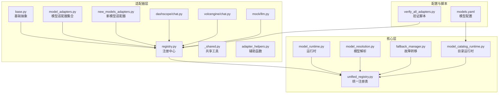
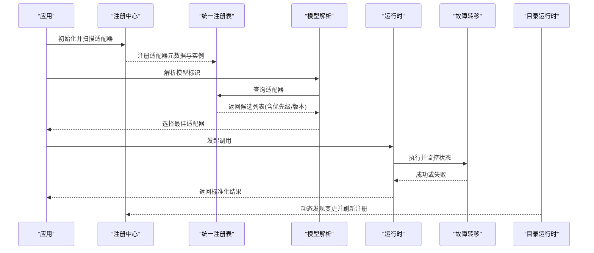
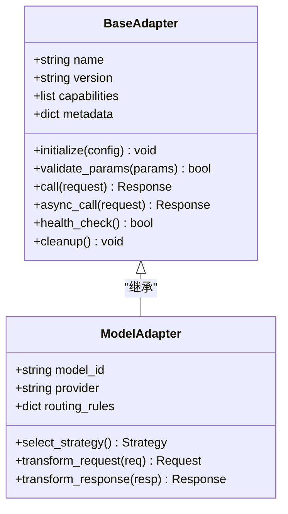
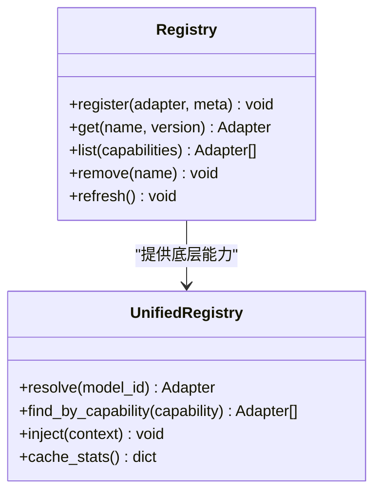
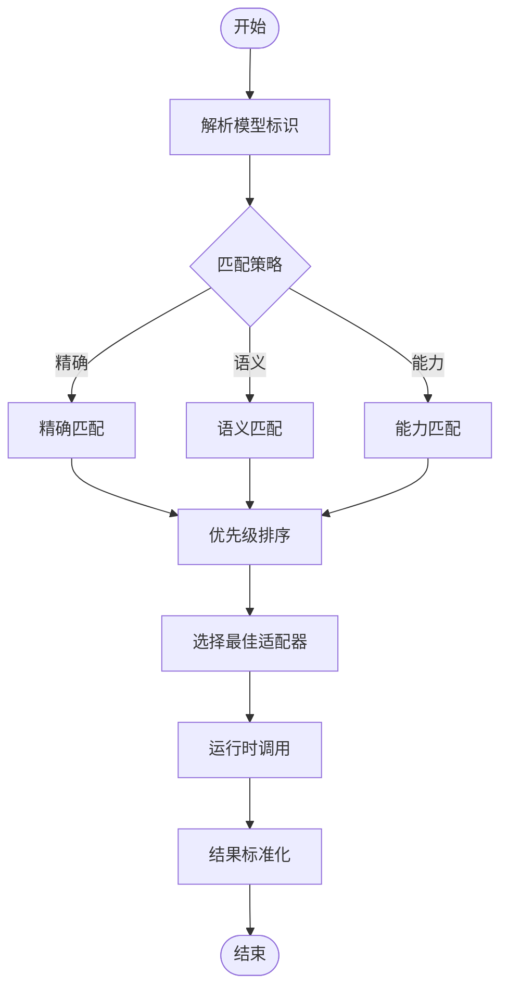
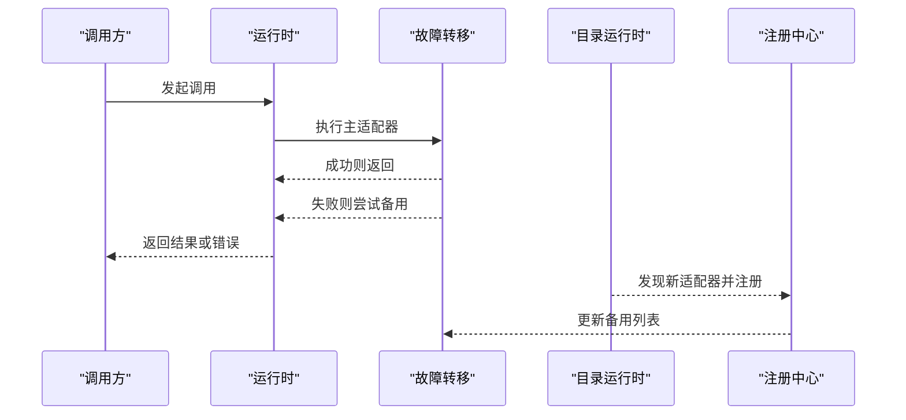
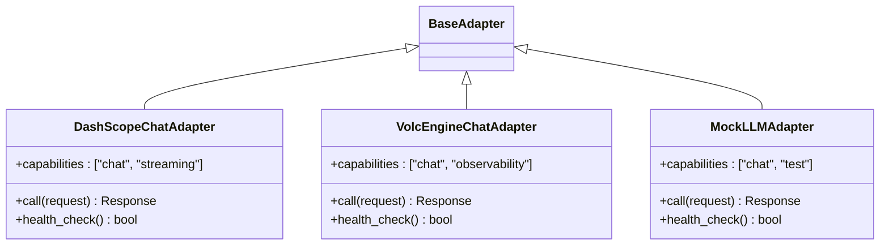
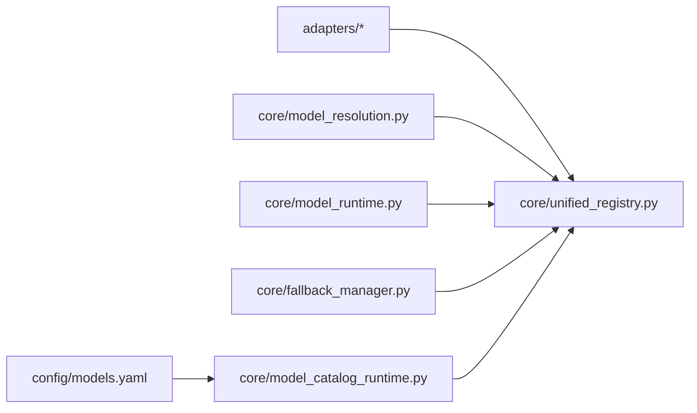
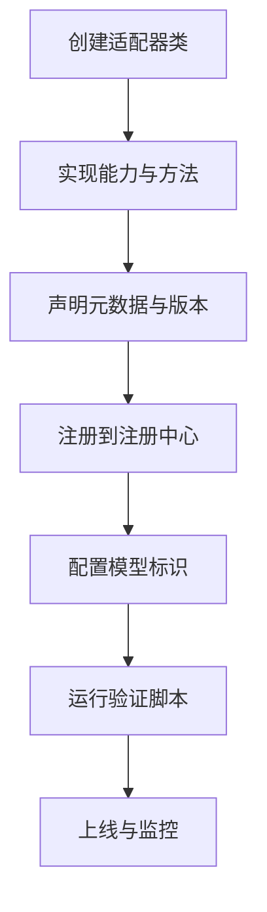

# 适配器注册系统

<cite>
**本文引用的文件**   
- [adapters/registry.py](file://adapters/registry.py)
- [adapters/base.py](file://adapters/base.py)
- [adapters/model_adapters.py](file://adapters/model_adapters.py)
- [adapters/new_models_adapters.py](file://adapters/new_models_adapters.py)
- [adapters/_shared.py](file://adapters/_shared.py)
- [adapters/adapter_helpers.py](file://adapters/adapter_helpers.py)
- [core/unified_registry.py](file://core/unified_registry.py)
- [core/model_runtime.py](file://core/model_runtime.py)
- [core/model_resolution.py](file://core/model_resolution.py)
- [core/fallback_manager.py](file://core/fallback_manager.py)
- [core/model_catalog_runtime.py](file://core/model_catalog_runtime.py)
- [adapters/dashscope/chat.py](file://adapters/dashscope/chat.py)
- [adapters/volcengine/chat.py](file://adapters/volcengine/chat.py)
- [adapters/mock/llm.py](file://adapters/mock/llm.py)
- [config/models.yaml](file://config/models.yaml)
- [scripts/verify_all_adapters.py](file://scripts/verify_all_adapters.py)
</cite>

## 目录
1. [简介](#简介)
2. [项目结构](#项目结构)
3. [核心组件](#核心组件)
4. [架构总览](#架构总览)
5. [详细组件分析](#详细组件分析)
6. [依赖关系分析](#依赖关系分析)
7. [性能考量](#性能考量)
8. [故障排查指南](#故障排查指南)
9. [结论](#结论)
10. [附录](#附录)

## 简介
本技术文档围绕“适配器注册系统”展开，系统性阐述模型适配器的动态加载、依赖注入与服务发现机制；详细说明模型适配器的注册流程（含元数据管理、版本控制与兼容性检查）；给出新模型适配器的注册方式与扩展点；解释适配器查找算法、优先级管理与故障转移机制；并提供完整的注册配置示例与调试方法，以及自定义适配器注册的完整开发指南。

## 项目结构
适配器注册系统主要分布在以下模块：
- adapters：具体适配器实现与注册基础设施
- core：统一注册表、运行时、解析与故障转移等核心能力
- config：模型与适配器相关配置
- scripts：验证与调试脚本

图表来源
- [adapters/base.py](file://adapters/base.py)
- [adapters/registry.py](file://adapters/registry.py)
- [adapters/model_adapters.py](file://adapters/model_adapters.py)
- [adapters/new_models_adapters.py](file://adapters/new_models_adapters.py)
- [adapters/_shared.py](file://adapters/_shared.py)
- [adapters/adapter_helpers.py](file://adapters/adapter_helpers.py)
- [core/unified_registry.py](file://core/unified_registry.py)
- [core/model_runtime.py](file://core/model_runtime.py)
- [core/model_resolution.py](file://core/model_resolution.py)
- [core/fallback_manager.py](file://core/fallback_manager.py)
- [core/model_catalog_runtime.py](file://core/model_catalog_runtime.py)
- [config/models.yaml](file://config/models.yaml)
- [scripts/verify_all_adapters.py](file://scripts/verify_all_adapters.py)

章节来源
- [adapters/registry.py](file://adapters/registry.py)
- [adapters/base.py](file://adapters/base.py)
- [core/unified_registry.py](file://core/unified_registry.py)
- [core/model_runtime.py](file://core/model_runtime.py)
- [core/model_resolution.py](file://core/model_resolution.py)
- [core/fallback_manager.py](file://core/fallback_manager.py)
- [core/model_catalog_runtime.py](file://core/model_catalog_runtime.py)
- [config/models.yaml](file://config/models.yaml)
- [scripts/verify_all_adapters.py](file://scripts/verify_all_adapters.py)

## 核心组件
- 基础抽象与契约：定义适配器基类、能力声明、参数校验与生命周期钩子
- 注册中心：集中管理适配器实例、元数据、版本信息与优先级
- 统一注册表：跨子系统提供一致的查找、解析与注入接口
- 运行时：封装调用路径、上下文传递与结果标准化
- 模型解析：将配置或请求映射到具体适配器实例
- 故障转移：在失败时按策略回退到其他可用适配器
- 目录运行时：基于模型目录进行服务发现与动态更新
- 辅助工具：通用校验、序列化、日志与错误处理

章节来源
- [adapters/base.py](file://adapters/base.py)
- [adapters/registry.py](file://adapters/registry.py)
- [core/unified_registry.py](file://core/unified_registry.py)
- [core/model_runtime.py](file://core/model_runtime.py)
- [core/model_resolution.py](file://core/model_resolution.py)
- [core/fallback_manager.py](file://core/fallback_manager.py)
- [core/model_catalog_runtime.py](file://core/model_catalog_runtime.py)
- [adapters/_shared.py](file://adapters/_shared.py)
- [adapters/adapter_helpers.py](file://adapters/adapter_helpers.py)

## 架构总览
适配器注册系统的整体交互如下：
- 启动阶段：加载配置与目录，扫描并注册所有适配器，构建索引
- 运行阶段：根据模型标识解析目标适配器，执行调用，必要时触发故障转移
- 维护阶段：支持热更新、版本切换与兼容性检查

图表来源
- [adapters/registry.py](file://adapters/registry.py)
- [core/unified_registry.py](file://core/unified_registry.py)
- [core/model_resolution.py](file://core/model_resolution.py)
- [core/model_runtime.py](file://core/model_runtime.py)
- [core/fallback_manager.py](file://core/fallback_manager.py)
- [core/model_catalog_runtime.py](file://core/model_catalog_runtime.py)

## 详细组件分析

### 适配器基础抽象与元数据
- 设计要点
  - 统一的适配器基类定义能力集、输入输出规范、生命周期钩子
  - 元数据包含名称、版本、能力标签、兼容矩阵、优先级与路由规则
  - 支持可选的异步/同步双模式与流式响应
- 关键职责
  - 参数校验与默认值填充
  - 资源初始化与清理
  - 错误码与异常规范化

图表来源
- [adapters/base.py](file://adapters/base.py)
- [adapters/model_adapters.py](file://adapters/model_adapters.py)

章节来源
- [adapters/base.py](file://adapters/base.py)
- [adapters/model_adapters.py](file://adapters/model_adapters.py)

### 注册中心与统一注册表
- 设计要点
  - 注册中心负责适配器实例的生命周期与元数据存储
  - 统一注册表对外暴露查找、解析、注入接口，屏蔽内部实现差异
  - 支持按能力、版本、提供者维度检索
- 关键职责
  - 动态加载与卸载
  - 冲突检测与覆盖策略
  - 缓存与索引优化

图表来源
- [adapters/registry.py](file://adapters/registry.py)
- [core/unified_registry.py](file://core/unified_registry.py)

章节来源
- [adapters/registry.py](file://adapters/registry.py)
- [core/unified_registry.py](file://core/unified_registry.py)

### 模型解析与运行时
- 设计要点
  - 模型解析器将字符串标识或结构化请求转换为适配器实例
  - 运行时封装调用上下文、重试、超时与结果标准化
- 关键职责
  - 匹配策略（精确匹配、语义匹配、能力匹配）
  - 优先级排序与版本选择
  - 调用链路追踪与指标上报

图表来源
- [core/model_resolution.py](file://core/model_resolution.py)
- [core/model_runtime.py](file://core/model_runtime.py)

章节来源
- [core/model_resolution.py](file://core/model_resolution.py)
- [core/model_runtime.py](file://core/model_runtime.py)

### 故障转移与目录运行时
- 设计要点
  - 故障转移管理器维护备用适配器列表与回退策略
  - 目录运行时监听外部目录或数据库，动态发现新适配器并热更新
- 关键职责
  - 健康检查与快速失败
  - 自动回退与熔断
  - 增量更新与一致性保证

图表来源
- [core/fallback_manager.py](file://core/fallback_manager.py)
- [core/model_catalog_runtime.py](file://core/model_catalog_runtime.py)
- [adapters/registry.py](file://adapters/registry.py)

章节来源
- [core/fallback_manager.py](file://core/fallback_manager.py)
- [core/model_catalog_runtime.py](file://core/model_catalog_runtime.py)
- [adapters/registry.py](file://adapters/registry.py)

### 具体适配器示例
- DashScope Chat 适配器：面向对话场景，支持多轮上下文与流式输出
- VolcEngine Chat 适配器：面向企业级部署，强调稳定性与可观测性
- Mock LLM 适配器：用于测试与沙箱环境，模拟不同行为

图表来源
- [adapters/dashscope/chat.py](file://adapters/dashscope/chat.py)
- [adapters/volcengine/chat.py](file://adapters/volcengine/chat.py)
- [adapters/mock/llm.py](file://adapters/mock/llm.py)

章节来源
- [adapters/dashscope/chat.py](file://adapters/dashscope/chat.py)
- [adapters/volcengine/chat.py](file://adapters/volcengine/chat.py)
- [adapters/mock/llm.py](file://adapters/mock/llm.py)

## 依赖关系分析
- 耦合度
  - 适配器对注册中心的依赖为单向，避免循环依赖
  - 运行时与解析器通过统一注册表解耦
- 外部依赖
  - 配置驱动（YAML/JSON）
  - 目录监听或数据库源（用于服务发现）
- 潜在风险
  - 版本冲突需通过元数据约束解决
  - 动态加载需考虑安全与权限控制

图表来源
- [adapters/registry.py](file://adapters/registry.py)
- [core/unified_registry.py](file://core/unified_registry.py)
- [core/model_resolution.py](file://core/model_resolution.py)
- [core/model_runtime.py](file://core/model_runtime.py)
- [core/fallback_manager.py](file://core/fallback_manager.py)
- [core/model_catalog_runtime.py](file://core/model_catalog_runtime.py)
- [config/models.yaml](file://config/models.yaml)

章节来源
- [adapters/registry.py](file://adapters/registry.py)
- [core/unified_registry.py](file://core/unified_registry.py)
- [core/model_resolution.py](file://core/model_resolution.py)
- [core/model_runtime.py](file://core/model_runtime.py)
- [core/fallback_manager.py](file://core/fallback_manager.py)
- [core/model_catalog_runtime.py](file://core/model_catalog_runtime.py)
- [config/models.yaml](file://config/models.yaml)

## 性能考量
- 注册索引：使用哈希与多级索引提升查找效率
- 懒加载：按需实例化适配器，减少内存占用
- 缓存：对解析结果与健康检查结果进行短期缓存
- 并发：支持异步调用与连接池复用
- 监控：埋点统计成功率、延迟与错误分布

[本节为通用指导，不直接分析具体文件]

## 故障排查指南
- 常见问题
  - 适配器未注册：检查扫描路径与导入顺序
  - 版本冲突：核对元数据中的版本范围与兼容性矩阵
  - 健康检查失败：确认依赖服务可用性与网络连通性
  - 解析失败：校验模型标识格式与能力标签
- 调试方法
  - 启用详细日志与追踪ID
  - 使用验证脚本批量检查适配器状态
  - 通过统一注册表查询当前注册快照

章节来源
- [scripts/verify_all_adapters.py](file://scripts/verify_all_adapters.py)
- [adapters/registry.py](file://adapters/registry.py)
- [core/unified_registry.py](file://core/unified_registry.py)

## 结论
适配器注册系统通过清晰的抽象、集中的注册与统一的解析接口，实现了高内聚、低耦合的动态加载与服务发现能力。结合版本控制、兼容性检查与故障转移机制，系统在可扩展性与稳定性之间取得良好平衡。遵循本文档的开发指南，可高效扩展新的模型适配器并融入现有生态。

[本节为总结性内容，不直接分析具体文件]

## 附录

### 新模型适配器注册流程
- 步骤概览
  - 定义适配器类并继承基础抽象
  - 实现必要方法与元数据声明
  - 在注册中心完成注册（自动或手动）
  - 配置模型标识与路由规则
  - 运行验证脚本确保健康

[本图为概念流程图，不直接映射具体文件]

### 注册配置示例（说明）
- 模型标识：唯一字符串，建议采用“提供商_模型名_版本”格式
- 能力标签：如 chat、image、video、tts 等
- 路由规则：优先级、权重、条件分支
- 兼容性矩阵：支持的输入输出格式与最小版本要求
- 健康检查：端点或方法，用于探测可用性

[本节为配置说明，不直接分析具体文件]

### 自定义适配器开发指南（说明）
- 继承基础抽象类，实现核心方法
- 遵循参数校验与错误规范化约定
- 提供健康检查与资源清理逻辑
- 编写单元测试与集成测试用例
- 通过验证脚本进行端到端检查

[本节为开发指南，不直接分析具体文件]