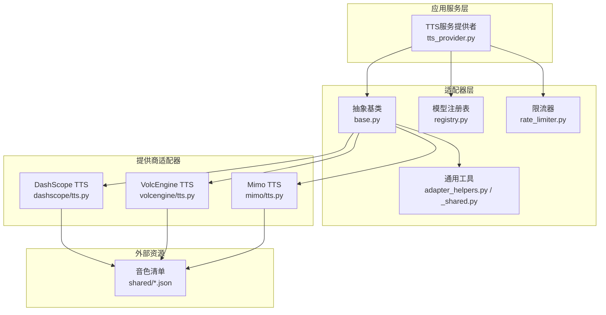
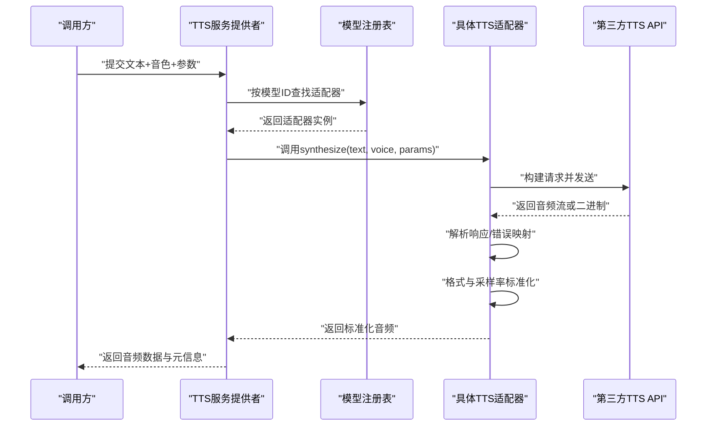
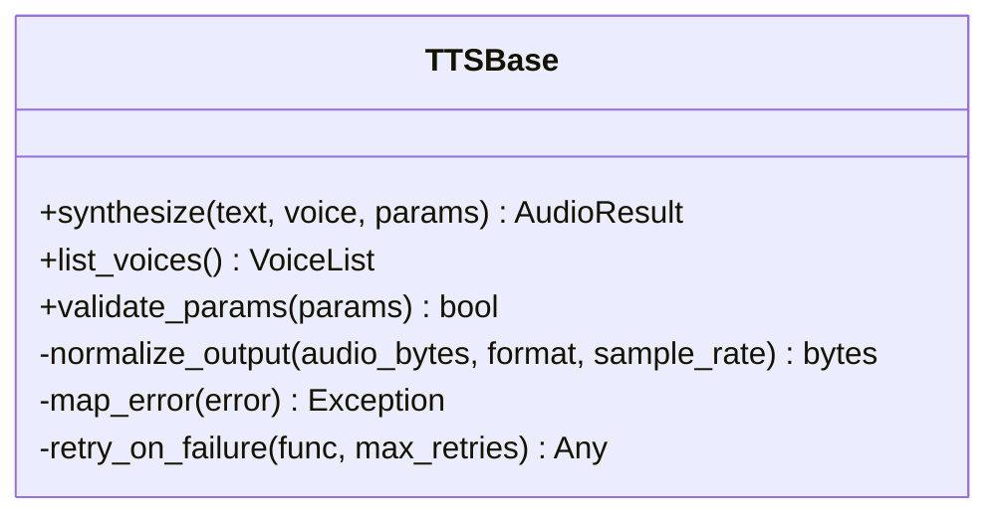
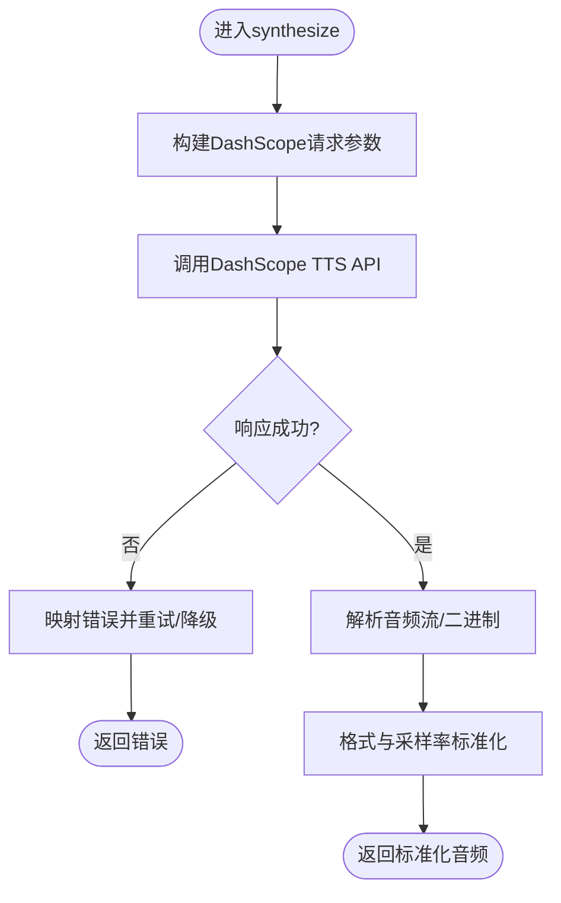
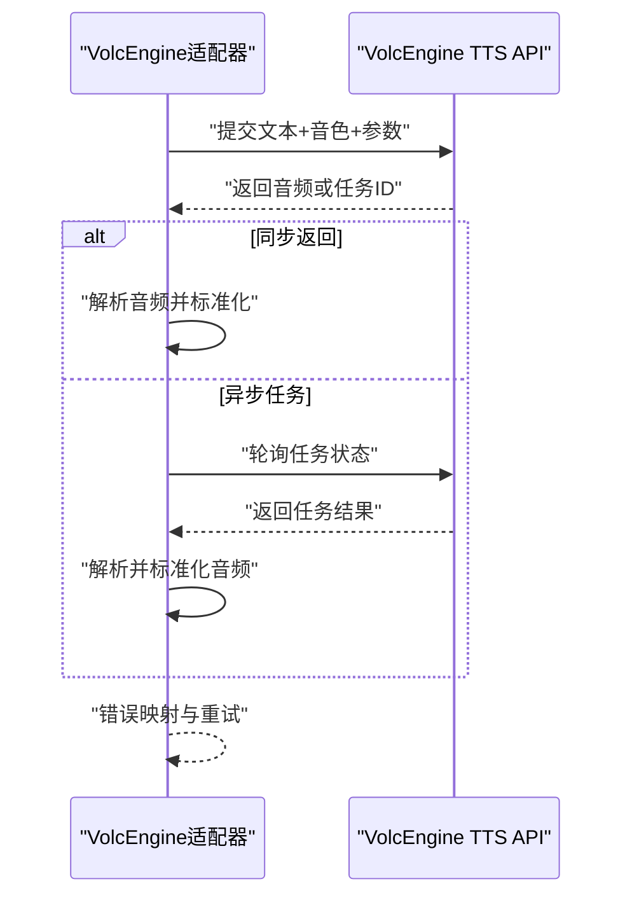
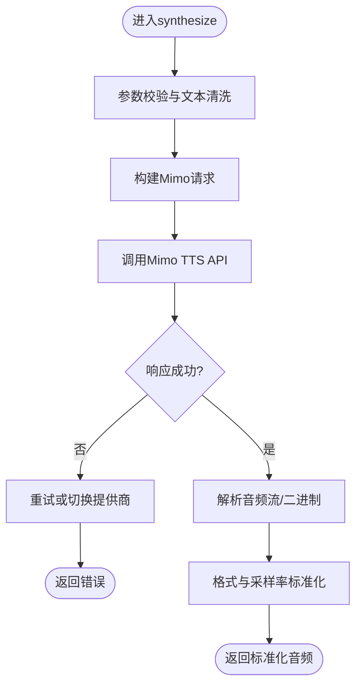
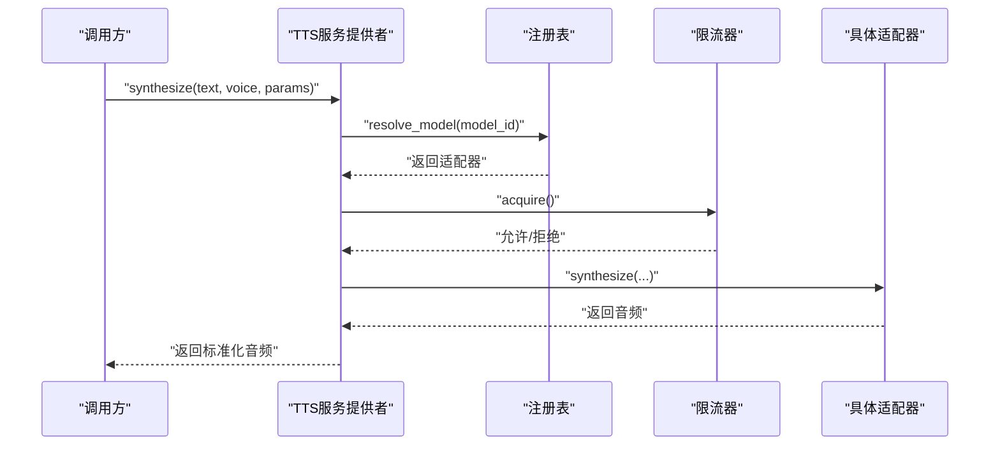
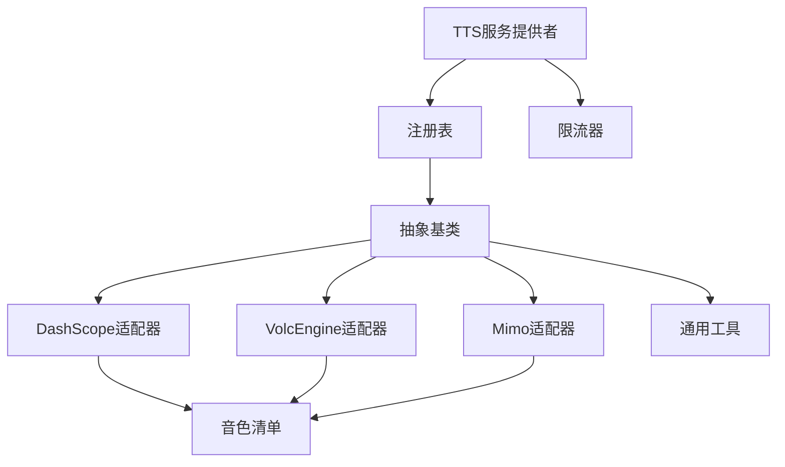

# 语音合成适配器

<cite>
**本文引用的文件**   
- [adapters/dashscope/tts.py](file://adapters/dashscope/tts.py)
- [adapters/volcengine/tts.py](file://adapters/volcengine/tts.py)
- [adapters/mimo/tts.py](file://adapters/mimo/tts.py)
- [adapters/base.py](file://adapters/base.py)
- [adapters/adapter_helpers.py](file://adapters/adapter_helpers.py)
- [adapters/_shared.py](file://adapters/_shared.py)
- [adapters/rate_limiter.py](file://adapters/rate_limiter.py)
- [adapters/registry.py](file://adapters/registry.py)
- [backend/app/services/providers/tts_provider.py](file://backend/app/services/providers/tts_provider.py)
- [scripts/verify_seed_tts_websocket.py](file://scripts/verify_seed_tts_websocket.py)
- [scripts/debug_single_voice.py](file://scripts/debug_single_voice.py)
- [shared/qwen3_tts_voices.json](file://shared/qwen3_tts_voices.json)
- [shared/mimo_v2_5_tts_voices.json](file://shared/mimo_v2_5_tts_voices.json)
</cite>

## 目录
1. [简介](#简介)
2. [项目结构](#项目结构)
3. [核心组件](#核心组件)
4. [架构总览](#架构总览)
5. [详细组件分析](#详细组件分析)
6. [依赖关系分析](#依赖关系分析)
7. [性能考量](#性能考量)
8. [故障排查指南](#故障排查指南)
9. [结论](#结论)
10. [附录](#附录)

## 简介
本技术文档面向语音合成（TTS）适配层，系统性梳理多提供商（DashScope、VolcEngine、Mimo等）的集成实现与调用方式，涵盖参数配置、响应处理、音色管理、音频格式与采样率设置、音质优化选项、错误处理与重试机制，以及性能调优与最佳实践。读者可据此快速理解并扩展新的TTS提供商接入。

## 项目结构
TTS相关代码主要分布在以下位置：
- 各提供商适配器：adapters/{provider}/tts.py
- 通用基类与工具：adapters/base.py, adapters/adapter_helpers.py, adapters/_shared.py
- 限流与注册：adapters/rate_limiter.py, adapters/registry.py
- 服务层聚合与调度：backend/app/services/providers/tts_provider.py
- 调试与验证脚本：scripts/*tts*
- 音色清单数据：shared/*.json

**图表来源** 
- [adapters/base.py](file://adapters/base.py)
- [adapters/adapter_helpers.py](file://adapters/adapter_helpers.py)
- [adapters/_shared.py](file://adapters/_shared.py)
- [adapters/rate_limiter.py](file://adapters/rate_limiter.py)
- [adapters/registry.py](file://adapters/registry.py)
- [adapters/dashscope/tts.py](file://adapters/dashscope/tts.py)
- [adapters/volcengine/tts.py](file://adapters/volcengine/tts.py)
- [adapters/mimo/tts.py](file://adapters/mimo/tts.py)
- [backend/app/services/providers/tts_provider.py](file://backend/app/services/providers/tts_provider.py)
- [shared/qwen3_tts_voices.json](file://shared/qwen3_tts_voices.json)
- [shared/mimo_v2_5_tts_voices.json](file://shared/mimo_v2_5_tts_voices.json)

**章节来源**
- [adapters/base.py](file://adapters/base.py)
- [adapters/adapter_helpers.py](file://adapters/adapter_helpers.py)
- [adapters/_shared.py](file://adapters/_shared.py)
- [adapters/rate_limiter.py](file://adapters/rate_limiter.py)
- [adapters/registry.py](file://adapters/registry.py)
- [adapters/dashscope/tts.py](file://adapters/dashscope/tts.py)
- [adapters/volcengine/tts.py](file://adapters/volcengine/tts.py)
- [adapters/mimo/tts.py](file://adapters/mimo/tts.py)
- [backend/app/services/providers/tts_provider.py](file://backend/app/services/providers/tts_provider.py)

## 核心组件
- 抽象基类与统一接口：定义TTS适配器的标准方法（文本转音频、音色列表获取、参数校验、结果解析），屏蔽提供商差异。
- 提供商适配器：分别实现DashScope、VolcEngine、Mimo的具体API调用、鉴权、请求构造、响应解析与错误映射。
- 通用工具与共享逻辑：封装HTTP客户端、重试策略、序列化/反序列化工具、音频格式转换、采样率对齐、日志与追踪。
- 限流与注册：提供速率限制与模型注册能力，便于动态发现与路由。
- 服务层聚合：对外暴露统一的TTS服务接口，负责参数归一化、提供商选择、并发控制与结果回传。

**章节来源**
- [adapters/base.py](file://adapters/base.py)
- [adapters/adapter_helpers.py](file://adapters/adapter_helpers.py)
- [adapters/_shared.py](file://adapters/_shared.py)
- [adapters/rate_limiter.py](file://adapters/rate_limiter.py)
- [adapters/registry.py](file://adapters/registry.py)
- [backend/app/services/providers/tts_provider.py](file://backend/app/services/providers/tts_provider.py)

## 架构总览
TTS调用流程从服务层发起，经注册表定位具体适配器，再由适配器完成鉴权、参数组装、网络请求、响应解析与错误处理。音频输出经过格式与采样率标准化后返回上层。

**图表来源** 
- [backend/app/services/providers/tts_provider.py](file://backend/app/services/providers/tts_provider.py)
- [adapters/registry.py](file://adapters/registry.py)
- [adapters/base.py](file://adapters/base.py)
- [adapters/dashscope/tts.py](file://adapters/dashscope/tts.py)
- [adapters/volcengine/tts.py](file://adapters/volcengine/tts.py)
- [adapters/mimo/tts.py](file://adapters/mimo/tts.py)

## 详细组件分析

### 抽象基类与统一接口
- 职责：定义synthesize、list_voices、validate_params等统一方法；提供默认的错误处理与重试钩子；规范输入输出数据结构。
- 关键点：
  - 输入参数规范化：文本清洗、长度限制、编码检查。
  - 输出标准化：统一音频格式（如PCM/WAV/MP3）、采样率（如16kHz/24kHz）、声道数与比特深度。
  - 错误映射：将第三方错误码映射为内部异常类型，便于上层统一处理。
  - 重试策略：基于指数退避与最大重试次数，支持可配置的重试条件（如网络超时、限流）。

**图表来源** 
- [adapters/base.py](file://adapters/base.py)

**章节来源**
- [adapters/base.py](file://adapters/base.py)

### DashScope TTS 适配器
- 职责：对接DashScope TTS API，完成鉴权、请求构造、流式/非流式响应处理、错误映射。
- 关键特性：
  - 参数映射：将统一参数转换为DashScope特定字段（如voice_id、speed、pitch、volume、format、sample_rate）。
  - 响应处理：支持音频流式返回，缓冲合并后输出；对部分失败片段进行重试。
  - 音色管理：读取shared中的音色清单，支持情感标签与风格参数映射。
  - 错误处理：针对限流、鉴权失败、模型不可用等场景进行差异化处理与重试。

**图表来源** 
- [adapters/dashscope/tts.py](file://adapters/dashscope/tts.py)
- [adapters/adapter_helpers.py](file://adapters/adapter_helpers.py)
- [shared/qwen3_tts_voices.json](file://shared/qwen3_tts_voices.json)

**章节来源**
- [adapters/dashscope/tts.py](file://adapters/dashscope/tts.py)
- [adapters/adapter_helpers.py](file://adapters/adapter_helpers.py)
- [shared/qwen3_tts_voices.json](file://shared/qwen3_tts_voices.json)

### VolcEngine TTS 适配器
- 职责：对接VolcEngine TTS API，处理鉴权、请求构造、响应解析与错误映射。
- 关键特性：
  - 参数映射：支持语速、音调、音量、音频格式、采样率、情感强度等参数。
  - 响应处理：支持同步与异步任务模式；对长文本分片生成与拼接。
  - 音色管理：结合shared音色清单，提供音色别名与风格映射。
  - 错误处理：区分网络错误、业务错误与配额不足，提供重试与降级策略。

**图表来源** 
- [adapters/volcengine/tts.py](file://adapters/volcengine/tts.py)
- [adapters/adapter_helpers.py](file://adapters/adapter_helpers.py)

**章节来源**
- [adapters/volcengine/tts.py](file://adapters/volcengine/tts.py)
- [adapters/adapter_helpers.py](file://adapters/adapter_helpers.py)

### Mimo TTS 适配器
- 职责：对接Mimo TTS API，处理鉴权、请求构造、响应解析与错误映射。
- 关键特性：
  - 参数映射：支持语速、音调、音量、音频格式、采样率、情感控制等。
  - 响应处理：支持流式与非流式；对大文本进行智能分片与拼接。
  - 音色管理：使用shared音色清单，支持音色克隆与个性化风格。
  - 错误处理：针对限流、模型不可用、参数非法等进行重试与降级。

**图表来源** 
- [adapters/mimo/tts.py](file://adapters/mimo/tts.py)
- [adapters/adapter_helpers.py](file://adapters/adapter_helpers.py)
- [shared/mimo_v2_5_tts_voices.json](file://shared/mimo_v2_5_tts_voices.json)

**章节来源**
- [adapters/mimo/tts.py](file://adapters/mimo/tts.py)
- [adapters/adapter_helpers.py](file://adapters/adapter_helpers.py)
- [shared/mimo_v2_5_tts_voices.json](file://shared/mimo_v2_5_tts_voices.json)

### 服务层聚合与调度
- 职责：对外暴露统一TTS服务接口，负责参数归一化、提供商选择、并发控制、结果回传。
- 关键特性：
  - 参数归一化：将上层参数映射到各提供商所需格式。
  - 提供商选择：基于模型ID、可用性、负载与成本策略选择最优适配器。
  - 并发控制：通过限流器与队列控制并发度，避免过载。
  - 结果回传：统一音频格式与元数据，支持流式与批量返回。

**图表来源** 
- [backend/app/services/providers/tts_provider.py](file://backend/app/services/providers/tts_provider.py)
- [adapters/registry.py](file://adapters/registry.py)
- [adapters/rate_limiter.py](file://adapters/rate_limiter.py)

**章节来源**
- [backend/app/services/providers/tts_provider.py](file://backend/app/services/providers/tts_provider.py)
- [adapters/registry.py](file://adapters/registry.py)
- [adapters/rate_limiter.py](file://adapters/rate_limiter.py)

## 依赖关系分析
- 组件耦合：
  - 服务层依赖注册表与限流器，降低对具体适配器的直接耦合。
  - 适配器依赖通用工具与共享数据（音色清单），提高复用性。
- 外部依赖：
  - 各提供商API：DashScope、VolcEngine、Mimo。
  - 音频处理库：用于格式转换、采样率对齐、流式处理。
- 潜在循环依赖：通过抽象基类与服务层解耦，避免适配器与服务层之间的循环引用。

**图表来源** 
- [backend/app/services/providers/tts_provider.py](file://backend/app/services/providers/tts_provider.py)
- [adapters/registry.py](file://adapters/registry.py)
- [adapters/rate_limiter.py](file://adapters/rate_limiter.py)
- [adapters/base.py](file://adapters/base.py)
- [adapters/dashscope/tts.py](file://adapters/dashscope/tts.py)
- [adapters/volcengine/tts.py](file://adapters/volcengine/tts.py)
- [adapters/mimo/tts.py](file://adapters/mimo/tts.py)
- [shared/qwen3_tts_voices.json](file://shared/qwen3_tts_voices.json)
- [shared/mimo_v2_5_tts_voices.json](file://shared/mimo_v2_5_tts_voices.json)

**章节来源**
- [backend/app/services/providers/tts_provider.py](file://backend/app/services/providers/tts_provider.py)
- [adapters/registry.py](file://adapters/registry.py)
- [adapters/rate_limiter.py](file://adapters/rate_limiter.py)
- [adapters/base.py](file://adapters/base.py)
- [adapters/dashscope/tts.py](file://adapters/dashscope/tts.py)
- [adapters/volcengine/tts.py](file://adapters/volcengine/tts.py)
- [adapters/mimo/tts.py](file://adapters/mimo/tts.py)
- [shared/qwen3_tts_voices.json](file://shared/qwen3_tts_voices.json)
- [shared/mimo_v2_5_tts_voices.json](file://shared/mimo_v2_5_tts_voices.json)

## 性能考量
- 流式处理：优先使用流式API减少内存占用与首包延迟。
- 分片策略：对长文本进行语义分片，避免单次请求过大导致超时。
- 缓存与预热：对常用音色与短文本进行本地缓存，减少重复请求。
- 并发控制：通过限流器与队列控制并发度，避免下游过载。
- 采样率与格式：根据播放端需求选择合适的采样率（如16kHz/24kHz）与压缩格式（如MP3/AAC）以平衡质量与带宽。
- 重试与降级：合理设置重试次数与退避策略，失败时自动降级至备用提供商。

[本节为通用指导，不直接分析具体文件]

## 故障排查指南
- 常见问题：
  - 鉴权失败：检查API密钥与权限配置。
  - 限流错误：调整并发度与重试间隔，或升级配额。
  - 模型不可用：切换备用模型或提供商。
  - 音频格式不支持：确认输出格式与采样率兼容性。
- 调试工具：
  - 使用调试脚本验证单个音色与参数组合。
  - 查看日志与追踪信息定位问题。
- 重试机制：
  - 基于错误类型进行差异化重试（如网络超时、限流）。
  - 设置最大重试次数与退避策略，避免无限重试。

**章节来源**
- [scripts/debug_single_voice.py](file://scripts/debug_single_voice.py)
- [scripts/verify_seed_tts_websocket.py](file://scripts/verify_seed_tts_websocket.py)
- [adapters/rate_limiter.py](file://adapters/rate_limiter.py)

## 结论
本TTS适配器层通过抽象基类与统一接口屏蔽了多提供商差异，提供了稳定的音色管理、音频格式与采样率标准化、错误处理与重试机制。服务层聚合与调度进一步优化了性能与可靠性。建议在生产环境中启用流式处理、分片策略、缓存与预热，并结合限流与重试机制确保高可用。

[本节为总结性内容，不直接分析具体文件]

## 附录
- 音色管理：
  - 音色选择：通过shared音色清单进行映射与过滤。
  - 情感控制：支持情感强度与风格参数调节。
  - 语音风格：支持语速、音调、音量等参数微调。
- 音频格式与采样率：
  - 支持PCM/WAV/MP3等格式。
  - 推荐采样率：16kHz（语音通话）、24kHz（高质量播放）。
- 代码示例路径：
  - DashScope调用示例：参考[dashscope/tts.py](file://adapters/dashscope/tts.py)
  - VolcEngine调用示例：参考[volcengine/tts.py](file://adapters/volcengine/tts.py)
  - Mimo调用示例：参考[mimo/tts.py](file://adapters/mimo/tts.py)
  - 服务层调用示例：参考[tts_provider.py](file://backend/app/services/providers/tts_provider.py)

[本节为补充说明，不直接分析具体文件]