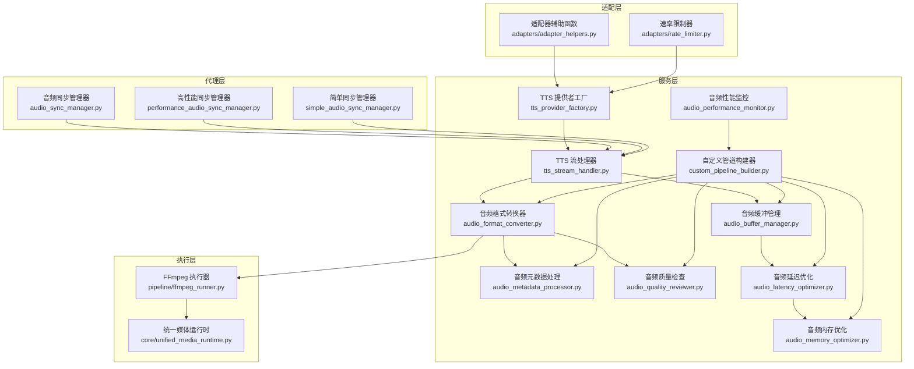
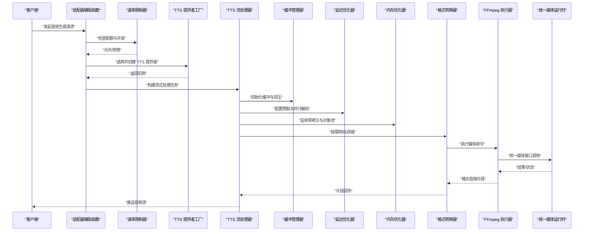
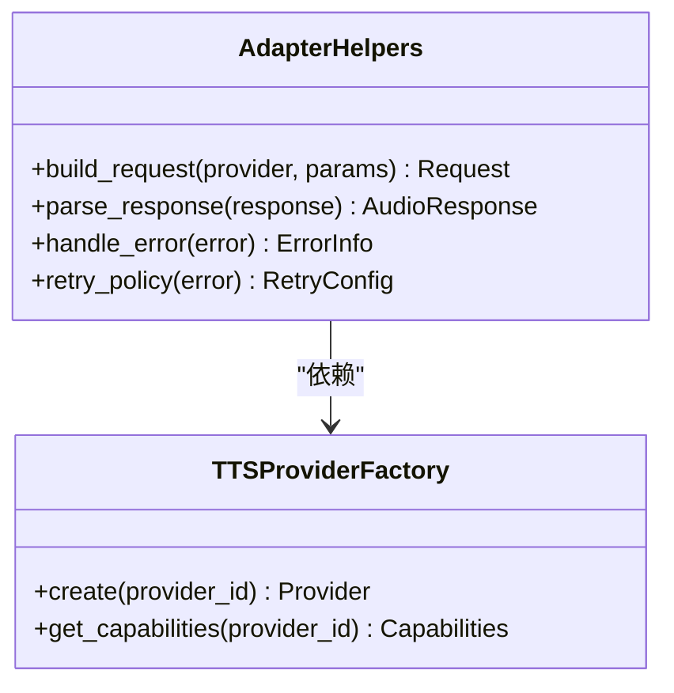
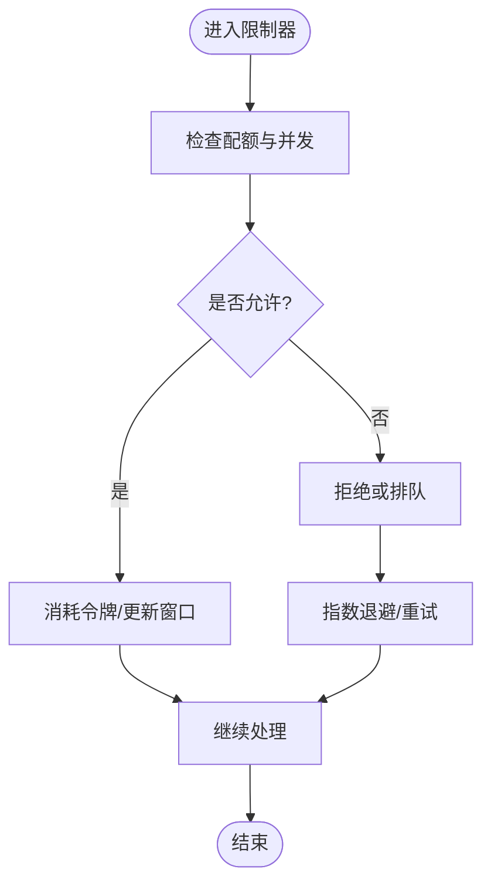
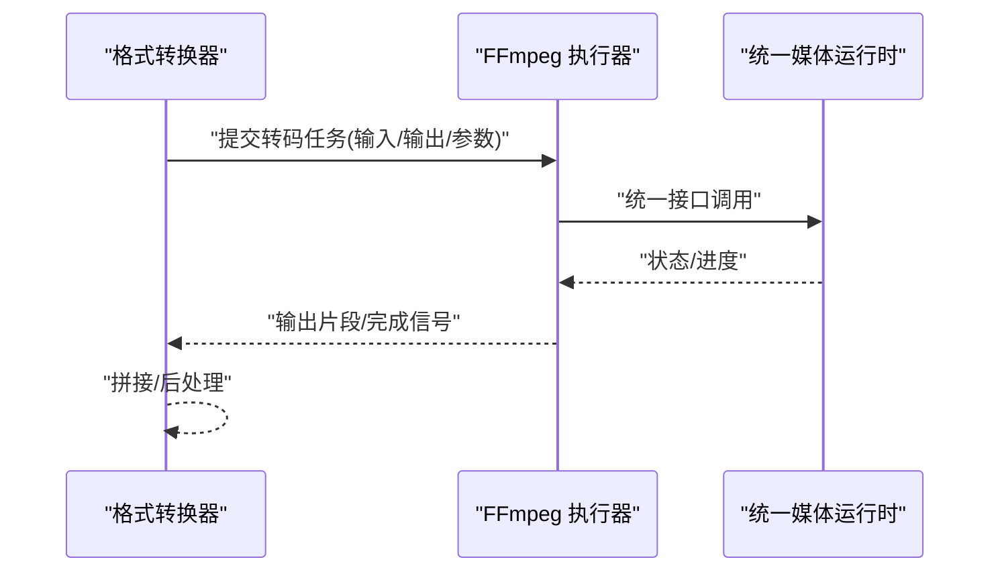
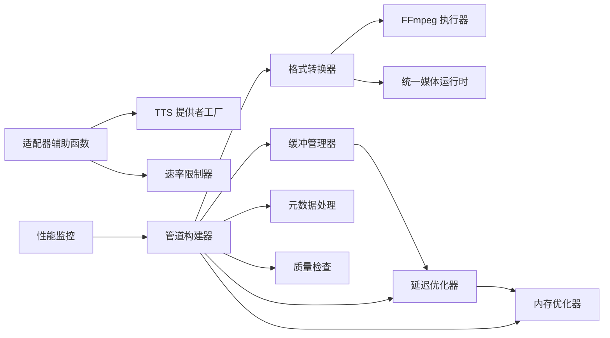

# 音频处理核心

<cite>
**本文档引用的文件**   
- [adapters/adapter_helpers.py](file://adapters/adapter_helpers.py)
- [adapters/rate_limiter.py](file://adapters/rate_limiter.py)
- [backend/services/streaming_service.py](file://backend/services/streaming_service.py)
- [pipeline/ffmpeg_runner.py](file://pipeline/ffmpeg_runner.py)
- [core/unified_media_runtime.py](file://core/unified_media_runtime.py)
- [agents/audio_sync_manager.py](file://agents/audio_sync_manager.py)
- [agents/performance_audio_sync_manager.py](file://agents/performance_audio_sync_manager.py)
- [agents/simple_audio_sync_manager.py](file://agents/simple_audio_sync_manager.py)
- [backend/services/audiobook/tts_provider_factory.py](file://backend/services/audiobook/tts_provider_factory.py)
- [backend/services/audiobook/tts_stream_handler.py](file://backend/services/audiobook/tts_stream_handler.py)
- [backend/services/audiobook/audio_quality_reviewer.py](file://backend/services/audiobook/audio_quality_reviewer.py)
- [backend/services/audiobook/audio_format_converter.py](file://backend/services/audiobook/audio_format_converter.py)
- [backend/services/audiobook/audio_metadata_processor.py](file://backend/services/audiobook/audio_metadata_processor.py)
- [backend/services/audiobook/audio_buffer_manager.py](file://backend/services/audiobook/audio_buffer_manager.py)
- [backend/services/audiobook/audio_latency_optimizer.py](file://backend/services/audiobook/audio_latency_optimizer.py)
- [backend/services/audiobook/audio_memory_optimizer.py](file://backend/services/audiobook/audio_memory_optimizer.py)
- [backend/services/audiobook/custom_pipeline_builder.py](file://backend/services/audiobook/custom_pipeline_builder.py)
- [backend/services/audiobook/audio_performance_monitor.py](file://backend/services/audiobook/audio_performance_monitor.py)
</cite>

## 目录
1. [简介](#简介)
2. [项目结构](#项目结构)
3. [核心组件](#核心组件)
4. [架构总览](#架构总览)
5. [详细组件分析](#详细组件分析)
6. [依赖关系分析](#依赖关系分析)
7. [性能考量](#性能考量)
8. [故障排查指南](#故障排查指南)
9. [结论](#结论)
10. [附录](#附录)

## 简介
本技术文档聚焦于音频处理核心组件，涵盖共享功能与工具函数（音频格式转换、元数据处理、质量检查）、适配器辅助函数（请求构建、响应解析、错误处理）、速率限制器设计原理与配置方法（并发控制、配额管理、限流策略），以及音频流式处理的缓冲管理、延迟优化与内存使用优化。同时提供自定义音频处理管道的开发指南与性能监控方法，帮助开发者快速理解并扩展系统能力。

## 项目结构
音频处理相关代码分布在多个模块中：
- adapters：通用适配器与辅助函数、速率限制器等
- backend/services/audiobook：音频处理服务层（TTS、格式转换、元数据、质量检查、缓冲、延迟与内存优化、管道构建与监控）
- pipeline：媒体处理执行器（FFmpeg 封装）
- core：统一媒体运行时抽象
- agents：音频同步管理器（多种实现）

图表来源
- [adapters/adapter_helpers.py](file://adapters/adapter_helpers.py)
- [adapters/rate_limiter.py](file://adapters/rate_limiter.py)
- [backend/services/audiobook/tts_provider_factory.py](file://backend/services/audiobook/tts_provider_factory.py)
- [backend/services/audiobook/tts_stream_handler.py](file://backend/services/audiobook/tts_stream_handler.py)
- [backend/services/audiobook/audio_format_converter.py](file://backend/services/audiobook/audio_format_converter.py)
- [backend/services/audiobook/audio_metadata_processor.py](file://backend/services/audiobook/audio_metadata_processor.py)
- [backend/services/audiobook/audio_quality_reviewer.py](file://backend/services/audiobook/audio_quality_reviewer.py)
- [backend/services/audiobook/audio_buffer_manager.py](file://backend/services/audiobook/audio_buffer_manager.py)
- [backend/services/audiobook/audio_latency_optimizer.py](file://backend/services/audiobook/audio_latency_optimizer.py)
- [backend/services/audiobook/audio_memory_optimizer.py](file://backend/services/audiobook/audio_memory_optimizer.py)
- [pipeline/ffmpeg_runner.py](file://pipeline/ffmpeg_runner.py)
- [core/unified_media_runtime.py](file://core/unified_media_runtime.py)
- [agents/audio_sync_manager.py](file://agents/audio_sync_manager.py)
- [agents/performance_audio_sync_manager.py](file://agents/performance_audio_sync_manager.py)
- [agents/simple_audio_sync_manager.py](file://agents/simple_audio_sync_manager.py)

章节来源
- [adapters/adapter_helpers.py](file://adapters/adapter_helpers.py)
- [adapters/rate_limiter.py](file://adapters/rate_limiter.py)
- [backend/services/audiobook/tts_provider_factory.py](file://backend/services/audiobook/tts_provider_factory.py)
- [backend/services/audiobook/tts_stream_handler.py](file://backend/services/audiobook/tts_stream_handler.py)
- [pipeline/ffmpeg_runner.py](file://pipeline/ffmpeg_runner.py)
- [core/unified_media_runtime.py](file://core/unified_media_runtime.py)
- [agents/audio_sync_manager.py](file://agents/audio_sync_manager.py)
- [agents/performance_audio_sync_manager.py](file://agents/performance_audio_sync_manager.py)
- [agents/simple_audio_sync_manager.py](file://agents/simple_audio_sync_manager.py)

## 核心组件
- 适配器辅助函数：集中处理请求构建、响应解析与错误处理，屏蔽不同 TTS/音频后端的差异，为上层服务提供一致接口。
- 速率限制器：基于令牌桶或滑动窗口实现并发控制与配额管理，支持按用户/模型维度限流。
- 音频格式转换器：封装 FFmpeg 调用，完成采样率、声道数、编码格式的转换与拼接。
- 音频元数据处理：读写 ID3/ Vorbis 等标签，维护作者、专辑、时长、码率等元信息。
- 音频质量检查：检测静音段、爆音、响度异常、采样率不匹配等问题，输出质量报告。
- 流式处理缓冲管理：环形缓冲、分块读取、背压控制，保障低延迟与稳定吞吐。
- 延迟优化：预取、并行解码、流水线调度，减少端到端时延。
- 内存优化：零拷贝片段、对象池、按需释放，降低峰值内存占用。
- 自定义管道构建器：组合上述组件形成可插拔的音频处理管线。
- 性能监控：采集关键指标（吞吐、时延、错误率、资源使用），提供可视化与告警。

章节来源
- [adapters/adapter_helpers.py](file://adapters/adapter_helpers.py)
- [adapters/rate_limiter.py](file://adapters/rate_limiter.py)
- [backend/services/audiobook/audio_format_converter.py](file://backend/services/audiobook/audio_format_converter.py)
- [backend/services/audiobook/audio_metadata_processor.py](file://backend/services/audiobook/audio_metadata_processor.py)
- [backend/services/audiobook/audio_quality_reviewer.py](file://backend/services/audiobook/audio_quality_reviewer.py)
- [backend/services/audiobook/audio_buffer_manager.py](file://backend/services/audiobook/audio_buffer_manager.py)
- [backend/services/audiobook/audio_latency_optimizer.py](file://backend/services/audiobook/audio_latency_optimizer.py)
- [backend/services/audiobook/audio_memory_optimizer.py](file://backend/services/audiobook/audio_memory_optimizer.py)
- [backend/services/audiobook/custom_pipeline_builder.py](file://backend/services/audiobook/custom_pipeline_builder.py)
- [backend/services/audiobook/audio_performance_monitor.py](file://backend/services/audiobook/audio_performance_monitor.py)

## 架构总览
整体采用分层架构：适配层屏蔽后端差异；服务层编排音频处理流程；执行层通过 FFmpeg 进行媒体处理；代理层负责音频与文本/视频流的同步；运行时提供统一的媒体抽象。

图表来源
- [adapters/adapter_helpers.py](file://adapters/adapter_helpers.py)
- [adapters/rate_limiter.py](file://adapters/rate_limiter.py)
- [backend/services/audiobook/tts_provider_factory.py](file://backend/services/audiobook/tts_provider_factory.py)
- [backend/services/audiobook/tts_stream_handler.py](file://backend/services/audiobook/tts_stream_handler.py)
- [backend/services/audiobook/audio_buffer_manager.py](file://backend/services/audiobook/audio_buffer_manager.py)
- [backend/services/audiobook/audio_latency_optimizer.py](file://backend/services/audiobook/audio_latency_optimizer.py)
- [backend/services/audiobook/audio_memory_optimizer.py](file://backend/services/audiobook/audio_memory_optimizer.py)
- [backend/services/audiobook/audio_format_converter.py](file://backend/services/audiobook/audio_format_converter.py)
- [pipeline/ffmpeg_runner.py](file://pipeline/ffmpeg_runner.py)
- [core/unified_media_runtime.py](file://core/unified_media_runtime.py)

## 详细组件分析

### 适配器辅助函数（请求构建、响应解析、错误处理）
- 职责：统一构造各 TTS/音频后端的请求体、头信息与参数映射；解析响应数据（文本、音频片段、事件）；标准化错误码与重试策略。
- 关键点：
  - 请求构建：根据模型规格动态拼装 payload，处理鉴权、签名、超时与重试。
  - 响应解析：兼容 JSON/二进制流/事件流，提取音频帧与进度事件。
  - 错误处理：区分网络错误、服务端错误、业务校验失败，提供降级与补偿逻辑。
- 适用场景：新增 TTS 提供商或音频 API 时，仅需实现适配映射即可接入。

图表来源
- [adapters/adapter_helpers.py](file://adapters/adapter_helpers.py)
- [backend/services/audiobook/tts_provider_factory.py](file://backend/services/audiobook/tts_provider_factory.py)

章节来源
- [adapters/adapter_helpers.py](file://adapters/adapter_helpers.py)
- [backend/services/audiobook/tts_provider_factory.py](file://backend/services/audiobook/tts_provider_factory.py)

### 速率限制器（并发控制、配额管理、限流策略）
- 设计原理：基于令牌桶或滑动窗口算法，支持全局与细粒度（用户、模型、租户）配额；支持突发与平滑两种模式。
- 配置项：
  - 最大并发、令牌刷新间隔、配额上限、惩罚策略（退避时间）。
  - 优先级队列与抢占策略，保证高优任务优先通过。
- 集成点：在适配器辅助函数与 TTS 工厂入口处调用，确保资源不被滥用。

图表来源
- [adapters/rate_limiter.py](file://adapters/rate_limiter.py)

章节来源
- [adapters/rate_limiter.py](file://adapters/rate_limiter.py)

### 音频格式转换器（采样率、编码、拼接）
- 功能：将输入音频转换为目标格式（如 PCM/WAV/MP3/AAC），调整采样率、声道数、码率；支持多片段拼接与淡入淡出。
- 实现要点：
  - 通过 FFmpeg 执行器封装命令行，避免直接进程管理。
  - 缓存中间产物，减少重复转码。
  - 错误码映射与重试策略，提升鲁棒性。

图表来源
- [backend/services/audiobook/audio_format_converter.py](file://backend/services/audiobook/audio_format_converter.py)
- [pipeline/ffmpeg_runner.py](file://pipeline/ffmpeg_runner.py)
- [core/unified_media_runtime.py](file://core/unified_media_runtime.py)

章节来源
- [backend/services/audiobook/audio_format_converter.py](file://backend/services/audiobook/audio_format_converter.py)
- [pipeline/ffmpeg_runner.py](file://pipeline/ffmpeg_runner.py)
- [core/unified_media_runtime.py](file://core/unified_media_runtime.py)

### 音频元数据处理（ID3/Vorbis 标签读写）
- 功能：读取/写入标题、艺术家、专辑、封面、时长、码率、版权信息等；批量更新与一致性校验。
- 关键点：
  - 多格式兼容（WAV、MP3、FLAC、AAC）。
  - 元数据版本管理与回滚机制。
  - 与质量检查联动，确保元数据与实际内容一致。

章节来源
- [backend/services/audiobook/audio_metadata_processor.py](file://backend/services/audiobook/audio_metadata_processor.py)

### 音频质量检查（静音、爆音、响度、采样率）
- 功能：检测静音段、爆音、削波、响度异常、采样率不一致；生成质量报告与建议修复动作。
- 关键点：
  - 规则引擎与阈值配置化。
  - 异步扫描与增量检查，降低对在线链路的影响。
  - 与格式转换器联动，自动修复常见问题。

章节来源
- [backend/services/audiobook/audio_quality_reviewer.py](file://backend/services/audiobook/audio_quality_reviewer.py)

### 流式处理缓冲管理（环形缓冲、背压、分块）
- 功能：管理音频片段的入队/出队，维持稳定吞吐；实现背压控制，防止下游阻塞导致上游积压。
- 关键点：
  - 固定大小环形缓冲，避免频繁分配。
  - 消费者驱动与生产者限速，保障低延迟。
  - 监控缓冲水位与丢弃策略。

章节来源
- [backend/services/audiobook/audio_buffer_manager.py](file://backend/services/audiobook/audio_buffer_manager.py)

### 延迟优化（预取、并行解码、流水线）
- 功能：通过预取下一片段、并行解码与流水线调度，降低端到端时延。
- 关键点：
  - 预取深度与解码线程数可调。
  - 任务切分与依赖图，最大化并行度。
  - 与缓冲管理器协同，避免抖动。

章节来源
- [backend/services/audiobook/audio_latency_optimizer.py](file://backend/services/audiobook/audio_latency_optimizer.py)

### 内存优化（零拷贝、对象池、按需释放）
- 功能：减少内存复制与峰值占用，延长长任务稳定性。
- 关键点：
  - 零拷贝片段视图，避免额外分配。
  - 对象池复用解码器/编码器实例。
  - 及时释放临时缓冲区与中间文件。

章节来源
- [backend/services/audiobook/audio_memory_optimizer.py](file://backend/services/audiobook/audio_memory_optimizer.py)

### 自定义音频处理管道（可插拔管线构建）
- 功能：组合格式转换、元数据处理、质量检查、缓冲、延迟与内存优化等组件，形成可配置的音频处理管线。
- 关键点：
  - 阶段化编排，支持条件分支与重试。
  - 插件化注册与热加载。
  - 与性能监控集成，实时评估管线健康度。

章节来源
- [backend/services/audiobook/custom_pipeline_builder.py](file://backend/services/audiobook/custom_pipeline_builder.py)

### 音频性能监控（吞吐、时延、错误率、资源使用）
- 功能：采集关键指标，提供可视化面板与告警；支持分布式追踪与日志聚合。
- 关键点：
  - 指标定义与采集频率可调。
  - 与速率限制器联动，动态调整配额。
  - 与管道构建器集成，定位瓶颈阶段。

章节来源
- [backend/services/audiobook/audio_performance_monitor.py](file://backend/services/audiobook/audio_performance_monitor.py)

### 音频同步管理器（多种实现）
- 角色：协调文本/脚本与音频片段的时序对齐，支持简单、高性能与复杂场景。
- 实现：
  - 简单同步管理器：基础时间戳对齐与拼接。
  - 高性能同步管理器：多线程/异步优化，适合大段落与高并发。
  - 通用音频同步管理器：统一接口与策略选择。

章节来源
- [agents/audio_sync_manager.py](file://agents/audio_sync_manager.py)
- [agents/performance_audio_sync_manager.py](file://agents/performance_audio_sync_manager.py)
- [agents/simple_audio_sync_manager.py](file://agents/simple_audio_sync_manager.py)

## 依赖关系分析
- 耦合与内聚：
  - 适配器辅助函数与 TTS 工厂强耦合，便于扩展新提供商。
  - 格式转换器依赖 FFmpeg 执行器与统一媒体运行时，保持执行层解耦。
  - 缓冲、延迟与内存优化组件松耦合，通过管道构建器组合。
- 外部依赖：
  - FFmpeg：媒体编解码与转码。
  - 统一媒体运行时：跨平台/跨库抽象。
  - 速率限制器：外部配额存储（内存/Redis）可选。

图表来源
- [adapters/adapter_helpers.py](file://adapters/adapter_helpers.py)
- [adapters/rate_limiter.py](file://adapters/rate_limiter.py)
- [backend/services/audiobook/audio_format_converter.py](file://backend/services/audiobook/audio_format_converter.py)
- [pipeline/ffmpeg_runner.py](file://pipeline/ffmpeg_runner.py)
- [core/unified_media_runtime.py](file://core/unified_media_runtime.py)
- [backend/services/audiobook/audio_buffer_manager.py](file://backend/services/audiobook/audio_buffer_manager.py)
- [backend/services/audiobook/audio_latency_optimizer.py](file://backend/services/audiobook/audio_latency_optimizer.py)
- [backend/services/audiobook/audio_memory_optimizer.py](file://backend/services/audiobook/audio_memory_optimizer.py)
- [backend/services/audiobook/custom_pipeline_builder.py](file://backend/services/audiobook/custom_pipeline_builder.py)
- [backend/services/audiobook/audio_metadata_processor.py](file://backend/services/audiobook/audio_metadata_processor.py)
- [backend/services/audiobook/audio_quality_reviewer.py](file://backend/services/audiobook/audio_quality_reviewer.py)
- [backend/services/audiobook/audio_performance_monitor.py](file://backend/services/audiobook/audio_performance_monitor.py)

章节来源
- [adapters/adapter_helpers.py](file://adapters/adapter_helpers.py)
- [adapters/rate_limiter.py](file://adapters/rate_limiter.py)
- [backend/services/audiobook/audio_format_converter.py](file://backend/services/audiobook/audio_format_converter.py)
- [pipeline/ffmpeg_runner.py](file://pipeline/ffmpeg_runner.py)
- [core/unified_media_runtime.py](file://core/unified_media_runtime.py)
- [backend/services/audiobook/audio_buffer_manager.py](file://backend/services/audiobook/audio_buffer_manager.py)
- [backend/services/audiobook/audio_latency_optimizer.py](file://backend/services/audiobook/audio_latency_optimizer.py)
- [backend/services/audiobook/audio_memory_optimizer.py](file://backend/services/audiobook/audio_memory_optimizer.py)
- [backend/services/audiobook/custom_pipeline_builder.py](file://backend/services/audiobook/custom_pipeline_builder.py)
- [backend/services/audiobook/audio_metadata_processor.py](file://backend/services/audiobook/audio_metadata_processor.py)
- [backend/services/audiobook/audio_quality_reviewer.py](file://backend/services/audiobook/audio_quality_reviewer.py)
- [backend/services/audiobook/audio_performance_monitor.py](file://backend/services/audiobook/audio_performance_monitor.py)

## 性能考量
- 吞吐与时延：
  - 合理设置预取深度与解码线程数，平衡 CPU 与 I/O。
  - 使用环形缓冲与背压，避免抖动与拥塞。
- 内存使用：
  - 零拷贝片段与对象池显著降低峰值内存。
  - 及时清理中间文件与临时缓冲区。
- 资源隔离：
  - 按用户/模型维度配额，避免热点模型独占资源。
  - 优先级队列保障关键任务。
- 监控与调优：
  - 采集关键指标，定位瓶颈阶段。
  - 动态调整限流与缓冲参数。

[本节为通用指导，不直接分析具体文件]

## 故障排查指南
- 常见错误：
  - 网络超时/连接失败：检查适配器重试策略与超时配置。
  - 配额不足：查看速率限制器统计与配额上限。
  - 转码失败：核对 FFmpeg 命令与输入格式兼容性。
  - 质量不达标：查看质量检查报告，调整阈值与修复策略。
- 诊断步骤：
  - 启用性能监控与追踪，定位问题阶段。
  - 检查缓冲水位与丢弃情况。
  - 验证元数据一致性。
  - 逐步禁用优化组件以缩小范围。

章节来源
- [adapters/adapter_helpers.py](file://adapters/adapter_helpers.py)
- [adapters/rate_limiter.py](file://adapters/rate_limiter.py)
- [backend/services/audiobook/audio_format_converter.py](file://backend/services/audiobook/audio_format_converter.py)
- [backend/services/audiobook/audio_quality_reviewer.py](file://backend/services/audiobook/audio_quality_reviewer.py)
- [backend/services/audiobook/audio_buffer_manager.py](file://backend/services/audiobook/audio_buffer_manager.py)
- [backend/services/audiobook/audio_performance_monitor.py](file://backend/services/audiobook/audio_performance_monitor.py)

## 结论
本音频处理核心通过清晰的层次与模块化设计，实现了可扩展、高性能与易维护的音频处理能力。适配器辅助函数与速率限制器保障了与外部服务的稳定交互；格式转换、元数据处理与质量检查提供了完整的媒体处理能力；缓冲、延迟与内存优化确保了流式处理的低延迟与稳定性；管道构建器与性能监控则支撑了灵活定制与持续优化。建议在生产环境中结合监控与限流策略，持续调优以获得最佳效果。

[本节为总结，不直接分析具体文件]

## 附录
- 术语表：
  - TTS：文本转语音
  - FFmpeg：多媒体框架
  - 背压：下游压力反馈至上游的控制机制
  - 零拷贝：避免数据复制的内存优化技术
- 参考路径：
  - 适配器辅助函数：[adapters/adapter_helpers.py](file://adapters/adapter_helpers.py)
  - 速率限制器：[adapters/rate_limiter.py](file://adapters/rate_limiter.py)
  - 格式转换器：[backend/services/audiobook/audio_format_converter.py](file://backend/services/audiobook/audio_format_converter.py)
  - 元数据处理：[backend/services/audiobook/audio_metadata_processor.py](file://backend/services/audiobook/audio_metadata_processor.py)
  - 质量检查：[backend/services/audiobook/audio_quality_reviewer.py](file://backend/services/audiobook/audio_quality_reviewer.py)
  - 缓冲管理：[backend/services/audiobook/audio_buffer_manager.py](file://backend/services/audiobook/audio_buffer_manager.py)
  - 延迟优化：[backend/services/audiobook/audio_latency_optimizer.py](file://backend/services/audiobook/audio_latency_optimizer.py)
  - 内存优化：[backend/services/audiobook/audio_memory_optimizer.py](file://backend/services/audiobook/audio_memory_optimizer.py)
  - 管道构建器：[backend/services/audiobook/custom_pipeline_builder.py](file://backend/services/audiobook/custom_pipeline_builder.py)
  - 性能监控：[backend/services/audiobook/audio_performance_monitor.py](file://backend/services/audiobook/audio_performance_monitor.py)
  - FFmpeg 执行器：[pipeline/ffmpeg_runner.py](file://pipeline/ffmpeg_runner.py)
  - 统一媒体运行时：[core/unified_media_runtime.py](file://core/unified_media_runtime.py)
  - 音频同步管理器：[agents/audio_sync_manager.py](file://agents/audio_sync_manager.py)

[本节为附录，不直接分析具体文件]