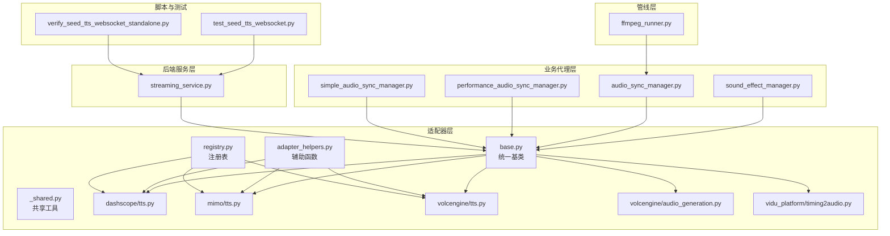
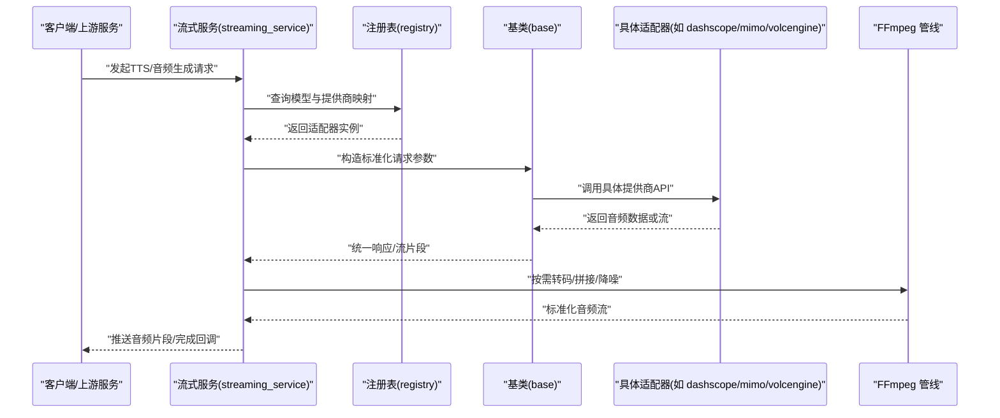
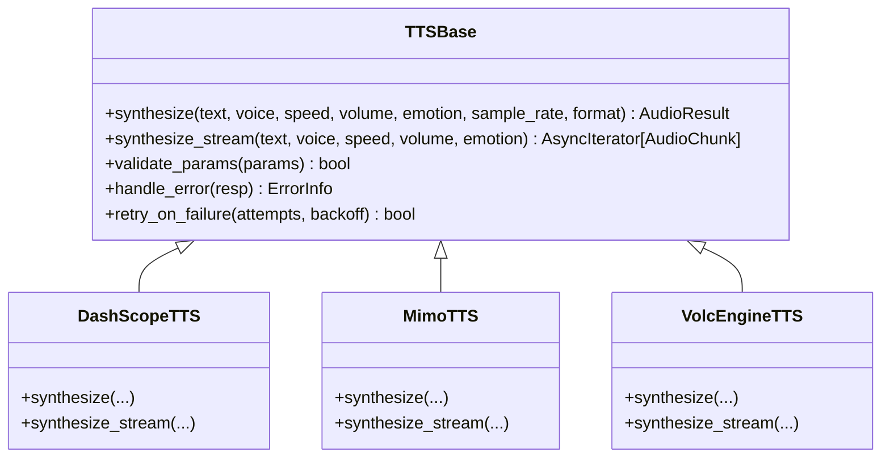
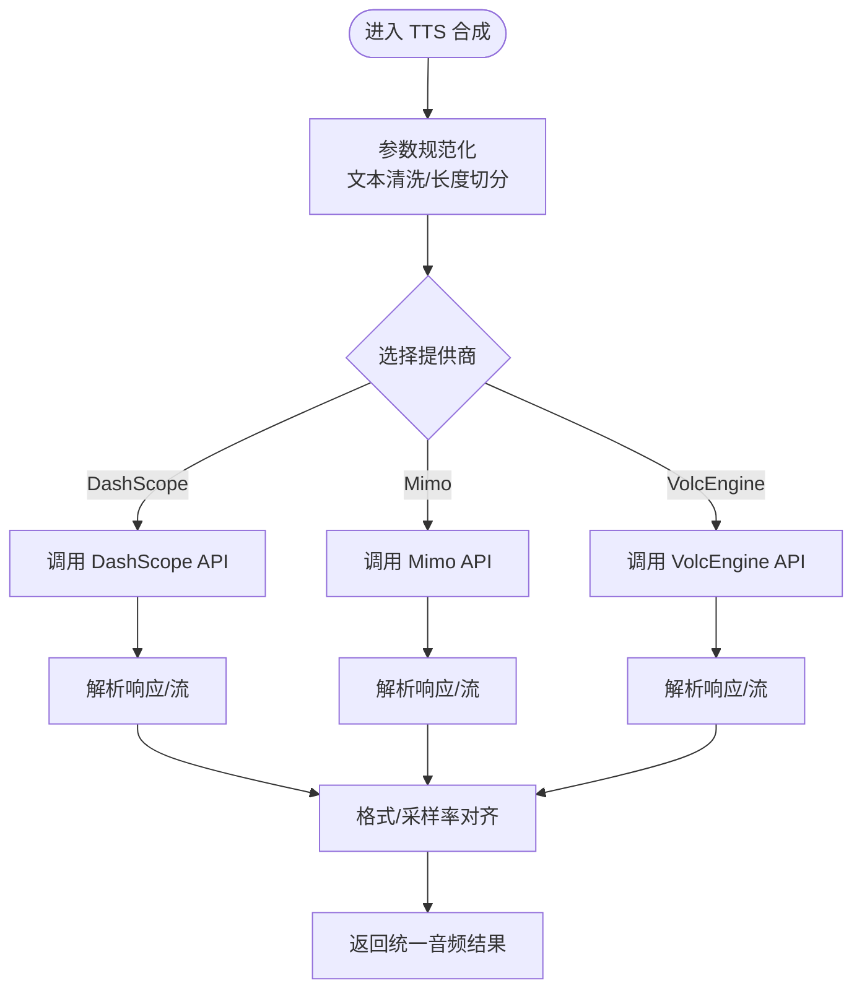
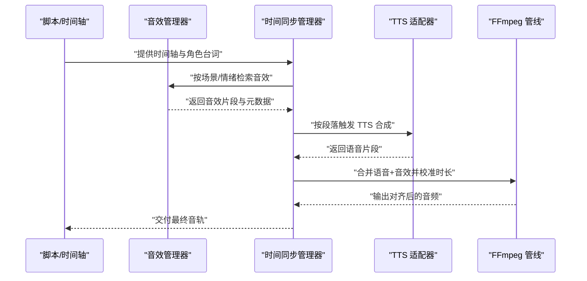
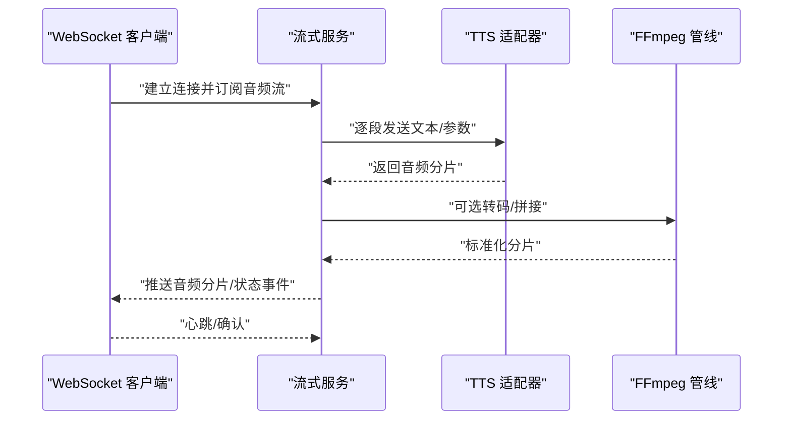
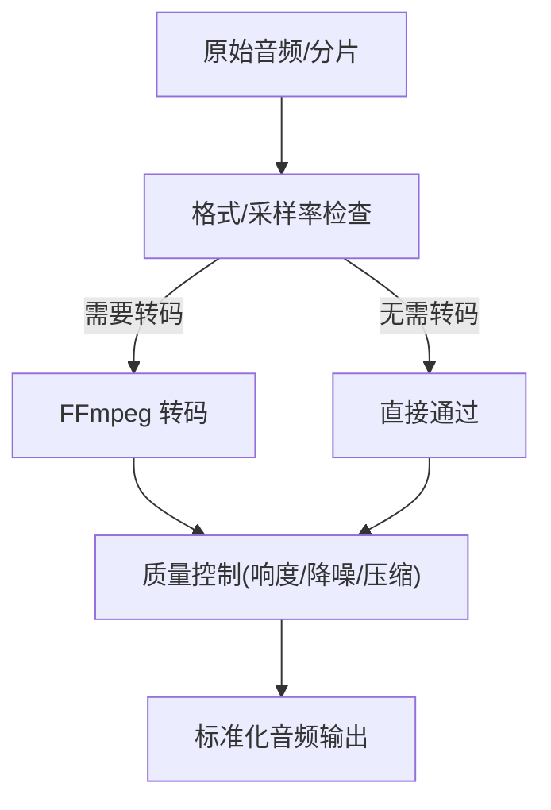
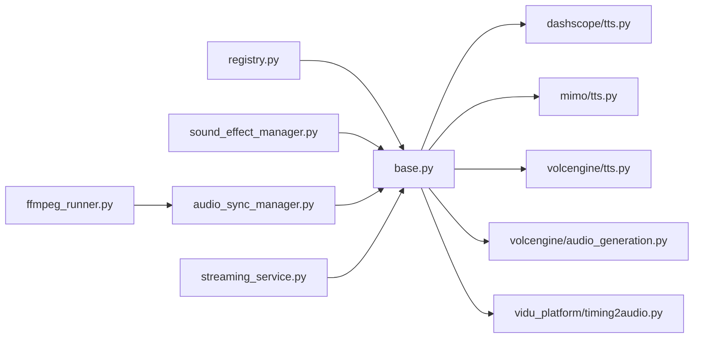

# 音频处理适配器

<cite>
**本文引用的文件**   
- [adapters/base.py](file://adapters/base.py)
- [adapters/_shared.py](file://adapters/_shared.py)
- [adapters/adapter_helpers.py](file://adapters/adapter_helpers.py)
- [adapters/dashscope/tts.py](file://adapters/dashscope/tts.py)
- [adapters/mimo/tts.py](file://adapters/mimo/tts.py)
- [adapters/volcengine/tts.py](file://adapters/volcengine/tts.py)
- [adapters/volcengine/audio_generation.py](file://adapters/volcengine/audio_generation.py)
- [adapters/vidu_platform/timing2audio.py](file://adapters/vidu_platform/timing2audio.py)
- [adapters/registry.py](file://adapters/registry.py)
- [adapters/model_adapters.py](file://adapters/model_adapters.py)
- [adapters/new_models_adapters.py](file://adapters/new_models_adapters.py)
- [adapters/rate_limiter.py](file://adapters/rate_limiter.py)
- [agents/sound_effect_manager.py](file://agents/sound_effect_manager.py)
- [agents/audio_sync_manager.py](file://agents/audio_sync_manager.py)
- [agents/performance_audio_sync_manager.py](file://agents/performance_audio_sync_manager.py)
- [agents/simple_audio_sync_manager.py](file://agents/simple_audio_sync_manager.py)
- [backend/app/services/streaming_service.py](file://backend/app/services/streaming_service.py)
- [pipeline/ffmpeg_runner.py](file://pipeline/ffmpeg_runner.py)
- [scripts/test_seed_tts_websocket.py](file://scripts/test_seed_tts_websocket.py)
- [scripts/verify_seed_tts_websocket_standalone.py](file://scripts/verify_seed_tts_websocket_standalone.py)
</cite>

## 目录
1. [简介](#简介)
2. [项目结构](#项目结构)
3. [核心组件](#核心组件)
4. [架构总览](#架构总览)
5. [详细组件分析](#详细组件分析)
6. [依赖关系分析](#依赖关系分析)
7. [性能考量](#性能考量)
8. [故障排查指南](#故障排查指南)
9. [结论](#结论)
10. [附录](#附录)

## 简介
本技术文档面向“音频处理适配器”子系统，聚焦语音合成（TTS）适配器的实现方式、多提供商API集成、音色管理与情感控制；同时覆盖音频生成、音效合成与时间同步的适配器设计。文档还阐述音频格式转换、质量控制与实时处理技术，解释流式处理、缓冲管理与延迟优化策略，并提供完整工作流示例、性能调优指南以及自定义音频适配器的开发模板与测试方法。读者无需深入底层即可理解整体架构与关键流程。

## 项目结构
音频相关能力分布在以下层次：
- 适配器层：统一抽象与多厂商实现（如 DashScope、Mimo、VolcEngine），以及通用工具与注册表。
- 业务代理层：音效管理、音频同步等上层编排逻辑。
- 后端服务层：流式输出、任务调度与接口暴露。
- 管线层：FFmpeg 转码与媒体处理。
- 脚本与测试：端到端验证与WebSocket流式测试。

**图表来源** 
- [adapters/base.py](file://adapters/base.py)
- [adapters/_shared.py](file://adapters/_shared.py)
- [adapters/adapter_helpers.py](file://adapters/adapter_helpers.py)
- [adapters/dashscope/tts.py](file://adapters/dashscope/tts.py)
- [adapters/mimo/tts.py](file://adapters/mimo/tts.py)
- [adapters/volcengine/tts.py](file://adapters/volcengine/tts.py)
- [adapters/volcengine/audio_generation.py](file://adapters/volcengine/audio_generation.py)
- [adapters/vidu_platform/timing2audio.py](file://adapters/vidu_platform/timing2audio.py)
- [agents/sound_effect_manager.py](file://agents/sound_effect_manager.py)
- [agents/audio_sync_manager.py](file://agents/audio_sync_manager.py)
- [agents/performance_audio_sync_manager.py](file://agents/performance_audio_sync_manager.py)
- [agents/simple_audio_sync_manager.py](file://agents/simple_audio_sync_manager.py)
- [backend/app/services/streaming_service.py](file://backend/app/services/streaming_service.py)
- [pipeline/ffmpeg_runner.py](file://pipeline/ffmpeg_runner.py)
- [scripts/test_seed_tts_websocket.py](file://scripts/test_seed_tts_websocket.py)
- [scripts/verify_seed_tts_websocket_standalone.py](file://scripts/verify_seed_tts_websocket_standalone.py)

**章节来源**
- [adapters/base.py](file://adapters/base.py)
- [adapters/_shared.py](file://adapters/_shared.py)
- [adapters/adapter_helpers.py](file://adapters/adapter_helpers.py)
- [adapters/registry.py](file://adapters/registry.py)
- [adapters/model_adapters.py](file://adapters/model_adapters.py)
- [adapters/new_models_adapters.py](file://adapters/new_models_adapters.py)

## 核心组件
- 统一基类与抽象接口：定义 TTS/音频生成的标准调用契约（文本输入、参数配置、音频输出、错误码、重试与限流）。
- 提供商适配器：DashScope、Mimo、VolcEngine 等具体实现，屏蔽各厂商差异，提供一致的调用体验。
- 注册表与模型路由：集中管理可用模型与提供商映射，支持动态发现与切换。
- 辅助工具：请求构建、响应解析、鉴权封装、速率限制与缓存。
- 业务编排：音效管理、时间同步、流式输出与 FFmpeg 转码。

**章节来源**
- [adapters/base.py](file://adapters/base.py)
- [adapters/registry.py](file://adapters/registry.py)
- [adapters/model_adapters.py](file://adapters/model_adapters.py)
- [adapters/new_models_adapters.py](file://adapters/new_models_adapters.py)
- [adapters/_shared.py](file://adapters/_shared.py)
- [adapters/adapter_helpers.py](file://adapters/adapter_helpers.py)
- [adapters/rate_limiter.py](file://adapters/rate_limiter.py)

## 架构总览
下图展示了从上层调用到具体提供商适配器的完整路径，包括流式输出与转码环节。

**图表来源** 
- [backend/app/services/streaming_service.py](file://backend/app/services/streaming_service.py)
- [adapters/registry.py](file://adapters/registry.py)
- [adapters/base.py](file://adapters/base.py)
- [adapters/dashscope/tts.py](file://adapters/dashscope/tts.py)
- [adapters/mimo/tts.py](file://adapters/mimo/tts.py)
- [adapters/volcengine/tts.py](file://adapters/volcengine/tts.py)
- [pipeline/ffmpeg_runner.py](file://pipeline/ffmpeg_runner.py)

## 详细组件分析

### TTS 适配器基类与通用能力
- 职责：定义统一的 TTS 调用接口（文本、说话人、语速、音量、情感、采样率、格式）、错误处理、重试与限流、流式分片。
- 关键点：
  - 参数规范化：将不同提供商的参数映射为内部标准字段。
  - 流式协议：支持按帧/块返回音频，便于低延迟播放。
  - 质量与格式：统一输出采样率、位深、编码格式，便于下游处理。
  - 可观测性：埋点、耗时统计、失败原因分类。

**图表来源** 
- [adapters/base.py](file://adapters/base.py)
- [adapters/dashscope/tts.py](file://adapters/dashscope/tts.py)
- [adapters/mimo/tts.py](file://adapters/mimo/tts.py)
- [adapters/volcengine/tts.py](file://adapters/volcengine/tts.py)

**章节来源**
- [adapters/base.py](file://adapters/base.py)
- [adapters/_shared.py](file://adapters/_shared.py)
- [adapters/adapter_helpers.py](file://adapters/adapter_helpers.py)

### 提供商适配器：DashScope、Mimo、VolcEngine
- DashScope TTS：
  - 特点：高音质、丰富音色库、情感控制参数。
  - 集成要点：鉴权、模型ID映射、流式分片解析、错误码映射。
- Mimo TTS：
  - 特点：轻量快速、适合短文本实时合成。
  - 集成要点：并发限制、超时控制、音频格式对齐。
- VolcEngine TTS/AudioGeneration：
  - 特点：企业级稳定性、批量生成、长文本分段。
  - 集成要点：分页/分片策略、结果聚合、质量回退。

**图表来源** 
- [adapters/dashscope/tts.py](file://adapters/dashscope/tts.py)
- [adapters/mimo/tts.py](file://adapters/mimo/tts.py)
- [adapters/volcengine/tts.py](file://adapters/volcengine/tts.py)
- [adapters/volcengine/audio_generation.py](file://adapters/volcengine/audio_generation.py)

**章节来源**
- [adapters/dashscope/tts.py](file://adapters/dashscope/tts.py)
- [adapters/mimo/tts.py](file://adapters/mimo/tts.py)
- [adapters/volcengine/tts.py](file://adapters/volcengine/tts.py)
- [adapters/volcengine/audio_generation.py](file://adapters/volcengine/audio_generation.py)

### 音效合成与时间同步适配器
- 音效管理器：负责音效库检索、匹配、加载与混音，支持基于场景/情绪的自动选择。
- 时间同步管理器：根据字幕/脚本时间轴，将语音与音效对齐，保证唇形/节奏一致。
- 高性能同步：采用预取、并行解码与最小化拷贝策略降低延迟。

**图表来源** 
- [agents/sound_effect_manager.py](file://agents/sound_effect_manager.py)
- [agents/audio_sync_manager.py](file://agents/audio_sync_manager.py)
- [agents/performance_audio_sync_manager.py](file://agents/performance_audio_sync_manager.py)
- [agents/simple_audio_sync_manager.py](file://agents/simple_audio_sync_manager.py)
- [pipeline/ffmpeg_runner.py](file://pipeline/ffmpeg_runner.py)

**章节来源**
- [agents/sound_effect_manager.py](file://agents/sound_effect_manager.py)
- [agents/audio_sync_manager.py](file://agents/audio_sync_manager.py)
- [agents/performance_audio_sync_manager.py](file://agents/performance_audio_sync_manager.py)
- [agents/simple_audio_sync_manager.py](file://agents/simple_audio_sync_manager.py)

### 流式处理与 WebSocket 验证
- 流式服务：将 TTS/音频生成的分片以事件流形式推送，支持断线重连与进度上报。
- WebSocket 测试：端到端验证流式传输的正确性与延迟表现。

**图表来源** 
- [backend/app/services/streaming_service.py](file://backend/app/services/streaming_service.py)
- [scripts/test_seed_tts_websocket.py](file://scripts/test_seed_tts_websocket.py)
- [scripts/verify_seed_tts_websocket_standalone.py](file://scripts/verify_seed_tts_websocket_standalone.py)

**章节来源**
- [backend/app/services/streaming_service.py](file://backend/app/services/streaming_service.py)
- [scripts/test_seed_tts_websocket.py](file://scripts/test_seed_tts_websocket.py)
- [scripts/verify_seed_tts_websocket_standalone.py](file://scripts/verify_seed_tts_websocket_standalone.py)

### 音频格式转换与质量控制
- 格式转换：通过 FFmpeg 统一输出目标采样率、声道数、编码格式（如 PCM/WAV/MP3/AAC）。
- 质量控制：响度归一化、噪声抑制、削波检测、动态范围压缩。
- 转码管线：批处理与流式转码并存，兼顾吞吐与延迟。

**图表来源** 
- [pipeline/ffmpeg_runner.py](file://pipeline/ffmpeg_runner.py)

**章节来源**
- [pipeline/ffmpeg_runner.py](file://pipeline/ffmpeg_runner.py)

## 依赖关系分析
- 适配器与注册表：注册表维护模型ID到提供商适配器的映射，运行时动态选择。
- 基类与实现：所有 TTS/音频生成适配器继承统一基类，确保行为一致。
- 业务层与管线：音效与同步模块依赖 FFmpeg 进行后处理，提升一致性。
- 外部依赖：各提供商 SDK/HTTP 客户端、鉴权服务、限流器。

**图表来源** 
- [adapters/registry.py](file://adapters/registry.py)
- [adapters/base.py](file://adapters/base.py)
- [adapters/dashscope/tts.py](file://adapters/dashscope/tts.py)
- [adapters/mimo/tts.py](file://adapters/mimo/tts.py)
- [adapters/volcengine/tts.py](file://adapters/volcengine/tts.py)
- [adapters/volcengine/audio_generation.py](file://adapters/volcengine/audio_generation.py)
- [adapters/vidu_platform/timing2audio.py](file://adapters/vidu_platform/timing2audio.py)
- [agents/sound_effect_manager.py](file://agents/sound_effect_manager.py)
- [agents/audio_sync_manager.py](file://agents/audio_sync_manager.py)
- [backend/app/services/streaming_service.py](file://backend/app/services/streaming_service.py)
- [pipeline/ffmpeg_runner.py](file://pipeline/ffmpeg_runner.py)

**章节来源**
- [adapters/registry.py](file://adapters/registry.py)
- [adapters/model_adapters.py](file://adapters/model_adapters.py)
- [adapters/new_models_adapters.py](file://adapters/new_models_adapters.py)

## 性能考量
- 流式优先：尽量使用流式 API 减少首包延迟，结合小分片推送提升交互感。
- 并发与限流：合理设置并发上限与退避策略，避免触发提供商限流。
- 缓存与预热：对常用音色/提示词进行缓存与预热，缩短冷启动时间。
- 转码优化：批处理与零拷贝策略，减少 CPU 占用与内存峰值。
- 资源隔离：不同提供商任务隔离，避免相互影响。
- 监控与告警：记录关键指标（时延、成功率、错误分布），及时定位瓶颈。

[本节为通用指导，不直接分析具体文件]

## 故障排查指南
- 常见问题：
  - 鉴权失败：检查密钥、权限与网络连通性。
  - 限流/超时：调整重试次数与退避间隔，必要时降级到备用提供商。
  - 格式不一致：统一采样率与编码，避免播放器兼容问题。
  - 流中断：增加心跳与重连机制，校验分片完整性。
- 诊断步骤：
  - 查看日志与埋点，定位失败阶段。
  - 复现最小用例，逐步缩小范围。
  - 使用 WebSocket 测试脚本验证端到端链路。
  - 通过 FFmpeg 回放中间产物，检查转码质量。

**章节来源**
- [adapters/rate_limiter.py](file://adapters/rate_limiter.py)
- [scripts/test_seed_tts_websocket.py](file://scripts/test_seed_tts_websocket.py)
- [scripts/verify_seed_tts_websocket_standalone.py](file://scripts/verify_seed_tts_websocket_standalone.py)

## 结论
音频处理适配器通过统一基类与注册表实现了多提供商的无缝集成，结合流式处理、FFmpeg 转码与音效同步，构建了高可用、低延迟、可扩展的音频生成体系。遵循本文档的设计与实践，可在保持高质量输出的同时，灵活扩展新提供商与处理能力。

[本节为总结性内容，不直接分析具体文件]

## 附录

### 自定义音频适配器开发模板
- 步骤概览：
  - 继承统一基类，实现 synthesize 与 synthesize_stream。
  - 在注册表中登记模型ID与适配器映射。
  - 编写单元测试与端到端验证脚本。
  - 接入限流与错误处理，确保稳定性。
- 参考实现：
  - 基类接口与通用逻辑见基类文件。
  - 提供商适配示例见各 TTS 适配器文件。
  - 注册与路由见注册表与模型适配器文件。

**章节来源**
- [adapters/base.py](file://adapters/base.py)
- [adapters/dashscope/tts.py](file://adapters/dashscope/tts.py)
- [adapters/mimo/tts.py](file://adapters/mimo/tts.py)
- [adapters/volcengine/tts.py](file://adapters/volcengine/tts.py)
- [adapters/registry.py](file://adapters/registry.py)
- [adapters/model_adapters.py](file://adapters/model_adapters.py)
- [adapters/new_models_adapters.py](file://adapters/new_models_adapters.py)

### 测试方法与验证
- 单元测试：覆盖参数校验、错误分支、限流与重试。
- 集成测试：对接真实提供商 API，验证音频质量与格式。
- 端到端测试：使用 WebSocket 脚本验证流式传输与延迟。
- 回归测试：确保新增适配器不影响既有功能。

**章节来源**
- [scripts/test_seed_tts_websocket.py](file://scripts/test_seed_tts_websocket.py)
- [scripts/verify_seed_tts_websocket_standalone.py](file://scripts/verify_seed_tts_websocket_standalone.py)