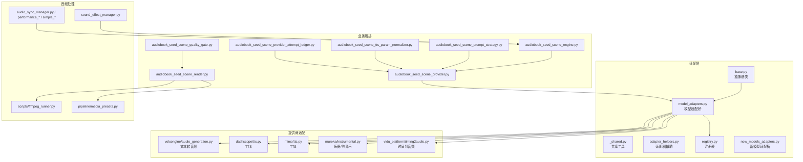
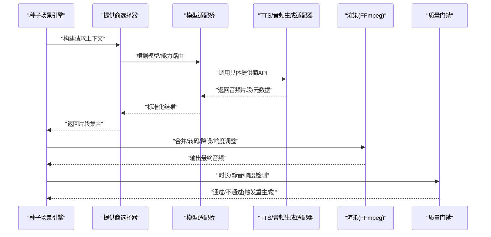
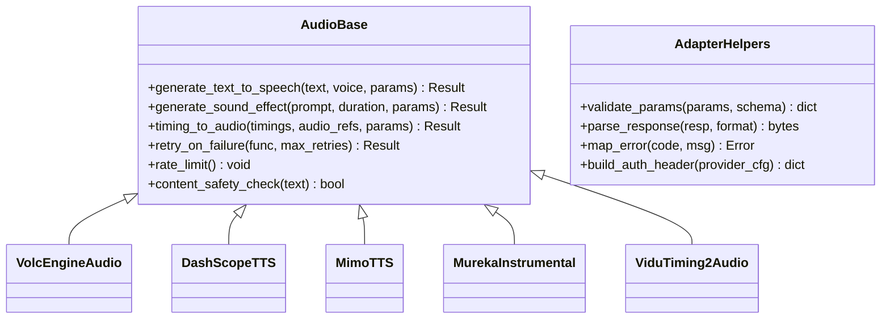
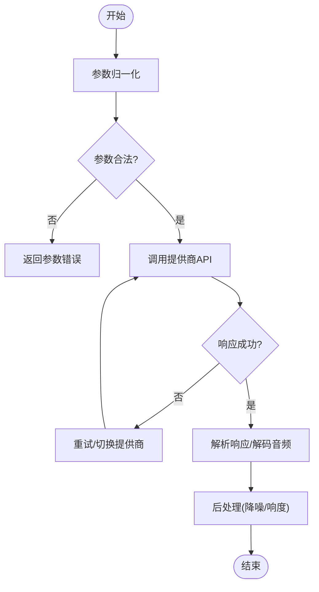
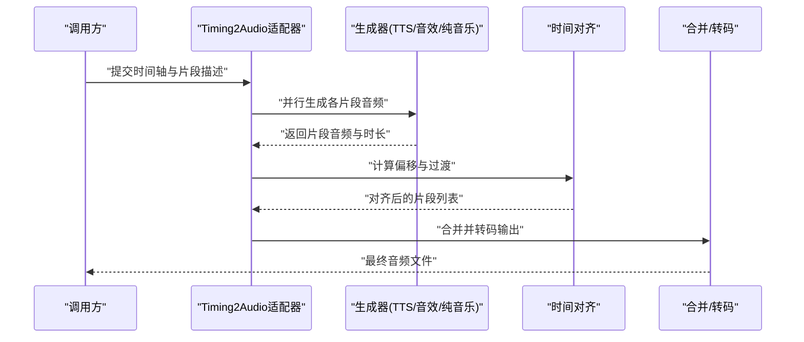
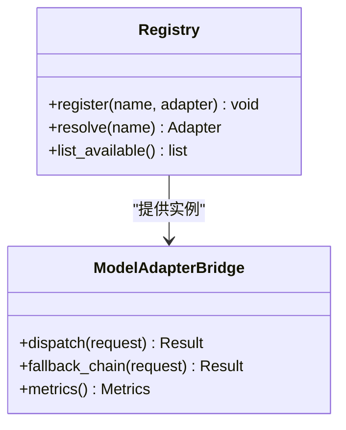
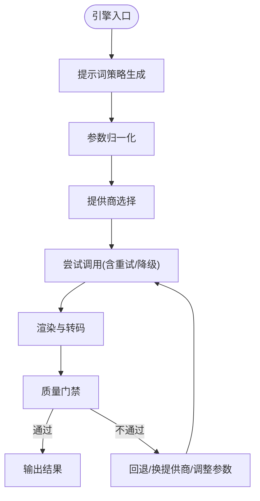
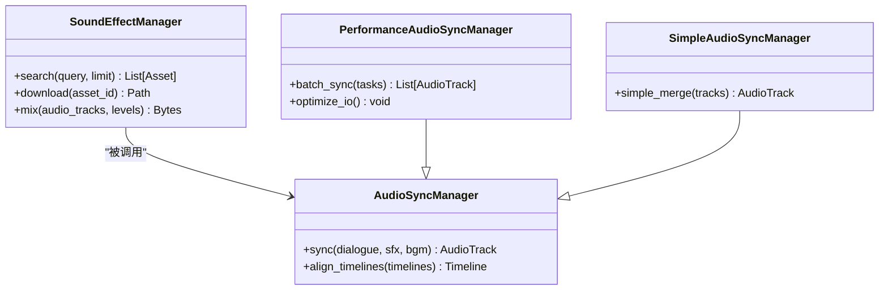
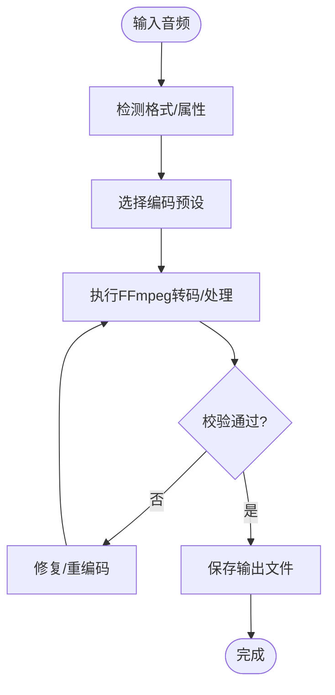
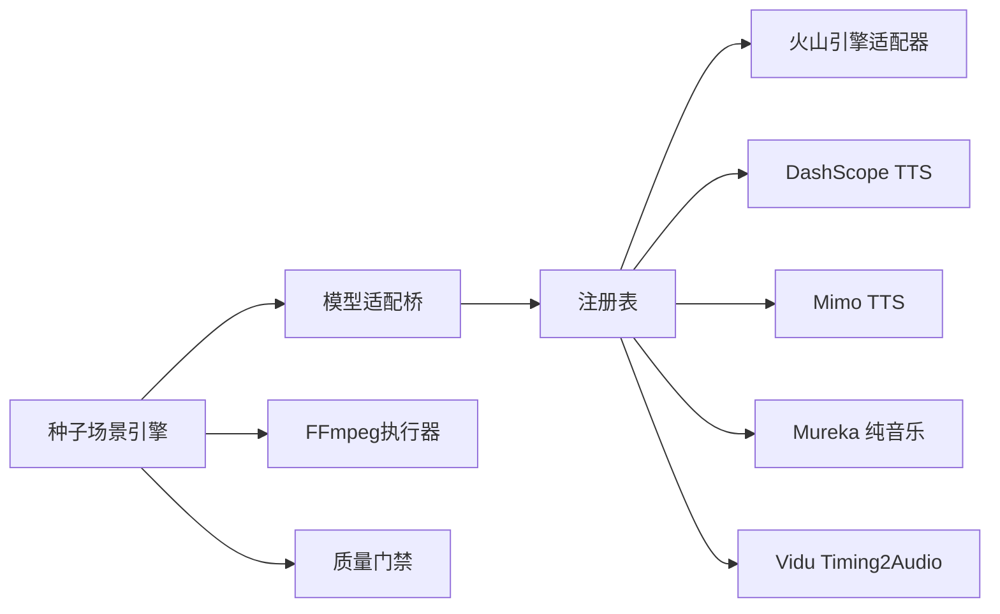

# 音频生成适配器

<cite>
**本文引用的文件**   
- [adapters/base.py](file://adapters/base.py)
- [adapters/_shared.py](file://adapters/_shared.py)
- [adapters/adapter_helpers.py](file://adapters/adapter_helpers.py)
- [adapters/volcengine/audio_generation.py](file://adapters/volcengine/audio_generation.py)
- [adapters/dashscope/tts.py](file://adapters/dashscope/tts.py)
- [adapters/mimo/tts.py](file://adapters/mimo/tts.py)
- [adapters/mureka/instrumental.py](file://adapters/mureka/instrumental.py)
- [adapters/vidu_platform/timing2audio.py](file://adapters/vidu_platform/timing2audio.py)
- [adapters/registry.py](file://adapters/registry.py)
- [adapters/model_adapters.py](file://adapters/model_adapters.py)
- [adapters/new_models_adapters.py](file://adapters/new_models_adapters.py)
- [adapters/content_safety_checker.py](file://adapters/content_safety_checker.py)
- [adapters/rate_limiter.py](file://adapters/rate_limiter.py)
- [agents/sound_effect_manager.py](file://agents/sound_effect_manager.py)
- [agents/audio_sync_manager.py](file://agents/audio_sync_manager.py)
- [agents/performance_audio_sync_manager.py](file://agents/performance_audio_sync_manager.py)
- [agents/simple_audio_sync_manager.py](file://agents/simple_audio_sync_manager.py)
- [backend/app/services/audiobook/audiobook_seed_scene_engine.py](file://backend/app/services/audiobook/audiobook_seed_scene_engine.py)
- [backend/app/services/audiobook/audiobook_seed_scene_provider.py](file://backend/app/services/audiobook/audiobook_seed_scene_provider.py)
- [backend/app/services/audiobook/audiobook_seed_scene_render.py](file://backend/app/services/audiobook/audiobook_seed_scene_render.py)
- [backend/app/services/audiobook/audiobook_seed_scene_quality_gate.py](file://backend/app/services/audiobook/audiobook_seed_scene_quality_gate.py)
- [backend/app/services/audiobook/audiobook_seed_scene_prompt_strategy.py](file://backend/app/services/audiobook/audiobook_seed_scene_prompt_strategy.py)
- [backend/app/services/audiobook/audiobook_seed_scene_tts_param_normalizer.py](file://backend/app/services/audiobook/audiobook_seed_scene_tts_param_normalizer.py)
- [backend/app/services/audiobook/audiobook_seed_scene_provider_attempt_ledger.py](file://backend/app/services/audiobook/audiobook_seed_scene_provider_attempt_ledger.py)
- [scripts/ffmpeg_runner.py](file://scripts/ffmpeg_runner.py)
- [pipeline/media_presets.py](file://pipeline/media_presets.py)
</cite>

## 目录
1. [简介](#简介)
2. [项目结构](#项目结构)
3. [核心组件](#核心组件)
4. [架构总览](#架构总览)
5. [详细组件分析](#详细组件分析)
6. [依赖关系分析](#依赖关系分析)
7. [性能考量](#性能考量)
8. [故障排除指南](#故障排除指南)
9. [结论](#结论)
10. [附录](#附录)

## 简介
本技术文档面向“音频生成适配器”子系统，覆盖以下能力：
- 基于文本的音频生成（TTS）
- 音效合成与选择
- 时间到音频（Timing2Audio）的时间同步音频生成
- 多提供商集成（火山引擎、DashScope、Mimo、Mureka 等）的参数配置、生成策略与质量控制
- 音频格式转换、编码设置与输出优化
- 端到端工作流示例与常见问题排查

目标读者包括后端开发者、音视频工程师与产品实现人员。

## 项目结构
音频生成相关代码主要分布在以下模块：
- adapters：各提供商的音频生成适配器与通用基类、工具
- agents：音效管理、音频同步管理器（含高性能实现）
- backend/app/services/audiobook：有声书场景下的种子场景引擎、渲染、质量门禁、提示词策略、参数归一化、尝试记录等
- scripts/pipeline：FFmpeg 执行器与媒体预设

图表来源
- [adapters/base.py](file://adapters/base.py)
- [adapters/model_adapters.py](file://adapters/model_adapters.py)
- [adapters/registry.py](file://adapters/registry.py)
- [adapters/volcengine/audio_generation.py](file://adapters/volcengine/audio_generation.py)
- [adapters/dashscope/tts.py](file://adapters/dashscope/tts.py)
- [adapters/mimo/tts.py](file://adapters/mimo/tts.py)
- [adapters/mureka/instrumental.py](file://adapters/mureka/instrumental.py)
- [adapters/vidu_platform/timing2audio.py](file://adapters/vidu_platform/timing2audio.py)
- [backend/app/services/audiobook/audiobook_seed_scene_engine.py](file://backend/app/services/audiobook/audiobook_seed_scene_engine.py)
- [backend/app/services/audiobook/audiobook_seed_scene_provider.py](file://backend/app/services/audiobook/audiobook_seed_scene_provider.py)
- [backend/app/services/audiobook/audiobook_seed_scene_render.py](file://backend/app/services/audiobook/audiobook_seed_scene_render.py)
- [backend/app/services/audiobook/audiobook_seed_scene_quality_gate.py](file://backend/app/services/audiobook/audiobook_seed_scene_quality_gate.py)
- [backend/app/services/audiobook/audiobook_seed_scene_prompt_strategy.py](file://backend/app/services/audiobook/audiobook_seed_scene_prompt_strategy.py)
- [backend/app/services/audiobook/audiobook_seed_scene_tts_param_normalizer.py](file://backend/app/services/audiobook/audiobook_seed_scene_tts_param_normalizer.py)
- [backend/app/services/audiobook/audiobook_seed_scene_provider_attempt_ledger.py](file://backend/app/services/audiobook/audiobook_seed_scene_provider_attempt_ledger.py)
- [scripts/ffmpeg_runner.py](file://scripts/ffmpeg_runner.py)
- [pipeline/media_presets.py](file://pipeline/media_presets.py)

章节来源
- [adapters/base.py](file://adapters/base.py)
- [adapters/model_adapters.py](file://adapters/model_adapters.py)
- [adapters/registry.py](file://adapters/registry.py)
- [adapters/volcengine/audio_generation.py](file://adapters/volcengine/audio_generation.py)
- [adapters/dashscope/tts.py](file://adapters/dashscope/tts.py)
- [adapters/mimo/tts.py](file://adapters/mimo/tts.py)
- [adapters/mureka/instrumental.py](file://adapters/mureka/instrumental.py)
- [adapters/vidu_platform/timing2audio.py](file://adapters/vidu_platform/timing2audio.py)
- [backend/app/services/audiobook/audiobook_seed_scene_engine.py](file://backend/app/services/audiobook/audiobook_seed_scene_engine.py)
- [backend/app/services/audiobook/audiobook_seed_scene_provider.py](file://backend/app/services/audiobook/audiobook_seed_scene_provider.py)
- [backend/app/services/audiobook/audiobook_seed_scene_render.py](file://backend/app/services/audiobook/audiobook_seed_scene_render.py)
- [backend/app/services/audiobook/audiobook_seed_scene_quality_gate.py](file://backend/app/services/audiobook/audiobook_seed_scene_quality_gate.py)
- [backend/app/services/audiobook/audiobook_seed_scene_prompt_strategy.py](file://backend/app/services/audiobook/audiobook_seed_scene_prompt_strategy.py)
- [backend/app/services/audiobook/audiobook_seed_scene_tts_param_normalizer.py](file://backend/app/services/audiobook/audiobook_seed_scene_tts_param_normalizer.py)
- [backend/app/services/audiobook/audiobook_seed_scene_provider_attempt_ledger.py](file://backend/app/services/audiobook/audiobook_seed_scene_provider_attempt_ledger.py)
- [scripts/ffmpeg_runner.py](file://scripts/ffmpeg_runner.py)
- [pipeline/media_presets.py](file://pipeline/media_presets.py)

## 核心组件
- 抽象基类与统一接口
  - 定义统一的音频生成接口（文本转语音、音效、时间到音频），屏蔽提供商差异
  - 提供错误码、重试、限流、安全审核等横切能力的接入点
- 适配器注册与路由
  - 通过注册表集中管理可用适配器，按模型名或能力选择具体实现
  - 模型适配桥将高层请求映射为各提供商的具体调用
- 业务编排
  - 种子场景引擎负责整体流程编排：提示词策略、参数归一化、提供商尝试、渲染与质检
  - 渲染阶段使用 FFmpeg 进行格式转换、编码与输出优化
  - 质量门禁对时长、静音比例、响度等进行校验
- 音频处理
  - 音效管理器负责音效库检索、下载与混音
  - 音频同步管理器负责台词与音效、BGM 的时间对齐与拼接

章节来源
- [adapters/base.py](file://adapters/base.py)
- [adapters/registry.py](file://adapters/registry.py)
- [adapters/model_adapters.py](file://adapters/model_adapters.py)
- [adapters/_shared.py](file://adapters/_shared.py)
- [adapters/adapter_helpers.py](file://adapters/adapter_helpers.py)
- [agents/sound_effect_manager.py](file://agents/sound_effect_manager.py)
- [agents/audio_sync_manager.py](file://agents/audio_sync_manager.py)
- [agents/performance_audio_sync_manager.py](file://agents/performance_audio_sync_manager.py)
- [agents/simple_audio_sync_manager.py](file://agents/simple_audio_sync_manager.py)

## 架构总览
下图展示从上层业务到提供商适配器的完整调用链，以及渲染与质检环节。

图表来源
- [backend/app/services/audiobook/audiobook_seed_scene_engine.py](file://backend/app/services/audiobook/audiobook_seed_scene_engine.py)
- [backend/app/services/audiobook/audiobook_seed_scene_provider.py](file://backend/app/services/audiobook/audiobook_seed_scene_provider.py)
- [adapters/model_adapters.py](file://adapters/model_adapters.py)
- [adapters/volcengine/audio_generation.py](file://adapters/volcengine/audio_generation.py)
- [adapters/dashscope/tts.py](file://adapters/dashscope/tts.py)
- [adapters/mimo/tts.py](file://adapters/mimo/tts.py)
- [adapters/mureka/instrumental.py](file://adapters/mureka/instrumental.py)
- [scripts/ffmpeg_runner.py](file://scripts/ffmpeg_runner.py)
- [backend/app/services/audiobook/audiobook_seed_scene_quality_gate.py](file://backend/app/services/audiobook/audiobook_seed_scene_quality_gate.py)

## 详细组件分析

### 抽象基类与适配器辅助
- 抽象基类
  - 定义统一的生成接口：文本转语音、音效生成、时间到音频
  - 暴露重试、限流、安全审核、日志埋点的扩展点
- 适配器辅助
  - 提供参数校验、响应解析、错误映射、鉴权头拼装等通用逻辑
  - 封装常见网络异常与超时处理，统一错误码

图表来源
- [adapters/base.py](file://adapters/base.py)
- [adapters/_shared.py](file://adapters/_shared.py)
- [adapters/adapter_helpers.py](file://adapters/adapter_helpers.py)
- [adapters/volcengine/audio_generation.py](file://adapters/volcengine/audio_generation.py)
- [adapters/dashscope/tts.py](file://adapters/dashscope/tts.py)
- [adapters/mimo/tts.py](file://adapters/mimo/tts.py)
- [adapters/mureka/instrumental.py](file://adapters/mureka/instrumental.py)
- [adapters/vidu_platform/timing2audio.py](file://adapters/vidu_platform/timing2audio.py)

章节来源
- [adapters/base.py](file://adapters/base.py)
- [adapters/_shared.py](file://adapters/_shared.py)
- [adapters/adapter_helpers.py](file://adapters/adapter_helpers.py)

### 提供商适配器：文本转语音与音效
- 火山引擎文本转音频
  - 支持多音色、语速、音量、采样率等参数
  - 失败自动重试，错误码映射与降级策略
- DashScope TTS
  - 支持流式与非流式两种模式
  - 参数归一化与兼容性处理
- Mimo TTS
  - 针对特定音色库的优化参数
- Mureka 乐器/纯音乐
  - 基于提示词的纯音乐生成，控制风格、时长、节拍

图表来源
- [adapters/volcengine/audio_generation.py](file://adapters/volcengine/audio_generation.py)
- [adapters/dashscope/tts.py](file://adapters/dashscope/tts.py)
- [adapters/mimo/tts.py](file://adapters/mimo/tts.py)
- [adapters/mureka/instrumental.py](file://adapters/mureka/instrumental.py)

章节来源
- [adapters/volcengine/audio_generation.py](file://adapters/volcengine/audio_generation.py)
- [adapters/dashscope/tts.py](file://adapters/dashscope/tts.py)
- [adapters/mimo/tts.py](file://adapters/mimo/tts.py)
- [adapters/mureka/instrumental.py](file://adapters/mureka/instrumental.py)

### 时间到音频（Timing2Audio）
- 输入
  - 时间轴片段：起止时间、文本/音效描述、参考音频ID
  - 可选：风格、节奏、环境声、淡入淡出
- 处理流程
  - 校验时间轴合法性与重叠冲突
  - 按片段并行生成音频（TTS/音效/纯音乐）
  - 时间对齐与拼接，处理边界过渡
  - 全局响度与静音检测，必要时微调
- 输出
  - 带时间戳的音频轨道，支持多轨导出

图表来源
- [adapters/vidu_platform/timing2audio.py](file://adapters/vidu_platform/timing2audio.py)

章节来源
- [adapters/vidu_platform/timing2audio.py](file://adapters/vidu_platform/timing2audio.py)

### 模型适配桥与注册表
- 注册表
  - 维护模型名到适配器的映射，支持动态加载与热更新
- 模型适配桥
  - 将高层请求（文本、音效、时间轴）转换为具体提供商的调用
  - 统一错误处理、重试与降级

图表来源
- [adapters/registry.py](file://adapters/registry.py)
- [adapters/model_adapters.py](file://adapters/model_adapters.py)
- [adapters/new_models_adapters.py](file://adapters/new_models_adapters.py)

章节来源
- [adapters/registry.py](file://adapters/registry.py)
- [adapters/model_adapters.py](file://adapters/model_adapters.py)
- [adapters/new_models_adapters.py](file://adapters/new_models_adapters.py)

### 业务编排：种子场景引擎、提供商选择、渲染与质检
- 种子场景引擎
  - 编排提示词策略、参数归一化、提供商尝试、渲染与质检
- 提供商选择
  - 基于模型能力、配额、延迟与历史成功率选择最优提供商
- 渲染
  - 使用 FFmpeg 进行格式转换、编码、降噪、响度标准化
- 质量门禁
  - 检查时长、静音比例、响度、爆音等指标，不通过则触发重生成

图表来源
- [backend/app/services/audiobook/audiobook_seed_scene_engine.py](file://backend/app/services/audiobook/audiobook_seed_scene_engine.py)
- [backend/app/services/audiobook/audiobook_seed_scene_provider.py](file://backend/app/services/audiobook/audiobook_seed_scene_provider.py)
- [backend/app/services/audiobook/audiobook_seed_scene_render.py](file://backend/app/services/audiobook/audiobook_seed_scene_render.py)
- [backend/app/services/audiobook/audiobook_seed_scene_quality_gate.py](file://backend/app/services/audiobook/audiobook_seed_scene_quality_gate.py)
- [backend/app/services/audiobook/audiobook_seed_scene_prompt_strategy.py](file://backend/app/services/audiobook/audiobook_seed_scene_prompt_strategy.py)
- [backend/app/services/audiobook/audiobook_seed_scene_tts_param_normalizer.py](file://backend/app/services/audiobook/audiobook_seed_scene_tts_param_normalizer.py)
- [backend/app/services/audiobook/audiobook_seed_scene_provider_attempt_ledger.py](file://backend/app/services/audiobook/audiobook_seed_scene_provider_attempt_ledger.py)

章节来源
- [backend/app/services/audiobook/audiobook_seed_scene_engine.py](file://backend/app/services/audiobook/audiobook_seed_scene_engine.py)
- [backend/app/services/audiobook/audiobook_seed_scene_provider.py](file://backend/app/services/audiobook/audiobook_seed_scene_provider.py)
- [backend/app/services/audiobook/audiobook_seed_scene_render.py](file://backend/app/services/audiobook/audiobook_seed_scene_render.py)
- [backend/app/services/audiobook/audiobook_seed_scene_quality_gate.py](file://backend/app/services/audiobook/audiobook_seed_scene_quality_gate.py)
- [backend/app/services/audiobook/audiobook_seed_scene_prompt_strategy.py](file://backend/app/services/audiobook/audiobook_seed_scene_prompt_strategy.py)
- [backend/app/services/audiobook/audiobook_seed_scene_tts_param_normalizer.py](file://backend/app/services/audiobook/audiobook_seed_scene_tts_param_normalizer.py)
- [backend/app/services/audiobook/audiobook_seed_scene_provider_attempt_ledger.py](file://backend/app/services/audiobook/audiobook_seed_scene_provider_attempt_ledger.py)

### 音效管理与音频同步
- 音效管理器
  - 基于语义检索与规则筛选候选音效，支持批量下载与缓存
  - 混音时考虑响度匹配与频段避让
- 音频同步管理器
  - 简单版：顺序拼接与基础对齐
  - 高性能版：并发生成与批处理，减少IO与CPU抖动
  - 与引擎协作，确保台词、音效、BGM 的时间一致性

图表来源
- [agents/sound_effect_manager.py](file://agents/sound_effect_manager.py)
- [agents/audio_sync_manager.py](file://agents/audio_sync_manager.py)
- [agents/performance_audio_sync_manager.py](file://agents/performance_audio_sync_manager.py)
- [agents/simple_audio_sync_manager.py](file://agents/simple_audio_sync_manager.py)

章节来源
- [agents/sound_effect_manager.py](file://agents/sound_effect_manager.py)
- [agents/audio_sync_manager.py](file://agents/audio_sync_manager.py)
- [agents/performance_audio_sync_manager.py](file://agents/performance_audio_sync_manager.py)
- [agents/simple_audio_sync_manager.py](file://agents/simple_audio_sync_manager.py)

### 音频格式转换、编码设置与输出优化
- FFmpeg 执行器
  - 封装常用命令：转码、裁剪、降噪、响度标准化、比特率控制
  - 支持进度回调与错误捕获
- 媒体预设
  - 提供不同场景的编码预设（如广播级、移动端、低带宽）
  - 默认参数包含采样率、声道数、码率、编码器选择

图表来源
- [scripts/ffmpeg_runner.py](file://scripts/ffmpeg_runner.py)
- [pipeline/media_presets.py](file://pipeline/media_presets.py)

章节来源
- [scripts/ffmpeg_runner.py](file://scripts/ffmpeg_runner.py)
- [pipeline/media_presets.py](file://pipeline/media_presets.py)

## 依赖关系分析
- 耦合与内聚
  - 适配器层高度内聚，通过统一接口降低与业务层的耦合
  - 业务编排层依赖适配器注册与模型适配桥，保持对提供商实现的解耦
- 外部依赖
  - 各提供商API（火山引擎、DashScope、Mimo、Mureka、Vidu）
  - FFmpeg 用于音频处理与转码
- 潜在循环依赖
  - 通过注册表与适配桥避免直接导入，降低循环风险

图表来源
- [adapters/model_adapters.py](file://adapters/model_adapters.py)
- [adapters/registry.py](file://adapters/registry.py)
- [adapters/volcengine/audio_generation.py](file://adapters/volcengine/audio_generation.py)
- [adapters/dashscope/tts.py](file://adapters/dashscope/tts.py)
- [adapters/mimo/tts.py](file://adapters/mimo/tts.py)
- [adapters/mureka/instrumental.py](file://adapters/mureka/instrumental.py)
- [adapters/vidu_platform/timing2audio.py](file://adapters/vidu_platform/timing2audio.py)
- [scripts/ffmpeg_runner.py](file://scripts/ffmpeg_runner.py)
- [backend/app/services/audiobook/audiobook_seed_scene_quality_gate.py](file://backend/app/services/audiobook/audiobook_seed_scene_quality_gate.py)

章节来源
- [adapters/model_adapters.py](file://adapters/model_adapters.py)
- [adapters/registry.py](file://adapters/registry.py)
- [adapters/volcengine/audio_generation.py](file://adapters/volcengine/audio_generation.py)
- [adapters/dashscope/tts.py](file://adapters/dashscope/tts.py)
- [adapters/mimo/tts.py](file://adapters/mimo/tts.py)
- [adapters/mureka/instrumental.py](file://adapters/mureka/instrumental.py)
- [adapters/vidu_platform/timing2audio.py](file://adapters/vidu_platform/timing2audio.py)
- [scripts/ffmpeg_runner.py](file://scripts/ffmpeg_runner.py)
- [backend/app/services/audiobook/audiobook_seed_scene_quality_gate.py](file://backend/app/services/audiobook/audiobook_seed_scene_quality_gate.py)

## 性能考量
- 并发与批处理
  - 在 Timing2Audio 中并行生成片段，结合批处理减少网络往返
  - 高性能音频同步管理器采用任务队列与内存池，降低GC压力
- 缓存与预热
  - 音效库索引与下载缓存，避免重复IO
  - TTS 预览与常用音色预加载，缩短首帧延迟
- 编码与转码
  - 选择合适的编码器与码率，平衡音质与体积
  - 使用硬件加速（若可用）提升转码速度
- 限流与重试
  - 自适应限流避免触发提供商速率限制
  - 指数退避重试提高成功率

[本节为通用指导，不直接分析具体文件]

## 故障排除指南
- 常见错误与定位
  - 参数非法：检查参数归一化与校验逻辑
  - 提供商限流：查看限流器与重试策略，适当降低并发
  - 内容安全审核失败：检查审核器配置与白名单
  - 渲染失败：确认 FFmpeg 路径与参数，检查输入音频属性
  - 质量门禁不通过：调整静音阈值、响度目标、降噪强度
- 调试建议
  - 启用详细日志与尝试记录，观察提供商调用链路
  - 使用最小可复现用例隔离问题
  - 对比不同提供商的输出，定位模型差异

章节来源
- [adapters/content_safety_checker.py](file://adapters/content_safety_checker.py)
- [adapters/rate_limiter.py](file://adapters/rate_limiter.py)
- [backend/app/services/audiobook/audiobook_seed_scene_provider_attempt_ledger.py](file://backend/app/services/audiobook/audiobook_seed_scene_provider_attempt_ledger.py)
- [scripts/ffmpeg_runner.py](file://scripts/ffmpeg_runner.py)
- [backend/app/services/audiobook/audiobook_seed_scene_quality_gate.py](file://backend/app/services/audiobook/audiobook_seed_scene_quality_gate.py)

## 结论
音频生成适配器通过统一的抽象接口与注册路由机制，有效整合了多家提供商的能力，并在业务编排层实现了提示词策略、参数归一化、渲染与质检的闭环。配合音效管理与音频同步模块，能够稳定输出高质量的时间同步音频。未来可进一步引入更智能的提供商选择策略与在线学习的质量反馈回路，以提升整体效率与体验。

[本节为总结性内容，不直接分析具体文件]

## 附录
- 端到端工作流示例
  - 输入：章节脚本与时间轴
  - 步骤：提示词生成 → 参数归一化 → 提供商选择与调用 → 渲染与转码 → 质量门禁
  - 输出：带时间戳的音频轨道与字幕文件
- 最佳实践
  - 合理设置并发与重试次数，避免过载
  - 使用合适的编码预设，兼顾音质与体积
  - 定期更新音效库与音色资源，保持多样性
  - 监控关键指标（成功率、延迟、音质评分），持续优化

[本节为补充信息，不直接分析具体文件]