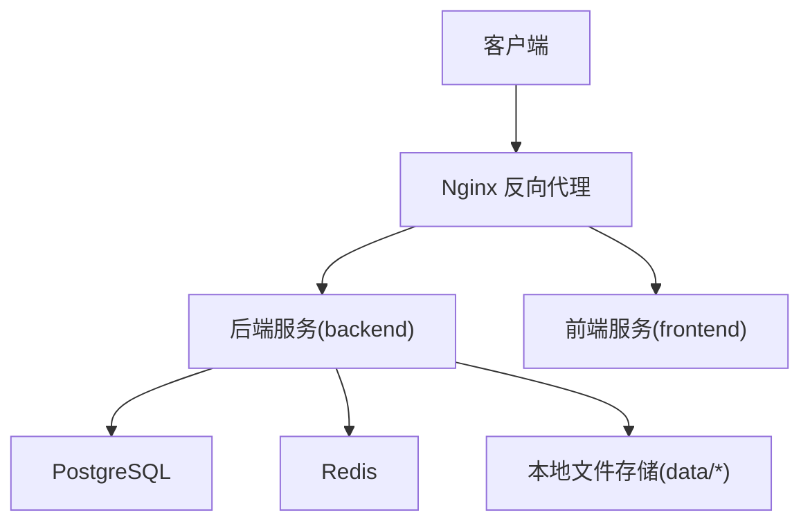
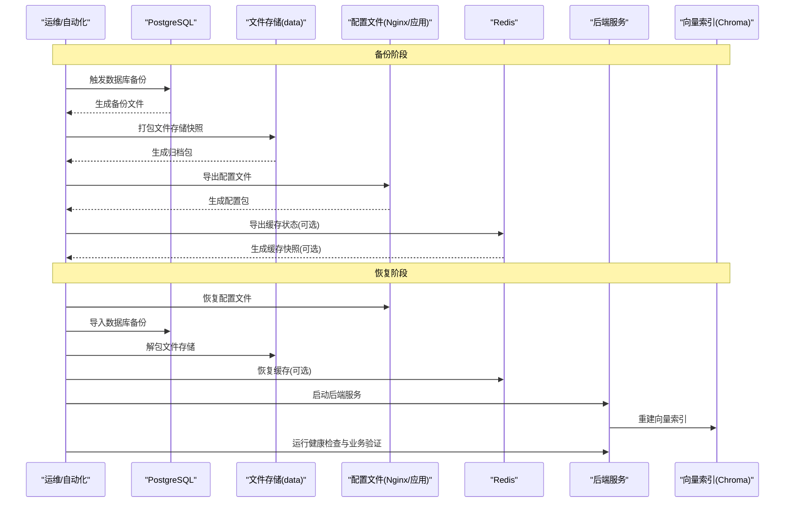
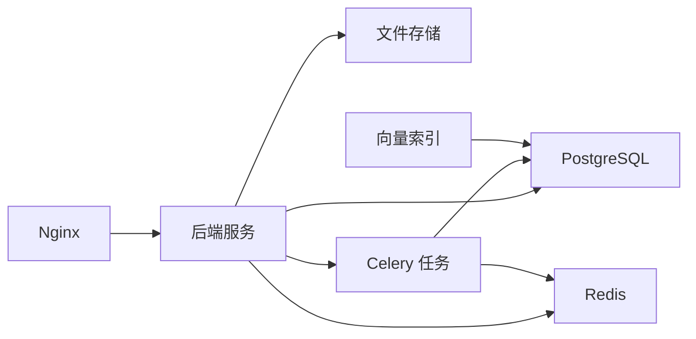

# 备份恢复

<cite>
**本文引用的文件**   
- [docker-compose.yml](file://docker-compose.yml)
- [nginx.conf](file://nginx.conf)
- [backend/Dockerfile](file://backend/Dockerfile)
- [frontend/Dockerfile](file://frontend/Dockerfile)
- [backend/alembic.ini](file://backend/alembic.ini)
- [backend/app/celery_app.py](file://backend/app/celery_app.py)
- [backend/app/main.py](file://backend/app/main.py)
- [backend/app/core/config.py](file://backend/app/core/config.py)
- [backend/app/services/cache_system.py](file://backend/app/services/cache_system.py)
- [postgres-init/01-init.sql](file://postgres-init/01-init.sql)
- [redis.conf](file://redis.conf)
- [scripts/rebuild_chroma_from_postgres.py](file://scripts/rebuild_chroma_from_postgres.py)
- [scripts/rebuild_chroma_from_db.py](file://scripts/rebuild_chroma_from_db.py)
</cite>

## 目录
1. [简介](#简介)
2. [项目结构](#项目结构)
3. [核心组件](#核心组件)
4. [架构总览](#架构总览)
5. [详细组件分析](#详细组件分析)
6. [依赖关系分析](#依赖关系分析)
7. [性能考虑](#性能考虑)
8. [故障排查指南](#故障排查指南)
9. [结论](#结论)
10. [附录](#附录)

## 简介
本文件面向小说创作代理系统的运维与研发人员，提供完整的备份与恢复策略与操作指南。内容覆盖数据库、文件存储、配置文件、缓存数据的备份策略；自动化备份任务配置（定时调度、策略设置、存储空间管理、完整性校验）；灾难恢复流程（数据恢复步骤、服务重启顺序、一致性检查、业务验证）；异地容灾（多地域同步、自动切换、冲突解决）；以及备份测试与演练（定期恢复测试、应急预案、团队培训）。

## 项目结构
系统采用容器化部署，包含后端服务、前端服务、PostgreSQL 数据库、Redis 缓存、Nginx 反向代理等关键组件。数据持久化主要涉及：
- 数据库：PostgreSQL（由 docker-compose 编排，初始化脚本位于 postgres-init）
- 文件存储：后端 data 目录下的各类产物（如音频库、TTS 调试输出、用户资产等）
- 缓存：Redis（通过 redis.conf 配置）
- 配置：Nginx 配置、应用配置、Alembic 迁移配置等

**图示来源** 
- [docker-compose.yml](file://docker-compose.yml)
- [nginx.conf](file://nginx.conf)
- [backend/Dockerfile](file://backend/Dockerfile)
- [frontend/Dockerfile](file://frontend/Dockerfile)

**章节来源**
- [docker-compose.yml](file://docker-compose.yml)
- [nginx.conf](file://nginx.conf)
- [backend/Dockerfile](file://backend/Dockerfile)
- [frontend/Dockerfile](file://frontend/Dockerfile)

## 核心组件
- 数据库层：PostgreSQL，使用 Alembic 进行版本化管理，初始化脚本在 postgres-init/01-init.sql
- 缓存层：Redis，用于会话、任务队列、热点数据缓存
- 文件存储层：后端 data 目录及子目录，承载音频、字幕、调试日志、索引等
- 应用层：FastAPI 后端（main.py）、Celery 异步任务（celery_app.py）、配置加载（core/config.py）
- 向量检索：Chroma（通过重建脚本从数据库重建索引）

**章节来源**
- [backend/app/main.py](file://backend/app/main.py)
- [backend/app/celery_app.py](file://backend/app/celery_app.py)
- [backend/app/core/config.py](file://backend/app/core/config.py)
- [backend/alembic.ini](file://backend/alembic.ini)
- [postgres-init/01-init.sql](file://postgres-init/01-init.sql)
- [scripts/rebuild_chroma_from_postgres.py](file://scripts/rebuild_chroma_from_postgres.py)
- [scripts/rebuild_chroma_from_db.py](file://scripts/rebuild_chroma_from_db.py)

## 架构总览
下图展示备份与恢复涉及的组件交互与数据流向。备份阶段将数据库快照、文件存储快照、配置文件与缓存状态导出至备份介质；恢复阶段按顺序恢复各组件并执行一致性校验与业务验证。

**图示来源** 
- [docker-compose.yml](file://docker-compose.yml)
- [backend/app/main.py](file://backend/app/main.py)
- [backend/app/celery_app.py](file://backend/app/celery_app.py)
- [scripts/rebuild_chroma_from_postgres.py](file://scripts/rebuild_chroma_from_postgres.py)

## 详细组件分析

### 数据库备份与恢复（PostgreSQL）
- 备份策略
  - 全量备份：每日一次，保留最近 N 天
  - 增量/差异备份：每小时一次，结合 WAL 归档实现时间点恢复（PITR）
  - 逻辑备份：使用 pg_dump 导出 SQL 或自定义格式，便于跨版本迁移
- 恢复步骤
  - 停止写入服务，确保一致性
  - 恢复最新的全量备份，再回放增量/WAL 到目标时间点
  - 校验表结构与数据完整性（行数、约束、外键）
  - 启动应用并执行健康检查
- 注意事项
  - 备份前暂停 Celery 任务，避免写入不一致
  - 记录备份元数据（时间戳、版本号、校验和）

**章节来源**
- [backend/alembic.ini](file://backend/alembic.ini)
- [postgres-init/01-init.sql](file://postgres-init/01-init.sql)

### 文件存储备份与恢复（data/*）
- 备份策略
  - 全量+增量：基于文件系统变更检测（如 inotify 或云对象存储事件）
  - 压缩与分卷：大文件分卷上传，支持断点续传
  - 去重与校验：对重复块去重，计算 SHA-256 校验
- 恢复步骤
  - 先恢复配置文件与数据库，再恢复文件存储
  - 校验文件完整性（哈希比对）
  - 重建相关索引（如 Chroma 向量索引）
- 注意事项
  - 注意权限与路径映射（容器卷挂载）
  - 清理临时文件与调试日志，避免污染备份

**章节来源**
- [backend/Dockerfile](file://backend/Dockerfile)
- [frontend/Dockerfile](file://frontend/Dockerfile)

### 配置文件备份与恢复（Nginx/应用）
- 备份范围
  - Nginx 配置（nginx.conf、站点配置、SSL 证书）
  - 应用配置（环境变量、密钥、模型配置、路由规则）
  - Alembic 迁移脚本与 alembic.ini
- 恢复步骤
  - 优先恢复 Nginx 与应用配置
  - 校验配置语法（nginx -t）
  - 重载 Nginx 与重启应用服务

**章节来源**
- [nginx.conf](file://nginx.conf)
- [backend/app/core/config.py](file://backend/app/core/config.py)
- [backend/alembic.ini](file://backend/alembic.ini)

### 缓存数据备份与恢复（Redis）
- 备份策略
  - 定期 RDB/AOF 快照，结合 WAL 保证一致性
  - 敏感数据加密存储，限制访问权限
- 恢复步骤
  - 停止应用写入
  - 替换 Redis 数据文件并重启
  - 验证热点数据与任务队列状态
- 注意事项
  - 缓存为可重建数据，优先保障数据库与文件存储
  - 恢复后需预热关键缓存（如 TTS 预览、模型目录）

**章节来源**
- [redis.conf](file://redis.conf)
- [backend/app/services/cache_system.py](file://backend/app/services/cache_system.py)

### 向量索引重建（Chroma）
- 背景：向量索引为衍生数据，可从数据库重建
- 流程：从 PostgreSQL 抽取实体与特征，调用重建脚本生成索引
- 建议：在恢复完成后执行，确保数据一致后再构建索引

**章节来源**
- [scripts/rebuild_chroma_from_postgres.py](file://scripts/rebuild_chroma_from_postgres.py)
- [scripts/rebuild_chroma_from_db.py](file://scripts/rebuild_chroma_from_db.py)

## 依赖关系分析
- 后端服务依赖数据库、缓存与文件存储
- Celery 任务依赖 Redis 队列与数据库
- Nginx 作为入口，转发前后端请求
- 向量索引依赖数据库源数据

**图示来源** 
- [docker-compose.yml](file://docker-compose.yml)
- [backend/app/main.py](file://backend/app/main.py)
- [backend/app/celery_app.py](file://backend/app/celery_app.py)

**章节来源**
- [docker-compose.yml](file://docker-compose.yml)
- [backend/app/main.py](file://backend/app/main.py)
- [backend/app/celery_app.py](file://backend/app/celery_app.py)

## 性能考虑
- 备份窗口：选择低峰期执行全量备份，增量备份频率根据写入量调整
- I/O 优化：使用 SSD/NVMe，分离备份存储与运行存储
- 并发控制：限制备份进程数，避免影响在线服务
- 网络带宽：异地同步时启用压缩与限速，避免拥塞
- 缓存预热：恢复后批量预热热点数据，降低冷启动延迟

[本节为通用指导，不直接分析具体文件]

## 故障排查指南
- 数据库恢复失败
  - 检查备份文件完整性（校验和）
  - 查看 PostgreSQL 错误日志与事务状态
  - 确认 Alembic 迁移版本与目标环境一致
- 文件存储不一致
  - 对比哈希值与目录结构
  - 检查容器卷挂载与权限
- 缓存异常
  - 确认 Redis 数据文件可用
  - 重启后验证任务队列与会话状态
- 向量索引重建失败
  - 检查源数据完整性
  - 查看重建脚本日志与内存占用

**章节来源**
- [backend/alembic.ini](file://backend/alembic.ini)
- [postgres-init/01-init.sql](file://postgres-init/01-init.sql)
- [redis.conf](file://redis.conf)
- [scripts/rebuild_chroma_from_postgres.py](file://scripts/rebuild_chroma_from_postgres.py)

## 结论
本备份恢复方案围绕数据库、文件存储、配置文件与缓存四大要素设计，结合自动化调度与完整性校验，确保系统在灾难场景下可快速恢复并保持业务连续性。通过定期演练与异地容灾配置，进一步提升系统的韧性与可用性。

[本节为总结性内容，不直接分析具体文件]

## 附录

### 自动化备份任务配置
- 定时调度
  - 使用系统级 cron 或容器编排工具（如 Kubernetes CronJob）
  - 全量备份每日凌晨执行，增量备份每小时执行
- 备份策略设置
  - 保留策略：全量保留 7 天，增量保留 30 天
  - 压缩与加密：启用 gzip/zstd 压缩与 AES-256 加密
- 存储空间管理
  - 监控磁盘使用率，超过阈值触发告警
  - 自动清理过期备份，保留最小必要副本
- 备份完整性验证
  - 每次备份后执行校验和比对
  - 定期抽样恢复演练，验证可恢复性

[本节为通用指导，不直接分析具体文件]

### 灾难恢复流程
- 数据恢复操作步骤
  - 停止所有写入服务（Nginx、后端、Celery）
  - 恢复配置文件与数据库
  - 恢复文件存储与缓存（可选）
  - 启动后端服务与 Celery 任务
  - 重建向量索引
- 服务重启顺序
  - Nginx → 后端服务 → Celery → 向量索引重建
- 数据一致性检查
  - 数据库约束与外键校验
  - 文件哈希与目录结构比对
  - 缓存命中率与任务队列状态
- 业务验证方法
  - 登录与权限验证
  - 关键 API 调用（项目创建、章节生成、音频合成）
  - 端到端工作流测试（从脚本到成品）

[本节为通用指导，不直接分析具体文件]

### 异地容灾配置
- 多地域数据同步
  - 使用对象存储跨区域复制（如 S3/COS/OSS）
  - 数据库使用主从复制或托管服务的跨区复制
- 故障自动切换
  - DNS 智能解析与健康检查
  - 负载均衡器自动摘除故障节点
- 数据冲突解决
  - 写扩散与读扩散策略
  - 合并冲突的幂等处理与审计日志

[本节为通用指导，不直接分析具体文件]

### 备份测试与演练指南
- 定期恢复测试
  - 每月进行一次完整恢复演练
  - 记录恢复时长与成功率
- 应急预案制定
  - 明确角色分工与沟通渠道
  - 准备回滚与降级方案
- 团队培训要求
  - 运维与研发共同掌握备份恢复流程
  - 定期更新文档与脚本，保持同步

[本节为通用指导，不直接分析具体文件]