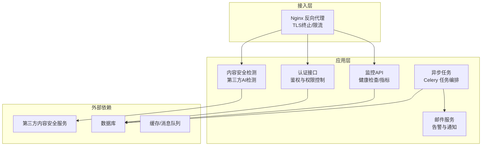
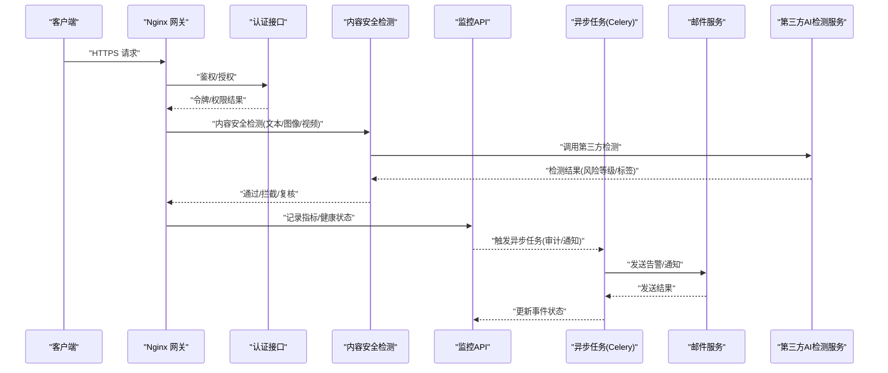
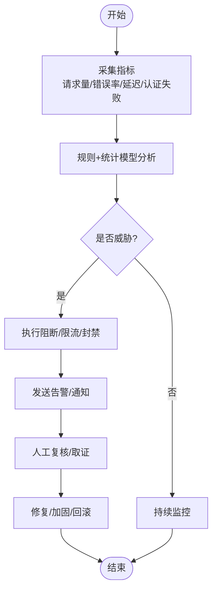
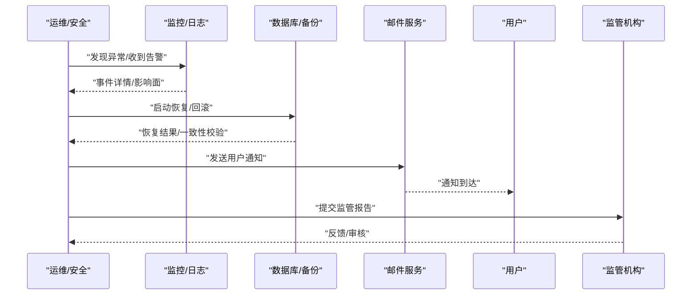
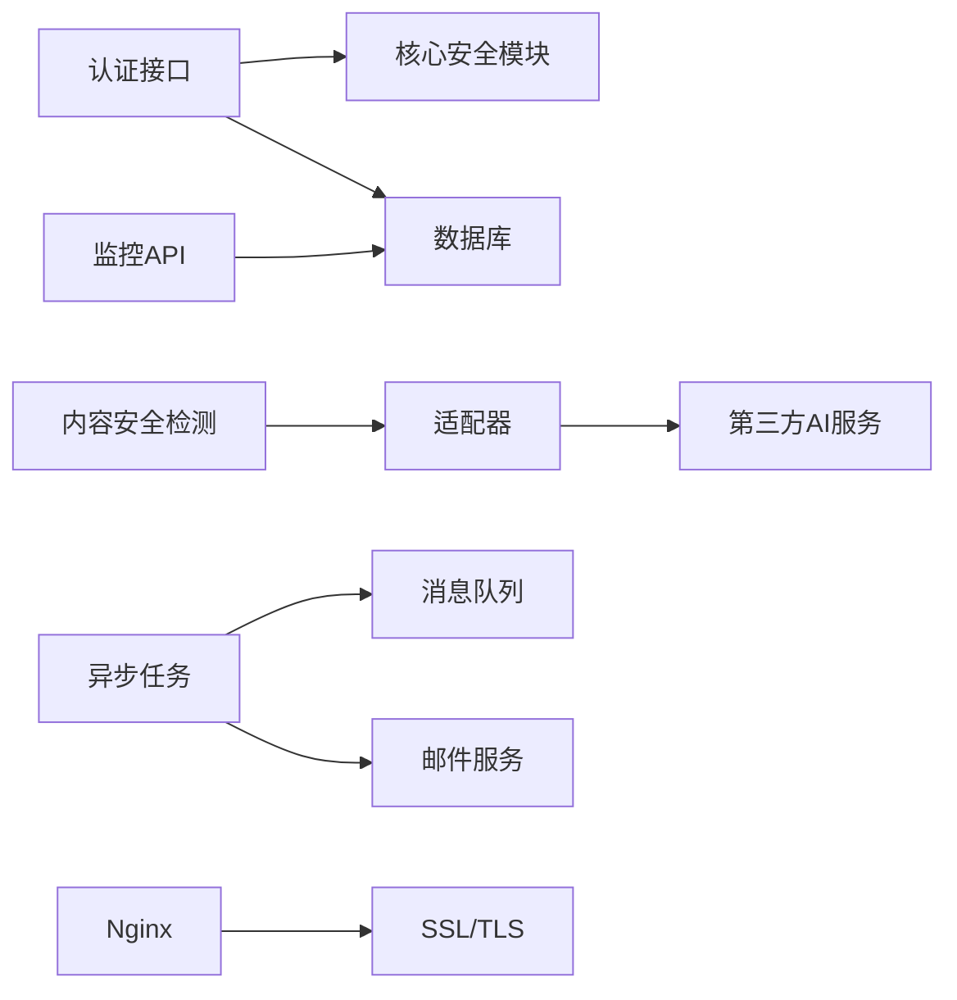

# 安全事件应急响应

<cite>
**本文引用的文件**   
- [backend/app/core/security.py](file://backend/app/core/security.py)
- [backend/app/api/v1/auth.py](file://backend/app/api/v1/auth.py)
- [backend/app/services/tencent_ai_detect.py](file://backend/app/services/tencent_ai_detect.py)
- [adapters/content_safety_checker.py](file://adapters/content_safety_checker.py)
- [backend/app/api/v1/ai_detect.py](file://backend/app/api/v1/ai_detect.py)
- [backend/app/api/v1/monitoring.py](file://backend/app/api/v1/monitoring.py)
- [backend/app/celery_app.py](file://backend/app/celery_app.py)
- [backend/app/tasks/dreamweaver_tasks.py](file://backend/app/tasks/dreamweaver_tasks.py)
- [backend/app/services/email_service.py](file://backend/app/services/email_service.py)
- [nginx.conf](file://nginx.conf)
- [nginx-prod.conf](file://nginx-prod.conf)
- [ssl/README.md](file://ssl/README.md)
- [CONTENT_SAFETY_CHECKER.md](file://CONTENT_SAFETY_CHECKER.md)
</cite>

## 目录
1. [简介](#简介)
2. [项目结构](#项目结构)
3. [核心组件](#核心组件)
4. [架构总览](#架构总览)
5. [详细组件分析](#详细组件分析)
6. [依赖关系分析](#依赖关系分析)
7. [性能考虑](#性能考虑)
8. [故障排查指南](#故障排查指南)
9. [结论](#结论)
10. [附录](#附录)

## 简介
本文件为小说创作代理系统的安全事件应急响应文档，面向运营、研发与合规团队。内容涵盖：
- 安全告警处理流程（级别定义、通知机制、响应时限、升级策略）
- 入侵检测与威胁识别（异常行为分析、恶意流量检测、攻击模式识别）
- 数据泄露应对（影响范围评估、数据恢复、用户通知、监管报告）
- 事后分析与改进（根因分析、加固方案、流程优化）
- 应急预案模板与演练计划

本预案基于系统现有安全能力（鉴权、内容安全检测、监控与任务队列等）进行编排，确保在真实事件中快速定位、处置与复盘。

## 项目结构
与安全相关的关键位置包括：
- 应用安全与鉴权：后端核心安全模块、认证接口
- 内容安全检测：第三方AI检测服务与适配器
- 监控与可观测性：监控API、异步任务与日志
- 网关与传输安全：Nginx配置与SSL说明
- 邮件通知：用于告警与用户通知的邮件服务

图表来源
- [nginx.conf](file://nginx.conf)
- [nginx-prod.conf](file://nginx-prod.conf)
- [backend/app/core/security.py](file://backend/app/core/security.py)
- [backend/app/api/v1/auth.py](file://backend/app/api/v1/auth.py)
- [backend/app/services/tencent_ai_detect.py](file://backend/app/services/tencent_ai_detect.py)
- [backend/app/api/v1/monitoring.py](file://backend/app/api/v1/monitoring.py)
- [backend/app/celery_app.py](file://backend/app/celery_app.py)
- [backend/app/services/email_service.py](file://backend/app/services/email_service.py)

章节来源
- [backend/app/core/security.py](file://backend/app/core/security.py)
- [backend/app/api/v1/auth.py](file://backend/app/api/v1/auth.py)
- [backend/app/services/tencent_ai_detect.py](file://backend/app/services/tencent_ai_detect.py)
- [backend/app/api/v1/monitoring.py](file://backend/app/api/v1/monitoring.py)
- [backend/app/celery_app.py](file://backend/app/celery_app.py)
- [backend/app/services/email_service.py](file://backend/app/services/email_service.py)
- [nginx.conf](file://nginx.conf)
- [nginx-prod.conf](file://nginx-prod.conf)
- [ssl/README.md](file://ssl/README.md)

## 核心组件
- 安全与鉴权
  - 核心安全模块负责鉴权策略、权限校验与敏感操作保护。
  - 认证接口提供登录、令牌签发与访问控制入口。
- 内容安全检测
  - 通过第三方AI检测服务对文本/图像/视频内容进行风险判定。
  - 适配器封装调用、重试与错误处理。
- 监控与可观测性
  - 监控API暴露健康检查与关键指标，便于自动化巡检与告警。
  - 异步任务用于耗时检测、批量扫描与通知发送。
- 通知与协作
  - 邮件服务用于内部告警与对外用户通知。
- 网关与传输安全
  - Nginx作为反向代理，集中管理TLS、限流与访问控制。

章节来源
- [backend/app/core/security.py](file://backend/app/core/security.py)
- [backend/app/api/v1/auth.py](file://backend/app/api/v1/auth.py)
- [adapters/content_safety_checker.py](file://adapters/content_safety_checker.py)
- [backend/app/services/tencent_ai_detect.py](file://backend/app/services/tencent_ai_detect.py)
- [backend/app/api/v1/monitoring.py](file://backend/app/api/v1/monitoring.py)
- [backend/app/celery_app.py](file://backend/app/celery_app.py)
- [backend/app/services/email_service.py](file://backend/app/services/email_service.py)
- [nginx.conf](file://nginx.conf)
- [nginx-prod.conf](file://nginx-prod.conf)
- [ssl/README.md](file://ssl/README.md)

## 架构总览
下图展示从请求接入到安全检测、监控与通知的整体流程，以及事件升级路径。

图表来源
- [nginx.conf](file://nginx.conf)
- [backend/app/api/v1/auth.py](file://backend/app/api/v1/auth.py)
- [backend/app/services/tencent_ai_detect.py](file://backend/app/services/tencent_ai_detect.py)
- [adapters/content_safety_checker.py](file://adapters/content_safety_checker.py)
- [backend/app/api/v1/monitoring.py](file://backend/app/api/v1/monitoring.py)
- [backend/app/celery_app.py](file://backend/app/celery_app.py)
- [backend/app/services/email_service.py](file://backend/app/services/email_service.py)

## 详细组件分析

### 安全告警处理流程
- 告警级别定义
  - P1 致命：核心服务不可用、大规模数据泄露、严重越权访问。
  - P2 高危：批量内容违规、频繁认证失败、关键接口被滥用。
  - P3 中危：个别内容风险、偶发异常、资源使用异常。
  - P4 低危：轻微异常、提示性告警。
- 通知机制
  - 内部告警：通过邮件服务向安全与运维团队发送告警。
  - 用户通知：涉及用户数据或账号安全时，通过邮件或站内信通知受影响用户。
  - 监管上报：P1/P2事件按法规要求在规定时限内上报。
- 响应时间要求
  - P1：15分钟内响应，2小时内初步遏制，24小时内恢复或降级。
  - P2：30分钟内响应，4小时内遏制，48小时内恢复。
  - P3：2小时内响应，24小时内处理。
  - P4：工作日4小时内处理。
- 升级策略
  - 未按时闭环自动升级至上一级；重复发生的事件自动升级并纳入专项治理。
  - 跨部门协同：涉及多系统时由安全负责人统一协调。

章节来源
- [backend/app/services/email_service.py](file://backend/app/services/email_service.py)
- [backend/app/celery_app.py](file://backend/app/celery_app.py)
- [backend/app/api/v1/monitoring.py](file://backend/app/api/v1/monitoring.py)

### 入侵检测与威胁识别
- 异常行为分析
  - 基于监控API采集的请求频率、错误率、延迟分布等指标，识别异常峰值与异常模式。
  - 结合认证接口的失败次数与IP集中度，识别暴力破解与撞库。
- 恶意流量检测
  - Nginx层限流与黑名单，阻断高频恶意请求。
  - 对可疑User-Agent、异常路径与参数进行过滤与审计。
- 攻击模式识别
  - 内容安全检测对文本/图像/视频进行风险标签识别，拦截违规内容。
  - 对批量生成与异常调用模式进行阈值告警与人工复核。

图表来源
- [backend/app/api/v1/monitoring.py](file://backend/app/api/v1/monitoring.py)
- [backend/app/api/v1/auth.py](file://backend/app/api/v1/auth.py)
- [nginx.conf](file://nginx.conf)
- [backend/app/services/tencent_ai_detect.py](file://backend/app/services/tencent_ai_detect.py)
- [adapters/content_safety_checker.py](file://adapters/content_safety_checker.py)

章节来源
- [backend/app/api/v1/monitoring.py](file://backend/app/api/v1/monitoring.py)
- [backend/app/api/v1/auth.py](file://backend/app/api/v1/auth.py)
- [backend/app/services/tencent_ai_detect.py](file://backend/app/services/tencent_ai_detect.py)
- [adapters/content_safety_checker.py](file://adapters/content_safety_checker.py)
- [nginx.conf](file://nginx.conf)

### 数据泄露应对措施
- 影响范围评估
  - 通过监控与日志回溯受影响的接口、用户与数据范围。
  - 评估泄露数据类型、数量与传播路径。
- 数据恢复流程
  - 启用备份与快照，优先恢复关键业务数据。
  - 校验数据一致性，必要时进行回滚。
- 用户通知机制
  - 通过邮件服务向受影响用户发送通知，说明事件、影响与建议措施。
- 监管报告要求
  - 按法规要求在限定时间内完成上报，提交事件摘要、影响范围、处置进展与整改措施。

图表来源
- [backend/app/api/v1/monitoring.py](file://backend/app/api/v1/monitoring.py)
- [backend/app/services/email_service.py](file://backend/app/services/email_service.py)

章节来源
- [backend/app/api/v1/monitoring.py](file://backend/app/api/v1/monitoring.py)
- [backend/app/services/email_service.py](file://backend/app/services/email_service.py)

### 事后分析与改进措施
- 根因分析
  - 收集日志、指标与审计记录，还原攻击链与漏洞点。
  - 区分技术原因与管理流程缺陷。
- 安全加固方案
  - 强化鉴权与权限控制，最小化权限分配。
  - 完善内容安全检测策略与阈值，增加黑白名单与风控规则。
  - 提升网关防护能力（限流、WAF、证书与加密）。
- 流程优化建议
  - 建立常态化演练与红蓝对抗，验证预案有效性。
  - 完善告警分级与升级机制，缩短MTTR。
  - 引入自动化处置（自动封禁、隔离、降级）。

章节来源
- [backend/app/core/security.py](file://backend/app/core/security.py)
- [backend/app/api/v1/auth.py](file://backend/app/api/v1/auth.py)
- [adapters/content_safety_checker.py](file://adapters/content_safety_checker.py)
- [nginx.conf](file://nginx.conf)
- [ssl/README.md](file://ssl/README.md)

### 应急预案模板与演练计划
- 预案模板要点
  - 事件分类与级别、指挥体系与职责分工
  - 检测与预警、处置步骤、沟通与上报
  - 恢复与验证、复盘与改进
- 演练计划
  - 季度桌面推演：覆盖鉴权失效、内容违规、数据泄露场景
  - 半年实战演练：模拟真实攻击与故障，检验自动化处置
  - 年度综合演练：跨部门协同与监管上报演练

章节来源
- [backend/app/celery_app.py](file://backend/app/celery_app.py)
- [backend/app/services/email_service.py](file://backend/app/services/email_service.py)
- [backend/app/api/v1/monitoring.py](file://backend/app/api/v1/monitoring.py)

## 依赖关系分析
- 组件耦合
  - 认证接口依赖核心安全模块与数据库。
  - 内容安全检测依赖第三方AI服务与适配器。
  - 监控API依赖数据库与日志系统。
  - 异步任务依赖消息队列与邮件服务。
- 外部依赖
  - 第三方AI检测服务：内容风险判定。
  - Nginx：反向代理、TLS终止、限流。
  - SSL证书：传输加密。

图表来源
- [backend/app/api/v1/auth.py](file://backend/app/api/v1/auth.py)
- [backend/app/core/security.py](file://backend/app/core/security.py)
- [backend/app/services/tencent_ai_detect.py](file://backend/app/services/tencent_ai_detect.py)
- [adapters/content_safety_checker.py](file://adapters/content_safety_checker.py)
- [backend/app/api/v1/monitoring.py](file://backend/app/api/v1/monitoring.py)
- [backend/app/celery_app.py](file://backend/app/celery_app.py)
- [backend/app/services/email_service.py](file://backend/app/services/email_service.py)
- [nginx.conf](file://nginx.conf)
- [ssl/README.md](file://ssl/README.md)

章节来源
- [backend/app/api/v1/auth.py](file://backend/app/api/v1/auth.py)
- [backend/app/core/security.py](file://backend/app/core/security.py)
- [backend/app/services/tencent_ai_detect.py](file://backend/app/services/tencent_ai_detect.py)
- [adapters/content_safety_checker.py](file://adapters/content_safety_checker.py)
- [backend/app/api/v1/monitoring.py](file://backend/app/api/v1/monitoring.py)
- [backend/app/celery_app.py](file://backend/app/celery_app.py)
- [backend/app/services/email_service.py](file://backend/app/services/email_service.py)
- [nginx.conf](file://nginx.conf)
- [ssl/README.md](file://ssl/README.md)

## 性能考虑
- 监控与告警的实时性：采用异步任务与消息队列降低主链路阻塞。
- 内容安全检测的吞吐：合理设置并发与超时，避免第三方服务抖动影响用户体验。
- 限流与熔断：在Nginx与应用层实施限流，防止雪崩。
- 日志与审计：控制日志粒度与采样率，平衡可观测性与存储成本。

[本节为通用指导，不直接分析具体文件]

## 故障排查指南
- 常见问题定位
  - 认证失败：检查令牌签发、权限策略与数据库连接。
  - 内容检测失败：核对第三方服务可用性、适配器重试与错误码处理。
  - 监控指标异常：确认数据采集、存储与查询链路。
  - 通知未送达：核查邮件服务配置与队列消费。
- 排查步骤
  - 查看监控API与健康检查，确认服务状态。
  - 检索日志与审计记录，定位异常时间点与请求轨迹。
  - 复现问题并逐步缩小范围，必要时回滚或降级。
  - 修复后验证并补充告警规则与测试用例。

章节来源
- [backend/app/api/v1/monitoring.py](file://backend/app/api/v1/monitoring.py)
- [backend/app/api/v1/auth.py](file://backend/app/api/v1/auth.py)
- [backend/app/services/tencent_ai_detect.py](file://backend/app/services/tencent_ai_detect.py)
- [adapters/content_safety_checker.py](file://adapters/content_safety_checker.py)
- [backend/app/celery_app.py](file://backend/app/celery_app.py)
- [backend/app/services/email_service.py](file://backend/app/services/email_service.py)

## 结论
本应急响应预案以系统现有安全能力为基础，构建了从检测、处置到恢复与复盘的闭环流程。通过明确的告警级别、通知机制、响应时限与升级策略，结合入侵检测与数据泄露应对措施，可有效降低安全风险与业务影响。建议持续完善自动化处置与演练机制，提升整体韧性。

[本节为总结性内容，不直接分析具体文件]

## 附录
- 参考文档
  - 内容安全检测使用说明与最佳实践
  - SSL证书管理与自动续期指南
  - 监控与可观测性配置说明

章节来源
- [CONTENT_SAFETY_CHECKER.md](file://CONTENT_SAFETY_CHECKER.md)
- [ssl/README.md](file://ssl/README.md)