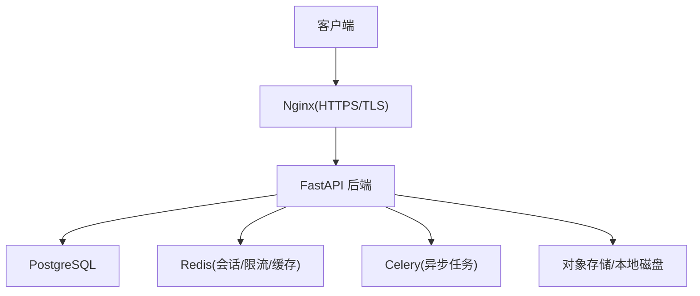
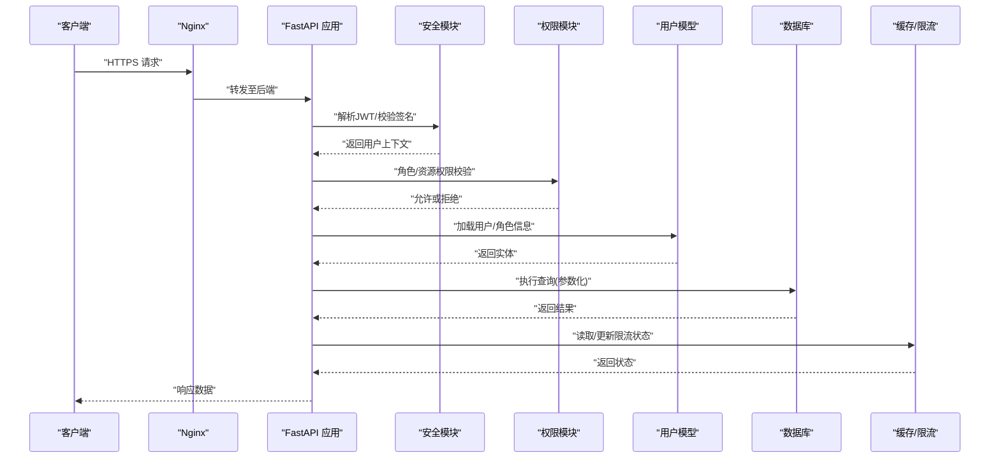
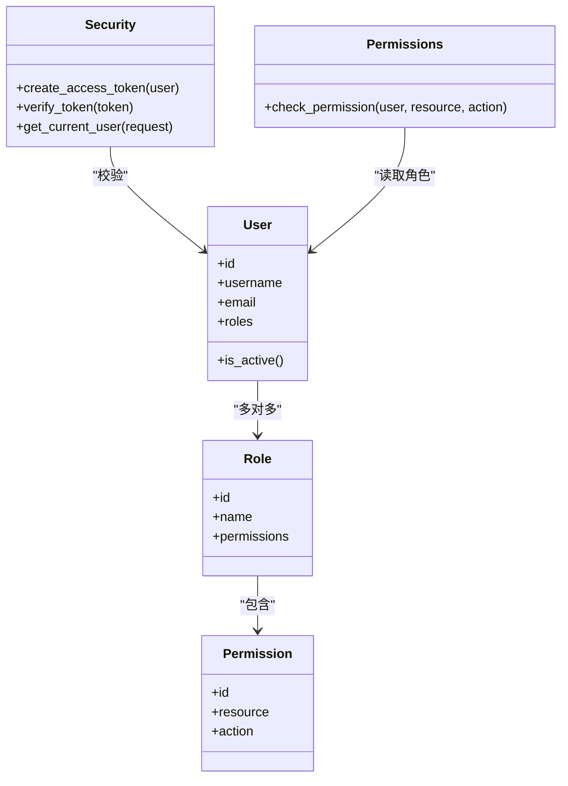
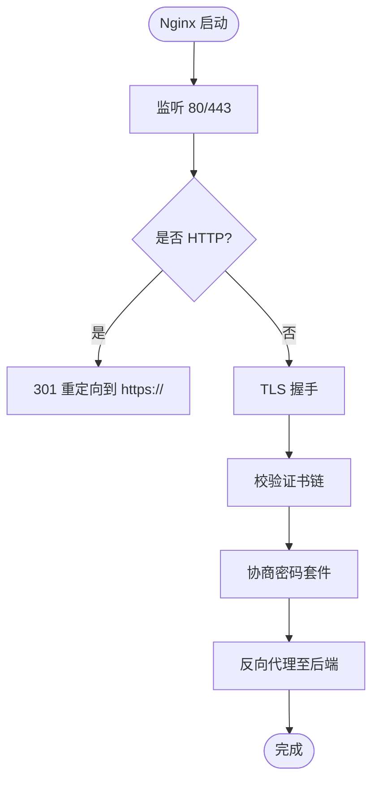
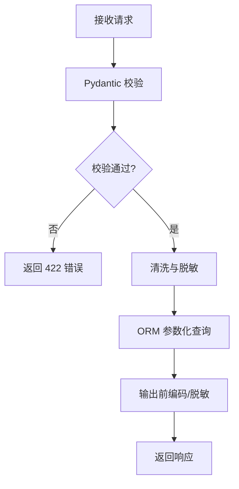
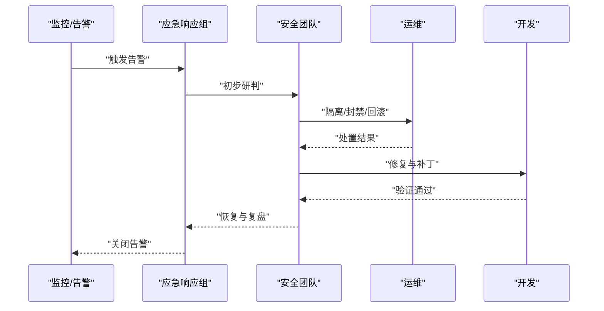
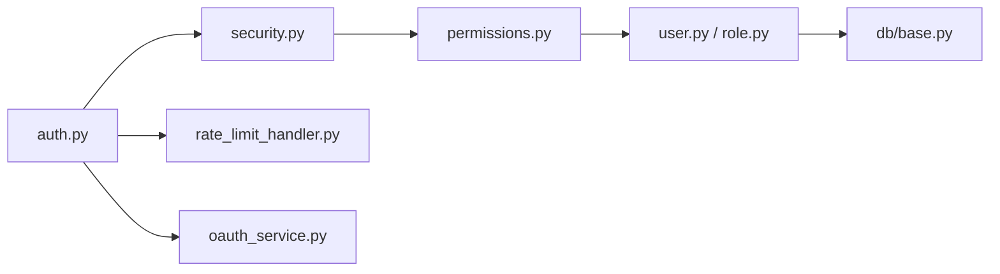

# 安全加固

<cite>
**本文引用的文件**   
- [backend/app/core/security.py](file://backend/app/core/security.py)
- [backend/app/api/v1/auth.py](file://backend/app/api/v1/auth.py)
- [backend/app/core/permissions.py](file://backend/app/core/permissions.py)
- [backend/app/models/user.py](file://backend/app/models/user.py)
- [backend/app/models/role.py](file://backend/app/models/role.py)
- [backend/app/core/config.py](file://backend/app/core/config.py)
- [nginx-prod.conf](file://nginx-prod.conf)
- [ssl/README.md](file://ssl/README.md)
- [backend/app/utils/sql_validator.py](file://backend/app/utils/sql_validator.py)
- [backend/app/services/email_service.py](file://backend/app/services/email_service.py)
- [backend/app/services/password_reset_service.py](file://backend/app/services/password_reset_service.py)
- [backend/app/services/rate_limit_handler.py](file://backend/app/services/rate_limit_handler.py)
- [backend/app/services/oauth_service.py](file://backend/app/services/oauth_service.py)
- [backend/app/services/streaming_service.py](file://backend/app/services/streaming_service.py)
- [backend/app/services/cache_system.py](file://backend/app/services/cache_system.py)
- [backend/app/websocket/manager.py](file://backend/app/websocket/manager.py)
- [backend/app/db/base.py](file://backend/app/db/base.py)
- [backend/app/schemas/user.py](file://backend/app/schemas/user.py)
- [backend/app/schemas/admin.py](file://backend/app/schemas/admin.py)
- [backend/app/scripts/set_admin.py](file://backend/app/scripts/set_admin.py)
- [backend/app/scripts/set_super_admin.py](file://backend/app/scripts/set_super_admin.py)
- [backend/tests/test_auth_routes.py](file://backend/tests/test_auth_routes.py)
- [backend/tests/test_dreamweaver_safety_audit.py](file://backend/tests/test_dreamweaver_safety_audit.py)
- [backend/tests/test_ai_trace_storage_safety.py](file://backend/tests/test_ai_trace_storage_safety.py)
- [docker-compose.yml](file://docker-compose.yml)
- [requirements.txt](file://requirements.txt)
</cite>

## 目录
1. [简介](#简介)
2. [项目结构](#项目结构)
3. [核心组件](#核心组件)
4. [架构总览](#架构总览)
5. [详细组件分析](#详细组件分析)
6. [依赖分析](#依赖分析)
7. [性能考虑](#性能考虑)
8. [故障排查指南](#故障排查指南)
9. [结论](#结论)
10. [附录](#附录)

## 简介
本文件面向小说创作代理系统的安全加固，覆盖身份认证与授权、数据传输安全、应用安全防护、安全审计与合规、以及安全事件应急响应。文档基于仓库中后端服务（FastAPI）、Nginx 反向代理、数据库与缓存等关键组件的实现进行梳理，并提供可操作的配置建议与流程图示，帮助读者快速理解并落地安全措施。

## 项目结构
本项目采用前后端分离架构：前端通过 Nginx 暴露 HTTPS 入口，后端由 FastAPI 提供 REST/WebSocket API，数据持久化使用 PostgreSQL，缓存与任务队列由 Redis/Celery 支撑。安全相关代码主要分布在 backend/app/core、backend/app/api、backend/app/services、backend/app/utils、backend/app/db 等目录，以及根目录的 nginx 配置文件与 ssl 说明。

**图示来源** 
- [nginx-prod.conf](file://nginx-prod.conf)
- [backend/app/core/config.py](file://backend/app/core/config.py)
- [backend/app/db/base.py](file://backend/app/db/base.py)
- [backend/app/services/cache_system.py](file://backend/app/services/cache_system.py)

**章节来源**
- [nginx-prod.conf](file://nginx-prod.conf)
- [backend/app/core/config.py](file://backend/app/core/config.py)
- [backend/app/db/base.py](file://backend/app/db/base.py)

## 核心组件
- 认证与授权
  - JWT 令牌签发与校验、角色权限控制、API 访问限制、会话安全管理。
- 传输安全
  - HTTPS 强制、TLS 版本与密码套件、证书管理。
- 应用安全
  - 输入校验、SQL 注入防护、XSS 防护、CSRF 保护、敏感信息脱敏。
- 审计与合规
  - 安全日志、漏洞扫描、渗透测试、合规检查。
- 应急响应
  - 告警处理、入侵检测、数据泄露应对、事后报告。

**章节来源**
- [backend/app/core/security.py](file://backend/app/core/security.py)
- [backend/app/api/v1/auth.py](file://backend/app/api/v1/auth.py)
- [backend/app/core/permissions.py](file://backend/app/core/permissions.py)
- [backend/app/models/user.py](file://backend/app/models/user.py)
- [backend/app/models/role.py](file://backend/app/models/role.py)
- [backend/app/core/config.py](file://backend/app/core/config.py)
- [nginx-prod.conf](file://nginx-prod.conf)
- [ssl/README.md](file://ssl/README.md)

## 架构总览
下图展示从客户端到后端的完整请求链路，包括认证、鉴权、输入校验、数据库访问与缓存交互。

**图示来源** 
- [backend/app/api/v1/auth.py](file://backend/app/api/v1/auth.py)
- [backend/app/core/security.py](file://backend/app/core/security.py)
- [backend/app/core/permissions.py](file://backend/app/core/permissions.py)
- [backend/app/models/user.py](file://backend/app/models/user.py)
- [backend/app/db/base.py](file://backend/app/db/base.py)
- [backend/app/services/rate_limit_handler.py](file://backend/app/services/rate_limit_handler.py)

## 详细组件分析

### 身份认证与授权（JWT、RBAC、会话）
- JWT 令牌管理
  - 登录接口生成访问令牌与刷新令牌，设置过期时间；校验时验证签名、有效期与受众。
  - 建议将敏感配置（如密钥、算法）集中管理并通过环境变量注入。
- 角色与权限控制（RBAC）
  - 用户-角色-资源三元关系，支持细粒度权限判定；在路由层装饰器或中间件中进行权限校验。
- 会话安全
  - 推荐使用无状态 JWT，避免服务端会话存储；如需会话，应使用加密且短时效的 Cookie，并启用 SameSite 与 Secure 标志。
- API 访问限制
  - 基于 IP/用户维度的速率限制，防止暴力破解与滥用。

**图示来源** 
- [backend/app/models/user.py](file://backend/app/models/user.py)
- [backend/app/models/role.py](file://backend/app/models/role.py)
- [backend/app/core/security.py](file://backend/app/core/security.py)
- [backend/app/core/permissions.py](file://backend/app/core/permissions.py)

**章节来源**
- [backend/app/api/v1/auth.py](file://backend/app/api/v1/auth.py)
- [backend/app/core/security.py](file://backend/app/core/security.py)
- [backend/app/core/permissions.py](file://backend/app/core/permissions.py)
- [backend/app/models/user.py](file://backend/app/models/user.py)
- [backend/app/models/role.py](file://backend/app/models/role.py)
- [backend/app/services/rate_limit_handler.py](file://backend/app/services/rate_limit_handler.py)

### 数据传输安全（HTTPS、TLS、证书、加密算法）
- HTTPS 强制
  - Nginx 监听 443，所有 HTTP 请求重定向至 HTTPS。
- TLS 版本与密码套件
  - 仅启用 TLSv1.2+，禁用弱密码套件，优先使用 ECDHE 与 AEAD 套件。
- SSL 证书管理
  - 使用自动化续期工具（如 certbot），证书路径与私钥权限严格管控。
- 加密算法选择
  - 哈希使用强算法（如 bcrypt/argon2），对称加密使用 AES-GCM，随机数生成遵循安全标准。

**图示来源** 
- [nginx-prod.conf](file://nginx-prod.conf)
- [ssl/README.md](file://ssl/README.md)

**章节来源**
- [nginx-prod.conf](file://nginx-prod.conf)
- [ssl/README.md](file://ssl/README.md)
- [backend/app/core/config.py](file://backend/app/core/config.py)

### 应用安全防护（输入校验、SQL 注入、XSS、CSRF、敏感信息脱敏）
- 输入验证
  - 使用 Pydantic Schema 对请求体进行强类型校验与默认值处理，拒绝非法字段。
- SQL 注入防护
  - 全量使用参数化查询与 ORM，禁止拼接 SQL；必要时引入 SQL 语法校验工具。
- XSS 防护
  - 输出编码、启用 CSP、避免直接渲染用户输入为 HTML。
- CSRF 保护
  - 对写操作启用 CSRF Token 校验或使用 SameSite Cookie 策略。
- 敏感信息脱敏
  - 日志与响应中对邮箱、手机号、身份证号等进行掩码处理。

**图示来源** 
- [backend/app/schemas/user.py](file://backend/app/schemas/user.py)
- [backend/app/utils/sql_validator.py](file://backend/app/utils/sql_validator.py)
- [backend/app/db/base.py](file://backend/app/db/base.py)

**章节来源**
- [backend/app/schemas/user.py](file://backend/app/schemas/user.py)
- [backend/app/schemas/admin.py](file://backend/app/schemas/admin.py)
- [backend/app/utils/sql_validator.py](file://backend/app/utils/sql_validator.py)
- [backend/app/db/base.py](file://backend/app/db/base.py)

### 安全审计与合规（日志、扫描、渗透、合规检查）
- 安全日志记录
  - 统一日志格式，记录认证失败、权限拒绝、异常堆栈与请求元数据；敏感字段脱敏。
- 漏洞扫描
  - 集成依赖与镜像扫描（如 Trivy、Snyk），CI 流水线阻断高危漏洞。
- 渗透测试
  - 定期开展黑盒/灰盒测试，覆盖认证绕过、越权、注入、反序列化等场景。
- 合规性检查
  - 对照数据安全法、个人信息保护法等要求，落实最小权限、数据留存策略与审计追踪。

**章节来源**
- [backend/app/services/email_service.py](file://backend/app/services/email_service.py)
- [backend/app/services/password_reset_service.py](file://backend/app/services/password_reset_service.py)
- [backend/tests/test_ai_trace_storage_safety.py](file://backend/tests/test_ai_trace_storage_safety.py)

### 安全事件应急响应（告警、入侵检测、数据泄露、事后报告）
- 告警处理
  - 建立告警规则（登录失败阈值、异常流量突增、权限拒绝激增），联动通知渠道。
- 入侵检测
  - 结合 WAF、IDS/IPS、主机安全探针，实时拦截恶意请求。
- 数据泄露应对
  - 立即隔离受影响服务、重置凭证、评估影响范围、通知监管与用户。
- 事后分析报告
  - 复盘时间线、根因分析、修复措施与回归测试，形成闭环。

[本图为概念流程，不映射具体源码]

## 依赖分析
- 外部依赖
  - 认证与加密：建议使用成熟的库（如 python-jose 用于 JWT，bcrypt/argon2 用于密码哈希）。
  - 网络与安全：Nginx 作为反向代理与 TLS 终止点。
  - 数据存储：PostgreSQL 与 Redis，确保连接加密与访问控制。
- 内部耦合
  - 安全模块与权限模块解耦，便于扩展新的鉴权策略。
  - 输入校验集中在 Schema 层，降低业务逻辑中的重复校验。

**图示来源** 
- [backend/app/api/v1/auth.py](file://backend/app/api/v1/auth.py)
- [backend/app/core/security.py](file://backend/app/core/security.py)
- [backend/app/core/permissions.py](file://backend/app/core/permissions.py)
- [backend/app/models/user.py](file://backend/app/models/user.py)
- [backend/app/models/role.py](file://backend/app/models/role.py)
- [backend/app/db/base.py](file://backend/app/db/base.py)
- [backend/app/services/rate_limit_handler.py](file://backend/app/services/rate_limit_handler.py)
- [backend/app/services/oauth_service.py](file://backend/app/services/oauth_service.py)

**章节来源**
- [requirements.txt](file://requirements.txt)
- [docker-compose.yml](file://docker-compose.yml)

## 性能考虑
- 认证开销
  - JWT 校验轻量，但应避免频繁解密大令牌；合理设置过期时间与刷新策略。
- 权限计算
  - 预计算用户权限集并缓存，减少数据库查询。
- 限流与缓存
  - 使用 Redis 实现分布式限流与热点数据缓存，注意键空间隔离与过期策略。
- 数据库访问
  - 使用索引与分页，避免 N+1 查询；批量写入与事务优化。

[本节为通用指导，不直接分析具体文件]

## 故障排查指南
- 认证失败
  - 检查 JWT 签名与过期时间、密钥一致性、时钟同步。
- 权限拒绝
  - 核对用户角色与资源权限映射，确认装饰器/中间件生效顺序。
- 输入校验报错
  - 查看 Pydantic 错误详情，修正请求体结构与类型。
- SQL 异常
  - 检查参数化查询与 ORM 用法，避免动态拼接。
- 限流触发
  - 调整阈值与窗口大小，区分不同用户/IP 维度。

**章节来源**
- [backend/tests/test_auth_routes.py](file://backend/tests/test_auth_routes.py)
- [backend/tests/test_dreamweaver_safety_audit.py](file://backend/tests/test_dreamweaver_safety_audit.py)

## 结论
通过对认证授权、传输安全、应用安全、审计合规与应急响应的系统化加固，本小说创作代理系统可在生产环境中提供更强的安全保障。建议持续完善自动化扫描与演练机制，确保安全策略随业务演进而迭代。

## 附录
- 管理员初始化脚本
  - 使用专用脚本创建管理员与超级管理员账户，确保初始权限最小化。
- WebSocket 安全
  - 对 WS 连接进行鉴权与速率限制，避免未授权接入。

**章节来源**
- [backend/app/scripts/set_admin.py](file://backend/app/scripts/set_admin.py)
- [backend/app/scripts/set_super_admin.py](file://backend/app/scripts/set_super_admin.py)
- [backend/app/websocket/manager.py](file://backend/app/websocket/manager.py)