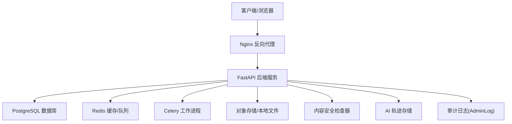
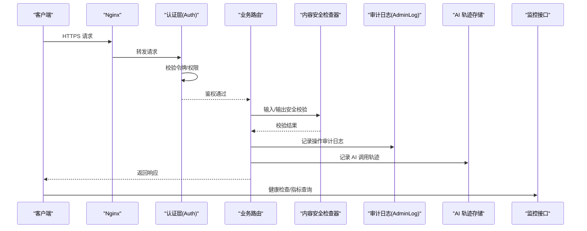
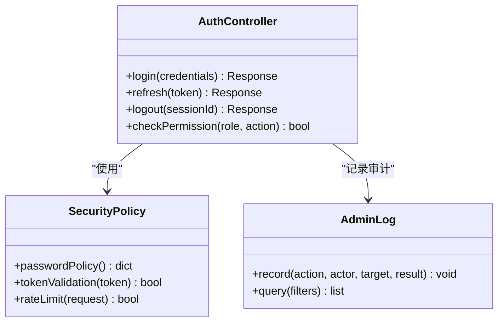
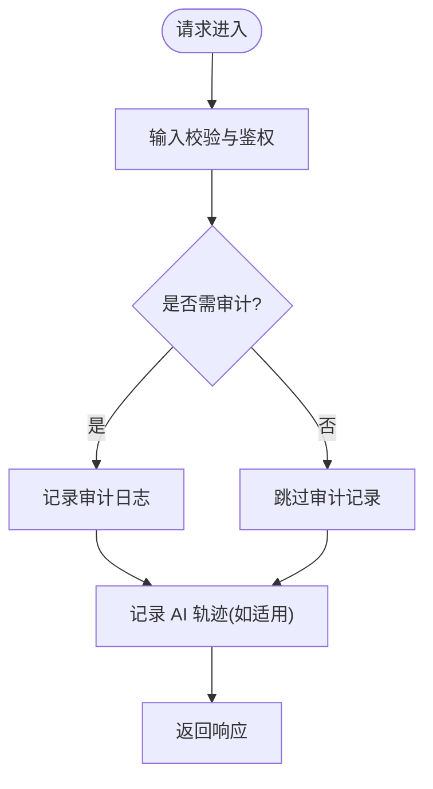
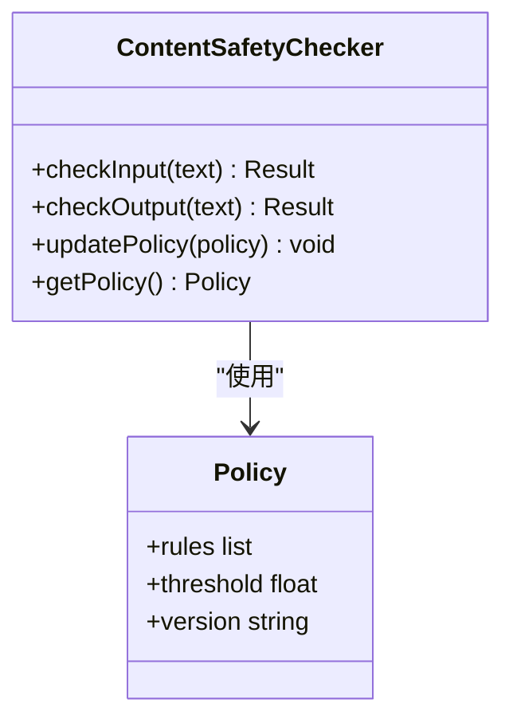
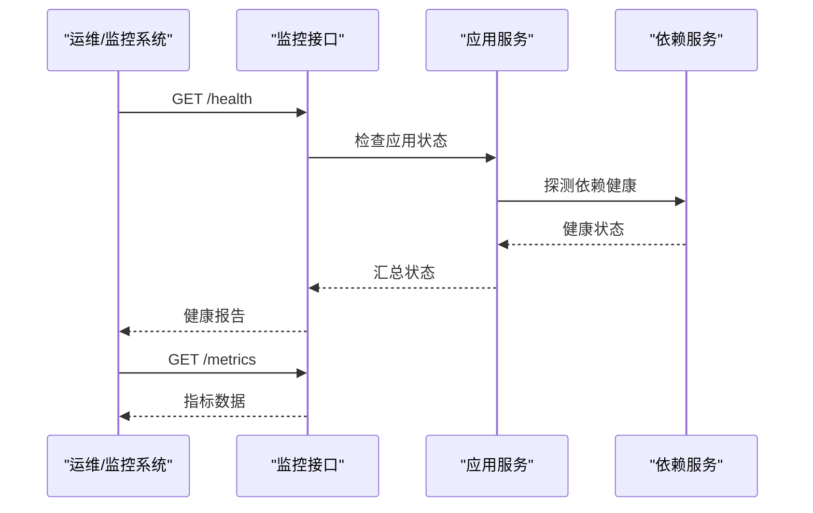
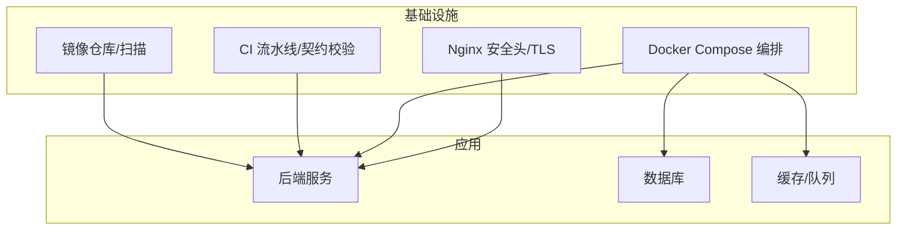
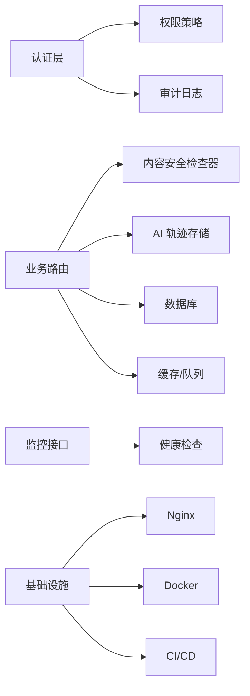

# 安全审计与合规

<cite>
**本文引用的文件**   
- [backend/app/core/security.py](file://backend/app/core/security.py)
- [backend/app/api/v1/auth.py](file://backend/app/api/v1/auth.py)
- [backend/app/models/admin_log.py](file://backend/app/models/admin_log.py)
- [backend/app/services/ai_trace_storage.py](file://backend/app/services/ai_trace_storage.py)
- [adapters/content_safety_checker.py](file://adapters/content_safety_checker.py)
- [core/logging_config.py](file://core/logging_config.py)
- [backend/app/api/v1/monitoring.py](file://backend/app/api/v1/monitoring.py)
- [backend/app/core/config.py](file://backend/app/core/config.py)
- [nginx.conf](file://nginx.conf)
- [docker-compose.yml](file://docker-compose.yml)
- [requirements.txt](file://requirements.txt)
- [.github/workflows/contracts.yml](file://.github/workflows/contracts.yml)
- [CONTENT_SAFETY_CHECKER.md](file://CONTENT_SAFETY_CHECKER.md)
</cite>

## 目录
1. [简介](#简介)
2. [项目结构](#项目结构)
3. [核心组件](#核心组件)
4. [架构总览](#架构总览)
5. [详细组件分析](#详细组件分析)
6. [依赖关系分析](#依赖关系分析)
7. [性能考量](#性能考量)
8. [故障排查指南](#故障排查指南)
9. [结论](#结论)
10. [附录](#附录)

## 简介
本文件面向小说创作代理系统的安全审计与合规，聚焦以下目标：
- 安全日志记录机制：操作审计日志、访问日志、错误日志的结构化采集与存储。
- 漏洞扫描与渗透测试流程：自动化安全扫描工具集成、定期安全评估、漏洞修复跟踪。
- 合规性检查要求：数据安全法规遵循、隐私保护措施、业务合规性验证。
- 安全事件监控与告警：异常行为检测、实时安全告警、事件响应流程。
- 提供安全审计报告模板与合规性检查清单，便于落地执行与审计归档。

## 项目结构
本项目采用前后端分离与多模块组织方式，后端以 FastAPI 为主，结合 Celery 异步任务、PostgreSQL 持久化、Nginx 反向代理；前端为 React/Vite 应用。与安全相关的关键位置包括：
- 认证与授权：后端 API 路由中的鉴权中间件与权限控制。
- 安全配置：应用配置、SSL/TLS、CORS、速率限制等。
- 日志与追踪：结构化日志、AI 轨迹存储、管理后台审计日志。
- 内容安全：内容安全校验适配器。
- 基础设施：Nginx 安全头、Docker Compose 编排、CI 流水线。

**图表来源** 
- [nginx.conf](file://nginx.conf)
- [docker-compose.yml](file://docker-compose.yml)
- [backend/app/core/security.py](file://backend/app/core/security.py)
- [backend/app/models/admin_log.py](file://backend/app/models/admin_log.py)
- [backend/app/services/ai_trace_storage.py](file://backend/app/services/ai_trace_storage.py)
- [adapters/content_safety_checker.py](file://adapters/content_safety_checker.py)

**章节来源**
- [backend/app/core/security.py](file://backend/app/core/security.py)
- [backend/app/api/v1/auth.py](file://backend/app/api/v1/auth.py)
- [backend/app/models/admin_log.py](file://backend/app/models/admin_log.py)
- [backend/app/services/ai_trace_storage.py](file://backend/app/services/ai_trace_storage.py)
- [adapters/content_safety_checker.py](file://adapters/content_safety_checker.py)
- [core/logging_config.py](file://core/logging_config.py)
- [backend/app/api/v1/monitoring.py](file://backend/app/api/v1/monitoring.py)
- [backend/app/core/config.py](file://backend/app/core/config.py)
- [nginx.conf](file://nginx.conf)
- [docker-compose.yml](file://docker-compose.yml)

## 核心组件
- 认证与授权（Auth）：统一身份认证、会话/令牌管理、角色与权限校验。
- 安全配置（Security）：密码策略、加密传输、请求签名、输入校验、速率限制。
- 审计与追踪（Audit & Trace）：管理操作审计日志、AI 调用轨迹、结构化日志输出。
- 内容安全（Content Safety）：敏感词过滤、违规内容识别、模型输出安全校验。
- 监控与告警（Monitoring）：健康检查、指标暴露、异常阈值告警。
- 基础设施安全（Infra）：Nginx 安全头、TLS 证书、容器镜像安全、CI 安全扫描。

**章节来源**
- [backend/app/api/v1/auth.py](file://backend/app/api/v1/auth.py)
- [backend/app/core/security.py](file://backend/app/core/security.py)
- [backend/app/models/admin_log.py](file://backend/app/models/admin_log.py)
- [backend/app/services/ai_trace_storage.py](file://backend/app/services/ai_trace_storage.py)
- [adapters/content_safety_checker.py](file://adapters/content_safety_checker.py)
- [backend/app/api/v1/monitoring.py](file://backend/app/api/v1/monitoring.py)
- [core/logging_config.py](file://core/logging_config.py)
- [backend/app/core/config.py](file://backend/app/core/config.py)
- [nginx.conf](file://nginx.conf)
- [docker-compose.yml](file://docker-compose.yml)

## 架构总览
下图展示安全相关组件的交互关系：客户端通过 Nginx 进入后端，后端在认证层进行鉴权，随后进入业务路由；关键操作写入审计日志，AI 调用轨迹持久化到存储；内容安全检查器对输入/输出进行安全校验；监控接口暴露健康与指标；所有组件由 Docker Compose 编排运行。

**图表来源** 
- [backend/app/api/v1/auth.py](file://backend/app/api/v1/auth.py)
- [adapters/content_safety_checker.py](file://adapters/content_safety_checker.py)
- [backend/app/models/admin_log.py](file://backend/app/models/admin_log.py)
- [backend/app/services/ai_trace_storage.py](file://backend/app/services/ai_trace_storage.py)
- [backend/app/api/v1/monitoring.py](file://backend/app/api/v1/monitoring.py)
- [nginx.conf](file://nginx.conf)

## 详细组件分析

### 认证与授权（Auth）
- 功能要点
  - 统一登录、令牌签发与刷新、会话生命周期管理。
  - 基于角色的访问控制（RBAC），细粒度权限校验。
  - 防暴力破解、账号锁定、密码复杂度策略。
- 关键实现位置
  - 认证路由与中间件：[backend/app/api/v1/auth.py](file://backend/app/api/v1/auth.py)
  - 安全策略与配置：[backend/app/core/security.py](file://backend/app/core/security.py)

**图表来源** 
- [backend/app/api/v1/auth.py](file://backend/app/api/v1/auth.py)
- [backend/app/core/security.py](file://backend/app/core/security.py)
- [backend/app/models/admin_log.py](file://backend/app/models/admin_log.py)

**章节来源**
- [backend/app/api/v1/auth.py](file://backend/app/api/v1/auth.py)
- [backend/app/core/security.py](file://backend/app/core/security.py)

### 审计与追踪（Audit & Trace）
- 功能要点
  - 管理操作审计日志：记录操作主体、目标、结果、时间戳、上下文。
  - AI 调用轨迹：记录提示词、模型选择、参数、耗时、结果摘要。
  - 结构化日志：统一格式、分级输出、可检索、可聚合。
- 关键实现位置
  - 审计日志模型：[backend/app/models/admin_log.py](file://backend/app/models/admin_log.py)
  - AI 轨迹存储：[backend/app/services/ai_trace_storage.py](file://backend/app/services/ai_trace_storage.py)
  - 日志配置：[core/logging_config.py](file://core/logging_config.py)

**图表来源** 
- [backend/app/models/admin_log.py](file://backend/app/models/admin_log.py)
- [backend/app/services/ai_trace_storage.py](file://backend/app/services/ai_trace_storage.py)
- [core/logging_config.py](file://core/logging_config.py)

**章节来源**
- [backend/app/models/admin_log.py](file://backend/app/models/admin_log.py)
- [backend/app/services/ai_trace_storage.py](file://backend/app/services/ai_trace_storage.py)
- [core/logging_config.py](file://core/logging_config.py)

### 内容安全（Content Safety）
- 功能要点
  - 输入/输出内容安全校验：敏感词、违规类型识别、模型输出过滤。
  - 策略可配置：白名单/黑名单、阈值、规则集版本管理。
  - 与业务解耦：适配器模式，支持多供应商或本地规则引擎。
- 关键实现位置
  - 内容安全检查器：[adapters/content_safety_checker.py](file://adapters/content_safety_checker.py)
  - 文档说明：[CONTENT_SAFETY_CHECKER.md](file://CONTENT_SAFETY_CHECKER.md)

**图表来源** 
- [adapters/content_safety_checker.py](file://adapters/content_safety_checker.py)
- [CONTENT_SAFETY_CHECKER.md](file://CONTENT_SAFETY_CHECKER.md)

**章节来源**
- [adapters/content_safety_checker.py](file://adapters/content_safety_checker.py)
- [CONTENT_SAFETY_CHECKER.md](file://CONTENT_SAFETY_CHECKER.md)

### 监控与告警（Monitoring）
- 功能要点
  - 健康检查：服务可用性、依赖状态（DB、Redis、外部服务）。
  - 指标暴露：QPS、延迟、错误率、资源使用率。
  - 告警策略：阈值触发、通知渠道（邮件、IM）、事件工单。
- 关键实现位置
  - 监控接口：[backend/app/api/v1/monitoring.py](file://backend/app/api/v1/monitoring.py)
  - 应用配置：[backend/app/core/config.py](file://backend/app/core/config.py)

**图表来源** 
- [backend/app/api/v1/monitoring.py](file://backend/app/api/v1/monitoring.py)
- [backend/app/core/config.py](file://backend/app/core/config.py)

**章节来源**
- [backend/app/api/v1/monitoring.py](file://backend/app/api/v1/monitoring.py)
- [backend/app/core/config.py](file://backend/app/core/config.py)

### 基础设施安全（Infra）
- 功能要点
  - Nginx 安全头：HSTS、X-Frame-Options、CSP、Referrer-Policy。
  - TLS 证书：自动续期、最小协议版本、强加密套件。
  - 容器与镜像：基础镜像加固、依赖漏洞扫描、非 root 运行。
  - CI/CD：代码质量检查、依赖漏洞扫描、合同契约校验。
- 关键实现位置
  - Nginx 配置：[nginx.conf](file://nginx.conf)
  - 编排文件：[docker-compose.yml](file://docker-compose.yml)
  - 依赖清单：[requirements.txt](file://requirements.txt)
  - CI 流水线：[.github/workflows/contracts.yml](file://.github/workflows/contracts.yml)

**图表来源** 
- [nginx.conf](file://nginx.conf)
- [docker-compose.yml](file://docker-compose.yml)
- [requirements.txt](file://requirements.txt)
- [.github/workflows/contracts.yml](file://.github/workflows/contracts.yml)

**章节来源**
- [nginx.conf](file://nginx.conf)
- [docker-compose.yml](file://docker-compose.yml)
- [requirements.txt](file://requirements.txt)
- [.github/workflows/contracts.yml](file://.github/workflows/contracts.yml)

## 依赖关系分析
- 组件耦合度
  - 认证层与权限策略低耦合，便于扩展新的鉴权方式。
  - 审计与追踪独立于业务逻辑，确保可观测性与可追溯性。
  - 内容安全检查器通过适配器模式隔离具体实现，提升灵活性。
- 外部依赖
  - 数据库：PostgreSQL（用户、审计日志、业务数据）。
  - 缓存/队列：Redis（会话、限流、任务队列）。
  - 外部服务：AI 模型提供商、内容安全服务、对象存储。
- 潜在风险
  - 第三方依赖漏洞：需定期扫描与更新。
  - 配置泄露：环境变量、密钥管理需严格管控。
  - 日志注入：输入校验与日志脱敏需落实。

**图表来源** 
- [backend/app/api/v1/auth.py](file://backend/app/api/v1/auth.py)
- [backend/app/core/security.py](file://backend/app/core/security.py)
- [backend/app/models/admin_log.py](file://backend/app/models/admin_log.py)
- [backend/app/services/ai_trace_storage.py](file://backend/app/services/ai_trace_storage.py)
- [adapters/content_safety_checker.py](file://adapters/content_safety_checker.py)
- [backend/app/api/v1/monitoring.py](file://backend/app/api/v1/monitoring.py)
- [nginx.conf](file://nginx.conf)
- [docker-compose.yml](file://docker-compose.yml)

**章节来源**
- [backend/app/api/v1/auth.py](file://backend/app/api/v1/auth.py)
- [backend/app/core/security.py](file://backend/app/core/security.py)
- [backend/app/models/admin_log.py](file://backend/app/models/admin_log.py)
- [backend/app/services/ai_trace_storage.py](file://backend/app/services/ai_trace_storage.py)
- [adapters/content_safety_checker.py](file://adapters/content_safety_checker.py)
- [backend/app/api/v1/monitoring.py](file://backend/app/api/v1/monitoring.py)
- [nginx.conf](file://nginx.conf)
- [docker-compose.yml](file://docker-compose.yml)

## 性能考量
- 日志写入：异步落盘、批量写入、轮转策略，避免阻塞主流程。
- 审计与追踪：采样策略、字段裁剪、压缩存储，降低 I/O 压力。
- 内容安全检查：缓存规则、并行校验、超时熔断。
- 监控指标：轻量级采集、聚合上报、避免高频查询。
- 资源隔离：容器化部署、CPU/内存限制、优雅降级。

## 故障排查指南
- 常见问题
  - 认证失败：检查令牌有效期、权限配置、密码策略。
  - 审计缺失：确认审计开关、日志级别、写入权限。
  - 内容安全误判：调整规则阈值、更新策略版本。
  - 监控无数据：检查健康检查依赖、指标暴露端口。
- 定位步骤
  - 查看应用日志与审计日志，定位异常时间点。
  - 检查 Nginx 访问日志与错误日志，确认请求路径与状态码。
  - 核对依赖服务健康状态（DB、Redis、外部 API）。
  - 复现问题并启用调试日志，收集上下文信息。

**章节来源**
- [core/logging_config.py](file://core/logging_config.py)
- [backend/app/api/v1/monitoring.py](file://backend/app/api/v1/monitoring.py)
- [nginx.conf](file://nginx.conf)

## 结论
本系统通过分层设计将认证、审计、追踪、内容安全与监控解耦，形成完整的安全闭环。建议持续完善自动化扫描、合规检查与事件响应流程，确保在业务增长过程中保持高安全水位与合规性。

## 附录

### 安全审计报告模板
- 基本信息：项目名称、审计范围、审计时间、审计人员。
- 发现项：漏洞名称、严重等级、影响范围、复现步骤。
- 修复建议：短期缓解措施、长期修复方案、责任人与时限。
- 验证结果：修复验证方法、回归测试结果、关闭依据。
- 附件：扫描报告、日志片段、截图证据。

### 合规性检查清单
- 数据安全
  - 数据传输加密（TLS 1.2+）、静态数据加密（磁盘/备份）。
  - 敏感字段脱敏、最小权限原则、访问控制矩阵。
- 隐私保护
  - 用户同意与撤回机制、数据保留与删除策略、跨境传输合规。
- 业务合规
  - 内容审核与过滤、未成年人保护、版权与知识产权。
- 运营合规
  - 日志留存周期、审计可追溯、变更管理与发布流程。
- 技术合规
  - 依赖漏洞扫描、镜像安全基线、CI/CD 安全门禁。