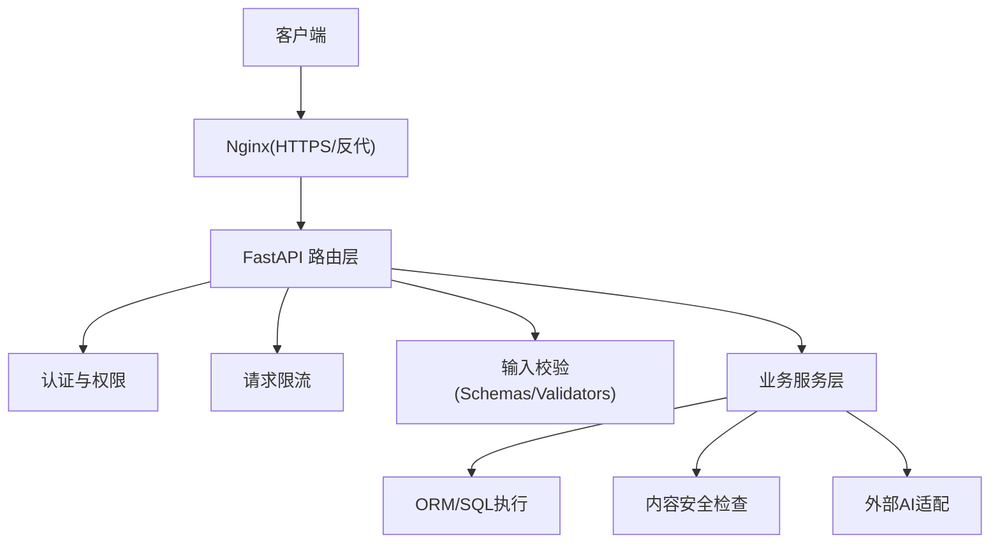
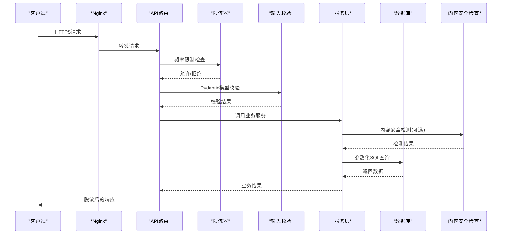
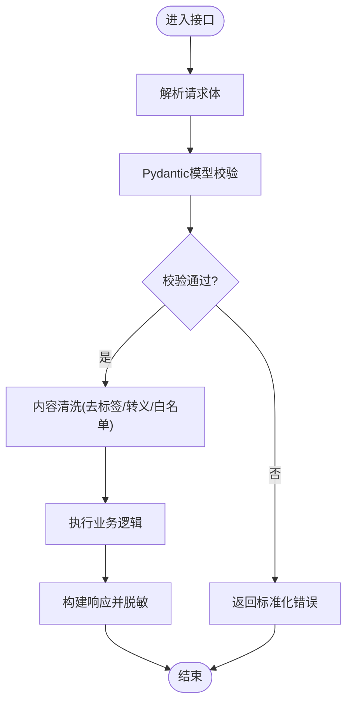
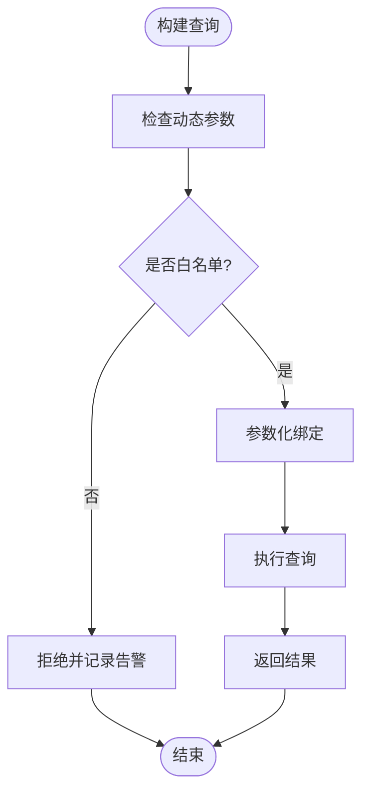
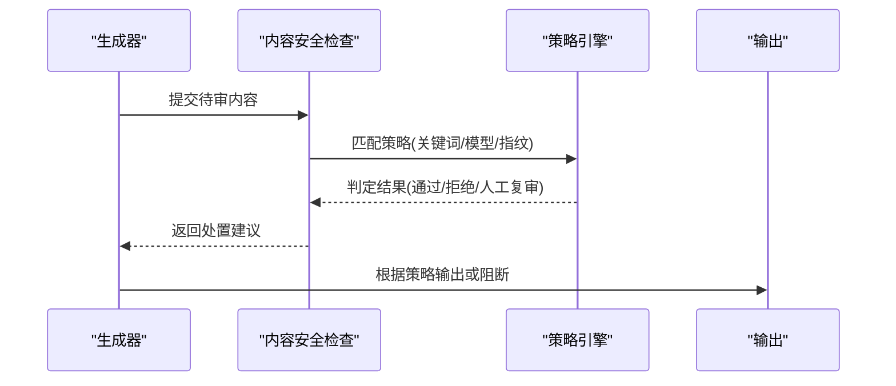
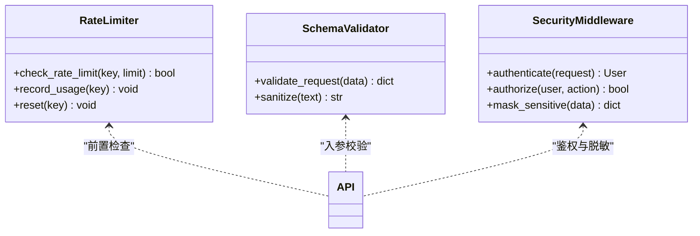
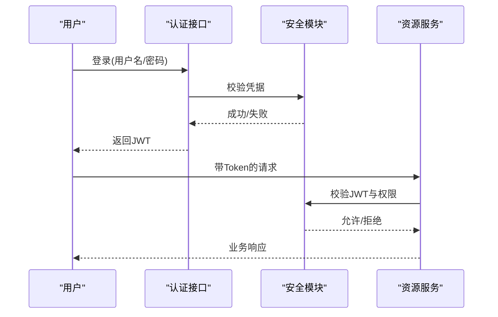
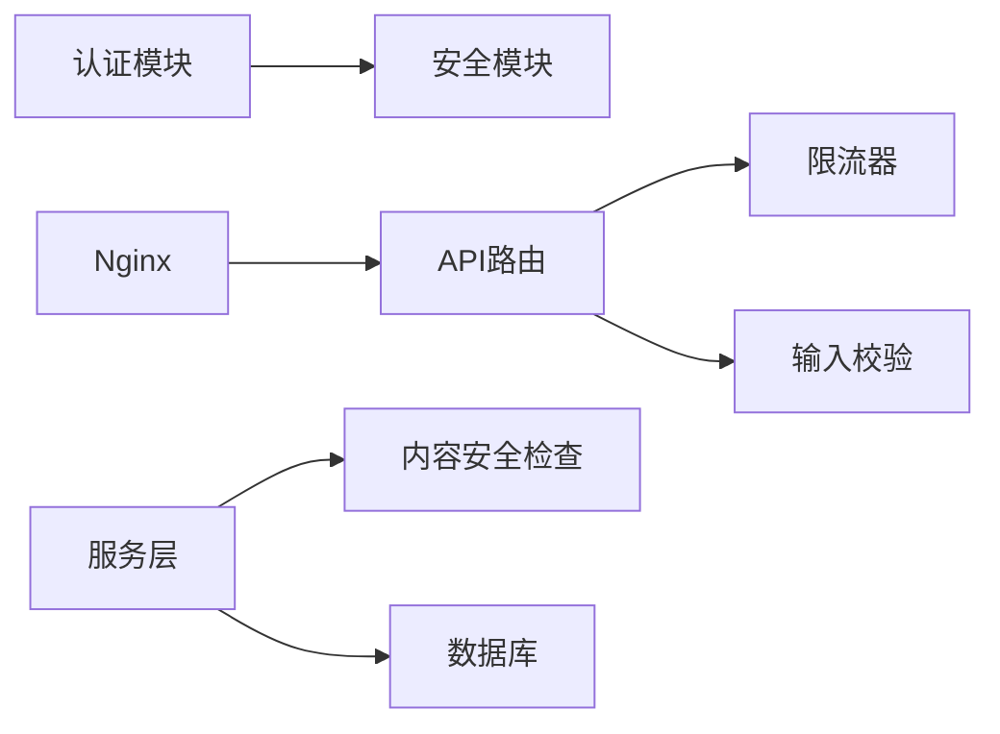

# 应用安全防护

<cite>
**本文引用的文件**   
- [backend/app/core/security.py](file://backend/app/core/security.py)
- [backend/app/core/config.py](file://backend/app/core/config.py)
- [backend/app/api/v1/auth.py](file://backend/app/api/v1/auth.py)
- [backend/app/utils/sql_validator.py](file://backend/app/utils/sql_validator.py)
- [adapters/content_safety_checker.py](file://adapters/content_safety_checker.py)
- [adapters/rate_limiter.py](file://adapters/rate_limiter.py)
- [backend/app/services/rate_limit_handler.py](file://backend/app/services/rate_limit_handler.py)
- [backend/app/schemas/common.py](file://backend/app/schemas/common.py)
- [core/validators.py](file://core/validators.py)
- [backend/app/models/user.py](file://backend/app/models/user.py)
- [backend/app/db/base.py](file://backend/app/db/base.py)
- [nginx.conf](file://nginx.conf)
- [nginx-prod.conf](file://nginx-prod.conf)
- [ssl/README.md](file://ssl/README.md)
- [CONTENT_SAFETY_CHECKER.md](file://CONTENT_SAFETY_CHECKER.md)
</cite>

## 目录
1. [简介](#简介)
2. [项目结构](#项目结构)
3. [核心组件](#核心组件)
4. [架构总览](#架构总览)
5. [详细组件分析](#详细组件分析)
6. [依赖关系分析](#依赖关系分析)
7. [性能考量](#性能考量)
8. [故障排查指南](#故障排查指南)
9. [结论](#结论)
10. [附录](#附录)

## 简介
本文件面向小说创作代理系统的应用安全，聚焦输入验证与数据清洗、SQL注入防护、XSS与CSRF防护、敏感信息脱敏、内容安全检查、API安全设计原则与安全编码规范。文档基于仓库现有实现进行梳理，并给出可操作的优化建议与排障指引，帮助开发者在保障功能的同时提升整体安全性与合规性。

## 项目结构
后端采用分层架构：API路由层、服务层、模型与数据库访问层、工具与中间件层；适配器层封装外部AI能力（含内容安全检测与限流）。前端通过Nginx反向代理对外暴露HTTPS入口。关键安全相关位置如下：
- 安全配置与认证：backend/app/core/security.py、backend/app/core/config.py、backend/app/api/v1/auth.py
- SQL注入防护：backend/app/utils/sql_validator.py、backend/app/db/base.py
- 内容安全：adapters/content_safety_checker.py、CONTENT_SAFETY_CHECKER.md
- 请求限流：adapters/rate_limiter.py、backend/app/services/rate_limit_handler.py
- 输入校验：backend/app/schemas/common.py、core/validators.py
- HTTPS与反代：nginx*.conf、ssl/README.md

**图示来源** 
- [nginx.conf](file://nginx.conf)
- [nginx-prod.conf](file://nginx-prod.conf)
- [backend/app/api/v1/auth.py](file://backend/app/api/v1/auth.py)
- [adapters/rate_limiter.py](file://adapters/rate_limiter.py)
- [backend/app/schemas/common.py](file://backend/app/schemas/common.py)
- [backend/app/utils/sql_validator.py](file://backend/app/utils/sql_validator.py)
- [adapters/content_safety_checker.py](file://adapters/content_safety_checker.py)

**章节来源**
- [nginx.conf](file://nginx.conf)
- [nginx-prod.conf](file://nginx-prod.conf)
- [ssl/README.md](file://ssl/README.md)

## 核心组件
- 认证与授权：基于JWT的无状态鉴权，结合角色/权限控制，统一在认证中间件中完成令牌解析与用户上下文注入。
- 输入校验：使用Pydantic模型与自定义校验器对请求体、路径参数、查询参数进行强类型校验与白名单过滤。
- SQL注入防护：强制使用参数化查询与SQL语法检查，禁止拼接字符串构造SQL。
- 内容安全：接入第三方或内置内容安全检测，对文本/图像/视频等生成内容进行合规性审查。
- 请求限流：按IP/用户维度限制请求频率，防止滥用与资源耗尽。
- 敏感信息脱敏：日志与错误响应中屏蔽敏感字段，配置文件加密存储。

**章节来源**
- [backend/app/core/security.py](file://backend/app/core/security.py)
- [backend/app/api/v1/auth.py](file://backend/app/api/v1/auth.py)
- [backend/app/schemas/common.py](file://backend/app/schemas/common.py)
- [core/validators.py](file://core/validators.py)
- [backend/app/utils/sql_validator.py](file://backend/app/utils/sql_validator.py)
- [adapters/content_safety_checker.py](file://adapters/content_safety_checker.py)
- [adapters/rate_limiter.py](file://adapters/rate_limiter.py)
- [backend/app/services/rate_limit_handler.py](file://backend/app/services/rate_limit_handler.py)

## 架构总览
下图展示从HTTP请求到内容安全与数据库访问的安全链路，强调校验、鉴权、限流、脱敏与合规检查的关键节点。

**图示来源** 
- [nginx.conf](file://nginx.conf)
- [backend/app/api/v1/auth.py](file://backend/app/api/v1/auth.py)
- [adapters/rate_limiter.py](file://adapters/rate_limiter.py)
- [backend/app/schemas/common.py](file://backend/app/schemas/common.py)
- [backend/app/utils/sql_validator.py](file://backend/app/utils/sql_validator.py)
- [adapters/content_safety_checker.py](file://adapters/content_safety_checker.py)

## 详细组件分析

### 输入验证与数据清洗（Pydantic与自定义校验）
- 使用Pydantic模型定义请求/响应结构，确保类型、长度、格式、枚举值等约束生效。
- 针对文本内容增加白名单过滤与HTML标签清理，避免XSS注入。
- 对数值范围、时间戳、URL、邮箱等字段进行严格校验，失败时返回标准化错误。
- 建议在公共Schema中集中定义通用字段校验规则，减少重复代码。

**图示来源** 
- [backend/app/schemas/common.py](file://backend/app/schemas/common.py)
- [core/validators.py](file://core/validators.py)

**章节来源**
- [backend/app/schemas/common.py](file://backend/app/schemas/common.py)
- [core/validators.py](file://core/validators.py)

### SQL注入防护
- 所有数据库操作必须使用参数化查询，禁止字符串拼接SQL。
- 引入SQL语法检查工具，拦截危险关键字与异常模式。
- 对动态排序字段、分页参数进行白名单映射，避免任意列名注入。
- 在ORM层统一封装查询方法，确保调用方无法绕过安全策略。

**图示来源** 
- [backend/app/utils/sql_validator.py](file://backend/app/utils/sql_validator.py)
- [backend/app/db/base.py](file://backend/app/db/base.py)

**章节来源**
- [backend/app/utils/sql_validator.py](file://backend/app/utils/sql_validator.py)
- [backend/app/db/base.py](file://backend/app/db/base.py)

### XSS与CSRF防护
- XSS防护：对所有用户可控输出进行HTML转义与标签白名单过滤；前端渲染避免直接插入未清洗内容。
- CSRF防护：对写操作启用CSRF Token校验；跨域请求需携带同源策略与预检处理；仅允许受信任来源。
- 建议在后端统一设置安全响应头（如Content-Security-Policy、X-Frame-Options），并在Nginx层加固。

**章节来源**
- [nginx.conf](file://nginx.conf)
- [nginx-prod.conf](file://nginx-prod.conf)

### 敏感信息脱敏处理
- 日志脱敏：对密码、令牌、密钥、手机号、身份证号等字段进行掩码或移除。
- 错误响应清理：避免回显堆栈、内部路径、数据库连接信息等敏感细节。
- 配置文件加密：敏感配置（如数据库密码、第三方密钥）采用加密存储，运行时解密加载。

**章节来源**
- [backend/app/core/config.py](file://backend/app/core/config.py)

### 内容安全检查机制
- 对AI生成的文本、图像、音频、视频等内容进行合规性检测，包括色情、暴力、政治敏感、版权侵权等。
- 支持多策略组合：关键词匹配、分类模型、指纹比对、哈希校验等。
- 提供审核开关与阈值配置，便于灰度上线与快速回滚。

**图示来源** 
- [adapters/content_safety_checker.py](file://adapters/content_safety_checker.py)
- [CONTENT_SAFETY_CHECKER.md](file://CONTENT_SAFETY_CHECKER.md)

**章节来源**
- [adapters/content_safety_checker.py](file://adapters/content_safety_checker.py)
- [CONTENT_SAFETY_CHECKER.md](file://CONTENT_SAFETY_CHECKER.md)

### API安全设计原则
- 请求频率限制：按IP/用户维度限制并发与QPS，超限返回429并记录审计日志。
- 参数验证：所有入参必须经过强类型校验与白名单过滤，拒绝非法或越界数据。
- 响应格式控制：统一JSON结构，隐藏内部错误详情，仅返回必要字段。
- 认证与授权：JWT令牌校验、最小权限原则、敏感操作二次确认。

**图示来源** 
- [adapters/rate_limiter.py](file://adapters/rate_limiter.py)
- [backend/app/services/rate_limit_handler.py](file://backend/app/services/rate_limit_handler.py)
- [backend/app/schemas/common.py](file://backend/app/schemas/common.py)
- [backend/app/core/security.py](file://backend/app/core/security.py)

**章节来源**
- [adapters/rate_limiter.py](file://adapters/rate_limiter.py)
- [backend/app/services/rate_limit_handler.py](file://backend/app/services/rate_limit_handler.py)
- [backend/app/schemas/common.py](file://backend/app/schemas/common.py)
- [backend/app/core/security.py](file://backend/app/core/security.py)

### 认证与权限（JWT与RBAC）
- JWT签发与校验：包含用户ID、角色、过期时间；服务端校验签名与有效期。
- RBAC权限控制：基于角色的访问控制，细粒度到资源与动作。
- 会话管理：无状态令牌，必要时配合黑名单或短期刷新机制。

**图示来源** 
- [backend/app/api/v1/auth.py](file://backend/app/api/v1/auth.py)
- [backend/app/core/security.py](file://backend/app/core/security.py)

**章节来源**
- [backend/app/api/v1/auth.py](file://backend/app/api/v1/auth.py)
- [backend/app/core/security.py](file://backend/app/core/security.py)

## 依赖关系分析
- 安全模块依赖：认证与权限依赖安全模块；限流器为API前置依赖；输入校验为路由层依赖；内容安全检查为服务层依赖。
- 外部依赖：Nginx作为反向代理与TLS终止点；第三方内容安全服务；数据库驱动与ORM。
- 潜在风险：循环依赖应避免；外部服务超时与降级策略需完善；密钥管理需集中化。

**图示来源** 
- [backend/app/api/v1/auth.py](file://backend/app/api/v1/auth.py)
- [backend/app/core/security.py](file://backend/app/core/security.py)
- [adapters/rate_limiter.py](file://adapters/rate_limiter.py)
- [backend/app/schemas/common.py](file://backend/app/schemas/common.py)
- [adapters/content_safety_checker.py](file://adapters/content_safety_checker.py)
- [backend/app/db/base.py](file://backend/app/db/base.py)
- [nginx.conf](file://nginx.conf)

**章节来源**
- [backend/app/api/v1/auth.py](file://backend/app/api/v1/auth.py)
- [backend/app/core/security.py](file://backend/app/core/security.py)
- [adapters/rate_limiter.py](file://adapters/rate_limiter.py)
- [backend/app/schemas/common.py](file://backend/app/schemas/common.py)
- [adapters/content_safety_checker.py](file://adapters/content_safety_checker.py)
- [backend/app/db/base.py](file://backend/app/db/base.py)
- [nginx.conf](file://nginx.conf)

## 性能考量
- 限流算法选择：令牌桶或滑动窗口，兼顾公平性与吞吐。
- 内容安全检查异步化：非阻塞队列处理，降低主流程延迟。
- 缓存热点数据：用户权限、模型配置、限流计数等。
- 数据库索引优化：减少慢查询，避免全表扫描。

[本节为通用指导，不直接分析具体文件]

## 故障排查指南
- 认证失败：检查JWT签名、过期时间、服务器时钟同步；查看认证接口日志。
- 限流触发：确认限流键（IP/用户）、阈值配置、Redis/内存状态。
- 内容安全误判：调整策略阈值、更新关键词库、复核模型版本。
- SQL异常：检查参数化绑定、动态字段白名单、SQL语法检查规则。
- 敏感信息泄露：核查日志过滤器、错误响应模板、配置加载过程。

**章节来源**
- [backend/app/api/v1/auth.py](file://backend/app/api/v1/auth.py)
- [adapters/rate_limiter.py](file://adapters/rate_limiter.py)
- [adapters/content_safety_checker.py](file://adapters/content_safety_checker.py)
- [backend/app/utils/sql_validator.py](file://backend/app/utils/sql_validator.py)
- [backend/app/core/config.py](file://backend/app/core/config.py)

## 结论
本系统通过多层安全机制构建了较为完整的防护体系：严格的输入校验、参数化SQL、内容安全检测、请求限流与敏感信息脱敏。建议持续完善策略配置、强化外部依赖容错、推进密钥集中管理与自动化审计，以应对不断演进的威胁面。

[本节为总结性内容，不直接分析具体文件]

## 附录
- 安全编码规范要点
  - 所有用户输入必须校验与清洗，禁止信任任何外部数据。
  - 使用参数化查询与ORM，禁止字符串拼接SQL。
  - 统一错误响应格式，隐藏内部细节。
  - 日志中屏蔽敏感字段，遵循最小披露原则。
  - 配置项加密存储，运行时解密，禁止硬编码密钥。
  - 对外接口启用HTTPS与必要的安全响应头。
  - 定期更新依赖与第三方安全库，关注漏洞公告。

[本节为通用指导，不直接分析具体文件]