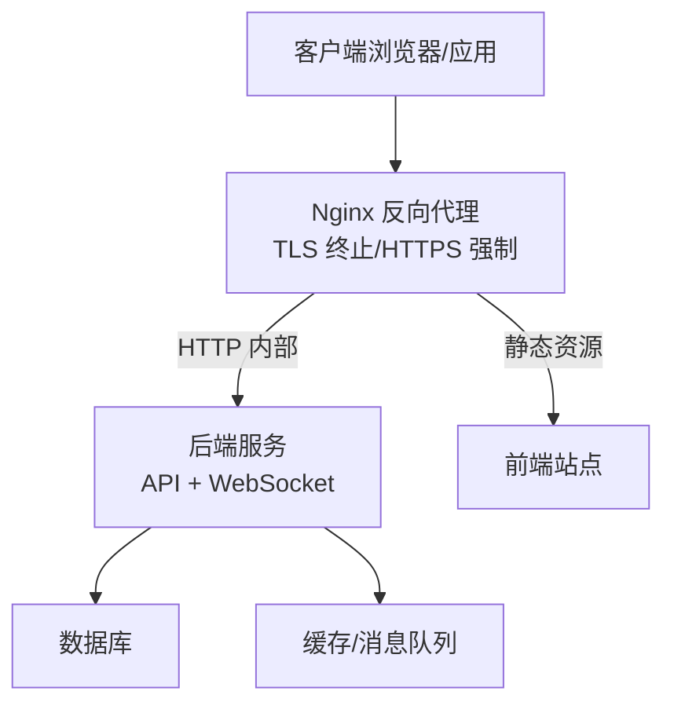
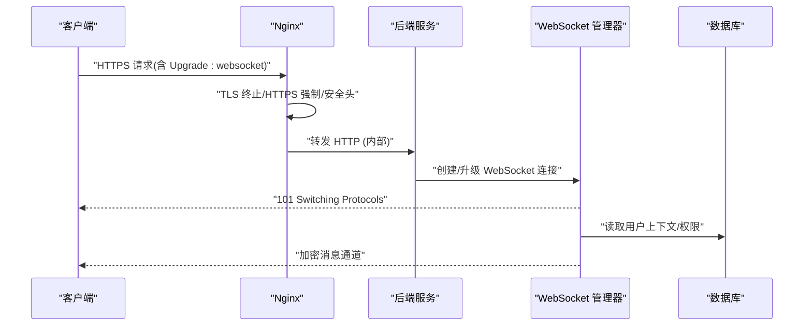
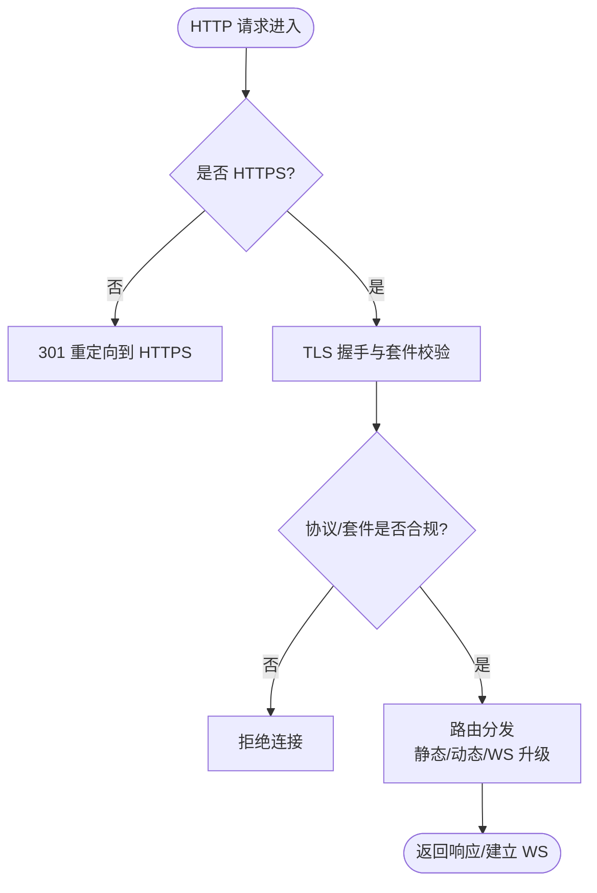
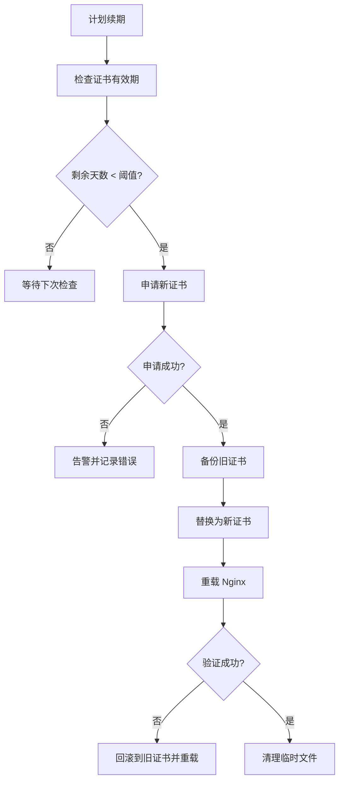
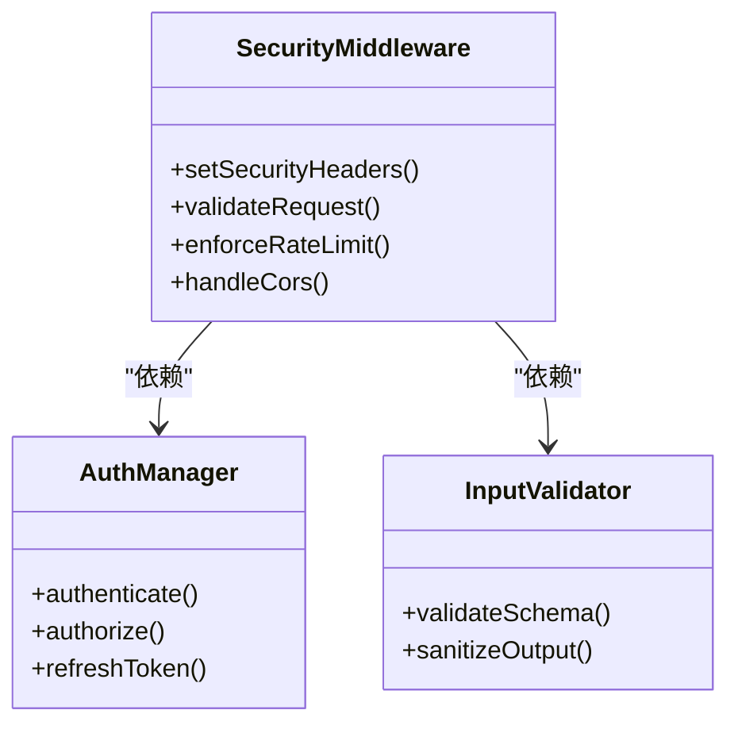
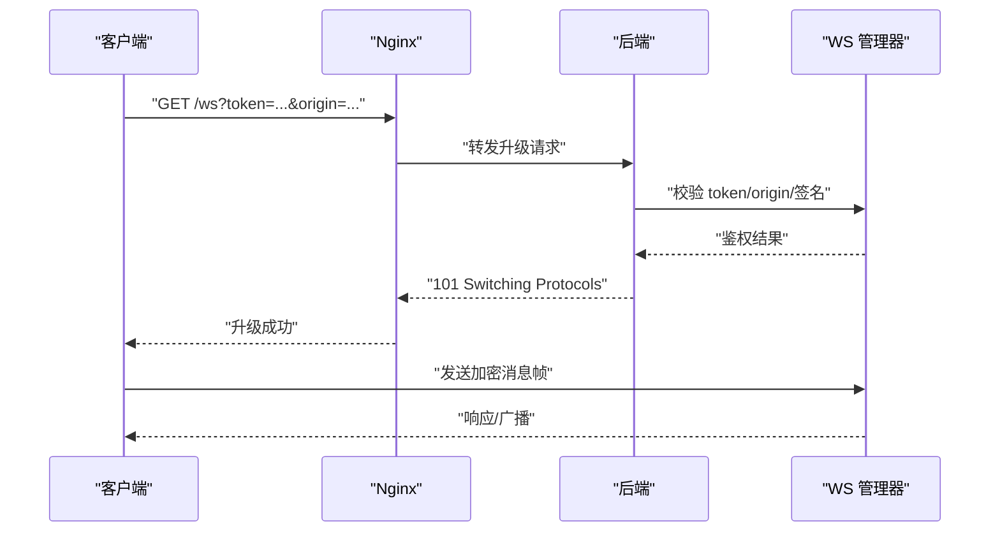
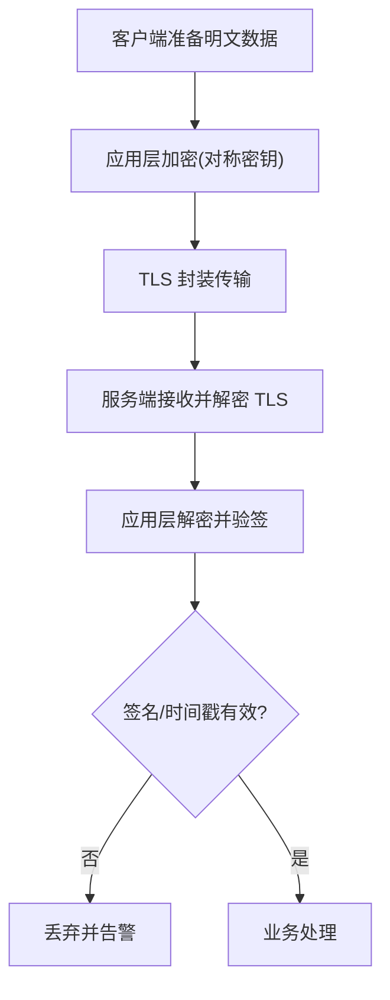
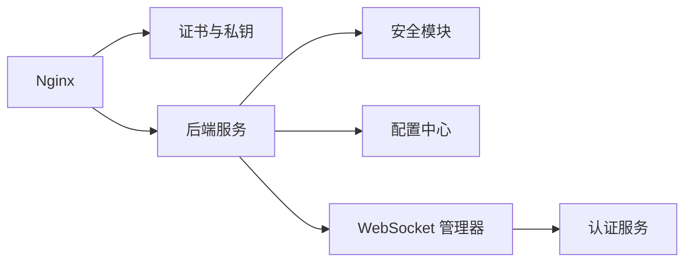

# 数据传输安全

<cite>
**本文引用的文件**   
- [nginx.conf](file://nginx.conf)
- [nginx-prod.conf](file://nginx-prod.conf)
- [nginx-dev.conf](file://nginx-dev.conf)
- [frontend.nginx.conf](file://frontend/frontend.nginx.conf)
- [SSL_CERTIFICATE_GUIDE.md](file://SSL_CERTIFICATE_GUIDE.md)
- [SSL_AUTO_RENEW_GUIDE.md](file://SSL_AUTO_RENEW_GUIDE.md)
- [ssl/README.md](file://ssl/README.md)
- [backend/app/core/security.py](file://backend/app/core/security.py)
- [backend/app/core/config.py](file://backend/app/core/config.py)
- [backend/app/main.py](file://backend/app/main.py)
- [backend/app/websocket/__init__.py](file://backend/app/websocket/__init__.py)
- [backend/app/websocket/manager.py](file://backend/app/websocket/manager.py)
- [docker-compose.yml](file://docker-compose.yml)
- [start_production.bat](file://start_production.bat)
- [SEED_TTS_WEBSOCKET_IMPLEMENTATION.md](file://SEED_TTS_WEBSOCKET_IMPLEMENTATION.md)
</cite>

## 目录
1. [简介](#简介)
2. [项目结构](#项目结构)
3. [核心组件](#核心组件)
4. [架构总览](#架构总览)
5. [详细组件分析](#详细组件分析)
6. [依赖关系分析](#依赖关系分析)
7. [性能考量](#性能考量)
8. [故障排除指南](#故障排除指南)
9. [结论](#结论)
10. [附录](#附录)

## 简介
本文件面向小说创作代理系统的数据传输安全，聚焦于 HTTPS 强制启用、Nginx 反向代理配置、SSL/TLS 证书生命周期管理、加密套件与 TLS 版本策略、端到端加密与中间人攻击防护、证书固定技术，以及 WebSocket 连接的安全升级握手、消息加密与连接池管理。文档同时提供生产环境安全配置模板要点与常见问题的排查方法，帮助运维与开发团队在保障安全的前提下稳定运行。

## 项目结构
本项目采用前后端分离与多服务编排的架构：
- Nginx 作为统一入口，负责终止 TLS、HTTP 到 HTTPS 重定向、静态资源缓存与请求转发。
- 后端基于 Python Web 框架（FastAPI/Starlette）提供服务，包含 API、WebSocket、任务队列等。
- 前端通过独立 Nginx 或同一 Nginx 实例进行托管。
- 使用 docker-compose 编排服务，便于部署与扩展。

[本节为概念性概述，不直接分析具体文件]

## 核心组件
- Nginx 反向代理与 TLS 终止：集中处理 HTTPS、证书、压缩、缓存与访问控制。
- 后端安全模块：统一设置安全响应头、CORS、CSRF、速率限制与认证鉴权。
- WebSocket 管理器：实现连接建立、心跳、断线重连与权限校验。
- 证书管理与自动化续期：脚本与流程确保证书有效性与最小化停机风险。
- 容器编排与启动脚本：保证生产环境一致性与可观测性。

**章节来源**
- [nginx.conf](file://nginx.conf)
- [nginx-prod.conf](file://nginx-prod.conf)
- [frontend/nginx.conf](file://frontend/frontend.nginx.conf)
- [backend/app/core/security.py](file://backend/app/core/security.py)
- [backend/app/websocket/manager.py](file://backend/app/websocket/manager.py)
- [SSL_CERTIFICATE_GUIDE.md](file://SSL_CERTIFICATE_GUIDE.md)
- [SSL_AUTO_RENEW_GUIDE.md](file://SSL_AUTO_RENEW_GUIDE.md)

## 架构总览
下图展示了从客户端到后端的完整数据流与安全边界：

**图表来源**
- [nginx.conf](file://nginx.conf)
- [backend/app/main.py](file://backend/app/main.py)
- [backend/app/websocket/manager.py](file://backend/app/websocket/manager.py)

**章节来源**
- [nginx.conf](file://nginx.conf)
- [backend/app/main.py](file://backend/app/main.py)
- [backend/app/websocket/manager.py](file://backend/app/websocket/manager.py)

## 详细组件分析

### Nginx 反向代理与 HTTPS 强制
- 强制 HTTPS：所有 HTTP 请求重定向至 HTTPS，避免明文传输。
- TLS 版本与加密套件：仅允许现代 TLS 版本与强加密套件，禁用弱算法。
- 安全响应头：HSTS、X-Frame-Options、X-Content-Type-Options、Referrer-Policy 等。
- 静态资源与缓存：对前端静态资源启用缓存与压缩，减少带宽与延迟。
- 上游转发：将动态请求转发至后端服务，必要时设置超时与重试策略。

**图表来源**
- [nginx.conf](file://nginx.conf)
- [nginx-prod.conf](file://nginx-prod.conf)
- [frontend/nginx.conf](file://frontend/frontend.nginx.conf)

**章节来源**
- [nginx.conf](file://nginx.conf)
- [nginx-prod.conf](file://nginx-prod.conf)
- [frontend/nginx.conf](file://frontend/frontend.nginx.conf)

### SSL/TLS 证书管理流程
- 证书生成：使用受信任 CA 签发或通过自动化工具申请。
- 部署策略：证书与私钥放置于只读目录，Nginx 热加载配置。
- 监控告警：证书到期前预警，失败时通知运维。
- 自动续期：定时任务检查并更新证书，平滑切换避免中断。
- 回滚机制：保留上一版证书，失败时快速回滚。

**图表来源**
- [SSL_CERTIFICATE_GUIDE.md](file://SSL_CERTIFICATE_GUIDE.md)
- [SSL_AUTO_RENEW_GUIDE.md](file://SSL_AUTO_RENEW_GUIDE.md)
- [ssl/README.md](file://ssl/README.md)

**章节来源**
- [SSL_CERTIFICATE_GUIDE.md](file://SSL_CERTIFICATE_GUIDE.md)
- [SSL_AUTO_RENEW_GUIDE.md](file://SSL_AUTO_RENEW_GUIDE.md)
- [ssl/README.md](file://ssl/README.md)

### 后端安全与响应头
- 统一安全头：强制 HTTPS、内容类型嗅探防护、点击劫持防护、跨域策略。
- 认证与授权：JWT/OAuth、RBAC、会话管理。
- 输入校验与输出编码：防止注入与 XSS。
- 速率限制与防刷：接口级限流与 IP 黑名单。

**图表来源**
- [backend/app/core/security.py](file://backend/app/core/security.py)
- [backend/app/core/config.py](file://backend/app/core/config.py)

**章节来源**
- [backend/app/core/security.py](file://backend/app/core/security.py)
- [backend/app/core/config.py](file://backend/app/core/config.py)

### WebSocket 连接安全
- 升级握手验证：严格校验 Upgrade 头、Origin、Sec-WebSocket-* 字段。
- 身份与会话：连接前完成鉴权，携带令牌或签名参数。
- 消息加密：在 TLS 之上应用应用层加密（可选），或使用二进制帧与签名校验。
- 连接池管理：限制并发连接数、心跳保活、断线重连与优雅关闭。
- 审计与限流：记录连接事件、按用户/IP 限速。

**图表来源**
- [backend/app/websocket/manager.py](file://backend/app/websocket/manager.py)
- [SEED_TTS_WEBSOCKET_IMPLEMENTATION.md](file://SEED_TTS_WEBSOCKET_IMPLEMENTATION.md)

**章节来源**
- [backend/app/websocket/manager.py](file://backend/app/websocket/manager.py)
- [SEED_TTS_WEBSOCKET_IMPLEMENTATION.md](file://SEED_TTS_WEBSOCKET_IMPLEMENTATION.md)

### 端到端加密与中间人攻击防护
- 端到端加密：在 TLS 基础上对敏感载荷再次加密（如信封加密），密钥由客户端与服务端协商。
- 中间人防护：启用 HSTS、证书固定（Pin）、严格的证书链校验。
- 随机性与完整性：使用强随机数、消息签名与时间戳防重放。
- 最小暴露面：仅开放必要端口与路径，屏蔽调试接口。

[本节为通用实践说明，不直接分析具体文件]

### 生产环境安全配置模板要点
- Nginx：强制 HTTPS、仅 TLS1.2+、强加密套件、HSTS、安全头、缓存与压缩、上游超时与重试。
- 后端：环境变量驱动配置、最小权限、日志脱敏、健康检查与就绪探针。
- 容器：只读根文件系统、非 root 运行、镜像扫描、最小基础镜像。
- 监控：证书到期、TLS 错误率、握手失败、WS 连接异常。

**章节来源**
- [nginx-prod.conf](file://nginx-prod.conf)
- [docker-compose.yml](file://docker-compose.yml)
- [start_production.bat](file://start_production.bat)

## 依赖关系分析
- Nginx 依赖证书文件与配置文件；后端依赖安全模块与配置中心。
- WebSocket 管理器依赖认证与鉴权服务。
- 容器编排依赖镜像与外部服务（数据库、缓存）。

**图表来源**
- [nginx.conf](file://nginx.conf)
- [backend/app/core/security.py](file://backend/app/core/security.py)
- [backend/app/core/config.py](file://backend/app/core/config.py)
- [backend/app/websocket/manager.py](file://backend/app/websocket/manager.py)

**章节来源**
- [nginx.conf](file://nginx.conf)
- [backend/app/core/security.py](file://backend/app/core/security.py)
- [backend/app/core/config.py](file://backend/app/core/config.py)
- [backend/app/websocket/manager.py](file://backend/app/websocket/manager.py)

## 性能考量
- TLS 握手开销：启用会话复用、OCSP Stapling、HTTP/2 与 QUIC（若支持）。
- 证书大小：选择合适证书链长度，减少握手时延。
- 压缩与缓存：合理设置 gzip/brotli 与静态资源缓存策略。
- 连接池：后端与数据库连接池调优，避免频繁握手与上下文切换。
- 监控指标：握手失败率、证书过期、TLS 版本分布、加密套件使用占比。

[本节为通用指导，不直接分析具体文件]

## 故障排除指南
- 证书问题：检查证书链完整性、域名匹配、私钥权限与 Nginx 重载状态。
- TLS 握手失败：确认客户端支持的 TLS 版本与套件，查看 Nginx 错误日志。
- HSTS 导致无法访问：确认预加载列表与子域名策略，必要时暂时移除 Strict-Transport-Security。
- WebSocket 升级失败：检查 Origin、Upgrade 头、Nginx 代理设置与后端鉴权逻辑。
- 中间人攻击迹象：启用证书固定与 HSTS，核查代理链与 DNS 解析。

**章节来源**
- [SSL_CERTIFICATE_GUIDE.md](file://SSL_CERTIFICATE_GUIDE.md)
- [SSL_AUTO_RENEW_GUIDE.md](file://SSL_AUTO_RENEW_GUIDE.md)
- [nginx.conf](file://nginx.conf)
- [backend/app/websocket/manager.py](file://backend/app/websocket/manager.py)

## 结论
通过统一的 Nginx 反向代理与严格的 TLS 策略，结合后端安全模块与 WebSocket 连接治理，可实现端到端的数据传输安全。配合自动化证书管理与监控告警，能够在生产环境中持续保障通信机密性与完整性，降低中间人攻击与证书失效带来的风险。

[本节为总结性内容，不直接分析具体文件]

## 附录
- 参考文档与脚本：
  - 证书指南与自动续期流程见相关 Markdown 文件。
  - 生产启动脚本与容器编排用于一致性部署。
- 建议实践：
  - 定期演练证书续期与回滚。
  - 对关键接口实施速率限制与审计。
  - 对敏感数据实施应用层加密与签名。

[本节为补充信息，不直接分析具体文件]