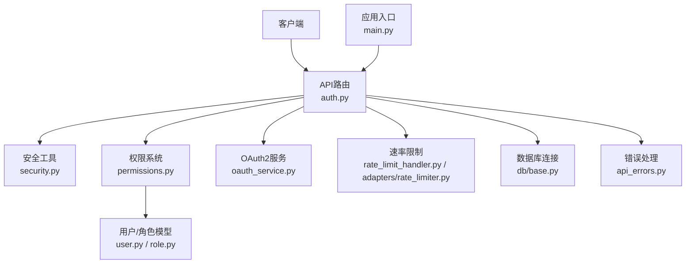
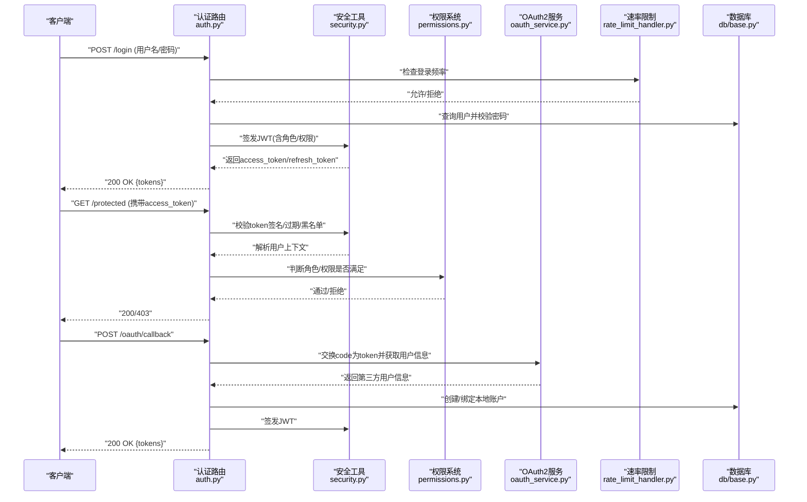
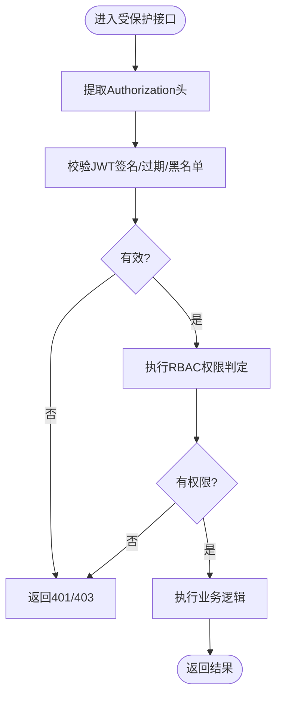
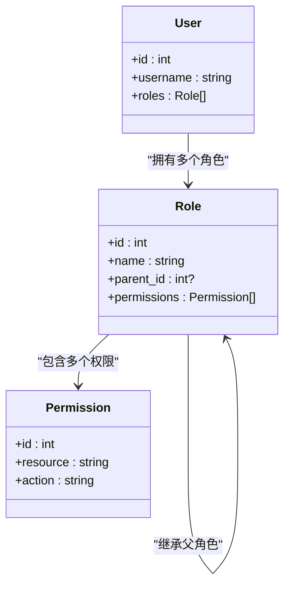
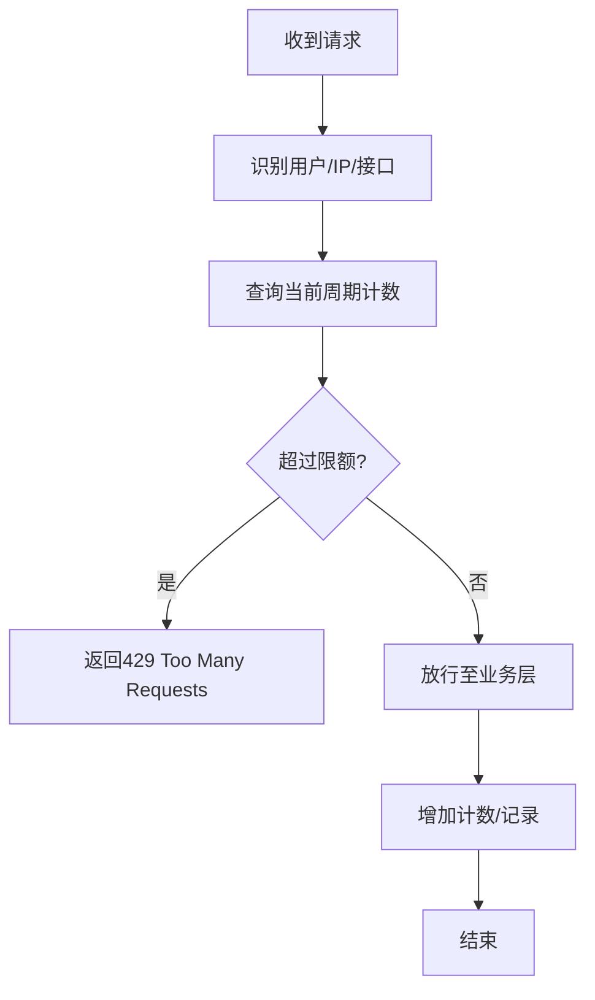
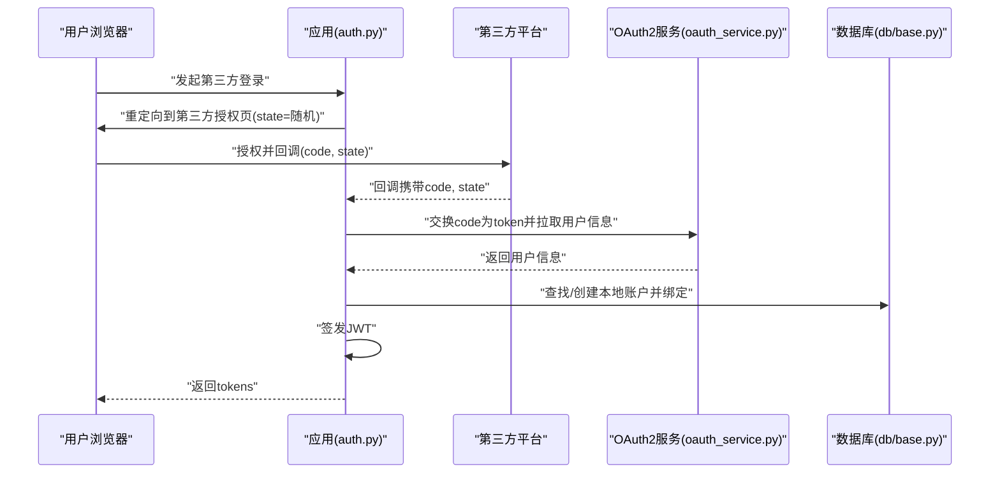
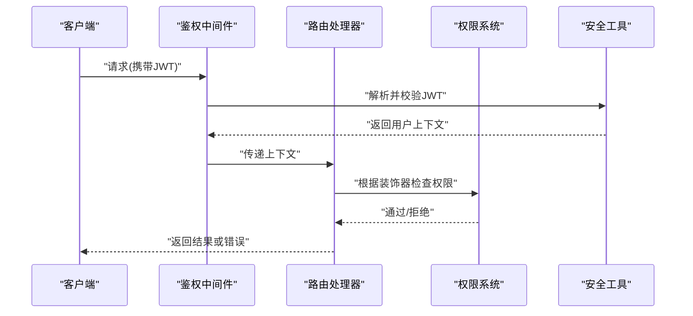
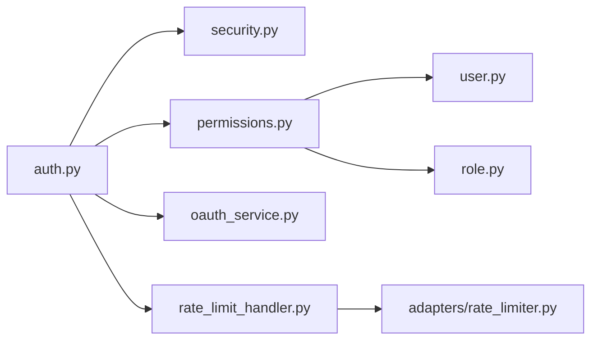

# 身份认证与授权

<cite>
**本文引用的文件**   
- [backend/app/api/v1/auth.py](file://backend/app/api/v1/auth.py)
- [backend/app/core/security.py](file://backend/app/core/security.py)
- [backend/app/core/permissions.py](file://backend/app/core/permissions.py)
- [backend/app/models/user.py](file://backend/app/models/user.py)
- [backend/app/models/role.py](file://backend/app/models/role.py)
- [backend/app/services/oauth_service.py](file://backend/app/services/oauth_service.py)
- [backend/app/services/rate_limit_handler.py](file://backend/app/services/rate_limit_handler.py)
- [adapters/rate_limiter.py](file://adapters/rate_limiter.py)
- [backend/app/main.py](file://backend/app/main.py)
- [backend/app/db/base.py](file://backend/app/db/base.py)
- [backend/app/schemas/user.py](file://backend/app/schemas/user.py)
- [backend/app/schemas/admin.py](file://backend/app/schemas/admin.py)
- [backend/app/utils/api_errors.py](file://backend/app/utils/api_errors.py)
- [backend/tests/test_auth_routes.py](file://backend/tests/test_auth_routes.py)
</cite>

## 目录
1. [简介](#简介)
2. [项目结构](#项目结构)
3. [核心组件](#核心组件)
4. [架构总览](#架构总览)
5. [详细组件分析](#详细组件分析)
6. [依赖关系分析](#依赖关系分析)
7. [性能考量](#性能考量)
8. [故障排查指南](#故障排查指南)
9. [结论](#结论)
10. [附录](#附录)

## 简介
本文件面向小说创作代理系统的后端安全体系，系统性阐述身份认证与授权的设计与实现。重点覆盖：
- JWT 令牌生命周期管理（生成、校验、刷新、撤销）
- RBAC 角色权限模型与资源访问控制策略
- API 访问限制与安全策略（速率限制、IP 白名单、会话管理）
- OAuth2 集成与第三方登录流程
- 自定义权限装饰器、中间件与认证流程的实现要点
- 常见安全漏洞防护与最佳实践

## 项目结构
认证与授权相关代码主要分布在以下模块：
- 认证路由与接口：backend/app/api/v1/auth.py
- 安全工具与JWT处理：backend/app/core/security.py
- 权限系统与RBAC：backend/app/core/permissions.py
- 用户与角色数据模型：backend/app/models/user.py、backend/app/models/role.py
- OAuth2服务：backend/app/services/oauth_service.py
- 速率限制：backend/app/services/rate_limit_handler.py、adapters/rate_limiter.py
- 应用入口与全局中间件：backend/app/main.py
- 数据库基础配置：backend/app/db/base.py
- 请求/响应模式定义：backend/app/schemas/user.py、backend/app/schemas/admin.py
- 统一错误处理：backend/app/utils/api_errors.py
- 认证路由测试：backend/tests/test_auth_routes.py

图表来源
- [backend/app/api/v1/auth.py](file://backend/app/api/v1/auth.py)
- [backend/app/core/security.py](file://backend/app/core/security.py)
- [backend/app/core/permissions.py](file://backend/app/core/permissions.py)
- [backend/app/services/oauth_service.py](file://backend/app/services/oauth_service.py)
- [backend/app/services/rate_limit_handler.py](file://backend/app/services/rate_limit_handler.py)
- [adapters/rate_limiter.py](file://adapters/rate_limiter.py)
- [backend/app/models/user.py](file://backend/app/models/user.py)
- [backend/app/models/role.py](file://backend/app/models/role.py)
- [backend/app/db/base.py](file://backend/app/db/base.py)
- [backend/app/utils/api_errors.py](file://backend/app/utils/api_errors.py)
- [backend/app/main.py](file://backend/app/main.py)

章节来源
- [backend/app/api/v1/auth.py](file://backend/app/api/v1/auth.py)
- [backend/app/core/security.py](file://backend/app/core/security.py)
- [backend/app/core/permissions.py](file://backend/app/core/permissions.py)
- [backend/app/models/user.py](file://backend/app/models/user.py)
- [backend/app/models/role.py](file://backend/app/models/role.py)
- [backend/app/services/oauth_service.py](file://backend/app/services/oauth_service.py)
- [backend/app/services/rate_limit_handler.py](file://backend/app/services/rate_limit_handler.py)
- [adapters/rate_limiter.py](file://adapters/rate_limiter.py)
- [backend/app/main.py](file://backend/app/main.py)
- [backend/app/db/base.py](file://backend/app/db/base.py)
- [backend/app/schemas/user.py](file://backend/app/schemas/user.py)
- [backend/app/schemas/admin.py](file://backend/app/schemas/admin.py)
- [backend/app/utils/api_errors.py](file://backend/app/utils/api_errors.py)
- [backend/tests/test_auth_routes.py](file://backend/tests/test_auth_routes.py)

## 核心组件
- 认证路由（auth.py）：提供登录、注册、登出、刷新令牌、第三方登录等接口，协调安全工具、权限系统与外部服务。
- 安全工具（security.py）：负责JWT的签发、解析、校验、黑名单/撤销列表维护、密码哈希与校验、令牌过期策略。
- 权限系统（permissions.py）：基于RBAC的角色与权限判定，支持权限继承、资源级访问控制、装饰器与中间件集成。
- 用户与角色模型（user.py、role.py）：用户实体、角色实体、角色-权限关联、用户-角色关联的数据结构与查询方法。
- OAuth2服务（oauth_service.py）：对接第三方平台，完成授权码流程、Token交换、用户信息拉取与本地账户绑定。
- 速率限制（rate_limit_handler.py、adapters/rate_limiter.py）：按用户/IP/接口维度限流，结合Redis或内存存储计数。
- 应用入口（main.py）：注册全局中间件（如鉴权、限流、CORS、日志），挂载API路由。
- 错误处理（api_errors.py）：统一异常类型与HTTP状态码映射，便于前端一致处理。

章节来源
- [backend/app/api/v1/auth.py](file://backend/app/api/v1/auth.py)
- [backend/app/core/security.py](file://backend/app/core/security.py)
- [backend/app/core/permissions.py](file://backend/app/core/permissions.py)
- [backend/app/models/user.py](file://backend/app/models/user.py)
- [backend/app/models/role.py](file://backend/app/models/role.py)
- [backend/app/services/oauth_service.py](file://backend/app/services/oauth_service.py)
- [backend/app/services/rate_limit_handler.py](file://backend/app/services/rate_limit_handler.py)
- [adapters/rate_limiter.py](file://adapters/rate_limiter.py)
- [backend/app/main.py](file://backend/app/main.py)
- [backend/app/utils/api_errors.py](file://backend/app/utils/api_errors.py)

## 架构总览
下图展示从客户端到后端的认证与授权关键路径，包括JWT签发与校验、RBAC权限判定、OAuth2第三方登录以及速率限制。

图表来源
- [backend/app/api/v1/auth.py](file://backend/app/api/v1/auth.py)
- [backend/app/core/security.py](file://backend/app/core/security.py)
- [backend/app/core/permissions.py](file://backend/app/core/permissions.py)
- [backend/app/services/oauth_service.py](file://backend/app/services/oauth_service.py)
- [backend/app/services/rate_limit_handler.py](file://backend/app/services/rate_limit_handler.py)
- [backend/app/db/base.py](file://backend/app/db/base.py)

## 详细组件分析

### JWT令牌管理机制
- 令牌生成
  - 登录成功后由安全工具签发短期有效的access_token与较长期的refresh_token，载荷包含用户标识、角色与权限集合。
  - 建议将敏感字段最小化，避免在token中存放明文密码或大对象。
- 令牌验证
  - 每次受保护请求需携带access_token，服务端校验签名、过期时间、黑名单（撤销）。
  - 失败时返回统一错误码，便于前端重试或跳转登录。
- 令牌刷新
  - refresh_token用于换取新的access_token，需校验其有效性、绑定用户与设备指纹（可选）。
  - 刷新接口应单独限流，防止暴力刷新。
- 令牌撤销
  - 支持将已签发的access_token加入黑名单（例如使用Redis键空间），或在登出时使refresh_token失效。
  - 管理员可批量撤销某用户的所有活跃令牌。

图表来源
- [backend/app/core/security.py](file://backend/app/core/security.py)
- [backend/app/core/permissions.py](file://backend/app/core/permissions.py)
- [backend/app/api/v1/auth.py](file://backend/app/api/v1/auth.py)

章节来源
- [backend/app/core/security.py](file://backend/app/core/security.py)
- [backend/app/api/v1/auth.py](file://backend/app/api/v1/auth.py)

### RBAC角色权限控制系统
- 模型设计
  - 用户-角色多对多、角色-权限多对多，支持权限继承（父角色包含子角色权限）。
  - 资源级控制：按模块/资源/动作（CRUD）粒度进行判定。
- 权限判定流程
  - 从JWT载荷或会话加载用户角色与权限集合。
  - 先检查显式授予的权限，再检查继承链上的权限。
  - 支持资源范围限定（如仅允许访问自己创建的项目）。
- 装饰器与中间件
  - 提供@require_role、@require_permission等装饰器，快速声明接口所需权限。
  - 全局中间件统一拦截未认证与越权请求，输出标准化错误。

图表来源
- [backend/app/models/user.py](file://backend/app/models/user.py)
- [backend/app/models/role.py](file://backend/app/models/role.py)
- [backend/app/core/permissions.py](file://backend/app/core/permissions.py)

章节来源
- [backend/app/core/permissions.py](file://backend/app/core/permissions.py)
- [backend/app/models/user.py](file://backend/app/models/user.py)
- [backend/app/models/role.py](file://backend/app/models/role.py)

### API访问限制与安全策略
- 速率限制
  - 按用户ID、IP地址、接口路径分别计数，支持滑动窗口或固定窗口算法。
  - 超限返回429，附带重试间隔；对登录、注册、刷新等高敏接口设置更严格阈值。
- IP白名单
  - 管理员可配置可信IP段，绕过部分限制或提升配额。
  - 白名单更新实时生效，支持热重载。
- 会话管理
  - 无状态JWT为主，必要时结合Redis维护会话状态（如强制下线、设备管理）。
  - 支持多端登录策略与并发会话上限控制。

图表来源
- [backend/app/services/rate_limit_handler.py](file://backend/app/services/rate_limit_handler.py)
- [adapters/rate_limiter.py](file://adapters/rate_limiter.py)

章节来源
- [backend/app/services/rate_limit_handler.py](file://backend/app/services/rate_limit_handler.py)
- [adapters/rate_limiter.py](file://adapters/rate_limiter.py)

### OAuth2集成与第三方登录
- 流程说明
  - 客户端重定向至第三方授权页，回调携带code。
  - 服务端用code换取access_token与用户信息，建立或绑定本地账户。
  - 签发JWT并返回给客户端。
- 安全要点
  - 校验state参数防CSRF。
  - 严格校验redirect_uri与scope。
  - 对用户邮箱/手机号进行唯一性校验与冲突处理。

图表来源
- [backend/app/api/v1/auth.py](file://backend/app/api/v1/auth.py)
- [backend/app/services/oauth_service.py](file://backend/app/services/oauth_service.py)
- [backend/app/db/base.py](file://backend/app/db/base.py)

章节来源
- [backend/app/api/v1/auth.py](file://backend/app/api/v1/auth.py)
- [backend/app/services/oauth_service.py](file://backend/app/services/oauth_service.py)

### 自定义权限装饰器、中间件与认证流程示例
- 权限装饰器
  - 使用@require_role("admin")或@require_permission("project:create")声明接口权限。
  - 未通过判定返回403，并通过统一错误格式返回。
- 中间件
  - 全局鉴权中间件：解析JWT、注入用户上下文、调用权限系统。
  - 限流中间件：在路由前执行速率限制检查。
- 认证流程
  - 登录：校验凭据→签发JWT→返回tokens。
  - 刷新：校验refresh_token→签发新access_token。
  - 登出：撤销refresh_token或加入黑名单。

图表来源
- [backend/app/core/permissions.py](file://backend/app/core/permissions.py)
- [backend/app/core/security.py](file://backend/app/core/security.py)
- [backend/app/api/v1/auth.py](file://backend/app/api/v1/auth.py)

章节来源
- [backend/app/core/permissions.py](file://backend/app/core/permissions.py)
- [backend/app/core/security.py](file://backend/app/core/security.py)
- [backend/app/api/v1/auth.py](file://backend/app/api/v1/auth.py)

## 依赖关系分析
- 模块耦合
  - auth.py依赖security.py、permissions.py、oauth_service.py、rate_limit_handler.py。
  - permissions.py依赖user.py与role.py的数据模型。
  - rate_limit_handler.py依赖adapters/rate_limiter.py的具体实现。
- 外部依赖
  - Redis用于令牌黑名单与限流计数。
  - 第三方OAuth2提供商（如微信、GitHub、Google等）。
- 潜在循环依赖
  - 确保权限系统不反向依赖认证路由，避免循环导入。

图表来源
- [backend/app/api/v1/auth.py](file://backend/app/api/v1/auth.py)
- [backend/app/core/security.py](file://backend/app/core/security.py)
- [backend/app/core/permissions.py](file://backend/app/core/permissions.py)
- [backend/app/services/oauth_service.py](file://backend/app/services/oauth_service.py)
- [backend/app/services/rate_limit_handler.py](file://backend/app/services/rate_limit_handler.py)
- [adapters/rate_limiter.py](file://adapters/rate_limiter.py)
- [backend/app/models/user.py](file://backend/app/models/user.py)
- [backend/app/models/role.py](file://backend/app/models/role.py)

章节来源
- [backend/app/api/v1/auth.py](file://backend/app/api/v1/auth.py)
- [backend/app/core/security.py](file://backend/app/core/security.py)
- [backend/app/core/permissions.py](file://backend/app/core/permissions.py)
- [backend/app/services/oauth_service.py](file://backend/app/services/oauth_service.py)
- [backend/app/services/rate_limit_handler.py](file://backend/app/services/rate_limit_handler.py)
- [adapters/rate_limiter.py](file://adapters/rate_limiter.py)
- [backend/app/models/user.py](file://backend/app/models/user.py)
- [backend/app/models/role.py](file://backend/app/models/role.py)

## 性能考量
- JWT校验开销低，但黑名单查询需借助Redis索引，注意键设计与过期策略。
- 权限判定应避免N+1查询，采用批量加载用户角色与权限。
- 速率限制在高并发场景下建议使用Redis原子操作与滑动窗口算法。
- 第三方登录回调需异步处理用户绑定与初始化任务，减少同步阻塞。

[本节为通用指导，无需引用具体文件]

## 故障排查指南
- 常见问题
  - 401未认证：检查Authorization头格式、JWT签名与过期时间。
  - 403权限不足：确认用户角色与权限集合是否正确加载，装饰器参数是否匹配。
  - 429限流触发：检查限流阈值与计数键，必要时调整策略。
  - OAuth回调失败：核对client_id、secret、redirect_uri与scope配置。
- 调试建议
  - 启用详细日志记录JWT解析与权限判定过程。
  - 使用测试用例验证登录、刷新、撤销流程。
  - 通过健康检查接口确认Redis与第三方服务连通性。

章节来源
- [backend/app/utils/api_errors.py](file://backend/app/utils/api_errors.py)
- [backend/tests/test_auth_routes.py](file://backend/tests/test_auth_routes.py)

## 结论
本系统以JWT为核心，结合RBAC与速率限制，构建了完整的认证与授权体系。通过清晰的模块划分与统一的错误处理，既保证了安全性，也提升了可维护性与扩展性。建议在后续迭代中持续优化权限判定性能与限流策略，并完善第三方登录的安全校验与审计能力。

[本节为总结性内容，无需引用具体文件]

## 附录
- 配置项建议
  - JWT密钥轮换策略与最小生存期。
  - 限流阈值与窗口大小按环境区分。
  - OAuth2提供商的回调域名与白名单。
- 最佳实践
  - 最小权限原则与职责分离。
  - 敏感操作二次确认与审计日志。
  - 定期审查角色与权限分配，清理僵尸账户。

[本节为补充信息，无需引用具体文件]