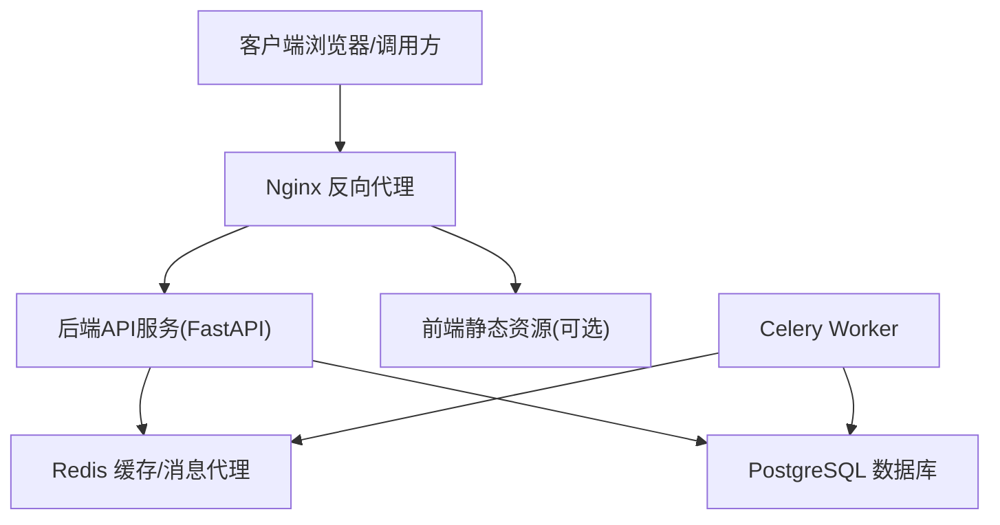
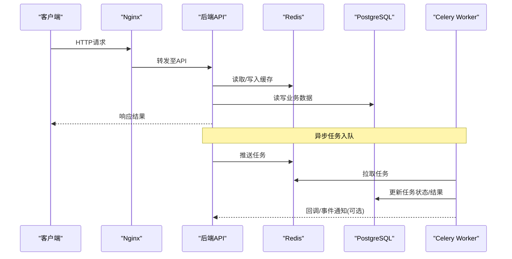
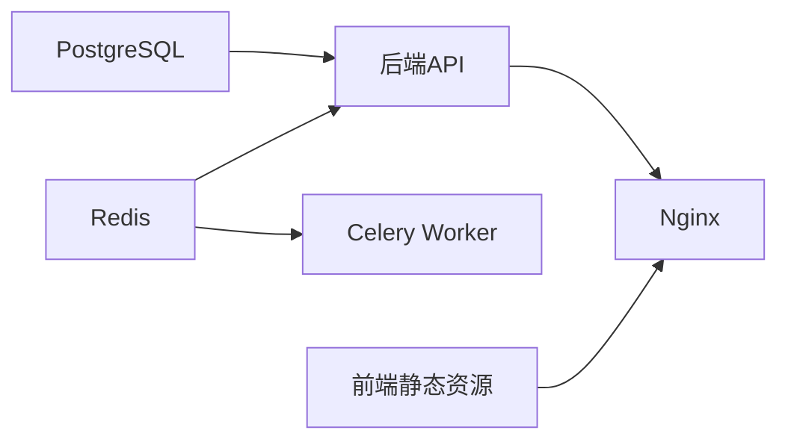

# Docker Compose编排

<cite>
**本文引用的文件**   
- [docker-compose.yml](file://docker-compose.yml)
- [nginx.conf](file://nginx.conf)
- [nginx-dev.conf](file://nginx-dev.conf)
- [nginx-prod.conf](file://nginx-prod.conf)
- [backend/Dockerfile](file://backend/Dockerfile)
- [frontend/Dockerfile](file://frontend/Dockerfile)
- [redis.conf](file://redis.conf)
- [postgres-init/01-init.sql](file://postgres-init/01-init.sql)
- [backend/app/celery_app.py](file://backend/app/celery_app.py)
- [backend/app/main.py](file://backend/app/main.py)
- [backend/app/core/config.py](file://backend/app/core/config.py)
- [backend/app/core/env_loader.py](file://backend/app/core/env_loader.py)
</cite>

## 目录
1. [简介](#简介)
2. [项目结构](#项目结构)
3. [核心组件](#核心组件)
4. [架构总览](#架构总览)
5. [详细组件分析](#详细组件分析)
6. [依赖关系分析](#依赖关系分析)
7. [性能考虑](#性能考虑)
8. [故障排查指南](#故障排查指南)
9. [结论](#结论)
10. [附录](#附录)

## 简介
本文件为小说创作代理系统的Docker Compose编排文档，覆盖后端API服务、Celery Worker、Redis缓存、PostgreSQL数据库与Nginx反向代理的完整部署方案。内容涵盖服务定义结构、网络通信（自定义网络、端口映射、服务发现）、数据持久化（数据库卷、静态资源、日志管理）、环境变量配置管理（.env组织、敏感信息处理、环境隔离）、健康检查与自动重启策略、以及故障恢复机制。读者可据此快速搭建本地开发或生产环境，并具备排障与优化能力。

## 项目结构
系统采用多容器微服务架构，通过Docker Compose统一编排：
- 后端API服务：基于FastAPI，提供REST接口与WebSocket支持
- Celery Worker：异步任务执行器，处理音频生成、视频生成、数据处理等耗时任务
- Redis：消息代理与缓存
- PostgreSQL：业务数据持久化
- Nginx：反向代理、静态资源托管、SSL终止

图表来源
- [docker-compose.yml](file://docker-compose.yml)
- [nginx.conf](file://nginx.conf)
- [backend/app/main.py](file://backend/app/main.py)
- [backend/app/celery_app.py](file://backend/app/celery_app.py)

章节来源
- [docker-compose.yml](file://docker-compose.yml)
- [nginx.conf](file://nginx.conf)
- [backend/Dockerfile](file://backend/Dockerfile)
- [frontend/Dockerfile](file://frontend/Dockerfile)

## 核心组件
- 后端API服务
  - 入口：FastAPI应用启动与路由注册
  - 依赖：PostgreSQL、Redis、外部AI模型服务
  - 功能：用户认证、项目管理、章节与角色管理、工作流编排、资产库、审计与监控等
- Celery Worker
  - 任务队列：通过Redis作为Broker
  - 任务类型：音频生成、视频生成、字幕生成、质量审核、批量处理等
- Redis
  - 用途：任务队列、会话缓存、限流、热点数据缓存
- PostgreSQL
  - 用途：业务主数据、元数据、审计日志、向量索引元数据
- Nginx
  - 用途：反向代理、负载均衡、静态资源服务、HTTPS终止、请求头转发

章节来源
- [backend/app/main.py](file://backend/app/main.py)
- [backend/app/celery_app.py](file://backend/app/celery_app.py)
- [backend/app/core/config.py](file://backend/app/core/config.py)
- [backend/app/core/env_loader.py](file://backend/app/core/env_loader.py)

## 架构总览
下图展示从客户端到各服务的请求路径与数据流向，包括Nginx对API与静态资源的分流、API对Redis与PostgreSQL的访问、以及Worker通过Redis消费任务的流程。

图表来源
- [docker-compose.yml](file://docker-compose.yml)
- [nginx.conf](file://nginx.conf)
- [backend/app/main.py](file://backend/app/main.py)
- [backend/app/celery_app.py](file://backend/app/celery_app.py)

## 详细组件分析

### 服务定义与网络通信
- 自定义网络
  - 使用独立网络隔离服务间通信，避免宿主机端口冲突
  - 服务间通过容器名进行DNS解析实现服务发现
- 端口映射
  - Nginx对外暴露HTTP/HTTPS端口
  - 数据库与Redis仅对内网开放，不直接暴露给宿主机
- 健康检查
  - 为关键服务配置健康检查，确保依赖就绪后再启动依赖方
  - 失败时触发自动重启或依赖重试

章节来源
- [docker-compose.yml](file://docker-compose.yml)

### 后端API服务
- 镜像构建
  - 基于Python基础镜像，安装依赖并拷贝应用代码
- 运行参数
  - 环境变量注入：数据库连接、Redis地址、密钥、第三方API Key等
  - 挂载卷：日志、上传文件、临时目录
- 健康检查
  - 通过内置健康端点检测服务可用性
- 依赖顺序
  - 等待PostgreSQL与Redis就绪后启动

章节来源
- [backend/Dockerfile](file://backend/Dockerfile)
- [backend/app/main.py](file://backend/app/main.py)
- [backend/app/core/config.py](file://backend/app/core/config.py)
- [backend/app/core/env_loader.py](file://backend/app/core/env_loader.py)

### Celery Worker
- 镜像构建
  - 复用后端镜像，以celery命令启动worker进程
- 任务队列
  - Broker与Backend均指向Redis
- 并发与资源
  - 根据CPU核数与内存限制设置并发度
- 日志与监控
  - 输出结构化日志，便于集中采集

章节来源
- [backend/app/celery_app.py](file://backend/app/celery_app.py)
- [docker-compose.yml](file://docker-compose.yml)

### Redis缓存
- 配置文件
  - 通过redis.conf定制持久化、内存策略、最大连接数
- 数据持久化
  - 启用AOF/RDB，将数据落盘至卷
- 安全与访问控制
  - 设置密码与ACL（可选）

章节来源
- [redis.conf](file://redis.conf)
- [docker-compose.yml](file://docker-compose.yml)

### PostgreSQL数据库
- 初始化脚本
  - 通过01-init.sql创建初始库、表、权限与种子数据
- 数据卷
  - 持久化PG数据目录，避免容器重建丢失
- 备份与恢复
  - 建议配合pg_dump与定时任务实现备份

章节来源
- [postgres-init/01-init.sql](file://postgres-init/01-init.sql)
- [docker-compose.yml](file://docker-compose.yml)

### Nginx反向代理
- 配置模式
  - 提供dev与prod两套模板，分别用于开发与生产环境
- 路由规则
  - /api 转发至后端API
  - / 返回前端静态资源
- SSL终止
  - 在Nginx层加载证书，减少后端压力
- 缓存与压缩
  - 开启Gzip与静态资源缓存策略

章节来源
- [nginx.conf](file://nginx.conf)
- [nginx-dev.conf](file://nginx-dev.conf)
- [nginx-prod.conf](file://nginx-prod.conf)
- [frontend/Dockerfile](file://frontend/Dockerfile)

## 依赖关系分析
- 服务间依赖
  - API依赖PostgreSQL与Redis
  - Worker依赖Redis与PostgreSQL
  - Nginx依赖API与静态资源
- 启动顺序
  - 先启动基础设施（PostgreSQL、Redis），再启动API与Worker，最后启动Nginx
- 健康检查链
  - API健康检查通过后，Nginx才将其加入上游池

图表来源
- [docker-compose.yml](file://docker-compose.yml)
- [backend/app/main.py](file://backend/app/main.py)
- [backend/app/celery_app.py](file://backend/app/celery_app.py)

章节来源
- [docker-compose.yml](file://docker-compose.yml)

## 性能考虑
- 数据库连接池
  - 合理设置连接池大小，避免连接耗尽
- Redis内存与淘汰策略
  - 根据热点数据规模调整maxmemory与eviction策略
- Worker并发
  - 依据CPU与I/O特性调整并发度，避免上下文切换开销
- Nginx缓冲与超时
  - 针对大文件上传/下载调优proxy_buffer与超时参数
- 静态资源缓存
  - 启用浏览器缓存与CDN（可选）

[本节为通用指导，不直接分析具体文件]

## 故障排查指南
- 常见问题定位
  - 数据库连接失败：检查环境变量、网络连通性、账号权限
  - Redis连接失败：检查密码、ACL、防火墙与安全组
  - Worker无任务：检查队列名称、任务注册、Broker可达性
  - Nginx 502/504：检查上游API健康状态与超时配置
- 日志与监控
  - 收集容器日志与业务日志，结合结构化字段快速定位
  - 关键指标：QPS、延迟、错误率、队列长度、连接数
- 健康检查与自愈
  - 利用Compose健康检查与restart策略实现自动恢复
  - 对依赖服务设置重试与退避策略

章节来源
- [backend/app/core/config.py](file://backend/app/core/config.py)
- [backend/app/core/env_loader.py](file://backend/app/core/env_loader.py)
- [docker-compose.yml](file://docker-compose.yml)

## 结论
通过Docker Compose将后端API、Celery Worker、Redis、PostgreSQL与Nginx统一编排，可实现高内聚、低耦合、易扩展的微服务部署。借助健康检查、卷持久化与环境变量管理，系统在开发与生产环境中均可稳定运行。建议在生产环境引入集中式日志、监控告警与自动化备份，进一步提升可靠性与可观测性。

## 附录
- 环境变量管理建议
  - 使用.env按环境隔离（开发、测试、生产）
  - 敏感信息通过密钥管理服务或平台Secret注入
  - 统一前缀命名规范，避免冲突
- 数据备份策略
  - PostgreSQL定期快照与逻辑备份
  - Redis持久化文件纳入备份计划
  - 静态资源与用户上传文件同步至对象存储
- 安全加固
  - 最小权限原则，限制容器网络与文件系统访问
  - 启用TLS与强密码策略
  - 定期扫描镜像漏洞

[本节为通用指导，不直接分析具体文件]