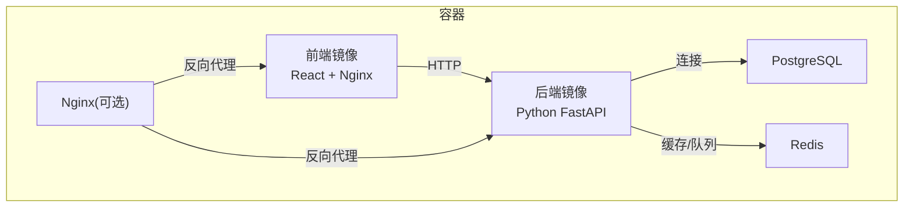
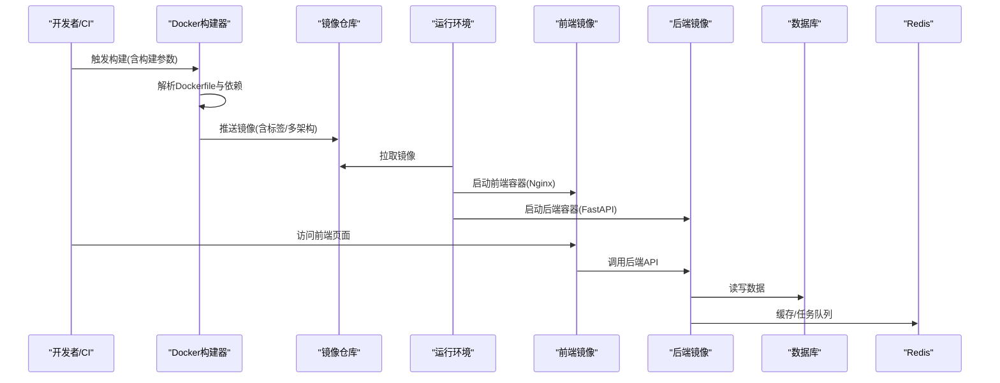
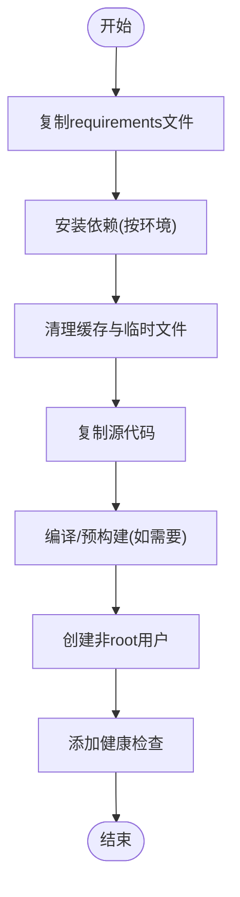
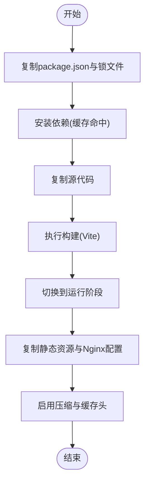
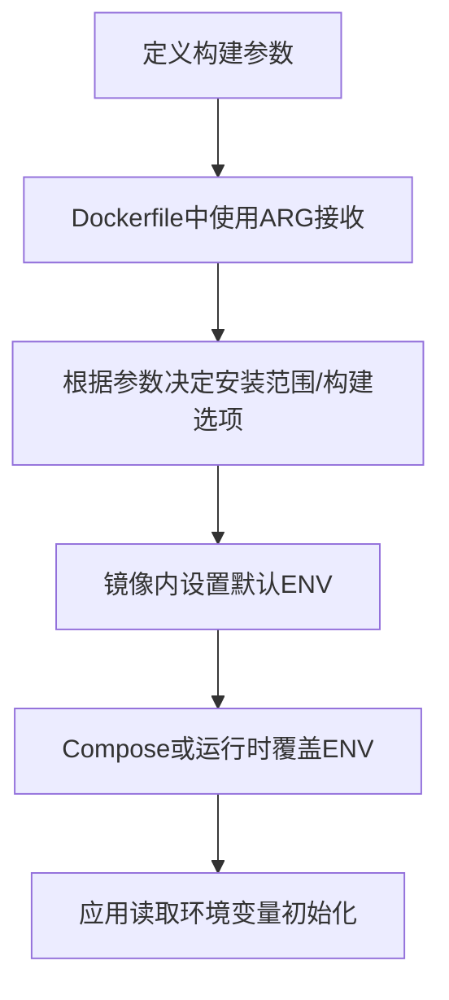
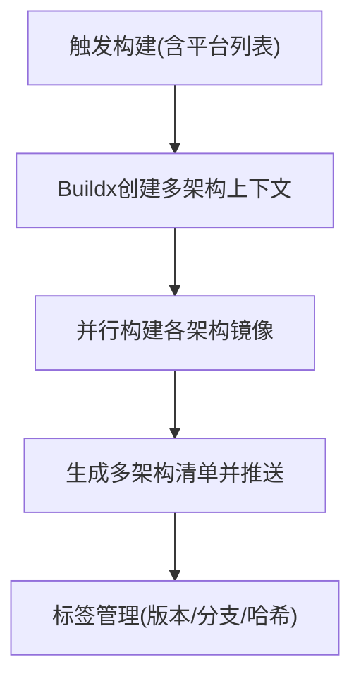
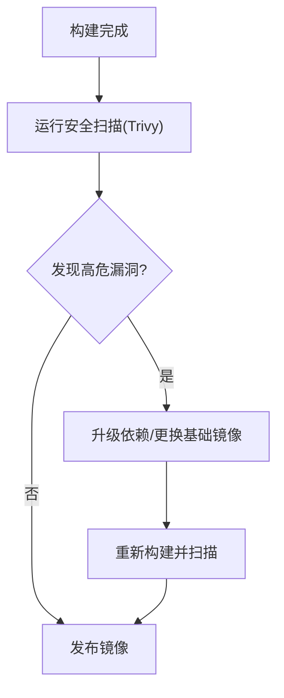
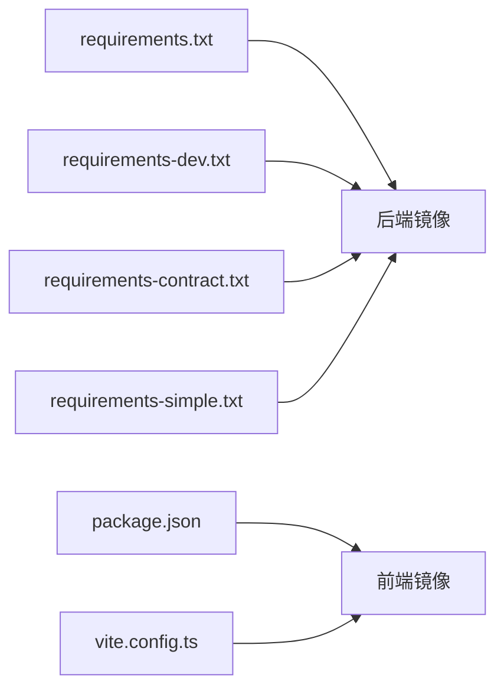

# Docker镜像构建

<cite>
**本文引用的文件**   
- [backend/Dockerfile](file://backend/Dockerfile)
- [frontend/Dockerfile](file://frontend/Dockerfile)
- [docker-compose.yml](file://docker-compose.yml)
- [nginx.conf](file://nginx.conf)
- [nginx-prod.conf](file://nginx-prod.conf)
- [frontend/frontend.nginx.conf](file://frontend/frontend.nginx.conf)
- [backend/requirements.txt](file://backend/requirements.txt)
- [backend/requirements-dev.txt](file://backend/requirements-dev.txt)
- [backend/requirements-contract.txt](file://backend/requirements-contract.txt)
- [backend/requirements-simple.txt](file://backend/requirements-simple.txt)
- [frontend/package.json](file://frontend/package.json)
- [frontend/vite.config.ts](file://frontend/vite.config.ts)
</cite>

## 目录
1. [简介](#简介)
2. [项目结构](#项目结构)
3. [核心组件](#核心组件)
4. [架构总览](#架构总览)
5. [详细组件分析](#详细组件分析)
6. [依赖关系分析](#依赖关系分析)
7. [性能考虑](#性能考虑)
8. [故障排查指南](#故障排查指南)
9. [结论](#结论)
10. [附录](#附录)

## 简介
本文件为小说创作代理系统的Docker镜像构建文档，重点说明多阶段构建策略（Python后端与React前端）、依赖层缓存优化、镜像体积与安全扫描最佳实践，以及构建参数配置（环境变量注入、标签管理、多架构支持）。读者可据此在本地或CI中高效构建生产可用的高质量镜像。

## 项目结构
系统包含前后端两套应用与Nginx反向代理：
- 后端：Python/FastAPI应用，使用多套requirements文件区分环境依赖。
- 前端：React/Vite应用，提供独立Dockerfile与Nginx静态资源服务配置。
- 编排：docker-compose统一编排后端、数据库、Redis等组件。
- Nginx：生产与开发两种配置文件，用于静态资源与反向代理。

**图示来源** 
- [docker-compose.yml](file://docker-compose.yml)
- [nginx.conf](file://nginx.conf)
- [nginx-prod.conf](file://nginx-prod.conf)
- [frontend/frontend.nginx.conf](file://frontend/frontend.nginx.conf)

**章节来源**
- [docker-compose.yml](file://docker-compose.yml)
- [nginx.conf](file://nginx.conf)
- [nginx-prod.conf](file://nginx-prod.conf)
- [frontend/frontend.nginx.conf](file://frontend/frontend.nginx.conf)

## 核心组件
- 后端镜像构建：基于Python基础镜像，按环境分离依赖安装，合并RUN指令，清理缓存，最小化运行时依赖。
- 前端镜像构建：多阶段构建，第一阶段编译产物，第二阶段仅部署静态资源与Nginx，显著减小镜像体积。
- 构建参数与环境变量：通过--build-arg注入构建期变量，通过ENV或Compose注入运行期变量。
- 多架构支持：结合Buildx与平台标记构建多架构镜像。
- 安全扫描：集成Trivy等工具进行漏洞扫描与修复建议。

**章节来源**
- [backend/Dockerfile](file://backend/Dockerfile)
- [frontend/Dockerfile](file://frontend/Dockerfile)
- [backend/requirements.txt](file://backend/requirements.txt)
- [backend/requirements-dev.txt](file://backend/requirements-dev.txt)
- [backend/requirements-contract.txt](file://backend/requirements-contract.txt)
- [backend/requirements-simple.txt](file://backend/requirements-simple.txt)
- [frontend/package.json](file://frontend/package.json)
- [frontend/vite.config.ts](file://frontend/vite.config.ts)

## 架构总览
下图展示从源码到镜像的构建流程与运行时的请求路径。

**图示来源** 
- [backend/Dockerfile](file://backend/Dockerfile)
- [frontend/Dockerfile](file://frontend/Dockerfile)
- [docker-compose.yml](file://docker-compose.yml)

## 详细组件分析

### 后端镜像构建（Python）
- 基础镜像选择：建议使用alpine或slim变体以减小体积；若需系统级依赖，可选择完整发行版并精简后续步骤。
- 依赖分层与缓存：
  - 先复制requirements文件并安装依赖，再复制代码，最大化利用Docker层缓存。
  - 将不同环境的依赖拆分为多个requirements文件，按需安装。
- 合并RUN指令：减少层数，避免中间状态残留。
- 清理临时文件：在安装后删除pip缓存、构建缓存、测试文件等。
- 非root用户运行：提升安全性。
- 健康检查与健康探针：便于编排系统监控。

**图示来源** 
- [backend/Dockerfile](file://backend/Dockerfile)
- [backend/requirements.txt](file://backend/requirements.txt)
- [backend/requirements-dev.txt](file://backend/requirements-dev.txt)
- [backend/requirements-contract.txt](file://backend/requirements-contract.txt)
- [backend/requirements-simple.txt](file://backend/requirements-simple.txt)

**章节来源**
- [backend/Dockerfile](file://backend/Dockerfile)
- [backend/requirements.txt](file://backend/requirements.txt)
- [backend/requirements-dev.txt](file://backend/requirements-dev.txt)
- [backend/requirements-contract.txt](file://backend/requirements-contract.txt)
- [backend/requirements-simple.txt](file://backend/requirements-simple.txt)

### 前端镜像构建（React + Vite）
- 多阶段构建：
  - 构建阶段：安装Node依赖并执行构建命令，生成静态资源。
  - 运行阶段：仅包含静态资源与Nginx，显著降低镜像大小。
- 依赖缓存：优先复制package.json与lock文件，再复制源码，确保依赖变更时才重新安装。
- 构建优化：关闭不必要的调试信息，启用压缩与Tree Shaking。
- Nginx配置：合理设置缓存头、Gzip/Brotli压缩、路由回退。

**图示来源** 
- [frontend/Dockerfile](file://frontend/Dockerfile)
- [frontend/package.json](file://frontend/package.json)
- [frontend/vite.config.ts](file://frontend/vite.config.ts)
- [frontend/frontend.nginx.conf](file://frontend/frontend.nginx.conf)

**章节来源**
- [frontend/Dockerfile](file://frontend/Dockerfile)
- [frontend/package.json](file://frontend/package.json)
- [frontend/vite.config.ts](file://frontend/vite.config.ts)
- [frontend/frontend.nginx.conf](file://frontend/frontend.nginx.conf)

### 构建参数与环境变量
- 构建参数（--build-arg）：用于控制构建期行为，例如是否安装开发依赖、是否启用调试符号、是否开启特定功能开关。
- 运行期环境变量（ENV/Compose）：用于注入API密钥、数据库连接串、日志级别、特性开关等。
- 敏感信息处理：避免将密钥写入镜像，使用运行时挂载或密钥管理服务。

**图示来源** 
- [backend/Dockerfile](file://backend/Dockerfile)
- [frontend/Dockerfile](file://frontend/Dockerfile)
- [docker-compose.yml](file://docker-compose.yml)

**章节来源**
- [backend/Dockerfile](file://backend/Dockerfile)
- [frontend/Dockerfile](file://frontend/Dockerfile)
- [docker-compose.yml](file://docker-compose.yml)

### 多架构支持与标签管理
- 使用Buildx构建多架构镜像，指定目标平台（如linux/amd64、linux/arm64）。
- 标签策略：语义化版本、分支名、提交哈希、时间戳组合，便于追踪与回滚。
- 推送至镜像仓库时同时推送多架构清单。

**图示来源** 
- [docker-compose.yml](file://docker-compose.yml)

**章节来源**
- [docker-compose.yml](file://docker-compose.yml)

### 安全扫描与漏洞修复
- 扫描工具：推荐使用Trivy对镜像进行漏洞扫描，输出报告与严重等级。
- 基线更新：定期更新基础镜像与系统包，缩小攻击面。
- 最小权限：容器内以非root用户运行，限制文件系统权限。
- 依赖治理：锁定依赖版本，及时升级已知漏洞的库。

**图示来源** 
- [backend/Dockerfile](file://backend/Dockerfile)
- [frontend/Dockerfile](file://frontend/Dockerfile)

**章节来源**
- [backend/Dockerfile](file://backend/Dockerfile)
- [frontend/Dockerfile](file://frontend/Dockerfile)

## 依赖关系分析
- 后端依赖分层：
  - requirements.txt：生产依赖
  - requirements-dev.txt：开发依赖
  - requirements-contract.txt：契约测试相关依赖
  - requirements-simple.txt：简化依赖集（用于轻量场景）
- 前端依赖：
  - package.json与锁文件驱动依赖安装与构建
  - vite.config.ts控制构建行为（压缩、插件、代理等）

**图示来源** 
- [backend/requirements.txt](file://backend/requirements.txt)
- [backend/requirements-dev.txt](file://backend/requirements-dev.txt)
- [backend/requirements-contract.txt](file://backend/requirements-contract.txt)
- [backend/requirements-simple.txt](file://backend/requirements-simple.txt)
- [frontend/package.json](file://frontend/package.json)
- [frontend/vite.config.ts](file://frontend/vite.config.ts)

**章节来源**
- [backend/requirements.txt](file://backend/requirements.txt)
- [backend/requirements-dev.txt](file://backend/requirements-dev.txt)
- [backend/requirements-contract.txt](file://backend/requirements-contract.txt)
- [backend/requirements-simple.txt](file://backend/requirements-simple.txt)
- [frontend/package.json](file://frontend/package.json)
- [frontend/vite.config.ts](file://frontend/vite.config.ts)

## 性能考虑
- 依赖层缓存：
  - 将不常变化的依赖安装步骤前置，代码变更不触发依赖重装。
  - 使用锁文件确保依赖一致性，避免重复下载。
- 合并RUN指令：减少层数，降低镜像体积与I/O开销。
- 清理缓存：安装完成后立即清理pip/npm缓存与构建产物。
- 构建优化：
  - 前端：启用压缩、Tree Shaking、按需加载。
  - 后端：仅安装必要依赖，移除调试符号与测试文件。
- 运行时优化：
  - 使用gunicorn/uvicorn等高性能WSGI/ASGI服务器。
  - 合理设置线程/进程数与缓存策略。

[本节为通用指导，无需具体文件引用]

## 故障排查指南
- 构建失败常见原因：
  - 网络问题导致依赖下载失败：配置国内镜像源或使用缓存代理。
  - 依赖冲突：检查requirements与package.lock的一致性。
  - 权限问题：确保脚本执行权限正确。
- 运行时问题：
  - 环境变量未注入：检查Compose或运行命令中的ENV设置。
  - 端口冲突：确认Nginx与后端端口未被占用。
  - 健康检查失败：检查应用健康端点与探针配置。
- 安全扫描告警：
  - 升级基础镜像与依赖库，必要时替换存在漏洞的组件。

**章节来源**
- [docker-compose.yml](file://docker-compose.yml)
- [nginx.conf](file://nginx.conf)
- [nginx-prod.conf](file://nginx-prod.conf)
- [frontend/frontend.nginx.conf](file://frontend/frontend.nginx.conf)

## 结论
通过多阶段构建、合理的依赖分层与缓存策略、镜像体积优化与安全扫描，可以显著提升构建效率与运行稳定性。建议在CI中固化构建流程，统一标签规范与扫描策略，确保交付质量与可追溯性。

[本节为总结性内容，无需具体文件引用]

## 附录
- 常用构建命令参考：
  - 本地构建后端镜像（示例）：在backend目录执行构建命令，传入必要的构建参数。
  - 本地构建前端镜像（示例）：在frontend目录执行构建命令，生成静态资源并打包Nginx镜像。
  - 多架构构建（示例）：使用Buildx指定平台列表并推送镜像仓库。
- 推荐工具：
  - Trivy：镜像安全扫描
  - Docker Buildx：多架构构建
  - Nginx：静态资源与反向代理

[本节为补充信息，无需具体文件引用]