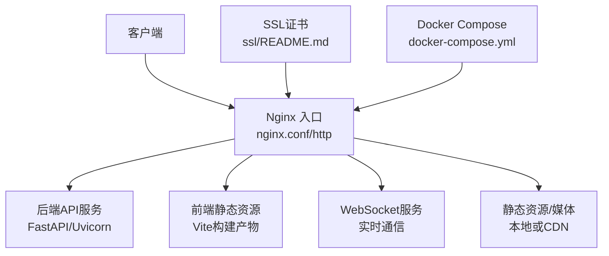
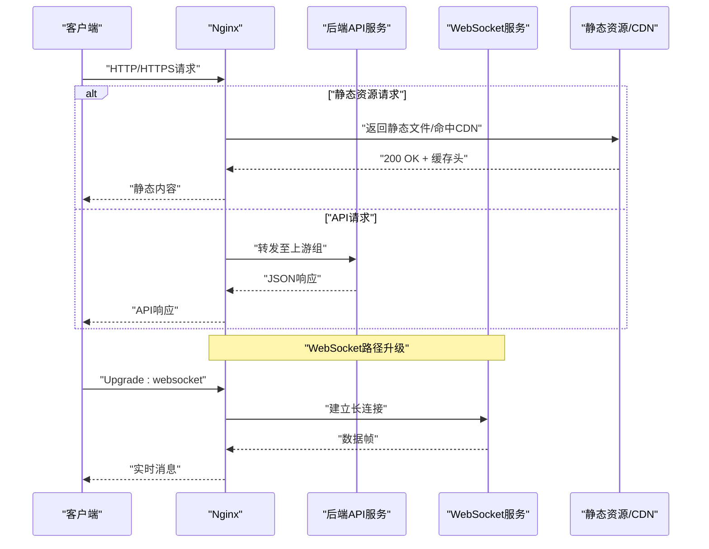
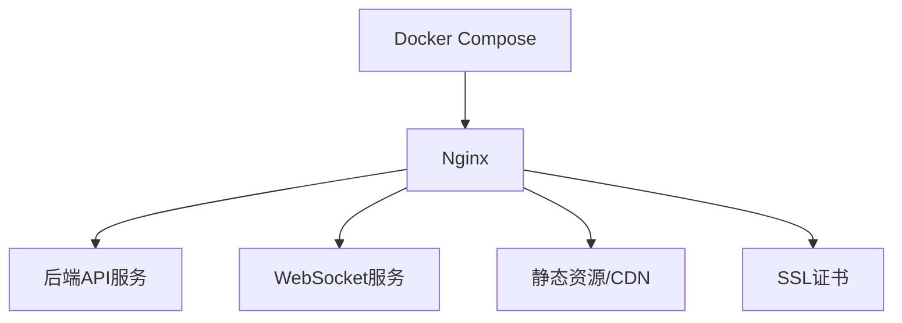

# Nginx反向代理

<cite>
**本文档引用的文件**   
- [nginx.conf](file://nginx.conf)
- [nginx-dev.conf](file://nginx-dev.conf)
- [nginx-prod.conf](file://nginx-prod.conf)
- [nginx.conf.http](file://nginx.conf.http)
- [frontend/nginx.conf](file://frontend/nginx.conf)
- [ssl/README.md](file://ssl/README.md)
- [SSL_CERTIFICATE_GUIDE.md](file://SSL_CERTIFICATE_GUIDE.md)
- [SSL_AUTO_RENEW_GUIDE.md](file://SSL_AUTO_RENEW_GUIDE.md)
- [docker-compose.yml](file://docker-compose.yml)
</cite>

## 目录
1. [简介](#简介)
2. [项目结构](#项目结构)
3. [核心组件](#核心组件)
4. [架构总览](#架构总览)
5. [详细组件分析](#详细组件分析)
6. [依赖关系分析](#依赖关系分析)
7. [性能考虑](#性能考虑)
8. [故障排查指南](#故障排查指南)
9. [结论](#结论)
10. [附录](#附录)

## 简介
本文件为“小说创作代理系统”的Nginx反向代理配置文档，覆盖开发环境与生产环境的差异、调试与错误页定制、访问日志格式、SSL/TLS证书管理（含Let's Encrypt自动续期、HTTPS强制重定向、HTTP/2启用）、负载均衡策略（轮询、权重、故障转移）、静态资源优化（Gzip压缩、浏览器缓存、CDN集成）、WebSocket支持（连接保持、心跳检测、连接数限制）以及安全加固（请求频率限制、IP白名单、CORS跨域）。

## 项目结构
本项目在根目录提供多套Nginx配置文件，分别用于不同场景：
- nginx.conf：通用主配置（包含http/server/location等基础结构）
- nginx-dev.conf：开发环境专用配置（开启调试、简化安全策略、便于本地联调）
- nginx-prod.conf：生产环境专用配置（强化安全、启用HTTP/2、HTTPS强制重定向、日志与监控）
- nginx.conf.http：纯HTTP入口示例（不含TLS）
- frontend/nginx.conf：前端静态资源服务与路由转发配置
- ssl/README.md：SSL证书存放说明
- SSL_CERTIFICATE_GUIDE.md / SSL_AUTO_RENEW_GUIDE.md：证书申请、部署与自动续期指南
- docker-compose.yml：容器编排中Nginx与其他服务的网络与服务暴露方式

**图表来源** 
- [nginx.conf](file://nginx.conf)
- [nginx.conf.http](file://nginx.conf.http)
- [frontend/nginx.conf](file://frontend/nginx.conf)
- [ssl/README.md](file://ssl/README.md)
- [docker-compose.yml](file://docker-compose.yml)

**章节来源**
- [nginx.conf](file://nginx.conf)
- [nginx-dev.conf](file://nginx-dev.conf)
- [nginx-prod.conf](file://nginx-prod.conf)
- [nginx.conf.http](file://nginx.conf.http)
- [frontend/nginx.conf](file://frontend/nginx.conf)
- [ssl/README.md](file://ssl/README.md)
- [docker-compose.yml](file://docker-compose.yml)

## 核心组件
- 入口与监听器
  - HTTP监听端口（默认80），用于健康检查、重定向到HTTPS、CDN回源等
  - HTTPS监听端口（默认443），启用HTTP/2与安全套件
- 上游与负载均衡
  - 定义后端API服务上游组，支持轮询、权重、故障转移
  - WebSocket路径透传，确保长连接稳定
- 静态资源与缓存
  - 前端静态资源目录映射，设置Gzip压缩与浏览器缓存策略
  - CDN集成时通过缓存头与回源规则优化命中率
- 日志与监控
  - 自定义访问日志格式，记录关键请求信息
  - 错误页面定制，提升用户体验
- 安全策略
  - 请求频率限制、IP白名单、CORS跨域控制
  - 严格的安全响应头（HSTS、X-Frame-Options等）

**章节来源**
- [nginx.conf](file://nginx.conf)
- [nginx-prod.conf](file://nginx-prod.conf)
- [nginx-dev.conf](file://nginx-dev.conf)
- [frontend/nginx.conf](file://frontend/nginx.conf)

## 架构总览
下图展示从客户端到Nginx再到后端服务与静态资源的整体流程。

**图表来源** 
- [nginx.conf](file://nginx.conf)
- [nginx-prod.conf](file://nginx-prod.conf)
- [frontend/nginx.conf](file://frontend/nginx.conf)

## 详细组件分析

### 开发环境与生产环境配置差异
- 开发环境（nginx-dev.conf）
  - 开启调试模式：更详细的错误输出、允许跨域、关闭部分安全头
  - 简化日志：减少字段，便于本地快速定位问题
  - 禁用或放宽限流：避免影响联调效率
  - 可选HTTP直连：便于本地测试不携带TLS
- 生产环境（nginx-prod.conf）
  - 强制HTTPS：所有HTTP请求重定向到HTTPS
  - 启用HTTP/2：提升多路复用与头部压缩性能
  - 严格安全头：HSTS、X-Content-Type-Options、Referrer-Policy等
  - 精细化日志：记录请求ID、上游耗时、状态码分布
  - 限流与防护：对敏感接口进行速率限制与IP白名单

**章节来源**
- [nginx-dev.conf](file://nginx-dev.conf)
- [nginx-prod.conf](file://nginx-prod.conf)

### 调试模式与错误页面定制
- 调试模式
  - 开发环境可开启更详细的错误页与日志，便于定位问题
  - 生产环境建议关闭调试，仅保留必要错误信息
- 错误页面定制
  - 自定义4xx/5xx页面，提升用户感知
  - 将错误页面托管于静态资源目录或通过location匹配返回

**章节来源**
- [nginx-dev.conf](file://nginx-dev.conf)
- [nginx-prod.conf](file://nginx-prod.conf)

### 访问日志格式
- 自定义日志格式
  - 包含时间戳、客户端IP、请求方法、URL、状态码、上游地址、耗时、User-Agent等
  - 可按模块拆分日志文件，便于分析与告警
- 日志轮转与归档
  - 结合系统工具或容器日志驱动进行轮转与持久化

**章节来源**
- [nginx.conf](file://nginx.conf)
- [nginx-prod.conf](file://nginx-prod.conf)

### SSL/TLS证书管理
- 证书存放与引用
  - 证书文件放置于ssl目录，并在server块中引用
  - 使用绝对路径或相对路径需保持一致性
- Let's Encrypt自动续期
  - 参考SSL_AUTO_RENEW_GUIDE.md中的自动化脚本与定时任务
  - 确保证书更新后Nginx平滑重载
- HTTPS强制重定向
  - 所有HTTP请求301重定向到HTTPS
  - 避免混合内容与降级风险
- HTTP/2启用
  - 在HTTPS server块启用HTTP/2以提升性能
  - 注意兼容性与浏览器支持

**章节来源**
- [ssl/README.md](file://ssl/README.md)
- [SSL_CERTIFICATE_GUIDE.md](file://SSL_CERTIFICATE_GUIDE.md)
- [SSL_AUTO_RENEW_GUIDE.md](file://SSL_AUTO_RENEW_GUIDE.md)
- [nginx-prod.conf](file://nginx-prod.conf)

### 负载均衡配置
- 上游组定义
  - 定义后端API服务多个实例，支持轮询、权重分配
  - 配置健康检查与故障转移策略
- 权重分配
  - 根据实例能力设置不同权重，实现流量倾斜
- 故障转移
  - 当某实例不可用时自动切换到其他可用实例
  - 配合重试与超时策略提升可用性

**章节来源**
- [nginx.conf](file://nginx.conf)
- [nginx-prod.conf](file://nginx-prod.conf)

### 静态资源优化
- Gzip压缩
  - 对文本类资源启用Gzip压缩，减少传输体积
- 浏览器缓存策略
  - 为静态资源设置Cache-Control与Expires，提高命中率
  - 版本化文件名以规避缓存污染
- CDN集成
  - 配置回源规则与缓存头，确保CDN与Nginx协同工作
  - 针对动态接口禁用缓存，仅对静态资源生效

**章节来源**
- [frontend/nginx.conf](file://frontend/nginx.conf)
- [nginx.conf](file://nginx.conf)

### WebSocket支持
- 连接升级
  - 对特定location启用WebSocket升级，透传Upgrade与Connection头
- 连接保持
  - 调整超时与缓冲参数，确保长连接稳定
- 心跳检测
  - 应用层实现心跳机制，Nginx侧保持连接活跃
- 连接数限制
  - 对WebSocket路径设置并发连接上限，防止资源耗尽

**章节来源**
- [nginx.conf](file://nginx.conf)
- [nginx-prod.conf](file://nginx-prod.conf)

### 安全加固措施
- 请求频率限制
  - 对登录、注册、生成接口等进行速率限制，防止滥用
- IP白名单
  - 对管理接口或内部API限制来源IP，增强访问控制
- CORS跨域配置
  - 精确配置允许的域名、方法与头，避免宽泛放行
- 安全响应头
  - 设置HSTS、X-Frame-Options、X-Content-Type-Options等

**章节来源**
- [nginx-prod.conf](file://nginx-prod.conf)
- [nginx.conf](file://nginx.conf)

## 依赖关系分析
Nginx作为入口网关，依赖以下组件：
- 后端API服务：提供RESTful接口与业务逻辑
- WebSocket服务：处理实时通信与事件推送
- 静态资源目录或CDN：承载前端构建产物与媒体文件
- SSL证书：用于HTTPS加密与身份验证
- Docker Compose：编排Nginx与其他服务的网络与生命周期

**图表来源** 
- [nginx.conf](file://nginx.conf)
- [docker-compose.yml](file://docker-compose.yml)

**章节来源**
- [nginx.conf](file://nginx.conf)
- [docker-compose.yml](file://docker-compose.yml)

## 性能考虑
- 启用HTTP/2与Gzip压缩，降低延迟与带宽占用
- 合理设置worker进程与连接数，匹配服务器CPU核数
- 静态资源缓存与CDN加速，减少后端压力
- 日志级别与采样策略平衡，避免I/O瓶颈
- 上游超时与重试策略优化，提升用户体验

[本节为通用指导，无需具体文件来源]

## 故障排查指南
- 常见问题
  - HTTPS握手失败：检查证书路径与权限
  - WebSocket断开：确认Upgrade头与超时设置
  - 403/404错误：核对location与root路径
  - 跨域失败：检查CORS配置与请求头
- 诊断步骤
  - 查看Nginx错误日志与访问日志
  - 使用curl或浏览器开发者工具检查响应头
  - 逐步缩小范围，定位是Nginx还是后端问题

**章节来源**
- [nginx-prod.conf](file://nginx-prod.conf)
- [nginx-dev.conf](file://nginx-dev.conf)

## 结论
通过合理的Nginx配置，可以为小说创作代理系统提供高性能、高可用的反向代理服务。开发环境与生产环境的差异化配置有助于快速迭代与稳定运行。SSL/TLS、负载均衡、静态资源优化、WebSocket与安全加固共同构成完整的网关能力。建议在生产环境中严格遵循安全最佳实践，并结合监控与日志持续优化。

[本节为总结性内容，无需具体文件来源]

## 附录
- 相关指南
  - SSL证书申请与部署：参考SSL_CERTIFICATE_GUIDE.md
  - Let's Encrypt自动续期：参考SSL_AUTO_RENEW_GUIDE.md
  - SSL证书存放说明：参考ssl/README.md
- 容器编排
  - 服务暴露与网络：参考docker-compose.yml

**章节来源**
- [SSL_CERTIFICATE_GUIDE.md](file://SSL_CERTIFICATE_GUIDE.md)
- [SSL_AUTO_RENEW_GUIDE.md](file://SSL_AUTO_RENEW_GUIDE.md)
- [ssl/README.md](file://ssl/README.md)
- [docker-compose.yml](file://docker-compose.yml)