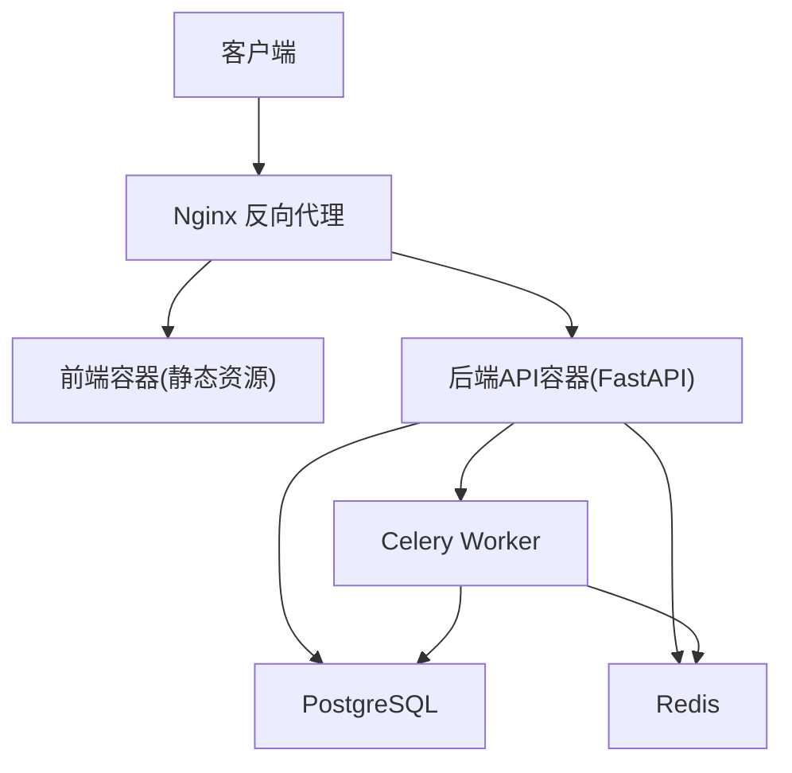
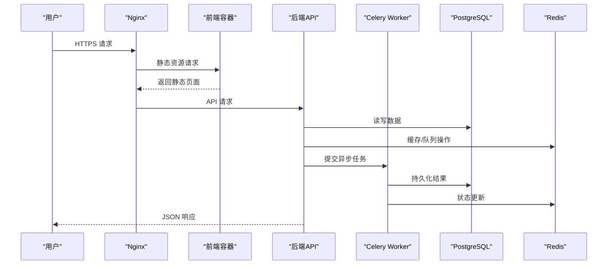
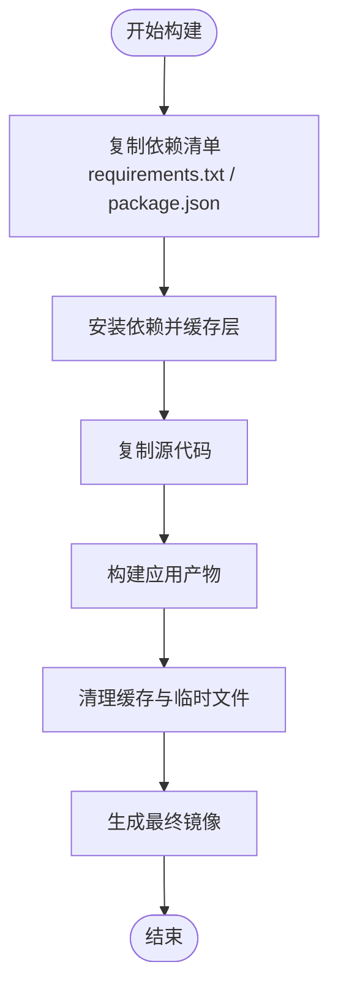
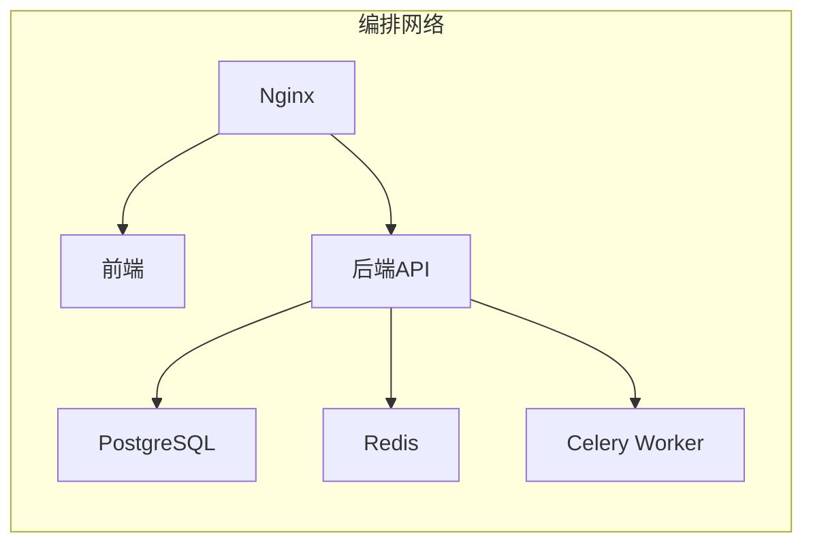
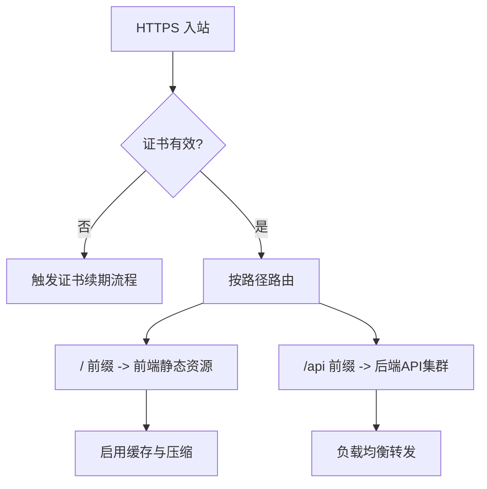
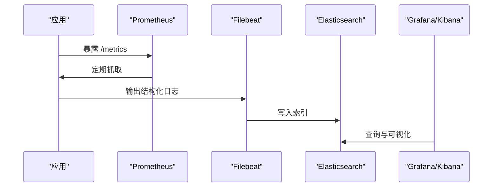
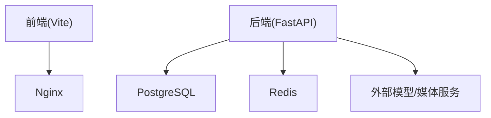

# 容器化部署

<cite>
**本文引用的文件**   
- [docker-compose.yml](file://docker-compose.yml)
- [backend/Dockerfile](file://backend/Dockerfile)
- [frontend/Dockerfile](file://frontend/Dockerfile)
- [nginx-prod.conf](file://nginx-prod.conf)
- [nginx-dev.conf](file://nginx-dev.conf)
- [nginx.conf](file://nginx.conf)
- [ssl/README.md](file://ssl/README.md)
- [postgres-init/01-init.sql](file://postgres-init/01-init.sql)
- [redis.conf](file://redis.conf)
- [backend/app/main.py](file://backend/app/main.py)
- [backend/app/celery_app.py](file://backend/app/celery_app.py)
- [backend/requirements.txt](file://backend/requirements.txt)
- [frontend/package.json](file://frontend/package.json)
- [frontend/vite.config.ts](file://frontend/vite.config.ts)
- [deploy_config.json](file://deploy_config.json)
</cite>

## 目录
1. [简介](#简介)
2. [项目结构](#项目结构)
3. [核心组件](#核心组件)
4. [架构总览](#架构总览)
5. [详细组件分析](#详细组件分析)
6. [依赖关系分析](#依赖关系分析)
7. [性能考量](#性能考量)
8. [故障排查指南](#故障排查指南)
9. [结论](#结论)
10. [附录](#附录)

## 简介
本文件面向小说创作代理系统的容器化生产部署，覆盖以下关键主题：
- Docker 镜像构建：多阶段构建、依赖层缓存策略与镜像体积优化
- docker-compose 编排：服务网络、数据卷、环境变量与健康检查
- Nginx 反向代理：SSL 证书管理、负载均衡与静态资源缓存
- 监控与日志：Prometheus 指标暴露、结构化日志与日志聚合
- 安全加固：最小权限、镜像扫描与网络安全策略

## 项目结构
系统由后端 API（FastAPI + Celery）、前端（React/Vite）、Nginx、PostgreSQL、Redis 等构成。容器化相关文件集中在根目录与子模块中：
- 后端镜像构建定义位于 backend/Dockerfile
- 前端镜像构建定义位于 frontend/Dockerfile
- 服务编排使用根目录的 docker-compose.yml
- Nginx 提供生产与开发两种配置
- PostgreSQL 初始化脚本位于 postgres-init
- Redis 配置文件位于 redis.conf
- SSL 证书说明位于 ssl/README.md

**图表来源** 
- [docker-compose.yml](file://docker-compose.yml)
- [backend/Dockerfile](file://backend/Dockerfile)
- [frontend/Dockerfile](file://frontend/Dockerfile)
- [nginx-prod.conf](file://nginx-prod.conf)

**章节来源**
- [docker-compose.yml](file://docker-compose.yml)
- [backend/Dockerfile](file://backend/Dockerfile)
- [frontend/Dockerfile](file://frontend/Dockerfile)
- [nginx-prod.conf](file://nginx-prod.conf)

## 核心组件
- 后端 API：基于 FastAPI 的应用入口与路由组织，配合 Celery 异步任务处理
- 前端：Vite 构建产物通过 Nginx 静态托管
- 数据库：PostgreSQL 持久化业务数据，初始化脚本在启动时执行
- 缓存：Redis 用于会话、队列与中间结果缓存
- 任务队列：Celery Worker 消费任务并调用外部模型/媒体运行时

**章节来源**
- [backend/app/main.py](file://backend/app/main.py)
- [backend/app/celery_app.py](file://backend/app/celery_app.py)
- [backend/requirements.txt](file://backend/requirements.txt)
- [frontend/package.json](file://frontend/package.json)
- [frontend/vite.config.ts](file://frontend/vite.config.ts)

## 架构总览
下图展示容器间通信与数据流向，包括健康检查与持久化挂载点。

**图表来源** 
- [docker-compose.yml](file://docker-compose.yml)
- [nginx-prod.conf](file://nginx-prod.conf)
- [backend/app/main.py](file://backend/app/main.py)
- [backend/app/celery_app.py](file://backend/app/celery_app.py)

## 详细组件分析

### Docker 镜像构建与优化
- 多阶段构建
  - 后端：构建阶段安装依赖与编译扩展，运行阶段仅包含运行时依赖与代码，显著减小镜像体积
  - 前端：构建阶段安装依赖并打包 Vite 产物，运行阶段仅包含 Nginx 或轻量 HTTP 服务器
- 依赖层缓存策略
  - 将包管理器依赖文件（如 requirements.txt、package.json）置于 COPY 之前，利用 Docker 层缓存加速重复构建
  - 分离开发与生产依赖，避免生产镜像携带调试工具
- 镜像大小优化技巧
  - 使用精简基础镜像（如 alpine 或 distroless）
  - 合并 RUN 指令减少层数
  - 清理临时文件与包管理器缓存
  - 使用 .dockerignore 排除无关文件

**图表来源** 
- [backend/Dockerfile](file://backend/Dockerfile)
- [frontend/Dockerfile](file://frontend/Dockerfile)
- [backend/requirements.txt](file://backend/requirements.txt)
- [frontend/package.json](file://frontend/package.json)

**章节来源**
- [backend/Dockerfile](file://backend/Dockerfile)
- [frontend/Dockerfile](file://frontend/Dockerfile)
- [backend/requirements.txt](file://backend/requirements.txt)
- [frontend/package.json](file://frontend/package.json)

### docker-compose 编排配置
- 服务网络
  - 默认桥接网络隔离服务间通信，内部域名即服务名
  - 对外端口由 Nginx 统一暴露（80/443）
- 数据卷挂载
  - PostgreSQL：持久化数据目录映射到宿主机或云盘
  - Redis：可选持久化目录映射
  - 上传与输出：媒体文件、TTS 产物、审计日志等挂载至共享存储
- 环境变量传递
  - 数据库连接串、Redis 地址、密钥与第三方 API Key 通过环境变量注入
  - 支持 .env 文件或 secrets 管理
- 健康检查
  - API 提供健康端点，Nginx 与编排器据此判断服务可用性
  - 数据库与缓存可通过 TCP 探针或专用命令检查

**图表来源** 
- [docker-compose.yml](file://docker-compose.yml)

**章节来源**
- [docker-compose.yml](file://docker-compose.yml)

### Nginx 反向代理配置
- SSL 证书管理
  - 使用 Let’s Encrypt 自动签发与续期，证书路径挂载到容器
  - 强制 HTTPS 与 HSTS 头
- 负载均衡
  - 对后端 API 进行轮询或加权转发，支持多实例水平扩展
- 静态资源缓存
  - 为前端静态资源设置长期缓存与版本化文件名
  - 开启 Gzip/Brotli 压缩

**图表来源** 
- [nginx-prod.conf](file://nginx-prod.conf)
- [ssl/README.md](file://ssl/README.md)

**章节来源**
- [nginx-prod.conf](file://nginx-prod.conf)
- [nginx-dev.conf](file://nginx-dev.conf)
- [ssl/README.md](file://ssl/README.md)

### 监控与日志
- Prometheus 指标
  - 后端暴露 /metrics 端点，采集 QPS、延迟、错误率、队列长度等
  - 通过 ServiceMonitor 或 scrape_configs 拉取指标
- 结构化日志
  - 应用输出 JSON 格式日志，便于集中收集
  - 日志级别与采样策略可配置
- 日志聚合方案
  - Filebeat/Fluent Bit 采集容器 stdout/stderr 与本地日志文件
  - 汇聚至 Elasticsearch/ClickHouse，配合 Kibana/Grafana 可视化

**图表来源** 
- [backend/app/main.py](file://backend/app/main.py)
- [backend/app/celery_app.py](file://backend/app/celery_app.py)

**章节来源**
- [backend/app/main.py](file://backend/app/main.py)
- [backend/app/celery_app.py](file://backend/app/celery_app.py)

### 安全加固建议
- 最小权限原则
  - 以非 root 用户运行容器进程
  - 限制文件系统写权限与网络出站规则
- 镜像扫描
  - CI/CD 集成 Trivy/Grype 扫描漏洞
  - 阻断高危镜像进入生产
- 网络安全策略
  - 仅开放必要端口（Nginx 80/443）
  - 数据库与缓存不暴露公网，仅内网访问
- 密钥管理
  - 使用环境变量或 Secret Manager，禁止硬编码
  - 定期轮换密钥与证书

[本节为通用指导，不直接分析具体文件]

## 依赖关系分析
- 后端依赖
  - Python 运行时与第三方库（requirements.txt）
  - 数据库驱动、消息队列客户端、媒体处理工具
- 前端依赖
  - Node.js 运行时与构建工具链（package.json）
  - Vite 插件与样式框架
- 运行时依赖
  - PostgreSQL 与 Redis 服务
  - Nginx 作为反向代理与静态资源服务器

**图表来源** 
- [backend/requirements.txt](file://backend/requirements.txt)
- [frontend/package.json](file://frontend/package.json)
- [docker-compose.yml](file://docker-compose.yml)

**章节来源**
- [backend/requirements.txt](file://backend/requirements.txt)
- [frontend/package.json](file://frontend/package.json)
- [docker-compose.yml](file://docker-compose.yml)

## 性能考量
- 构建性能
  - 合理分层与依赖缓存，缩短冷/热构建时间
  - 并行构建多阶段产物
- 运行性能
  - 数据库连接池与慢查询优化
  - Redis 热点键与过期策略
  - Nginx 缓存与压缩
  - Celery Worker 并发度与队列分区
- 资源限制
  - 为各容器设置 CPU/内存上限与请求限流
  - 使用水平扩展应对峰值流量

[本节为通用指导，不直接分析具体文件]

## 故障排查指南
- 常见症状
  - 502/504：Nginx 无法连接上游服务或超时
  - 数据库连接失败：认证错误或网络不可达
  - Redis 超时：内存不足或网络抖动
- 诊断步骤
  - 查看容器日志与事件
  - 检查健康检查与探针状态
  - 验证环境变量与密钥配置
  - 使用 curl/wget 测试内部服务连通性
- 恢复措施
  - 重启异常服务或扩容实例
  - 回滚镜像版本或配置
  - 清理锁与队列积压

**章节来源**
- [docker-compose.yml](file://docker-compose.yml)
- [nginx-prod.conf](file://nginx-prod.conf)
- [backend/app/main.py](file://backend/app/main.py)

## 结论
通过多阶段构建与分层缓存，结合合理的编排与 Nginx 反向代理，可实现高可用、易扩展的小说创作代理系统。配合完善的监控、日志与安全策略，可在生产环境稳定运行并持续演进。

[本节为总结性内容，不直接分析具体文件]

## 附录
- 快速启动
  - 准备 .env 与证书文件
  - 执行 docker-compose up -d
- 常用命令
  - 查看日志：docker compose logs -f
  - 进入容器：docker compose exec <service> bash
  - 重建镜像：docker compose build --no-cache
- 参考配置
  - 部署参数：deploy_config.json
  - 数据库初始化：postgres-init/01-init.sql
  - Redis 配置：redis.conf

**章节来源**
- [deploy_config.json](file://deploy_config.json)
- [postgres-init/01-init.sql](file://postgres-init/01-init.sql)
- [redis.conf](file://redis.conf)