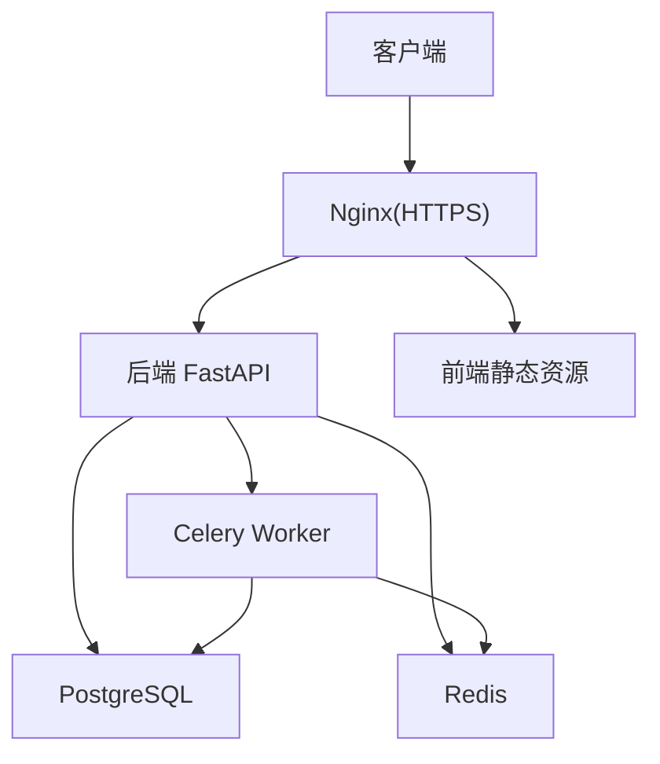
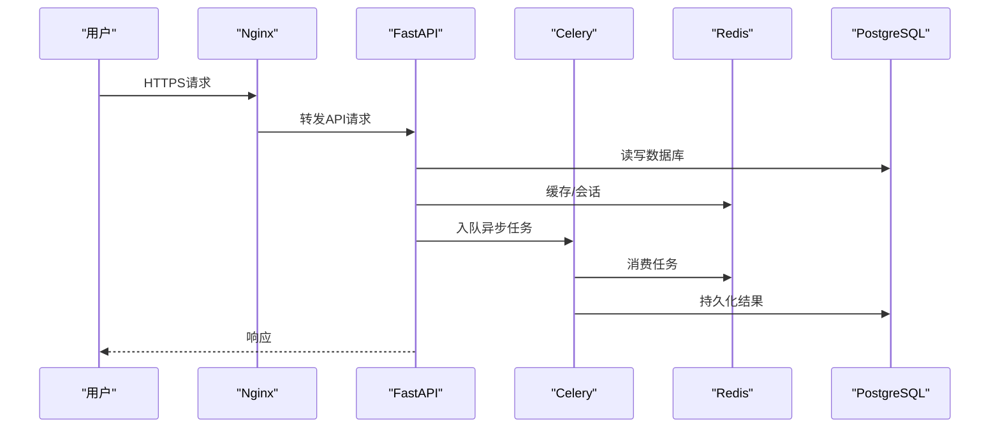
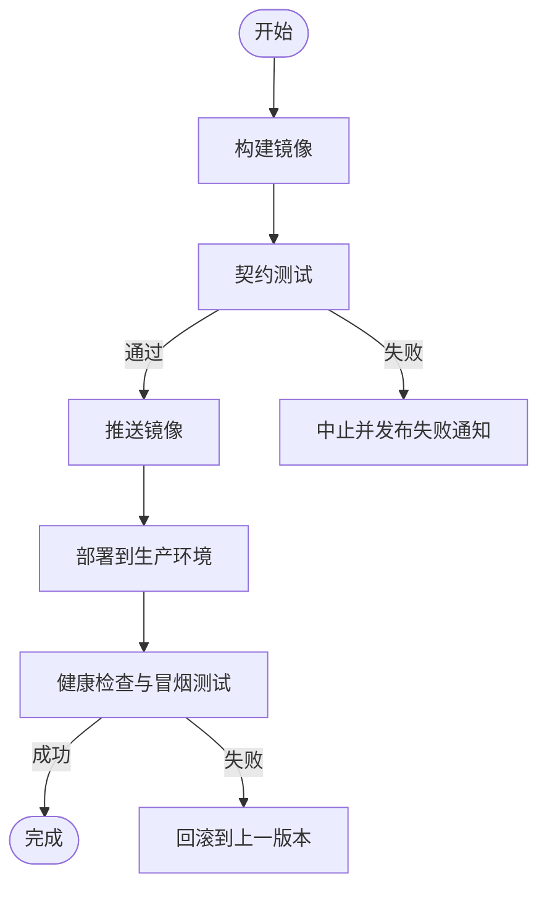
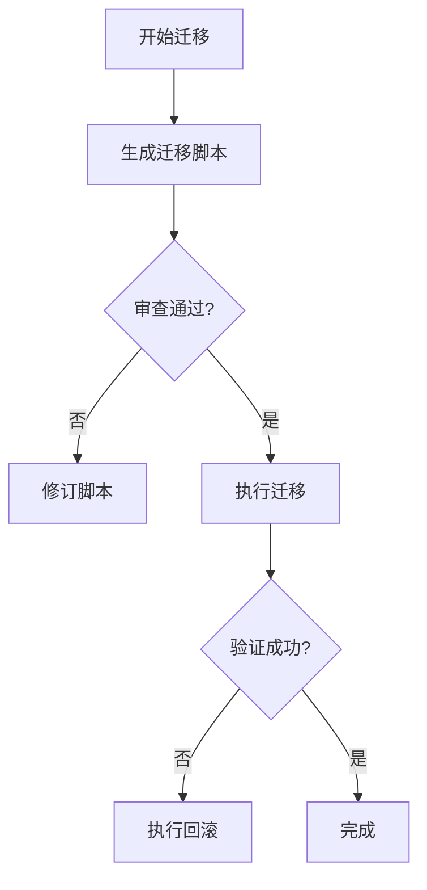
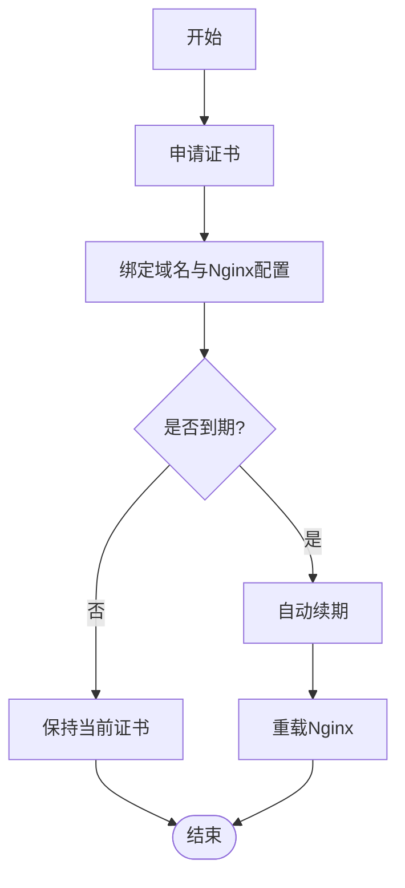
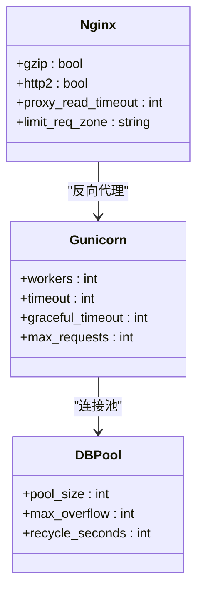
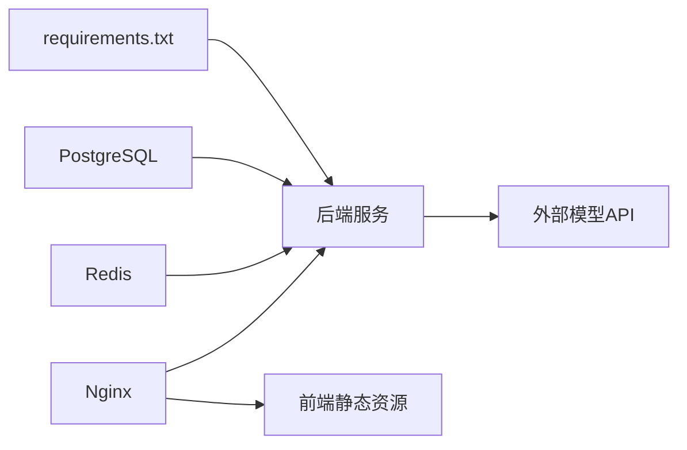

# 生产环境部署

<cite>
**本文引用的文件**   
- [docker-compose.yml](file://docker-compose.yml)
- [nginx-prod.conf](file://nginx-prod.conf)
- [backend/Dockerfile](file://backend/Dockerfile)
- [frontend/Dockerfile](file://frontend/Dockerfile)
- [backend/alembic.ini](file://backend/alembic.ini)
- [backend/alembic/env.py](file://backend/alembic/env.py)
- [backend/app/main.py](file://backend/app/main.py)
- [backend/app/celery_app.py](file://backend/app/celery_app.py)
- [backend/app/core/config.py](file://backend/app/core/config.py)
- [backend/app/core/security.py](file://backend/app/core/security.py)
- [backend/app/db/base.py](file://backend/app/db/base.py)
- [postgres-init/01-init.sql](file://postgres-init/01-init.sql)
- [.github/workflows/contracts.yml](file://.github/workflows/contracts.yml)
- [deploy_config.json](file://deploy_config.json)
- [start_production.bat](file://start_production.bat)
- [ssl/README.md](file://ssl/README.md)
- [SSL_CERTIFICATE_GUIDE.md](file://SSL_CERTIFICATE_GUIDE.md)
- [SSL_AUTO_RENEW_GUIDE.md](file://SSL_AUTO_RENEW_GUIDE.md)
- [DATABASE_MIGRATION_GUIDE.md](file://DATABASE_MIGRATION_GUIDE.md)
- [POSTGRESQL_DEPLOYMENT.md](file://POSTGRESQL_DEPLOYMENT.md)
- [requirements.txt](file://requirements.txt)
- [redis.conf](file://redis.conf)
</cite>

## 目录
1. [简介](#简介)
2. [项目结构](#项目结构)
3. [核心组件](#核心组件)
4. [架构总览](#架构总览)
5. [详细组件分析](#详细组件分析)
6. [依赖关系分析](#依赖关系分析)
7. [性能考虑](#性能考虑)
8. [故障排查指南](#故障排查指南)
9. [结论](#结论)
10. [附录](#附录)

## 简介
本指南面向在生产环境部署“小说创作代理系统”的运维与工程团队，覆盖服务器与操作系统准备、系统依赖安装、容器化部署、CI/CD流水线、数据库迁移策略、SSL证书部署与自动续期、性能调优（Gunicorn/连接池/内存限制）、安全加固（防火墙、入侵检测、审计日志）以及灾难恢复计划（备份、切换、业务连续性）。文档以仓库内现有配置与脚本为依据，提供可操作的步骤与最佳实践。

## 项目结构
系统采用前后端分离与多服务编排：
- 后端：FastAPI应用、Celery异步任务、Alembic数据库迁移、PostgreSQL、Redis缓存与消息队列
- 前端：静态资源由Nginx托管
- 反向代理：Nginx统一入口、HTTPS终止、静态资源缓存
- 容器编排：Docker Compose一键拉起服务
- CI/CD：GitHub Actions工作流用于契约测试与发布流程

**图示来源**
- [docker-compose.yml](file://docker-compose.yml)
- [nginx-prod.conf](file://nginx-prod.conf)
- [backend/app/main.py](file://backend/app/main.py)
- [backend/app/celery_app.py](file://backend/app/celery_app.py)

**章节来源**
- [docker-compose.yml](file://docker-compose.yml)
- [nginx-prod.conf](file://nginx-prod.conf)

## 核心组件
- 应用服务：后端FastAPI主入口、Celery任务执行器、配置与安全模块
- 数据层：PostgreSQL初始化脚本、Alembic迁移配置
- 缓存与队列：Redis配置
- 反向代理：Nginx生产配置
- 容器化：前后端Dockerfile
- 部署与自动化：Compose编排、启动脚本、CI工作流、部署配置

**章节来源**
- [backend/app/main.py](file://backend/app/main.py)
- [backend/app/celery_app.py](file://backend/app/celery_app.py)
- [backend/app/core/config.py](file://backend/app/core/config.py)
- [backend/app/core/security.py](file://backend/app/core/security.py)
- [backend/app/db/base.py](file://backend/app/db/base.py)
- [backend/alembic/env.py](file://backend/alembic/env.py)
- [backend/alembic.ini](file://backend/alembic.ini)
- [postgres-init/01-init.sql](file://postgres-init/01-init.sql)
- [redis.conf](file://redis.conf)
- [backend/Dockerfile](file://backend/Dockerfile)
- [frontend/Dockerfile](file://frontend/Dockerfile)
- [docker-compose.yml](file://docker-compose.yml)
- [nginx-prod.conf](file://nginx-prod.conf)

## 架构总览
生产环境通过Nginx作为统一入口，HTTPS终止后转发至后端API与前端静态资源；后端通过Alembic管理数据库版本，使用Celery处理耗时任务，Redis作为缓存与任务队列；所有服务由Docker Compose编排，便于扩展与回滚。

**图示来源**
- [nginx-prod.conf](file://nginx-prod.conf)
- [backend/app/main.py](file://backend/app/main.py)
- [backend/app/celery_app.py](file://backend/app/celery_app.py)
- [backend/app/db/base.py](file://backend/app/db/base.py)
- [redis.conf](file://redis.conf)

## 详细组件分析

### 服务器与操作系统准备
- 建议操作系统：Ubuntu 22.04 LTS或CentOS Stream 9
- 硬件建议：CPU≥4核、内存≥16GB、SSD≥100GB（根据媒体生成负载调整）
- 网络要求：开放80/443端口，允许出站访问外部模型API
- 内核参数优化：启用TCP拥塞控制、提高文件描述符上限、禁用IPv6（如不需要）

**章节来源**
- [docker-compose.yml](file://docker-compose.yml)
- [nginx-prod.conf](file://nginx-prod.conf)

### 系统依赖安装
- Python环境与包管理：使用requirements.txt锁定依赖
- 容器运行时：Docker与Docker Compose
- 反向代理：Nginx（也可容器化运行）
- 数据库：PostgreSQL（容器或托管服务）
- 缓存与队列：Redis（容器或托管服务）

**章节来源**
- [requirements.txt](file://requirements.txt)
- [backend/Dockerfile](file://backend/Dockerfile)
- [frontend/Dockerfile](file://frontend/Dockerfile)
- [docker-compose.yml](file://docker-compose.yml)

### 部署流程自动化（CI/CD）
- GitHub Actions工作流：触发条件、构建镜像、运行契约测试、推送镜像到仓库
- 发布策略：基于标签的版本发布，支持灰度与回滚
- 部署脚本：使用Compose拉取最新镜像并滚动更新

**图示来源**
- [.github/workflows/contracts.yml](file://.github/workflows/contracts.yml)
- [docker-compose.yml](file://docker-compose.yml)

**章节来源**
- [.github/workflows/contracts.yml](file://.github/workflows/contracts.yml)
- [deploy_config.json](file://deploy_config.json)
- [start_production.bat](file://start_production.bat)

### 数据库迁移策略（Alembic）
- 迁移工具：Alembic，配置文件位于backend/alembic.ini，环境脚本env.py
- 执行流程：生成迁移脚本→审查→在目标环境执行→验证数据一致性
- 回滚方案：记录迁移版本，按顺序回滚；对破坏性变更需配合数据备份
- 数据备份恢复：定期全量+增量备份，恢复前校验完整性

**图示来源**
- [backend/alembic.ini](file://backend/alembic.ini)
- [backend/alembic/env.py](file://backend/alembic/env.py)
- [DATABASE_MIGRATION_GUIDE.md](file://DATABASE_MIGRATION_GUIDE.md)

**章节来源**
- [backend/alembic.ini](file://backend/alembic.ini)
- [backend/alembic/env.py](file://backend/alembic/env.py)
- [DATABASE_MIGRATION_GUIDE.md](file://DATABASE_MIGRATION_GUIDE.md)

### SSL证书部署与自动续期
- 证书生成：使用Let’s Encrypt或企业CA签发域名证书
- 域名绑定：在Nginx中配置server块指向证书路径
- 自动续期：通过cron或systemd定时器调用certbot或其他工具自动续期并重载Nginx

**图示来源**
- [ssl/README.md](file://ssl/README.md)
- [SSL_CERTIFICATE_GUIDE.md](file://SSL_CERTIFICATE_GUIDE.md)
- [SSL_AUTO_RENEW_GUIDE.md](file://SSL_AUTO_RENEW_GUIDE.md)
- [nginx-prod.conf](file://nginx-prod.conf)

**章节来源**
- [ssl/README.md](file://ssl/README.md)
- [SSL_CERTIFICATE_GUIDE.md](file://SSL_CERTIFICATE_GUIDE.md)
- [SSL_AUTO_RENEW_GUIDE.md](file://SSL_AUTO_RENEW_GUIDE.md)
- [nginx-prod.conf](file://nginx-prod.conf)

### 性能调优配置
- Gunicorn设置：进程数=CPU核数×2+1，超时与重试策略，优雅重启
- 数据库连接池：合理设置最大连接数与空闲回收，避免连接泄漏
- 内存限制：为各容器设置内存上限，防止OOM；监控峰值内存
- Nginx优化：开启gzip、HTTP/2、缓存头、上游超时与限流

**图示来源**
- [backend/app/core/config.py](file://backend/app/core/config.py)
- [backend/app/db/base.py](file://backend/app/db/base.py)
- [nginx-prod.conf](file://nginx-prod.conf)

**章节来源**
- [backend/app/core/config.py](file://backend/app/core/config.py)
- [backend/app/db/base.py](file://backend/app/db/base.py)
- [nginx-prod.conf](file://nginx-prod.conf)

### 安全加固措施
- 防火墙规则：仅开放必要端口（80/443），限制管理端口访问
- 入侵检测：部署fail2ban或云厂商WAF，监控异常登录与高频请求
- 安全审计日志：集中收集Nginx、应用、数据库与系统日志，接入SIEM
- 最小权限原则：服务账户与数据库账号权限最小化，密钥通过环境变量注入

**章节来源**
- [nginx-prod.conf](file://nginx-prod.conf)
- [backend/app/core/security.py](file://backend/app/core/security.py)

### 灾难恢复计划
- 数据备份策略：每日全量+每小时增量备份，保留周期按合规要求设定
- 故障切换机制：多可用区部署，数据库主从切换，Nginx健康检查与流量切换
- 业务连续性保障：关键服务高可用，降级策略（如关闭非核心功能），演练与复盘

**章节来源**
- [docker-compose.yml](file://docker-compose.yml)
- [POSTGRESQL_DEPLOYMENT.md](file://POSTGRESQL_DEPLOYMENT.md)

## 依赖关系分析
- 后端依赖：Python库（requirements.txt）、PostgreSQL、Redis、Celery
- 前端依赖：Node.js构建产物，静态资源由Nginx托管
- 外部依赖：第三方模型API（LLM/TTS/图像/视频），需配置密钥与限流

**图示来源**
- [requirements.txt](file://requirements.txt)
- [docker-compose.yml](file://docker-compose.yml)
- [nginx-prod.conf](file://nginx-prod.conf)

**章节来源**
- [requirements.txt](file://requirements.txt)
- [docker-compose.yml](file://docker-compose.yml)
- [nginx-prod.conf](file://nginx-prod.conf)

## 性能考虑
- 水平扩展：后端无状态化，通过副本数量扩容；数据库垂直扩展或读写分离
- 缓存策略：热点数据缓存、TTL设置、缓存穿透与雪崩防护
- 任务队列：Celery并发与队列隔离，避免长尾任务阻塞
- 监控告警：指标采集（Prometheus/Grafana）、日志聚合（ELK）、链路追踪

[本节为通用指导，不直接分析具体文件]

## 故障排查指南
- 常见问题：端口冲突、证书路径错误、数据库连接失败、Redis不可用
- 排查步骤：查看Nginx与应用日志、检查服务健康接口、验证环境变量与密钥
- 恢复手段：回滚镜像、重建容器、重置数据库连接、清理锁与临时文件

**章节来源**
- [nginx-prod.conf](file://nginx-prod.conf)
- [backend/app/main.py](file://backend/app/main.py)
- [backend/app/celery_app.py](file://backend/app/celery_app.py)

## 结论
通过容器化编排、标准化迁移流程、完善的SSL与性能调优、严格的安全加固与灾备计划，本系统可在生产环境中稳定运行并快速迭代。建议持续完善监控与演练，确保业务连续性与数据安全。

[本节为总结，不直接分析具体文件]

## 附录
- 参考文档：数据库部署、SSL证书指南、迁移指南
- 部署脚本：生产启动脚本、部署配置
- 初始化脚本：PostgreSQL初始化SQL

**章节来源**
- [POSTGRESQL_DEPLOYMENT.md](file://POSTGRESQL_DEPLOYMENT.md)
- [SSL_CERTIFICATE_GUIDE.md](file://SSL_CERTIFICATE_GUIDE.md)
- [SSL_AUTO_RENEW_GUIDE.md](file://SSL_AUTO_RENEW_GUIDE.md)
- [DATABASE_MIGRATION_GUIDE.md](file://DATABASE_MIGRATION_GUIDE.md)
- [start_production.bat](file://start_production.bat)
- [deploy_config.json](file://deploy_config.json)
- [postgres-init/01-init.sql](file://postgres-init/01-init.sql)