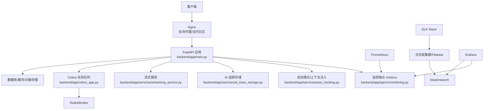
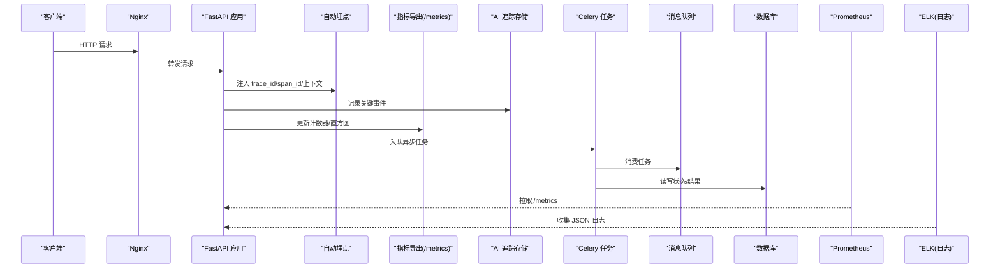
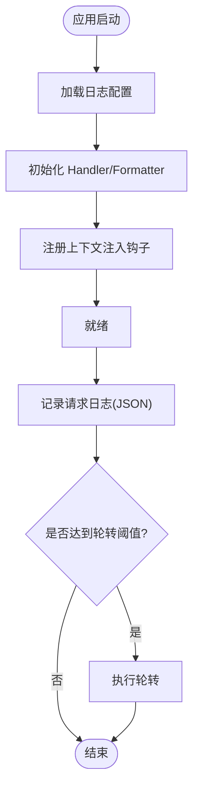
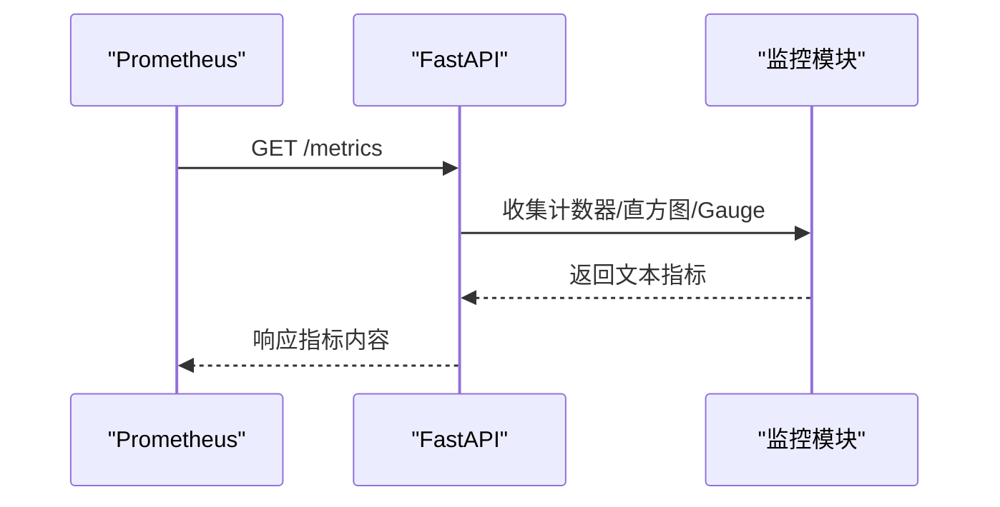
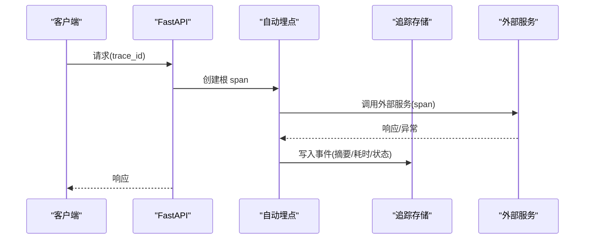
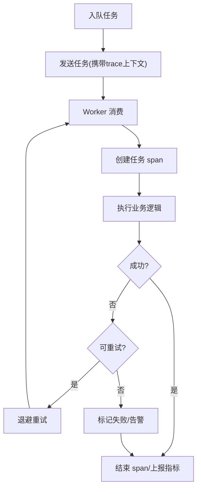
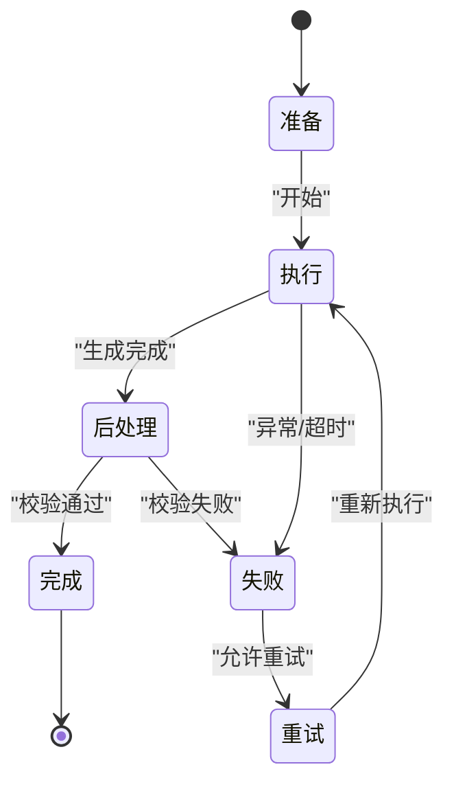
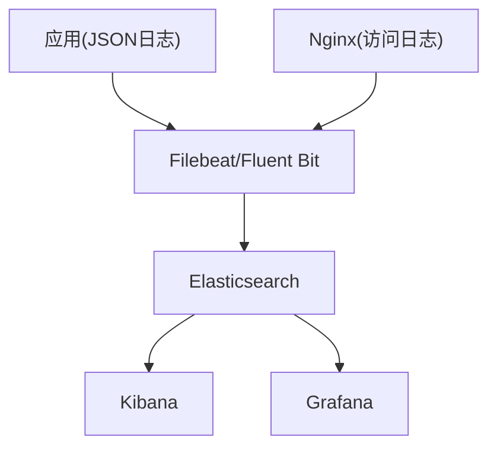
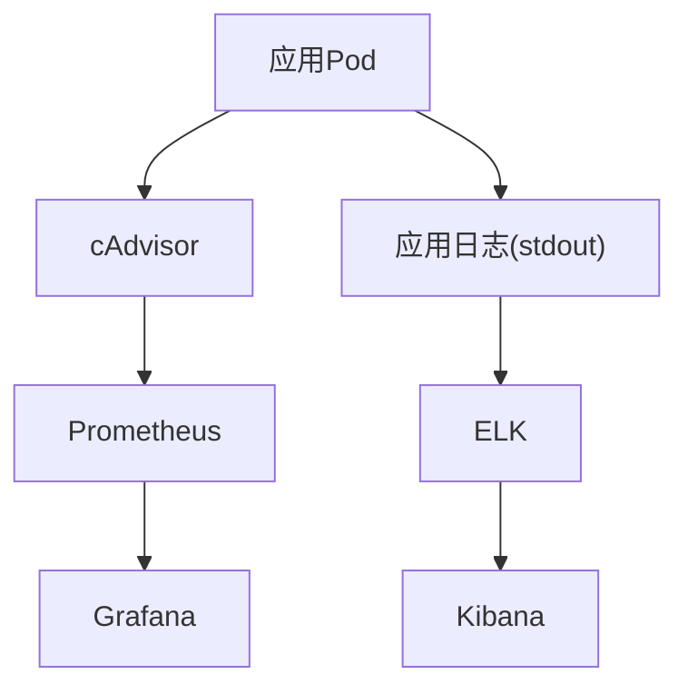
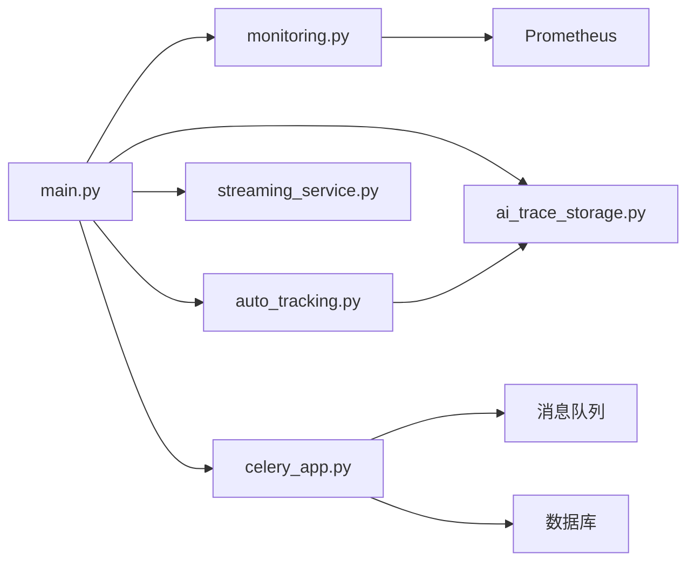

# 监控与日志

<cite>
**本文引用的文件**   
- [core/logging_config.py](file://core/logging_config.py)
- [backend/app/main.py](file://backend/app/main.py)
- [backend/app/api/v1/monitoring.py](file://backend/app/api/v1/monitoring.py)
- [backend/app/services/auto_tracking.py](file://backend/app/services/auto_tracking.py)
- [backend/app/services/ai_trace_storage.py](file://backend/app/services/ai_trace_storage.py)
- [backend/app/services/streaming_service.py](file://backend/app/services/streaming_service.py)
- [backend/app/celery_app.py](file://backend/app/celery_app.py)
- [docker-compose.yml](file://docker-compose.yml)
- [nginx.conf](file://nginx.conf)
- [README.md](file://README.md)
</cite>

## 目录
1. [简介](#简介)
2. [项目结构](#项目结构)
3. [核心组件](#核心组件)
4. [架构总览](#架构总览)
5. [详细组件分析](#详细组件分析)
6. [依赖关系分析](#依赖关系分析)
7. [性能考虑](#性能考虑)
8. [故障排查指南](#故障排查指南)
9. [结论](#结论)
10. [附录](#附录)

## 简介
本文件面向小说创作代理系统的“监控与日志”能力，覆盖结构化日志、应用性能监控（Prometheus）、分布式追踪、日志聚合与长期存储、告警规则以及容器化环境下的最佳实践。文档以仓库现有实现为依据，提供可操作的配置要点、数据流说明与可视化图示，帮助读者快速搭建并运维一套高可用、可观测的监控系统。

## 项目结构
围绕监控与日志的关键位置如下：
- 日志配置与初始化：core/logging_config.py
- Web 应用入口与中间件挂载：backend/app/main.py
- Prometheus 指标暴露接口：backend/app/api/v1/monitoring.py
- 自动埋点与上下文注入：backend/app/services/auto_tracking.py
- AI 追踪存储与查询：backend/app/services/ai_trace_storage.py
- 流式处理与任务追踪：backend/app/services/streaming_service.py
- 异步任务队列（Celery）：backend/app/celery_app.py
- 容器编排与外部服务集成：docker-compose.yml
- Nginx 反向代理与访问日志：nginx.conf
- 项目概览与使用说明：README.md

**图表来源** 
- [backend/app/main.py](file://backend/app/main.py)
- [backend/app/api/v1/monitoring.py](file://backend/app/api/v1/monitoring.py)
- [backend/app/services/auto_tracking.py](file://backend/app/services/auto_tracking.py)
- [backend/app/services/ai_trace_storage.py](file://backend/app/services/ai_trace_storage.py)
- [backend/app/services/streaming_service.py](file://backend/app/services/streaming_service.py)
- [backend/app/celery_app.py](file://backend/app/celery_app.py)
- [docker-compose.yml](file://docker-compose.yml)
- [nginx.conf](file://nginx.conf)

**章节来源**
- [core/logging_config.py](file://core/logging_config.py)
- [backend/app/main.py](file://backend/app/main.py)
- [backend/app/api/v1/monitoring.py](file://backend/app/api/v1/monitoring.py)
- [backend/app/services/auto_tracking.py](file://backend/app/services/auto_tracking.py)
- [backend/app/services/ai_trace_storage.py](file://backend/app/services/ai_trace_storage.py)
- [backend/app/services/streaming_service.py](file://backend/app/services/streaming_service.py)
- [backend/app/celery_app.py](file://backend/app/celery_app.py)
- [docker-compose.yml](file://docker-compose.yml)
- [nginx.conf](file://nginx.conf)
- [README.md](file://README.md)

## 核心组件
- 结构化日志系统
  - 统一日志初始化与输出格式（JSON），支持级别控制、字段扩展与上下文注入。
  - 关键路径：core/logging_config.py
- 应用性能监控（APM）
  - 通过 /metrics 暴露 Prometheus 指标，包括请求计数、错误率、延迟分位等。
  - 关键路径：backend/app/api/v1/monitoring.py
- 自动埋点与上下文传播
  - 在请求生命周期中注入 trace_id、span_id、用户/项目上下文，便于链路追踪与审计。
  - 关键路径：backend/app/services/auto_tracking.py
- AI 追踪存储
  - 将模型调用、提示词、结果、耗时等关键事件持久化，支撑回溯与分析。
  - 关键路径：backend/app/services/ai_trace_storage.py
- 流式服务与任务追踪
  - 对长耗时/流式任务进行进度上报与状态管理，结合队列进行异步执行。
  - 关键路径：backend/app/services/streaming_service.py, backend/app/celery_app.py
- 外部服务与基础设施
  - Nginx 作为入口，采集访问日志；Prometheus 抓取指标；ELK 聚合日志；Grafana 展示面板。
  - 关键路径：docker-compose.yml, nginx.conf

**章节来源**
- [core/logging_config.py](file://core/logging_config.py)
- [backend/app/api/v1/monitoring.py](file://backend/app/api/v1/monitoring.py)
- [backend/app/services/auto_tracking.py](file://backend/app/services/auto_tracking.py)
- [backend/app/services/ai_trace_storage.py](file://backend/app/services/ai_trace_storage.py)
- [backend/app/services/streaming_service.py](file://backend/app/services/streaming_service.py)
- [backend/app/celery_app.py](file://backend/app/celery_app.py)
- [docker-compose.yml](file://docker-compose.yml)
- [nginx.conf](file://nginx.conf)

## 架构总览
下图展示了从客户端到后端、再到监控与日志体系的端到端数据流。

**图表来源** 
- [backend/app/main.py](file://backend/app/main.py)
- [backend/app/api/v1/monitoring.py](file://backend/app/api/v1/monitoring.py)
- [backend/app/services/auto_tracking.py](file://backend/app/services/auto_tracking.py)
- [backend/app/services/ai_trace_storage.py](file://backend/app/services/ai_trace_storage.py)
- [backend/app/celery_app.py](file://backend/app/celery_app.py)
- [docker-compose.yml](file://docker-compose.yml)
- [nginx.conf](file://nginx.conf)

## 详细组件分析

### 结构化日志配置
- 目标
  - 统一 JSON 格式输出，包含时间戳、级别、模块、trace_id、span_id、用户/项目上下文、请求方法、路径、状态码、耗时等。
  - 支持按模块/级别动态调整，避免生产环境过度日志。
- 关键设计
  - 全局初始化：在应用启动时加载日志配置，注册 JSON Formatter 与 Handler。
  - 上下文注入：基于请求上下文或任务上下文，自动附加 trace_id、span_id、业务标识。
  - 输出目标：stdout（容器标准输出）+ 可选文件轮转（本地调试）。
- 建议配置项
  - 日志级别：DEBUG/INFO/WARNING/ERROR
  - 输出格式：JSON，固定字段集
  - 采样策略：高频接口可按条件采样
  - 脱敏：对敏感字段进行掩码处理
- 参考实现位置
  - 日志初始化与格式化：core/logging_config.py

**图表来源** 
- [core/logging_config.py](file://core/logging_config.py)

**章节来源**
- [core/logging_config.py](file://core/logging_config.py)

### 应用性能监控（Prometheus）
- 目标
  - 暴露 /metrics 端点，提供请求量、错误率、P50/P95/P99 延迟、并发数、队列长度、外部调用成功率等指标。
- 关键设计
  - 使用计数器（Counter）统计请求与错误；使用直方图（Histogram）统计延迟分布；使用 Gauge 表示当前状态（如活跃连接数）。
  - 在中间层或路由层自动打点，确保指标一致性。
- 指标分类
  - 通用：http_requests_total、http_request_duration_seconds、http_errors_total
  - 业务：生成任务完成数、失败数、重试次数、TTS 时长、视频生成时长
  - 资源：CPU、内存、磁盘、网络（由运行时/Exporter 提供）
- 参考实现位置
  - 指标端点：backend/app/api/v1/monitoring.py

**图表来源** 
- [backend/app/api/v1/monitoring.py](file://backend/app/api/v1/monitoring.py)

**章节来源**
- [backend/app/api/v1/monitoring.py](file://backend/app/api/v1/monitoring.py)

### 分布式追踪（请求链路跟踪）
- 目标
  - 为每个请求分配唯一 trace_id，跨服务/线程/队列传递 span_id，形成完整调用链。
- 关键设计
  - 自动埋点：在请求进入/离开、函数调用前后插入 span，记录输入输出摘要、耗时、异常信息。
  - 上下文传播：HTTP Header、消息体、队列任务均携带 trace 上下文。
  - 外部调用：对第三方 API 调用增加 span，记录状态码、耗时、错误码。
- 参考实现位置
  - 自动埋点与上下文：backend/app/services/auto_tracking.py
  - 追踪数据存储：backend/app/services/ai_trace_storage.py

**图表来源** 
- [backend/app/services/auto_tracking.py](file://backend/app/services/auto_tracking.py)
- [backend/app/services/ai_trace_storage.py](file://backend/app/services/ai_trace_storage.py)

**章节来源**
- [backend/app/services/auto_tracking.py](file://backend/app/services/auto_tracking.py)
- [backend/app/services/ai_trace_storage.py](file://backend/app/services/ai_trace_storage.py)

### 异步任务追踪（Celery）
- 目标
  - 将 trace 上下文注入 Celery 任务，保证任务执行过程可追踪，支持重试与失败回调。
- 关键设计
  - 任务装饰器/中间件：在任务开始/结束记录 span，捕获异常并上报。
  - 队列指标：任务入队/出队数量、积压长度、平均耗时、失败率。
- 参考实现位置
  - Celery 应用与任务：backend/app/celery_app.py

**图表来源** 
- [backend/app/celery_app.py](file://backend/app/celery_app.py)

**章节来源**
- [backend/app/celery_app.py](file://backend/app/celery_app.py)

### 流式服务与进度上报
- 目标
  - 对长耗时/流式任务提供实时进度与状态，便于前端展示与用户体验优化。
- 关键设计
  - SSE/WebSocket 推送：服务端周期性推送进度、阶段状态、错误信息。
  - 任务状态机：定义各阶段（准备、执行、后处理、完成、失败）及转换条件。
- 参考实现位置
  - 流式服务：backend/app/services/streaming_service.py

**图表来源** 
- [backend/app/services/streaming_service.py](file://backend/app/services/streaming_service.py)

**章节来源**
- [backend/app/services/streaming_service.py](file://backend/app/services/streaming_service.py)

### 日志聚合方案（ELK Stack）
- 目标
  - 集中收集应用日志、访问日志、错误日志，支持检索、分析与长期归档。
- 关键设计
  - 采集器：Filebeat/Fluent Bit 收集 stdout 与文件日志。
  - 索引策略：按天/周滚动索引，设置保留周期与冷热分层。
  - 查询与可视化：Kibana 构建仪表盘，Grafana 对接 Elasticsearch 做统一展示。
- 参考实现位置
  - 容器编排与服务依赖：docker-compose.yml
  - 访问日志与入口：nginx.conf

**图表来源** 
- [docker-compose.yml](file://docker-compose.yml)
- [nginx.conf](file://nginx.conf)

**章节来源**
- [docker-compose.yml](file://docker-compose.yml)
- [nginx.conf](file://nginx.conf)

### 告警规则配置
- 目标
  - 针对异常错误、性能瓶颈、资源使用建立自动化告警，及时发现问题。
- 建议规则
  - 错误率：HTTP 5xx 比例超过阈值（如 > 1% 持续 5 分钟）
  - 延迟：P95/P99 延迟超过阈值（如 > 2s）
  - 队列积压：Celery 队列长度持续增长且无消费
  - 资源：CPU/内存/磁盘使用率超过阈值（如 CPU > 80% 持续 10 分钟）
  - 外部依赖：第三方 API 失败率/超时率升高
- 告警通道
  - 邮件、企业微信/钉钉、PagerDuty、Slack 等

[本节为通用指导，不直接分析具体文件]

### 容器化环境下的监控最佳实践
- 容器指标采集
  - 通过 cAdvisor 或 Node Exporter 采集容器级指标，Prometheus 统一抓取。
- 服务网格集成
  - 若采用 Istio/Linkerd，启用 mTLS、访问日志、分布式追踪（Jaeger/Zipkin）。
- 统一监控面板
  - Grafana 整合应用指标、系统指标、业务指标，提供多视图仪表盘。
- 参考实现位置
  - 容器编排与服务依赖：docker-compose.yml
  - 入口与访问日志：nginx.conf

**图表来源** 
- [docker-compose.yml](file://docker-compose.yml)
- [nginx.conf](file://nginx.conf)

**章节来源**
- [docker-compose.yml](file://docker-compose.yml)
- [nginx.conf](file://nginx.conf)

## 依赖关系分析
- 组件耦合
  - FastAPI 应用依赖自动埋点、指标导出、追踪存储、流式服务与 Celery。
  - Celery 依赖消息队列（Redis/RabbitMQ）与数据库。
  - Prometheus 仅依赖 /metrics 端点；ELK 依赖日志输出。
- 潜在循环依赖
  - 应避免在埋点/追踪模块中引入业务逻辑，防止循环导入。
- 外部依赖
  - 第三方模型/媒体服务调用需纳入追踪与指标统计。

**图表来源** 
- [backend/app/main.py](file://backend/app/main.py)
- [backend/app/api/v1/monitoring.py](file://backend/app/api/v1/monitoring.py)
- [backend/app/services/auto_tracking.py](file://backend/app/services/auto_tracking.py)
- [backend/app/services/ai_trace_storage.py](file://backend/app/services/ai_trace_storage.py)
- [backend/app/services/streaming_service.py](file://backend/app/services/streaming_service.py)
- [backend/app/celery_app.py](file://backend/app/celery_app.py)

**章节来源**
- [backend/app/main.py](file://backend/app/main.py)
- [backend/app/api/v1/monitoring.py](file://backend/app/api/v1/monitoring.py)
- [backend/app/services/auto_tracking.py](file://backend/app/services/auto_tracking.py)
- [backend/app/services/ai_trace_storage.py](file://backend/app/services/ai_trace_storage.py)
- [backend/app/services/streaming_service.py](file://backend/app/services/streaming_service.py)
- [backend/app/celery_app.py](file://backend/app/celery_app.py)

## 性能考虑
- 日志开销
  - 生产环境默认 INFO 级别，高频接口开启采样；避免在热路径打印大对象。
- 指标粒度
  - 直方图桶大小合理设置，避免过多标签导致 Cardinality 爆炸。
- 追踪采样
  - 全量追踪成本高，建议按请求类型/用户维度采样。
- 队列与背压
  - 监控队列积压与消费者速率，必要时扩容或限流。
- 外部调用
  - 设置超时与重试上限，记录失败原因与降级策略。

[本节为通用指导，不直接分析具体文件]

## 故障排查指南
- 常见问题
  - 指标缺失：检查 /metrics 端点可达性与标签完整性。
  - 日志丢失：确认 Filebeat/Fluent Bit 权限与路径，检查索引映射。
  - 追踪断裂：验证 trace_id 在各层是否正确传播。
  - 任务失败：查看 Celery 日志与错误堆栈，检查依赖服务可用性。
- 定位步骤
  - 通过 trace_id 串联请求与任务日志。
  - 使用 Kibana/Grafana 过滤错误与慢请求。
  - 逐步缩小范围至具体模块/外部调用。

[本节为通用指导，不直接分析具体文件]

## 结论
通过统一的日志、指标、追踪与聚合体系，小说创作代理系统可实现端到端可观测性。建议在开发阶段即嵌入埋点与指标，配合容器化与 ELK/Prometheus/Grafana 生态，形成稳定可靠的监控与排障闭环。

[本节为总结，不直接分析具体文件]

## 附录
- 相关文档与脚本
  - README.md 提供项目概览与使用说明，可作为部署与运行参考。

**章节来源**
- [README.md](file://README.md)