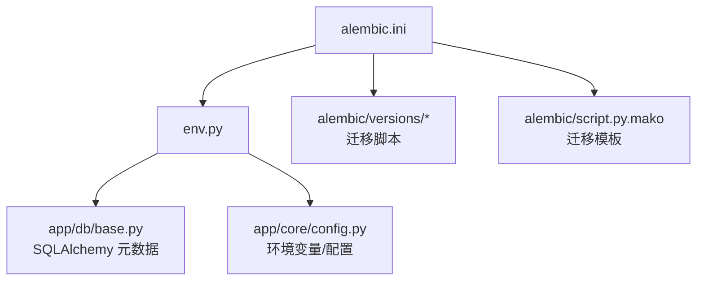
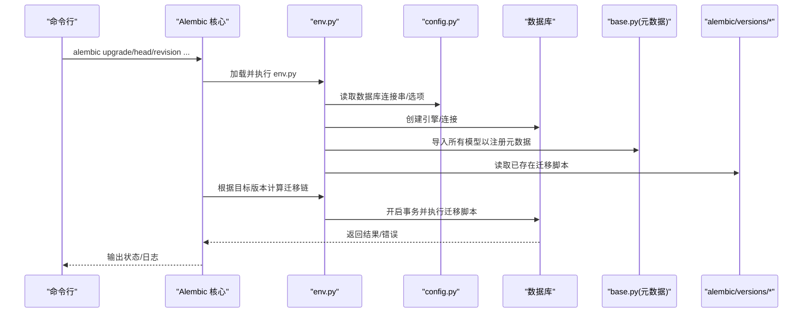
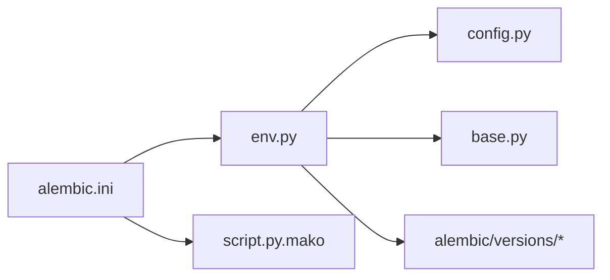

# Alembic环境配置

<cite>
**本文引用的文件**   
- [alembic.ini](file://backend/alembic.ini)
- [env.py](file://backend/alembic/env.py)
- [script.py.mako](file://backend/alembic/script.py.mako)
- [base.py](file://backend/app/db/base.py)
- [config.py](file://backend/app/core/config.py)
- [DATABASE_MIGRATION_GUIDE.md](file://DATABASE_MIGRATION_GUIDE.md)
</cite>

## 目录
1. [简介](#简介)
2. [项目结构](#项目结构)
3. [核心组件](#核心组件)
4. [架构总览](#架构总览)
5. [详细组件分析](#详细组件分析)
6. [依赖关系分析](#依赖关系分析)
7. [性能考虑](#性能考虑)
8. [故障排查指南](#故障排查指南)
9. [结论](#结论)
10. [附录](#附录)

## 简介
本文件面向小说创作代理系统的数据库迁移工具 Alembic，提供完整的环境配置说明。内容涵盖 alembic.ini 参数、env.py 运行期脚本、script.py.mako 模板定制，以及开发/生产环境的差异与初始化步骤。目标是帮助开发者快速、正确地搭建和维护迁移环境，确保模型变更可追溯、可回滚、可审计。

## 项目结构
Alembic 相关代码位于 backend 目录下，主要包含：
- 配置文件：backend/alembic.ini
- 运行期脚本：backend/alembic/env.py
- 迁移脚本模板：backend/alembic/script.py.mako
- 迁移脚本版本目录：backend/alembic/versions（由 alembic 命令生成）
- 应用模型与基础元数据：backend/app/db/base.py
- 应用配置加载：backend/app/core/config.py

图表来源
- [alembic.ini](file://backend/alembic.ini)
- [env.py](file://backend/alembic/env.py)
- [base.py](file://backend/app/db/base.py)
- [config.py](file://backend/app/core/config.py)
- [script.py.mako](file://backend/alembic/script.py.mako)

章节来源
- [DATABASE_MIGRATION_GUIDE.md](file://DATABASE_MIGRATION_GUIDE.md)

## 核心组件
- alembic.ini：定义 Alembic 全局行为，包括数据库连接字符串、脚本目录、模板路径、日志级别等。
- env.py：Alembic 运行期入口，负责建立引擎、上下文、事务、导入模型元数据、执行迁移。
- script.py.mako：迁移文件的生成模板，控制导入语句、函数签名、注释格式等。
- app/db/base.py：集中声明 SQLAlchemy 的 Base/元数据，供 env.py 统一导入以发现表结构。
- app/core/config.py：集中读取环境变量或配置文件，为数据库连接串和可选特性开关提供值。

章节来源
- [alembic.ini](file://backend/alembic.ini)
- [env.py](file://backend/alembic/env.py)
- [script.py.mako](file://backend/alembic/script.py.mako)
- [base.py](file://backend/app/db/base.py)
- [config.py](file://backend/app/core/config.py)

## 架构总览
下图展示 Alembic 在应用中的位置与关键交互：

图表来源
- [env.py](file://backend/alembic/env.py)
- [config.py](file://backend/app/core/config.py)
- [base.py](file://backend/app/db/base.py)

## 详细组件分析

### alembic.ini 配置详解
- 数据库连接字符串
  - 通过连接字符串指定驱动、主机、端口、用户名、密码、库名等。建议从环境变量注入，避免硬编码敏感信息。
  - 常见驱动示例：PostgreSQL（psycopg2/asyncpg）、MySQL（pymysql/mysqlclient）、SQLite（sqlite）。
- 脚本目录与版本目录
  - script_location：指向 alembic 脚本根目录（通常为 backend/alembic）。
  - version_locations：若使用多版本目录，可在此追加；默认使用 versions。
- 模板文件路径
  - template_directory：指向自定义模板目录，默认使用内置模板；可通过 script.py.mako 覆盖迁移生成格式。
- 其他常用项
  - output_encoding：迁移文件编码（推荐 utf-8）。
  - sqlalchemy.url：数据库连接串（支持环境变量替换）。
  - sqlalchemy.pool_*：连接池大小、超时、回收策略等。
  - logging.level：日志级别（INFO/DEBUG/WARNING）。
  - file_template：迁移文件名模板（含时间戳、短哈希等）。

章节来源
- [alembic.ini](file://backend/alembic.ini)

### env.py 环境脚本作用与配置
- 作用
  - 解析 alembic.ini，构建 SQLAlchemy 引擎与连接。
  - 导入应用模型元数据，使 Alembic 能自动检测表结构变化。
  - 管理迁移事务（批量提交、失败回滚）。
  - 提供上下文对象（context），用于 run_migrations_online/offline。
- 关键流程
  - 读取配置：从 config.py 获取数据库连接串与连接池参数。
  - 建立引擎：调用 create_engine，设置 echo、pool_pre_ping、pool_recycle 等。
  - 导入模型：import_models() 触发 models/__init__.py 中所有模型的导入，从而注册到 Base.metadata。
  - 上下文设置：configure(context, engine, metadata=Base.metadata)。
  - 事务处理：run_migrations_offline() 直接写 SQL 文件；run_migrations_online() 在事务中执行迁移。
- 常见问题定位
  - 未导入模型导致无法检测变更：确保 env.py 正确导入 models 包。
  - 连接失败：检查连接串、网络、权限、SSL/TLS 参数。
  - 事务异常：确认迁移脚本内无隐式提交，交由 Alembic 统一管理。

章节来源
- [env.py](file://backend/alembic/env.py)
- [config.py](file://backend/app/core/config.py)
- [base.py](file://backend/app/db/base.py)

### script.py.mako 模板定制
- 用途
  - 控制 alembic revision 生成的迁移文件头部、导入语句、函数签名、注释模板。
- 常见定制点
  - 导入语句：按需引入 SQLAlchemy 类型、约束、索引、DDL 操作。
  - 函数签名：upgrade()/downgrade() 的参数与返回值约定。
  - 注释模板：作者、日期、描述占位符。
  - 编码与换行：确保跨平台一致。
- 最佳实践
  - 保持与项目风格一致（缩进、命名、导入顺序）。
  - 避免在模板中写入业务逻辑，仅做格式化与样板代码。
  - 如需多套模板，可在 template_directory 下维护多份 mako 文件并通过 alembic.ini 切换。

章节来源
- [script.py.mako](file://backend/alembic/script.py.mako)

### 模型与元数据集成（base.py）
- 职责
  - 定义 Base = declarative_base()，集中存放所有表的元数据。
  - 提供统一的 metadata 对象，供 Alembic 扫描变更。
- 注意事项
  - 所有模型必须被导入（通常在 __init__.py 中聚合导入），否则 Alembic 无法感知。
  - 表名、字段名、约束需与业务语义一致，便于后续迁移可读性。

章节来源
- [base.py](file://backend/app/db/base.py)

### 配置加载（config.py）
- 职责
  - 从环境变量或配置文件读取数据库连接串、连接池参数、调试开关等。
  - 提供统一的访问接口，避免散落各处。
- 建议
  - 将敏感信息放入环境变量或密钥管理服务。
  - 区分开发与生产配置（如连接池大小、日志级别、SSL 强制）。

章节来源
- [config.py](file://backend/app/core/config.py)

## 依赖关系分析

图表来源
- [alembic.ini](file://backend/alembic.ini)
- [env.py](file://backend/alembic/env.py)
- [config.py](file://backend/app/core/config.py)
- [base.py](file://backend/app/db/base.py)
- [script.py.mako](file://backend/alembic/script.py.mako)

章节来源
- [alembic.ini](file://backend/alembic.ini)
- [env.py](file://backend/alembic/env.py)

## 性能考虑
- 连接池
  - 合理设置 pool_size、max_overflow、pool_recycle、pool_pre_ping，避免连接泄漏与频繁重连。
- 日志与调试
  - 生产环境关闭 SQL 回显（echo=False），降低 I/O 开销。
- 迁移批处理
  - 大表变更尽量拆分为多个小迁移，减少锁持有时间。
- 离线模式
  - 在 CI/CD 中使用 offline 模式预生成 SQL 文件，便于审查与缓存。

[本节为通用指导，不直接分析具体文件]

## 故障排查指南
- 无法识别模型变更
  - 检查 env.py 是否正确导入 models 包，确保 Base.metadata 包含所有表。
  - 确认 alembic.ini 的 script_location 指向正确的 alembic 目录。
- 数据库连接失败
  - 校验连接串格式、主机可达性、用户名/密码、库是否存在。
  - 检查 SSL/TLS、代理、防火墙规则。
- 迁移失败或回滚异常
  - 查看迁移脚本中的 DDL/DML 是否幂等、兼容旧数据。
  - 使用 alembic history 与 show 核对迁移链。
- 模板生成不符合预期
  - 检查 script.py.mako 语法与占位符，必要时重建模板目录。
- 环境差异问题
  - 确认开发/生产环境变量隔离，避免误用测试库。

章节来源
- [env.py](file://backend/alembic/env.py)
- [alembic.ini](file://backend/alembic.ini)
- [script.py.mako](file://backend/alembic/script.py.mako)

## 结论
通过合理配置 alembic.ini、规范 env.py 的运行期行为、定制 script.py.mako 模板，并与应用的模型与配置模块紧密集成，可以构建稳定、可维护、可扩展的数据库迁移体系。建议在开发/生产环境中严格分离配置，结合 CI/CD 实现自动化迁移与回滚策略，保障系统演进的安全性与一致性。

[本节为总结性内容，不直接分析具体文件]

## 附录

### 环境初始化步骤（开发/生产通用）
- 安装依赖
  - 安装 Alembic、SQLAlchemy、数据库驱动（如 psycopg2-binary、pymysql）。
- 准备数据库
  - 创建空库，确保用户具备足够权限。
- 配置连接串
  - 在环境变量或配置文件中设置数据库连接串，并在 alembic.ini 中引用。
- 初始化 Alembic
  - 运行 alembic init 生成 alembic 目录与模板（若尚未存在）。
- 集成模型
  - 在 env.py 中导入 models 包，确保 Base.metadata 完整。
- 生成初始迁移
  - 运行 alembic revision --autogenerate -m "initial" 生成初始迁移。
- 执行迁移
  - 运行 alembic upgrade head 应用到数据库。
- 验证
  - 使用 alembic current、history、show 检查当前版本与迁移链。

章节来源
- [DATABASE_MIGRATION_GUIDE.md](file://DATABASE_MIGRATION_GUIDE.md)

### 开发环境与生产环境差异
- 连接串与认证
  - 开发：本地 SQLite 或本地 PostgreSQL，允许弱口令。
  - 生产：远程数据库，强口令、最小权限、启用 SSL。
- 连接池与日志
  - 开发：较小 pool_size，开启 SQL 回显便于调试。
  - 生产：较大 pool_size，关闭 SQL 回显，启用结构化日志。
- 迁移策略
  - 开发：频繁 autogenerate，允许破坏性变更。
  - 生产：手动编写迁移，灰度发布，保留回滚能力。
- 安全与合规
  - 生产：密钥管理、审计日志、变更审批流程。

[本节为通用指导，不直接分析具体文件]