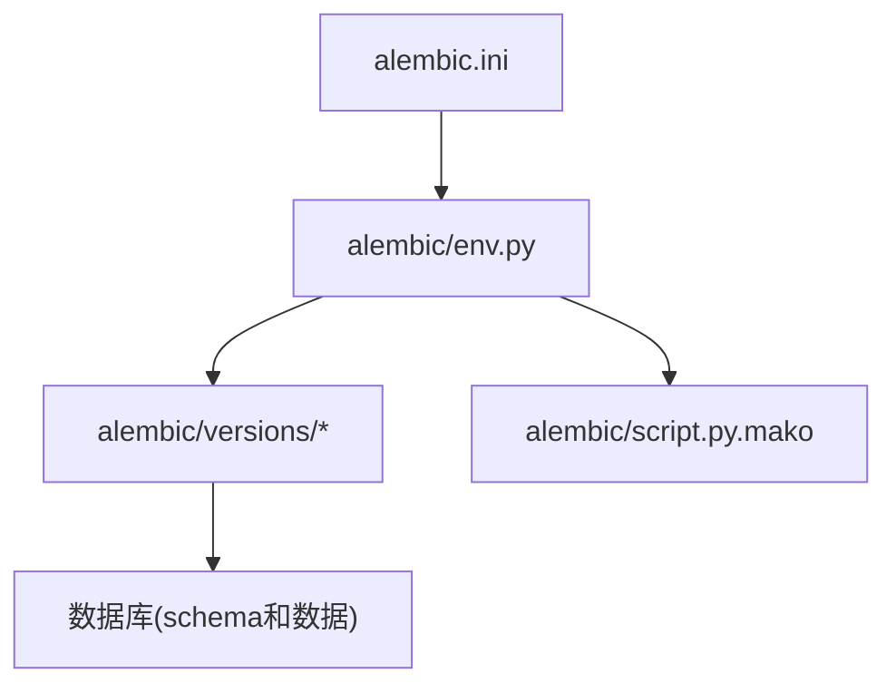
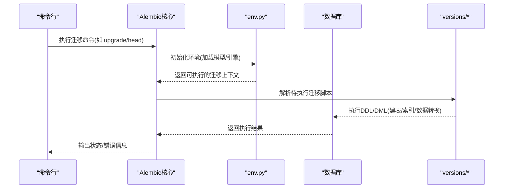
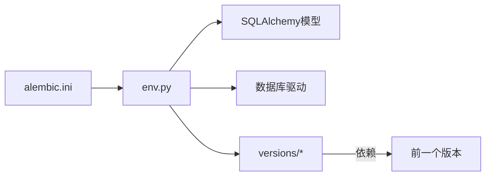

# Alembic迁移管理

<cite>
**本文引用的文件**   
- [alembic.ini](file://backend/alembic.ini)
- [env.py](file://backend/alembic/env.py)
- [script.py.mako](file://backend/alembic/script.py.mako)
- [initial.py](file://backend/alembic/versions/initial.py)
- [merge_heads.py](file://backend/alembic/versions/merge_heads.py)
- [DATABASE_MIGRATION_GUIDE.md](file://DATABASE_MIGRATION_GUIDE.md)
</cite>

## 目录
1. [简介](#简介)
2. [项目结构](#项目结构)
3. [核心组件](#核心组件)
4. [架构总览](#架构总览)
5. [详细组件分析](#详细组件分析)
6. [依赖关系分析](#依赖关系分析)
7. [性能考虑](#性能考虑)
8. [故障排查指南](#故障排查指南)
9. [结论](#结论)
10. [附录](#附录)

## 简介
本文件面向小说创作代理系统的数据库迁移管理，聚焦于Alembic在工程中的安装、配置与使用。内容涵盖：
- alembic.ini与环境脚本(env.py)的配置要点
- 迁移文件的生成流程（自动生成与手动编写）
- 版本控制策略（命名规范、分支管理与合并冲突处理）
- 回滚操作（单步/批量回滚与数据恢复）
- 复杂迁移场景（数据转换、索引重建、表结构变更）
- 常用命令示例与最佳实践

## 项目结构
后端模块中Alembic相关目录与关键文件如下：
- backend/alembic.ini：Alembic全局配置，包含数据库连接、迁移目录、环境设置等
- backend/alembic/env.py：Alembic运行环境脚本，负责加载SQLAlchemy模型、构建引擎、执行迁移上下文
- backend/alembic/script.py.mako：迁移脚本模板，定义生成的迁移文件骨架
- backend/alembic/versions/*：各迁移脚本，按时间戳或哈希标识版本顺序

图表来源
- [alembic.ini](file://backend/alembic.ini)
- [env.py](file://backend/alembic/env.py)
- [script.py.mako](file://backend/alembic/script.py.mako)
- [initial.py](file://backend/alembic/versions/initial.py)
- [merge_heads.py](file://backend/alembic/versions/merge_heads.py)

章节来源
- [alembic.ini](file://backend/alembic.ini)
- [env.py](file://backend/alembic/env.py)
- [script.py.mako](file://backend/alembic/script.py.mako)
- [initial.py](file://backend/alembic/versions/initial.py)
- [merge_heads.py](file://backend/alembic/versions/merge_heads.py)

## 核心组件
- alembic.ini：集中式配置，指定数据库URL、迁移目录、日志级别、环境参数等
- env.py：运行时环境，负责导入SQLAlchemy模型、创建引擎、设置上下文、调用upgrade/downgrade
- script.py.mako：迁移脚本模板，统一生成风格（如revision、down_revision、upgrade、downgrade函数签名）
- versions/*：具体迁移实现，每个文件对应一次schema或数据变更

章节来源
- [alembic.ini](file://backend/alembic.ini)
- [env.py](file://backend/alembic/env.py)
- [script.py.mako](file://backend/alembic/script.py.mako)

## 架构总览
Alembic通过命令行驱动，读取alembic.ini定位迁移目录，由env.py加载模型并建立数据库连接，再根据目标版本对versions下的脚本进行顺序执行。

图表来源
- [alembic.ini](file://backend/alembic.ini)
- [env.py](file://backend/alembic/env.py)
- [initial.py](file://backend/alembic/versions/initial.py)
- [merge_heads.py](file://backend/alembic/versions/merge_heads.py)

## 详细组件分析

### alembic.ini配置要点
- 数据库连接：配置数据库URL，确保与运行环境一致（开发/测试/生产）
- 迁移目录：指向backend/alembic/versions
- 日志与调试：建议开启适当日志级别便于排查
- 环境变量注入：可通过环境变量覆盖敏感配置（如密码、主机）

章节来源
- [alembic.ini](file://backend/alembic.ini)

### env.py环境脚本
- 模型导入：确保所有SQLAlchemy模型被导入，以便Alembic检测差异
- 引擎创建：从配置或环境变量构造数据库引擎
- 上下文设置：设置目标版本、事务模式、批处理选项等
- 迁移执行：封装upgrade/downgrade逻辑，支持批量操作与事务边界

章节来源
- [env.py](file://backend/alembic/env.py)

### script.py.mako模板
- 生成迁移骨架：revision、down_revision、upgrade、downgrade函数签名
- 默认注释与导入：便于开发者快速填充业务逻辑
- 自定义扩展：可在模板中加入通用辅助函数或约束检查

章节来源
- [script.py.mako](file://backend/alembic/script.py.mako)

### 迁移文件与版本控制
- initial.py：初始迁移，定义基础表结构与索引
- merge_heads.py：多分支合并时用于对齐头节点，保证线性历史
- 命名规范：建议使用描述性文件名（如 add_xxx_to_yyy.py），避免纯数字或无意义名称
- 分支管理：特性分支独立提交迁移，合入主干前需验证兼容性
- 合并冲突：优先以数据一致性为先，必要时引入中间迁移过渡

章节来源
- [initial.py](file://backend/alembic/versions/initial.py)
- [merge_heads.py](file://backend/alembic/versions/merge_heads.py)

### 迁移生成流程
- 自动生成：基于模型差异生成迁移脚本，适用于字段新增、删除、类型变更
- 手动编写：复杂数据转换、跨表关联更新、索引重建等场景需手工编写
- 数据模型变更：修改SQLAlchemy模型后，先审查自动生成的迁移，再补充必要的数据迁移步骤

章节来源
- [DATABASE_MIGRATION_GUIDE.md](file://DATABASE_MIGRATION_GUIDE.md)

### 回滚操作指南
- 单步回滚：回退到上一个版本，适用于误改后的快速修复
- 批量回滚：回退到指定版本，适用于大范围调整
- 数据恢复：结合备份与迁移脚本的幂等设计，确保可重复执行

章节来源
- [DATABASE_MIGRATION_GUIDE.md](file://DATABASE_MIGRATION_GUIDE.md)

### 复杂迁移场景处理
- 数据转换：分阶段迁移，先加字段，再回填数据，最后切换逻辑
- 索引重建：在线重建大表索引，避免锁表影响服务可用性
- 表结构变更：采用“双写”或“灰度切换”，降低风险

章节来源
- [DATABASE_MIGRATION_GUIDE.md](file://DATABASE_MIGRATION_GUIDE.md)

## 依赖关系分析
Alembic依赖SQLAlchemy模型定义与数据库驱动；env.py作为桥梁将两者串联。迁移脚本之间通过down_revision形成有向无环图，确保执行顺序正确。

图表来源
- [alembic.ini](file://backend/alembic.ini)
- [env.py](file://backend/alembic/env.py)
- [initial.py](file://backend/alembic/versions/initial.py)
- [merge_heads.py](file://backend/alembic/versions/merge_heads.py)

章节来源
- [alembic.ini](file://backend/alembic.ini)
- [env.py](file://backend/alembic/env.py)
- [initial.py](file://backend/alembic/versions/initial.py)
- [merge_heads.py](file://backend/alembic/versions/merge_heads.py)

## 性能考虑
- 批量写入：在迁移中使用批量插入/更新减少往返开销
- 事务边界：合理划分事务，避免长事务导致锁竞争
- 索引策略：迁移前后评估查询路径，避免全表扫描
- 并发控制：在高并发环境下，迁移期间限制写入或采用读写分离

## 故障排查指南
- 连接失败：检查alembic.ini中的数据库URL与网络连通性
- 模型未导入：确认env.py已导入所有模型，避免差异检测遗漏
- 版本不一致：使用head/compare命令对比本地与数据库版本
- 回滚失败：检查迁移脚本幂等性与数据约束

章节来源
- [DATABASE_MIGRATION_GUIDE.md](file://DATABASE_MIGRATION_GUIDE.md)

## 结论
通过规范的Alembic配置与迁移流程，可有效管理小说创作代理系统的数据库演进。建议团队遵循统一的命名与分支策略，重视数据迁移的幂等性与可回滚性，确保系统稳定迭代。

## 附录
- 常用命令示例（请在后端目录下执行）：
  - 初始化迁移目录：alembic init
  - 生成迁移：alembic revision --autogenerate -m "描述"
  - 应用迁移：alembic upgrade head
  - 查看版本：alembic current / alembic history
  - 回滚一步：alembic downgrade -1
  - 回滚到指定版本：alembic downgrade <版本号>
  - 比较差异：alembic compare
- 最佳实践：
  - 每次变更只生成一个迁移，保持原子性
  - 数据迁移与结构迁移分离，便于回滚与重试
  - 在生产环境执行迁移前，先在预发环境充分验证
  - 记录迁移影响范围与回滚方案，纳入发布清单