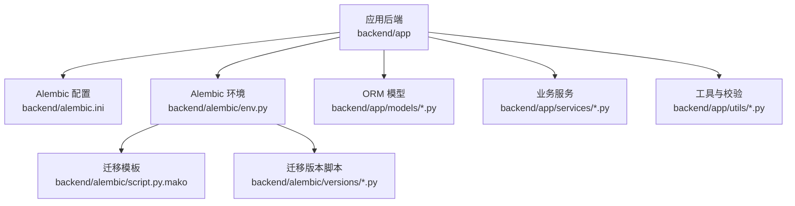
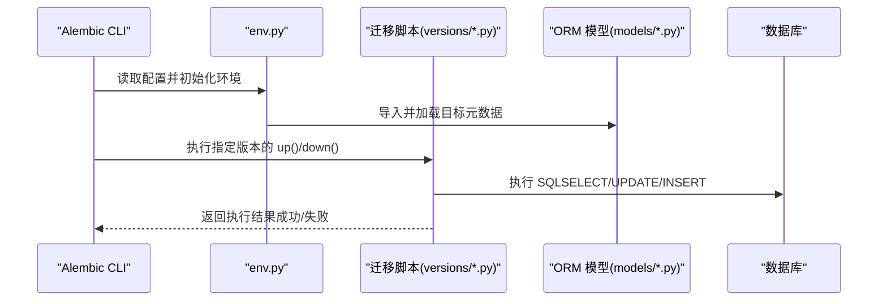

# 数据迁移处理

<cite>
**本文引用的文件**   
- [DATABASE_MIGRATION_GUIDE.md](file://DATABASE_MIGRATION_GUIDE.md)
- [alembic.ini](file://backend/alembic.ini)
- [env.py](file://backend/alembic/env.py)
- [script.py.mako](file://backend/alembic/script.py.mako)
- [initial.py](file://backend/alembic/versions/initial.py)
- [add_active_user_asset_identity_unique_index.py](file://backend/alembic/versions/add_active_user_asset_identity_unique_index.py)
- [add_admin_rbac.py](file://backend/alembic/versions/add_admin_rbac.py)
- [add_audio_config_to_projects.py](file://backend/alembic/versions/add_audio_config_to_projects.py)
- [add_audio_library_asset_ratings.py](file://backend/alembic/versions/add_audio_library_asset_ratings.py)
- [add_audio_library_assets.py](file://backend/alembic/versions/add_audio_library_assets.py)
- [add_audiobook_delete_audit.py](file://backend/alembic/versions/add_audiobook_delete_audit.py)
- [add_audiobook_models.py](file://backend/alembic/versions/add_audiobook_models.py)
- [add_book_parser_tables.py](file://backend/alembic/versions/add_book_parser_tables.py)
- [add_cascade_delete_constraints.py](file://backend/alembic/versions/add_cascade_delete_constraints.py)
- [add_champion_ai_score_to_experiments.py](file://backend/alembic/versions/add_champion_ai_score_to_experiments.py)
- [add_chapter_audio_runs.py](file://backend/alembic/versions/add_chapter_audio_runs.py)
- [add_chapter_summary_fields.py](file://backend/alembic/versions/add_chapter_summary_fields.py)
- [add_chapter_summary_fields_to_existing_table.py](file://backend/alembic/versions/add_chapter_summary_fields_to_existing_table.py)
- [add_character_genre_fields_json.py](file://backend/alembic/versions/add_character_genre_fields_json.py)
- [add_character_role_position.py](file://backend/alembic/versions/add_character_role_position.py)
- [add_deleted_at_to_audiobook_models.py](file://backend/alembic/versions/add_deleted_at_to_audiobook_models.py)
- [add_deleted_at_to_chapters.py](file://backend/alembic/versions/add_deleted_at_to_chapters.py)
- [add_dreamweaver_run_events.py](file://backend/alembic/versions/add_dreamweaver_run_events.py)
- [add_epic_framework_fields.py](file://backend/alembic/versions/add_epic_framework_fields.py)
- [add_genre_planning_to_projects.py](file://backend/alembic/versions/add_genre_planning_to_projects.py)
- [add_model_catalog_tables.py](file://backend/alembic/versions/add_model_catalog_tables.py)
- [add_phone_field.py](file://backend/alembic/versions/add_phone_field.py)
- [add_project_display_no.py](file://backend/alembic/versions/add_project_display_no.py)
- [add_project_review_config.py](file://backend/alembic/versions/add_project_review_config.py)
- [add_project_settings_review_meta.py](file://backend/alembic/versions/add_project_settings_review_meta.py)
- [add_prompt_challenger_state_transitions.py](file://backend/alembic/versions/add_prompt_challenger_state_transitions.py)
- [add_prompt_experiment_tables.py](file://backend/alembic/versions/add_prompt_experiment_tables.py)
- [add_script_fields_to_chapter_audios.py](file://backend/alembic/versions/add_script_fields_to_chapter_audios.py)
- [add_setting_models.py](file://backend/alembic/versions/add_setting_models.py)
- [add_snapshots_confidence_to_setting_items.py](file://backend/alembic/versions/add_snapshots_confidence_to_setting_items.py)
- [add_structured_memory_to_project_settings.py](file://backend/alembic/versions/add_structured_memory_to_project_settings.py)
- [add_third_party_login_fields.py](file://backend/alembic/versions/add_third_party_login_fields.py)
- [add_user_asset_records.py](file://backend/alembic/versions/add_user_asset_records.py)
- [add_user_voice_isolation_and_public_pool.py](file://backend/alembic/versions/add_user_voice_isolation_and_public_pool.py)
- [add_voice_asset_billing_ledger.py](file://backend/alembic/versions/add_voice_asset_billing_ledger.py)
- [add_voice_reference_assets.py](file://backend/alembic/versions/add_voice_reference_assets.py)
- [align_chapter_audios_with_runtime_model.py](file://backend/alembic/versions/align_chapter_audios_with_runtime_model.py)
- [align_remaining_timestamp_columns.py](file://backend/alembic/versions/align_remaining_timestamp_columns.py)
- [backfill_character_story_stance_from_text_evidence.py](file://backend/alembic/versions/backfill_character_story_stance_from_text_evidence.py)
- [cleanup_redundant_indexes.py](file://backend/alembic/versions/cleanup_redundant_indexes.py)
- [correct_character_story_stance_false_positives.py](file://backend/alembic/versions/correct_character_story_stance_false_positives.py)
- [create_project_settings_table.py](file://backend/alembic/versions/create_project_settings_table.py)
- [d1d5ec080e06_merge_multiple_heads.py](file://backend/alembic/versions/d1d5ec080e06_merge_multiple_heads.py)
- [merge_effective_heads_after_model_catalog.py](file://backend/alembic/versions/merge_effective_heads_after_model_catalog.py)
- [merge_heads.py](file://backend/alembic/versions/merge_heads.py)
- [normalize_character_story_fields.py](file://backend/alembic/versions/normalize_character_story_fields.py)
- [normalize_project_settings_row_timestamps.py](file://backend/alembic/versions/normalize_project_settings_row_timestamps.py)
- [normalize_timezone_aware_timestamp_columns.py](file://backend/alembic/versions/normalize_timezone_aware_timestamp_columns.py)
- [rebuild_user_asset_records_local_first.py](file://backend/alembic/versions/rebuild_user_asset_records_local_first.py)
- [remove_legacy_chapter_audio_runtime_fields.py](file://backend/alembic/versions/remove_legacy_chapter_audio_runtime_fields.py)
</cite>

## 目录
1. [简介](#简介)
2. [项目结构](#项目结构)
3. [核心组件](#核心组件)
4. [架构总览](#架构总览)
5. [详细组件分析](#详细组件分析)
6. [依赖关系分析](#依赖关系分析)
7. [性能考虑](#性能考虑)
8. [故障排查指南](#故障排查指南)
9. [结论](#结论)
10. [附录](#附录)

## 简介
本文件面向小说创作代理系统的数据迁移实践，聚焦 Alembic 迁移脚本的编写规范、安全写法与性能优化。内容涵盖：
- 在迁移中如何正确编写 SELECT、UPDATE、INSERT 等数据转换逻辑
- 大数据量迁移的分批处理、索引优化与事务控制策略
- 错误处理与重试机制：异常捕获、日志记录、部分回滚策略
- 复杂迁移示例：跨表同步、数据清洗转换、历史数据修复
- 测试与验证方法：模拟数据准备、结果验证、性能测试

## 项目结构
本项目使用 Alembic 管理数据库迁移，迁移脚本位于 backend/alembic/versions 目录下，配置文件包括 alembic.ini 与 env.py。模型定义位于 backend/app/models，服务层与工具类位于 backend/app/services 与 backend/app/utils。

图表来源
- [alembic.ini](file://backend/alembic.ini)
- [env.py](file://backend/alembic/env.py)
- [script.py.mako](file://backend/alembic/script.py.mako)
- [initial.py](file://backend/alembic/versions/initial.py)

章节来源
- [DATABASE_MIGRATION_GUIDE.md](file://DATABASE_MIGRATION_GUIDE.md)
- [alembic.ini](file://backend/alembic.ini)
- [env.py](file://backend/alembic/env.py)
- [script.py.mako](file://backend/alembic/script.py.mako)

## 核心组件
- Alembic 配置与环境
  - alembic.ini：迁移工程入口、数据库连接、脚本位置等
  - env.py：迁移运行时的上下文、连接获取、目标元数据加载
  - script.py.mako：生成迁移脚本的模板
- 迁移版本脚本
  - versions/*.py：每个迁移一个文件，包含 up() 与 down()，实现增量变更与回滚
- ORM 模型与服务
  - models/*.py：定义表结构与字段类型
  - services/*.py：业务逻辑，可能涉及数据迁移辅助函数或批量处理

章节来源
- [alembic.ini](file://backend/alembic.ini)
- [env.py](file://backend/alembic/env.py)
- [script.py.mako](file://backend/alembic/script.py.mako)
- [initial.py](file://backend/alembic/versions/initial.py)

## 架构总览
下图展示从 Alembic CLI 到数据库的迁移执行路径，以及迁移脚本与 ORM 模型的交互关系。

图表来源
- [env.py](file://backend/alembic/env.py)
- [script.py.mako](file://backend/alembic/script.py.mako)
- [initial.py](file://backend/alembic/versions/initial.py)

## 详细组件分析

### 迁移脚本编写规范与安全写法
- 通用原则
  - 所有数据操作应在事务内执行，确保原子性；遇到异常应触发回滚
  - 优先使用参数化查询，避免字符串拼接导致的注入风险
  - 对大表操作必须分批处理，避免长事务与锁竞争
- SELECT 安全写法
  - 使用明确的列名与条件过滤，避免 SELECT *
  - 为高频查询添加必要索引，减少全表扫描
  - 分页读取，限制单次批次大小
- UPDATE 安全写法
  - 使用 WHERE 精确限定更新范围，必要时加 LIMIT 分批更新
  - 先做幂等检查，避免重复更新造成不一致
  - 对关键列更新前进行校验，保证数据类型与约束一致
- INSERT 安全写法
  - 使用批量插入，减少往返开销
  - 插入前进行去重或唯一键冲突处理（如 ON CONFLICT DO NOTHING/UPDATE）
  - 保持外键约束一致性，避免插入顺序问题

章节来源
- [DATABASE_MIGRATION_GUIDE.md](file://DATABASE_MIGRATION_GUIDE.md)

### 大数据量迁移的性能优化
- 分批处理
  - 将大表按主键或时间戳分片，逐批读取与写入
  - 每批提交一次事务，降低锁持有时间
- 索引优化
  - 迁移前评估查询计划，按需创建临时索引
  - 迁移完成后清理冗余索引，避免写放大
- 事务控制
  - 合理设置事务边界，避免超长事务
  - 对关键步骤增加检查点，便于定位失败位置

章节来源
- [DATABASE_MIGRATION_GUIDE.md](file://DATABASE_MIGRATION_GUIDE.md)

### 错误处理与重试机制
- 异常捕获
  - 在迁移脚本中对关键操作包裹 try/except，捕获数据库异常
  - 记录详细的错误上下文（表名、批次号、SQL 片段）
- 日志记录
  - 使用统一日志框架输出结构化日志，便于追踪
  - 记录迁移进度、批次统计、耗时与错误堆栈
- 部分回滚策略
  - 对于可分割的批次，失败时仅回滚当前批次，不影响已提交数据
  - 提供恢复脚本，支持从断点继续执行

章节来源
- [DATABASE_MIGRATION_GUIDE.md](file://DATABASE_MIGRATION_GUIDE.md)

### 复杂数据迁移示例
- 跨表数据同步
  - 通过 JOIN 或子查询关联多表，计算派生字段后更新目标表
  - 使用中间表或临时视图简化复杂逻辑
- 数据清洗转换
  - 标准化格式（日期、金额、枚举值），处理空值与异常值
  - 基于规则引擎或外部服务进行数据校验与修正
- 历史数据修复
  - 针对已知缺陷数据进行批量修复，保留审计字段
  - 修复前后进行一致性校验，确保无副作用

章节来源
- [DATABASE_MIGRATION_GUIDE.md](file://DATABASE_MIGRATION_GUIDE.md)

### 测试与验证方法
- 模拟数据准备
  - 构造覆盖正常、边界与异常场景的测试数据集
  - 使用种子脚本快速生成大规模数据用于性能测试
- 结果验证
  - 对比迁移前后数据一致性（行数、聚合值、关键字段）
  - 使用断言脚本自动化验证关键指标
- 性能测试
  - 监控迁移过程中的 CPU、内存、IO 与锁等待
  - 调整批次大小与并发度，找到最优配置

章节来源
- [DATABASE_MIGRATION_GUIDE.md](file://DATABASE_MIGRATION_GUIDE.md)

### 迁移脚本示例解析
以下以几个典型迁移脚本为例，说明常见模式与最佳实践。

#### 初始迁移（initial.py）
- 作用：创建基础表结构与初始数据
- 关键点：明确外键约束、默认值与索引；确保 down() 能完整回滚

章节来源
- [initial.py](file://backend/alembic/versions/initial.py)

#### 新增索引（add_active_user_asset_identity_unique_index.py）
- 作用：为活跃用户资产标识添加唯一索引
- 关键点：先检查索引是否存在，避免重复创建；在大表上异步构建索引以减少锁

章节来源
- [add_active_user_asset_identity_unique_index.py](file://backend/alembic/versions/add_active_user_asset_identity_unique_index.py)

#### 权限模型扩展（add_admin_rbac.py）
- 作用：引入角色与权限相关表及关系
- 关键点：保持与现有用户表的兼容性；提供降级路径以支持旧版本

章节来源
- [add_admin_rbac.py](file://backend/alembic/versions/add_admin_rbac.py)

#### 音频配置字段（add_audio_config_to_projects.py）
- 作用：为项目表新增音频配置字段
- 关键点：设置合理默认值；提供迁移脚本填充历史数据

章节来源
- [add_audio_config_to_projects.py](file://backend/alembic/versions/add_audio_config_to_projects.py)

#### 音频库资产评分（add_audio_library_asset_ratings.py）
- 作用：新增评分表并建立与资产表的关联
- 关键点：确保评分数据的完整性与一致性；支持批量导入

章节来源
- [add_audio_library_asset_ratings.py](file://backend/alembic/versions/add_audio_library_asset_ratings.py)

#### 音频库资产表（add_audio_library_assets.py）
- 作用：创建音频库资产主表
- 关键点：定义必要的索引与约束；支持后续扩展字段

章节来源
- [add_audio_library_assets.py](file://backend/alembic/versions/add_audio_library_assets.py)

#### 有声书删除审计（add_audiobook_delete_audit.py）
- 作用：记录有声书删除操作的审计信息
- 关键点：保留删除原因与操作人；支持审计查询与分析

章节来源
- [add_audiobook_delete_audit.py](file://backend/alembic/versions/add_audiobook_delete_audit.py)

#### 有声书模型（add_audiobook_models.py）
- 作用：定义有声书相关的核心表结构
- 关键点：明确状态机与生命周期；提供迁移脚本初始化默认数据

章节来源
- [add_audiobook_models.py](file://backend/alembic/versions/add_audiobook_models.py)

#### 书籍解析表（add_book_parser_tables.py）
- 作用：新增书籍解析相关的表结构
- 关键点：支持多种解析格式；提供数据导入导出接口

章节来源
- [add_book_parser_tables.py](file://backend/alembic/versions/add_book_parser_tables.py)

#### 级联删除约束（add_cascade_delete_constraints.py）
- 作用：为关联表添加级联删除约束
- 关键点：评估级联删除的影响范围；提供手动清理脚本作为备选

章节来源
- [add_cascade_delete_constraints.py](file://backend/alembic/versions/add_cascade_delete_constraints.py)

#### 冠军 AI 分数（add_champion_ai_score_to_experiments.py）
- 作用：为实验表新增冠军 AI 分数字段
- 关键点：支持历史数据回填；确保分数计算的准确性

章节来源
- [add_champion_ai_score_to_experiments.py](file://backend/alembic/versions/add_champion_ai_score_to_experiments.py)

#### 章节音频运行记录（add_chapter_audio_runs.py）
- 作用：记录章节音频生成的运行信息
- 关键点：支持重试与失败重试计数；提供运行状态查询

章节来源
- [add_chapter_audio_runs.py](file://backend/alembic/versions/add_chapter_audio_runs.py)

#### 章节摘要字段（add_chapter_summary_fields.py）
- 作用：为章节表新增摘要相关字段
- 关键点：支持自动生成与手动编辑；提供摘要质量评估

章节来源
- [add_chapter_summary_fields.py](file://backend/alembic/versions/add_chapter_summary_fields.py)

#### 章节摘要字段（已有表）（add_chapter_summary_fields_to_existing_table.py）
- 作用：为已有章节表补充摘要字段
- 关键点：兼容旧数据结构；提供数据迁移脚本

章节来源
- [add_chapter_summary_fields_to_existing_table.py](file://backend/alembic/versions/add_chapter_summary_fields_to_existing_table.py)

#### 角色流派字段（JSON）（add_character_genre_fields_json.py）
- 作用：为角色表新增 JSON 格式的流派字段
- 关键点：支持动态扩展；提供 JSON 字段校验与索引

章节来源
- [add_character_genre_fields_json.py](file://backend/alembic/versions/add_character_genre_fields_json.py)

#### 角色职位（add_character_role_position.py）
- 作用：新增角色职位字段
- 关键点：定义职位枚举值；支持历史数据映射

章节来源
- [add_character_role_position.py](file://backend/alembic/versions/add_character_role_position.py)

#### 软删除字段（有声书模型）（add_deleted_at_to_audiobook_models.py）
- 作用：为有声书模型添加软删除字段
- 关键点：统一软删除逻辑；提供查询过滤与统计

章节来源
- [add_deleted_at_to_audiobook_models.py](file://backend/alembic/versions/add_deleted_at_to_audiobook_models.py)

#### 软删除字段（章节）（add_deleted_at_to_chapters.py）
- 作用：为章节表添加软删除字段
- 关键点：与项目层级保持一致；支持批量恢复

章节来源
- [add_deleted_at_to_chapters.py](file://backend/alembic/versions/add_deleted_at_to_chapters.py)

#### 梦境编织运行事件（add_dreamweaver_run_events.py）
- 作用：记录梦境编织任务的运行事件
- 关键点：支持事件溯源；提供事件回放功能

章节来源
- [add_dreamweaver_run_events.py](file://backend/alembic/versions/add_dreamweaver_run_events.py)

#### 史诗框架字段（add_epic_framework_fields.py）
- 作用：为史诗框架相关表新增字段
- 关键点：支持多阶段生成；提供字段版本管理

章节来源
- [add_epic_framework_fields.py](file://backend/alembic/versions/add_epic_framework_fields.py)

#### 项目流派规划（add_genre_planning_to_projects.py）
- 作用：为项目表新增流派规划字段
- 关键点：支持流派组合与权重；提供规划建议

章节来源
- [add_genre_planning_to_projects.py](file://backend/alembic/versions/add_genre_planning_to_projects.py)

#### 模型目录表（add_model_catalog_tables.py）
- 作用：创建模型目录相关表结构
- 关键点：支持模型注册与发现；提供版本管理

章节来源
- [add_model_catalog_tables.py](file://backend/alembic/versions/add_model_catalog_tables.py)

#### 手机号字段（add_phone_field.py）
- 作用：为用户表新增手机号字段
- 关键点：支持手机号格式校验；提供隐私保护

章节来源
- [add_phone_field.py](file://backend/alembic/versions/add_phone_field.py)

#### 项目显示编号（add_project_display_no.py）
- 作用：为项目表新增显示编号字段
- 关键点：支持自定义编号规则；提供唯一性约束

章节来源
- [add_project_display_no.py](file://backend/alembic/versions/add_project_display_no.py)

#### 项目评审配置（add_project_review_config.py）
- 作用：新增项目评审配置表
- 关键点：支持灵活配置评审流程；提供配置版本控制

章节来源
- [add_project_review_config.py](file://backend/alembic/versions/add_project_review_config.py)

#### 项目设置评审元数据（add_project_settings_review_meta.py）
- 作用：为项目设置表新增评审元数据字段
- 关键点：记录评审历史；支持审计追溯

章节来源
- [add_project_settings_review_meta.py](file://backend/alembic/versions/add_project_settings_review_meta.py)

#### 提示词挑战者状态转换（add_prompt_challenger_state_transitions.py）
- 作用：新增提示词挑战者的状态转换表
- 关键点：定义状态机；支持状态回滚

章节来源
- [add_prompt_challenger_state_transitions.py](file://backend/alembic/versions/add_prompt_challenger_state_transitions.py)

#### 提示词实验表（add_prompt_experiment_tables.py）
- 作用：创建提示词实验相关表结构
- 关键点：支持实验对比与评估；提供结果导出

章节来源
- [add_prompt_experiment_tables.py](file://backend/alembic/versions/add_prompt_experiment_tables.py)

#### 章节音频脚本字段（add_script_fields_to_chapter_audios.py）
- 作用：为章节音频表新增脚本字段
- 关键点：支持脚本版本管理；提供脚本比对

章节来源
- [add_script_fields_to_chapter_audios.py](file://backend/alembic/versions/add_script_fields_to_chapter_audios.py)

#### 设定模型（add_setting_models.py）
- 作用：新增设定相关表结构
- 关键点：支持设定分类与继承；提供设定模板

章节来源
- [add_setting_models.py](file://backend/alembic/versions/add_setting_models.py)

#### 快照置信度（add_snapshots_confidence_to_setting_items.py）
- 作用：为设定项表新增快照置信度字段
- 关键点：支持置信度计算；提供快照回溯

章节来源
- [add_snapshots_confidence_to_setting_items.py](file://backend/alembic/versions/add_snapshots_confidence_to_setting_items.py)

#### 结构化记忆（add_structured_memory_to_project_settings.py）
- 作用：为项目设置表新增结构化记忆字段
- 关键点：支持记忆检索与更新；提供记忆一致性校验

章节来源
- [add_structured_memory_to_project_settings.py](file://backend/alembic/versions/add_structured_memory_to_project_settings.py)

#### 第三方登录字段（add_third_party_login_fields.py）
- 作用：为用户表新增第三方登录字段
- 关键点：支持多平台登录；提供账号绑定

章节来源
- [add_third_party_login_fields.py](file://backend/alembic/versions/add_third_party_login_fields.py)

#### 用户资产记录（add_user_asset_records.py）
- 作用：新增用户资产记录表
- 关键点：支持资产版本管理；提供资产审计

章节来源
- [add_user_asset_records.py](file://backend/alembic/versions/add_user_asset_records.py)

#### 用户语音隔离与公共池（add_user_voice_isolation_and_public_pool.py）
- 作用：新增用户语音隔离与公共池相关表
- 关键点：支持语音资源复用；提供权限控制

章节来源
- [add_user_voice_isolation_and_public_pool.py](file://backend/alembic/versions/add_user_voice_isolation_and_public_pool.py)

#### 语音资产计费台账（add_voice_asset_billing_ledger.py）
- 作用：新增语音资产计费台账表
- 关键点：支持计费明细查询；提供账单导出

章节来源
- [add_voice_asset_billing_ledger.py](file://backend/alembic/versions/add_voice_asset_billing_ledger.py)

#### 语音参考资产（add_voice_reference_assets.py）
- 作用：新增语音参考资产表
- 关键点：支持参考语音管理；提供相似度匹配

章节来源
- [add_voice_reference_assets.py](file://backend/alembic/versions/add_voice_reference_assets.py)

#### 对齐章节音频运行时模型（align_chapter_audios_with_runtime_model.py）
- 作用：对齐章节音频表与运行时模型
- 关键点：确保字段一致性；提供数据修复脚本

章节来源
- [align_chapter_audios_with_runtime_model.py](file://backend/alembic/versions/align_chapter_audios_with_runtime_model.py)

#### 对齐剩余时间戳列（align_remaining_timestamp_columns.py）
- 作用：对齐剩余时间戳列的时区与格式
- 关键点：避免时区混乱；提供时间转换脚本

章节来源
- [align_remaining_timestamp_columns.py](file://backend/alembic/versions/align_remaining_timestamp_columns.py)

#### 从文本证据回填角色立场（backfill_character_story_stance_from_text_evidence.py）
- 作用：基于文本证据回填角色立场数据
- 关键点：使用 NLP 模型提取立场；提供人工审核接口

章节来源
- [backfill_character_story_stance_from_text_evidence.py](file://backend/alembic/versions/backfill_character_story_stance_from_text_evidence.py)

#### 清理冗余索引（cleanup_redundant_indexes.py）
- 作用：清理数据库中冗余索引
- 关键点：识别未使用索引；评估清理影响

章节来源
- [cleanup_redundant_indexes.py](file://backend/alembic/versions/cleanup_redundant_indexes.py)

#### 修正角色立场误报（correct_character_story_stance_false_positives.py）
- 作用：修正角色立场数据中的误报
- 关键点：使用规则与模型联合修正；提供修正日志

章节来源
- [correct_character_story_stance_false_positives.py](file://backend/alembic/versions/correct_character_story_stance_false_positives.py)

#### 创建项目设置表（create_project_settings_table.py）
- 作用：创建项目设置主表
- 关键点：支持键值对存储；提供设置版本控制

章节来源
- [create_project_settings_table.py](file://backend/alembic/versions/create_project_settings_table.py)

#### 合并多个头（d1d5ec080e06_merge_multiple_heads.py）
- 作用：合并多个迁移头
- 关键点：解决分支合并冲突；确保迁移顺序正确

章节来源
- [d1d5ec080e06_merge_multiple_heads.py](file://backend/alembic/versions/d1d5ec080e06_merge_multiple_heads.py)

#### 模型目录后合并有效头（merge_effective_heads_after_model_catalog.py）
- 作用：在模型目录迁移后合并有效头
- 关键点：维护迁移图的正确性；避免循环依赖

章节来源
- [merge_effective_heads_after_model_catalog.py](file://backend/alembic/versions/merge_effective_heads_after_model_catalog.py)

#### 合并头（merge_heads.py）
- 作用：通用头合并脚本
- 关键点：支持自动合并策略；提供冲突解决提示

章节来源
- [merge_heads.py](file://backend/alembic/versions/merge_heads.py)

#### 规范化角色故事字段（normalize_character_story_fields.py）
- 作用：规范化角色故事相关字段
- 关键点：统一字段命名与类型；提供数据迁移脚本

章节来源
- [normalize_character_story_fields.py](file://backend/alembic/versions/normalize_character_story_fields.py)

#### 规范化项目设置行时间戳（normalize_project_settings_row_timestamps.py）
- 作用：规范化项目设置行的时间戳字段
- 关键点：统一时区与格式；提供时间校准脚本

章节来源
- [normalize_project_settings_row_timestamps.py](file://backend/alembic/versions/normalize_project_settings_row_timestamps.py)

#### 规范化带时区的时间戳列（normalize_timezone_aware_timestamp_columns.py）
- 作用：规范化所有带时区的时间戳列
- 关键点：避免时区错误；提供时区转换工具

章节来源
- [normalize_timezone_aware_timestamp_columns.py](file://backend/alembic/versions/normalize_timezone_aware_timestamp_columns.py)

#### 重建用户资产记录本地优先（rebuild_user_asset_records_local_first.py）
- 作用：优先本地数据重建用户资产记录
- 关键点：确保本地数据一致性；提供远程同步脚本

章节来源
- [rebuild_user_asset_records_local_first.py](file://backend/alembic/versions/rebuild_user_asset_records_local_first.py)

#### 移除遗留章节音频运行时字段（remove_legacy_chapter_audio_runtime_fields.py）
- 作用：移除章节音频表中遗留的运行时字段
- 关键点：评估字段使用情况；提供数据备份

章节来源
- [remove_legacy_chapter_audio_runtime_fields.py](file://backend/alembic/versions/remove_legacy_chapter_audio_runtime_fields.py)

## 依赖关系分析
迁移脚本之间的依赖关系通过 Alembic 的版本链管理，确保迁移顺序正确。

图表来源
- [initial.py](file://backend/alembic/versions/initial.py)
- [add_audio_library_assets.py](file://backend/alembic/versions/add_audio_library_assets.py)
- [add_audio_library_asset_ratings.py](file://backend/alembic/versions/add_audio_library_asset_ratings.py)
- [add_chapter_audio_runs.py](file://backend/alembic/versions/add_chapter_audio_runs.py)
- [align_chapter_audios_with_runtime_model.py](file://backend/alembic/versions/align_chapter_audios_with_runtime_model.py)
- [remove_legacy_chapter_audio_runtime_fields.py](file://backend/alembic/versions/remove_legacy_chapter_audio_runtime_fields.py)

章节来源
- [alembic.ini](file://backend/alembic.ini)
- [env.py](file://backend/alembic/env.py)

## 性能考虑
- 分批处理：将大表操作拆分为小批次，减少锁持有时间与内存占用
- 索引优化：在迁移前评估查询计划，按需创建临时索引，迁移后清理冗余索引
- 事务控制：合理设置事务边界，避免超长事务导致锁竞争
- 并发控制：谨慎使用并发迁移，避免资源争用与死锁

## 故障排查指南
- 常见问题
  - 迁移失败：检查数据库连接、权限与约束冲突
  - 性能问题：分析慢查询日志，优化索引与查询语句
  - 数据不一致：对比迁移前后数据，定位差异行
- 调试技巧
  - 启用详细日志，记录每一步操作
  - 使用只读副本进行测试，避免影响生产数据
  - 逐步执行迁移，定位问题所在步骤

## 结论
通过规范的迁移脚本编写、性能优化与完善的错误处理机制，可以确保小说创作代理系统的数据迁移安全、高效且可维护。建议在实际项目中结合具体业务场景，制定详细的迁移计划与测试方案。

## 附录
- 参考文档：DATABASE_MIGRATION_GUIDE.md
- 常用命令：
  - 生成迁移脚本：alembic revision --autogenerate -m "描述"
  - 执行迁移：alembic upgrade head
  - 回滚迁移：alembic downgrade -1
  - 查看迁移历史：alembic history
  - 检查迁移状态：alembic current