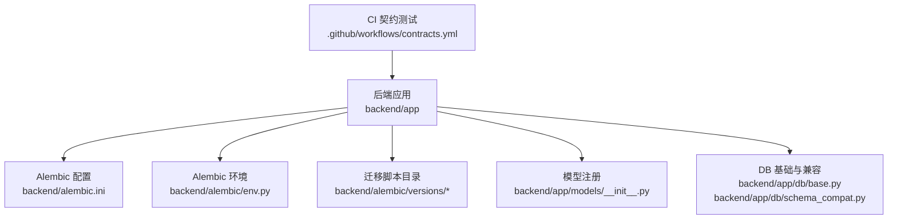
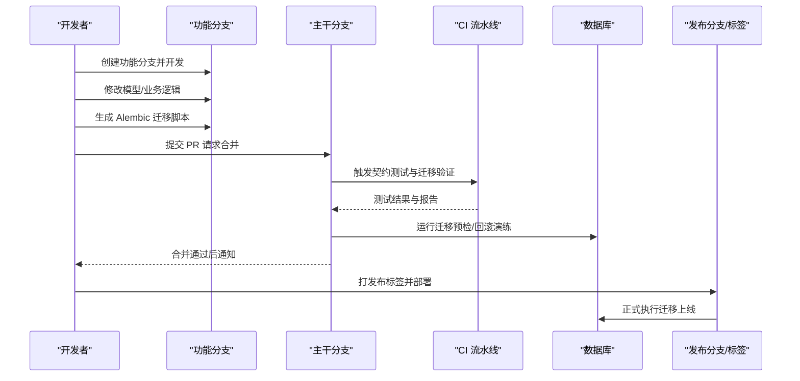
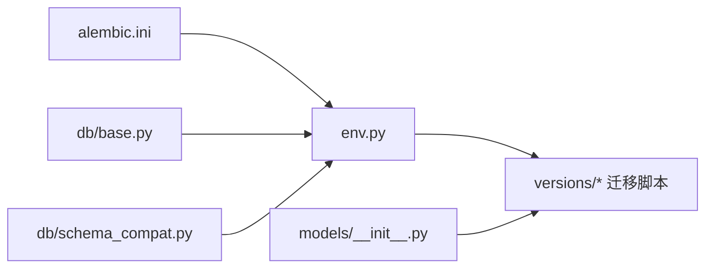

# 分支管理策略

<cite>
**本文引用的文件**   
- [backend/alembic.ini](file://backend/alembic.ini)
- [backend/alembic/env.py](file://backend/alembic/env.py)
- [backend/alembic/script.py.mako](file://backend/alembic/script.py.mako)
- [backend/alembic/versions/initial.py](file://backend/alembic/versions/initial.py)
- [backend/alembic/versions/merge_heads.py](file://backend/alembic/versions/merge_heads.py)
- [backend/alembic/versions/d1d5ec080e06_merge_multiple_heads.py](file://backend/alembic/versions/d1d5ec080e06_merge_multiple_heads.py)
- [backend/alembic/versions/merge_effective_heads_after_model_catalog.py](file://backend/alembic/versions/merge_effective_heads_after_model_catalog.py)
- [backend/app/db/base.py](file://backend/app/db/base.py)
- [backend/app/db/schema_compat.py](file://backend/app/db/schema_compat.py)
- [backend/app/models/__init__.py](file://backend/app/models/__init__.py)
- [backend/tests/test_application_openapi.py](file://backend/tests/test_application_openapi.py)
- [.github/workflows/contracts.yml](file://.github/workflows/contracts.yml)
- [README.md](file://README.md)
</cite>

## 目录
1. [简介](#简介)
2. [项目结构](#项目结构)
3. [核心组件](#核心组件)
4. [架构总览](#架构总览)
5. [详细组件分析](#详细组件分析)
6. [依赖关系分析](#依赖关系分析)
7. [性能考虑](#性能考虑)
8. [故障排查指南](#故障排查指南)
9. [结论](#结论)
10. [附录](#附录)

## 简介
本文件为小说创作代理系统的 Alembic 数据库迁移分支管理策略提供完整规范。内容覆盖开发分支、功能分支与发布分支的命名约定、生命周期管理、合并策略；在多人协作下如何创建与管理迁移文件、处理分支间依赖、保证切换时的数据一致性；以及主干保护、版本控制流程（代码审查、自动化测试、标签管理）和冲突预防与常见问题解决方案。

## 项目结构
本项目使用 Alembic 进行数据库迁移，迁移脚本位于 backend/alembic 目录，模型定义位于 backend/app/models，基础连接与兼容性逻辑位于 backend/app/db。CI 流水线通过 .github/workflows/contracts.yml 执行契约测试，确保 API 与数据层变更的一致性。

**图示来源** 
- [backend/alembic.ini](file://backend/alembic.ini)
- [backend/alembic/env.py](file://backend/alembic/env.py)
- [backend/alembic/versions/initial.py](file://backend/alembic/versions/initial.py)
- [backend/app/models/__init__.py](file://backend/app/models/__init__.py)
- [backend/app/db/base.py](file://backend/app/db/base.py)
- [backend/app/db/schema_compat.py](file://backend/app/db/schema_compat.py)
- [.github/workflows/contracts.yml](file://.github/workflows/contracts.yml)

**章节来源**
- [README.md](file://README.md)

## 核心组件
- Alembic 配置与环境：alembic.ini 指定迁移元数据位置与目标数据库；env.py 负责引擎初始化、事务上下文与迁移脚本加载。
- 迁移脚本：versions 目录下每个文件代表一次迁移，包含 up/down 操作，用于前滚/回滚数据库结构变更。
- 模型与连接：app/models 中的 ORM 模型由 Alembic 自动检测生成迁移；app/db/base.py 提供 Base 声明式基类与连接设置；schema_compat.py 提供跨版本兼容逻辑。
- CI 契约测试：通过 contracts.yml 对 API 契约与数据层变更进行自动化验证，保障迁移与接口一致。

**章节来源**
- [backend/alembic.ini](file://backend/alembic.ini)
- [backend/alembic/env.py](file://backend/alembic/env.py)
- [backend/app/db/base.py](file://backend/app/db/base.py)
- [backend/app/db/schema_compat.py](file://backend/app/db/schema_compat.py)
- [backend/app/models/__init__.py](file://backend/app/models/__init__.py)
- [.github/workflows/contracts.yml](file://.github/workflows/contracts.yml)

## 架构总览
下图展示从开发者到生产环境的迁移工作流，包括分支创建、迁移脚本生成、合并、CI 校验与发布。

**图示来源** 
- [backend/alembic/env.py](file://backend/alembic/env.py)
- [backend/alembic/versions/initial.py](file://backend/alembic/versions/initial.py)
- [.github/workflows/contracts.yml](file://.github/workflows/contracts.yml)

## 详细组件分析

### 分支命名约定与生命周期
- 主干分支（main/master）：稳定可发布的基线，禁止直接推送，仅允许通过受控的合并流程进入。
- 功能分支（feature/*）：以 feature/<模块>-<描述> 命名，例如 feature/audio-library-assets。生命周期从创建到合并入主干，完成后删除。
- 修复分支（hotfix/*）：针对线上问题的快速修复，命名 hotfix/<问题简述>，需紧急评审后合并至主干与发布分支。
- 发布分支（release/*）：命名 release/vX.Y.Z，用于冻结代码、回归测试与打标签。

建议规则：
- 所有分支名小写、短横线分隔，避免空格与特殊字符。
- 功能分支粒度适中，单一职责，便于独立评审与回滚。
- 发布分支仅做补丁与文档更新，不引入新功能。

**章节来源**
- [README.md](file://README.md)

### 迁移文件创建与命名
- 使用 Alembic 命令生成迁移文件，文件名应体现变更意图，如 add_audio_library_assets.py。
- 迁移文件必须包含完整的 up() 与 down() 实现，确保可回滚。
- 对于破坏性变更（删列、改类型），需在 up() 中记录数据迁移步骤，down() 中恢复或清理。

最佳实践：
- 每次迁移只解决一个明确问题，避免“大爆炸”式变更。
- 在迁移注释中说明影响范围、风险与回滚策略。
- 若涉及多表关联，优先采用增量方式（加列、默认值、再迁移数据）。

**章节来源**
- [backend/alembic/versions/add_audio_library_assets.py](file://backend/alembic/versions/add_audio_library_assets.py)
- [backend/alembic/versions/add_audiobook_models.py](file://backend/alembic/versions/add_audiobook_models.py)

### 分支间依赖关系处理
- 当多个功能分支各自产生迁移时，需评估依赖顺序。若存在强依赖，应在 PR 中明确说明并在合并时按序执行。
- 遇到分叉头（multiple heads）时，应创建合并迁移文件将分叉头统一，例如 merge_heads.py、d1d5ec080e06_merge_multiple_heads.py。
- 合并迁移不应改变数据结构，仅用于对齐历史迁移链，保持线性历史。

处理流程：
- 识别分叉头：使用 alembic heads 查看当前头节点。
- 生成合并迁移：基于差异编写合并脚本，确保无副作用。
- 验证迁移链：运行 alembic upgrade head 与 downgrade 回滚演练。

**章节来源**
- [backend/alembic/versions/merge_heads.py](file://backend/alembic/versions/merge_heads.py)
- [backend/alembic/versions/d1d5ec080e06_merge_multiple_heads.py](file://backend/alembic/versions/d1d5ec080e06_merge_multiple_heads.py)
- [backend/alembic/versions/merge_effective_heads_after_model_catalog.py](file://backend/alembic/versions/merge_effective_heads_after_model_catalog.py)

### 分支切换时的数据一致性保证
- 在切换分支前，确保本地数据库已执行最新迁移，或使用隔离的测试数据库。
- 使用 Alembic 的环境变量与连接配置（env.py）确保不同环境（开发、测试、生产）迁移行为一致。
- 对破坏性变更，先在测试环境验证回滚路径，再在生产执行。

一致性检查清单：
- 迁移脚本是否可逆（down 实现完整）。
- 是否存在未提交的中间状态数据。
- 是否有外部系统依赖该表结构（需同步更新）。

**章节来源**
- [backend/alembic/env.py](file://backend/alembic/env.py)
- [backend/app/db/base.py](file://backend/app/db/base.py)

### 主干分支保护策略
- 启用分支保护规则：禁止强制推送、要求至少一名维护者批准、通过 CI 检查后方可合并。
- 合并前必须完成代码审查与迁移验证，确保无破坏性变更或未覆盖的回滚路径。
- 主干应保持可构建、可部署状态，任何临时实验应在功能分支中进行。

**章节来源**
- [.github/workflows/contracts.yml](file://.github/workflows/contracts.yml)

### 发布分支的版本控制流程
- 发布分支命名 release/vX.Y.Z，冻结代码后进行回归测试与安全扫描。
- 通过 CI 执行契约测试、迁移演练与端到端验证。
- 验证通过后打标签 vX.Y.Z，并生成发布说明（含迁移影响与回滚预案）。

版本标签管理：
- 标签语义遵循语义化版本（主版本.次版本.修订号）。
- 标签不可移动，如需修正应创建新标签。
- 发布分支合并回主干时需保留标签信息。

**章节来源**
- [.github/workflows/contracts.yml](file://.github/workflows/contracts.yml)

### 代码审查与自动化测试验证
- 代码审查要求：至少一名资深成员审阅，关注迁移脚本的可逆性、性能影响与兼容性。
- 自动化测试：CI 中运行单元测试、集成测试与契约测试，确保 API 与数据层一致。
- 迁移演练：在 CI 中执行 alembic upgrade 与 downgrade，验证迁移链完整性。

**章节来源**
- [backend/tests/test_application_openapi.py](file://backend/tests/test_application_openapi.py)
- [.github/workflows/contracts.yml](file://.github/workflows/contracts.yml)

### 冲突预防的最佳实践
- 小步快跑：频繁提交小型变更，减少合并冲突概率。
- 提前同步：定期从主干拉取最新代码，保持功能分支与主干同步。
- 迁移解耦：将无关变更拆分到不同分支，避免耦合导致的冲突。
- 使用合并迁移：当出现分叉头时，及时创建合并迁移，保持历史线性。

**章节来源**
- [backend/alembic/versions/merge_heads.py](file://backend/alembic/versions/merge_heads.py)

### 常见问题的解决方案
- 分叉头无法升级：创建合并迁移文件，将多个头节点统一为一个。
- 迁移回滚失败：检查 down() 实现是否完整，必要时补充数据恢复逻辑。
- 环境不一致：确保各环境 alembic.ini 配置一致，使用环境变量区分数据库连接。
- 契约测试失败：检查 API 响应结构与模型变更是否匹配，更新测试用例。

**章节来源**
- [backend/alembic/versions/d1d5ec080e06_merge_multiple_heads.py](file://backend/alembic/versions/d1d5ec080e06_merge_multiple_heads.py)
- [backend/app/db/schema_compat.py](file://backend/app/db/schema_compat.py)

## 依赖关系分析
下图展示 Alembic 环境与迁移脚本之间的依赖关系，以及模型注册对迁移生成的影响。

**图示来源** 
- [backend/alembic.ini](file://backend/alembic.ini)
- [backend/alembic/env.py](file://backend/alembic/env.py)
- [backend/app/models/__init__.py](file://backend/app/models/__init__.py)
- [backend/app/db/base.py](file://backend/app/db/base.py)
- [backend/app/db/schema_compat.py](file://backend/app/db/schema_compat.py)

**章节来源**
- [backend/alembic.ini](file://backend/alembic.ini)
- [backend/alembic/env.py](file://backend/alembic/env.py)
- [backend/app/models/__init__.py](file://backend/app/models/__init__.py)
- [backend/app/db/base.py](file://backend/app/db/base.py)
- [backend/app/db/schema_compat.py](file://backend/app/db/schema_compat.py)

## 性能考虑
- 迁移脚本应避免全表扫描与长时间锁表，优先使用增量变更。
- 大数据量迁移应分批处理，结合后台任务异步执行。
- 在 CI 中使用轻量数据库镜像加速迁移验证。

[本节为通用指导，无需特定文件引用]

## 故障排查指南
- 迁移失败：检查 alembic.log 与数据库错误日志，确认 SQL 语法与约束。
- 回滚异常：验证 down() 实现，必要时手动修复数据后再重试。
- 环境差异：对比各环境 alembic.ini 配置，确保驱动与参数一致。
- 契约测试失败：定位 API 响应差异，更新测试用例或调整序列化逻辑。

**章节来源**
- [backend/alembic/env.py](file://backend/alembic/env.py)
- [backend/tests/test_application_openapi.py](file://backend/tests/test_application_openapi.py)

## 结论
通过规范的分支管理、严格的迁移脚本编写与 CI 自动化验证，可有效降低数据库变更风险，提升团队协作效率与系统稳定性。建议持续优化迁移脚本质量，完善回滚策略，并加强团队培训与知识共享。

[本节为总结性内容，无需特定文件引用]

## 附录
- 常用 Alembic 命令：
  - 生成迁移：alembic revision --autogenerate -m "描述"
  - 升级数据库：alembic upgrade head
  - 降级数据库：alembic downgrade -1
  - 查看迁移历史：alembic history
  - 查看当前头节点：alembic heads
- 推荐工具：
  - 数据库可视化工具（如 DBeaver、pgAdmin）用于验证迁移结果。
  - 代码审查平台（如 GitHub/GitLab）用于流程管控。

[本节为参考信息，无需特定文件引用]