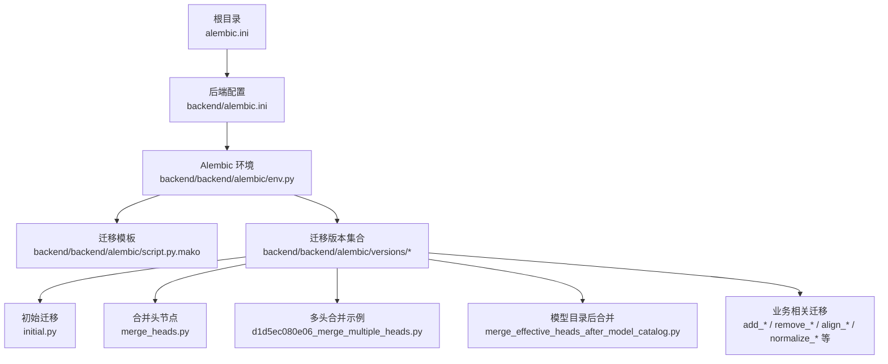
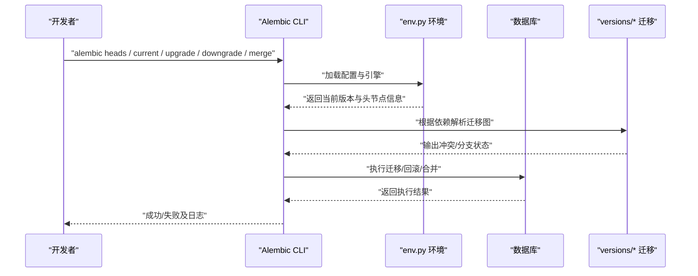
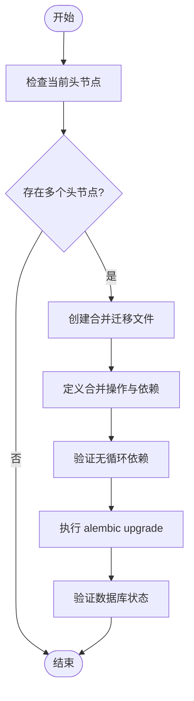
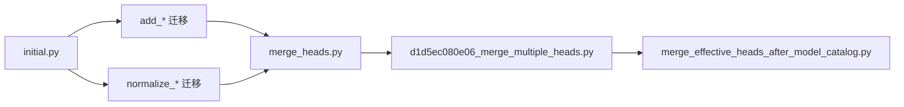

# 合并冲突解决

<cite>
**本文引用的文件**   
- [alembic.ini](file://backend/alembic.ini)
- [env.py](file://backend/backend/alembic/env.py)
- [script.py.mako](file://backend/backend/alembic/script.py.mako)
- [initial.py](file://backend/backend/alembic/versions/initial.py)
- [merge_heads.py](file://backend/backend/alembic/versions/merge_heads.py)
- [d1d5ec080e06_merge_multiple_heads.py](file://backend/backend/alembic/versions/d1d5ec080e06_merge_multiple_heads.py)
- [merge_effective_heads_after_model_catalog.py](file://backend/backend/alembic/versions/merge_effective_heads_after_model_catalog.py)
- [add_active_user_asset_identity_unique_index.py](file://backend/backend/alembic/versions/add_active_user_asset_identity_unique_index.py)
- [add_admin_rbac.py](file://backend/backend/alembic/versions/add_admin_rbac.py)
- [add_audio_config_to_projects.py](file://backend/backend/alembic/versions/add_audio_config_to_projects.py)
- [add_audio_library_asset_ratings.py](file://backend/backend/alembic/versions/add_audio_library_asset_ratings.py)
- [add_audio_library_assets.py](file://backend/backend/alembic/versions/add_audio_library_assets.py)
- [add_audiobook_delete_audit.py](file://backend/backend/alembic/versions/add_audiobook_delete_audit.py)
- [add_audiobook_models.py](file://backend/backend/alembic/versions/add_audiobook_models.py)
- [add_book_parser_tables.py](file://backend/backend/alembic/versions/add_book_parser_tables.py)
- [add_cascade_delete_constraints.py](file://backend/backend/alembic/versions/add_cascade_delete_constraints.py)
- [add_champion_ai_score_to_experiments.py](file://backend/backend/alembic/versions/add_champion_ai_score_to_experiments.py)
- [add_chapter_audio_runs.py](file://backend/backend/alembic/versions/add_chapter_audio_runs.py)
- [add_chapter_summary_fields.py](file://backend/backend/alembic/versions/add_chapter_summary_fields.py)
- [add_chapter_summary_fields_to_existing_table.py](file://backend/backend/alembic/versions/add_chapter_summary_fields_to_existing_table.py)
- [add_character_genre_fields_json.py](file://backend/backend/alembic/versions/add_character_genre_fields_json.py)
- [add_character_role_position.py](file://backend/backend/alembic/versions/add_character_role_position.py)
- [add_deleted_at_to_audiobook_models.py](file://backend/backend/alembic/versions/add_deleted_at_to_audiobook_models.py)
- [add_deleted_at_to_chapters.py](file://backend/backend/alembic/versions/add_deleted_at_to_chapters.py)
- [add_dreamweaver_run_events.py](file://backend/backend/alembic/versions/add_dreamweaver_run_events.py)
- [add_epic_framework_fields.py](file://backend/backend/alembic/versions/add_epic_framework_fields.py)
- [add_genre_planning_to_projects.py](file://backend/backend/alembic/versions/add_genre_planning_to_projects.py)
- [add_model_catalog_tables.py](file://backend/backend/alembic/versions/add_model_catalog_tables.py)
- [add_phone_field.py](file://backend/backend/alembic/versions/add_phone_field.py)
- [add_project_display_no.py](file://backend/backend/alembic/versions/add_project_display_no.py)
- [add_project_review_config.py](file://backend/backend/alembic/versions/add_project_review_config.py)
- [add_project_settings_review_meta.py](file://backend/backend/alembic/versions/add_project_settings_review_meta.py)
- [add_prompt_challenger_state_transitions.py](file://backend/backend/alembic/versions/add_prompt_challenger_state_transitions.py)
- [add_prompt_experiment_tables.py](file://backend/backend/alembic/versions/add_prompt_experiment_tables.py)
- [add_script_fields_to_chapter_audios.py](file://backend/backend/alembic/versions/add_script_fields_to_chapter_audios.py)
- [add_setting_models.py](file://backend/backend/alembic/versions/add_setting_models.py)
- [add_snapshots_confidence_to_setting_items.py](file://backend/backend/alembic/versions/add_snapshots_confidence_to_setting_items.py)
- [add_structured_memory_to_project_settings.py](file://backend/backend/alembic/versions/add_structured_memory_to_project_settings.py)
- [add_third_party_login_fields.py](file://backend/backend/alembic/versions/add_third_party_login_fields.py)
- [add_user_asset_records.py](file://backend/backend/alembic/versions/add_user_asset_records.py)
- [add_user_voice_isolation_and_public_pool.py](file://backend/backend/alembic/versions/add_user_voice_isolation_and_public_pool.py)
- [add_voice_asset_billing_ledger.py](file://backend/backend/alembic/versions/add_voice_asset_billing_ledger.py)
- [add_voice_reference_assets.py](file://backend/backend/alembic/versions/add_voice_reference_assets.py)
- [align_chapter_audios_with_runtime_model.py](file://backend/backend/alembic/versions/align_chapter_audios_with_runtime_model.py)
- [align_remaining_timestamp_columns.py](file://backend/backend/alembic/versions/align_remaining_timestamp_columns.py)
- [backfill_character_story_stance_from_text_evidence.py](file://backend/backend/alembic/versions/backfill_character_story_stance_from_text_evidence.py)
- [cleanup_redundant_indexes.py](file://backend/backend/alembic/versions/cleanup_redundant_indexes.py)
- [correct_character_story_stance_false_positives.py](file://backend/backend/alembic/versions/correct_character_story_stance_false_positives.py)
- [create_project_settings_table.py](file://backend/backend/alembic/versions/create_project_settings_table.py)
- [normalize_character_story_fields.py](file://backend/backend/alembic/versions/normalize_character_story_fields.py)
- [normalize_project_settings_row_timestamps.py](file://backend/backend/alembic/versions/normalize_project_settings_row_timestamps.py)
- [normalize_timezone_aware_timestamp_columns.py](file://backend/backend/alembic/versions/normalize_timezone_aware_timestamp_columns.py)
- [rebuild_user_asset_records_local_first.py](file://backend/backend/alembic/versions/rebuild_user_asset_records_local_first.py)
- [remove_legacy_chapter_audio_runtime_fields.py](file://backend/backend/alembic/versions/remove_legacy_chapter_audio_runtime_fields.py)
</cite>

## 目录
1. [简介](#简介)
2. [项目结构](#项目结构)
3. [核心组件](#核心组件)
4. [架构总览](#架构总览)
5. [详细组件分析](#详细组件分析)
6. [依赖关系分析](#依赖关系分析)
7. [性能考虑](#性能考虑)
8. [故障排查指南](#故障排查指南)
9. [结论](#结论)
10. [附录](#附录)

## 简介
本文件面向小说创作代理系统的数据库迁移管理，聚焦于 Alembic 的合并冲突解决。内容涵盖常见迁移冲突类型（字段、表结构、约束等）、alembic merge 的正确使用方法（手动合并、自动合并、冲突检测工具）、复杂场景策略（并发修改同一表、删除与修改冲突、外键关系冲突），以及预防最佳实践（原子性设计、依赖管理、团队协作规范）。文档同时提供实际冲突案例与解决演示路径，帮助团队在协作中高效、安全地处理迁移冲突。

## 项目结构
后端使用 Alembic 进行数据库版本控制，迁移脚本位于 backend/backend/alembic/versions 目录，配置文件包括 alembic.ini 与 env.py。根目录也包含一个 alembic.ini，用于顶层命令入口或不同环境配置。

**图示来源**
- [alembic.ini](file://backend/alembic.ini)
- [alembic.ini](file://backend/backend/alembic.ini)
- [env.py](file://backend/backend/alembic/env.py)
- [script.py.mako](file://backend/backend/alembic/script.py.mako)
- [initial.py](file://backend/backend/alembic/versions/initial.py)
- [merge_heads.py](file://backend/backend/alembic/versions/merge_heads.py)
- [d1d5ec080e06_merge_multiple_heads.py](file://backend/backend/alembic/versions/d1d5ec080e06_merge_multiple_heads.py)
- [merge_effective_heads_after_model_catalog.py](file://backend/backend/alembic/versions/merge_effective_heads_after_model_catalog.py)

**章节来源**
- [alembic.ini](file://backend/alembic.ini)
- [alembic.ini](file://backend/backend/alembic.ini)
- [env.py](file://backend/backend/alembic/env.py)
- [script.py.mako](file://backend/backend/alembic/script.py.mako)
- [initial.py](file://backend/backend/alembic/versions/initial.py)

## 核心组件
- Alembic 配置与环境：alembic.ini 定义数据库连接、迁移目录；env.py 负责加载配置、创建引擎、运行上下文的 before_revision/after_revision 钩子。
- 迁移模板：script.py.mako 生成新迁移文件的骨架，确保 revision 元数据与操作上下文一致。
- 迁移版本集：versions 目录下的 .py 文件代表每个迁移步骤，命名通常体现变更意图（如 add_*、remove_*、normalize_*、align_*）。

关键职责：
- 将应用模型变更转化为可逆/不可逆的 SQL 操作序列。
- 维护迁移图（revision graph）与依赖关系，支持分支与合并。
- 通过 alembic 命令驱动迁移执行、回滚与合并。

**章节来源**
- [alembic.ini](file://backend/backend/alembic.ini)
- [env.py](file://backend/backend/alembic/env.py)
- [script.py.mako](file://backend/backend/alembic/script.py.mako)

## 架构总览
下图展示了从命令行到 Alembic 环境再到具体迁移版本的调用流程，以及常见的冲突检测与合并路径。

**图示来源**
- [alembic.ini](file://backend/backend/alembic.ini)
- [env.py](file://backend/backend/alembic/env.py)
- [initial.py](file://backend/backend/alembic/versions/initial.py)
- [merge_heads.py](file://backend/backend/alembic/versions/merge_heads.py)

## 详细组件分析

### 迁移版本与合并头节点
项目中存在多个“合并头节点”相关的迁移，表明团队在处理多分支并行开发时采用了显式合并策略。典型文件包括：
- initial.py：初始化数据库结构。
- merge_heads.py：合并多个头节点，形成单一最新头。
- d1d5ec080e06_merge_multiple_heads.py：多分支合并的具体实现。
- merge_effective_heads_after_model_catalog.py：在模型目录变更后重新合并有效头节点。

这些文件体现了以下模式：
- 显式合并：通过专门的迁移文件记录合并点，便于审计与回滚。
- 依赖声明：明确各迁移之间的依赖关系，避免循环依赖。
- 幂等性：对重复执行的变更进行保护（例如检查索引是否存在再添加）。

**图示来源**
- [merge_heads.py](file://backend/backend/alembic/versions/merge_heads.py)
- [d1d5ec080e06_merge_multiple_heads.py](file://backend/backend/alembic/versions/d1d5ec080e06_merge_multiple_heads.py)
- [merge_effective_heads_after_model_catalog.py](file://backend/backend/alembic/versions/merge_effective_heads_after_model_catalog.py)

**章节来源**
- [initial.py](file://backend/backend/alembic/versions/initial.py)
- [merge_heads.py](file://backend/backend/alembic/versions/merge_heads.py)
- [d1d5ec080e06_merge_multiple_heads.py](file://backend/backend/alembic/versions/d1d5ec080e06_merge_multiple_heads.py)
- [merge_effective_heads_after_model_catalog.py](file://backend/backend/alembic/versions/merge_effective_heads_after_model_catalog.py)

### 字段与表结构变更类迁移
大量以 add_* 命名的迁移涉及新增字段、表或索引，例如：
- add_active_user_asset_identity_unique_index.py：为活跃用户资产标识添加唯一索引。
- add_audio_config_to_projects.py：为项目表增加音频配置字段。
- add_audio_library_assets.py：新增音频库资产表。
- add_deleted_at_to_chapters.py：为章节表增加软删除时间戳。
- add_phone_field.py：为用户表增加电话字段。
- add_project_display_no.py：为项目表增加展示编号字段。
- add_third_party_login_fields.py：为第三方登录增加字段。
- add_user_asset_records.py：新增用户资产记录表。
- add_voice_asset_billing_ledger.py：新增语音资产计费台账表。
- add_voice_reference_assets.py：新增语音参考资产表。

这类迁移的典型风险与解决要点：
- 字段冲突：多人同时向同一表添加相同字段导致冲突。解决方式：统一命名规范、先检查字段是否存在再添加、使用条件语句保证幂等。
- 默认值与空值：新增非空字段需设置默认值或允许空值，避免阻塞历史数据回填。
- 索引冲突：重复创建索引会报错，应使用“存在即跳过”的策略。

**章节来源**
- [add_active_user_asset_identity_unique_index.py](file://backend/backend/alembic/versions/add_active_user_asset_identity_unique_index.py)
- [add_audio_config_to_projects.py](file://backend/backend/alembic/versions/add_audio_config_to_projects.py)
- [add_audio_library_assets.py](file://backend/backend/alembic/versions/add_audio_library_assets.py)
- [add_deleted_at_to_chapters.py](file://backend/backend/alembic/versions/add_deleted_at_to_chapters.py)
- [add_phone_field.py](file://backend/backend/alembic/versions/add_phone_field.py)
- [add_project_display_no.py](file://backend/backend/alembic/versions/add_project_display_no.py)
- [add_third_party_login_fields.py](file://backend/backend/alembic/versions/add_third_party_login_fields.py)
- [add_user_asset_records.py](file://backend/backend/alembic/versions/add_user_asset_records.py)
- [add_voice_asset_billing_ledger.py](file://backend/backend/alembic/versions/add_voice_asset_billing_ledger.py)
- [add_voice_reference_assets.py](file://backend/backend/alembic/versions/add_voice_reference_assets.py)

### 约束与外键关系冲突
约束与外键冲突常出现在以下场景：
- 删除与修改冲突：某迁移删除列或表，另一迁移修改该列或表。
- 外键依赖冲突：新增外键指向尚未存在的表或列，或反向删除被引用对象。
- 级联删除冲突：添加或删除级联约束时需确保数据一致性。

本项目中的相关迁移包括：
- add_cascade_delete_constraints.py：添加级联删除约束。
- remove_legacy_chapter_audio_runtime_fields.py：移除旧运行时字段，可能与其他修改产生冲突。
- align_chapter_audios_with_runtime_model.py：对齐章节音频与运行时模型，涉及字段重命名或类型调整。
- normalize_timezone_aware_timestamp_columns.py：规范化时间戳列，可能影响依赖查询。

解决策略：
- 分步迁移：先添加新字段/索引，再迁移数据，最后删除旧字段。
- 依赖顺序：确保删除前所有引用已更新或迁移完成。
- 幂等校验：在执行约束变更前检查约束是否已存在。

**章节来源**
- [add_cascade_delete_constraints.py](file://backend/backend/alembic/versions/add_cascade_delete_constraints.py)
- [remove_legacy_chapter_audio_runtime_fields.py](file://backend/backend/alembic/versions/remove_legacy_chapter_audio_runtime_fields.py)
- [align_chapter_audios_with_runtime_model.py](file://backend/backend/alembic/versions/align_chapter_audios_with_runtime_model.py)
- [normalize_timezone_aware_timestamp_columns.py](file://backend/backend/alembic/versions/normalize_timezone_aware_timestamp_columns.py)

### 数据回填与归一化迁移
数据回填与归一化迁移用于修复历史数据或统一格式，例如：
- backfill_character_story_stance_from_text_evidence.py：基于文本证据回填角色故事立场。
- correct_character_story_stance_false_positives.py：修正角色故事立场误判。
- normalize_character_story_fields.py：规范化角色故事字段。
- normalize_project_settings_row_timestamps.py：规范化项目设置行时间戳。
- rebuild_user_asset_records_local_first.py：优先本地重建用户资产记录。
- cleanup_redundant_indexes.py：清理冗余索引。

这类迁移的关键点：
- 分批处理：大数据量回填需分批提交，避免锁表与超时。
- 错误容忍：对个别记录失败进行重试或跳过，保证整体进度。
- 可观测性：记录回填统计与异常，便于审计与回溯。

**章节来源**
- [backfill_character_story_stance_from_text_evidence.py](file://backend/backend/alembic/versions/backfill_character_story_stance_from_text_evidence.py)
- [correct_character_story_stance_false_positives.py](file://backend/backend/alembic/versions/correct_character_story_stance_false_positives.py)
- [normalize_character_story_fields.py](file://backend/backend/alembic/versions/normalize_character_story_fields.py)
- [normalize_project_settings_row_timestamps.py](file://backend/backend/alembic/versions/normalize_project_settings_row_timestamps.py)
- [rebuild_user_asset_records_local_first.py](file://backend/backend/alembic/versions/rebuild_user_asset_records_local_first.py)
- [cleanup_redundant_indexes.py](file://backend/backend/alembic/versions/cleanup_redundant_indexes.py)

### 业务领域迁移概览
除上述通用模式外，还有大量针对特定业务领域的迁移，如：
- 有声书相关：add_audiobook_models.py、add_audiobook_delete_audit.py、add_chapter_audio_runs.py、add_script_fields_to_chapter_audios.py。
- 提示词实验：add_prompt_experiment_tables.py、add_prompt_challenger_state_transitions.py。
- 项目设置：add_project_settings_review_meta.py、add_structured_memory_to_project_settings.py、create_project_settings_table.py。
- 角色与设定：add_character_genre_fields_json.py、add_character_role_position.py、add_setting_models.py、add_snapshots_confidence_to_setting_items.py。
- 其他：add_admin_rbac.py、add_champion_ai_score_to_experiments.py、add_deleted_at_to_audiobook_models.py、add_dreamweaver_run_events.py、add_epic_framework_fields.py、add_genre_planning_to_projects.py、add_model_catalog_tables.py、add_project_review_config.py、add_user_voice_isolation_and_public_pool.py、align_remaining_timestamp_columns.py。

这些迁移体现了领域驱动的迁移组织方式，建议按领域划分分支与合并点，减少跨领域冲突。

**章节来源**
- [add_audiobook_models.py](file://backend/backend/alembic/versions/add_audiobook_models.py)
- [add_audiobook_delete_audit.py](file://backend/backend/alembic/versions/add_audiobook_delete_audit.py)
- [add_chapter_audio_runs.py](file://backend/backend/alembic/versions/add_chapter_audio_runs.py)
- [add_script_fields_to_chapter_audios.py](file://backend/backend/alembic/versions/add_script_fields_to_chapter_audios.py)
- [add_prompt_experiment_tables.py](file://backend/backend/alembic/versions/add_prompt_experiment_tables.py)
- [add_prompt_challenger_state_transitions.py](file://backend/backend/alembic/versions/add_prompt_challenger_state_transitions.py)
- [add_project_settings_review_meta.py](file://backend/backend/alembic/versions/add_project_settings_review_meta.py)
- [add_structured_memory_to_project_settings.py](file://backend/backend/alembic/versions/add_structured_memory_to_project_settings.py)
- [create_project_settings_table.py](file://backend/backend/alembic/versions/create_project_settings_table.py)
- [add_character_genre_fields_json.py](file://backend/backend/alembic/versions/add_character_genre_fields_json.py)
- [add_character_role_position.py](file://backend/backend/alembic/versions/add_character_role_position.py)
- [add_setting_models.py](file://backend/backend/alembic/versions/add_setting_models.py)
- [add_snapshots_confidence_to_setting_items.py](file://backend/backend/alembic/versions/add_snapshots_confidence_to_setting_items.py)
- [add_admin_rbac.py](file://backend/backend/alembic/versions/add_admin_rbac.py)
- [add_champion_ai_score_to_experiments.py](file://backend/backend/alembic/versions/add_champion_ai_score_to_experiments.py)
- [add_deleted_at_to_audiobook_models.py](file://backend/backend/alembic/versions/add_deleted_at_to_audiobook_models.py)
- [add_dreamweaver_run_events.py](file://backend/backend/alembic/versions/add_dreamweaver_run_events.py)
- [add_epic_framework_fields.py](file://backend/backend/alembic/versions/add_epic_framework_fields.py)
- [add_genre_planning_to_projects.py](file://backend/backend/alembic/versions/add_genre_planning_to_projects.py)
- [add_model_catalog_tables.py](file://backend/backend/alembic/versions/add_model_catalog_tables.py)
- [add_project_review_config.py](file://backend/backend/alembic/versions/add_project_review_config.py)
- [add_user_voice_isolation_and_public_pool.py](file://backend/backend/alembic/versions/add_user_voice_isolation_and_public_pool.py)
- [align_remaining_timestamp_columns.py](file://backend/backend/alembic/versions/align_remaining_timestamp_columns.py)

## 依赖关系分析
迁移之间的依赖关系决定了执行顺序与合并策略。常见依赖模式：
- 线性依赖：A -> B -> C，适合简单演进。
- 分支依赖：A -> B, A -> C，B 与 C 独立，最终合并为 D。
- 交叉依赖：需谨慎避免循环依赖，必要时引入中间合并迁移。

本项目通过显式合并迁移（如 merge_heads.py、d1d5ec080e06_merge_multiple_heads.py）来管理复杂依赖，确保迁移图的连通性与正确性。

**图示来源**
- [initial.py](file://backend/backend/alembic/versions/initial.py)
- [merge_heads.py](file://backend/backend/alembic/versions/merge_heads.py)
- [d1d5ec080e06_merge_multiple_heads.py](file://backend/backend/alembic/versions/d1d5ec080e06_merge_multiple_heads.py)
- [merge_effective_heads_after_model_catalog.py](file://backend/backend/alembic/versions/merge_effective_heads_after_model_catalog.py)

**章节来源**
- [initial.py](file://backend/backend/alembic/versions/initial.py)
- [merge_heads.py](file://backend/backend/alembic/versions/merge_heads.py)
- [d1d5ec080e06_merge_multiple_heads.py](file://backend/backend/alembic/versions/d1d5ec080e06_merge_multiple_heads.py)
- [merge_effective_heads_after_model_catalog.py](file://backend/backend/alembic/versions/merge_effective_heads_after_model_catalog.py)

## 性能考虑
- 大表变更：避免在高峰时段执行 ALTER TABLE 加锁操作，采用在线DDL或分阶段迁移。
- 索引重建：批量重建索引时使用 CONCURRENTLY（PostgreSQL）以减少锁竞争。
- 数据回填：分批提交事务，记录进度，支持断点续传。
- 迁移回滚：确保迁移具备可逆性，避免长时间锁定或数据不一致。

[本节为通用指导，不直接分析具体文件]

## 故障排查指南
常见问题与排查步骤：
- 冲突检测：使用 alembic heads 查看头节点，alembic current 查看当前版本。
- 自动合并：尝试 alembic merge -m "描述"，若失败则进入手动合并。
- 手动合并：编辑合并迁移文件，解决冲突代码段，确保依赖正确。
- 验证：执行 alembic upgrade head 并检查数据库状态。
- 回滚：若失败，使用 alembic downgrade -n 1 回滚一步，修正后重试。

常用命令：
- alembic heads：列出所有头节点。
- alembic current：显示当前版本。
- alembic upgrade head：升级到最新。
- alembic downgrade -n 1：回滚一步。
- alembic merge -m "消息"：合并头节点。

**章节来源**
- [alembic.ini](file://backend/backend/alembic.ini)
- [env.py](file://backend/backend/alembic/env.py)

## 结论
通过显式合并迁移、幂等性设计、依赖管理与团队协作规范，可以有效降低 Alembic 合并冲突的风险。建议在大型团队中建立迁移审查流程，结合自动化测试与监控，确保数据库演进的稳定性与可追溯性。

[本节为总结，不直接分析具体文件]

## 附录
- 最佳实践清单：
  - 每个迁移只做一个变更，保持原子性。
  - 使用条件语句确保幂等性（如 IF NOT EXISTS）。
  - 明确声明依赖关系，避免循环依赖。
  - 对大数据量操作进行分批处理。
  - 编写清晰的迁移说明与回滚策略。
  - 团队协作中使用分支隔离与合并请求审查。

[本节为补充信息，不直接分析具体文件]