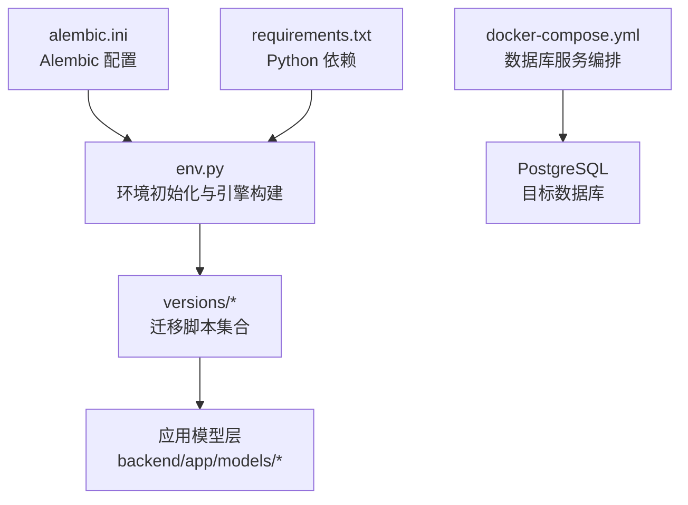
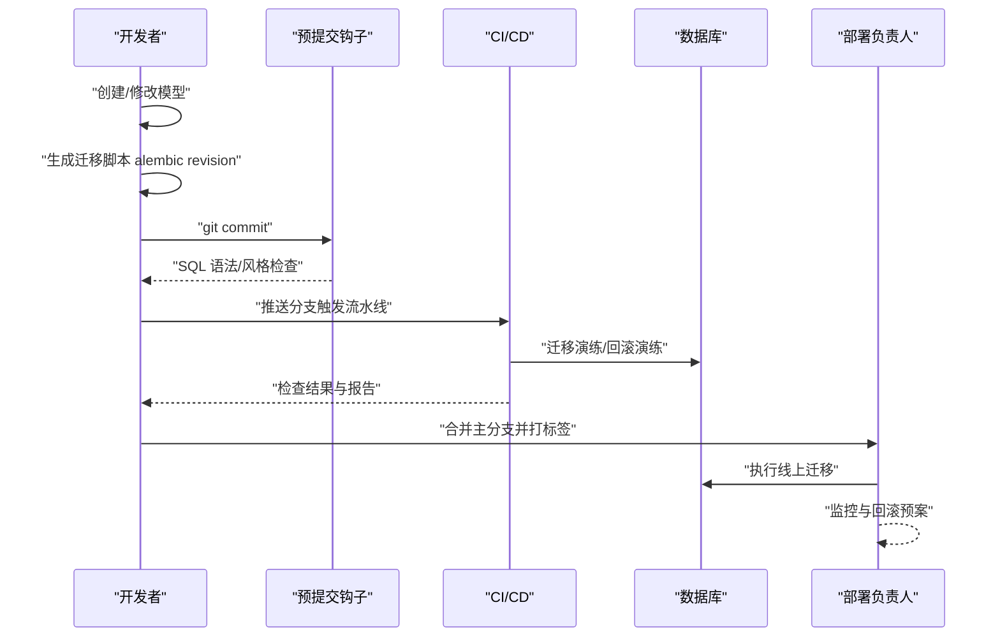
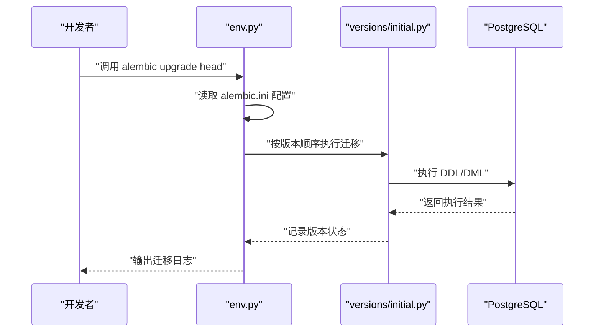
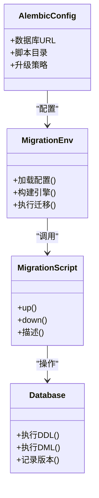
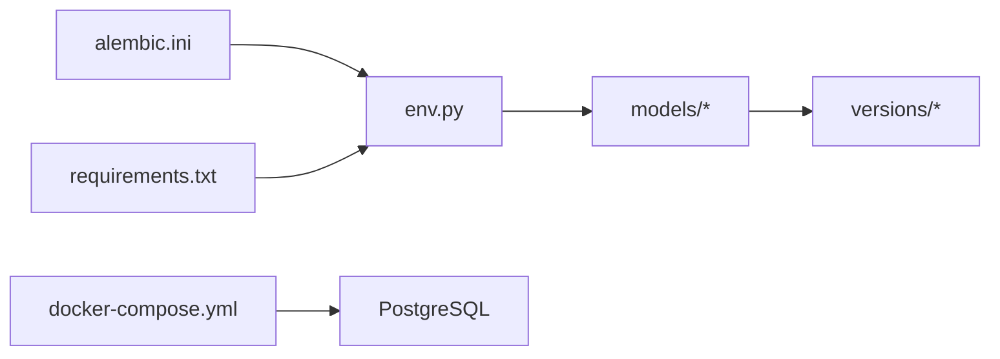

# 团队协作规范

<cite>
**本文引用的文件**   
- [alembic.ini](file://backend/alembic.ini)
- [env.py](file://backend/app/alembic/env.py)
- [script.py.mako](file://backend/app/alembic/script.py.mako)
- [initial.py](file://backend/app/alembic/versions/initial.py)
- [merge_heads.py](file://backend/app/alembic/versions/merge_heads.py)
- [DATABASE_MIGRATION_GUIDE.md](file://DATABASE_MIGRATION_GUIDE.md)
- [docker-compose.yml](file://docker-compose.yml)
- [requirements.txt](file://backend/requirements.txt)
</cite>

## 目录
1. [引言](#引言)
2. [项目结构](#项目结构)
3. [核心组件](#核心组件)
4. [架构总览](#架构总览)
5. [详细组件分析](#详细组件分析)
6. [依赖分析](#依赖分析)
7. [性能考虑](#性能考虑)
8. [故障排查指南](#故障排查指南)
9. [结论](#结论)
10. [附录](#附录)

## 引言
本规范面向小说创作代理系统的数据库迁移协作，聚焦于 Alembic 在团队中的使用方式。文档明确迁移创建者、代码审查者与部署负责人的职责与要求；规定迁移文件的提交规范（提交信息格式、命名约定、变更描述模板）；给出代码审查检查要点（SQL 语法、性能影响、向后兼容、安全漏洞）；提供冲突预防与解决流程（日常同步、预警、快速恢复）；并给出工具链配置建议（预提交钩子、自动化检查、CI/CD 集成），确保迁移可追溯、可回滚、可审计。

## 项目结构
本项目采用后端集中式 Alembic 管理，迁移脚本位于 backend/app/alembic/versions，配置文件 alembic.ini 位于 backend 根目录，环境初始化脚本 env.py 负责连接数据库与导入模型元数据。版本控制以 Git 为主，CI/CD 通过 GitHub Actions 触发相关校验。

图表来源 
- [alembic.ini](file://backend/alembic.ini)
- [env.py](file://backend/app/alembic/env.py)
- [initial.py](file://backend/app/alembic/versions/initial.py)
- [docker-compose.yml](file://docker-compose.yml)
- [requirements.txt](file://backend/requirements.txt)

章节来源
- [DATABASE_MIGRATION_GUIDE.md](file://DATABASE_MIGRATION_GUIDE.md)

## 核心组件
- Alembic 配置与入口
  - alembic.ini：定义数据库 URL、脚本目录、升级策略等。
  - env.py：加载配置、构建 SQLAlchemy 引擎、注册模型元数据、执行迁移上下文。
  - script.py.mako：迁移脚本模板，统一生成头部注释与函数签名。
- 迁移版本管理
  - versions/initial.py：初始迁移，建立基础表结构与索引。
  - versions/merge_heads.py：合并多分支头，保证历史线性化。
- 外部依赖与服务
  - docker-compose.yml：本地/测试环境数据库服务编排。
  - requirements.txt：Alembic、SQLAlchemy 等依赖声明。

章节来源
- [alembic.ini](file://backend/alembic.ini)
- [env.py](file://backend/app/alembic/env.py)
- [script.py.mako](file://backend/app/alembic/script.py.mako)
- [initial.py](file://backend/app/alembic/versions/initial.py)
- [merge_heads.py](file://backend/app/alembic/versions/merge_heads.py)
- [docker-compose.yml](file://docker-compose.yml)
- [requirements.txt](file://backend/requirements.txt)

## 架构总览
下图展示从开发者到生产环境的迁移流水线：开发阶段生成迁移脚本，提交前进行静态检查与 SQL 校验；合并后由 CI 自动运行迁移演练与兼容性测试；发布时由部署负责人执行线上迁移与回滚预案。

[此图为概念流程图，不直接映射具体源码文件]

## 详细组件分析

### 角色与职责分工
- 迁移文件创建者
  - 根据需求或模型变更，生成最小化迁移脚本，确保可逆性（包含 up/down）。
  - 在迁移中避免长事务与锁竞争，优先使用非阻塞 DDL 与分批处理。
  - 编写清晰的变更说明，标注影响范围与风险等级。
- 代码审查者
  - 审查 SQL 语法与语义正确性，评估查询与索引变更对性能的影响。
  - 验证向后兼容性（字段新增默认值、删除列的灰度策略）。
  - 检查潜在安全风险（注入、权限、敏感数据暴露）。
- 部署负责人
  - 制定迁移计划与回滚方案，协调停机窗口或零停机策略。
  - 在预发环境先行验证，记录迁移耗时与资源占用。
  - 上线后持续监控错误率与慢查询，必要时触发回滚。

章节来源
- [DATABASE_MIGRATION_GUIDE.md](file://DATABASE_MIGRATION_GUIDE.md)

### 迁移文件提交规范
- 提交信息格式
  - 类型：feat|fix|refactor|chore|docs|test|ci|db
  - 主题：简明描述变更目的，不超过 50 字符
  - 正文：说明影响范围、兼容性策略、回滚步骤
  - 示例：db: 为表 X 添加字段 Y，含默认值与索引
- 文件命名约定
  - 使用 Alembic 生成的哈希前缀 + 可读描述，如 <hash>_add_y_to_x_table.py
  - 禁止重命名已发布的迁移文件；如需修正，新建迁移并标记废弃
- 变更描述模板
  - 背景与动机
  - 变更内容（DDL/DML）
  - 性能影响与索引策略
  - 向后兼容性与灰度方案
  - 回滚步骤与验证方法

章节来源
- [DATABASE_MIGRATION_GUIDE.md](file://DATABASE_MIGRATION_GUIDE.md)

### 代码审查检查要点
- SQL 语法检查
  - 使用方言无关语法或显式指定方言特性
  - 避免隐式类型转换与跨库差异
- 性能影响评估
  - 大表 DDL 使用在线变更策略
  - 新增索引评估选择性，避免冗余索引
  - 批量 DML 分片提交，减少锁持有时间
- 向后兼容性验证
  - 新增字段设置合理默认值
  - 删除字段先弃用再下线，双写过渡
  - API 与 ORM 层变更与迁移顺序一致
- 安全漏洞检查
  - 防止 SQL 注入与越权访问
  - 敏感字段加密与脱敏策略
  - 权限最小化原则

章节来源
- [DATABASE_MIGRATION_GUIDE.md](file://DATABASE_MIGRATION_GUIDE.md)

### 冲突预防与解决流程
- 日常同步机制
  - 每日拉取主干最新迁移，保持本地分支与主线一致
  - 小步提交，频繁合并，降低冲突概率
- 冲突预警
  - 在 PR 阶段强制运行迁移演练与回滚演练
  - 使用 CI 报告冲突与失败原因
- 快速恢复方案
  - 若迁移失败，立即回滚至上一稳定版本
  - 修复后重新生成迁移并补充回归测试
  - 记录复盘与改进措施

章节来源
- [DATABASE_MIGRATION_GUIDE.md](file://DATABASE_MIGRATION_GUIDE.md)

### 工具链配置
- 预提交钩子
  - 安装 pre-commit 并配置 SQL 语法检查、迁移脚本风格检查
  - 在 commit 前自动运行 lint 与格式化
- 自动化检查
  - CI 中执行 alembic upgrade --dry-run 与 downgrade 演练
  - 生成迁移报告与覆盖率统计
- CI/CD 集成
  - 在合并主分支时触发全量迁移演练
  - 发布流水线包含迁移验证与回滚演练
  - 通知渠道推送结果与告警

章节来源
- [DATABASE_MIGRATION_GUIDE.md](file://DATABASE_MIGRATION_GUIDE.md)

### 关键流程时序图（基于源码映射）

图表来源 
- [env.py](file://backend/app/alembic/env.py)
- [initial.py](file://backend/app/alembic/versions/initial.py)

章节来源
- [env.py](file://backend/app/alembic/env.py)
- [initial.py](file://backend/app/alembic/versions/initial.py)

### 类图（迁移生命周期）

图表来源 
- [alembic.ini](file://backend/alembic.ini)
- [env.py](file://backend/app/alembic/env.py)
- [initial.py](file://backend/app/alembic/versions/initial.py)

章节来源
- [alembic.ini](file://backend/alembic.ini)
- [env.py](file://backend/app/alembic/env.py)
- [initial.py](file://backend/app/alembic/versions/initial.py)

## 依赖分析
- 内部依赖
  - env.py 依赖 alembic.ini 的配置与 models 层的元数据
  - versions/* 依赖 SQLAlchemy 与数据库方言
- 外部依赖
  - PostgreSQL 作为目标数据库
  - Docker Compose 用于本地/测试环境编排
  - Python 包依赖通过 requirements.txt 管理

图表来源 
- [alembic.ini](file://backend/alembic.ini)
- [env.py](file://backend/app/alembic/env.py)
- [docker-compose.yml](file://docker-compose.yml)
- [requirements.txt](file://backend/requirements.txt)

章节来源
- [alembic.ini](file://backend/alembic.ini)
- [env.py](file://backend/app/alembic/env.py)
- [docker-compose.yml](file://docker-compose.yml)
- [requirements.txt](file://backend/requirements.txt)

## 性能考虑
- 大表变更优先使用在线 DDL 与增量索引重建
- 批量更新分片提交，避免长事务与锁竞争
- 迁移前后对比慢查询与执行计划，优化热点路径
- 在预发环境压测迁移耗时与资源占用，设定阈值告警

[本节为通用指导，不直接分析具体文件]

## 故障排查指南
- 常见问题
  - 迁移失败：检查 SQL 语法、权限、锁等待与磁盘空间
  - 回滚失败：确认 down 脚本完整性与数据一致性
  - 性能退化：定位新增索引与查询计划变化
- 排查步骤
  - 查看迁移日志与数据库错误日志
  - 在本地复现并逐步缩小问题范围
  - 使用 EXPLAIN 分析慢查询
  - 必要时回滚并修复后再试
- 预防措施
  - 强化预提交与 CI 检查
  - 完善迁移脚本的 up/down 对称性
  - 建立回滚演练与应急预案

章节来源
- [DATABASE_MIGRATION_GUIDE.md](file://DATABASE_MIGRATION_GUIDE.md)

## 结论
通过明确的职责分工、严格的提交规范、全面的审查要点与完善的工具链配置，团队可在保证数据安全与系统稳定的前提下高效推进数据库演进。建议持续优化迁移演练与回滚能力，形成闭环质量保障体系。

[本节为总结性内容，不直接分析具体文件]

## 附录
- 常用命令参考
  - 生成迁移：alembic revision --autogenerate -m "描述"
  - 升级迁移：alembic upgrade head
  - 回滚迁移：alembic downgrade -1
  - 查看版本：alembic current / history
- 最佳实践清单
  - 每次变更只生成一个迁移
  - 保持 up/down 对称与幂等
  - 避免在生产环境执行交互式操作
  - 记录迁移影响面与回滚步骤

[本节为补充信息，不直接分析具体文件]