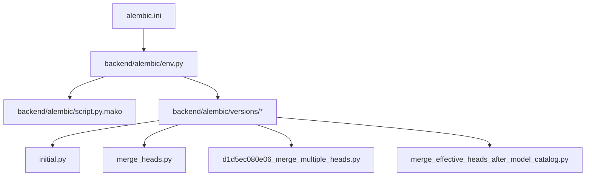
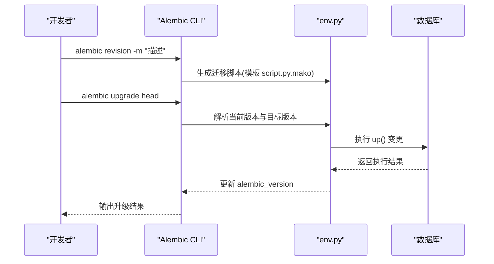
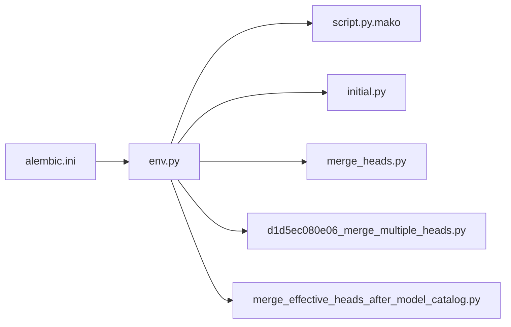

# 版本控制策略

<cite>
**本文引用的文件**   
- [alembic.ini](file://backend/alembic.ini)
- [env.py](file://backend/alembic/env.py)
- [script.py.mako](file://backend/alembic/script.py.mako)
- [initial.py](file://backend/alembic/versions/initial.py)
- [merge_heads.py](file://backend/alembic/versions/merge_heads.py)
- [d1d5ec080e06_merge_multiple_heads.py](file://backend/alembic/versions/d1d5ec080e06_merge_multiple_heads.py)
- [merge_effective_heads_after_model_catalog.py](file://backend/alembic/versions/merge_effective_heads_after_model_catalog.py)
- [DATABASE_MIGRATION_GUIDE.md](file://DATABASE_MIGRATION_GUIDE.md)
</cite>

## 目录
1. [简介](#简介)
2. [项目结构](#项目结构)
3. [核心组件](#核心组件)
4. [架构总览](#架构总览)
5. [详细组件分析](#详细组件分析)
6. [依赖关系分析](#依赖关系分析)
7. [性能考虑](#性能考虑)
8. [故障排查指南](#故障排查指南)
9. [结论](#结论)
10. [附录](#附录)

## 简介
本文件为小说创作代理系统的 Alembic 数据库迁移版本控制策略提供完整规范与实践指南。内容覆盖迁移文件命名、分支与合并策略、冲突检测与处理、生产环境部署流程（预发布检查、灰度发布、回滚）、团队协作规范（代码审查、提交规范、冲突预防），以及迁移历史维护与清理策略（归档、兼容性管理）。目标是确保在多分支并行开发和高并发生产环境下，数据库变更可追溯、可回滚、可审计且一致可靠。

## 项目结构
后端使用 Alembic 进行数据库迁移管理，相关配置与模板位于 backend/alembic 目录，迁移脚本位于 backend/alembic/versions。根目录 alembic.ini 用于全局配置，DATABASE_MIGRATION_GUIDE.md 提供迁移操作指引。

图表来源
- [alembic.ini](file://backend/alembic.ini)
- [env.py](file://backend/alembic/env.py)
- [script.py.mako](file://backend/alembic/script.py.mako)
- [initial.py](file://backend/alembic/versions/initial.py)
- [merge_heads.py](file://backend/alembic/versions/merge_heads.py)
- [d1d5ec080e06_merge_multiple_heads.py](file://backend/alembic/versions/d1d5ec080e06_merge_multiple_heads.py)
- [merge_effective_heads_after_model_catalog.py](file://backend/alembic/versions/merge_effective_heads_after_model_catalog.py)

章节来源
- [DATABASE_MIGRATION_GUIDE.md](file://DATABASE_MIGRATION_GUIDE.md)

## 核心组件
- 配置文件：alembic.ini 定义迁移目录、目标数据库连接、日志级别等；env.py 负责构建 SQLAlchemy 引擎、加载模型元数据、执行上下文的 before_revision/after_revision 钩子；script.py.mako 是迁移脚本的生成模板。
- 迁移脚本：versions 目录下每个 .py 文件代表一个版本，包含 up() 和 down() 方法，描述正向与反向变更。
- 合并脚本：存在多个 merge_* 文件，用于将多分支头合并为单一头，保证版本树线性化。

章节来源
- [alembic.ini](file://backend/alembic.ini)
- [env.py](file://backend/alembic/env.py)
- [script.py.mako](file://backend/alembic/script.py.mako)
- [initial.py](file://backend/alembic/versions/initial.py)
- [merge_heads.py](file://backend/alembic/versions/merge_heads.py)
- [d1d5ec080e06_merge_multiple_heads.py](file://backend/alembic/versions/d1d5ec080e06_merge_multiple_heads.py)
- [merge_effective_heads_after_model_catalog.py](file://backend/alembic/versions/merge_effective_heads_after_model_catalog.py)

## 架构总览
Alembic 在应用启动或独立任务中通过 env.py 初始化迁移环境，读取 alembic.ini 配置，基于 models 元数据生成迁移图，并执行指定版本的 up/down。合并阶段通过 alembic merge 命令将多条分支头合并，避免版本分叉导致的不一致。

图表来源
- [env.py](file://backend/alembic/env.py)
- [script.py.mako](file://backend/alembic/script.py.mako)

## 详细组件分析

### 迁移文件命名规范与版本管理最佳实践
- 命名规范：建议采用“简短英文描述”命名，避免特殊字符与空格，便于阅读与检索。示例见现有迁移文件名风格。
- 版本唯一性：每个迁移必须具有唯一的版本号（由 Alembic 自动生成），禁止手动修改版本号。
- 幂等性与可回滚：up() 与 down() 需成对实现，确保可逆；对不可逆操作（如删除列）需在 down() 中记录说明并提供替代恢复方案。
- 原子性：单个迁移应聚焦单一职责，避免跨模块大变更；必要时拆分为多个小迁移。
- 注释与上下文：在迁移头部添加作者、日期、关联需求编号与变更原因，便于追踪。

章节来源
- [initial.py](file://backend/alembic/versions/initial.py)
- [merge_heads.py](file://backend/alembic/versions/merge_heads.py)
- [d1d5ec080e06_merge_multiple_heads.py](file://backend/alembic/versions/d1d5ec080e06_merge_multiple_heads.py)
- [merge_effective_heads_after_model_catalog.py](file://backend/alembic/versions/merge_effective_heads_after_model_catalog.py)

### 分支策略与合并冲突解决
- 分支策略：以功能或问题修复为单位创建分支，每个分支仅包含与该主题相关的迁移；主分支保持单头线性历史。
- 合并时机：在 PR 合并前完成本地迁移测试与冲突解决；避免在主分支上直接产生多头。
- 冲突检测：使用 alembic heads 查看是否存在多个头；若存在，则需通过 alembic merge 合并。
- 合并步骤：
  1) 确定需要合并的两个头版本；
  2) 运行 alembic merge 生成合并迁移；
  3) 人工校验合并迁移逻辑，确保无重复或遗漏；
  4) 提交合并迁移并推送。

章节来源
- [merge_heads.py](file://backend/alembic/versions/merge_heads.py)
- [d1d5ec080e06_merge_multiple_heads.py](file://backend/alembic/versions/d1d5ec080e06_merge_multiple_heads.py)
- [merge_effective_heads_after_model_catalog.py](file://backend/alembic/versions/merge_effective_heads_after_model_catalog.py)

### 版本标签管理
- 标签策略：每次稳定发布对应一个 Git 标签（如 v1.2.3），并在该标签下锁定数据库迁移集合。
- 标签与迁移一致性：确保标签对应的代码包含所有已上线迁移；禁止在标签后新增未合并的迁移。
- 回滚基线：以最近稳定标签作为回滚基线，结合迁移 down() 实现精确回滚。

章节来源
- [DATABASE_MIGRATION_GUIDE.md](file://DATABASE_MIGRATION_GUIDE.md)

### 多分支开发时的迁移合并方法
- 使用 alembic merge 将两条或多条分支头合并为单一头，避免后续升级出现歧义。
- 冲突处理：当两个分支对同一表或字段有变更时，需在合并迁移中统一顺序与约束，确保最终状态一致。
- 版本一致性保证：合并完成后，再次运行 alembic heads 确认仅有一个头；在 CI 中增加 heads 检查门禁。

章节来源
- [merge_heads.py](file://backend/alembic/versions/merge_heads.py)
- [d1d5ec080e06_merge_multiple_heads.py](file://backend/alembic/versions/d1d5ec080e06_merge_multiple_heads.py)
- [merge_effective_heads_after_model_catalog.py](file://backend/alembic/versions/merge_effective_heads_after_model_catalog.py)

### 生产环境部署流程
- 预发布检查：
  - 运行 alembic check 验证迁移语法与依赖；
  - 在预发环境执行 alembic upgrade head，观察日志与错误；
  - 执行关键业务用例与数据校验脚本。
- 灰度发布：
  - 先对部分实例或只读副本执行迁移，验证无误后再全量升级；
  - 监控数据库锁等待、慢查询与错误率。
- 回滚策略：
  - 优先尝试 alembic downgrade 到上一个稳定版本；
  - 若涉及不可逆变更，需准备数据恢复脚本与备份；
  - 回滚后重新验证服务可用性。

章节来源
- [DATABASE_MIGRATION_GUIDE.md](file://DATABASE_MIGRATION_GUIDE.md)

### 团队协作的迁移管理规范
- 代码审查要求：
  - 迁移变更需经过至少一名资深成员审查；
  - 重点审查 up/down 对称性、索引与约束影响、数据迁移安全性。
- 提交规范：
  - 提交信息需包含迁移目的、影响范围与回滚方案；
  - 关联需求或问题编号，便于追踪。
- 冲突预防：
  - 频繁同步主分支，减少长生命周期分支；
  - 拆分大迁移为小步演进，降低冲突概率。

章节来源
- [DATABASE_MIGRATION_GUIDE.md](file://DATABASE_MIGRATION_GUIDE.md)

### 迁移历史的维护与清理策略
- 旧版本归档：
  - 保留最近 N 个版本的迁移历史，更早版本可归档至独立仓库或文档；
  - 归档时需注明兼容性与回滚限制。
- 兼容性管理：
  - 对向后不兼容的变更，提供过渡期迁移与降级路径；
  - 在 env.py 中通过 before_revision/after_revision 钩子执行兼容性检查。
- 清理原则：
  - 删除无效或重复迁移；
  - 定期整理迁移注释与依赖关系，确保可读性。

章节来源
- [env.py](file://backend/alembic/env.py)
- [DATABASE_MIGRATION_GUIDE.md](file://DATABASE_MIGRATION_GUIDE.md)

## 依赖关系分析
Alembic 的核心依赖包括 alembic.ini 配置、env.py 环境与 versions 下的迁移脚本。合并迁移依赖多个头的版本信息，确保最终版本树收敛。

图表来源
- [alembic.ini](file://backend/alembic.ini)
- [env.py](file://backend/alembic/env.py)
- [script.py.mako](file://backend/alembic/script.py.mako)
- [initial.py](file://backend/alembic/versions/initial.py)
- [merge_heads.py](file://backend/alembic/versions/merge_heads.py)
- [d1d5ec080e06_merge_multiple_heads.py](file://backend/alembic/versions/d1d5ec080e06_merge_multiple_heads.py)
- [merge_effective_heads_after_model_catalog.py](file://backend/alembic/versions/merge_effective_heads_after_model_catalog.py)

章节来源
- [alembic.ini](file://backend/alembic.ini)
- [env.py](file://backend/alembic/env.py)

## 性能考虑
- 迁移粒度：尽量小而精，避免长时间锁表；对大数据表变更采用分批与在线工具。
- 索引与约束：新增索引建议在低峰期执行，必要时使用 CONCURRENTLY（根据数据库支持）。
- 事务边界：合理划分事务，避免过大事务导致回滚成本过高。
- 监控与告警：在迁移过程中监控锁等待、慢查询与错误率，设置阈值告警。

[本节为通用指导，不直接分析具体文件]

## 故障排查指南
- 常见问题：
  - 多头冲突：使用 alembic heads 检查，按合并策略生成合并迁移；
  - 回滚失败：检查 down() 实现与数据依赖，必要时准备手工修复脚本；
  - 环境不一致：确保 alembic.ini 与数据库连接一致，模型元数据同步。
- 诊断步骤：
  - 查看迁移日志与错误堆栈；
  - 在预发环境复现问题；
  - 逐步 down/up 定位问题迁移。

章节来源
- [DATABASE_MIGRATION_GUIDE.md](file://DATABASE_MIGRATION_GUIDE.md)

## 结论
通过严格的命名规范、分支与合并策略、生产部署流程与团队协作规范，结合迁移历史维护与清理策略，可确保小说创作代理系统的数据库变更安全、可控、可回滚。建议持续完善自动化检查与监控，提升迁移质量与效率。

[本节为总结性内容，不直接分析具体文件]

## 附录
- 常用命令参考：
  - 生成迁移：alembic revision -m "描述"
  - 升级：alembic upgrade head
  - 回滚：alembic downgrade <version>
  - 查看头：alembic heads
  - 合并头：alembic merge <rev1> <rev2> -m "合并说明"
- 检查清单：
  - 迁移是否幂等与可回滚；
  - 是否影响性能与锁；
  - 是否通过预发验证；
  - 是否更新文档与注释。

[本节为补充信息，不直接分析具体文件]