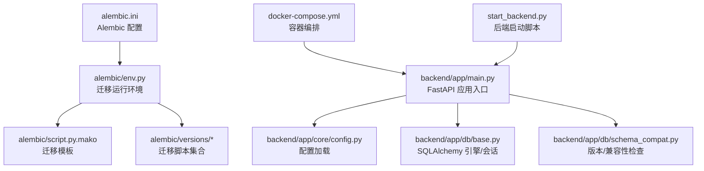
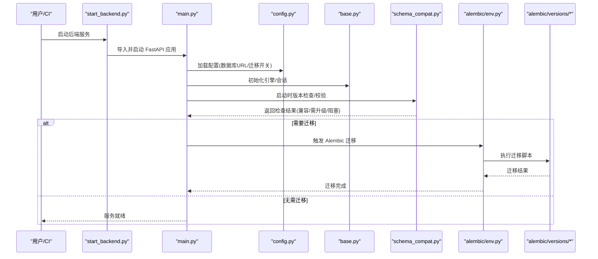
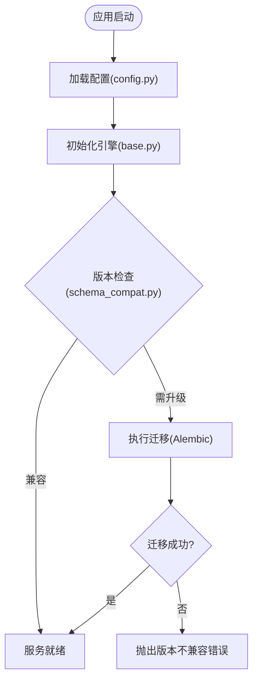
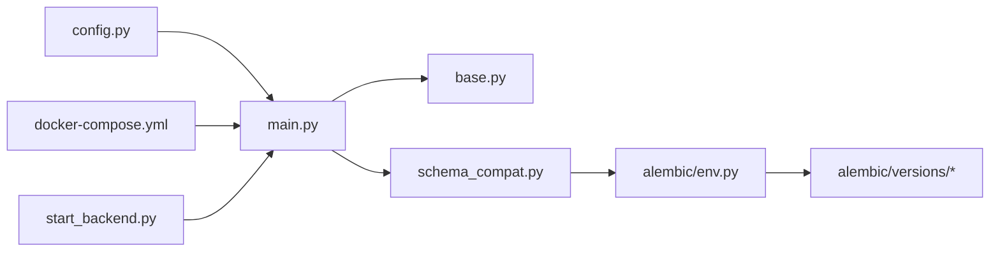
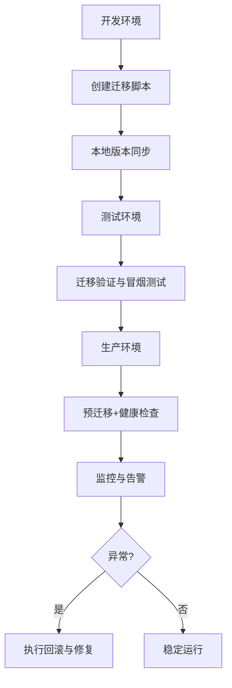

# 版本生命周期管理

<cite>
**本文引用的文件**   
- [alembic.ini](file://backend/alembic.ini)
- [env.py](file://backend/alembic/env.py)
- [script.py.mako](file://backend/alembic/script.py.mako)
- [initial.py](file://backend/alembic/versions/initial.py)
- [merge_heads.py](file://backend/alembic/versions/merge_heads.py)
- [DATABASE_MIGRATION_GUIDE.md](file://DATABASE_MIGRATION_GUIDE.md)
- [docker-compose.yml](file://docker-compose.yml)
- [start_backend.py](file://start_backend.py)
- [main.py](file://backend/app/main.py)
- [config.py](file://backend/app/core/config.py)
- [schema_compat.py](file://backend/app/db/schema_compat.py)
- [base.py](file://backend/app/db/base.py)
</cite>

## 目录
1. [简介](#简介)
2. [项目结构](#项目结构)
3. [核心组件](#核心组件)
4. [架构总览](#架构总览)
5. [详细组件分析](#详细组件分析)
6. [依赖关系分析](#依赖关系分析)
7. [性能考量](#性能考量)
8. [故障排查指南](#故障排查指南)
9. [结论](#结论)
10. [附录](#附录)

## 简介
本文件面向小说创作代理系统的数据库迁移与版本生命周期管理，围绕 Alembic 的迁移版本创建、测试、部署、回滚全流程展开，覆盖开发环境同步、测试环境验证、生产环境发布；同时给出版本标签策略（语义化版本控制、兼容性矩阵、降级支持）、版本检查机制（启动时校验、运行时检查、不兼容错误处理）以及清理与维护策略（旧版本归档、清理脚本、历史查询工具），并补充自动化流程与监控告警配置建议。

## 项目结构
本项目使用 Alembic 进行数据库迁移管理，迁移脚本位于 backend/alembic/versions，配置文件 alembic.ini 位于后端根目录，应用通过 FastAPI 启动并在启动阶段执行必要的版本检查或迁移。

**图表来源** 
- [alembic.ini](file://backend/alembic.ini)
- [env.py](file://backend/alembic/env.py)
- [script.py.mako](file://backend/alembic/script.py.mako)
- [initial.py](file://backend/alembic/versions/initial.py)
- [merge_heads.py](file://backend/alembic/versions/merge_heads.py)
- [main.py](file://backend/app/main.py)
- [config.py](file://backend/app/core/config.py)
- [base.py](file://backend/app/db/base.py)
- [schema_compat.py](file://backend/app/db/schema_compat.py)
- [docker-compose.yml](file://docker-compose.yml)
- [start_backend.py](file://start_backend.py)

**章节来源**
- [alembic.ini](file://backend/alembic.ini)
- [env.py](file://backend/alembic/env.py)
- [script.py.mako](file://backend/alembic/script.py.mako)
- [initial.py](file://backend/alembic/versions/initial.py)
- [merge_heads.py](file://backend/alembic/versions/merge_heads.py)
- [DATABASE_MIGRATION_GUIDE.md](file://DATABASE_MIGRATION_GUIDE.md)
- [docker-compose.yml](file://docker-compose.yml)
- [start_backend.py](file://start_backend.py)
- [main.py](file://backend/app/main.py)
- [config.py](file://backend/app/core/config.py)
- [schema_compat.py](file://backend/app/db/schema_compat.py)
- [base.py](file://backend/app/db/base.py)

## 核心组件
- Alembic 配置与环境
  - alembic.ini：定义数据库连接、迁移目录、目标元数据等。
  - env.py：构建迁移上下文、设置 SQLAlchemy 引擎、导入模型以生成迁移头。
  - script.py.mako：迁移脚本模板，统一生成风格与头部信息。
- 迁移版本
  - initial.py：初始迁移，建立基础表结构与约束。
  - merge_heads.py：合并分支头，确保线性历史。
  - versions/*：按功能演进持续新增的增量迁移。
- 应用集成
  - main.py：应用入口，负责路由注册、中间件、启动钩子。
  - config.py：集中读取环境变量与配置项（如数据库 URL、迁移开关）。
  - base.py：提供 SQLAlchemy 引擎与会话工厂，供迁移与应用共享。
  - schema_compat.py：实现版本/兼容性检查逻辑（启动时校验、运行时检查）。
- 部署与启动
  - docker-compose.yml：编排数据库与服务，便于本地与 CI 环境一致。
  - start_backend.py：后端启动脚本，封装环境变量与启动参数。

**章节来源**
- [alembic.ini](file://backend/alembic.ini)
- [env.py](file://backend/alembic/env.py)
- [script.py.mako](file://backend/alembic/script.py.mako)
- [initial.py](file://backend/alembic/versions/initial.py)
- [merge_heads.py](file://backend/alembic/versions/merge_heads.py)
- [main.py](file://backend/app/main.py)
- [config.py](file://backend/app/core/config.py)
- [base.py](file://backend/app/db/base.py)
- [schema_compat.py](file://backend/app/db/schema_compat.py)
- [docker-compose.yml](file://docker-compose.yml)
- [start_backend.py](file://start_backend.py)

## 架构总览
下图展示从应用启动到数据库版本检查/迁移的关键调用链，以及 Alembic 与 SQLAlchemy 的协作方式。

**图表来源** 
- [start_backend.py](file://start_backend.py)
- [main.py](file://backend/app/main.py)
- [config.py](file://backend/app/core/config.py)
- [base.py](file://backend/app/db/base.py)
- [schema_compat.py](file://backend/app/db/schema_compat.py)
- [env.py](file://backend/alembic/env.py)
- [initial.py](file://backend/alembic/versions/initial.py)
- [merge_heads.py](file://backend/alembic/versions/merge_heads.py)

## 详细组件分析

### Alembic 配置与环境
- alembic.ini
  - 作用：指定数据库连接字符串、迁移目录、目标元数据模块、日志级别等。
  - 关键点：确保 DATABASE_URL 与后端配置一致；启用合适的日志以便调试迁移。
- env.py
  - 作用：构建 Alembic 运行上下文，加载 SQLAlchemy 引擎，导入所有模型以生成迁移头。
  - 关键点：避免在迁移中引入业务逻辑；仅做元数据与迁移执行。
- script.py.mako
  - 作用：迁移脚本模板，统一生成头部注释、revision ID、down_revision 等。
  - 关键点：保持模板稳定，避免破坏现有迁移生成规则。

**章节来源**
- [alembic.ini](file://backend/alembic.ini)
- [env.py](file://backend/alembic/env.py)
- [script.py.mako](file://backend/alembic/script.py.mako)

### 迁移版本管理
- initial.py
  - 作用：首次建库，定义核心表结构与索引。
  - 关键点：字段类型、约束、默认值需与模型保持一致。
- merge_heads.py
  - 作用：合并多分支迁移头，保证线性历史，避免冲突。
  - 关键点：合并后需验证 down_revision 正确性。
- versions/*
  - 作用：按功能迭代新增的增量迁移，命名应体现变更内容。
  - 关键点：每个迁移应具备可逆性（up/down），必要时提供数据回填与清理。

**章节来源**
- [initial.py](file://backend/alembic/versions/initial.py)
- [merge_heads.py](file://backend/alembic/versions/merge_heads.py)

### 应用集成与版本检查
- main.py
  - 作用：应用入口，注册路由、中间件、生命周期钩子。
  - 关键点：在启动阶段调用版本检查或迁移命令。
- config.py
  - 作用：集中读取环境变量（如数据库 URL、是否自动迁移、版本阈值）。
  - 关键点：区分开发与生产行为（例如生产禁用自动迁移）。
- base.py
  - 作用：提供 SQLAlchemy 引擎与会话工厂，供应用与迁移共享。
  - 关键点：连接池、超时、重试策略需合理配置。
- schema_compat.py
  - 作用：实现版本/兼容性检查（启动时校验、运行时检查、不兼容错误处理）。
  - 关键点：明确“向前兼容”与“向后兼容”策略，记录版本差异与修复路径。

**图表来源** 
- [main.py](file://backend/app/main.py)
- [config.py](file://backend/app/core/config.py)
- [base.py](file://backend/app/db/base.py)
- [schema_compat.py](file://backend/app/db/schema_compat.py)

**章节来源**
- [main.py](file://backend/app/main.py)
- [config.py](file://backend/app/core/config.py)
- [base.py](file://backend/app/db/base.py)
- [schema_compat.py](file://backend/app/db/schema_compat.py)

### 部署与启动
- docker-compose.yml
  - 作用：编排数据库与服务，便于本地与 CI 环境一致。
  - 关键点：数据库镜像版本、网络、卷挂载、环境变量一致性。
- start_backend.py
  - 作用：封装后端启动脚本，注入环境变量与启动参数。
  - 关键点：在生产环境禁用自动迁移，改为预迁移+健康检查。

**章节来源**
- [docker-compose.yml](file://docker-compose.yml)
- [start_backend.py](file://start_backend.py)

## 依赖关系分析
- Alembic 与 SQLAlchemy
  - Alembic 通过 env.py 获取 SQLAlchemy 引擎与模型元数据，生成并执行迁移。
- 应用与数据库
  - main.py 通过 base.py 获取连接，schema_compat.py 在启动时进行版本校验。
- 配置与环境
  - config.py 决定行为差异（如是否自动迁移、日志级别、超时）。
- 部署编排
  - docker-compose.yml 统一数据库与服务依赖，确保迁移与运行环境一致。

**图表来源** 
- [config.py](file://backend/app/core/config.py)
- [main.py](file://backend/app/main.py)
- [base.py](file://backend/app/db/base.py)
- [schema_compat.py](file://backend/app/db/schema_compat.py)
- [env.py](file://backend/alembic/env.py)
- [initial.py](file://backend/alembic/versions/initial.py)
- [merge_heads.py](file://backend/alembic/versions/merge_heads.py)
- [docker-compose.yml](file://docker-compose.yml)
- [start_backend.py](file://start_backend.py)

**章节来源**
- [config.py](file://backend/app/core/config.py)
- [main.py](file://backend/app/main.py)
- [base.py](file://backend/app/db/base.py)
- [schema_compat.py](file://backend/app/db/schema_compat.py)
- [env.py](file://backend/alembic/env.py)
- [initial.py](file://backend/alembic/versions/initial.py)
- [merge_heads.py](file://backend/alembic/versions/merge_heads.py)
- [docker-compose.yml](file://docker-compose.yml)
- [start_backend.py](file://start_backend.py)

## 性能考量
- 迁移脚本粒度
  - 将大表变更拆分为多个小迁移，减少锁持有时间。
- 连接池与超时
  - 合理配置连接池大小与超时，避免迁移期间连接耗尽。
- 批量操作
  - 对数据回填使用批量写入，降低 IO 压力。
- 只读副本
  - 在迁移期间将读流量切换到只读副本，降低主库压力。

[本节为通用指导，不直接分析具体文件]

## 故障排查指南
- 常见症状
  - 启动时报版本不兼容：检查 schema_compat.py 的版本校验逻辑与 alembic 当前头。
  - 迁移失败：查看 alembic 日志与数据库错误，确认迁移脚本的可逆性与数据一致性。
  - 生产无法自动迁移：确认 config.py 中的开关与部署脚本是否禁用了自动迁移。
- 定位步骤
  - 查看 alembic 当前版本与 heads：确保无分支头冲突。
  - 检查 alembic.ini 的数据库连接与权限。
  - 核对 schema_compat.py 的版本阈值与兼容性矩阵。
  - 回滚到上一个稳定版本并验证。
- 恢复策略
  - 先回滚再重新迁移；必要时执行数据修复脚本。
  - 在 CI 中增加迁移冒烟测试，提前发现不兼容变更。

**章节来源**
- [DATABASE_MIGRATION_GUIDE.md](file://DATABASE_MIGRATION_GUIDE.md)
- [schema_compat.py](file://backend/app/db/schema_compat.py)
- [alembic.ini](file://backend/alembic.ini)
- [config.py](file://backend/app/core/config.py)

## 结论
通过 Alembic 与应用的紧密集成，本项目实现了从开发到生产的完整版本生命周期管理。建议在以下方面持续完善：
- 强化版本检查机制（启动时与运行时双重校验）。
- 完善兼容性矩阵与降级策略，确保平滑升级。
- 建立自动化迁移流水线与监控告警，提升稳定性与可观测性。

[本节为总结性内容，不直接分析具体文件]

## 附录

### 版本生命周期流程（开发/测试/生产）
- 开发环境
  - 创建迁移：基于模型变更生成迁移脚本，确保 up/down 可逆。
  - 版本同步：本地数据库执行迁移，验证数据一致性。
- 测试环境
  - 版本验证：CI 中执行迁移与冒烟测试，确保兼容性与性能。
  - 回归测试：覆盖关键路径，防止回退问题。
- 生产环境
  - 版本发布：预迁移+健康检查，禁止自动迁移。
  - 回滚支持：保留上一版本迁移脚本与数据修复脚本。

[本图为概念流程图，不映射具体源码文件]

### 版本标签与兼容性策略
- 语义化版本控制
  - 主版本：破坏性变更（需停机或强降级）。
  - 次版本：新功能（向前兼容）。
  - 修订号：缺陷修复（无行为变化）。
- 兼容性矩阵维护
  - 记录各版本间的兼容关系，明确升级路径与限制。
- 版本降级支持
  - 提供 down 迁移与数据修复脚本，确保回滚安全。

[本节为策略说明，不直接分析具体文件]

### 版本检查机制实现要点
- 启动时版本验证
  - 比较应用期望版本与数据库当前版本，不一致则阻止启动或触发迁移。
- 运行时版本检查
  - 在关键路径检查特性开关与数据结构可用性。
- 版本不兼容的错误处理
  - 明确错误码与消息，记录诊断信息，便于快速定位。

**章节来源**
- [schema_compat.py](file://backend/app/db/schema_compat.py)
- [config.py](file://backend/app/core/config.py)

### 版本清理与维护策略
- 旧版本迁移归档
  - 归档不再使用的迁移脚本，保留必要回滚能力。
- 数据库清理脚本
  - 定期清理临时表、过期数据与冗余索引。
- 版本历史查询工具
  - 提供命令行或 API 查询当前版本、heads、迁移历史。

[本节为通用指导，不直接分析具体文件]

### 自动化流程与监控告警
- CI/CD 流水线
  - 代码提交触发迁移生成与验证，失败阻断合并。
- 健康检查
  - 启动后执行轻量迁移检查与健康探针。
- 监控告警
  - 记录迁移耗时、失败率、版本不一致事件，设置阈值告警。

[本节为通用指导，不直接分析具体文件]