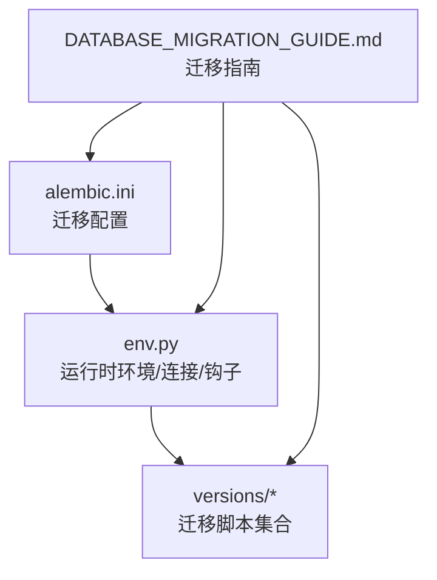
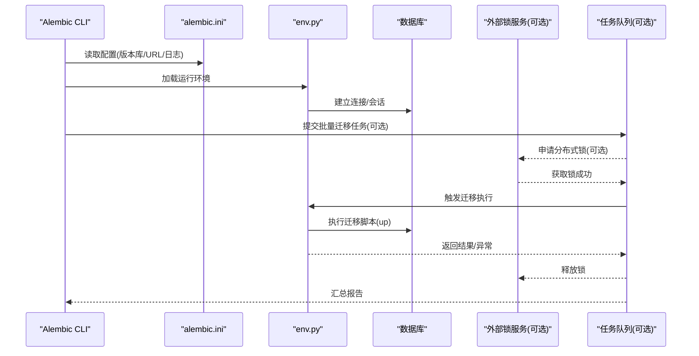
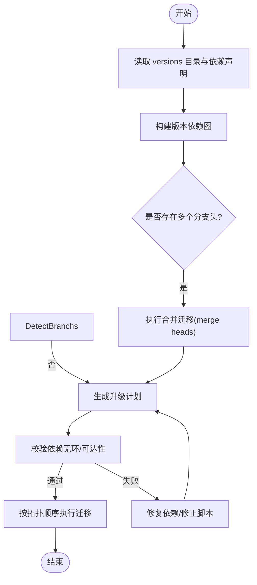

# 批量迁移操作

<cite>
**本文引用的文件**   
- [alembic.ini](file://backend/alembic.ini)
- [env.py](file://backend/alembic/env.py)
- [script.py.mako](file://backend/alembic/script.py.mako)
- [initial.py](file://backend/alembic/versions/initial.py)
- [merge_heads.py](file://backend/alembic/versions/merge_heads.py)
- [DATABASE_MIGRATION_GUIDE.md](file://DATABASE_MIGRATION_GUIDE.md)
</cite>

## 目录
1. [简介](#简介)
2. [项目结构](#项目结构)
3. [核心组件](#核心组件)
4. [架构总览](#架构总览)
5. [详细组件分析](#详细组件分析)
6. [依赖关系分析](#依赖关系分析)
7. [性能考虑](#性能考虑)
8. [故障排查指南](#故障排查指南)
9. [结论](#结论)
10. [附录](#附录)

## 简介
本文件面向小说创作代理系统的数据库迁移工程，聚焦于使用 Alembic 进行批量迁移的完整实践。内容涵盖多环境（开发、测试、生产）差异化配置与执行策略；并发迁移的控制方法（锁机制、队列管理、资源竞争避免）；批量迁移的执行计划制定（依赖关系分析、执行顺序优化、失败重试）；监控与日志收集（进度跟踪、错误告警、性能指标）；回滚策略与灾难恢复方案；以及最佳实践与常见问题解决方案。目标是帮助团队在复杂业务与高并发场景下安全、可控地推进数据库变更。

## 项目结构
本项目采用后端集中式 Alembic 迁移管理，迁移脚本位于 backend/alembic/versions，配置文件 alembic.ini 位于 backend 根目录，运行环境与连接信息通过 env.py 注入。README 与迁移指南提供了整体说明与常用命令参考。

图表来源
- [alembic.ini](file://backend/alembic.ini)
- [env.py](file://backend/alembic/env.py)
- [initial.py](file://backend/alembic/versions/initial.py)
- [DATABASE_MIGRATION_GUIDE.md](file://DATABASE_MIGRATION_GUIDE.md)

章节来源
- [alembic.ini](file://backend/alembic.ini)
- [env.py](file://backend/alembic/env.py)
- [initial.py](file://backend/alembic/versions/initial.py)
- [DATABASE_MIGRATION_GUIDE.md](file://DATABASE_MIGRATION_GUIDE.md)

## 核心组件
- 迁移配置：alembic.ini 定义版本库、脚本模板、目标数据库 URL、日志级别等。
- 运行环境：env.py 负责构建 SQLAlchemy 引擎、设置上下文、注册 before/after 迁移钩子、处理事务与批处理模式。
- 迁移脚本：versions 目录下的每个 .py 文件代表一次迁移，包含 up/down 逻辑与依赖声明。
- 脚本模板：script.py.mako 提供生成迁移文件的默认骨架。
- 文档：DATABASE_MIGRATION_GUIDE.md 提供迁移命令与环境差异建议。

章节来源
- [alembic.ini](file://backend/alembic.ini)
- [env.py](file://backend/alembic/env.py)
- [script.py.mako](file://backend/alembic/script.py.mako)
- [initial.py](file://backend/alembic/versions/initial.py)
- [DATABASE_MIGRATION_GUIDE.md](file://DATABASE_MIGRATION_GUIDE.md)

## 架构总览
下图展示 Alembic 在多环境中的典型调用链与关键控制点：CLI 读取 alembic.ini，env.py 初始化引擎与上下文，versions 中的迁移按依赖顺序执行，必要时通过钩子或外部协调器实现分布式锁与并发控制。

图表来源
- [alembic.ini](file://backend/alembic.ini)
- [env.py](file://backend/alembic/env.py)
- [initial.py](file://backend/alembic/versions/initial.py)

## 详细组件分析

### Alembic 配置与运行环境
- alembic.ini：集中管理版本库路径、脚本模板、目标数据库连接串、日志输出等。不同环境可通过环境变量覆盖数据库 URL、日志级别、批处理开关等。
- env.py：负责创建引擎、设置连接参数、注册 before_revision/after_revision 钩子、处理事务边界与批处理模式。可在钩子中集成锁检查、健康检查、指标上报等。
- script.py.mako：统一迁移文件骨架，便于规范 up/down 结构与注释。

章节来源
- [alembic.ini](file://backend/alembic.ini)
- [env.py](file://backend/alembic/env.py)
- [script.py.mako](file://backend/alembic/script.py.mako)

### 迁移脚本与版本管理
- initial.py：初始迁移，定义基础表结构与索引，作为后续所有迁移的起点。
- merge_heads.py：合并分支头，确保版本图线性化，避免多分支导致的冲突。
- 其他迁移：按需添加，遵循“幂等、可回滚、最小影响”原则，明确依赖关系与数据一致性约束。

章节来源
- [initial.py](file://backend/alembic/versions/initial.py)
- [merge_heads.py](file://backend/alembic/versions/merge_heads.py)

### 多环境差异化处理
- 开发环境：启用详细日志、允许非阻塞式迁移、开启调试钩子。
- 测试环境：隔离数据库实例、快速回滚、并行测试时加细粒度锁。
- 生产环境：严格审批流程、灰度发布、强制分布式锁与审计日志。

章节来源
- [DATABASE_MIGRATION_GUIDE.md](file://DATABASE_MIGRATION_GUIDE.md)

## 依赖关系分析
- 版本依赖：通过迁移脚本中的 revision 与 down_revision 声明依赖关系，Alembic 自动计算执行拓扑。
- 分支合并：当存在多条分支时，先合并再升级，避免循环依赖与不可达版本。
- 外部依赖：如向量库、缓存、对象存储等，应在迁移前完成健康检查与降级策略。

图表来源
- [initial.py](file://backend/alembic/versions/initial.py)
- [merge_heads.py](file://backend/alembic/versions/merge_heads.py)

章节来源
- [initial.py](file://backend/alembic/versions/initial.py)
- [merge_heads.py](file://backend/alembic/versions/merge_heads.py)

## 性能考虑
- 批处理模式：在 env.py 中启用批处理以减少语句开销，适合大表 DDL/DML。
- 连接池与超时：合理设置连接池大小、查询超时、连接回收策略，避免连接耗尽。
- 索引与统计信息：迁移后重建统计信息，减少查询退化。
- 分阶段迁移：将大迁移拆分为小步骤，降低锁持有时间与回滚成本。

[本节为通用指导，不直接分析具体文件]

## 故障排查指南
- 常见错误
  - 版本不一致：检查 alembic_version 与实际版本图是否一致，必要时执行 heads 与 current 对比。
  - 依赖冲突：确认分支已合并，迁移脚本依赖声明正确。
  - 锁争用：检查分布式锁服务状态与锁释放逻辑。
  - 连接失败：验证数据库 URL、权限、网络连通性与连接池配置。
- 定位手段
  - 查看迁移日志与钩子输出，定位失败阶段。
  - 使用 dry-run 模式预演迁移，评估影响范围。
  - 导出当前 schema 快照，对比差异。
- 恢复策略
  - 优先回滚到最近稳定版本。
  - 若无法回滚，基于备份恢复并重新应用迁移。

章节来源
- [DATABASE_MIGRATION_GUIDE.md](file://DATABASE_MIGRATION_GUIDE.md)

## 结论
通过统一的 Alembic 配置与运行环境、严格的版本依赖管理与分支合并策略、结合分布式锁与任务队列的并发控制，可以在多环境下安全高效地完成批量迁移。配合完善的监控、日志与回滚预案，能够显著降低变更风险，保障系统稳定性与可观测性。

[本节为总结性内容，不直接分析具体文件]

## 附录

### 批量迁移执行计划（建议）
- 依赖分析：解析 versions 目录，构建依赖图，识别分支与合并点。
- 执行顺序：按拓扑排序执行，优先独立迁移，最后执行跨模块大迁移。
- 失败重试：对幂等 DDL/DML 支持自动重试，非幂等操作需人工介入。
- 回滚策略：记录每次迁移的快照与元数据，支持一键回滚至指定版本。

### 并发控制策略（建议）
- 锁机制：使用 Redis 或数据库行级锁实现分布式锁，确保同一时刻仅一个迁移进程执行。
- 队列管理：通过 Celery/RQ 等任务队列编排迁移任务，支持优先级与重试。
- 资源竞争：限制并发度，避免同时修改同一表或共享资源。

### 监控与日志（建议）
- 进度跟踪：记录每个迁移阶段的开始/结束时间、影响行数、耗时。
- 错误告警：失败立即通知，附带上下文与堆栈。
- 性能指标：连接池使用率、慢查询、DDL 耗时、锁等待时长。

### 最佳实践
- 迁移脚本幂等：重复执行不改变最终状态。
- 最小变更：只改必要字段与索引，避免大规模重算。
- 灰度发布：先在只读副本或非核心流量上验证。
- 审计留痕：记录执行人、时间、变更摘要与审批单号。

[本节为通用指导，不直接分析具体文件]