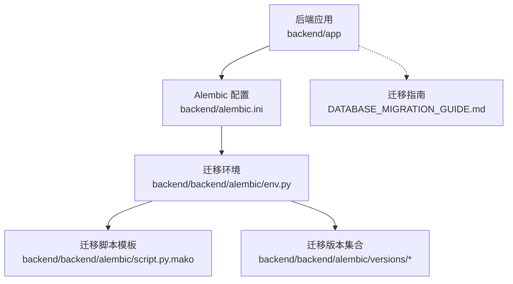
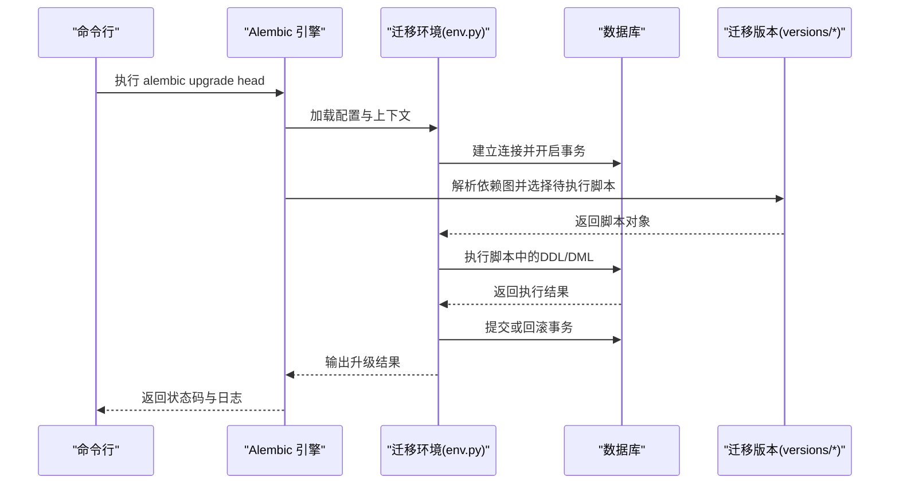
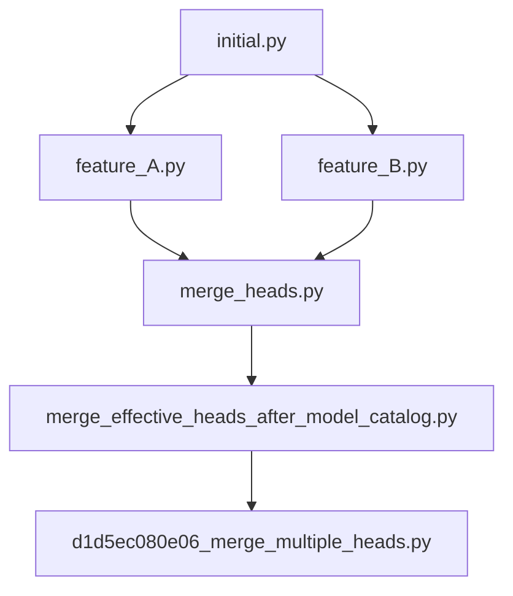

# 迁移升级操作

<cite>
**本文引用的文件**   
- [alembic.ini](file://backend/alembic.ini)
- [env.py](file://backend/backend/alembic/env.py)
- [script.py.mako](file://backend/backend/alembic/script.py.mako)
- [initial.py](file://backend/backend/alembic/versions/initial.py)
- [merge_heads.py](file://backend/backend/alembic/versions/merge_heads.py)
- [merge_effective_heads_after_model_catalog.py](file://backend/backend/alembic/versions/merge_effective_heads_after_model_catalog.py)
- [d1d5ec080e06_merge_multiple_heads.py](file://backend/backend/alembic/versions/d1d5ec080e06_merge_multiple_heads.py)
- [DATABASE_MIGRATION_GUIDE.md](file://DATABASE_MIGRATION_GUIDE.md)
</cite>

## 目录
1. [简介](#简介)
2. [项目结构](#项目结构)
3. [核心组件](#核心组件)
4. [架构总览](#架构总览)
5. [详细组件分析](#详细组件分析)
6. [依赖关系分析](#依赖关系分析)
7. [性能与并发考虑](#性能与并发考虑)
8. [故障排查指南](#故障排查指南)
9. [结论](#结论)
10. [附录](#附录)

## 简介
本文件面向小说创作代理系统的数据库迁移运维，聚焦 Alembic 的升级流程与最佳实践。内容涵盖：
- 使用 alembic upgrade head 升级到最新版本，以及 alembic upgrade +版本号 指定版本升级的方法
- 升级过程中的事务处理机制（自动回滚、错误恢复策略）
- 批量升级与多环境部署策略、并发执行控制
- 升级前准备工作（数据库备份、依赖检查、配置验证）
- 升级过程监控方法与进度查看技巧
- 常见升级错误的诊断与解决方法（版本冲突、依赖缺失等）

## 项目结构
本项目在 backend 目录下集成 Alembic 迁移管理，关键位置如下：
- 根级配置文件：backend/alembic.ini
- 迁移运行环境与脚本模板：backend/backend/alembic/env.py、backend/backend/alembic/script.py.mako
- 迁移脚本集合：backend/backend/alembic/versions/*
- 项目内迁移指南文档：DATABASE_MIGRATION_GUIDE.md

图表来源 
- [alembic.ini](file://backend/alembic.ini)
- [env.py](file://backend/backend/alembic/env.py)
- [script.py.mako](file://backend/backend/alembic/script.py.mako)
- [initial.py](file://backend/backend/alembic/versions/initial.py)
- [DATABASE_MIGRATION_GUIDE.md](file://DATABASE_MIGRATION_GUIDE.md)

章节来源
- [alembic.ini](file://backend/alembic.ini)
- [env.py](file://backend/backend/alembic/env.py)
- [script.py.mako](file://backend/backend/alembic/script.py.mako)
- [initial.py](file://backend/backend/alembic/versions/initial.py)
- [DATABASE_MIGRATION_GUIDE.md](file://DATABASE_MIGRATION_GUIDE.md)

## 核心组件
- Alembic 配置（backend/alembic.ini）
  - 定义数据库连接 URL、迁移脚本目录、日志级别、目标元数据绑定等
  - 用于统一各环境的迁移行为
- 迁移环境（backend/backend/alembic/env.py）
  - 负责加载配置、建立引擎与连接、设置上下文、执行迁移脚本
  - 可结合事务上下文进行迁移执行与回滚
- 迁移脚本模板（backend/backend/alembic/script.py.mako）
  - 生成每个迁移文件的骨架，包含上下文的初始化与事务封装
- 迁移版本集合（backend/backend/alembic/versions/*）
  - 每个 .py 文件代表一次迁移，命名规范通常包含版本号或哈希
  - 包含初始结构与后续演进（如合并头分支、字段变更等）

章节来源
- [alembic.ini](file://backend/alembic.ini)
- [env.py](file://backend/backend/alembic/env.py)
- [script.py.mako](file://backend/backend/alembic/script.py.mako)
- [initial.py](file://backend/backend/alembic/versions/initial.py)
- [merge_heads.py](file://backend/backend/alembic/versions/merge_heads.py)
- [merge_effective_heads_after_model_catalog.py](file://backend/backend/alembic/versions/merge_effective_heads_after_model_catalog.py)
- [d1d5ec080e06_merge_multiple_heads.py](file://backend/backend/alembic/versions/d1d5ec080e06_merge_multiple_heads.py)

## 架构总览
下图展示从命令行到数据库的迁移执行路径，以及与环境配置、迁移脚本的关系。

图表来源 
- [env.py](file://backend/backend/alembic/env.py)
- [script.py.mako](file://backend/backend/alembic/script.py.mako)
- [initial.py](file://backend/backend/alembic/versions/initial.py)

## 详细组件分析

### 命令与用法
- 升级到最新版本
  - 命令：alembic upgrade head
  - 作用：根据当前数据库版本与 versions 目录下的迁移脚本，按依赖顺序执行至最新 head
- 指定版本升级
  - 命令：alembic upgrade +版本号
  - 作用：将数据库升级到指定版本号（若该版本存在且满足依赖关系）
- 常用辅助命令
  - alembic current：查看当前数据库版本
  - alembic history：查看迁移历史与依赖关系
  - alembic check：校验迁移脚本是否存在循环依赖或断裂

章节来源
- [DATABASE_MIGRATION_GUIDE.md](file://DATABASE_MIGRATION_GUIDE.md)

### 事务处理机制与错误恢复
- 事务边界
  - env.py 中通过上下文管理器为每次迁移开启事务，确保 DDL/DML 原子性
  - script.py.mako 生成的迁移脚本默认在事务包裹下执行
- 自动回滚
  - 当迁移脚本抛出异常时，事务自动回滚，保证数据库一致性
- 错误恢复策略
  - 定位失败迁移：使用 alembic history 与 alembic current 对比
  - 修复脚本后重新执行：再次运行 alembic upgrade head 或 alembic upgrade +版本号
  - 强制修正版本标记（谨慎）：仅在确认数据一致时使用 alembic stamp 修正版本记录

章节来源
- [env.py](file://backend/backend/alembic/env.py)
- [script.py.mako](file://backend/backend/alembic/script.py.mako)

### 批量升级与多环境部署
- 批量升级
  - 适用于测试/预发/生产等多环境，建议按环境分别执行 alembic upgrade head
  - 建议在低峰期执行，避免与业务写入竞争
- 并发执行控制
  - 同一数据库实例禁止并发执行迁移，防止锁竞争与版本不一致
  - 多实例只读副本不受影响，但主库必须串行执行
- 推荐流程
  - 先在开发环境验证，再在测试环境灰度，最后在生产环境滚动升级
  - 配合 CI/CD 流水线，确保每次发布前自动执行迁移并校验

章节来源
- [DATABASE_MIGRATION_GUIDE.md](file://DATABASE_MIGRATION_GUIDE.md)

### 升级前准备工作
- 数据库备份
  - 对生产库执行全量备份，确保可快速回滚
- 依赖检查
  - 确认 Python 环境、Alembic 版本、数据库驱动与方言匹配
  - 检查迁移脚本依赖是否完整（外键、索引、约束）
- 配置验证
  - 校验 alembic.ini 中的数据库连接、编码、时区等参数
  - 确认 env.py 中的目标元数据绑定正确

章节来源
- [alembic.ini](file://backend/alembic.ini)
- [env.py](file://backend/backend/alembic/env.py)
- [DATABASE_MIGRATION_GUIDE.md](file://DATABASE_MIGRATION_GUIDE.md)

### 监控方法与进度查看
- 日志级别
  - 在 alembic.ini 中调整日志级别，便于观察执行细节
- 实时查看
  - 使用 alembic history 与 alembic current 对比版本变化
  - 关注数据库锁等待与慢查询，必要时启用数据库审计日志
- 进度提示
  - 迁移脚本中可增加打印语句（谨慎），或在外部脚本包装执行过程

章节来源
- [alembic.ini](file://backend/alembic.ini)
- [DATABASE_MIGRATION_GUIDE.md](file://DATABASE_MIGRATION_GUIDE.md)

### 常见错误与解决
- 版本冲突
  - 现象：多个 head 分支导致无法直接升级
  - 解决：先执行 merge 迁移合并分支，再升级 head
  - 参考：merge_heads.py、merge_effective_heads_after_model_catalog.py、d1d5ec080e06_merge_multiple_heads.py
- 依赖缺失
  - 现象：迁移脚本引用不存在的表或列
  - 解决：检查依赖迁移是否已执行，必要时补充缺失迁移
- 权限不足
  - 现象：创建索引或约束失败
  - 解决：提升数据库用户权限或调整迁移脚本
- 事务异常
  - 现象：部分 DDL 成功、部分失败
  - 解决：回滚后修复脚本，重新执行；必要时使用 alembic stamp 修正版本

章节来源
- [merge_heads.py](file://backend/backend/alembic/versions/merge_heads.py)
- [merge_effective_heads_after_model_catalog.py](file://backend/backend/alembic/versions/merge_effective_heads_after_model_catalog.py)
- [d1d5ec080e06_merge_multiple_heads.py](file://backend/backend/alembic/versions/d1d5ec080e06_merge_multiple_heads.py)
- [DATABASE_MIGRATION_GUIDE.md](file://DATABASE_MIGRATION_GUIDE.md)

## 依赖关系分析
迁移版本的依赖关系由 Alembic 基于脚本头部注释与版本号推断。下图示意典型依赖链与合并场景。

图表来源 
- [initial.py](file://backend/backend/alembic/versions/initial.py)
- [merge_heads.py](file://backend/backend/alembic/versions/merge_heads.py)
- [merge_effective_heads_after_model_catalog.py](file://backend/backend/alembic/versions/merge_effective_heads_after_model_catalog.py)
- [d1d5ec080e06_merge_multiple_heads.py](file://backend/backend/alembic/versions/d1d5ec080e06_merge_multiple_heads.py)

章节来源
- [initial.py](file://backend/backend/alembic/versions/initial.py)
- [merge_heads.py](file://backend/backend/alembic/versions/merge_heads.py)
- [merge_effective_heads_after_model_catalog.py](file://backend/backend/alembic/versions/merge_effective_heads_after_model_catalog.py)
- [d1d5ec080e06_merge_multiple_heads.py](file://backend/backend/alembic/versions/d1d5ec080e06_merge_multiple_heads.py)

## 性能与并发考虑
- 大表 DDL 优化
  - 分步执行：先建索引/约束，再批量更新数据，最后切换
  - 使用在线 DDL（如数据库支持）减少锁时间
- 事务粒度
  - 尽量缩小事务范围，避免长事务阻塞其他会话
- 并发控制
  - 单库串行执行迁移，避免锁争用
  - 读写分离环境下，仅主库执行迁移，副本保持只读

[本节为通用指导，不直接分析具体文件]

## 故障排查指南
- 快速定位
  - 使用 alembic current 与 alembic history 对比差异
  - 检查 alembic.ini 的日志级别，捕获详细执行信息
- 回滚与恢复
  - 优先使用数据库备份恢复
  - 若仅需修正版本标记，谨慎使用 alembic stamp
- 常见问题
  - 版本冲突：先合并分支再升级
  - 依赖缺失：补齐前置迁移或修正脚本
  - 权限问题：提升用户权限或调整迁移脚本

章节来源
- [DATABASE_MIGRATION_GUIDE.md](file://DATABASE_MIGRATION_GUIDE.md)

## 结论
通过规范的 Alembic 迁移流程与严格的并发控制，可在多环境中安全、稳定地推进数据库演进。建议结合 CI/CD 自动化执行与监控，确保每次发布前的迁移可验证、可回滚、可追溯。

[本节为总结性内容，不直接分析具体文件]

## 附录
- 常用命令速查
  - alembic upgrade head：升级到最新版本
  - alembic upgrade +版本号：升级到指定版本
  - alembic current：查看当前版本
  - alembic history：查看迁移历史
  - alembic check：校验迁移依赖
- 参考文档
  - DATABASE_MIGRATION_GUIDE.md：项目内迁移指南

章节来源
- [DATABASE_MIGRATION_GUIDE.md](file://DATABASE_MIGRATION_GUIDE.md)