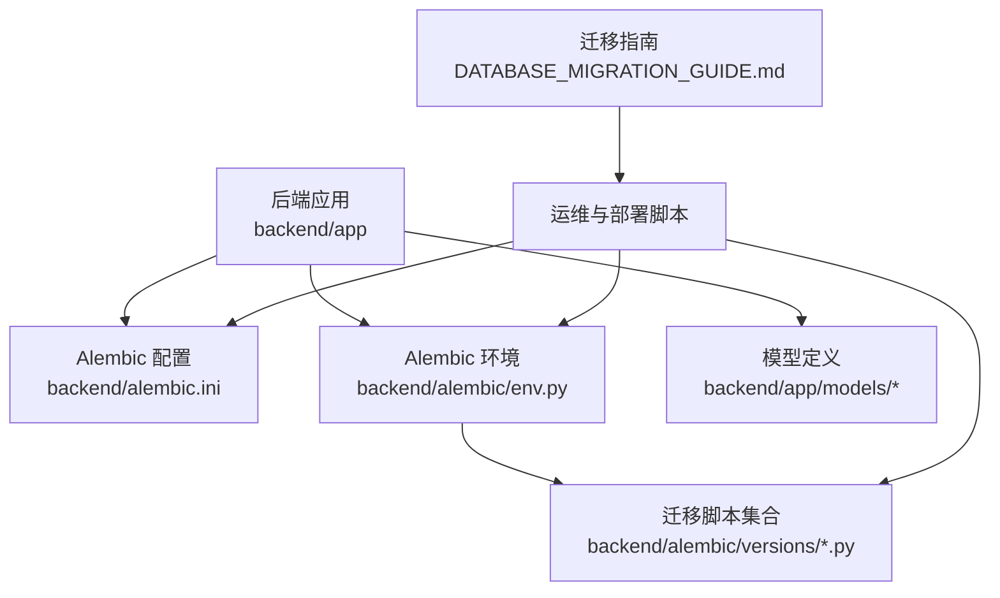
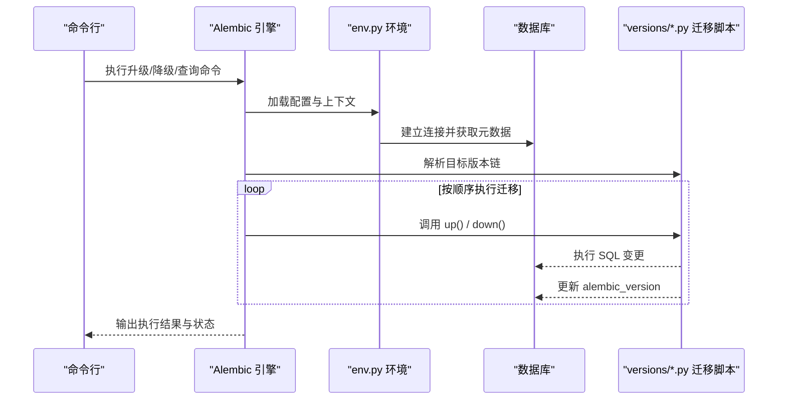
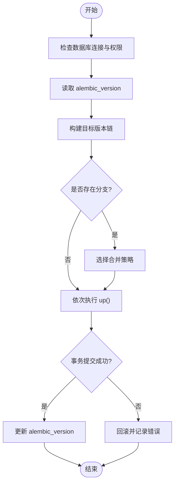
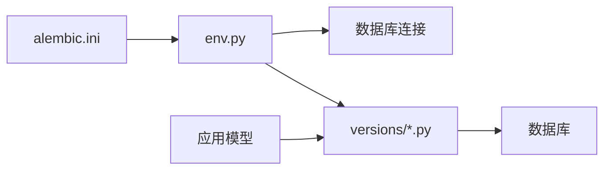

# 迁移执行管理

<cite>
**本文档引用的文件**   
- [alembic.ini](file://backend/alembic.ini)
- [env.py](file://backend/alembic/env.py)
- [script.py.mako](file://backend/alembic/script.py.mako)
- [initial.py](file://backend/alembic/versions/initial.py)
- [merge_heads.py](file://backend/alembic/versions/merge_heads.py)
- [DATABASE_MIGRATION_GUIDE.md](file://DATABASE_MIGRATION_GUIDE.md)
</cite>

## 目录
1. [简介](#简介)
2. [项目结构](#项目结构)
3. [核心组件](#核心组件)
4. [架构总览](#架构总览)
5. [详细组件分析](#详细组件分析)
6. [依赖关系分析](#依赖关系分析)
7. [性能考虑](#性能考虑)
8. [故障排查指南](#故障排查指南)
9. [结论](#结论)
10. [附录](#附录)

## 简介
本文件面向小说创作代理系统的数据库迁移执行管理，聚焦于 Alembic 迁移的完整生命周期与工程化实践。内容涵盖：
- 常用命令与用法：升级到最新版本、指定版本升级、查看当前版本状态
- 迁移执行生命周期：迁移前检查、事务处理、错误恢复机制
- 批量执行策略：多环境部署、并发控制、进度监控
- 最佳实践：备份、回滚计划、验证方法
- 常见错误诊断与解决方法

## 项目结构
本项目在 backend 目录下维护 Alembic 配置与迁移脚本，根目录提供迁移指南文档。关键路径如下：
- 配置文件：backend/alembic.ini
- 运行环境：backend/alembic/env.py
- 模板：backend/alembic/script.py.mako
- 迁移脚本：backend/alembic/versions/*.py（包含初始迁移、合并头分支等）
- 指南文档：DATABASE_MIGRATION_GUIDE.md

**图表来源** 
- [alembic.ini](file://backend/alembic.ini)
- [env.py](file://backend/alembic/env.py)
- [initial.py](file://backend/alembic/versions/initial.py)
- [merge_heads.py](file://backend/alembic/versions/merge_heads.py)
- [DATABASE_MIGRATION_GUIDE.md](file://DATABASE_MIGRATION_GUIDE.md)

**章节来源**
- [alembic.ini](file://backend/alembic.ini)
- [env.py](file://backend/alembic/env.py)
- [initial.py](file://backend/alembic/versions/initial.py)
- [merge_heads.py](file://backend/alembic/versions/merge_heads.py)
- [DATABASE_MIGRATION_GUIDE.md](file://DATABASE_MIGRATION_GUIDE.md)

## 核心组件
- alembic.ini：Alembic 全局配置，包括数据库连接、脚本位置、日志级别等
- env.py：Alembic 运行时环境，负责加载配置、建立连接、设置上下文、执行迁移脚本
- script.py.mako：生成迁移脚本的模板，统一迁移文件的结构与元数据
- versions/*.py：具体迁移脚本，描述数据库结构的变更步骤
- DATABASE_MIGRATION_GUIDE.md：项目级迁移操作指南与注意事项

这些组件共同构成“配置—环境—模板—脚本”的闭环，确保迁移可重复、可追踪、可回滚。

**章节来源**
- [alembic.ini](file://backend/alembic.ini)
- [env.py](file://backend/alembic/env.py)
- [script.py.mako](file://backend/alembic/script.py.mako)
- [initial.py](file://backend/alembic/versions/initial.py)
- [merge_heads.py](file://backend/alembic/versions/merge_heads.py)
- [DATABASE_MIGRATION_GUIDE.md](file://DATABASE_MIGRATION_GUIDE.md)

## 架构总览
下图展示从命令行到数据库的迁移执行链路，以及与环境变量、配置和迁移脚本的交互关系。

**图表来源** 
- [env.py](file://backend/alembic/env.py)
- [initial.py](file://backend/alembic/versions/initial.py)
- [merge_heads.py](file://backend/alembic/versions/merge_heads.py)

## 详细组件分析

### 命令与用法
- 升级到最新版本
  - 命令：alembic upgrade head
  - 作用：将数据库迁移至最新可用版本，自动计算并执行缺失的迁移步骤
- 指定版本升级
  - 命令：alembic upgrade +版本号
  - 作用：将数据库迁移到指定版本，若存在分支需先合并或选择目标分支
- 查看当前版本状态
  - 命令：alembic current
  - 作用：显示当前数据库已应用的迁移版本及与最新版本的差异

建议在执行升级前使用 alembic history 或 alembic heads 确认版本链与目标版本。

**章节来源**
- [DATABASE_MIGRATION_GUIDE.md](file://DATABASE_MIGRATION_GUIDE.md)

### 迁移执行生命周期
- 迁移前检查
  - 校验数据库连接与权限
  - 读取 alembic_version 表确定当前版本
  - 解析目标版本链，识别分支与合并点
- 事务处理
  - 每个迁移脚本通常在一个事务中执行，失败时整体回滚
  - 对于不可回滚的 DDL，需在脚本内显式处理异常与回滚逻辑
- 错误恢复机制
  - 遇到错误立即停止，保持数据库一致性
  - 记录错误日志与堆栈，便于定位问题
  - 支持回滚到上一个稳定版本

**图表来源** 
- [env.py](file://backend/alembic/env.py)
- [initial.py](file://backend/alembic/versions/initial.py)
- [merge_heads.py](file://backend/alembic/versions/merge_heads.py)

**章节来源**
- [DATABASE_MIGRATION_GUIDE.md](file://DATABASE_MIGRATION_GUIDE.md)

### 批量执行与多环境部署
- 多环境策略
  - 开发/测试/预发/生产分别维护独立数据库实例
  - 通过环境变量切换 alembic.ini 中的数据库连接
  - 使用 CI/CD 流水线在每个环境执行相同的迁移命令
- 并发控制
  - 同一数据库实例禁止并发执行迁移，避免版本冲突
  - 使用分布式锁或队列保证串行执行
- 执行进度监控
  - 记录每次迁移的执行时间、版本、操作人
  - 结合日志系统与告警，及时发现问题
  - 对长耗时迁移进行分步上报与断点续跑

**章节来源**
- [DATABASE_MIGRATION_GUIDE.md](file://DATABASE_MIGRATION_GUIDE.md)

### 最佳实践
- 备份策略
  - 升级前对数据库进行全量或增量备份
  - 保留最近 N 次迁移快照，便于快速回滚
- 回滚计划
  - 为每个迁移编写对应的 down() 逻辑
  - 在生产环境执行前，先在非生产环境验证回滚路径
- 验证方法
  - 升级后执行数据一致性校验与业务冒烟测试
  - 对比 schema 与模型定义，确保无漂移
  - 对关键索引与约束进行完整性检查

**章节来源**
- [DATABASE_MIGRATION_GUIDE.md](file://DATABASE_MIGRATION_GUIDE.md)

### 常见错误与诊断
- 版本不一致
  - 现象：提示分支冲突或无法找到目标版本
  - 解决：使用 alembic heads 查看分支，必要时合并后再升级
- 权限不足
  - 现象：创建表或索引失败
  - 解决：提升数据库用户权限或调整迁移脚本的权限需求
- 事务失败
  - 现象：部分 DDL 未生效且未回滚
  - 解决：拆分迁移脚本，确保每个事务内的语句可原子性执行
- 连接超时
  - 现象：迁移过程中连接断开
  - 解决：优化网络与数据库参数，增加重试与超时配置

**章节来源**
- [DATABASE_MIGRATION_GUIDE.md](file://DATABASE_MIGRATION_GUIDE.md)

## 依赖关系分析
Alembic 的依赖关系主要体现在配置、环境与脚本之间：
- alembic.ini 提供数据库连接与脚本路径
- env.py 加载配置、建立连接、设置上下文
- versions/*.py 依赖 env.py 提供的上下文与连接
- 应用模型定义与迁移脚本需保持一致，避免 schema 漂移

**图表来源** 
- [alembic.ini](file://backend/alembic.ini)
- [env.py](file://backend/alembic/env.py)
- [initial.py](file://backend/alembic/versions/initial.py)
- [merge_heads.py](file://backend/alembic/versions/merge_heads.py)

**章节来源**
- [alembic.ini](file://backend/alembic.ini)
- [env.py](file://backend/alembic/env.py)
- [initial.py](file://backend/alembic/versions/initial.py)
- [merge_heads.py](file://backend/alembic/versions/merge_heads.py)

## 性能考虑
- 大表变更
  - 使用在线 DDL 工具或分批迁移，减少锁表时间
  - 对索引重建采用并行与低峰期执行
- 事务粒度
  - 尽量缩小事务范围，避免长时间持有锁
  - 将无关操作移出事务，提高并发度
- 监控与限流
  - 对慢查询与锁等待进行监控
  - 限制迁移执行的并发度，避免影响业务

[本节为通用指导，不直接分析具体文件]

## 故障排查指南
- 定位问题
  - 查看迁移日志与错误堆栈
  - 检查 alembic_version 表与实际 schema 的一致性
- 复现与隔离
  - 在非生产环境复现问题，隔离外部依赖
  - 使用最小化迁移脚本验证问题根因
- 修复与回归
  - 修正迁移脚本或配置后，重新执行并验证
  - 回归测试覆盖关键路径，确保无副作用

**章节来源**
- [DATABASE_MIGRATION_GUIDE.md](file://DATABASE_MIGRATION_GUIDE.md)

## 结论
通过规范化的 Alembic 迁移执行流程，结合完善的备份、回滚与验证策略，可在多环境下安全、可控地推进数据库演进。建议在 CI/CD 中固化迁移步骤，强化监控与告警，确保生产环境的稳定性与可追溯性。

[本节为总结性内容，不直接分析具体文件]

## 附录
- 常用命令速查
  - 升级到最新版本：alembic upgrade head
  - 指定版本升级：alembic upgrade +版本号
  - 查看当前版本：alembic current
  - 查看版本历史：alembic history
  - 查看分支头：alembic heads
- 参考文档
  - 项目迁移指南：DATABASE_MIGRATION_GUIDE.md

**章节来源**
- [DATABASE_MIGRATION_GUIDE.md](file://DATABASE_MIGRATION_GUIDE.md)