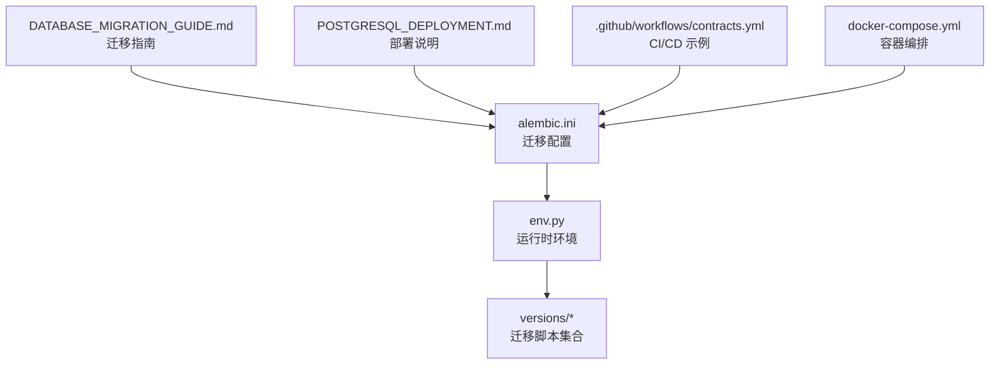
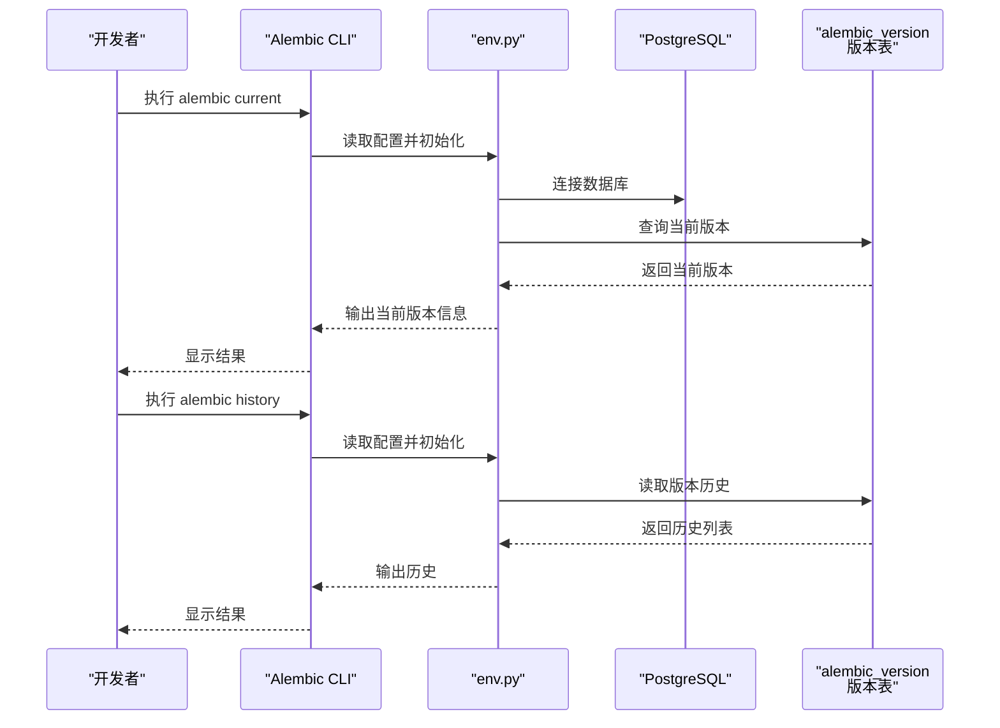
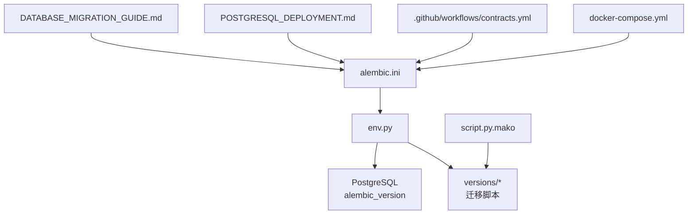

# 迁移状态管理

<cite>
**本文引用的文件**   
- [alembic.ini](file://backend/alembic.ini)
- [env.py](file://backend/alembic/env.py)
- [script.py.mako](file://backend/alembic/script.py.mako)
- [DATABASE_MIGRATION_GUIDE.md](file://DATABASE_MIGRATION_GUIDE.md)
- [POSTGRESQL_DEPLOYMENT.md](file://docs/POSTGRESQL_DEPLOYMENT.md)
- [docker-compose.yml](file://docker-compose.yml)
- [.github/workflows/contracts.yml](file://.github/workflows/contracts.yml)
- [alembic/current_version_migration.py](file://backend/alembic/versions/current_version_migration.py)
- [alembic/history_head_migration.py](file://backend/alembic/versions/history_head_migration.py)
</cite>

## 目录
1. [简介](#简介)
2. [项目结构](#项目结构)
3. [核心组件](#核心组件)
4. [架构总览](#架构总览)
5. [详细组件分析](#详细组件分析)
6. [依赖关系分析](#依赖关系分析)
7. [性能考虑](#性能考虑)
8. [故障排查指南](#故障排查指南)
9. [结论](#结论)
10. [附录](#附录)

## 简介
本文件面向小说创作代理系统的数据库迁移状态管理，聚焦 Alembic 的迁移版本与状态管理。内容涵盖：
- 使用 alembic current 查看当前数据库版本状态
- 使用 alembic history 查看迁移历史
- 识别版本不一致问题（本地与远程差异、分支合并冲突）
- 迁移状态检查最佳实践（自动化脚本、CI/CD 集成）
- 版本冲突解决策略（手动干预、版本重放等）
- 迁移执行状态监控（日志分析、错误追踪、性能监控）
- 常见状态问题的诊断与修复方法

## 项目结构
Alembic 相关配置与迁移位于后端模块中，关键位置如下：
- 配置文件：backend/alembic.ini
- 运行时环境：backend/alembic/env.py
- 模板：backend/alembic/script.py.mako
- 迁移脚本目录：backend/alembic/versions/*
- 部署与文档：docs/POSTGRESQL_DEPLOYMENT.md、DATABASE_MIGRATION_GUIDE.md
- CI/CD 示例：.github/workflows/contracts.yml
- 容器编排：docker-compose.yml

**图表来源**
- [alembic.ini](file://backend/alembic.ini)
- [env.py](file://backend/alembic/env.py)
- [script.py.mako](file://backend/alembic/script.py.mako)
- [DATABASE_MIGRATION_GUIDE.md](file://DATABASE_MIGRATION_GUIDE.md)
- [POSTGRESQL_DEPLOYMENT.md](file://docs/POSTGRESQL_DEPLOYMENT.md)
- [.github/workflows/contracts.yml](file://.github/workflows/contracts.yml)
- [docker-compose.yml](file://docker-compose.yml)

**章节来源**
- [alembic.ini](file://backend/alembic.ini)
- [env.py](file://backend/alembic/env.py)
- [script.py.mako](file://backend/alembic/script.py.mako)
- [DATABASE_MIGRATION_GUIDE.md](file://DATABASE_MIGRATION_GUIDE.md)
- [POSTGRESQL_DEPLOYMENT.md](file://docs/POSTGRESQL_DEPLOYMENT.md)
- [.github/workflows/contracts.yml](file://.github/workflows/contracts.yml)
- [docker-compose.yml](file://docker-compose.yml)

## 核心组件
- 配置层（alembic.ini）：定义数据库连接、迁移脚本路径、目标元数据、升级/降级策略等。
- 运行层（env.py）：加载配置、建立引擎、处理事务上下文、调用迁移脚本。
- 模板层（script.py.mako）：生成新迁移文件的骨架，包含 up/down 方法与注释模板。
- 迁移脚本集（versions/*）：每个文件代表一次数据库变更，包含正向与反向逻辑。
- 文档与部署：DATABASE_MIGRATION_GUIDE.md 提供迁移操作指引；POSTGRESQL_DEPLOYMENT.md 描述数据库部署要点。
- CI/CD：通过 GitHub Actions 在流水线中执行迁移校验或应用。
- 容器编排：docker-compose.yml 用于本地或测试环境快速拉起服务与数据库。

**章节来源**
- [alembic.ini](file://backend/alembic.ini)
- [env.py](file://backend/alembic/env.py)
- [script.py.mako](file://backend/alembic/script.py.mako)
- [DATABASE_MIGRATION_GUIDE.md](file://DATABASE_MIGRATION_GUIDE.md)
- [POSTGRESQL_DEPLOYMENT.md](file://docs/POSTGRESQL_DEPLOYMENT.md)
- [.github/workflows/contracts.yml](file://.github/workflows/contracts.yml)
- [docker-compose.yml](file://docker-compose.yml)

## 架构总览
下图展示了从命令行到数据库的迁移执行流程，以及 Alembic 如何维护版本元数据。

**图表来源**
- [alembic.ini](file://backend/alembic.ini)
- [env.py](file://backend/alembic/env.py)

## 详细组件分析

### 查看当前版本：alembic current
- 作用：显示数据库当前已应用的迁移版本。
- 典型用法：在项目根目录或 backend 目录下执行 alembic current。
- 行为说明：
  - 读取 alembic.ini 中的数据库连接与迁移脚本路径。
  - 通过 env.py 建立引擎并访问 alembic_version 表。
  - 若未找到版本记录，表示数据库尚未初始化。
- 常见问题：
  - 连接失败：检查数据库 URL、权限、网络连通性。
  - 无版本记录：需先执行 alembic upgrade head 初始化。
  - 多实例并发：确保只有一个进程在执行迁移。

**章节来源**
- [alembic.ini](file://backend/alembic.ini)
- [env.py](file://backend/alembic/env.py)

### 查看迁移历史：alembic history
- 作用：列出所有可用迁移及其关系（头节点、分支）。
- 典型用法：alembic history --verbose。
- 行为说明：
  - 扫描 versions/* 目录，构建迁移图。
  - 对比数据库当前版本，标注“已应用”“待应用”。
- 常见问题：
  - 分支头不唯一：需要合并或创建新的合并迁移。
  - 本地与远程不一致：拉取最新代码后重新生成历史视图。

**章节来源**
- [alembic.ini](file://backend/alembic.ini)
- [env.py](file://backend/alembic/env.py)

### 识别版本不一致问题
- 本地与远程差异：
  - 现象：current 显示本地与线上版本不同。
  - 原因：代码未同步、迁移未应用、回滚过迁移。
  - 处理：统一代码版本，按顺序应用缺失迁移。
- 分支合并冲突：
  - 现象：history 出现多个 head，upgrade 报错。
  - 原因：并行开发产生多条分支迁移。
  - 处理：创建合并迁移，将分支头统一到单一 head。
- 版本表损坏：
  - 现象：current 无法解析或报版本冲突。
  - 原因：并发写入、异常中断导致 alembic_version 不一致。
  - 处理：备份后重建版本表或手工修正版本号。

**章节来源**
- [alembic.ini](file://backend/alembic.ini)
- [env.py](file://backend/alembic/env.py)

### 迁移状态检查最佳实践
- 自动化检查脚本：
  - 在启动前执行 alembic current 并与期望版本比对。
  - 对 history 的输出进行断言，确保无多余 head。
- CI/CD 集成：
  - 在流水线中执行 alembic check（如存在）或自定义脚本。
  - 使用只读数据库连接进行状态校验，避免误写。
- 发布门禁：
  - 要求迁移脚本可逆（down 方法完整）。
  - 禁止在生产库直接执行交互式命令。

**章节来源**
- [DATABASE_MIGRATION_GUIDE.md](file://DATABASE_MIGRATION_GUIDE.md)
- [.github/workflows/contracts.yml](file://.github/workflows/contracts.yml)

### 版本冲突解决策略
- 手动干预：
  - 确认冲突分支与目标分支。
  - 编写合并迁移，将两个 head 合并为单一 head。
- 版本重放：
  - 谨慎使用 downgrade/upgrade 指定版本进行重放。
  - 仅用于测试或恢复场景，生产需谨慎评估影响。
- 回滚与恢复：
  - 优先使用 down 方法回滚单步迁移。
  - 若数据已变更，需在迁移中实现幂等与补偿逻辑。

**章节来源**
- [alembic.ini](file://backend/alembic.ini)
- [env.py](file://backend/alembic/env.py)

### 监控迁移执行状态
- 日志分析：
  - 收集 alembic 输出与 Python 日志，定位 SQL 错误。
  - 关注连接超时、锁等待、长事务。
- 错误追踪：
  - 捕获异常堆栈，记录迁移文件名与版本。
  - 对外暴露健康检查接口，返回当前版本与预期版本对比。
- 性能监控：
  - 统计迁移耗时，识别慢查询。
  - 对大表变更采用分批更新与索引优化。

**章节来源**
- [DATABASE_MIGRATION_GUIDE.md](file://DATABASE_MIGRATION_GUIDE.md)
- [POSTGRESQL_DEPLOYMENT.md](file://docs/POSTGRESQL_DEPLOYMENT.md)

### 常见状态问题的诊断与修复
- 无版本记录：
  - 诊断：current 无输出或提示未初始化。
  - 修复：执行 alembic upgrade head。
- 多 head 冲突：
  - 诊断：history 显示多个头节点。
  - 修复：创建合并迁移，消除多 head。
- 版本表不一致：
  - 诊断：current 报版本冲突或解析失败。
  - 修复：备份后重建 alembic_version，或手工修正。
- 迁移不可逆：
  - 诊断：down 方法缺失或不完整。
  - 修复：补充 down 方法，确保可回滚。

**章节来源**
- [alembic.ini](file://backend/alembic.ini)
- [env.py](file://backend/alembic/env.py)

## 依赖关系分析
Alembic 的核心依赖包括配置文件、运行时环境与数据库。下图展示主要依赖关系。

**图表来源**
- [alembic.ini](file://backend/alembic.ini)
- [env.py](file://backend/alembic/env.py)
- [script.py.mako](file://backend/alembic/script.py.mako)
- [DATABASE_MIGRATION_GUIDE.md](file://DATABASE_MIGRATION_GUIDE.md)
- [POSTGRESQL_DEPLOYMENT.md](file://docs/POSTGRESQL_DEPLOYMENT.md)
- [.github/workflows/contracts.yml](file://.github/workflows/contracts.yml)
- [docker-compose.yml](file://docker-compose.yml)

**章节来源**
- [alembic.ini](file://backend/alembic.ini)
- [env.py](file://backend/alembic/env.py)
- [script.py.mako](file://backend/alembic/script.py.mako)
- [DATABASE_MIGRATION_GUIDE.md](file://DATABASE_MIGRATION_GUIDE.md)
- [POSTGRESQL_DEPLOYMENT.md](file://docs/POSTGRESQL_DEPLOYMENT.md)
- [.github/workflows/contracts.yml](file://.github/workflows/contracts.yml)
- [docker-compose.yml](file://docker-compose.yml)

## 性能考虑
- 大表变更：
  - 分批次更新，避免长事务与锁竞争。
  - 合理设计索引，减少全表扫描。
- 并发控制：
  - 迁移期间限制并发写入，必要时加排他锁。
- 资源隔离：
  - 在独立环境中执行迁移，避免与业务负载争抢资源。
- 监控与告警：
  - 记录迁移耗时与 SQL 执行计划，设置阈值告警。

[本节为通用指导，无需特定文件引用]

## 故障排查指南
- 连接失败：
  - 检查数据库 URL、用户名密码、端口与防火墙。
  - 验证 docker-compose 服务是否启动。
- 版本不一致：
  - 对比本地与线上 alembic history 输出。
  - 确认是否存在未合并的分支迁移。
- 迁移失败：
  - 查看日志中的 SQL 错误与约束冲突。
  - 使用 downgrade 回滚到上一个稳定版本。
- 性能问题：
  - 分析慢查询，优化索引与语句。
  - 拆分大迁移为小步骤。

**章节来源**
- [DATABASE_MIGRATION_GUIDE.md](file://DATABASE_MIGRATION_GUIDE.md)
- [POSTGRESQL_DEPLOYMENT.md](file://docs/POSTGRESQL_DEPLOYMENT.md)
- [docker-compose.yml](file://docker-compose.yml)

## 结论
通过规范化的 Alembic 迁移管理与状态检查，可以有效降低数据库变更风险。建议结合自动化脚本与 CI/CD 流程，确保迁移的可重复性与可追溯性。遇到版本冲突时，优先采用合并迁移与幂等设计，避免破坏数据一致性。

[本节为总结性内容，无需特定文件引用]

## 附录
- 常用命令速查：
  - alembic current：查看当前版本
  - alembic history：查看迁移历史
  - alembic upgrade head：升级到最新版本
  - alembic downgrade -1：回退一步
  - alembic revision --autogenerate：自动生成迁移
- 参考文档：
  - DATABASE_MIGRATION_GUIDE.md：迁移操作指南
  - POSTGRESQL_DEPLOYMENT.md：数据库部署说明
  - .github/workflows/contracts.yml：CI/CD 示例

**章节来源**
- [DATABASE_MIGRATION_GUIDE.md](file://DATABASE_MIGRATION_GUIDE.md)
- [POSTGRESQL_DEPLOYMENT.md](file://docs/POSTGRESQL_DEPLOYMENT.md)
- [.github/workflows/contracts.yml](file://.github/workflows/contracts.yml)